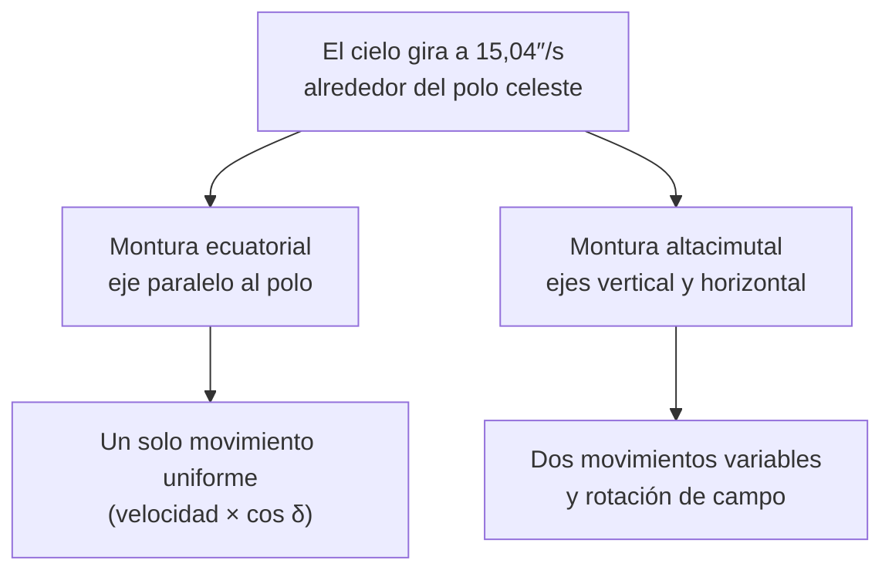

# B08-C15 — Monturas y seguimiento inicial

<!-- nav:top -->
[🏠 Programa](../../../../README.md) · [📚 Bloque B08](../../../tronco-comun/B08-observacion-del-cielo-y-astronomia-practica.md) · [← Anterior: B08-C14 — Telescopios de iniciación](../B08-C14-telescopios-de-iniciacion/CLASE.md) · [Siguiente: B08-C16 — Observación solar con filtros certificados →](../B08-C16-observacion-solar-con-filtros-certificados/CLASE.md)
<!-- /nav -->

## 1. Ubicación, nivel y alcance

Decimoquinta clase del bloque B08. Un telescopio sin montura estable es solo un tubo; y el cielo se mueve. Aquí aprendes **qué hace una montura**, por qué los objetos se escapan del campo y cómo calcular la velocidad con que hay que seguirlos. Nivel N1.

Verás montura altacimutal y ecuatorial, el ritmo del cielo (15 segundos de arco por segundo), cuánto tardan los objetos en salir del campo, la alineación polar en el hemisferio sur y los límites del seguimiento manual. No verás fotografía de larga exposición (C19) ni control automático (B16).

## 2. Por qué esta clase existe

A 120 aumentos, un planeta cruza el ocular en menos de dos minutos y tienes que empujar el tubo constantemente. La pregunta motivadora: **¿qué montura necesito y qué error puedo tolerar al seguir un objeto?** La decisión central: **elegir entre seguir a mano o con motor, y entre altacimutal o ecuatorial, a partir de cuánto tiempo necesitas el objeto quieto en el campo**.

## 3. Lo que podrás hacer al terminar

1. Describir las dos monturas básicas, el eje que mueve cada una y su ventaja principal.
2. Calcular la velocidad sidérea de seguimiento y su dependencia de la declinación.
3. Calcular cuánto tarda un objeto en cruzar un campo dado sin seguimiento.
4. Estimar el efecto de un error de alineación polar.
5. Explicar por qué una montura altacimutal tiene problemas cerca del cenit.
6. Planificar un seguimiento inicial con alternativas manuales y accesibles.

La evidencia es el **plan de seguimiento** del ejercicio 12.

## 4. Con qué llegas y cómo comprobarlo

1. ¿A qué altura está el polo sur celeste en tu lugar (C02)? 2. ¿Cuántos grados gira el cielo por hora (C05)? 3. ¿Cuántos segundos de arco son 0,5°? 4. ¿Qué es el campo real de un ocular (C14)? 5. ¿Qué recomienda NASA sobre los telescopios computarizados (C14)?

<details><summary>Ver respuestas</summary>

1. Tu latitud, sin signo. 2. ≈ 15,04° (por el día sidéreo, C05). 3. 1800″. 4. El ángulo de cielo que abarca el ocular, `campo aparente / M`. 5. Que son más difíciles para quien no conoce el cielo, porque exigen conocerlo para ponerlos a punto; los manuales suelen ser más fáciles (S2).
</details>

Con cuatro o cinco aciertos, sigue; con tres o menos, repasa C02, C05 y C14.

## 5. Un caso real: perseguir a Saturno con un Dobson de 200 mm

Retomas el 5 de noviembre de 2025 en el Elqui. Esa noche Saturno estaba a 61,6° de altura al anochecer astronómico (C10). Con el Dobson de 200 mm, f/6, y un ocular de 10 mm ves a 120 aumentos un campo real de 0,42° (C14). Sin seguimiento, Saturno cruza ese campo en menos de dos minutos. NASA recuerda que los Dobson son reflectores sobre una montura simple, fáciles de transportar y comenzar a usar (S2); su costo es que hay que empujarlos a mano. Esta clase calcula cuánto y con qué ritmo.

## 6. Vocabulario

Una **montura** sostiene el telescopio y permite apuntarlo. La **altacimutal** tiene un eje vertical (acimut) y uno horizontal (altura); la **ecuatorial** tiene un eje (de **ascensión recta**) paralelo al eje de la Tierra y otro (de **declinación**) perpendicular. El **seguimiento sidéreo** es el movimiento que compensa el giro del cielo: `Ω = 360° / 23,9345 h = 15,041″/s` (S1). La **alineación polar** es apuntar el eje de ascensión recta al polo celeste (el polo sur, en Chile). La **rotación de campo** es el giro de la imagen que sufre una montura altacimutal al seguir un objeto. Una montura **motorizada** o con **GoTo** apunta y sigue con motores; **push-to** guía sin motores.

## 7. Modelo mental: dos maneras de acompañar al cielo

El cielo gira alrededor del polo. Una montura ecuatorial gira sobre un eje paralelo al de la Tierra: con un solo movimiento uniforme sigue cualquier objeto. Una altacimutal debe mover dos ejes a velocidades que cambian con la posición del objeto.



*Descripción textual:* el giro del cielo se sigue con un solo movimiento uniforme en una montura ecuatorial alineada, mientras que en una altacimutal hay que mover dos ejes a velocidades variables y la imagen gira.

**Analogía y su límite.** Acompañar a alguien que camina en círculo: puedes girar con él (ecuatorial) o caminar en línea recta ajustando a cada paso (altacimutal). Falla porque el eje ecuatorial exige apuntar con precisión al polo, y esa alineación se estropea al mover el trípode.

## 8. La explicación, paso a paso

### 8.1 El ritmo del cielo

Con el día sidéreo de 23,9345 h (S1), `Ω = 360 × 3600 / (23,9345 × 3600) = 15,041″/s`, es decir, 902,5″ por minuto. Para un objeto de declinación `δ`, el recorrido aparente se reduce a `Ω cos δ`: en el ecuador celeste, 15,04″/s; a `δ = −30°`, 13,03″/s; a `δ = −60°`, 7,52″/s; cerca del polo (`δ = −85°`), 1,31″/s (laboratorio). Un campo de 0,42° (1512″) se cruza en `1512/15,04 = 100 s` en el ecuador y en `116 s` a `δ = −30°`.

**Pausa.** Con un campo real de 0,5° (1800″), ¿cuánto tarda en cruzarse a `δ = −60°`? <details><summary>Respuesta</summary>`1800/7,52 = 239 s`, unos 4 minutos.</details>

### 8.2 Montura ecuatorial y alineación polar

Si el eje de ascensión recta apunta exactamente al polo celeste, un motor a velocidad `Ω` mantiene cualquier objeto fijo en el campo. En el hemisferio sur, el eje debe elevarse a una altura igual a la latitud: 30° en el valle del Elqui (C02), hacia el sur verdadero (C01). No hay una estrella polar austral brillante que lo señale (afirmación general no consultada en una fuente de esta clase); se puede hallar el sur con la Cruz del Sur (C01), con la brújula y la declinación (C01) o con un buscador de polo; el método de «deriva» queda para más adelante. Un error `ε` en la alineación produce una deriva máxima en declinación de `Ω · ε`: 0,03″/s con 0,1° de error, 0,26″/s (15,8″ por minuto) con 1° (laboratorio, verificado por simulación).

### 8.3 Montura altacimutal

Con fórmulas esféricas (C04) se obtiene que la altura cambia a `dh/dt = Ω cos φ sen A` y el acimut a `dA/dt = Ω (sen φ − cos φ tan h cos A)`. A `φ = −30°`: para la Luna a las 04:00 UT del 5 de noviembre (altura 42,3°, acimut 359,7°), `dh/dt ≈ −0,07″/s` (está en el meridiano, en su máximo) y `dA/dt = −19,4″/s` (en acimut; sobre el cielo son `19,4 · cos 42,3° = 14,3″/s`). Un objeto a 85° de altura y acimut 100° pide `+12,8″/s` en altura y `+18,3″/s` en acimut; cerca del cenit, `tan h` crece sin límite y el acimut debe cambiar muy rápido: la montura altacimutal pierde el objeto («agujero del cenit»). Además, la imagen gira (rotación de campo), irrelevante a ojo pero grave para fotografiar (C19).

### 8.4 Seguir a mano

Con un Dobson, se empuja el tubo cada minuto: aprovecha que el objeto entra por un lado del campo y sale por el otro. Ponlo en el borde por donde entra para ganar tiempo. Mueve en pasos pequeños y estables. NASA recomienda empezar con instrumentos manuales, que son más fáciles que los computarizados para quien aún no conoce el cielo (S2). Para un grupo, un motor sidéreo facilita compartir el objeto; para las personas con poca fuerza, una montura equilibrada y una barra de empuje ayudan.

## 9. Magnitudes, símbolos y unidades

| Símbolo | Qué es | Unidad | Nota |
|---|---|---|---|
| `Ω` | velocidad angular del cielo | ″/s | 15,041 |
| `δ` | declinación | ° | `Ω cos δ` |
| `ε` | error de alineación polar | ° | deriva máxima `Ω ε` |
| `dh/dt`, `dA/dt` | tasas en altura y acimut | ″/s | altacimutal |
| `t_cruce` | tiempo de cruce de un campo | s | `campo / (Ω cos δ)` |

## 10. Convenciones y referencias

Acimut desde el norte hacia el este (C01). Las tasas se dan en segundos de arco por segundo de tiempo. La velocidad sidérea usa el día sidéreo de la NASA (23,9345 h); el valor del modelo de C05 es 23,93447 h (diferencia despreciable aquí). Los resultados valen para estrellas; la Luna y los planetas se mueven además respecto de las estrellas (≈ 0,6″/s la Luna, C03).

## 11. De dónde sale lo que afirmamos

| ID | Fuente | Localizador | Respalda | Consulta | Estado |
|---|---|---|---|---|---|
| S1 | NASA NSSDC, *Earth Fact Sheet* (act. 15-nov-2024) | https://nssdc.gsfc.nasa.gov/planetary/factsheet/earthfact.html | Rotación sidérea 23,9345 h | 2026-11-05 | Página leída |
| S2 | Night Sky Network, «How to Choose a First Telescope» (dic-2020) | https://nightsky.jpl.nasa.gov/news/321/ | Dobson: reflector con montura simple; manuales más fáciles que computarizados; clubes; no trata altacimutal vs ecuatorial | 2026-11-05 | Página leída |
| S3 | NASA SVS 5415 (JPL DE421) | https://svs.gsfc.nasa.gov/5415/ ; `mooninfo_2025.txt` | Movimiento de la Luna (≈ 0,63°/h), posición del 5-nov-2025 | 2026-11-05 | Datos leídos |
| S4 | Cálculo propio y laboratorio `seguimiento.py` | este repositorio | Fórmulas de tasas verificadas por diferencias finitas y simulación | 2026-11-05 | Ejecutado |

Límites: la teoría de monturas (alineación por deriva, rotación de campo, errores periódicos) no se contrastó con una fuente publicada; solo se verificaron numéricamente las fórmulas deducidas aquí. No se consultaron especificaciones de monturas comerciales ni a NASA sobre altacimutal vs ecuatorial.

## 12. Cómo ver (o sentir) el seguimiento

Tabla de tiempos de cruce de un campo de 0,5° (1800″):

| Declinación | Tasa (″/s) | Tiempo de cruce |
|---|---|---|
| 0° | 15,04 | 120 s |
| −30° | 13,03 | 138 s |
| −60° | 7,52 | 239 s |
| −85° | 1,31 | 1374 s (23 min) |

Sin ver: un reloj con aviso sonoro cada 60 s y un indicador táctil de la dirección en que se mueve el objeto dentro de tu campo (depende de la óptica del instrumento: compruébala de día con un objeto lejano y fijo, nunca con el Sol).

## 13. Ejemplo trabajado: Saturno a 120 aumentos

Saturno tiene declinación aproximada de −3° (valor de efeméride no consultado; se usa solo para el orden de magnitud), así que su velocidad es `≈ 15,0″/s` (ecuatorial). Con el campo de 0,42° (1512″) del Dobson de 200 mm y un ocular de 10 mm, tarda `1512/15,0 ≈ 100 s` en cruzarlo. Si empujas el tubo cada 60 s mantienes el planeta en el campo; con motor, indefinidamente. **Paso final · incertidumbre.** La velocidad en declinación es un cálculo seguro; la declinación de Saturno es un dato sin fuente aquí, y el tiempo de cruce cambia solo 1,4 % para ±10° de declinación. El seguimiento manual real añade segundos de incertidumbre por el tiempo de reacción.

## 14. Comparación de monturas

La **altacimutal** (como el Dobson) es simple, liviana y fácil de aprender, pero exige empujes frecuentes y tiene rotación de campo. La **ecuatorial** sigue con un solo movimiento y sirve para exposiciones largas, pero pesa más y exige alineación polar. Un motor sidéreo en una ecuatorial alineada da seguimiento continuo; en una altacimutal motorizada, el sistema calcula dos movimientos. Para la primera noche, lo manual basta (S2).

## 15. Práctica guiada

**Ejercicio 1.** Calcula `Ω` en ″/s y en ″/min con 23,9345 h. *Pasos:* 8.1.

<details><summary>Solución comentada</summary>

`Ω = 360 × 3600 / (23,9345 × 3600) = 15,041″/s`; por minuto, `902,5″`.
</details>

**Ejercicio 2.** ¿Cuánto tarda un objeto del ecuador celeste en cruzar un campo de 0,5°?

<details><summary>Solución comentada</summary>

`1800 / 15,04 = 120 s`.
</details>

**Ejercicio 3.** ¿A qué altura debe quedar el eje de ascensión recta en tu lugar y hacia dónde? (usa `φ = −30°`) *Pasos:* 8.2.

<details><summary>Solución comentada</summary>

A 30° sobre el horizonte, hacia el sur verdadero (el polo sur celeste, C02).
</details>

## 16. Práctica autónoma, transferencia e integrador

**Ejercicio 4.** ¿Qué velocidad de seguimiento necesita un objeto de `δ = −30°`? ¿Y cuánto tarda en cruzar 0,42°?

<details><summary>Solución comentada</summary>

`15,041 × cos 30° = 13,03″/s`; `1512 / 13,03 = 116 s`.
</details>

**Ejercicio 5.** Con un error de alineación polar de 0,5°, ¿qué deriva máxima en declinación se produce en 10 minutos?

<details><summary>Solución comentada</summary>

`Ω ε = 15,041 × 0,5 × π/180 = 0,131″/s`; en 600 s son `78,7″`, es decir, 1,3′, algo más de lo que cabe en un campo de alta resolución pero pequeño frente a 0,42°.
</details>

**Ejercicio 6.** Calcula `dA/dt` en altura 85°, acimut 100°, latitud −30°. ¿Es mayor o menor que `Ω`? *Pista:* 8.3.

<details><summary>Solución comentada</summary>

`15,041 × (−0,5 − 0,866 × 11,43 × (−0,1736)) = 15,041 × (−0,5 + 1,718) = 18,3″/s`: mayor que Ω (15,04). A 89° sube a ≈ 122″/s.
</details>

**Ejercicio 7.** ¿Por qué el cenit es un problema para la montura altacimutal?

<details><summary>Solución comentada</summary>

Porque el acimut cambia con rapidez creciente al acercarse al cenit (`tan h → ∞`), por encima de lo que pueden dar los motores o el empuje manual.
</details>

**Ejercicio 8.** La Luna se mueve ≈ 0,63°/h respecto de las estrellas (S3). ¿Cuántos ″/s es? ¿Importa para seguirla a mano un minuto?

<details><summary>Solución comentada</summary>

`0,63 × 3600 / 3600 = 0,63″/s`; en 60 s son `38″`, mucho menos que un campo de 1512″: no importa a mano; sí importaría en exposiciones largas.
</details>

**Ejercicio 9 · transferencia.** Un amigo propone comprar un telescopio computarizado para su hija de 8 años. ¿Qué le sugieres según lo consultado?

<details><summary>Solución comentada</summary>

Que empiece por binoculares o un Dobson manual, aprenda el cielo y pruebe instrumentos en un club antes de gastar; los computarizados exigen conocer el cielo para alinearlos (S2).
</details>

**Ejercicio 10 · transferencia.** Quieres alinear una montura ecuatorial en el Elqui. Describe el procedimiento y el error esperado de cada paso.

<details><summary>Solución comentada</summary>

Elevar el eje a 30°, apuntar al sur verdadero con la brújula corregida por declinación (error de varios grados, C01) o con la Cruz del Sur (error de unos grados); luego, si hay un buscador de polo o una cámara, afinar. Cada etapa debe tener su incertidumbre declarada; con 1° se tienen 15,8″ por minuto de deriva.
</details>

**Ejercicio 11 · transferencia.** Diseña una ayuda de seguimiento para una persona ciega que acompaña a un compañero que describe lo que ve.

<details><summary>Solución comentada</summary>

Un cronómetro sonoro que marca cada 60–90 s «mover el tubo hacia el oeste», un tope táctil o círculo graduado que indique cuánto empujar (≈ 1,25° en 5 min) y la descripción hablada de la imagen. Se acompaña de una práctica con el objeto fijo en el día (nunca el Sol).
</details>

**Ejercicio 12 · integrador.** Elabora un **plan de seguimiento**: instrumento y campo real, un objeto con su declinación (fuente), tasa y tiempo de cruce, método (manual o motor) y frecuencia de empuje, error de alineación esperado y una alternativa sin telescopio.

<details><summary>Solución modelo</summary>

El plan usa `Ω cos δ`, calcula el tiempo de cruce, declara supuestos, cita S1 y S2 y ofrece una alternativa de club o de datos abiertos. Se valora cuantificar la deriva por alineación.
</details>

## 17. Laboratorio: [`seguimiento.py`](seguimiento.py)

**Objetivo.** Calcular tasas de seguimiento y comprobar fórmulas contra métodos independientes. **Datos:** rotación sidérea publicada; resultados simulados. **Procedimiento:** `python seguimiento.py`; las pruebas comparan las fórmulas altacimutales con diferencias finitas y la deriva polar con una simulación de rotación. **Resultados reales (Python 3.12.9):**

```text
Omega = 15.0410 arcsec/s = 902.5 arcsec/min
Ecuatorial: dec 0: 15.04 | dec -30: 13.03 | dec -60: 7.52 | dec -85: 1.31 arcsec/s
Altacimutal lat -30: alt 42.3 az 359.7: dh/dt = -0.07, dA/dt = -19.37 | alt 20 az 90: +13.03, -7.52 |
  alt 60 az 180: 0.00, +15.04 | alt 85 az 100: +12.83, +18.33 arcsec/s
Alineación polar: error 0.1°: 0.03 arcsec/s; 0.5°: 0.13; 1.0°: 0.26 (15.8 arcsec/min)
```

**Límites:** estrella ideal, sin refracción ni flexión. **Sin código:** calculadora. **Sin equipo:** observa cuánto tarda una estrella en cruzar el marco de una ventana.

## 18. Errores frecuentes y cómo corregirlos

**Olvidar `cos δ`.** Ejercicio 4. **Confundir altura del polo con latitud norte.** Ejercicio 3. **Pensar que 1° de error es pequeño.** Ejercicio 10. **Creer que cualquier montura sigue bien cerca del cenit.** Ejercicio 7. **Empezar por lo complejo.** Ejercicio 9.

## 19. Cómo sabrás que vas bien

Tras 8.1: ¿calculas el tiempo de cruce? Ejercicio 2. Tras 8.2: ¿sabes cómo se alinea al polo sur? Ejercicio 10. Final: ¿tu plan declara cuánto error acepta?

## 20. Qué entregas y cómo se evalúa

El **plan de seguimiento** (ejercicio 12).

| Criterio | Inicial | En desarrollo | Logrado | Destacado |
|---|---|---|---|---|
| Cálculo | Sin cálculo | Con errores | Correcto | Verifica con simulación |
| Montura | Sin criterio | Elige sin justificar | Justifica por uso | Compara dos |
| Alineación | No la considera | La menciona | Cuantifica el error | Propone cómo reducirlo |
| Accesibilidad | Ninguna | Menciona | Alternativa | La prueba |

**Condiciones críticas:** nunca practicar el seguimiento con el Sol; declarar los supuestos.

## 21. Ética, seguridad y límites

Una montura mal equilibrada o un trípode inestable puede volcar el telescopio sobre personas, sobre todo niños: ajusta las patas, apoya sobre suelo firme y no dejes el equipo sin vigilancia. **Jamás practiques el seguimiento con el Sol sin un filtro solar certificado al frente del telescopio** (NASA, AAS; C09, C16): un motor que sigue al Sol multiplica el peligro porque el instrumento queda apuntado a él. Los motores y baterías en el frío exigen cuidado; los cables son riesgo de tropiezo en la oscuridad. Avisa a otras personas antes de mover el telescopio. El material es educativo y no reemplaza el manual del fabricante.

## 22. Para cerrar y seguir

El cielo gira a 15,04″ por segundo y una montura compensa ese ritmo con uno o con dos ejes: la ecuatorial alineada lo hace con un movimiento, la altacimutal con dos y con rotación de campo. Una primera noche manual basta si sabes cuánto tiempo tienes en el campo. Queda abierta una pregunta: ¿cómo observar el Sol, el objeto que más mueve y más daña, sin riesgos? (C16).

**Glosario español–inglés.** montura · *mount*; altacimutal · *altazimuth*; ecuatorial · *equatorial*; seguimiento sidéreo · *sidereal tracking*; alineación polar · *polar alignment*; rotación de campo · *field rotation*; push-to · *push-to*; GoTo · *GoTo*.

**Continuidad.** B08-C16 trata de la observación solar con filtros certificados, con el seguimiento como una dimensión de seguridad; B08-C19 usará el seguimiento en fotografía.

**Referencias:** ver sección 11.

<!-- nav:bottom -->
---

[← Anterior: B08-C14 — Telescopios de iniciación](../B08-C14-telescopios-de-iniciacion/CLASE.md) · [📚 Bloque B08](../../../tronco-comun/B08-observacion-del-cielo-y-astronomia-practica.md) · [Siguiente: B08-C16 — Observación solar con filtros certificados →](../B08-C16-observacion-solar-con-filtros-certificados/CLASE.md)
<!-- /nav -->
