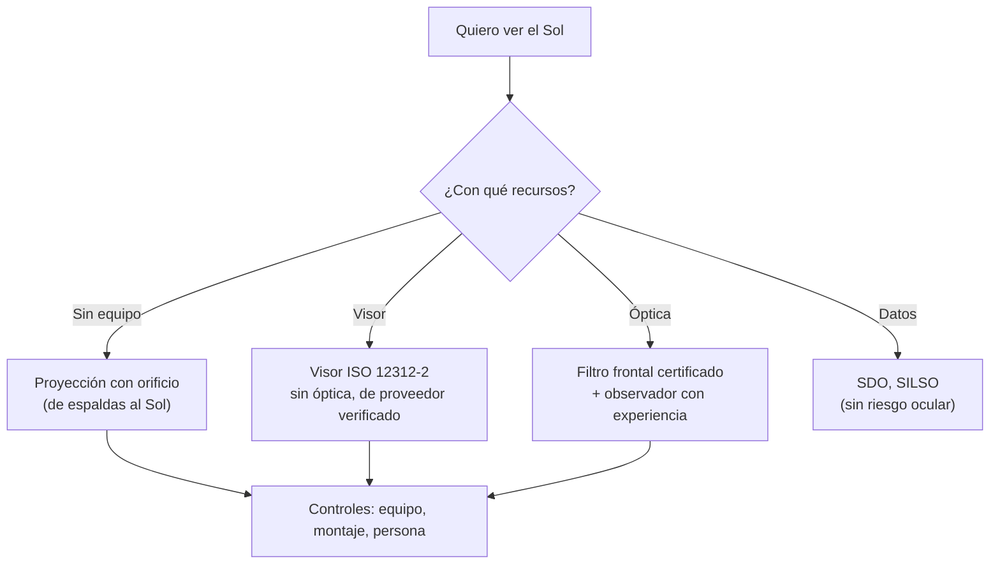

# B08-C16 — Observación solar con filtros certificados

<!-- nav:top -->
[🏠 Programa](../../../../README.md) · [📚 Bloque B08](../../../tronco-comun/B08-observacion-del-cielo-y-astronomia-practica.md) · [← Anterior: B08-C15 — Monturas y seguimiento inicial](../B08-C15-monturas-y-seguimiento-inicial/CLASE.md) · [Siguiente: B08-C17 — Registro sistemático en bitácora →](../B08-C17-registro-sistematico-en-bitacora/CLASE.md)
<!-- /nav -->

## 1. Ubicación, nivel y alcance

Decimosexta clase del bloque B08 y la más sensible en seguridad. El Sol es la estrella más cercana y la única que se estudia en detalle desde casa, pero mirarlo sin protección adecuada puede causar daño ocular grave. Esta clase enseña **qué es una protección certificada, cómo verificar que lo es, cómo observar el Sol sin equipo especial (proyección) y cómo estudiarlo con datos abiertos**. Nivel N1.

Verás la norma ISO 12312-2 para visores solares y lo que dice sobre ella la AAS, las reglas para filtros en telescopios y binoculares, la proyección con orificio, el tamaño del Sol y su rotación, y fuentes abiertas (SDO, SILSO). No verás espectroheliografía ni observación en H-alfa (B29, B23).

## 2. Por qué esta clase existe

Una persona que mira un eclipse parcial con gafas falsas, o enfoca el Sol con un telescopio sin filtro frontal, puede quedar con una lesión permanente. La pregunta motivadora: **¿cómo observo el Sol sin dañarme y sin dañar a otros?** La decisión central: **elegir un método seguro (proyección, visor certificado, filtro frontal certificado o datos abiertos) y verificar su legitimidad antes de cada uso**. Una condición de seguridad no se compensa con una buena nota en otra parte.

## 3. Lo que podrás hacer al terminar

1. Enunciar las reglas de seguridad solar de NASA y AAS que consultaste.
2. Explicar por qué las gafas de sol, los visores de eclipse con óptica y los filtros de ocular son peligrosos.
3. Distinguir un visor o filtro legítimo de uno dudoso con las pruebas de la AAS, sabiendo que no sustituyen una certificación.
4. Construir y usar un proyector de orificio y calcular el tamaño de la imagen.
5. Calcular la rotación solar vista desde la Tierra y usar datos abiertos de manchas.
6. Elaborar un plan de observación solar con alternativas.

La evidencia es el **plan de observación solar** del ejercicio 12.

## 4. Con qué llegas y cómo comprobarlo

1. ¿Qué diámetro angular tiene el Sol (C09)? 2. ¿Qué es la rotación sinódica frente a la sidérea (C08, C05)? 3. ¿Qué es una proyección con orificio? 4. ¿Por qué un telescopio concentra la luz (C14)? 5. ¿Qué dijo C09 sobre mirar un eclipse parcial?

<details><summary>Ver respuestas</summary>

1. Entre 1887″ y 1952″, unos 0,53°. 2. La sinódica se mide respecto del Sol y la Tierra; la sidérea, respecto de las estrellas. 3. Un agujero pequeño que forma una imagen invertida del Sol sobre una pantalla. 4. Su apertura recoge mucha más luz que la pupila (`(D/d)²`). 5. Que exige un visor ISO 12312-2 sin óptica o proyección, y que el Sol sigue siendo peligroso.
</details>

Con cuatro o cinco aciertos, sigue; con tres o menos, repasa C09 y C14.

## 5. Un caso real: una tarde de noviembre y un visor sospechoso

Retomas noviembre de 2025 en el Elqui. Un compañero llega con un visor «de eclipse» comprado en internet y quiere mirar el Sol a las 4 de la tarde con binoculares. Tú aplicas lo que aprendes: la AAS advierte que una etiqueta de conformidad ISO 12312-2 no basta y que algunas empresas imprimen falsamente el nombre de un fabricante listado (S2); NASA indica que los visores no deben combinarse con binoculares ni telescopios (S1); y para óptica se necesita un filtro especial al frente (S1, S3). El compañero queda sin mirar; en cambio, el grupo proyecta el Sol con un orificio y revisa las imágenes abiertas del Observatorio de Dinámica Solar de la NASA.

## 6. Vocabulario

**ISO 12312-2** es la norma internacional para filtros de observación directa del Sol; la AAS la considera el referente de seguridad, aunque advierte que la conformidad requiere pruebas de un laboratorio acreditado, no una etiqueta (S2). Un **visor solar** (gafas de eclipse o visor de mano) se usa a simple vista, sin óptica. Un **filtro solar frontal** va montado sobre la apertura de telescopios, binoculares o cámaras. Un **filtro de ocular** se enrosca atrás: la AAS dice que es peligroso y debe desecharse (S3). La **proyección con orificio** forma una imagen del Sol sobre una pantalla sin mirar el Sol (S1). La **densidad óptica** `OD` es el logaritmo decimal de la atenuación: la transmitancia es `10^(−OD)`. Las **manchas solares** son zonas oscuras de la superficie; el **número de manchas** es un índice de actividad que publica el centro SILSO (S5).

## 7. Modelo mental: cuatro caminos, tres capas de control

Hay cuatro formas de estudiar el Sol: sin mirarlo (proyección), con un visor certificado a simple vista, con un filtro certificado al frente de la óptica o con datos de otros (SDO, SILSO). Cada una exige controles: del equipo (¿es legítimo?), del montaje (¿está seguro y al frente?) y de la persona (¿sabe lo que hace y la supervisan?).



*Descripción textual:* según los recursos, el camino seguro es proyección con orificio, visor certificado sin óptica, filtro frontal certificado con observador experimentado o datos abiertos; los tres primeros exigen controles del equipo, del montaje y de la persona.

**Analogía y su límite.** Es como manejar electricidad: se aísla, se verifica y se supervisa. Falla porque un error eléctrico se nota al instante; un error con el Sol puede no doler en el momento y dañar de forma permanente.

## 8. La explicación, paso a paso

### 8.1 Las reglas que consultaste

NASA (S1): los visores seguros deben cumplir ISO 12312-2; las gafas de sol, aunque sean muy oscuras, no protegen; inspecciona los visores y descarta los dañados; usa un filtro solar especial sobre el frente de cualquier cámara, telescopio o binoculares; no combines visores con binoculares o telescopios porque la luz concentrada puede atravesarlos; si no tienes protección, usa una proyección con orificio y nunca mires el Sol a través del orificio. La AAS (S2) añade que el desempeño no se confirma con la vista: una etiqueta no basta, y recomienda comprar a fabricantes de su lista o revendedores autorizados.

**Pausa.** ¿Qué haces si tus gafas de eclipse tienen un rayón? <details><summary>Respuesta</summary>Las descartas: NASA indica descartar las dañadas y la AAS, las rotas, rayadas o perforadas (S1, S2).</details>

### 8.2 Filtros para telescopios y binoculares

Según la AAS (S3), un filtro para óptica puede considerarse seguro si cumple los requisitos de la ISO 12312-2 (transmitancia, uniformidad de transmitancia, calidad del material y la superficie), debe estar montado con firmeza sobre la apertura, es decir, en el frente, y usarse según las instrucciones del proveedor; los filtros que se enroscan en el ocular, atrás, son peligrosos y deben descartarse; los filtros de óptica solo deben usarlos observadores experimentados. La AAS recomienda comprar al fabricante o a distribuidores autorizados e identificados, y desconfiar de mercados en línea sin verificación (S3). Por esta razón esta clase **no te pide usar el Sol con telescopio ni binoculares** salvo bajo la supervisión de una persona con experiencia; la actividad central es la proyección con orificio.

### 8.3 Cómo probar un visor (y por qué eso no basta)

La AAS describe tres pruebas rápidas para descartar visores débiles: en interiores, solo se deben ver luces muy brillantes y muy tenues; al aire libre, solo reflejos tenues del Sol en superficies brillantes; y una mirada de menos de un segundo al Sol debe mostrar un disco nítido, redondo y de brillo cómodo sobre un fondo oscuro (S2). Aprobar las tres significa que es «probablemente seguro»; no es una certificación. La regla de esta clase es más estricta: **no hagas la tercera prueba; verifica el origen del visor con la lista de proveedores y, si dudas, no lo uses.** No se debe seguir la sugerencia de mirar unos segundos cada cierto tiempo con visores dudosos que aparece en la fuente.

### 8.4 Proyección con orificio y datos abiertos

El Sol mide `1919″` a 1 UA (rango 1887–1952″, S4): `0,533°`, es decir `9,3 × 10⁻³ rad`. Un orificio pequeño forma una imagen cuyo diámetro es `distancia × 0,0093`: a 1 m, 9,30 mm; a 3 m, 27,9 mm (laboratorio). Se hace con cartulina (orificio de 2–5 mm, valor práctico no verificado) y una pantalla blanca; el observador da la espalda al Sol y mira solo la pantalla. Con datos abiertos: el Observatorio de Dinámica Solar de la NASA publica imágenes de disco completo actualizadas en varias resoluciones, con los instrumentos AIA y HMI (S6); SILSO, un centro de datos mundial del Observatorio Real de Bélgica, distribuye el número de manchas, incluido un valor diario estimado (S5). Para el 1 al 5 de noviembre de 2026, el estimado fue 33, 49, 45, 78 y 100 (media 61,0); es un dato estimado y mutable, no un valor definitivo.

## 9. Magnitudes, símbolos y unidades

| Símbolo | Qué es | Unidad | Nota |
|---|---|---|---|
| `θ_☉` | diámetro angular del Sol | ″ | 1887–1952 (S4) |
| `d_p` | distancia orificio–pantalla | m | imagen `= d_p × 9,3 mm/m` |
| `OD` | densidad óptica | adimensional | `T = 10^(−OD)` |
| `P_sid`, `P_sin` | rotación sidérea y sinódica | d | 25,38 y 27,28 (a 16° de latitud) |
| `EISN` | número diario estimado de manchas | adimensional | SILSO |

## 10. Convenciones y referencias

La norma ISO 12312-2 es de pago y **no se leyó**; todo lo que se dice de ella proviene de las páginas de NASA y AAS. Los valores numéricos de transmitancia exigidos por la norma no se citan. La densidad óptica se usa solo como relación física general. El número de manchas EISN es un estimado provisional. Las horas del evento no se dan: esta clase no es un pronóstico.

## 11. De dónde sale lo que afirmamos

| ID | Fuente | Localizador | Respalda | Consulta | Estado |
|---|---|---|---|---|---|
| S1 | NASA Science, *Eclipse safety* | https://science.nasa.gov/eclipses/safety/ | ISO 12312-2; gafas de sol no protegen; inspección y descarte; filtros al frente; no combinar visores con óptica; proyección con orificio | 2026-11-05 | Página leída |
| S2 | AAS, *How to tell if your eclipse glasses or handheld solar viewers are safe* | https://eclipse.aas.org/eye-safety/how-to-tell-if-viewers-are-safe | Etiqueta insuficiente; pruebas interior/exterior/Sol; comprar a proveedores listados; descarte de visores dañados | 2026-11-05 | Página leída (sin fecha; © 2026) |
| S3 | AAS, *Solar filters for telescopes, binoculars and cameras* | https://eclipse.aas.org/eye-safety/viewers-filters | Filtros de óptica: requisitos de la norma, montaje al frente, filtros de ocular peligrosos, solo observadores con experiencia, proveedores | 2026-11-05 | Página leída (sin fecha; © 2026) |
| S4 | NASA NSSDC, *Sun Fact Sheet* (act. 9-may-2024) | https://nssdc.gsfc.nasa.gov/planetary/factsheet/sunfact.html | Radio 695 700 km; distancia 149,6 millones de km; 1919″ (1887–1952″); rotación sidérea 609,12 h a 16° | 2026-11-05 | Página leída |
| S5 | SILSO, Royal Observatory of Belgium (SIDC) | https://www.sidc.be/SILSO/home | Centro de datos mundial del número de manchas; EISN diario estimado (1–5 nov 2026: 33, 49, 45, 78, 100) | 2026-11-05 | Página leída; licencia no declarada en la página |
| S6 | NASA SDO, *Data* | https://sdo.gsfc.nasa.gov/data/ | Imágenes del disco completo, AIA y HMI | 2026-11-05 | Página leída (sin fecha) |
| S7 | NASA NSSDC, *Earth Fact Sheet* (act. 15-nov-2024) | https://nssdc.gsfc.nasa.gov/planetary/factsheet/earthfact.html | Período sidéreo de la Tierra 365,256 d | 2026-11-05 | Página leída |

Límites: la norma ISO 12312-2 y los requisitos de transmitancia no se leyeron; las pruebas de la AAS son orientativas. La eficacia de los proyectores de orificio y el tamaño recomendado del orificio no se verificaron en fuente. No se evaluó ningún producto ni proveedor.

## 12. Cómo estudiar el Sol (con distintos recursos)

| Recurso | Qué haces | Riesgo | Control |
|---|---|---|---|
| Sin equipo | Proyección con orificio de espaldas al Sol | Bajo | Nunca mirar por el orificio |
| Visor | Visor ISO 12312-2 de proveedor verificado, sin óptica | Medio | Inspección y verificación (S1, S2) |
| Binoculares/telescopio | Solo con filtro frontal certificado y observador con experiencia | Alto | Supervisión (S3) |
| Datos abiertos | Imágenes SDO, número de manchas SILSO | Ninguno ocular | Citar fecha y estado |

Para una persona ciega, los datos abiertos con descripción hablada o el sonido del número de manchas (sonificación de una serie) permiten participar; el calor del Sol y el cambio de luz se pueden sentir y describir sin mirar.

## 13. Ejemplo trabajado: proyección y rotación

Quieres proyectar el Sol con un orificio y la pantalla a 2 m. La imagen mide `2 m × 9,30 mm/m = 18,6 mm`. Si una mancha ocupa el 2 % del diámetro, mide 0,37 mm en la pantalla: casi invisible; por eso conviene una distancia mayor (3 m: 27,9 mm; mancha de 0,56 mm). Una mancha tarda en cruzar la cara visible aproximadamente `27,28/2 = 13,6 d` (rotación sinódica a 16° de latitud, derivada de 25,38 d sidérea y 365,256 d). **Paso final · incertidumbre.** La rotación depende de la latitud de la mancha (la cifra de S4 es a 16°) y la proyección depende del orificio: el tamaño real de la imagen tiene ±5 % por el desenfoque. No anotes más cifras que las que te dé el método.

## 14. Comparación de métodos

La **proyección** es la más segura y se hace con papel, pero da poco detalle. El **visor** es cómodo, pero solo sirve a simple vista. El **filtro frontal** da detalle (manchas), pero exige un equipo legítimo y experiencia. Los **datos abiertos** dan más información que cualquier equipo de principiante y cero riesgo ocular. Elige el de menor riesgo que cumpla el objetivo.

## 15. Práctica guiada

**Ejercicio 1.** Calcula el diámetro de la imagen del Sol con un orificio y la pantalla a 1,5 m. *Pasos:* 8.4.

<details><summary>Solución comentada</summary>

`1,5 × 9,30 mm/m = 13,95 mm`. (Laboratorio: 9,30 mm por metro.)
</details>

**Ejercicio 2.** Un visor tiene un rasguño. ¿Qué haces y qué fuente lo respalda? *Pasos:* 8.1.

<details><summary>Solución comentada</summary>

Lo descartas (S1: inspecciona y descarta los dañados; S2: descartar los rotos, rayados o perforados).
</details>

**Ejercicio 3.** ¿Dónde se coloca el filtro solar de un telescopio y por qué no atrás? *Pasos:* 8.2.

<details><summary>Solución comentada</summary>

Al frente, sobre la apertura, antes de que la luz se concentre (S3); los filtros que se enroscan en el ocular, atrás, reciben luz concentrada y son peligrosos (S3).
</details>

## 16. Práctica autónoma, transferencia e integrador

**Ejercicio 4.** Calcula el período sinódico de rotación solar con 609,12 h sidérea y 365,256 d.

<details><summary>Solución comentada</summary>

`P_sid = 609,12/24 = 25,38 d`; `1/P_sin = 1/25,38 − 1/365,256 = 0,03940 − 0,002738 = 0,036662`; `P_sin = 27,28 d`.
</details>

**Ejercicio 5.** ¿Cuántos días tarda una mancha en cruzar la cara visible, de limbo a limbo, aproximadamente?

<details><summary>Solución comentada</summary>

Media vuelta sinódica: `27,28/2 = 13,6 d`.
</details>

**Ejercicio 6.** Calcula la media de los cinco valores EISN y comenta qué puede decir y qué no sobre la actividad solar.

<details><summary>Solución comentada</summary>

`(33+49+45+78+100)/5 = 61,0`. Es una media de cinco días de valores estimados, no definitivos; no permite deducir la tendencia del ciclo ni dar un pronóstico.
</details>

**Ejercicio 7.** La transmitancia de un filtro de `OD = 5` es `10⁻⁵`. ¿Prueba eso que el filtro es seguro?

<details><summary>Solución comentada</summary>

No: es solo una relación física. La seguridad se decide por la certificación (ISO 12312-2 verificada en un proveedor legítimo), la uniformidad, la calidad de la superficie y el montaje frontal (S3). Un número sin certificación no es suficiente.
</details>

**Ejercicio 8.** Ordena de menor a mayor riesgo ocular: proyección con orificio, visor ISO 12312-2 verificado, binoculares con filtro frontal certificado, datos de SDO.

<details><summary>Solución comentada</summary>

Datos de SDO (ninguno) < proyección con orificio (bajo si no se mira por el orificio) < visor verificado < binoculares con filtro (alto, requiere experiencia).
</details>

**Ejercicio 9 · transferencia.** Un compañero dice: «mi visor pasó la prueba de la AAS, luego es certificado». Evalúa.

<details><summary>Solución comentada</summary>

La AAS dice que pasar las tres pruebas lo hace «probablemente» seguro, no certificado; la conformidad la acredita un laboratorio y el origen debe estar en la lista de proveedores (S2). Además, la tercera prueba implica mirar el Sol, que esta clase prohíbe.
</details>

**Ejercicio 10 · transferencia.** Un niño pide mirar el Sol con tus binoculares «para ver las manchas» con un visor de eclipse delante del ocular. ¿Qué haces?

<details><summary>Solución comentada</summary>

Lo impides: los visores no se combinan con óptica (S1) y un filtro de ocular es peligroso (S3). Propones la proyección con orificio o las imágenes de SDO (S6).
</details>

**Ejercicio 11 · transferencia.** Diseña una actividad solar para un grupo mixto que incluya a una persona ciega, sin riesgo ocular.

<details><summary>Solución comentada</summary>

Proyección con orificio dirigida por el grupo, con medición del diámetro de la imagen (tacto sobre la pantalla con marcas), cálculo de `d × 9,3 mm/m` y lectura hablada de las imágenes y el número de manchas de SDO y SILSO. La persona ciega puede medir, registrar y presentar los datos.
</details>

**Ejercicio 12 · integrador.** Elabora un **plan de observación solar**: objetivo, método elegido (proyección, visor, filtro frontal o datos), verificación del equipo con fuente, las cinco reglas de seguridad aplicables, el cálculo del tamaño de la imagen o la rotación, una alternativa sin riesgo y quién supervisa.

<details><summary>Solución modelo</summary>

Un plan válido prefiere la proyección o los datos abiertos; si usa visor o filtro, cita S1–S3 para su origen y montaje, descarta el uso de óptica con visores, no incluye mirar el Sol para «probar» el equipo y nombra a un supervisor con experiencia. Incluye cálculos coherentes con la sección 8.4 y una alternativa accesible.
</details>

## 17. Laboratorio: [`solar.py`](solar.py)

**Objetivo.** Calcular el tamaño de una imagen proyectada y la rotación solar, con control del diámetro angular. **Datos:** publicados (NASA) y estimados (SILSO). **Procedimiento:** `python solar.py` (no se mira el Sol); la prueba compara el diámetro angular publicado con `2R/D` (0,5 %). **Resultados reales (Python 3.12.9):**

```text
Diámetro angular: publicado 1919 arcsec; calculado 2R/D: 1918 arcsec
Proyección con orificio a 0.5 / 1.0 / 2.0 / 3.0 m: 4.65 / 9.30 / 18.61 / 27.91 mm
Rotación solar a 16°: sidérea 25.38 d; sinódica 27.28 d; cruce de la cara visible ~13.6 d
EISN (SILSO, estimado) 1-5 nov 2026: [33, 49, 45, 78, 100]; media 61.0; máximo 100
Densidad óptica (relación general): OD 3 -> 1e-03; OD 5 -> 1e-05
```

**Límites:** el programa no mide nada del Sol; el valor de EISN es estimado; la densidad óptica no es un criterio de seguridad. **Sin código:** calculadora. **Sin equipo:** proyección con orificio sobre cartulina.

## 18. Errores frecuentes y cómo corregirlos

**Confiar en una etiqueta.** Ejercicios 2 y 9. **Usar gafas de sol.** Sección 8.1. **Combinar visor y óptica.** Ejercicio 10. **Poner un filtro en el ocular.** Ejercicio 3. **«Probar» un visor mirando el Sol.** Sección 8.3. **Creer que un número de OD basta.** Ejercicio 7.

## 19. Cómo sabrás que vas bien

Tras 8.1: ¿enumeras las reglas sin mirar? Si no, rehaz los ejercicios 2 y 3. Tras 8.4: ¿calculas la imagen del orificio? Ejercicio 1. Final: ¿tu plan prefiere el método más seguro?

## 20. Qué entregas y cómo se evalúa

El **plan de observación solar** (ejercicio 12).

| Criterio | Inicial | En desarrollo | Logrado | Destacado |
|---|---|---|---|---|
| Seguridad | Omite reglas | Algunas | Todas con fuente | Verifica proveedor y supervisa |
| Método | Inadecuado | Aceptable | El de menor riesgo | Alternativas comparadas |
| Cálculo | Sin cálculo | Con error | Correcto | Con incertidumbre |
| Accesibilidad | Ninguna | Menciona | Alternativa | La prueba |

**Condición crítica (no se compensa por promedio):** cualquier plan que incluya mirar el Sol sin protección certificada verificada, usar un filtro de ocular, combinar visores con óptica, o «probar» un visor mirando el Sol se evalúa como no aprobado, sin importar el resto.

## 21. Ética, seguridad y límites

**Reglas no negociables.** 1) No mires el Sol sin protección certificada y verificada. 2) Las gafas de sol no protegen (NASA, S1). 3) No combines visores con binoculares, telescopios ni cámaras (S1). 4) Los filtros para óptica van **al frente** y solo los usan observadores con experiencia; los de ocular se descartan (S3). 5) Descarta cualquier visor o filtro dañado (S1, S2). 6) Compra a fabricantes o distribuidores identificados; una etiqueta no basta (S2, S3). 7) Los niños siempre con supervisión. 8) Si dudas, no observes: proyecta o usa datos.

Otros riesgos: calor y exposición prolongada al sol, deshidratación, quemaduras de piel, multitudes y caídas. Observar el Sol con equipo sin supervisión es una decisión de adultos informados; esta clase no sustituye la valoración de un profesional de la visión. Si crees que has dañado tu vista, consulta a un oftalmólogo de inmediato. Material educativo, no un manual de un fabricante.

## 22. Para cerrar y seguir

La observación solar segura se basa en métodos que no exponen los ojos: proyección, visores y filtros certificados verificados, y datos abiertos. Las reglas de NASA y AAS son claras: nada de óptica sin filtro frontal, nada de etiquetas de confianza, nada de pruebas mirando el Sol. Queda abierta una pregunta: ¿cómo registrar tus observaciones para que otros puedan revisarlas? (C17).

**Glosario español–inglés.** visor solar · *solar viewer*; filtro solar · *solar filter*; proyección con orificio · *pinhole projection*; densidad óptica · *optical density*; mancha solar · *sunspot*; rotación sinódica · *synodic rotation*; norma ISO · *ISO standard*.

**Continuidad.** B08-C17 enseña a llevar una bitácora, que aquí se usa para registrar el plan, la verificación del equipo y las condiciones. B08-C19 retoma las cámaras con la regla de filtros frontales.

**Referencias:** ver sección 11.

<!-- nav:bottom -->
---

[← Anterior: B08-C15 — Monturas y seguimiento inicial](../B08-C15-monturas-y-seguimiento-inicial/CLASE.md) · [📚 Bloque B08](../../../tronco-comun/B08-observacion-del-cielo-y-astronomia-practica.md) · [Siguiente: B08-C17 — Registro sistemático en bitácora →](../B08-C17-registro-sistematico-en-bitacora/CLASE.md)
<!-- /nav -->
