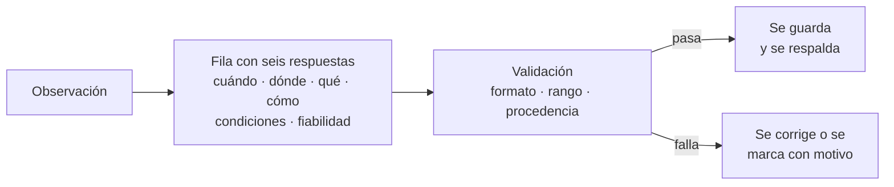

# B08-C17 — Registro sistemático en bitácora

<!-- nav:top -->
[🏠 Programa](../../../../README.md) · [📚 Bloque B08](../../../tronco-comun/B08-observacion-del-cielo-y-astronomia-practica.md) · [← Anterior: B08-C16 — Observación solar con filtros certificados](../B08-C16-observacion-solar-con-filtros-certificados/CLASE.md) · [Siguiente: B08-C18 — Introducción a meteoros y lluvias →](../B08-C18-introduccion-a-meteoros-y-lluvias/CLASE.md)
<!-- /nav -->

## 1. Ubicación, nivel y alcance

Decimoséptima clase del bloque B08. Has aprendido a calcular, medir y planear; lo que no se registra bien se pierde. Aquí construyes la **bitácora de observación**: el cuaderno (de papel o digital) que permite que tú, una semana después, y otra persona, un año después, entiendan qué se hizo, con qué y cuán confiable es. Nivel N1.

Verás qué registrar, en qué formato, cómo separar lo observado de lo calculado, cómo validar una tabla y cómo guardar copias. No verás gestión de datos de gran escala (B14) ni estadística (B12).

## 2. Por qué esta clase existe

Un dato sin fecha, sin lugar o sin procedencia es una anécdota. La pregunta motivadora: **¿qué debo anotar para que mi observación se pueda repetir, revisar y comparar?** La decisión central: **definir de antemano los campos mínimos y las reglas de validez, y no confundir nunca lo que viste con lo que calculaste**.

## 3. Lo que podrás hacer al terminar

1. Diseñar una bitácora con campos mínimos y justificarlos.
2. Registrar tiempos en UT con formato ISO 8601 y anotar el desfase de la hora local.
3. Rotular cada dato como observado, estimado, calculado, sintético o simulado.
4. Validar una tabla con reglas (rangos, formato, procedencia) y con una comprobación contra un cálculo.
5. Registrar condiciones (nubes, seeing, Luna) con una escala declarada.
6. Respaldar y compartir la bitácora de forma ordenada, con alternativas accesibles.

La evidencia es tu **bitácora de una sesión** con su validación (ejercicio 12).

## 4. Con qué llegas y cómo comprobarlo

1. ¿Qué diferencia hay entre dato observado y calculado (B01)? 2. ¿Qué es UT (C05)? 3. ¿Cómo estimaste la altura de la Luna con la mano (C04)? 4. ¿Qué es una incertidumbre? 5. ¿Qué rotulo debe llevar el dato de una efeméride?

<details><summary>Ver respuestas</summary>

1. Observado: medido por ti en el cielo; calculado: obtenido de un modelo. 2. El tiempo universal, referencia sin cambios de horario. 3. Con el puño de la mano a brazo extendido, ≈ 10° (regla práctica, C04). 4. El intervalo en que crees que está el valor. 5. «Calculado» (o «simulado»).
</details>

Con cuatro o cinco aciertos, sigue; con tres o menos, repasa C04 y C05.

## 5. Un caso real: tres filas de la Luna que no coinciden

Retomas el 5 de noviembre de 2025. Tu compañero anota en su cuaderno: «Luna, 00:00 UT, 20° de altura» y «04:00 UT, 70° de altura». Con los datos de la NASA (S1) y el cálculo de C04, la altura a las 00:00 UT era 17,6° y a las 04:00 UT, 42,3°. La primera anotación es coherente (20° estimado con el puño frente a 17,6° calculados); la segunda no (70° frente a 42,3°). El programa de la sección 17 detecta esa diferencia. Un cuaderno sin reglas dejaría pasar ambas.

## 6. Vocabulario

Una **bitácora** (o cuaderno de campo) es un registro cronológico de observaciones. Un **registro** (fila) contiene los **campos**: fecha y hora, lugar, objeto, método, instrumento, condiciones, procedencia, observador y notas. **ISO 8601** es el formato de fecha y hora `AAAA-MM-DDTHH:MM`; la `T` separa fecha y hora. La **procedencia** dice de dónde viene el dato: *observado*, *estimado*, *calculado*, *sintético* o *simulado*. Un **metadato** es un dato sobre los datos (quién, cuándo, con qué). La **reproducibilidad** es la posibilidad de que otra persona repita tu observación o tu cálculo con tus registros. La **escala de seeing** es una convención propia (1 a 5) que debes definir.

## 7. Modelo mental: cada fila responde seis preguntas

Una fila de bitácora responde: ¿cuándo?, ¿dónde?, ¿qué?, ¿cómo?, ¿con qué condiciones? y ¿qué tan fiable? Si falta una, el dato pierde valor. Las reglas de validación son controles automáticos sobre esas respuestas.



*Descripción textual:* cada observación se convierte en una fila con seis respuestas; una validación revisa formato, rangos y procedencia; si pasa se guarda y respalda, y si falla se corrige o se marca con el motivo.

**Analogía y su límite.** Un recibo de compra: sin fecha, monto y vendedor no sirve de nada. Falla porque un recibo es cuantitativo y una observación incluye juicio personal, que también debe quedar registrado como tal.

## 8. La explicación, paso a paso

### 8.1 Qué anotar siempre

La IMO (S2), en su guía de observación visual de meteoros, pide anotar el tipo y brillo de cada meteoro, comparar el brillo con estrellas conocidas, tomar la hora (con mayor cuidado en períodos de mucha actividad) y observar al menos una hora, y admite registrar en papel, en un rollo de papel o dictando a una grabadora. De ahí tomamos el principio: **registrar en el momento, con el método que te deje las manos y los ojos libres**. Para una sesión general añade: fecha y hora UT (C05), lugar con latitud y longitud (C01), instrumento y aumento (C13, C14), condiciones (nubosidad en porcentaje, seeing en la escala que definas), fase y altura de la Luna (C08, C12), y el nombre del observador. Estos campos son una propuesta de la clase, no un estándar externo.

**Pausa.** Si solo pudieras anotar cuatro campos, ¿cuáles elegirías? <details><summary>Respuesta</summary>Fecha-hora en UT, lugar, objeto o evento y procedencia del dato (observado o calculado): sin ellos no se puede repetir ni juzgar.</details>

### 8.2 Tiempo y lugar sin ambigüedades

Anota la fecha y hora en UT en formato ISO 8601 (`2025-11-05T04:00`). Si además anotas la hora local, escribe el desfase que usaste y de dónde lo tomaste: la hora oficial de Chile cambia por decreto y esta clase **no consultó la regla vigente**. Lugar: latitud y longitud en grados decimales, con signo (sur y oeste negativos, C01); declara si es de un GPS, de un mapa o aproximada. Si usas una aplicación, anota su nombre y versión.

### 8.3 Rotular la procedencia y la incertidumbre

Cada dato lleva un rótulo: *observado* (lo mediste tú), *estimado* (lo juzgaste a ojo, como la altura con el puño), *calculado* (sale de un modelo o efeméride), *sintético* (inventado para practicar) o *simulado* (resultado de una simulación). Junto a la cifra, la incertidumbre cuando exista: «altura 20° ± 5° (puño)». Lo calculado no se mezcla con lo observado en una misma columna sin rótulo. Un buen hábito es una columna de procedencia por fila.

### 8.4 Validar y respaldar

Una validación automática revisa: el formato de fecha, los rangos físicos (latitud entre −90° y +90°, longitud entre −180° y +180°, porcentaje entre 0 y 100), valores permitidos (método, procedencia) y, cuando se pueda, la coherencia con un cálculo (la altura de la Luna a una hora dada, C04). El laboratorio hace todo eso sobre seis filas sintéticas: una pasa y cinco son rechazadas, cada una con un motivo concreto. Respaldo: guarda una copia en otro lugar (otro dispositivo o papel) al terminar la sesión y no sobrescribas los originales; corrige con una nueva fila o nota, no borrando.

## 9. Magnitudes, símbolos y unidades

| Campo | Tipo | Regla |
|---|---|---|
| `fecha_hora_utc` | texto ISO 8601 | `AAAA-MM-DDTHH:MM`, UT |
| `lat`, `lon` | grados decimales | −90..90; −180..180 |
| `seeing_1a5` | entero | escala definida por ti |
| `nubosidad_pct` | % | 0..100 |
| `luna_pct` | % | 0..100 (C08) |
| `procedencia` | texto | observado, estimado, calculado, sintético, simulado |

## 10. Convenciones y referencias

UT en todos los registros; hora local opcional y con desfase declarado. Coordenadas con signo. Unidades siempre explícitas. Las filas de ejemplo de esta clase son **sintéticas**: no son observaciones reales. La escala de seeing y los campos de la bitácora son propuestas de esta clase.

## 11. De dónde sale lo que afirmamos

| ID | Fuente | Localizador | Respalda | Consulta | Estado |
|---|---|---|---|---|---|
| S1 | NASA SVS 5415 (JPL DE421) | https://svs.gsfc.nasa.gov/5415/ ; `mooninfo_2025.txt` | Posición de la Luna, 5-nov-2025 (para la coherencia) | 2026-11-05 | Datos leídos |
| S2 | IMO, *Visual observation* | https://imo.net/observations/methods/visual-observation/ | Anotar tipo y brillo, hora, comparar con estrellas, observar al menos una hora, formas de registrar | 2026-11-05 | Página leída |
| S3 | IMO, *Glossary* | https://imo.net/resources/glossary/ | Magnitud límite, ZHR | 2026-11-05 | Página leída |
| S4 | Programa de laboratorio `bitacora.py` | este repositorio | Reglas de validación y filas sintéticas | 2026-11-05 | Ejecutado |

Límites: los campos propuestos y la escala de seeing son diseño propio, no un estándar; no se consultó normativa de gestión de datos científicos; la regla de hora oficial de Chile no se consultó.

## 12. Cómo se ve una bitácora

Una fila de ejemplo (sintética) y su significado:

| Campo | Valor | Significado |
|---|---|---|
| fecha_hora_utc | 2025-11-05T00:00 | 5 de noviembre de 2025, 00:00 UT |
| lat, lon | −30,0; −70,7 | lugar redondeado |
| objeto, método | Luna, ojo | observación a simple vista |
| seeing, nubes | 3; 10 % | escala propia; nubosidad |
| luna_pct | 99,4 | fase de la tabla NASA (calculada) |
| alt_estimada | 20 | puño, ±5° |
| procedencia | sintético | fila de práctica |

Alternativas: grabar notas de voz en lugar de escribir, o llenar la tabla con un asistente. Para personas ciegas, una bitácora en CSV se lee con lector de pantalla; el formato rígido ayuda a la navegación. Para baja visión, letra grande y alto contraste.

## 13. Ejemplo trabajado: validar seis filas

Ejecutas `bitacora.py` con seis filas sintéticas. La primera (Luna a las 00:00 UT, altura estimada 20°) pasa: la altura calculada es 17,6° y la diferencia, 2,4°, está dentro de 5°. La segunda (04:00 UT, 70°) se rechaza: la altura calculada es 42,3°. La tercera tiene la hora `25:00`, inexistente; la cuarta, latitud −130°; la quinta, un método `satelite` no permitido; la sexta, procedencia vacía. **Paso final · incertidumbre.** La comprobación tolera 5° porque la estimación con el puño tiene esa incertidumbre; una tolerancia más estricta rechazaría anotaciones razonables, una más laxa dejaría pasar errores. Se declara y se justifica.

## 14. Comparación de formatos

El **papel** no depende de la energía y se escribe en la oscuridad con luz roja, pero es más difícil de validar y compartir. Un **archivo CSV** se valida y se comparte con facilidad, pero requiere un dispositivo. La **grabación de voz** deja las manos libres, pero hay que transcribirla (S2). Un buen proceso combina: notas en el campo y transcripción a CSV al día siguiente.

## 15. Práctica guiada

**Ejercicio 1.** Escribe en formato ISO 8601 las 4:00 UT del 5 de noviembre de 2025. *Pasos:* 8.2.

<details><summary>Solución comentada</summary>

`2025-11-05T04:00`.
</details>

**Ejercicio 2.** Una fila dice `lat = −130`. ¿Qué regla viola y cómo la corriges?

<details><summary>Solución comentada</summary>

Viola el rango −90..90. Probablemente sea −30 con un dígito de más; se corrige con una nueva fila y una nota, no borrando.
</details>

**Ejercicio 3.** Anota la altura de la Luna que calculaste en C04 para las 02:00 UT (35,3°) con su procedencia y una estimación de la incertidumbre de una medición con el puño.

<details><summary>Solución comentada</summary>

Valor calculado: 35,3°, procedencia *calculado*. Una estimación con el puño: ±5° (regla práctica), procedencia *estimado*. Ambos van en columnas o filas distintas, rotulados.
</details>

## 16. Práctica autónoma, transferencia e integrador

**Ejercicio 4.** Escribe los seis campos de una fila para una observación tuya hipotética.

<details><summary>Solución comentada</summary>

Debe incluir cuándo (UT), dónde (lat, lon), qué (objeto), cómo (método e instrumento), condiciones (nubes, seeing, Luna) y fiabilidad (procedencia e incertidumbre).
</details>

**Ejercicio 5.** ¿Por qué se rechazó la fila 5 del laboratorio?

<details><summary>Solución comentada</summary>

Porque el método `satelite` no está en el conjunto permitido (ojo, binoculares, telescopio, datos). La regla evita categorías inventadas y facilita el análisis.
</details>

**Ejercicio 6.** Si estimas con el puño 25° para la Luna a las 00:00 UT (calculada 17,6°), ¿pasa la validación? ¿Qué hace el resultado?

<details><summary>Solución comentada</summary>

La diferencia es 7,4° > 5°: se rechaza o se marca para revisión. Revisa tu método (¿puño de 10°?) y anota el motivo.
</details>

**Ejercicio 7.** ¿Qué rótulo lleva la fase lunar copiada de la tabla de la NASA?

<details><summary>Solución comentada</summary>

*Calculado* (efeméride DE421), con la fuente y la fecha de consulta; no es una observación tuya.
</details>

**Ejercicio 8.** Diseña una escala de seeing de 1 a 5 con descripciones observables.

<details><summary>Solución comentada</summary>

Ejemplo: 1 = estrellas parpadean mucho y el planeta se deforma; 3 = parpadeo moderado, imagen estable por momentos; 5 = estrellas casi fijas e imagen estable. Se declara que es una escala propia.
</details>

**Ejercicio 9 · transferencia.** Tienes dos fuentes de la fase lunar que difieren en 2 puntos porcentuales. ¿Qué anotas y cómo decides?

<details><summary>Solución comentada</summary>

Ambas en filas distintas con su fuente y fecha; la decisión usa la que tenga mejor procedencia (efeméride con documentación) y la diferencia como incertidumbre. No se promedian sin criterio.
</details>

**Ejercicio 10 · transferencia.** Un grupo de cuatro observadores comparte una bitácora en CSV. ¿Qué reglas acuerdan para evitar conflictos?

<details><summary>Solución comentada</summary>

Campos fijos, formato ISO en UT, un identificador de observador, no borrar filas (se añade una corrección), una copia de respaldo al final y revisión de validación antes de combinar.
</details>

**Ejercicio 11 · transferencia.** ¿Cómo participa una persona ciega en la bitácora?

<details><summary>Solución comentada</summary>

Como observadora por otros sentidos (descripción de temperatura, sonidos, brillo percibido) y como responsable de la validación y el archivo CSV con lector de pantalla; la bitácora puede incluir columnas para esas descripciones, rotuladas como *estimado*.
</details>

**Ejercicio 12 · integrador.** Elabora tu **bitácora de una sesión**: mínimo ocho filas (algunas sintéticas si no observas), con campos definidos, formato ISO en UT, procedencias, una validación por reglas y una comprobación contra un cálculo; entrega también la copia de respaldo.

<details><summary>Solución modelo</summary>

Cumple si todas las filas pasan la validación o están marcadas con su motivo, si la procedencia está en cada fila, si hay al menos una comprobación con un cálculo citado (por ejemplo, la Luna de C04) y si se declara qué filas son sintéticas. Se valora una alternativa accesible.
</details>

## 17. Laboratorio: [`bitacora.py`](bitacora.py)

**Requisitos:** Python 3.9 o superior y solo la biblioteca estándar; no hace falta instalar nada. Los valores de referencia de astropy 8.0.2 / pyerfa 2.0.1.5 están copiados en el código (no se importa astropy); para regenerarlos: `pip install astropy==8.0.2` (o `uv pip install astropy==8.0.2`). Los scripts comparten `programa/clases/B08/astrolib_b08.py`; si falta, Python avisa con un ImportError que nombra el módulo.

**Objetivo.** Validar una bitácora con reglas y contrastar una estimación con un cálculo. **Datos:** seis filas sintéticas; posiciones de la Luna de la NASA; altura calculada. **Procedimiento:** `python bitacora.py`; la prueba exige que la primera fila pase y que cada una de las otras cinco sea rechazada con el motivo esperado. **Resultados reales (Python 3.12.9):**

```text
fila 1 (fila de ejemplo coherente): VALIDA
fila 2 (altura estimada incoherente): RECHAZADA: altura estimada 70 difiere de la calculada 42.3 en mas de 5 grados
fila 3 (hora inexistente): RECHAZADA: fecha_hora_utc no es ISO 8601 UT valido (AAAA-MM-DDTHH:MM)
fila 4 (latitud imposible): RECHAZADA: lat fuera de rango [-90.0, 90.0]
fila 5 (metodo no permitido): RECHAZADA: metodo debe ser uno de ['binoculares', 'datos', 'ojo', 'telescopio']
fila 6 (sin procedencia): RECHAZADA: procedencia obligatoria, una de [...]
```

**Límites:** la comprobación de altura solo cubre dos instantes de la Luna; los campos son una propuesta. **Sin código:** revisa las seis filas a mano con la lista de reglas. **Sin equipo:** una libreta con columnas dibujadas.

## 18. Errores frecuentes y cómo corregirlos

**No anotar la procedencia.** Ejercicio 7. **Mezclar hora local y UT.** Ejercicio 1. **Borrar errores.** Ejercicio 2. **No declarar la incertidumbre.** Ejercicio 3. **Aceptar datos sin comprobación.** Ejercicio 6.

## 19. Cómo sabrás que vas bien

Tras 8.1: ¿tus filas responden las seis preguntas? Ejercicio 4. Tras 8.4: ¿tu validación detecta un error provocado a propósito? Ejercicio 5. Final: ¿alguien más podría repetir tu observación con tu bitácora?

## 20. Qué entregas y cómo se evalúa

La **bitácora de una sesión** (ejercicio 12).

| Criterio | Inicial | En desarrollo | Logrado | Destacado |
|---|---|---|---|---|
| Campos | Pocos | Algunos | Los seis con unidades | Metadatos y versión de herramientas |
| Tiempo y lugar | Local sin desfase | UT sin formato | ISO 8601 en UT con lugar | Con desfase y fuente |
| Procedencia | Ninguna | Parcial | En cada fila | Con incertidumbre |
| Validación | Ninguna | Manual | Reglas automáticas | Con comprobación contra cálculo |

**Condiciones críticas:** no presentar datos calculados o sintéticos como observados; no borrar registros originales.

## 21. Ética, seguridad y límites

Una bitácora honesta incluye lo que salió mal. Falsificar o "limpiar" datos es una falta ética grave y destruye el valor del registro. Protege la privacidad: no publiques la ubicación exacta de tu casa ni datos de otras personas sin su permiso; comparte coordenadas redondeadas si hace falta. Seguridad en campo: escribe con luz roja, no te distraigas caminando; anota también incidentes y casi incidentes (un tropiezo, un equipo mal sujeto), porque enseñan. En una sesión solar, registra el equipo, su origen y la verificación (C16). Respeta las licencias de los datos que copies (NASA, SILSO).

## 22. Para cerrar y seguir

Una buena bitácora responde seis preguntas, usa UT y formato ISO, rotula la procedencia y se valida con reglas y con un cálculo. Se respalda y no se corrige borrando. Queda abierta una pregunta: ¿qué observas cuando el cielo te ofrece un evento rápido, como los meteoros? (C18).

**Glosario español–inglés.** bitácora · *observing log*; registro · *record*; procedencia · *provenance*; metadato · *metadata*; reproducibilidad · *reproducibility*; validación · *validation*; copia de respaldo · *backup*.

**Continuidad.** B08-C18 aplica la bitácora al conteo de meteoros; B08-C20 integra todo en una campaña.

**Referencias:** ver sección 11.

<!-- nav:bottom -->
---

[← Anterior: B08-C16 — Observación solar con filtros certificados](../B08-C16-observacion-solar-con-filtros-certificados/CLASE.md) · [📚 Bloque B08](../../../tronco-comun/B08-observacion-del-cielo-y-astronomia-practica.md) · [Siguiente: B08-C18 — Introducción a meteoros y lluvias →](../B08-C18-introduccion-a-meteoros-y-lluvias/CLASE.md)
<!-- /nav -->
