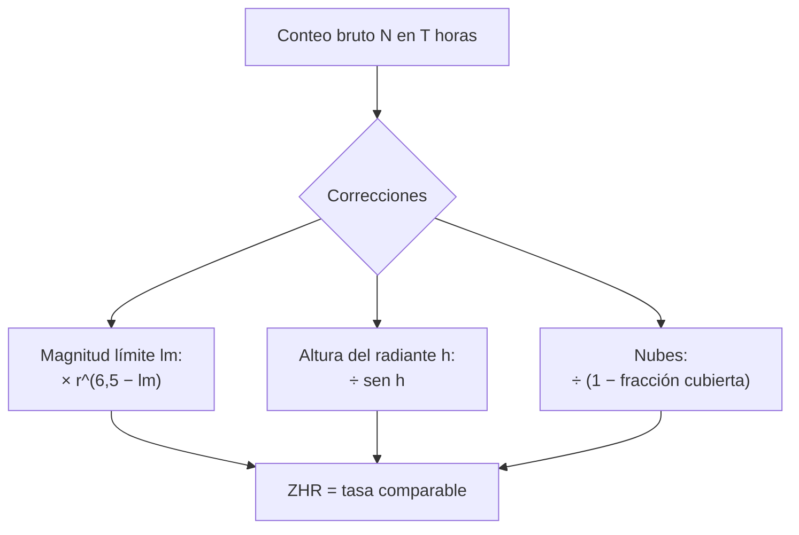

# B08-C18 — Introducción a meteoros y lluvias

<!-- nav:top -->
[🏠 Programa](../../../../README.md) · [📚 Bloque B08](../../../tronco-comun/B08-observacion-del-cielo-y-astronomia-practica.md) · [← Anterior: B08-C17 — Registro sistemático en bitácora](../B08-C17-registro-sistematico-en-bitacora/CLASE.md) · [Siguiente: B08-C19 — Fotografía astronómica elemental →](../B08-C19-fotografia-astronomica-elemental/CLASE.md)
<!-- /nav -->

## 1. Ubicación, nivel y alcance

Decimoctava clase del bloque B08. Hasta aquí observaste objetos que persisten; los meteoros son eventos que duran un instante. Aprendes **qué son, por qué hay lluvias en fechas fijas, cómo contarlos con método y cómo convertir tu conteo en una tasa comparable**. Es una actividad ideal para el cielo oscuro, sin equipo y para grupos. Nivel N1.

Verás meteoroide, meteoro y meteorito, lluvias de meteoros y su calendario según la IMO, la tasa horaria cenital (ZHR) y su corrección por magnitud límite y altura del radiante, y el registro en bitácora. No verás dinámica de cometas ni órbitas de meteoroides (B58) ni observación por video o radio.

## 2. Por qué esta clase existe

Cada año, titulares prometen «cientos de estrellas fugaces por hora». Con un cielo contaminado o con el radiante bajo el horizonte, verás muy pocas. La pregunta motivadora: **¿cuántos meteoros puedo esperar en mi cielo y cómo comparo mi conteo con el de otras personas?** La decisión central: **elegir fecha, lugar y hora, y registrar el conteo con las condiciones necesarias para corregirlo**.

## 3. Lo que podrás hacer al terminar

1. Distinguir meteoroide, meteoro, meteorito y lluvia de meteoros.
2. Leer el calendario de lluvias de la IMO e identificar las fechas de máximo.
3. Definir ZHR y explicar por qué un conteo bruto no es comparable.
4. Calcular una ZHR simplificada a partir de N, T, la magnitud límite y la altura del radiante.
5. Planificar la observación de una lluvia (hora, orientación, seguridad) con alternativas accesibles.
6. Registrar el conteo en la bitácora con sus condiciones.

La evidencia es el **informe de una sesión de meteoros** del ejercicio 12.

## 4. Con qué llegas y cómo comprobarlo

1. ¿Qué es la magnitud límite (C11, C12)? 2. ¿Qué es la altura de un punto del cielo (C04)? 3. ¿Cómo registras una observación (C17)? 4. ¿Cuánto vale `2,5^1`? 5. ¿Qué es la noche astronómica (C12)?

<details><summary>Ver respuestas</summary>

1. La magnitud de la estrella más débil visible en tu cielo. 2. El ángulo sobre el horizonte. 3. Con una fila por registro, en UT, con procedencia. 4. 2,5. 5. El período con el Sol a más de 18° bajo el horizonte.
</details>

Con cuatro o cinco aciertos, sigue; con tres o menos, repasa C11 a C17.

## 5. Un caso real: las Gemínidas de diciembre de 2026

Mirando adelante desde esta redacción (5 de noviembre de 2026), el calendario de la IMO (S2) indica para las Gemínidas una actividad del 4 al 17 de diciembre de 2026 con máximo en la noche del 13 al 14. Planearás una sesión en el valle del Elqui (lugar redondeado de C01). El calendario consultado no entrega las coordenadas del radiante ni las tasas, así que, para practicar el cálculo, usarás un **radiante sintético de ejemplo** (AR 7,5 h; Dec +30°) que no representa a la lluvia real; el real debe leerse de una fuente. Con él verás un problema que sí es real: un radiante de declinación norte llega poco alto desde Chile.

## 6. Vocabulario

Según NASA (S1), un **meteoroide** es una roca que viaja por el espacio, desde un grano de polvo hasta un asteroide pequeño; un **meteoro** es la estela luminosa que aparece cuando un meteoroide entra en la atmósfera a gran velocidad y se desintegra; un **meteorito** es el que sobrevive y llega al suelo. Una **lluvia de meteoros** es un aumento de la actividad de meteoros: unos pocos por hora son normales cualquier noche, y una lluvia los eleva mucho; suele nombrarse por una estrella o constelación cercana y ocurre cuando la Tierra atraviesa los restos de un cometa (S1). El **radiante** es el punto de la esfera celeste del que parecen venir los meteoros de una lluvia, hallado trazando hacia atrás sus trayectorias (S3). La **ZHR** (*zenithal hourly rate*) es el número de meteoros de la lluvia por hora que vería un observador con magnitud límite 6,5 y el radiante en el cenit (S3). Los meteoros **esporádicos** (SPO) no pertenecen a una lluvia (S4). El **índice de población** `r` mide la proporción de meteoros débiles frente a brillantes y se toma de una fuente o se supone.

## 7. Modelo mental: el radiante como centro de una explosión de líneas

Los meteoros de una lluvia llegan en trayectorias paralelas, y por perspectiva parecen salir del radiante. Cuanto más alto está el radiante, más del flujo real intercepta tu cielo; con el radiante bajo el horizonte, no ves la lluvia. Cuanto más débil es la estrella más débil que ves, más meteoros débiles cuentas.



*Descripción textual:* el conteo bruto se corrige por la magnitud límite, la altura del radiante y la nubosidad para obtener la ZHR, una tasa que se puede comparar entre observadores y entre noches.

**Analogía y su límite.** Contar gotas de lluvia en una ventana: depende del tamaño de la ventana (el cielo que ves), del ángulo de la lluvia y de lo que puedas distinguir. Falla porque los meteoros más débiles solo se ven con un cielo muy oscuro y los brillantes dejan estelas persistentes.

## 8. La explicación, paso a paso

### 8.1 El calendario

La IMO (S2) publica el calendario con el período de actividad y las noches de máximo. Para el período 2026–2027 incluye, por ejemplo: Taúridas del sur, actividad del 20 de septiembre al 20 de noviembre de 2026, con máximo de la componente de bólidos hacia el 5 de noviembre; Leónidas, del 6 al 30 de noviembre, máximo del 16 al 17; Gemínidas, del 4 al 17 de diciembre, máximo del 13 al 14; Úrsidas, del 17 al 26 de diciembre; Cuadrántidas, del 28 de diciembre de 2026 al 12 de enero de 2027, máximo del 3 al 4 de enero; Líridas, del 14 al 30 de abril de 2027; Eta Acuáridas, del 19 de abril al 28 de mayo de 2027, máximo del 5 al 6 de mayo; Delta Acuáridas del sur, del 12 de julio al 23 de agosto de 2027; y Perseidas, del 17 de julio al 24 de agosto de 2027, máximo del 12 al 13 de agosto. La página consultada no da radiantes ni ZHR, y tiene una incoherencia interna en el período de las Alfa Capricórnidas, por lo que su detalle no se reproduce aquí.

### 8.2 De conteo a ZHR (modelo simplificado)

De la definición de ZHR (S3) se deduce, bajo supuestos declarados, que `ZHR = N · r^(6,5 − lm) / (T · sen h · (1 − c))`, donde `N` es el número de meteoros de la lluvia en `T` horas, `lm` la magnitud límite, `r` el índice de población (aquí 2,5, valor de ejemplo), `h` la altura del radiante y `c` la fracción de cielo cubierta por nubes. La corrección por `lm` aumenta el conteo cuando tu cielo es peor que 6,5; la de `h`, cuando el radiante está bajo. El modelo supone radiante puntual y `h ≥ 25°`; el programa rechaza alturas menores. No es la fórmula completa de la IMO (no se leyó): es una versión deducida para enseñar.

**Pausa.** Si `lm = 6,5` y el radiante está en el cenit, ¿cuánto vale `ZHR`? <details><summary>Respuesta</summary>`N/T`: la definición misma.</details>

### 8.3 Un ejemplo con números (sintético)

Cuentas 18 meteoros de la lluvia en 1,5 h con `lm = 5,8`, radiante a 30° y sin nubes: `ZHR = 18 × 2,5^0,7 / (1,5 × 0,5) = 18 × 1,899 / 0,75 = 45,6`. Con 20 % de nubes: `45,6 / 0,8 = 57,0`. Son datos sintéticos de práctica, no una observación.

### 8.4 La geometría desde Chile

Con el radiante sintético (Dec +30°), la altura máxima en el Elqui es `90° − |−30° − 30°| = 30°` (C02), y solo supera 25° entre las 05:00 y las 07:00 UT del 14 de diciembre de 2026, que todavía son de noche astronómica (a las 08:00 UT ya no lo son), según el laboratorio (simulado). A las 07:00 UT está a 29,9°. Por tanto, un radiante de declinación norte da una tasa baja y una ventana corta desde Chile, aunque la lluvia sea intensa para el hemisferio norte. Es una lección de método: calcula la altura del radiante antes de salir. Para un radiante real, obtén sus coordenadas de la fuente y repite el cálculo (C04).

### 8.5 Cómo observar

La IMO (S4) pide estimar la magnitud límite en áreas definidas (dos o tres) y revisarla al menos cada hora, anotar el tipo (lluvia o esporádico) y el brillo de cada meteoro comparándolo con estrellas conocidas, tomar la hora y observar al menos una hora. A simple vista basta; no se necesitan binoculares. Consejo práctico (no verificado aquí): mira hacia un sector amplio del cielo, no directamente al radiante, y a unos 40–50° de él; acuéstate o usa una silla reclinable, con abrigo.

## 9. Magnitudes, símbolos y unidades

| Símbolo | Qué es | Unidad | Nota |
|---|---|---|---|
| `N` | meteoros contados | adimensional | solo de la lluvia |
| `T` | tiempo efectivo de observación | h | sin pausas |
| `lm` | magnitud límite | mag | C12 |
| `r` | índice de población | adimensional | 2,5 de ejemplo |
| `h` | altura del radiante | ° | C04 |
| `c` | fracción nublada | 0–1 | |
| `ZHR` | tasa cenital horaria | meteoros/h | referencia lm 6,5, h = 90° |

## 10. Convenciones y referencias

Fechas y horas en UT. La ZHR es una tasa de referencia, no lo que verá cualquier persona. El radiante y `r` del laboratorio son sintéticos. Una lluvia debe nombrarse como la IMO.

## 11. De dónde sale lo que afirmamos

| ID | Fuente | Localizador | Respalda | Consulta | Estado |
|---|---|---|---|---|---|
| S1 | NASA Science, *Meteors & Meteorites* (act. 21-sep-2026) | https://science.nasa.gov/solar-system/meteors-meteorites/ | Definiciones; lluvias por restos de cometas; ejemplo de las Perseidas | 2026-11-05 | Página leída |
| S2 | IMO, *Meteor Shower Calendar* (2026–2027) | https://imo.net/calendar/ | Períodos de actividad y noches de máximo | 2026-11-05 | Página leída; sin radiantes ni ZHR; una inconsistencia interna |
| S3 | IMO, *Glossary* | https://imo.net/resources/glossary/ | ZHR (lm 6,5, radiante en el cenit); radiante; magnitud límite | 2026-11-05 | Página leída (índice de población no definido) |
| S4 | IMO, *Visual observation* | https://imo.net/observations/methods/visual-observation/ | Método de conteo y registro; al menos una hora | 2026-11-05 | Página leída (no cubre ZHR, equipos ni seguridad) |

Límites: no se consultaron radiantes ni ZHR por lluvia, ni la fórmula completa de la IMO, ni el origen del índice de población; los consejos de postura y dirección de mirada son prácticas generales sin fuente. El hemisferio de visibilidad de cada lluvia no se verificó.

## 12. Cómo ver (y contar) meteoros

Tabla de la sesión sintética:

| Hora UT | Altura del radiante (sintético) | Noche astronómica | Útil (h ≥ 25°) |
|---|---|---|---|
| 04:00 | 18,6° | sí | no |
| 05:00 | 25,2° | sí | sí |
| 06:00 | 29,2° | sí | sí |
| 07:00 | 29,9° | sí | sí |
| 08:00 | 27,3° | no | — |

Sin ver: un compañero con grabadora cuenta y dicta; una persona ciega puede contar meteoros por sonido solo con instrumentos de radio (fuera del alcance) o participar como registradora y analista; el conteo visual exige visión o un asistente.

## 13. Ejemplo trabajado: planificar la noche del 13 al 14 de diciembre

Con el radiante sintético, la noche astronómica en el Elqui permite contar con el radiante a más de 25° entre las 05:00 y las 07:00 UT (3 h). Si en esas tres horas cuentas 30 meteoros con `lm = 6,0`, `h` media 28° y sin nubes: `ZHR = 30 × 2,5^0,5 / (3 × sen 28°) = 30 × 1,581 / (3 × 0,469) = 33,7`. **Paso final · incertidumbre.** Con 30 meteoros el error estadístico es del orden de `√30 ≈ 5,5` (18 %), y `r`, `lm` y `h` cambian durante las 3 h: reporta «ZHR ≈ 34 ± 8 (modelo simplificado, datos sintéticos)».

## 14. Comparación de métodos

El **conteo visual** es gratuito y conserva la información de brillo; la **fotografía** (C19) registra más pero con otro sesgo; los métodos de **video** y **radio** (no tratados) cuentan sin depender del ojo. Un buen proyecto declara cuál usó y cómo corrige.

## 15. Práctica guiada

**Ejercicio 1.** Distingue meteoroide, meteoro y meteorito con un ejemplo cada uno. *Pasos:* sección 6.

<details><summary>Solución comentada</summary>

Meteoroide: grano de polvo en el espacio; meteoro: la estela luminosa cuando entra y se desintegra; meteorito: el fragmento que llega al suelo (S1).
</details>

**Ejercicio 2.** ¿En qué fechas de 2026 es el máximo de las Leónidas y de las Gemínidas según S2?

<details><summary>Solución comentada</summary>

Leónidas: noche del 16 al 17 de noviembre; Gemínidas: noche del 13 al 14 de diciembre.
</details>

**Ejercicio 3.** Calcula la ZHR de 12 meteoros en 1 h con `lm = 6,5` y radiante a 90°.

<details><summary>Solución comentada</summary>

`ZHR = 12`: es la definición (S3).
</details>

## 16. Práctica autónoma, transferencia e integrador

**Ejercicio 4.** Con `lm = 5,5`, `r = 2,5`, `N = 10` en 1 h, radiante en el cenit, ¿qué ZHR resulta?

<details><summary>Solución comentada</summary>

`10 × 2,5^1 = 25`: el cielo peor oculta meteoros débiles; la corrección los repone.
</details>

**Ejercicio 5.** Con `lm = 6,5`, 10 meteoros en 1 h y el radiante a 30°, ¿qué ZHR resulta?

<details><summary>Solución comentada</summary>

`10 / sen 30° = 20`: el radiante bajo reduce lo que ves a la mitad.
</details>

**Ejercicio 6.** ¿Por qué el programa rechaza un radiante a 10° de altura?

<details><summary>Solución comentada</summary>

Porque el modelo simplificado (`1/sen h`) deja de ser fiable a alturas bajas (la corrección explota, `1/sen 10° = 5,8`, y la atmósfera y el horizonte distorsionan el conteo). Se exige `h ≥ 25°`.
</details>

**Ejercicio 7.** Calcula la ZHR del ejemplo 8.3 si el cielo tuviera 40 % de nubes.

<details><summary>Solución comentada</summary>

`45,6 / 0,6 = 76`: el error de corregir una gran fracción nublada es grande y se reporta con cautela.
</details>

**Ejercicio 8.** Estima la incertidumbre estadística de un conteo de 18 meteoros.

<details><summary>Solución comentada</summary>

Para conteos de Poisson, `σ ≈ √N = 4,2` (23 %). Reportas «18 ± 4».
</details>

**Ejercicio 9 · transferencia.** Un titular dice «150 meteoros por hora». Explica por qué tu conteo en el Elqui puede ser mucho menor.

<details><summary>Solución comentada</summary>

La ZHR es una tasa de referencia con `lm = 6,5` y radiante en el cenit; tu conteo depende de la magnitud límite, la altura del radiante, las nubes y la Luna (C12). Con un radiante bajo, el factor `sen h` puede dividirlo a la mitad o menos.
</details>

**Ejercicio 10 · transferencia.** Diseña una sesión de una hora para cuatro personas: roles y registro.

<details><summary>Solución comentada</summary>

Dos observadores con sectores distintos, un registrador con reloj en UT y linterna roja, y un coordinador de seguridad. Se rotan cada 30 min, se registra el tipo y brillo (S4) y la magnitud límite cada hora.
</details>

**Ejercicio 11 · transferencia.** ¿Cómo participa una persona con baja visión o ciega?

<details><summary>Solución comentada</summary>

Como registradora (dictado o teclado), organizadora de la logística, analista de datos y comunicadora; el conteo visual puede hacerlo otra persona. Se declara quién observó.
</details>

**Ejercicio 12 · integrador.** Elabora un **informe de una sesión de meteoros** (sintética o real): fecha y hora UT, lugar, lluvia (según S2), altura del radiante (con su fuente), magnitud límite, conteos y ZHR con incertidumbre, y las limitaciones.

<details><summary>Solución modelo</summary>

El informe usa la fórmula de 8.2, cita S2 y S3, declara qué es sintético, calcula la altura del radiante con C04 y rechaza o advierte si es menor de 25°. Incluye una alternativa accesible y la bitácora en el formato de C17.
</details>

## 17. Laboratorio: [`meteoros.py`](meteoros.py)

**Requisitos:** Python 3.9 o superior y solo la biblioteca estándar; no hace falta instalar nada. Los valores de referencia de astropy 8.0.2 / pyerfa 2.0.1.5 están copiados en el código (no se importa astropy); para regenerarlos: `pip install astropy==8.0.2` (o `uv pip install astropy==8.0.2`). Los scripts comparten `programa/clases/B08/astrolib_b08.py`; si falta, Python avisa con un ImportError que nombra el módulo.

**Objetivo.** Calcular la ZHR simplificada y la altura de un radiante sintético en el Elqui. **Datos:** sintéticos, con tiempo sidéreo validado contra astropy. **Procedimiento:** `python meteoros.py`; las pruebas verifican los casos analíticos y que la altura máxima del radiante es `90° − |lat − dec|`. **Resultados reales (Python 3.12.9):**

```text
14-dic-2026 UT | altura radiante sintético | noche astronómica
03:00 9.9° sí | 04:00 18.6° sí | 05:00 25.2° sí | 06:00 29.2° sí | 07:00 29.9° sí | 08:00 27.3° no
Ejemplo sintético: 18 meteoros en 1,5 h, lm 5,8, h 30°, r 2,5 -> ZHR = 45.6; con 20 % de nubes: 57.0
```

**Límites:** modelo simplificado, radiante puntual, `r` supuesto. **Sin código:** calculadora con la fórmula de 8.2. **Sin equipo:** cuenta meteoros a simple vista durante una hora.

## 18. Errores frecuentes y cómo corregirlos

**Comparar conteos brutos.** Ejercicios 4 y 5. **Mirar al radiante.** Sección 8.5 (práctica general). **Ignorar la altura del radiante.** Ejercicio 6. **Creer que un titular describe tu cielo.** Ejercicio 9. **Corregir sin reportar incertidumbre.** Ejercicio 8.

## 19. Cómo sabrás que vas bien

Tras 8.2: ¿calculas una ZHR a mano? Ejercicio 4. Tras 8.4: ¿sabes cuándo vale la pena salir? Ejercicio 6. Final: ¿tu informe declara lo sintético?

## 20. Qué entregas y cómo se evalúa

El **informe de una sesión de meteoros** (ejercicio 12).

| Criterio | Inicial | En desarrollo | Logrado | Destacado |
|---|---|---|---|---|
| Conteo y método | Sin método | Conteo sin condiciones | Con lm, tiempo y altura | Con incertidumbre |
| Corrección | Ninguna | Parcial | ZHR calculada | Declara supuestos y límites |
| Fuentes | Sin fuente | Sin fecha | IMO con fecha | Distingue publicado de supuesto |
| Seguridad y accesibilidad | Omite | Menciona | Plan y alternativa | Probados |

**Condiciones críticas:** declarar lo sintético; no atribuir a la IMO lo que no consultaste (radiantes, ZHR por lluvia).

## 21. Ética, seguridad y límites

Observar meteoros implica noches largas, quietud y frío: abrígate más de lo que crees, lleva agua, una silla reclinable, linterna roja, y avisa tu lugar y hora de regreso. Evita acampar al borde de caminos o quebradas; los vehículos y los animales nocturnos son riesgos. No uses linternas blancas ni pantallas brillantes que arruinen la visión de otros. Ten cuidado con la fatiga al conducir de regreso. Respeta la propiedad. No toques ni recojas objetos que creas meteoritos sin saber la normativa de patrimonio y de seguridad del lugar (no consultada aquí). Material educativo.

## 22. Para cerrar y seguir

Un meteoro es un instante; una lluvia, un patrón anual. Con la magnitud límite, la altura del radiante y las nubes, un conteo bruto se transforma en una ZHR comparable; sin ellas, es solo un número. Queda abierta una pregunta: ¿cómo registro un evento rápido con una cámara? (C19).

**Glosario español–inglés.** meteoroide · *meteoroid*; meteoro · *meteor*; meteorito · *meteorite*; lluvia de meteoros · *meteor shower*; radiante · *radiant*; tasa horaria cenital · *zenithal hourly rate (ZHR)*; esporádico · *sporadic*; índice de población · *population index*.

**Continuidad.** B08-C19 introduce la fotografía astronómica elemental; B08-C20 integra todo en una campaña de observación.

**Referencias:** ver sección 11.

<!-- nav:bottom -->
---

[← Anterior: B08-C17 — Registro sistemático en bitácora](../B08-C17-registro-sistematico-en-bitacora/CLASE.md) · [📚 Bloque B08](../../../tronco-comun/B08-observacion-del-cielo-y-astronomia-practica.md) · [Siguiente: B08-C19 — Fotografía astronómica elemental →](../B08-C19-fotografia-astronomica-elemental/CLASE.md)
<!-- /nav -->
