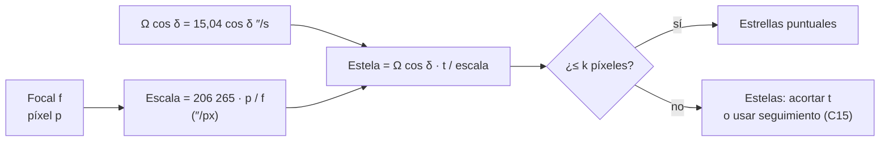

# B08-C19 — Fotografía astronómica elemental

<!-- nav:top -->
[🏠 Programa](../../../../README.md) · [📚 Bloque B08](../../../tronco-comun/B08-observacion-del-cielo-y-astronomia-practica.md) · [← Anterior: B08-C18 — Introducción a meteoros y lluvias](../B08-C18-introduccion-a-meteoros-y-lluvias/CLASE.md) · [Siguiente: B08-C20 — Proyecto de campaña de observación nocturna →](../B08-C20-proyecto-de-campana-de-observacion-nocturna/CLASE.md)
<!-- /nav -->

## 1. Ubicación, nivel y alcance

Decimonovena clase del bloque B08. Una cámara registra lo que el ojo no acumula: luz durante segundos. También tropieza con el mismo obstáculo que el telescopio: el cielo se mueve. Aquí aprendes **qué decide una fotografía astronómica elemental**: escala, campo, tiempo de exposición sin seguimiento, y cómo documentarla honestamente. Nivel N1.

Verás escala de placa, campo, estela de estrellas, tiempo máximo de exposición sin seguimiento, el tamaño de la Luna en la imagen, y las reglas de seguridad para fotografiar el Sol. No verás apilado, calibración con imágenes de corrección ni detectores (B28, B15).

## 2. Por qué esta clase existe

Un teléfono o una cámara réflex puede captar la Vía Láctea o la Luna con detalle, pero una exposición demasiado larga convierte las estrellas en rayas. La pregunta motivadora: **¿cuánto puedo exponer y con qué focal para obtener estrellas puntuales, y qué debo anotar para que la foto sirva como dato?** La decisión central: **elegir focal y tiempo a partir de la escala de placa y del ritmo del cielo, y declarar qué es la imagen (original o procesada)**.

## 3. Lo que podrás hacer al terminar

1. Calcular la escala de placa y el campo de una cámara con un objetivo dado.
2. Calcular la estela que deja una estrella en una exposición y el tiempo máximo para una estela aceptable.
3. Evaluar una regla práctica popular con un cálculo en lugar de aceptarla.
4. Calcular cuántos píxeles ocupa la Luna según la focal.
5. Aplicar las reglas de seguridad para fotografiar el Sol.
6. Documentar una fotografía con metadatos y su condición (original o procesada).

La evidencia es la **ficha de una fotografía** del ejercicio 12.

## 4. Con qué llegas y cómo comprobarlo

1. ¿Cuántos ″/s se mueve una estrella en el ecuador celeste (C15)? 2. ¿Qué es un píxel? 3. ¿Cuántos segundos de arco hay en un radián? 4. ¿Cuál es el diámetro angular de la Luna (C08)? 5. ¿Dónde va un filtro solar en una cámara (C16)?

<details><summary>Ver respuestas</summary>

1. 15,04″/s. 2. El elemento mínimo de una imagen digital. 3. 206 265″. 4. Entre 1762″ y 2009″ en 2025. 5. Al frente del objetivo, antes del lente (NASA, AAS).
</details>

Con cuatro o cinco aciertos, sigue; con tres o menos, repasa C15 y C16.

## 5. Un caso real: la Luna y la Vía Láctea con la misma cámara

Retomas el 5 de noviembre de 2025 en el Elqui. Imagina una cámara con sensor de 36 mm de ancho y píxeles de 4,3 µm (valores de ejemplo, no un modelo real). Quieres dos fotos: la Luna cerca del perigeo (2007,5″ de diámetro aparente ese día, S1) y, otra noche sin Luna, la franja de la Vía Láctea. Las dos exigen decisiones distintas: la Luna es muy brillante y exige exposiciones cortas; la Vía Láctea exige exposiciones largas y estrellas sin estela.

## 6. Vocabulario

La **distancia focal** `f` del objetivo (mm) y el **tamaño del píxel** `p` (µm) fijan la **escala de placa**: `escala = 206 265 · p / f` en segundos de arco por píxel (con `p` en mm). El **campo** es el ángulo que abarca el sensor: `2 arctan(w/2f)`, con `w` el ancho del sensor. La **estela** es la longitud en píxeles que recorre una estrella durante una exposición sin seguimiento: `Ω cos δ · t / escala`, con `Ω = 15,041″/s` (S2). La **exposición** es el tiempo con el obturador abierto; el **ISO** es la amplificación de la señal; la **apertura** relativa del objetivo (f/) controla la luz. Una imagen **original** es la que sale de la cámara sin alterar; una **procesada** ha sido modificada (recorte, apilado, contraste).

## 7. Modelo mental: el cielo se desliza sobre el sensor

La imagen de una estrella cae en un píxel; con el giro del cielo (15″/s), se desplaza a razón de `15,04″ / escala` píxeles por segundo. Cuanto más largo el objetivo, más pequeña la escala (menos ″ por píxel) y más rápido «corre» la estrella entre píxeles.



*Descripción textual:* la focal y el píxel dan la escala de placa; combinada con el ritmo del cielo y el tiempo de exposición da la estela en píxeles; si es mayor que el límite aceptado se acorta la exposición o se usa seguimiento.

**Analogía y su límite.** Fotografiar a alguien que corre: cuanto más lejos de ti pasa (focal corta), menos se nota el movimiento. Falla porque el movimiento del cielo es uniforme y predecible, y se puede compensar con una montura.

## 8. La explicación, paso a paso

### 8.1 Escala y campo

Para 50 mm y píxeles de 4,3 µm: `escala = 206 265 × 0,0043 / 50 = 17,74″/px`; el campo de un sensor de 36 mm es `2 arctan(18/50) = 39,6°`. Con 24 mm: `36,96″/px` y `73,7°`; con 200 mm: `4,43″/px` y `10,3°`; con un telescopio de 1000 mm y píxeles de 5 µm: `1,03″/px` y un sensor de 23,5 mm abarca `1,3°` (laboratorio).

### 8.2 Estela y tiempo máximo

Una estrella del ecuador celeste recorre `15,04″/s`. Con 50 mm (17,74″/px) se desplaza `0,85 px/s`: en 1,18 s la estela es de 1 píxel (`t = escala/Ω`). A `δ = −60°` el ritmo es la mitad (`Ω cos 60° = 7,52″/s`), de modo que el tiempo se duplica: 2,36 s. Con 24 mm, 1 píxel de estela tarda 2,5 s en el ecuador; con 200 mm, 0,3 s; con el telescopio de 1000 mm, 0,07 s. Si aceptas 2 píxeles, los tiempos se duplican. El valor de «píxeles aceptables» depende de cómo vas a ver la foto (pantalla de teléfono o impresión grande).

**Pausa.** ¿Qué pasa con el tiempo máximo si duplicas la focal? <details><summary>Respuesta</summary>La escala se reduce a la mitad, y el tiempo máximo también (≈ a la mitad).</details>

### 8.3 Una regla popular, evaluada

Se dice mucho que el tiempo máximo en segundos es `500 / f(mm)`. No hay una fuente de esta clase que la respalde; la evaluamos: con 24 mm da 20,8 s, y la estela en el ecuador sería `15,04 × 20,8 / 36,96 = 8,5 px`; con 50 mm, 10 s y 8,5 px; con 200 mm, 2,5 s y 8,5 px. Con estos píxeles pequeños (4,3 µm), la regla permite estelas de ~8 píxeles, visibles al ampliar. Es una regla pensada para tamaños de impresión y sensores más antiguos, según suele afirmarse (dato no verificado); calcula tú el tiempo con el criterio que necesites.

### 8.4 La Luna, el Sol y la seguridad

La Luna mide entre 1762″ y 2009″ en 2025 (S1). Con 200 mm y píxeles de 4,3 µm ocupa entre 397 y 453 px (el 5 % del ancho del sensor, de 8372 px); con 1000 mm, entre 1987 y 2265 px. La Luna es brillante: usa exposiciones cortas (la regla de la estela no limita). **El Sol exige un filtro solar certificado montado al frente del objetivo o telescopio** (NASA, S3; AAS, S4); la pantalla de la cámara y el visor óptico no son una protección, y el sensor puede dañarse. Para fotografiar un eclipse, el filtro permanece puesto durante todo el evento salvo en la totalidad de un eclipse total (S3). Decide también qué documentas: la foto original se guarda sin alterar; las versiones procesadas llevan una nota con lo que se hizo.

## 9. Magnitudes, símbolos y unidades

| Símbolo | Qué es | Unidad | Nota |
|---|---|---|---|
| `f` | distancia focal | mm | del objetivo |
| `p` | tamaño del píxel | µm | del sensor |
| `escala` | escala de placa | ″/px | `206 265 · p / f` (p en mm) |
| `w` | ancho del sensor | mm | 36 en el ejemplo |
| `t` | exposición | s | |
| `Ω` | ritmo del cielo | ″/s | 15,041 (S2) |
| `k` | estela aceptada | px | tú la eliges |

## 10. Convenciones y referencias

Las cámaras y objetivos son de ejemplo. El criterio `k` de píxeles aceptables es una decisión del fotógrafo. La regla de 500 se evalúa, no se adopta. Todo dato procesado se rotula como procesado. Las imágenes de la Luna o del cielo producidas por el estudiante son **observadas** (si son originales) o **procesadas**.

## 11. De dónde sale lo que afirmamos

| ID | Fuente | Localizador | Respalda | Consulta | Estado |
|---|---|---|---|---|---|
| S1 | NASA SVS 5415 (JPL DE421) | https://svs.gsfc.nasa.gov/5415/ ; `mooninfo_2025.txt` | Diámetro angular de la Luna (1762,3–2008,6″ en 2025; 2007,5″ el 5-nov) | 2026-11-05 | Datos leídos |
| S2 | NASA NSSDC, *Earth Fact Sheet* (act. 15-nov-2024) | https://nssdc.gsfc.nasa.gov/planetary/factsheet/earthfact.html | Rotación sidérea 23,9345 h | 2026-11-05 | Página leída |
| S3 | NASA Science, *Eclipse safety* | https://science.nasa.gov/eclipses/safety/ | Filtro solar especial sobre el frente de cámaras y telescopios; solo en totalidad se quitan los visores | 2026-11-05 | Página leída |
| S4 | AAS, *Solar filters for telescopes, binoculars and cameras* | https://eclipse.aas.org/eye-safety/viewers-filters | Filtros al frente, ISO 12312-2, proveedores, solo observadores con experiencia | 2026-11-05 | Página leída (sin fecha) |

Límites: no se consultó ninguna guía de fotografía ni especificaciones de cámaras; las fórmulas de escala y campo son geométricas estándar, y las cifras de cámaras son de ejemplo. La regla de 500, ISO, apertura y enfoque se mencionan como conceptos sin fuente.

## 12. Cómo ver (o describir) la fotografía

Tabla de configuraciones de ejemplo (laboratorio):

| Objetivo | Escala (″/px) | Campo | t_max 1 px (ecuador) | Estela con 500/f |
|---|---|---|---|---|
| 24 mm | 36,96 | 73,7° | 2,5 s | 8,5 px |
| 50 mm | 17,74 | 39,6° | 1,2 s | 8,5 px |
| 200 mm | 4,43 | 10,3° | 0,3 s | 8,5 px |
| 1000 mm (píxel 5 µm) | 1,03 | 1,3° | 0,07 s | 7,3 px |

Para una persona ciega: una descripción hablada de la imagen con ejes (posición en el cuadro, tamaños angulares), una versión táctil impresa de contorno, y el trabajo de preparación (calcular, programar, documentar) es plenamente accesible. Para baja visión: alto contraste y ampliación.

## 13. Ejemplo trabajado: la Vía Láctea con 24 mm

Con 24 mm (escala 36,96″/px), el tiempo para 1 píxel de estela en el ecuador es 2,5 s; si aceptas 3 píxeles, 7,3 s; a `δ = −60°`, el doble. La regla de 500 daría 20,8 s (8,5 px). Con una exposición de 8 s tendrías una estela de `15,04 × 8 / 36,96 = 3,3 px` en el ecuador. **Paso final · incertidumbre.** Los valores de cámara son de ejemplo; el criterio de píxeles es tuyo. Registra el valor que usaste y comprueba al ampliar la foto al 100 % que las estrellas no tengan estela; ajusta.

## 14. Comparación de métodos

**Sin seguimiento**, con tiempos cortos, es simple y basta para la Luna, planetas y campos amplios. **Con montura ecuatorial** (C15) se alargan los tiempos. **Con apilado** de muchas exposiciones cortas (no tratado aquí) se acumula señal sin estelas. Elegir depende del objeto y de tus recursos.

## 15. Práctica guiada

**Ejercicio 1.** Calcula la escala de placa de un objetivo de 50 mm con píxeles de 4,3 µm. *Pasos:* 8.1.

<details><summary>Solución comentada</summary>

`206 265 × 0,0043 / 50 = 17,74″/px`.
</details>

**Ejercicio 2.** ¿Cuánto tarda una estrella del ecuador en moverse 1 píxel en esa configuración? *Pasos:* 8.2.

<details><summary>Solución comentada</summary>

`t = 17,74 / 15,04 = 1,18 s`.
</details>

**Ejercicio 3.** ¿Qué campo abarca un sensor de 36 mm con 50 mm?

<details><summary>Solución comentada</summary>

`2 arctan(18/50) = 2 × 19,8° = 39,6°`.
</details>

## 16. Práctica autónoma, transferencia e integrador

**Ejercicio 4.** ¿Qué estela deja en una exposición de 10 s con 24 mm en el ecuador?

<details><summary>Solución comentada</summary>

`15,04 × 10 / 36,96 = 4,07 px`.
</details>

**Ejercicio 5.** ¿Cuánto es el tiempo máximo para 1 px a `δ = −60°` con 50 mm?

<details><summary>Solución comentada</summary>

`17,74 / (15,04 × 0,5) = 2,36 s` (el doble del ecuador).
</details>

**Ejercicio 6.** ¿Qué fracción del ancho del sensor (8372 px) ocupa la Luna de 453 px con 200 mm?

<details><summary>Solución comentada</summary>

`453 / 8372 = 5,4 %`.
</details>

**Ejercicio 7.** Evalúa la regla de 500 para 200 mm: tiempo y estela.

<details><summary>Solución comentada</summary>

`500/200 = 2,5 s`; estela `15,04 × 2,5 / 4,43 = 8,5 px`. Para 2 px habría que limitar el tiempo a ≈ 0,6 s.
</details>

**Ejercicio 8.** Calcula la focal para que la Luna de 2008,6″ ocupe 837 px (10 % del ancho) con píxeles de 4,3 µm.

<details><summary>Solución comentada</summary>

Escala necesaria `2008,6 / 837 = 2,40″/px`; `f = 206 265 × 0,0043 / 2,40 = 370 mm`.
</details>

**Ejercicio 9 · transferencia.** Un teléfono (valores hipotéticos: 5,6 mm de focal y píxeles de 1,2 µm) ¿qué escala y qué tiempo máximo para 1 px da?

<details><summary>Solución comentada</summary>

`206 265 × 0,0012 / 5,6 = 44,2″/px`; `t = 44,2 / 15,04 = 2,9 s`. Valores hipotéticos: usa los reales de tu equipo.
</details>

**Ejercicio 10 · transferencia.** Una amiga quiere fotografiar un eclipse parcial con su teléfono. ¿Qué le adviertes?

<details><summary>Solución comentada</summary>

Que necesita un filtro solar adecuado al frente de la cámara (S3, S4); no basta una gafa de eclipse ante la lente ni confiar en la pantalla; y que no mire el Sol por el visor o la pantalla sin protección. Alternativa: fotografiar la proyección con orificio (C16).
</details>

**Ejercicio 11 · transferencia.** Diseña la ayuda para que una persona ciega dirija una sesión fotográfica de la Luna.

<details><summary>Solución comentada</summary>

Prepara la hoja de cálculo (escala, tiempos), coordina el equipo, dicta los parámetros, pide a otra persona que encuadre con la tabla de alturas y acimuts (C04) y revisa la descripción hablada del resultado. La persona ciega participa en el diseño y análisis.
</details>

**Ejercicio 12 · integrador.** Elabora la **ficha de una fotografía**: objeto, UT, lugar, cámara y objetivo (con focal y píxel), exposición e ISO, escala, campo y estela calculadas, estado de la imagen (original o procesada), y limitaciones.

<details><summary>Solución modelo</summary>

La ficha contiene los cálculos de 8.1–8.2, rotula original o procesada, anota la bitácora (C17), declara que los valores de cámara son los reales o de ejemplo, e incluye una regla de seguridad si el Sol está en el encuadre.
</details>

## 17. Laboratorio: [`exposicion.py`](exposicion.py)

**Requisitos:** Python 3.9 o superior y solo la biblioteca estándar; no hace falta instalar nada. Los valores de referencia de astropy 8.0.2 / pyerfa 2.0.1.5 están copiados en el código (no se importa astropy); para regenerarlos: `pip install astropy==8.0.2` (o `uv pip install astropy==8.0.2`). Los scripts comparten `programa/clases/B08/astrolib_b08.py`; si falta, Python avisa con un ImportError que nombra el módulo.

**Objetivo.** Calcular escala, campo, estela y tiempo máximo. **Datos:** publicados (NASA) y configuraciones de ejemplo. **Procedimiento:** `python exposicion.py`; las pruebas verifican 1,0313″/px para 1000 mm y 5 µm, el ritmo de 15,041″/s y el campo de 39,6°. **Resultados reales (Python 3.12.9):**

```text
gran angular 24 mm: escala 36.96 ″/px | campo 73.7° | t_max(1 px) 2.5 s (ecuador), 4.9 s (dec −60) | estela con 500/f: 8.5 px
normal 50 mm: 17.74 | 39.6° | 1.2 s, 2.4 s | 8.5 px
tele 200 mm: 4.43 | 10.3° | 0.3 s, 0.6 s | 8.5 px
telescopio 1000 mm (píxel 5 µm): 1.03 | 1.3° | 0.1 s | 7.3 px
La Luna con 200 mm: 397 a 453 px; con 1000 mm: 1987 a 2265 px
```

**Límites:** óptica sin distorsión; sin turbulencia ni seguimiento; cámaras de ejemplo. **Sin código:** calculadora. **Sin equipo:** dibuja un cuadro y marca cuánto se desplaza una estrella por segundo.

## 18. Errores frecuentes y cómo corregirlos

**Aceptar una regla sin calcular.** Ejercicio 7. **Olvidar `cos δ`.** Ejercicio 5. **Usar el visor de la cámara sin filtro para encuadrar el Sol.** Ejercicio 10. **Presentar una foto procesada como original.** Ejercicio 12. **Confundir campo con escala.** Ejercicio 3.

## 19. Cómo sabrás que vas bien

Tras 8.1: ¿calculas la escala de placa de memoria? Ejercicio 1. Tras 8.2: ¿calculas el tiempo máximo? Ejercicio 2. Final: ¿tu ficha dice qué es original?

## 20. Qué entregas y cómo se evalúa

La **ficha de una fotografía** (ejercicio 12).

| Criterio | Inicial | En desarrollo | Logrado | Destacado |
|---|---|---|---|---|
| Cálculo | Sin cálculo | Con errores | Escala, campo y estela correctos | Compara dos criterios |
| Documentación | Sin metadatos | Parcial | UT, equipo y exposición | Con versión original y procesada |
| Honestidad | No distingue | Distingue de forma vaga | Rotula original/procesada | Describe el procesado |
| Seguridad | Omite | Menciona | Regla solar con fuente | Plan alternativo |

**Condiciones críticas (no se compensan por promedio):** presentar como observación una imagen procesada o sintética sin rótulo; fotografiar el Sol sin filtro certificado al frente.

## 21. Ética, seguridad y límites

**La cámara no te protege del Sol.** El sensor y tus ojos corren riesgo si el Sol entra en el encuadre sin filtro frontal certificado (NASA, AAS). No dejes una cámara con teleobjetivo apuntando al Sol, ni siquiera sin mirar. De noche: terreno, frío, trípodes que se vuelcan, cables y equipo valioso: ve acompañado y planifica el regreso. Respeta la privacidad si fotografías personas o propiedades y las licencias de las imágenes ajenas. No manipules una foto y la presentes como un descubrimiento; el procesado se declara. Material educativo.

## 22. Para cerrar y seguir

La escala de placa y el ritmo del cielo deciden cuánto puedes exponer sin seguimiento; una regla popular se evalúa con un cálculo, y una foto vale como dato cuando dice qué es y cómo se hizo. Queda abierta una pregunta: ¿cómo reúnes todo en una campaña de observación completa? (C20).

**Glosario español–inglés.** distancia focal · *focal length*; escala de placa · *plate scale*; campo · *field of view*; estela · *star trail*; exposición · *exposure*; imagen original · *raw image*; imagen procesada · *processed image*.

**Continuidad.** B08-C20 integra el bloque en una campaña con requisitos, componentes y criterios de comprobación.

**Referencias:** ver sección 11.

<!-- nav:bottom -->
---

[← Anterior: B08-C18 — Introducción a meteoros y lluvias](../B08-C18-introduccion-a-meteoros-y-lluvias/CLASE.md) · [📚 Bloque B08](../../../tronco-comun/B08-observacion-del-cielo-y-astronomia-practica.md) · [Siguiente: B08-C20 — Proyecto de campaña de observación nocturna →](../B08-C20-proyecto-de-campana-de-observacion-nocturna/CLASE.md)
<!-- /nav -->
