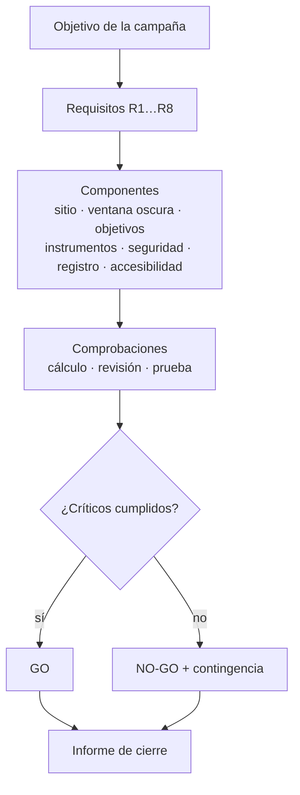

# B08-C20 — Proyecto de campaña de observación nocturna

<!-- nav:top -->
[🏠 Programa](../../../../README.md) · [📚 Bloque B08](../../../tronco-comun/B08-observacion-del-cielo-y-astronomia-practica.md) · [← Anterior: B08-C19 — Fotografía astronómica elemental](../B08-C19-fotografia-astronomica-elemental/CLASE.md) · [Siguiente: B09-C01 — Límites de funciones reales →](../../../tronco-comun/B09-calculo-diferencial-e-integral.md#b09-c01)
<!-- /nav -->

## 1. Ubicación, nivel y alcance

Vigésima y última clase del bloque B08. Integras todo lo anterior —orientación, coordenadas, tiempo, Luna, planetas, brillo, cielo oscuro, instrumentos, seguridad, registro, meteoros y fotografía— en un **proyecto de campaña de observación nocturna**, tratado como un problema de ingeniería: tiene requisitos, componentes, criterios de comprobación y una decisión de seguir o cancelar. Nivel N1.

Verás cómo escribir requisitos verificables, dividir la campaña en componentes, decidir con datos si se sale, asignar roles, prever riesgos y cerrar con un informe. No verás gestión de proyectos formal (B49, B64) ni observación profesional (B32).

## 2. Por qué esta clase existe

Una salida sin plan termina en una noche perdida o en un accidente. La pregunta motivadora: **¿cómo preparo una salida de observación para que sea segura, útil, accesible y reproducible?** La decisión central: **definir de antemano qué debe cumplirse para salir (go) y qué lo cancela (no-go), y comprobarlo con datos y con otra persona**.

## 3. Lo que podrás hacer al terminar

1. Escribir requisitos de una campaña con su criterio y método de comprobación.
2. Descomponer la campaña en componentes (sitio, ventana oscura, objetivos, instrumentos, seguridad, registro, accesibilidad).
3. Elegir entre dos noches con datos de Luna y noche astronómica.
4. Definir criterios go/no-go y un plan de contingencia.
5. Asignar roles y comunicar un plan de seguridad.
6. Cerrar la campaña con un informe que declare lo medido, lo calculado y lo no verificado.

La evidencia es el **plan de campaña** del ejercicio 12.

## 4. Con qué llegas y cómo comprobarlo

1. ¿Qué horas de noche astronómica hay sin Luna en la noche de Luna nueva de C12? 2. ¿Qué prohíbe C16? 3. ¿Cómo se registra una observación (C17)? 4. ¿Qué altura mínima usa C18 para el radiante? 5. ¿Cómo se estima la ganancia de un instrumento (C11)?

<details><summary>Ver respuestas</summary>

1. 7,20 h de 7,20 h. 2. Mirar el Sol sin protección certificada verificada. 3. En UT, ISO 8601, con procedencia, validada. 4. 25°. 5. `5 log₁₀(D/d)` como cota ideal.
</details>

Con cuatro o cinco aciertos, sigue; con tres o menos, repasa C11 a C18.

## 5. Un caso real: elegir entre dos noches de noviembre de 2025

Eres el equipo de una pequeña asociación en el valle del Elqui (lugar redondeado de C01). Tienen dos fechas posibles: la noche de Luna llena (5–6 de noviembre de 2025) y la de Luna nueva (20–21). Con las posiciones de la NASA (S1) y el programa de C12 sabes que la noche astronómica del 5–6 dura 7,67 h y la Luna está sobre el horizonte las 7,67 h (0 h sin Luna); la del 20–21 dura 7,20 h y la Luna no sale (7,20 h sin Luna). Sobre eso construirás el proyecto.

## 6. Vocabulario

Un **requisito** es una condición que la campaña debe cumplir; debe ser **verificable**: tener un **criterio de comprobación** (un número o un sí/no) y un **método de comprobación**. Un **componente** es una parte con función propia (sitio, instrumentos, seguridad...). **Go / no-go** es la decisión de salir o cancelar según criterios fijados antes. Un **plan de contingencia** dice qué se hace si falla algo (nubes, equipo, lesión). Un **rol** es una responsabilidad asignada a una persona. Un **riesgo** es un evento posible con consecuencia; se acompaña de una **mitigación**. La **trazabilidad** es poder seguir cada requisito hasta su comprobación. Un **informe de cierre** resume resultados, desviaciones y aprendizajes.

## 7. Modelo mental: requisitos arriba, comprobaciones abajo

La campaña es un árbol: arriba, el objetivo; en medio, los requisitos; abajo, los componentes que los cumplen y las comprobaciones que lo demuestran. Una decisión go/no-go es una puerta: todos los requisitos críticos deben pasar.



*Descripción textual:* el objetivo se traduce en requisitos, que se cumplen mediante componentes y se demuestran con comprobaciones; si todos los requisitos críticos se cumplen, la campaña sale (GO), si no, se cancela con un plan de contingencia, y en ambos casos se escribe un informe.

**Analogía y su límite.** Una lista de verificación previa al despegue de un avión. Falla porque la naturaleza (nubes, viento) cambia en el día y exige revisar los criterios hasta el último momento.

## 8. La explicación, paso a paso

### 8.1 Requisitos verificables

El laboratorio de la sección 17 trae una lista de ocho requisitos de ejemplo. Cada uno tiene criterio, método de comprobación y fuente: R1, **seguridad solar** (nadie mira el Sol sin protección certificada verificada; revisión por una segunda persona; NASA y AAS, C16); R2, **ventana oscura** (al menos 4 h de noche astronómica sin Luna; cálculo de C12); R3, objeto por encima de 25° (cálculo de C04); R4, **registro** en UT con procedencia (validación de C17); R5, **terreno, abrigo y comunicación** (revisión de día en el sitio); R6, **alternativas por recurso** (sin equipo, binoculares, telescopio, datos abiertos); R7, **accesibilidad** (una vía no visual por actividad, probada con una persona usuaria); R8, **criterio de cancelación** (nubes mayores de 50 %, viento fuerte o fatiga). Los umbrales (4 h, 25°, 50 %) son de ejemplo de esta clase, no normas.

**Pausa.** ¿Por qué R1 es un requisito crítico que no se compensa con los demás? <details><summary>Respuesta</summary>Porque su incumplimiento puede causar daño ocular permanente; ninguna ventaja de otro requisito lo equilibra (la condición crítica de C16).</details>

### 8.2 Componentes

*Sitio:* acceso seguro, permiso, horizonte despejado (carta de C02), nivel de luz (C12). *Ventana oscura:* noche astronómica sin Luna (C12). *Objetivos:* lista con altura y hora (C04, C10); planetas del pronóstico (por ejemplo, la tabla de C10 para el 5–6 de noviembre; para la noche elegida hay que recalcularla). *Instrumentos:* binoculares (C13), telescopio (C14) y montura (C15) con la calidad que tengas; fotografía (C19). *Seguridad:* abrigo, agua, linterna roja, botiquín, comunicación y plan solar si hay actividad diurna (C16). *Registro:* bitácora validada (C17). *Accesibilidad:* actividades táctiles, auditivas y de datos para quien no ve.

### 8.3 La decisión con datos

Con el programa se comparan las dos noches con el criterio R2 (≥ 4 h sin Luna) y un 10 % de nubes: la del 5–6 de noviembre da **NO-GO** (0,00 h de 7,67 h); la del 20–21, **GO** (7,20 h de 7,20 h). Con 80 % de nubes, ambas dan NO-GO por R8. La decisión se registra con la hora de revisión y la fuente (pronóstico meteorológico, que esta clase no consulta y debes citar tú). Una campaña de meteoros (C18) añadiría la altura del radiante; una fotográfica (C19), el tiempo máximo de exposición.

### 8.4 Roles, riesgos y cierre

Roles: coordinación, seguridad (que puede cancelar), registro, instrumentos, guía de actividades accesibles. Riesgos: sol y calor de día, frío y oscuridad de noche, caídas en terreno, vehículos, equipo volcado, fatiga al regresar, pérdida de adaptación a la oscuridad por luces; cada uno con su mitigación. El informe de cierre describe qué se hizo, qué se midió (con su procedencia), qué se desvió del plan y qué se aprende. Una mala noche con un buen informe vale más que una buena noche sin registro.

## 9. Magnitudes, símbolos y unidades

| Símbolo | Qué es | Unidad | Nota |
|---|---|---|---|
| `T_osc` | horas de noche astronómica sin Luna | h | C12 |
| `h_min` | altura mínima del objeto | ° | 25° de ejemplo |
| `c` | nubosidad | % | umbral 50 % de ejemplo |
| `R_i` | requisito i | — | con criterio y método |
| `GO / NO-GO` | decisión | — | todos los críticos cumplidos |

## 10. Convenciones y referencias

Tiempo en UT; hora local con desfase declarado y fuente. Los umbrales de los criterios son decisiones de ejemplo y deben ajustarse a tu grupo. Los datos de la Luna son calculados por la NASA; las posiciones de los planetas son de la referencia numérica de C10. El pronóstico del tiempo debe citarse con su fuente y hora: esta clase no lo consultó.

## 11. De dónde sale lo que afirmamos

| ID | Fuente | Localizador | Respalda | Consulta | Estado |
|---|---|---|---|---|---|
| S1 | NASA SVS 5415 (JPL DE421) | https://svs.gsfc.nasa.gov/5415/ ; `mooninfo_2025.txt` | Posición y fase de la Luna en las dos noches | 2026-11-05 | Datos leídos |
| S2 | USNO, *Rise, Set, and Twilight Definitions* | https://aa.usno.navy.mil/faq/RST_defs | Noche astronómica (Sol a −18°) | 2026-11-05 | Página leída |
| S3 | NASA Science, *Eclipse safety* | https://science.nasa.gov/eclipses/safety/ | Seguridad solar (R1) | 2026-11-05 | Página leída |
| S4 | AAS, *Solar filters…* y *How to tell if your eclipse glasses… are safe* | https://eclipse.aas.org/eye-safety/viewers-filters ; https://eclipse.aas.org/eye-safety/how-to-tell-if-viewers-are-safe | Filtros al frente, verificación de proveedores | 2026-11-05 | Páginas leídas (sin fecha) |
| S5 | IMO, *Visual observation* y *Meteor Shower Calendar* | https://imo.net/observations/methods/visual-observation/ ; https://imo.net/calendar/ | Método de registro y calendario (si la campaña es de meteoros) | 2026-11-05 | Páginas leídas |
| S6 | astropy, documentación v8.0.2: «Coordinates» y «Solar System Ephemerides» | https://docs.astropy.org/en/stable/coordinates/ ; https://docs.astropy.org/en/stable/coordinates/solarsystem.html | Según la documentación, AltAz usa información de rotación terrestre y la efeméride integrada usa elementos orbitales aproximados (errores de unos segundos a ~1,5 minutos de arco según el planeta); uso en esta clase: Referencia numérica de las pruebas de la biblioteca y de la tabla de planetas (valores generados por nosotros con astropy 8.0.2 y pyerfa 2.0.1.5, no publicados) | 2026-11-05 | Documentación leída; valores ejecutados localmente |

Límites: el pronóstico meteorológico, la normativa de acceso y de iluminación del sitio y los permisos **no se consultaron**; los umbrales y los requisitos son una propuesta didáctica; no es una guía de gestión de proyectos ni un procedimiento de seguridad certificado.

## 12. Cómo se ve el plan (y cómo se comparte)

Tabla de requisitos (laboratorio):

| ID | Requisito | Criterio | Comprobación |
|---|---|---|---|
| R1 | Seguridad solar | 0 observaciones solares sin plan | Segunda persona revisa |
| R2 | Ventana oscura | ≥ 4 h sin Luna | Cálculo C12 |
| R3 | Objeto sobre 25° | altura ≥ 25° | Cálculo C04 |
| R4 | Registro | 100 % filas válidas | Validación C17 |
| R5 | Terreno y comunicación | lista completa | Visita de día |
| R6 | Alternativas por recurso | una por recurso | Revisión |
| R7 | Accesibilidad | una vía no visual por actividad | Prueba con una persona |
| R8 | Cancelación | nubes > 50 %, viento, fatiga | Pronóstico y sitio |

Accesibilidad del propio documento: tabla con encabezados, lista en prosa, versión en audio opcional, y letra grande bajo petición.

## 13. Ejemplo trabajado: plan para la noche del 20–21 de noviembre

Elegida la noche de Luna nueva: noche astronómica de 00:53 a 08:05 UT (laboratorio de C12). Estaciones: (1) a simple vista: constelaciones y Vía Láctea, con el planisferio (C07) y conteo de magnitud límite (C12); (2) binoculares: cúmulos y campos estelares (C13); (3) telescopio: planetas visibles y objetos brillantes (C14, C15); (4) datos abiertos: imágenes del Sol del día y número de manchas (C16) para quien no pueda estar de noche. Objetivos concretos: se recalculan con C04 y C10 para ese día. Roles: coordinación, seguridad con poder de cancelar, registro en UT. Plan de contingencia: si hay más del 50 % de nubes a las 23:00 UT, se cancela y se hace una sesión de datos. **Paso final · incertidumbre.** Las horas del programa tienen ±6 min respecto de la referencia; la nubosidad depende de un pronóstico que debes consultar y citar. Declara todo eso en el plan.

## 14. Comparación de enfoques

Una **salida improvisada** es barata y deja pocos datos. Una **campaña con requisitos** exige tiempo de preparación pero asegura seguridad, reproducibilidad y aprendizaje. Una campaña **de un solo objetivo** (meteoros, Luna, planetas) es más fácil de evaluar que una mixta; para una primera campaña, elige uno o dos objetivos.

## 15. Práctica guiada

**Ejercicio 1.** Reescribe «que sea segura» como un requisito verificable. *Pasos:* 8.1.

<details><summary>Solución comentada</summary>

«Ninguna persona mira el Sol sin protección certificada verificada (criterio: 0 casos; comprobación: plan revisado por una segunda persona).»
</details>

**Ejercicio 2.** Con 7,20 h sin Luna y 10 % de nubes, ¿qué decisión da R2 y R8? *Pasos:* 8.3.

<details><summary>Solución comentada</summary>

R2: 7,20 ≥ 4 → cumple; R8: 10 % ≤ 50 % → cumple: GO.
</details>

**Ejercicio 3.** Con 0,00 h sin Luna, ¿qué decisión da R2? ¿Qué cambiarías?

<details><summary>Solución comentada</summary>

NO-GO. Cambiarías la fecha (a una noche de Luna nueva) o el objetivo (un objeto brillante que tolere la Luna, como la propia Luna o un planeta).
</details>

## 16. Práctica autónoma, transferencia e integrador

**Ejercicio 4.** ¿Qué componentes necesitas si la campaña es de meteoros? Nombra tres adicionales respecto de la del ejemplo.

<details><summary>Solución comentada</summary>

Calendario y ventana (S5), altura del radiante con un cálculo (C18), método de conteo y registro de magnitud límite cada hora (S5), silla reclinable y abrigo, y observadores con roles.
</details>

**Ejercicio 5.** Si la campaña es fotográfica, ¿qué requisito añades?

<details><summary>Solución comentada</summary>

Un requisito de exposición: «estela ≤ k píxeles» con la focal y el píxel de la cámara (C19), comprobado con el cálculo y con una foto de prueba ampliada al 100 %.
</details>

**Ejercicio 6.** Ordena por criticidad cuatro requisitos y explica el criterio.

<details><summary>Solución comentada</summary>

R1 (seguridad solar) y R5 (terreno y comunicación) son críticos para la integridad de las personas; R8 (cancelación) protege ante peligros; R2 y R3 afectan la calidad de la observación. Los críticos no se compensan.
</details>

**Ejercicio 7.** ¿Cómo comprobarías R7 (accesibilidad)?

<details><summary>Solución comentada</summary>

Pidiendo a una persona usuaria que realice cada actividad con la vía no visual y registrando si lo logra, cuánto tarda y qué falla; se corrige y repite. Una lista no es una prueba.
</details>

**Ejercicio 8.** La reunión se acerca y no tienes pronóstico del tiempo. ¿Qué haces?

<details><summary>Solución comentada</summary>

Declaras que no lo consultaste, buscas una fuente oficial local, registras su nombre y hora, y fijas un punto de decisión con una hora antes de salir. Si no hay pronóstico, NO-GO por R8.
</details>

**Ejercicio 9 · transferencia.** Un compañero propone observar el Sol de día «ya que estamos en el campo» con los binoculares. ¿Qué haces?

<details><summary>Solución comentada</summary>

Aplicas R1: sin filtro frontal certificado y verificado, no se hace; propones la proyección con orificio o datos de SDO (C16). La seguridad puede cancelar la actividad.
</details>

**Ejercicio 10 · transferencia.** Diseña la comunicación de seguridad antes de salir.

<details><summary>Solución comentada</summary>

Una hoja con lugar, hora de salida y regreso, contactos, responsable de seguridad, reglas (luz roja, no deslumbrar, no mirar el Sol), plan de emergencia (qué hacer y a quién llamar) y criterios de cancelación. Una persona fuera de la salida la recibe.
</details>

**Ejercicio 11 · transferencia.** ¿Qué aprendizaje incluirías en el informe de cierre si la noche se cancela?

<details><summary>Solución comentada</summary>

Qué criterio disparó el no-go, si fue correcto, qué dato faltaba (pronóstico), cuánto costó preparar y qué cambiarías (por ejemplo, una fecha alterna). Un no-go bien justificado es un buen resultado.
</details>

**Ejercicio 12 · integrador.** Elabora tu **plan de campaña**: objetivo, fechas candidatas con su comparación (ventana oscura, Luna), requisitos con criterio y método (al menos ocho), componentes, roles, riesgos con mitigación, criterios go/no-go, plan de contingencia, bitácora, alternativas por recurso y por accesibilidad, y fuentes con fecha de consulta.

<details><summary>Solución modelo</summary>

El plan cumple si cada requisito es verificable, R1 (seguridad solar) es crítico y explícito, las dos fechas se comparan con un cálculo citado, la decisión go/no-go está escrita antes de la salida, se declara lo no consultado (pronóstico, normativa) y hay una alternativa no visual probada. Se evalúa también el informe de cierre previsto.
</details>

## 17. Laboratorio: [`campana.py`](campana.py)

**Requisitos:** Python 3.9 o superior y solo la biblioteca estándar; no hace falta instalar nada. Los valores de referencia de astropy 8.0.2 / pyerfa 2.0.1.5 están copiados en el código (no se importa astropy); para regenerarlos: `pip install astropy==8.0.2` (o `uv pip install astropy==8.0.2`). Los scripts comparten `programa/clases/B08/astrolib_b08.py`; si falta, Python avisa con un ImportError que nombra el módulo.

**Objetivo.** Verificar los requisitos y decidir go/no-go para las dos noches. **Datos:** reutiliza los de C12 (NASA y modelo del Sol) y la tabla de planetas de C10. **Procedimiento:** `python campana.py`; las pruebas exigen que cada requisito tenga criterio, método y fuente, que exista el requisito de seguridad solar, que la noche de Luna llena sea NO-GO, la de Luna nueva GO, y que con 80 % de nubes ambas sean NO-GO. **Resultados reales (Python 3.12.9):**

```text
llena (5-6 nov 2025), nubes 10 %: NO-GO (horas sin Luna 0.00 de 7.67 h; fase media 99.2 %)
llena (5-6 nov 2025), nubes 80 %: NO-GO
nueva (20-21 nov 2025), nubes 10 %: GO (horas sin Luna 7.20 de 7.20 h; fase media 0.9 %)
nueva (20-21 nov 2025), nubes 80 %: NO-GO
```

**Límites:** los umbrales son de ejemplo; no se incluyen nubes ni viento reales; las dos noches usan filas de 2 h. **Sin código:** completa la tabla de requisitos en papel. **Sin equipo:** evalúa el plan solo con datos abiertos y ejercicios sin salir.

## 18. Errores frecuentes y cómo corregirlos

**Requisitos no verificables.** Ejercicio 1. **Decidir sin criterios previos.** Ejercicio 8. **Olvidar la seguridad solar de día.** Ejercicio 9. **No probar la accesibilidad.** Ejercicio 7. **No escribir el informe.** Ejercicio 11.

## 19. Cómo sabrás que vas bien

Tras 8.1: ¿cada requisito tiene criterio y método? Ejercicio 1. Tras 8.3: ¿tu decisión go/no-go está escrita antes de salir? Ejercicio 2. Final: ¿alguien más pudo revisar tu plan?

## 20. Qué entregas y cómo se evalúa

El **plan de campaña** (ejercicio 12) y, si se realiza la campaña, su **informe de cierre**.

| Criterio | Inicial | En desarrollo | Logrado | Destacado |
|---|---|---|---|---|
| Requisitos | Vagos | Algunos verificables | Todos con criterio y método | Con trazabilidad a componentes |
| Decisión | Sin criterio | Criterio sin datos | Criterio con datos citados | Con contingencia y revisión |
| Seguridad | Omite | Menciona | R1 crítico y plan de terreno | Revisión por otra persona |
| Accesibilidad | Ninguna | Menciona | Alternativa por actividad | Probada con una persona |
| Honestidad | Mezcla fuentes | Distingue parcialmente | Declara lo no consultado | Informe de cierre con desviaciones |

**Condiciones críticas (no se compensan por promedio):** un plan sin seguridad solar explícita; un plan que presenta como consultado algo que no lo fue; un plan sin vía no visual.

## 21. Ética, seguridad y límites

La campaña es un compromiso con personas: su seguridad está por encima del resultado. Reglas mínimas: reconocer el terreno de día; llevar abrigo, agua, linterna roja, botiquín y comunicación; observar en grupo; designar a alguien con poder de cancelar; no beber alcohol; no manejar con sueño; respetar la propiedad privada y las áreas protegidas; no deslumbrar; no mirar el Sol sin protección certificada verificada (NASA, AAS; C16). Si hay menores, supervisión adulta. La campaña no sustituye una evaluación de riesgos profesional si es de gran escala o con público; para eso se consulta a quien tenga competencia. Los datos de la bitácora se comparten con respeto a la privacidad y a las licencias de las fuentes.

## 22. Para cerrar y seguir

Una campaña de observación es un proyecto con requisitos verificables, componentes, una puerta go/no-go y un informe de cierre. Integra el bloque B08: te orientas (C01–C04), calculas el tiempo (C05), conoces el cielo (C06–C07), la Luna y los planetas (C08–C10), el brillo y la oscuridad (C11–C12), los instrumentos (C13–C15), el Sol con seguridad (C16), el registro (C17), los meteoros (C18) y las fotos (C19). Queda abierta una pregunta: ¿cómo profundizan los bloques siguientes en las matemáticas y la física que sostienen estas herramientas?

**Glosario español–inglés.** campaña de observación · *observing campaign*; requisito · *requirement*; criterio de comprobación · *verification criterion*; go / no-go · *go / no-go*; plan de contingencia · *contingency plan*; informe de cierre · *closing report*; trazabilidad · *traceability*.

**Continuidad.** Con B08 termina la parte práctica de A01. Los bloques B09 en adelante retoman las herramientas matemáticas y físicas; B32 trata las operaciones de observatorios científicos.

**Referencias:** ver sección 11.

<!-- nav:bottom -->
---

[← Anterior: B08-C19 — Fotografía astronómica elemental](../B08-C19-fotografia-astronomica-elemental/CLASE.md) · [📚 Bloque B08](../../../tronco-comun/B08-observacion-del-cielo-y-astronomia-practica.md) · [Siguiente: B09-C01 — Límites de funciones reales →](../../../tronco-comun/B09-calculo-diferencial-e-integral.md#b09-c01)
<!-- /nav -->
