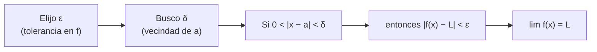

# B09-C01 — Límites de funciones reales

<!-- nav:top -->
[🏠 Programa](../../../../README.md) · [📚 Bloque B09](../../../tronco-comun/B09-calculo-diferencial-e-integral.md) · [← Anterior: B08-C20 — Proyecto de campaña de observación nocturna](../../B08/B08-C20-proyecto-de-campana-de-observacion-nocturna/CLASE.md) · [Siguiente: B09-C02 — Continuidad y discontinuidad →](../B09-C02-continuidad-y-discontinuidad/CLASE.md)
<!-- /nav -->

## 1. Ubicación, nivel y alcance

Primera clase del bloque B09 y del área A02. En [B04-C04](../../B04/B04-C04-funciones-y-graficas/CLASE.md) aprendiste a leer funciones y gráficas, y en [B04-C06](../../B04/B04-C06-identidades-trigonometricas/CLASE.md) las identidades trigonométricas. Aquí damos el paso que separa el álgebra del cálculo: preguntar **a qué valor se acerca una función cuando su variable se acerca a un punto**, sin exigir que llegue. Nivel N1 → N2. Verás límites numéricos y algebraicos, límites laterales, el límite fundamental `sin t / t`, la idea de ε y δ, y un problema numérico real (la cancelación). No verás derivadas (C03) ni demostraciones formales completas.

## 2. Por qué esta clase existe

Los astrónomos miden distancias a estrellas cercanas por **paralaje**: un ángulo diminuto, de fracciones de segundo de arco. Con ángulos tan pequeños, `sin t`, `tan t` y `t` casi coinciden, y casi todos los cálculos prácticos los sustituyen. Pero «casi» necesita una medida: ¿cuánto error se comete y cuándo deja de ser aceptable?

La decisión central: **¿cuándo puedo reemplazar `sin t` o `tan t` por `t`, y qué hago cuando una expresión da `0/0`?** El límite es la herramienta que responde ambas preguntas.

## 3. Lo que podrás hacer al terminar

1. Estimar un límite con una tabla de valores y confirmarlo con álgebra.
2. Calcular límites laterales y decidir si el límite existe.
3. Resolver formas `0/0` factorizando o multiplicando por el conjugado.
4. Usar `lim sin t / t = 1` y `lim (1 − cos t)/t² = 1/2`.
5. Hallar un `δ` para un `ε` dado en un caso concreto.
6. Detectar y evitar la pérdida de cifras por cancelación en un computador.

La evidencia es la **tabla ángulo–aproximación–error** del ejercicio 12 (sección 20).

## 4. Con qué llegas y cómo comprobarlo

Necesitas álgebra, funciones, trigonometría básica y notación científica. Cinco preguntas:

1. Factoriza `x² − 9`.
2. ¿Cuántos radianes son 180°?
3. ¿Cuánto vale `sin 30°`?
4. Escribe `0,000 004 85` en notación científica.
5. ¿Qué pasa con `1/x` cuando `x` es muy grande?

<details>
<summary>Ver respuestas</summary>

1. `(x − 3)(x + 3)`. 2. `π`. 3. `1/2`. 4. `4,85 × 10⁻⁶`. 5. Se acerca a 0.
</details>

Con cuatro o cinco aciertos, sigue; si no, repasa B04-C01 y B04-C04.

## 5. Un caso real: el ángulo de un segundo de arco

Un **segundo de arco** (1″) es 1/3600 de grado, es decir `π/648 000 rad = 4,848 × 10⁻⁶ rad`. Un objeto cuya paralaje es 1″ está, por definición del parsec, a 1 pc; con la unidad astronómica `1 au = 1,495 978 707 × 10¹¹ m` (S2) eso equivale a `3,0857 × 10¹⁶ m`. El programa define `1 pc = 648 000/π au` (como en B01-C02, no releída aquí); el laboratorio comprueba que ese número coincide con `1/tan(1″)` hasta 8 partes en 10¹². Esa coincidencia casi perfecta es el límite `tan t / t → 1` en acción. El segundo ejemplo es el Sol: su diámetro angular visto desde 1 au sale de `2R/d` con el radio nominal de la IAU `6,957 × 10⁸ m` (S3).

## 6. Vocabulario

Una **función** asigna a cada `x` un único `f(x)`. El **límite** de `f(x)` cuando `x` tiende a `a`, escrito `lim_{x→a} f(x) = L`, significa que `f(x)` se acerca a `L` tanto como se quiera al acercar `x` a `a`, **sin importar el valor de `f` en `a`** (S1). El **límite lateral** por la izquierda (`x → a⁻`) o por la derecha (`x → a⁺`) acerca `x` solo desde un lado. Una **forma indeterminada** `0/0` es un cociente cuyo numerador y denominador tienden ambos a 0: no dice nada por sí sola. Un **radián** es el ángulo cuyo arco mide un radio. Una **cancelación** numérica es la pérdida de cifras al restar números casi iguales.

## 7. Modelo mental: un túnel que se estrecha

Imagina un túnel horizontal de altura `2ε` alrededor del valor `L`. Decir que el límite es `L` es afirmar que, por pequeño que sea el túnel, existe un intervalo `δ` alrededor de `a` dentro del cual la gráfica no se sale. Importa la vecindad de `a`, no el punto `a`.



*Descripción textual:* primero se fija una tolerancia ε en la salida; luego se busca una vecindad δ de la entrada que la garantice; si siempre se puede, el límite es `L`.

Analogía: acercarse a una puerta sin cruzarla: lo que ves desde afuera define la puerta. Su límite: en el cálculo, el punto `a` mismo puede estar vacío (la función puede no estar definida allí) y aun así el límite existir.

## 8. La explicación, paso a paso

### 8.1 Primero, la tabla

Para `f(x) = (x² − 9)/(x − 3)` no se puede evaluar en `x = 3` (da `0/0`). Evalúa `x = 2,9; 2,99; 3,01`: `5,9; 5,99; 6,01`. La tabla sugiere 6. La tabla **sugiere**, no demuestra.

### 8.2 Luego, el álgebra

Para `x ≠ 3`: `(x² − 9)/(x − 3) = (x − 3)(x + 3)/(x − 3) = x + 3`. Ahora el límite es evidente: `6`. Con raíces se multiplica por el conjugado: `(√(1 + x) − 1)/x = 1/(√(1 + x) + 1)` → `1/2`.

### 8.3 Reglas de los límites

Si existen `lim f = L` y `lim g = M`: el límite de una suma, producto o cociente (con `M ≠ 0`) es la suma, el producto o el cociente de los límites (S1, §1.4(ii)). Una función continua se evalúa directo; lo difícil son los casos `0/0`.

### 8.4 Límites laterales

`lim_{x→a} f(x)` existe si y solo si los dos laterales existen y son iguales. Para `|x|/x`: por la izquierda vale −1 y por la derecha +1: no hay límite en 0. Para `1/x`: por la derecha crece sin cota, por la izquierda decrece sin cota: tampoco hay límite finito.

### 8.5 El límite fundamental

Con `t` en **radianes**, `lim_{t→0} sin t / t = 1`. Intuición geométrica: en un círculo de radio 1, el arco `t` y la cuerda vertical `sin t` se igualan al achicar `t`. De ahí: `tan t / t = (sin t / t)(1/cos t) → 1` y `(1 − cos t)/t² = 1/(1 + cos t) · (sin t / t)² → 1/2`. El tamaño del error, útil en la práctica, viene de la serie (C14): `sin t / t ≈ 1 − t²/6` y `tan t / t ≈ 1 + t²/3`. Con 1° (`t = 0,017 453 rad`) el error relativo de `sin t ≈ t` es `5,1 × 10⁻⁵` y el de `tan t ≈ t`, `1,0 × 10⁻⁴`.

### 8.6 ε y δ en un caso

Para `sin t / t`, como `1 − sin t / t ≈ t²/6`, basta `t < √(6ε)`. Con `ε = 10⁻⁶`, `δ = 2,449 × 10⁻³ rad = 505″`. Así, para ángulos menores que unos 8 minutos de arco, el error de la aproximación es menor que una parte en un millón.

### 8.7 El límite en el computador

En doble precisión (unas 16 cifras), `1 − cos t` para `t = 10⁻⁸` da `0`, porque `cos t` se redondea a 1. Reescribiendo `1 − cos t = 2 sin²(t/2)` se evita restar números casi iguales y sale `0,5` en `(1 − cos t)/t²`. El límite matemático es correcto; la fórmula ingenua falla en la máquina.

## 9. Magnitudes, símbolos y unidades

| Símbolo | Qué es | Unidad | Nota |
|---|---|---|---|
| `t`, `θ` | ángulo | rad | `1″ = π/648 000 rad` |
| `f(x)` | función | según el caso | |
| `a` | punto al que tiende `x` | como `x` | |
| `L` | valor del límite | como `f` | |
| `ε`, `δ` | tolerancias en salida y entrada | como `f` y `x` | `δ = √(6ε)` en `sin t / t` |
| `1 au` | unidad astronómica | m | `1,495 978 707 × 10¹¹` (S2) |
| `R_☉^N` | radio solar nominal | m | `6,957 × 10⁸` (S3), conversión |

## 10. Convenciones y referencias

Los ángulos de los límites trigonométricos van **siempre en radianes**; con grados el límite `sin t / t` no vale 1 sino `π/180`. Los segundos de arco se convierten a radianes antes de operar. `lim` sin lado significa ambos lados. El radio solar y la unidad astronómica son valores **convencionales** (conversión), no medidas de esta clase.

## 11. De dónde sale lo que afirmamos

| ID | Fuente | Localizador | Respalda | Estado |
|---|---|---|---|---|
| S1 | NIST, *Digital Library of Mathematical Functions* (DLMF) §1.4, versión 1.2.8 | https://dlmf.nist.gov/1.4 | Límites, continuidad y regla de L'Hôpital (§1.4(ii), ecs. 1.4.1–1.4.3, 1.4.14–1.4.15) | Página consultada el 2026-11-05 mediante extracción automática; ecuaciones citadas según esa extracción |
| S2 | IERS, *IERS Conventions (2010)*, TN36, tabla de constantes | https://iers-conventions.obspm.fr/content/tn36.pdf | `1 au = 1,495 978 707 × 10¹¹ m` | Texto extraído del PDF el 2026-11-05 |
| S3 | IAU, Resolución B3 de 2015, arXiv:1510.07674 | https://arxiv.org/pdf/1510.07674 | `R_☉^N = 6,957 × 10⁸ m` | Texto extraído del PDF el 2026-11-05 |

Límites: las deducciones de este texto (cotas por serie, `δ = √(6ε)`) son cálculos propios que el laboratorio comprueba; no son citas de S1. La definición del parsec se toma del programa (B01-C02) y no se releyó en fuente primaria en esta clase. Los ángulos de paralaje son **sintéticos**.

## 12. Cómo ver el límite

Equivalente accesible a una gráfica de `sin t / t` frente a `t`:

| Ángulo | `t` (rad) | `sin t / t` | `tan t / t` |
|---|---|---|---|
| 1° | `1,7453 × 10⁻²` | 0,999 949 | 1,000 102 |
| 1′ | `2,9089 × 10⁻⁴` | 0,999 999 986 | 1,000 000 028 |
| 1″ | `4,8481 × 10⁻⁶` | 0,999 999 999 996 | 1,000 000 000 008 |

Descripción larga: la curva `sin t / t` es una colina suave que vale 1 en `t = 0` (valor que se le asigna por continuidad) y baja con simetría hacia ambos lados; a 1° ya es imposible distinguirla de 1 a simple vista.

## 13. Ejemplo trabajado: ¿puedo usar `d = 1/p`?

Un astrónomo (hipotético) recibe una paralaje **sintética** `p = 0,1″` y quiere la distancia con `d = 1 au / tan p`.

**Paso 1 · Radianes.** `p = 0,1 × 4,848 × 10⁻⁶ = 4,848 × 10⁻⁷ rad`.

**Paso 2 · Aproximación.** `tan p ≈ p`, con error relativo `p²/3 = 7,8 × 10⁻¹⁴`.

**Paso 3 · Distancia.** `d = 1/p` (en au) `= 2,0626 × 10⁶ au = 10,000 pc`.

**Paso 4 · Decisión.** El error de la aproximación es mucho menor que la incertidumbre de cualquier medida de paralaje, de modo que usar `d = 1/p` es legítimo. El laboratorio da 10,000000 pc con `tan` y con `1/p`.

**Paso 5 · Contraste.** Con un ángulo de 1° la misma aproximación tendría error de `10⁻⁴`; con 30° ya no es aceptable. La aproximación depende del tamaño del ángulo, no del problema.

## 14. Distintas formas de calcular un límite

La **tabla de valores** es rápida y da intuición, pero puede engañar si el comportamiento cambia más cerca de `a`. El **álgebra** (factorizar, conjugado) es exacta cuando funciona. El **límite fundamental** resuelve las trigonométricas. La **regla de L'Hôpital** (S1) usa derivadas y se verá en C03–C04. El **cálculo numérico** con `ε` pequeñísimo es una comprobación, pero la aritmética finita puede fallar (8.7). Las cuatro deben coincidir; si no, hay un error.

## 15. Práctica guiada

**Ejercicio 1 · con los pasos indicados.** Calcula `lim_{x→3} (x² − 9)/(x − 3)`. *Pasos:* (a) evalúa en 2,99 y 3,01; (b) factoriza; (c) simplifica.

<details><summary>Solución comentada</summary>

(a) `5,99` y `6,01`. (b)–(c) `(x − 3)(x + 3)/(x − 3) = x + 3` para `x ≠ 3`; el límite es `6`. La función no está definida en 3, pero el límite sí existe (sección 8.2).
</details>

**Ejercicio 2 · con una pista.** Calcula `lim_{t→0} sin(5t)/t`. *Pista:* escribe `u = 5t`.

<details><summary>Solución comentada</summary>

`sin(5t)/t = 5 · sin(u)/u` con `u → 0`; el límite es `5 · 1 = 5`. Un cálculo propio con `t = 10⁻⁶` da 4,999999999979. Comprueba: el 5 sale de la escala del argumento.
</details>

**Ejercicio 3 · casi autónomo.** Una paralaje sintética de 0,5″ se usa con `tan p ≈ p`. ¿Cuál es el error relativo?

<details><summary>Solución comentada</summary>

`p = 0,5 × 4,848 × 10⁻⁶ = 2,424 × 10⁻⁶ rad`. Error `≈ p²/3 = 1,96 × 10⁻¹²` (sección 8.5). Insignificante.
</details>

## 16. Práctica autónoma, transferencia e integrador

**Ejercicio 4.** Calcula `lim_{x→0} (√(1 + x) − 1)/x`.

<details><summary>Solución comentada</summary>

Multiplica arriba y abajo por el conjugado: `x/[x(√(1 + x) + 1)] = 1/(√(1 + x) + 1) → 1/2` (sección 8.2).
</details>

**Ejercicio 5.** ¿Existe `lim_{x→0} |x|/x`? Calcula los límites laterales.

<details><summary>Solución comentada</summary>

Izquierda: `|x| = −x`, cociente −1. Derecha: +1. Distintos: el límite no existe (8.4).
</details>

**Ejercicio 6.** Calcula `lim_{t→0} tan t / t`.

<details><summary>Solución comentada</summary>

`tan t / t = (sin t / t)(1/cos t) → 1 · 1 = 1` (8.5).
</details>

**Ejercicio 7.** Calcula `lim_{x→∞} (3x² + 1)/(x² + 5)`. *Pista:* divide por `x²`.

<details><summary>Solución comentada</summary>

`(3 + 1/x²)/(1 + 5/x²) → 3/1 = 3`, porque `1/x²` y `5/x²` tienden a 0 (pregunta 5 de la sección 4).
</details>

**Ejercicio 8.** Halla un `δ` tal que `|sin t / t − 1| < 10⁻⁴` si `|t| < δ`.

<details><summary>Solución comentada</summary>

`δ = √(6 · 10⁻⁴) = 0,0245 rad ≈ 1,40°` (8.6). Para `t` más pequeño, el error es menor aún.
</details>

**Ejercicio 9 · transferencia.** Con el radio nominal del Sol (`6,957 × 10⁸ m`, S3) y `1 au` (S2), calcula el diámetro angular del Sol con `2R/d` y compáralo con `2 arctan(R/d)`.

<details><summary>Solución comentada</summary>

`R/d = 4,6504 × 10⁻³`. Aproximado: `2R/d = 9,30093 × 10⁻³ rad`; con el exacto `2 arctan(R/d)` el valor es `9,30087 × 10⁻³ rad = 0,5329° = 1918,4″`. Error relativo `7,2 × 10⁻⁶` (≈ `(R/d)²/3`). Resultado indicativo, calculado con cifras nominales (conversión, no medición).
</details>

**Ejercicio 10 · transferencia.** Un compañero evalúa `(1 − cos t)/t²` con `t = 10⁻⁹` y obtiene 0. ¿Qué pasó y cómo lo corriges?

<details><summary>Solución comentada</summary>

`cos(10⁻⁹) = 1 − 5 × 10⁻¹⁹`, que en doble precisión se redondea a 1; la resta da 0. Se corrige con `2 sin²(t/2)/t²`, que da 0,5. Lección: el límite correcto (1/2) no basta; hay que elegir la fórmula numéricamente estable (laboratorio, sección 17).
</details>

**Ejercicio 11 · transferencia.** Un texto afirma: «cuando la distancia tiende a cero, el flujo `1/d²` tiende a infinito, es decir, existe el límite infinito». Evalúa si es riguroso y discute el modelo.

<details><summary>Solución comentada</summary>

`1/d²` crece sin cota por ambos lados; se dice que *diverge a infinito* (el límite, como número real, no existe). Físicamente el modelo de fuente puntual deja de valer al llegar a la superficie del objeto: el dominio de validez termina antes de que el límite importe.
</details>

**Ejercicio 12 · integrador.** Elabora tu *tabla ángulo–aproximación–error* (sección 20) para 1°, 1′, 1″ y 1 mas (milisegundo de arco): `t` en rad, error relativo de `sin t ≈ t` y de `tan t ≈ t` por la serie, y marca cuál es el primero con error menor que `10⁻¹⁵`.

<details><summary>Solución modelo</summary>

Errores `t²/6` y `t²/3`: 1° → `5,1 × 10⁻⁵` y `1,0 × 10⁻⁴`; 1′ → `1,4 × 10⁻⁸` y `2,8 × 10⁻⁸`; 1″ → `3,9 × 10⁻¹²` y `7,8 × 10⁻¹²`; 1 mas (`4,848 × 10⁻⁹ rad`) → `3,9 × 10⁻¹⁸` y `7,8 × 10⁻¹⁸`, el primero bajo `10⁻¹⁵`. Se declara que los ángulos son sintéticos y que la comprobación numérica usó el script.
</details>

## 17. Laboratorio: el ángulo pequeño y la cancelación

El script [limite_de_angulo_pequeno.py](limite_de_angulo_pequeno.py) tabula `sin t / t` y `tan t / t`, comprueba la cota de la serie, halla el `δ` de `ε = 10⁻⁶`, verifica `1/tan(1″)` frente a `648 000/π` y muestra la cancelación en `(1 − cos t)/t²`. Se detiene si una prueba falla.

**Datos:** ángulos sintéticos; sin datos observados. **Predice antes de ejecutar:** ¿qué valor dará la fórmula ingenua con `t = 10⁻⁸`? (0.) **Ejecución del 2026-11-05 (Python 3.12.9):**

```text
epsilon = 1e-06  ->  delta = 2.449490e-03 rad = 505.2 arcsec
1 pc por 1/tan(1") = 206264.806245 au;  648000/pi = 206264.806247 au;  dif. relativa = 7.83e-12
Paralaje sintética 0.1" -> d = 10.000000 pc (aprox. 1/p: 10.000000 pc)
   1e-04        0.499999996961265        0.499999999583333
   1e-08        0.000000000000000        0.500000000000000
Pruebas superadas.
```

```bash
python programa/clases/B09/B09-C01-limites-de-funciones-reales/limite_de_angulo_pequeno.py
```

**Límites:** aritmética de doble precisión; no sustituye una demostración; sin datos de misión.

## 18. Errores frecuentes y cómo corregirlos

**Evaluar y rendirse ante `0/0`.** Se corrige con el ejercicio 1.

**Usar grados en `sin t / t`.** Se corrige releyendo la sección 10 y con el ejercicio 2.

**Afirmar que el límite existe porque la tabla «se ve» estable.** Se corrige con el ejercicio 5.

**Confundir el valor de `f(a)` con el límite.** Se corrige con la sección 8.1: la función puede ni estar definida en `a`.

**Restar números casi iguales sin pensarlo.** Se corrige con el ejercicio 10.

## 19. Cómo sabrás que vas bien

Tras 8.2: ¿resuelves `(x² − 9)/(x − 3)` sin calculadora? Si no, ejercicio 1. Tras 8.4: ¿decides si `|x|/x` tiene límite? Si no, ejercicio 5. Tras 8.5: ¿cuál es el error de `tan t ≈ t` a 1″? Si no sabes, ejercicio 12. Tras el laboratorio: ¿por qué falla la fórmula ingenua? Si no lo sabes, relee 8.7.

## 20. Qué entregas y cómo se evalúa

El producto es tu **tabla ángulo–aproximación–error** (ejercicio 12).

| Criterio | Inicial | En desarrollo | Logrado | Destacado |
|---|---|---|---|---|
| Cálculo de límites | Solo evalúa | Tabla sin álgebra | Álgebra y tabla coinciden | Usa ε y δ |
| Radianes | Mezcla grados | Convierte con error | Convierte siempre | Explica por qué importa |
| Error de aproximación | Sin cifra | Estima | Usa `t²/6` y `t²/3` | Justifica el umbral |
| Comprobación | Ausente | Mental | Ejecuta el script | Explica una discrepancia |
| Fuentes | Sin fuente | Sin fecha | Con localizador y fecha | Rotula sintéticos |

**Condiciones críticas (no se compensan con promedio):** declarar que los ángulos son radianes; rotular lo sintético; citar solo fuentes consultadas.

## 21. Ética, seguridad y límites

Una aproximación sin cota de error es una afirmación sin respaldo: en navegación o en una medida de distancia puede ocultar un error mayor que la incertidumbre del dato. No se debe presentar el ejercicio de paralaje como una medición real. Accesibilidad: fórmulas en texto, tablas equivalentes a las gráficas, ejercicios sin conexión.

## 22. Para cerrar y seguir

Un límite describe a qué se acerca una función, no dónde vale; los laterales deciden si existe; `sin t / t → 1` justifica el ángulo pequeño y su error es del orden de `t²`. Queda abierta una pregunta: cuando la función **sí** vale en el punto, ¿coincide con el límite? Eso es la continuidad.

**Glosario español–inglés.** límite · *limit*; límite lateral · *one-sided limit*; forma indeterminada · *indeterminate form*; segundo de arco · *arcsecond*; paralaje · *parallax*; cancelación · *cancellation*; aproximación de ángulo pequeño · *small-angle approximation*.

**Continuidad.** B09-C02 reutiliza tu capacidad de **comparar el límite con el valor de la función** para definir continuidad y clasificar discontinuidades.

**Referencias:** ver sección 11.

<!-- nav:bottom -->
---

[← Anterior: B08-C20 — Proyecto de campaña de observación nocturna](../../B08/B08-C20-proyecto-de-campana-de-observacion-nocturna/CLASE.md) · [📚 Bloque B09](../../../tronco-comun/B09-calculo-diferencial-e-integral.md) · [Siguiente: B09-C02 — Continuidad y discontinuidad →](../B09-C02-continuidad-y-discontinuidad/CLASE.md)
<!-- /nav -->
