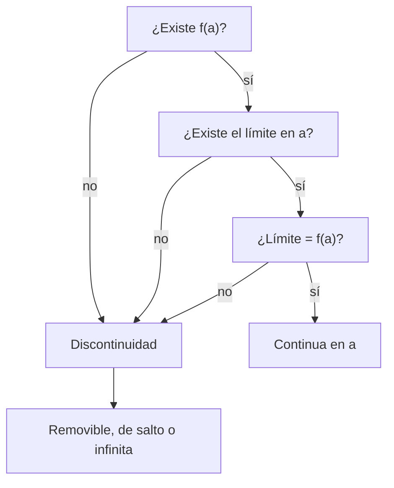

# B09-C02 — Continuidad y discontinuidad

<!-- nav:top -->
[🏠 Programa](../../../../README.md) · [📚 Bloque B09](../../../tronco-comun/B09-calculo-diferencial-e-integral.md) · [← Anterior: B09-C01 — Límites de funciones reales](../B09-C01-limites-de-funciones-reales/CLASE.md) · [Siguiente: B09-C03 — Derivada como tasa de cambio →](../B09-C03-derivada-como-tasa-de-cambio/CLASE.md)
<!-- /nav -->

## 1. Ubicación, nivel y alcance

Segunda clase del bloque B09. En la [clase anterior](../B09-C01-limites-de-funciones-reales/CLASE.md) aprendiste que un límite no depende del valor de la función en el punto. Ahora preguntas lo contrario: **¿cuándo coinciden el límite y el valor?** Eso es la continuidad. Nivel N2. Verás la definición, los tres tipos de discontinuidad, el teorema del valor intermedio y su uso como algoritmo (bisección). No verás derivadas (C03) ni análisis formal de convergencia.

## 2. Por qué esta clase existe

Un vehículo espacial cambia de masa de dos maneras: gradualmente, al quemar propelente, y de golpe, al soltar una etapa vacía. Un modelo de trayectoria que ignore los saltos integra mal; uno que los trate como suaves, también. Saber **dónde una cantidad es continua y dónde no** decide cómo se simula y qué teoremas se pueden usar.

La decisión central: **¿puedo usar un teorema (por ejemplo, «si pasa de 15 a 30 m/s², pasó por 25») sobre este intervalo, o hay un salto que lo impide?** La respuesta pide clasificar las discontinuidades.

## 3. Lo que podrás hacer al terminar

1. Comprobar la continuidad de una función en un punto con la definición.
2. Clasificar una discontinuidad como removible, de salto o infinita.
3. Calcular el valor que hace continua una función definida por tramos.
4. Aplicar el teorema del valor intermedio y localizar una raíz por bisección.
5. Modelar un salto de masa y empuje con límites laterales.
6. Decir cuándo un salto es físico y cuándo es una idealización.

La evidencia es la **tabla de discontinuidades de un vehículo sintético** del ejercicio 12 (sección 20).

## 4. Con qué llegas y cómo comprobarlo

Necesitas límites y límites laterales ([C01](../B09-C01-limites-de-funciones-reales/CLASE.md)). Cinco preguntas:

1. ¿Cuánto vale `lim_{x→2} (x² + 1)`?
2. ¿Qué es un límite lateral?
3. Si `f(x) = x + 3` para `x ≠ 3`, ¿a qué tiende `f` en 3?
4. ¿Cuánto vale `lim_{t→0} sin t / t`?
5. ¿Cuánto es `5 × 10⁵ / 2,5 × 10⁴`?

<details>
<summary>Ver respuestas</summary>

1. 5. 2. El límite acercándose por un solo lado. 3. 6. 4. 1. 5. 20.
</details>

Con cuatro o cinco aciertos, sigue; si no, repasa C01.

## 5. Un caso real: etapas que se sueltan

Los lanzadores de varias etapas reducen su masa soltando estructura vacía: en el instante de la separación la masa total baja de golpe y el empuje cambia porque se enciende otro motor. Es una práctica de ingeniería conocida; **todas las cifras de esta clase son sintéticas** (no describen ningún vehículo real) y se usan solo para ver el efecto matemático. Nuestro vehículo: masa inicial `100 000 kg`, la etapa 1 consume `500 kg/s` durante 100 s con empuje `1,5 × 10⁶ N`; en `t = 100 s` suelta `8 000 kg` de estructura; la etapa 2 consume `120 kg/s` con empuje `4,0 × 10⁵ N` hasta `t = 250 s`. La **aceleración propia** es `a = T/m` (empuje entre masa; sin gravedad ni arrastre).

## 6. Vocabulario

Una función `f` es **continua en `a`** si existen `f(a)` y `lim_{x→a} f(x)` y son iguales (S1, §1.4(ii)). Si falla, hay una **discontinuidad**: **removible** (el límite existe pero no coincide con `f(a)` o `f(a)` no existe), **de salto** (existen ambos límites laterales y son distintos) o **infinita** (la función crece sin cota). Una función es **continua por tramos** si lo es salvo en un número finito de saltos. El **teorema del valor intermedio** (TVI) dice que una función continua en `[a, b]` toma todos los valores entre `f(a)` y `f(b)`. La **bisección** es el algoritmo que lo usa: reduce a la mitad el intervalo que contiene la raíz.

## 7. Modelo mental: dibujar sin levantar el lápiz

Una función continua en un intervalo se dibuja sin levantar el lápiz. Cada tipo de discontinuidad es una razón para levantarlo: un hueco (removible), un salto de nivel (salto) o una subida al infinito (infinita).



*Descripción textual:* se comprueban en orden tres condiciones; si falla alguna, la discontinuidad se clasifica según los límites laterales.

Analogía: una carretera con un escalón. Su límite: una función puede ser continua y tener esquina (el valor cambia suave pero la pendiente salta); eso se verá en C03.

## 8. La explicación, paso a paso

### 8.1 Continuidad en un punto

Para comprobar que `f(x) = x² + 1` es continua en 2: `f(2) = 5`, el límite es 5, coinciden. Para polinomios, exponenciales, senos y cosenos basta evaluar; sumas, productos y composiciones de funciones continuas son continuas (S1).

### 8.2 Los tres tipos

`g(x) = (x² − 4)/(x − 2)` no existe en 2, pero su límite es 4: **removible**; se repara definiendo `g(2) = 4`. `h(x) = |x|/x` tiene límites −1 y +1 en 0: **salto** de tamaño 2. `k(x) = 1/(x − 1)` crece sin cota cerca de 1: **infinita**.

### 8.3 Funciones por tramos

Para que `f(x) = cx + 1` si `x < 2` y `x²` si `x ≥ 2` sea continua en 2, se igualan los límites laterales: `2c + 1 = 4`, luego `c = 3/2`. Cada vez que una variable cambia de régimen (de etapa, de capa, de modelo) se hace este chequeo.

### 8.4 El vehículo sintético

Dentro de cada etapa, `m(t)` y `a(t) = T/m(t)` son continuas (son cocientes de funciones continuas con denominador positivo). En `t = 100 s`: `m(100⁻) = 50 000 kg`, `m(100⁺) = 42 000 kg`, salto de `−8 000 kg`; `T` salta de `1,5 × 10⁶` a `4,0 × 10⁵ N`; `a` pasa de `30` a `9,524 m/s²`, salto de `−20,48 m/s²`.

### 8.5 Valor intermedio y bisección

En la etapa 1, `a(0) = 15` y `a(100⁻) = 30 m/s²`. Como `a` es continua en `[0, 100)`, toma el valor `2,5 g_n = 24,517 m/s²` (con `g_n = 9,806 65 m/s²`, exacta, S2). ¿Cuándo? Resolver `T/m = 24,517` da `m = 61 186 kg` y `t = 77,634 s`. La bisección encuentra lo mismo sin despejar: parte de un intervalo donde `a − 24,517` cambia de signo, lo parte por la mitad y se queda con la mitad que sigue cambiando de signo.

### 8.6 Cuándo el TVI no vale

Entre `t = 99` y `t = 101` la aceleración pasa de 29,7 a 9,5, pero nunca vale 20: hay un salto en el medio. Aplicar el TVI a un intervalo con discontinuidad produce conclusiones falsas. Otro ejemplo: `1/x` cambia de signo entre −1 y 1 sin tener raíz.

### 8.7 Salto físico o idealización

La masa real cambia en un tiempo finito (aunque muy corto). El salto es un modelo útil si el tiempo de separación es mucho menor que el paso de tiempo del cálculo; si no, hay que modelar la transición.

## 9. Magnitudes, símbolos y unidades

| Símbolo | Qué es | Unidad | Nota |
|---|---|---|---|
| `m(t)` | masa del vehículo | kg | sintética |
| `T(t)` | empuje | N | sintético |
| `a(t)` | aceleración propia `T/m` | m/s² | sin gravedad ni arrastre |
| `ṁ` | caudal de masa quemada | kg/s | 500 y 120 (sintéticos) |
| `t_s` | instante de separación | s | 100 |
| `g_n` | aceleración estándar | m/s² | 9,806 65, exacta (S2) |
| `f(a⁻)`, `f(a⁺)` | límites laterales | como `f` | |

## 10. Convenciones y referencias

El tiempo `t` se mide desde el encendido (`t = 0`). Se usa `m(t_s⁻)` para el valor justo antes y `m(t_s⁺)` justo después. La aceleración propia excluye la gravedad. `g_n` se usa solo como unidad de aceleración («g»), no como gravedad local.

## 11. De dónde sale lo que afirmamos

| ID | Fuente | Localizador | Respalda | Estado |
|---|---|---|---|---|
| S1 | NIST, *Digital Library of Mathematical Functions* §1.4, versión 1.2.8 | https://dlmf.nist.gov/1.4 | Continuidad, discontinuidades y continuidad por tramos (§1.4(ii), ecs. 1.4.1–1.4.3) | Consultada el 2026-11-05 mediante extracción automática |
| S2 | NIST, CODATA 2022, constante `g_n` | https://physics.nist.gov/cgi-bin/cuu/Value?gn | `g_n = 9,806 65 m s⁻²`, exacta | Consultada el 2026-11-05 |

Límites: las cifras del vehículo son **sintéticas**; el enunciado del TVI se cita como resultado estándar del cálculo y no se extrajo su número de ecuación de S1.

## 12. Cómo ver la discontinuidad

Equivalente accesible a una gráfica de `a(t)` (valores calculados por el laboratorio):

| `t` (s) | `m` (kg) | `T` (N) | `a` (m/s²) |
|---|---|---|---|
| 0 | 100 000 | 1,5 × 10⁶ | 15,00 |
| 50 | 75 000 | 1,5 × 10⁶ | 20,00 |
| 100⁻ | 50 000 | 1,5 × 10⁶ | 30,00 |
| 100⁺ | 42 000 | 4,0 × 10⁵ | 9,52 |
| 250 | 24 000 | 4,0 × 10⁵ | 16,67 |

Descripción larga: la gráfica sube de 15 a 30 m/s², cae de golpe a 9,5 y vuelve a subir hasta 16,7; el salto de 100 s es el único corte.

## 13. Ejemplo trabajado: ¿cuándo se llega a 2,5 g?

**Paso 1 · Datos.** Etapa 1: `a(t) = 1,5 × 10⁶/(10⁵ − 500 t)`, `0 ≤ t < 100 s`. Objetivo: `a = 2,5 g_n = 24,51662 m/s²`.

**Paso 2 · Continuidad.** `a` es continua en `[0, 100)` y `a(0) = 15 < 24,5 < 30 = a(100⁻)`: el TVI garantiza un `t` en el intervalo.

**Paso 3 · Solución exacta.** `10⁵ − 500 t = 1,5 × 10⁶/24,51662 = 61 186,4`, luego `t = 77,6341 s`.

**Paso 4 · Bisección.** El laboratorio parte de `[0, 100)` y converge a `t = 77,634054443 s`, igual al exacto en nueve cifras decimales.

**Paso 5 · Sentido.** Con `t = 77,6 s` la masa es 61 183 kg: coherente con el consumo. Si se hubiera pedido `a = 12 m/s²`, la etapa 1 no lo alcanza (arranca en 15) y habría que buscarlo en la etapa 2.

## 14. Distintas formas de hallar un valor

El **despeje** es exacto si se puede; la **bisección** funciona para cualquier función continua con cambio de signo, pero converge lento (una cifra binaria por paso); los **métodos con derivada** (C03, C06) son más rápidos pero requieren más condiciones. La bisección es robusta: es la elección cuando importa que no falle.

## 15. Práctica guiada

**Ejercicio 1 · con los pasos indicados.** Clasifica `g(x) = (x² − 4)/(x − 2)` en `x = 2` y repárala. *Pasos:* calcula el límite; compara con `g(2)`.

<details><summary>Solución comentada</summary>

`g(x) = x + 2` para `x ≠ 2`; el límite es 4; `g(2)` no existe: **removible**. Se repara definiendo `g(2) = 4` (sección 8.2).
</details>

**Ejercicio 2 · con una pista.** Halla `c` para que `f(x) = cx + 1` (`x < 2`) y `f(x) = x²` (`x ≥ 2`) sea continua. *Pista:* iguala los límites laterales.

<details><summary>Solución comentada</summary>

Izquierda: `2c + 1`; derecha: `4`. `c = 3/2`. Comprobación: `f(2) = 4`. (8.3)
</details>

**Ejercicio 3 · casi autónomo.** En el vehículo sintético, calcula el salto de `a` en `t = 100 s` partiendo de los saltos de `m` y `T`.

<details><summary>Solución comentada</summary>

`a(100⁻) = 1,5 × 10⁶/50 000 = 30`; `a(100⁺) = 4,0 × 10⁵/42 000 = 9,524`; salto `= −20,48 m/s²` (8.4).
</details>

## 16. Práctica autónoma, transferencia e integrador

**Ejercicio 4.** Clasifica `k(x) = 1/(x − 1)` en `x = 1`.

<details><summary>Solución comentada</summary>

El valor crece sin cota por ambos lados con signos opuestos: **infinita**. No se puede reparar con un solo valor.
</details>

**Ejercicio 5.** Demuestra con el TVI que `x³ + x − 1 = 0` tiene una raíz en `(0, 1)` y haz tres pasos de bisección.

<details><summary>Solución comentada</summary>

`f(0) = −1 < 0 < 1 = f(1)` y `f` es continua: hay raíz. Punto medio 0,5: `f = −0,375` → `(0,5; 1)`. 0,75: `f = +0,172` → `(0,5; 0,75)`. 0,625: `f = −0,131` → `(0,625; 0,75)`. Raíz ≈ 0,68.
</details>

**Ejercicio 6.** ¿Cuándo vale `a = 2 g_n` en la etapa 1?

<details><summary>Solución comentada</summary>

`m = 1,5 × 10⁶/19,6133 = 76 479 kg`; `t = (10⁵ − 76 479)/500 = 47,04 s`.
</details>

**Ejercicio 7.** ¿Existe un `t` con `a = 12 m/s²`? ¿En qué etapa?

<details><summary>Solución comentada</summary>

La etapa 1 va de 15 a 30: no. La etapa 2 va de 9,52 a 16,67: sí. `m = 4 × 10⁵/12 = 33 333 kg`; `t = 100 + (42 000 − 33 333)/120 = 172,2 s`.
</details>

**Ejercicio 8.** Explica por qué el TVI no garantiza un `t` con `a = 20` entre 99 y 101 s, aunque `a(99) ≈ 29,7` y `a(101) ≈ 9,5`.

<details><summary>Solución comentada</summary>

`a` es discontinua en 100 s. El valor 20 se alcanza antes (en `t = 50 s`) pero no en ese intervalo: la hipótesis de continuidad falla.
</details>

**Ejercicio 9 · transferencia.** Un modelo de tránsito (**sintético**) supone que el flujo de una estrella baja de 1,000 a 0,990 de golpe. ¿Es una discontinuidad física?

<details><summary>Solución comentada</summary>

No: el planeta tarda un tiempo finito en cubrir el borde estelar, así que el flujo real es continuo. El salto es una idealización válida si la cadencia de medida es mucho mayor que la duración de la entrada; si no, el modelo oculta la forma real (8.7).
</details>

**Ejercicio 10 · transferencia.** Un sensor satura en 4095 cuentas: `y = min(x, 4095)`. ¿Es continuo en 4095? ¿Qué le ocurre a su pendiente?

<details><summary>Solución comentada</summary>

Continuo: ambos lados dan 4095. La pendiente vale 1 a la izquierda y 0 a la derecha: continuidad no implica suavidad (se retoma en C03).
</details>

**Ejercicio 11 · transferencia.** Un programa busca una raíz de `1/x` en `[−1, 1]` por bisección porque el signo cambia. ¿Qué ocurre?

<details><summary>Solución comentada</summary>

Converge al 0, que no es raíz (es una discontinuidad infinita). La bisección exige continuidad; el signo no basta. Comprobar siempre `|f|` pequeño en el resultado.
</details>

**Ejercicio 12 · integrador.** Elabora tu *tabla de discontinuidades de un vehículo sintético*: cambia las masas y empujes (declarándolos sintéticos), calcula `m`, `T` y `a` antes y después de la separación, clasifica cada salto y halla con bisección el instante en que `a = 2 g_n`, verificándolo con el despeje.

<details><summary>Solución modelo</summary>

Tabla con columnas `t`, `m`, `T`, `a`, tipo de discontinuidad; el instante por bisección y por fórmula coinciden dentro de la tolerancia; se declara que los datos son sintéticos y que se omiten gravedad y arrastre.
</details>

## 17. Laboratorio: saltos y valor intermedio

El script [saltos_y_valor_intermedio.py](saltos_y_valor_intermedio.py) calcula los límites laterales de `m`, `T` y `a` en la separación, verifica que el salto de masa es −8 000 kg, resuelve `a = 2,5 g_n` por bisección y lo compara con el despeje exacto, y comprueba la extensión continua de `sin x / x`.

**Datos:** vehículo sintético. **Predice antes de ejecutar:** ¿cuánto vale el salto de empuje? (−1,1 × 10⁶ N.) **Ejecución del 2026-11-05 (Python 3.12.9):**

```text
masa [kg]            izq=    50000.0000  der=    42000.0000  salto=    -8000.0000
empuje [N]           izq=  1500000.0000  der=   400000.0000  salto= -1100000.0000
aceleración [m/s2]   izq=       30.0000  der=        9.5238  salto=      -20.4762
a = 2.5 g_n = 24.51662 m/s2 en t = 77.634054443 s (exacto 77.634054443 s)
sin x/x: f(1e-6)=1.000000000000; f(0) redefinida=1.0
Pruebas superadas.
```

```bash
python programa/clases/B09/B09-C02-continuidad-y-discontinuidad/saltos_y_valor_intermedio.py
```

**Límites:** modelo sin gravedad ni arrastre; separación instantánea; datos sintéticos; no es una herramienta de diseño de vehículos.

## 18. Errores frecuentes y cómo corregirlos

**Creer que «definida» implica «continua».** Se corrige con el ejercicio 1.

**Aplicar el TVI a través de un salto.** Se corrige con el ejercicio 8.

**Confundir continuidad con suavidad.** Se corrige con el ejercicio 10.

**Usar bisección sin verificar la continuidad.** Se corrige con el ejercicio 11.

**Olvidar comprobar el valor de la función en el punto de empalme.** Se corrige con el ejercicio 2.

## 19. Cómo sabrás que vas bien

Tras 8.2: ¿clasificas `|x|/x` en 0? Si no, ejercicio 4 y 1. Tras 8.3: ¿encuentras `c`? Si no, ejercicio 2. Tras 8.5: ¿puedes hacer tres pasos de bisección? Si no, ejercicio 5. Tras el laboratorio: ¿qué prueba protege el resultado de la bisección? (la comparación con el despeje exacto).

## 20. Qué entregas y cómo se evalúa

El producto es tu **tabla de discontinuidades de un vehículo sintético** (ejercicio 12).

| Criterio | Inicial | En desarrollo | Logrado | Destacado |
|---|---|---|---|---|
| Definición de continuidad | No la usa | La enuncia | La aplica con límites | Distingue continuidad y suavidad |
| Clasificación | Sin tipo | Tipo sin justificar | Tipo con límites laterales | Propone cómo reparar |
| TVI y bisección | No los usa | Con ayuda | Correcto | Detecta cuándo no aplican |
| Comprobación | Ausente | Mental | Script y despeje | Analiza el paso de tiempo |
| Fuentes | Sin fuente | Sin fecha | Con localizador y fecha | Rotula sintéticos |

**Condiciones críticas (no se compensan con promedio):** rotular lo sintético; no aplicar el TVI a un intervalo con salto; citar solo fuentes consultadas.

## 21. Ética, seguridad y límites

Un salto idealizado puede ocultar un riesgo real (cargas durante la separación). Esta clase no sirve para diseñar ni evaluar vehículos: sus cifras son ilustrativas. Accesibilidad: tablas equivalentes a la gráfica, fórmulas en texto, ejercicios sin conexión.

## 22. Para cerrar y seguir

Una función es continua si el límite coincide con su valor; las discontinuidades son removibles, de salto o infinitas; el TVI y la bisección solo valen donde hay continuidad. Queda abierta una pregunta: dentro de un tramo continuo, ¿con qué rapidez cambia la función? Es la derivada.

**Glosario español–inglés.** continuidad · *continuity*; discontinuidad removible · *removable discontinuity*; discontinuidad de salto · *jump discontinuity*; teorema del valor intermedio · *intermediate value theorem*; bisección · *bisection*; aceleración propia · *proper acceleration (thrust acceleration)*.

**Continuidad.** B09-C03 reutiliza tu capacidad de **calcular límites de cocientes** para definir la derivada.

**Referencias:** ver sección 11.

<!-- nav:bottom -->
---

[← Anterior: B09-C01 — Límites de funciones reales](../B09-C01-limites-de-funciones-reales/CLASE.md) · [📚 Bloque B09](../../../tronco-comun/B09-calculo-diferencial-e-integral.md) · [Siguiente: B09-C03 — Derivada como tasa de cambio →](../B09-C03-derivada-como-tasa-de-cambio/CLASE.md)
<!-- /nav -->
