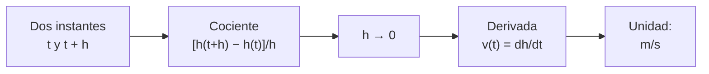

# B09-C03 — Derivada como tasa de cambio

<!-- nav:top -->
[🏠 Programa](../../../../README.md) · [📚 Bloque B09](../../../tronco-comun/B09-calculo-diferencial-e-integral.md) · [← Anterior: B09-C02 — Continuidad y discontinuidad](../B09-C02-continuidad-y-discontinuidad/CLASE.md) · [Siguiente: B09-C04 — Reglas de derivación →](../B09-C04-reglas-de-derivacion/CLASE.md)
<!-- /nav -->

## 1. Ubicación, nivel y alcance

Tercera clase del bloque B09. Usas el límite ([C01](../B09-C01-limites-de-funciones-reales/CLASE.md)) para dar sentido a algo que ya conoces: la velocidad como «distancia entre tiempo», pero **en un instante**, no en un intervalo. Nivel N2. Verás el cociente de diferencias, la derivada como su límite, la pendiente de la tangente, la derivada como tasa de cambio con unidades y cómo calcularla numéricamente (y cuándo falla). No verás las reglas de derivación (C04) ni las derivadas de funciones trigonométricas (C05).

## 2. Por qué esta clase existe

Casi toda cantidad en ciencias espaciales cambia con el tiempo o la posición: la altura de un cohete, la fase de una estrella variable, el brillo de un cometa. Lo que se quiere saber suele ser **con qué rapidez** cambia, y en qué instante deja de crecer. Medir «entre dos instantes» da un promedio; la derivada da el valor en un instante.

La decisión central: **¿cómo paso de la velocidad media a la velocidad instantánea, con qué unidades, y cómo sé cuánto confiar en un valor calculado numéricamente?**

## 3. Lo que podrás hacer al terminar

1. Calcular un cociente de diferencias e interpretarlo como tasa media.
2. Definir la derivada como límite y calcularla desde la definición en casos sencillos.
3. Interpretar la derivada como pendiente de la tangente y escribir la recta tangente.
4. Dar las unidades de una derivada y el significado de su signo.
5. Estimar derivadas numéricamente con cocientes progresivo y central y reconocer su error.
6. Reconocer una esquina donde la derivada no existe.

La evidencia es la **tabla de cocientes de diferencia con error y paso óptimo** del ejercicio 12 (sección 20).

## 4. Con qué llegas y cómo comprobarlo

Necesitas límites y funciones. Cinco preguntas:

1. ¿Cuánto vale `lim_{h→0} (2h)/h`?
2. Factoriza `(3 + h)² − 9` y simplifícalo dividiendo por `h`.
3. ¿Cuál es la pendiente de la recta que pasa por `(1, 2)` y `(3, 8)`?
4. ¿En qué unidades se mide la velocidad si la distancia está en metros y el tiempo en segundos?
5. ¿`|x|` es continua en 0?

<details>
<summary>Ver respuestas</summary>

1. 2. 2. `h(6 + h)/h = 6 + h`. 3. 3. 4. m/s. 5. Sí (C02).
</details>

Con cuatro o cinco aciertos, sigue; si no, repasa C01–C02.

## 5. Un caso real: lanzar algo hacia arriba en la Tierra

Un cuerpo lanzado hacia arriba con rapidez inicial `v₀` a poca altura sufre una aceleración hacia abajo `g = GM/R²`. Con los valores nominales de la IAU (2015), `(GM)_E^N = 3,986 004 × 10¹⁴ m³ s⁻²` y `R_eE^N = 6,3781 × 10⁶ m` (S2), sale `g = 9,7984 m/s²` en el ecuador, cerca del valor estándar `g_n = 9,806 65 m/s²` (S3) (la diferencia viene de la rotación y de que el radio nominal es el ecuatorial). Es una necesidad concreta: el cálculo de apogeos, tiempos de vuelo y velocidades de reentrada parte de esta derivada. Nuestro **ejemplo conductor** es un lanzamiento vertical **sintético** con `v₀ = 100 m/s`, sin arrastre ni rotación.

## 6. Vocabulario

El **cociente de diferencias** de `f` entre `x` y `x + h` es `[f(x + h) − f(x)]/h`: la tasa de cambio **media** en ese intervalo. La **derivada** de `f` en `x` es el límite de ese cociente cuando `h → 0`, escrita `f′(x)` o `df/dx` (S1, §1.4(iii), ec. 1.4.4). La **recta tangente** en `x₀` es la que pasa por `(x₀, f(x₀))` con pendiente `f′(x₀)`. La **tasa de cambio instantánea** es la derivada interpretada con unidades. Una función es **derivable** en un punto si ese límite existe. La **cancelación** (C01) afecta al cálculo numérico cuando `h` es muy pequeño.

## 7. Modelo mental: la secante que se vuelve tangente

Dos puntos de la gráfica definen una recta secante cuya pendiente es la tasa media. Al acercar el segundo punto al primero, la secante gira hasta apoyarse sobre la curva: la tangente. Su pendiente es la derivada.



*Descripción textual:* se toman dos instantes, se calcula la tasa media entre ellos, se reduce el intervalo hasta cero y el límite es la tasa instantánea, cuya unidad es la de la función dividida por la de la variable.

Analogía: el velocímetro de un auto frente al promedio del viaje. Su límite: un velocímetro real promedia en un intervalo corto; la derivada matemática es el límite ideal.

## 8. La explicación, paso a paso

### 8.1 Tasa media

Con `h(t) = v₀ t − ½ g t²` y `t` en s: entre `t = 0` y `t = 10 s` la altura pasa de 0 a `510,08 m`, tasa media `51,01 m/s`.

### 8.2 De la media al instante

Entre `t` y `t + Δt`: `[h(t + Δt) − h(t)]/Δt = v₀ − g t − ½ g Δt`. Al hacer `Δt → 0`, desaparece el último término y queda `v(t) = v₀ − g t`. En `t = 4 s`: `v = 100 − 9,7984 × 4 = 60,806 m/s`.

### 8.3 Definición general y ejemplos

`f′(x) = lim_{h→0} [f(x + h) − f(x)]/h` (S1). Para `f(x) = x²`: `[(x + h)² − x²]/h = 2x + h` → `2x`; en `x = 3`, `6`. Para `f(t) = 3t² − 2t` en `t = 2`: `[3(2 + h)² − 2(2 + h) − 8]/h = 10 + 3h` → `10`.

### 8.4 Tangente y aproximación lineal

La recta tangente en `t₀ = 4 s` es `h ≈ 321,613 + 60,806 (t − 4)`. Para `t = 4,5 s` da `352,016 m` frente a `350,791 m` exactos: el error `1,225 m = ½ g Δt²` es de orden `Δt²`. La aproximación lineal es buena cerca del punto.

### 8.5 Unidades y signo

La derivada de una altura (m) respecto al tiempo (s) está en m/s; la de la velocidad, en m/s²: `v′ = −g`. Signo positivo, subiendo; negativo, bajando; cero, instante de reposo: `v = 0` en `t = v₀/g = 10,206 s`, y la altura máxima es `v₀²/(2g) = 510,29 m`. En `t = 15 s`, `v = −46,98 m/s`: va descendiendo.

### 8.6 Derivar con el computador

Dos cocientes: el **progresivo** `[f(x + h) − f(x)]/h` tiene error de orden `h` (en nuestro caso exactamente `−g h/2`); el **central** `[f(x + h) − f(x − h)]/(2h)` tiene orden `h²`. Pero reducir `h` sin límite empeora el resultado: con `h = 10⁻¹²` el error sube a `1,6 × 10⁻² m/s` por redondeo y cancelación. Existe un `h` intermedio óptimo.

### 8.7 Cuando no existe

`|x|` en 0 es continua, pero los cocientes laterales valen −1 y +1: no es derivable allí (esquina). Continuidad es necesaria para derivar; no es suficiente.

## 9. Magnitudes, símbolos y unidades

| Símbolo | Qué es | Unidad | Nota |
|---|---|---|---|
| `h(t)` | altura | m | sintética |
| `v = dh/dt` | velocidad | m/s | positiva hacia arriba |
| `g` | aceleración de la gravedad | m/s² | `GM/R²` = 9,7984 (nominal) |
| `v₀` | rapidez inicial | m/s | 100 (sintética) |
| `Δt`, `h` | paso del cociente | s | según el caso |
| `(GM)_E^N` | parámetro nominal terrestre | m³/s² | `3,986 004 × 10¹⁴` (S2) |
| `R_eE^N` | radio ecuatorial nominal | m | `6,3781 × 10⁶` (S2) |

*Nota de notación:* se usa `h` tanto para la altura `h(t)` como para el paso `h` de la definición; el contexto lo distingue y en el laboratorio el paso se llama `dt`.

## 10. Convenciones y referencias

Eje vertical positivo hacia arriba, origen en el punto de lanzamiento, tiempo desde el lanzamiento. Los valores nominales de la IAU son factores de conversión, no estimaciones (S2). Esta clase no modela rotación terrestre, arrastre ni variación de `g` con la altura.

## 11. De dónde sale lo que afirmamos

| ID | Fuente | Localizador | Respalda | Estado |
|---|---|---|---|---|
| S1 | NIST, *Digital Library of Mathematical Functions* §1.4, versión 1.2.8 | https://dlmf.nist.gov/1.4 | Derivada como límite del cociente de diferencias (§1.4(iii), ec. 1.4.4) | Consultada el 2026-11-05 mediante extracción automática |
| S2 | IAU, Resolución B3 de 2015, arXiv:1510.07674 | https://arxiv.org/pdf/1510.07674 | `(GM)_E^N` y `R_eE^N` nominales | Texto extraído del PDF el 2026-11-05 |
| S3 | NIST, CODATA 2022, `g_n` | https://physics.nist.gov/cgi-bin/cuu/Value?gn | `g_n = 9,806 65 m s⁻²` exacta | Consultada el 2026-11-05 |
| S4 | IERS, *IERS Conventions (2010)*, TN36, tabla 1.2 (parámetros GRS80) | https://iers-conventions.obspm.fr/content/tn36.pdf | `ω = 7,292 115 × 10⁻⁵ rad/s` (velocidad angular media nominal) y `a_E = 6 378 137 m` | Texto extraído del PDF el 2026-11-05 |
| S5 | NASA/NSSDC, *Earth Fact Sheet* (actualizada 2024-11-15) | https://nssdc.gsfc.nasa.gov/planetary/factsheet/earthfact.html | Periodo de rotación sideral 23,9345 h | Consultada el 2026-11-05 mediante extracción automática |

Límites: el lanzamiento es **sintético**; `g` calculado con valores nominales es un orden de magnitud correcto, no la gravedad local.

## 12. Cómo ver la derivada

Equivalente accesible a una gráfica de `v(t)` (valores del modelo):

| `t` (s) | `h` (m) | `v` (m/s) |
|---|---|---|
| 0 | 0 | 100,00 |
| 4 | 321,61 | 60,81 |
| 10,206 | 510,29 | 0 |
| 15 | 397,68 | −46,98 |

Descripción larga: `h(t)` es una parábola con máximo en 10,2 s; `v(t)` es una recta que baja de 100 a −47 m/s pasando por cero en el máximo.

## 13. Ejemplo trabajado: velocidad a los 4 s

**Paso 1 · Modelo.** `h(t) = 100 t − 4,8992 t²`, con `½ g = 4,8992 m/s²`.

**Paso 2 · Cociente.** Con `Δt = 1 s`: `h(5) − h(4) = 377,52 − 321,61 = 55,91` m en 1 s: `55,91 m/s` (promedio entre 4 y 5 s).

**Paso 3 · Reducir.** `Δt = 0,1`: 60,316; `0,01`: 60,757; `0,001`: 60,802 m/s. Se acerca a 60,806.

**Paso 4 · Límite.** El error es exactamente `−g Δt/2` (4,90; 0,490; 0,049; 0,0049), así que el límite es `60,806 407 m/s`.

**Paso 5 · Unidad y sentido.** 60,8 m/s hacia arriba: la rapidez cayó de 100 a 60,8 por la gravedad en 4 s (`100 − 4 × 9,798 = 60,81`). Comprobación independiente con el laboratorio (sección 17).

## 14. Distintas formas de obtener una derivada

Desde la **definición**: exacta pero laboriosa; **fórmulas** (C04–C06): rápidas y exactas; **cociente progresivo**: simple, error de orden `h`; **cociente central**: más preciso con el doble de evaluaciones; **a partir de datos** (por ejemplo, una serie de tiempo medida): hay ruido y el cociente lo amplifica. Cada método es válido con su límite declarado.

## 15. Práctica guiada

**Ejercicio 1 · con los pasos indicados.** Calcula la tasa media de `h(t)` entre `t = 4` y `t = 5 s`. *Pasos:* evalúa `h(4)`, `h(5)` y divide.

<details><summary>Solución comentada</summary>

`h(4) = 321,61`, `h(5) = 500 − 122,48 = 377,52`; diferencia `55,91 m` en 1 s → `55,91 m/s`. Es la tasa media; la instantánea en 4 s es 60,81 (sección 8.2).
</details>

**Ejercicio 2 · con una pista.** Calcula con la definición la derivada de `f(x) = x²` en `x = 3`. *Pista:* simplifica antes del límite.

<details><summary>Solución comentada</summary>

`[(3 + h)² − 9]/h = (6h + h²)/h = 6 + h → 6`.
</details>

**Ejercicio 3 · casi autónomo.** ¿En qué instante se detiene la ascensión y qué altura se alcanza?

<details><summary>Solución comentada</summary>

`v = 0` → `t = 100/9,7984 = 10,206 s`; `h_max = 100²/(2 · 9,7984) = 510,29 m` (8.5).
</details>

## 16. Práctica autónoma, transferencia e integrador

**Ejercicio 4.** Con la definición, halla `f′(2)` para `f(t) = 3t² − 2t`.

<details><summary>Solución comentada</summary>

`[3(2 + h)² − 2(2 + h) − 8]/h = (12h + 3h² − 2h)/h = 10 + 3h → 10`.
</details>

**Ejercicio 5.** Calcula la velocidad media entre 0 y 10 s y compárala con la instantánea en 5 s.

<details><summary>Solución comentada</summary>

Media: `510,08/10 = 51,008 m/s`; instantánea: `100 − 9,7984 × 5 = 51,008 m/s`. Coinciden: en una parábola, la velocidad media sobre un intervalo es la instantánea en su punto medio.
</details>

**Ejercicio 6.** Escribe la tangente en `t = 4 s` y predice `h(4,5)`. Calcula el error.

<details><summary>Solución comentada</summary>

`h ≈ 321,613 + 60,806 (t − 4)` → `352,016 m`; exacto `350,791 m`; error `1,225 m = ½ g Δt²` (8.4).
</details>

**Ejercicio 7.** ¿Qué indica el signo de `v` en `t = 15 s`?

<details><summary>Solución comentada</summary>

`v = −46,98 m/s`: el cuerpo desciende con esa rapidez; la altura todavía es positiva (397,7 m).
</details>

**Ejercicio 8.** ¿Es derivable `|x|` en 0? Calcula los cocientes laterales.

<details><summary>Solución comentada</summary>

Derecha: `h/h = 1`; izquierda: `−h/h = −1`. No coinciden: no es derivable (8.7).
</details>

**Ejercicio 9 · transferencia.** La Tierra gira a `ω = 7,292 115 × 10⁻⁵ rad/s` (valor nominal de GRS80, S4) y el radio ecuatorial es `6 378 137 m` (S4). El arco recorrido es `s = a_E θ` con `θ = ω t`. Calcula `ds/dt` y el periodo `2π/ω`.

<details><summary>Solución comentada</summary>

`ds/dt = a_E ω = 6 378 137 × 7,292 115 × 10⁻⁵ = 465,10 m/s`. Periodo `2π/ω = 86 164,1 s = 23,934 h`, coherente con las 23,9345 h de rotación sideral de la ficha de la Tierra (S5). Es el movimiento de un punto del ecuador (modelo circular).
</details>

**Ejercicio 10 · transferencia.** Un compañero reduce `h` hasta `10⁻¹²` s en un cociente progresivo de la velocidad y el error crece. ¿Qué ocurrió y qué paso propondrías?

<details><summary>Solución comentada</summary>

Al restar `h(t + h) − h(t)` ambos valores casi iguales pierden cifras (cancelación, C01) y al dividir por `h` pequeño se amplifica el redondeo (`1,6 × 10⁻² m/s`). Conviene un `h` intermedio (del orden de 10⁻⁶–10⁻⁷ en el cociente progresivo de la tabla) o el cociente central.
</details>

**Ejercicio 11 · transferencia.** Un estudiante dice: «en el apogeo la velocidad es 0, por lo tanto no hay aceleración». Evalúalo.

<details><summary>Solución comentada</summary>

Falso: `v = 0` solo en un instante; la aceleración es `v′ = −g`, igual en todo el vuelo. Si fuera 0, el cuerpo se quedaría en reposo allí.
</details>

**Ejercicio 12 · integrador.** Elabora tu *tabla de cocientes de diferencia con error y paso óptimo*: para `sin t` en `t = 1`, calcula el cociente progresivo y el central con `h = 10⁻¹, 10⁻², …, 10⁻¹²`, el error frente a `cos 1`, el orden observado y el `h` con menor error.

<details><summary>Solución modelo</summary>

Tabla con `h`, cociente progresivo, error, cociente central, error; el progresivo baja ×10 por cada ×10 en `h` (orden 1), el central ×100 (orden 2); el error mínimo del progresivo está cerca de `h ≈ 10⁻⁸` y el del central cerca de `10⁻⁵`; se declara que `sin` es una función de prueba y que el valor exacto es `cos 1`.
</details>

## 17. Laboratorio: cocientes de diferencia

El script [cocientes_de_diferencia.py](cocientes_de_diferencia.py) calcula los cocientes progresivo y central de `h(t)` para `Δt` de 1 s a 10⁻¹² s, y comprueba que el error progresivo es `−g Δt/2`, que el central es exacto (hasta redondeo) para una parábola, que `v = 0` en el apogeo y los órdenes 1 y 2 con `sin`.

**Datos:** nominales de la IAU, lanzamiento sintético. **Predice antes de ejecutar:** ¿qué error dará el cociente progresivo con `Δt = 0,01 s`? (`−g/200 = −0,049`.) **Ejecución del 2026-11-05 (Python 3.12.9):**

```text
g = GM/R^2 = 9.79840 m/s2
t = 4.0 s: v exacta = 60.806407 m/s
    1e+00    55.907208   -4.90e+00    60.806407    0.00e+00
    1e-02    60.757415   -4.90e-02    60.806407    2.10e-12
    1e-09    60.806428    2.09e-05    60.806428    2.09e-05
    1e-12    60.822458    1.61e-02    60.822458    1.61e-02
Apogeo: t = 10.2057 s, h = 510.287 m
sin'(1): razón de errores progresivo 1e-3/1e-4 = 10.00 (orden 1); central 1e-2/1e-3 = 100.0 (orden 2)
Pruebas superadas.
```

```bash
python programa/clases/B09/B09-C03-derivada-como-tasa-de-cambio/cocientes_de_diferencia.py
```

**Límites:** lanzamiento sintético sin arrastre; aritmética de doble precisión; sin datos observados.

## 18. Errores frecuentes y cómo corregirlos

**Confundir tasa media con instantánea.** Se corrige con los ejercicios 1 y 5.

**Olvidar las unidades de la derivada.** Se corrige con la sección 8.5 y el ejercicio 9.

**Creer que velocidad cero implica aceleración cero.** Se corrige con el ejercicio 11.

**Reducir `h` indefinidamente en el computador.** Se corrige con el ejercicio 10.

**Suponer que toda función continua es derivable.** Se corrige con el ejercicio 8.

## 19. Cómo sabrás que vas bien

Tras 8.2: ¿obtienes `v(t)` a partir de `h(t)` por el límite? Si no, ejercicio 2. Tras 8.4: ¿puedes escribir la tangente? Si no, ejercicio 6. Tras 8.6: ¿cuál es el orden de cada cociente? Si no lo sabes, ejercicio 12. Tras el laboratorio: ¿por qué el error crece con `Δt = 10⁻¹²`?

## 20. Qué entregas y cómo se evalúa

El producto es tu **tabla de cocientes de diferencia con error y paso óptimo** (ejercicio 12).

| Criterio | Inicial | En desarrollo | Logrado | Destacado |
|---|---|---|---|---|
| Definición | Memoriza fórmula | La aplica con ayuda | La aplica y simplifica | Relaciona con la tangente |
| Unidades y signo | Omite unidades | Unidad sin signo | Unidad y signo interpretados | Detecta errores de unidad |
| Error numérico | Sin análisis | Observa el error | Ordena por orden | Explica el paso óptimo |
| Comprobación | Ausente | Mental | Contra valor exacto | Contra segundo método |
| Fuentes | Sin fuente | Sin fecha | Con localizador y fecha | Rotula sintéticos |

**Condiciones críticas (no se compensan con promedio):** declarar unidades; rotular lo sintético; citar solo fuentes consultadas.

## 21. Ética, seguridad y límites

Una velocidad estimada a partir de datos con ruido puede inducir a error en una decisión de operación; el cociente de diferencias amplifica el ruido. Esta clase no calcula trayectorias reales ni sirve para operación. Accesibilidad: tablas equivalentes a las gráficas, fórmulas en texto, ejercicios sin conexión.

## 22. Para cerrar y seguir

La derivada es el límite de la tasa media; es la pendiente de la tangente y tiene unidades de «salida por entrada». Numéricamente, el cociente central es más preciso, pero hay un `h` óptimo. Queda abierta una pregunta: derivar desde la definición es lento; ¿hay reglas para derivar cualquier combinación de funciones?

**Glosario español–inglés.** derivada · *derivative*; tasa de cambio · *rate of change*; cociente de diferencias · *difference quotient*; recta tangente · *tangent line*; secante · *secant*; velocidad instantánea · *instantaneous velocity*; paso · *step size*.

**Continuidad.** B09-C04 reutiliza tu capacidad de **calcular un límite de cocientes** para deducir las reglas de derivación.

**Referencias:** ver sección 11.

<!-- nav:bottom -->
---

[← Anterior: B09-C02 — Continuidad y discontinuidad](../B09-C02-continuidad-y-discontinuidad/CLASE.md) · [📚 Bloque B09](../../../tronco-comun/B09-calculo-diferencial-e-integral.md) · [Siguiente: B09-C04 — Reglas de derivación →](../B09-C04-reglas-de-derivacion/CLASE.md)
<!-- /nav -->
