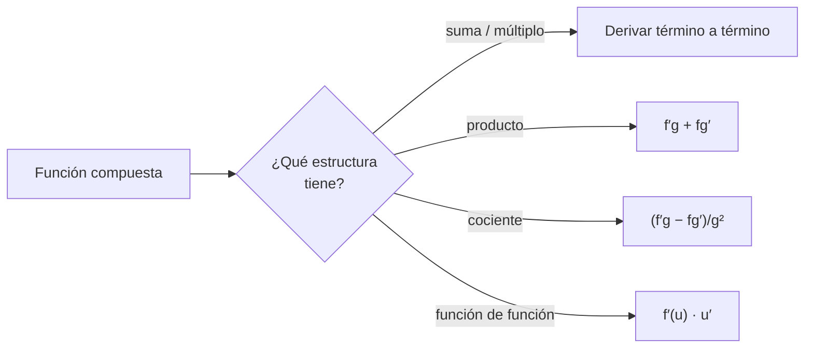

# B09-C04 — Reglas de derivación

<!-- nav:top -->
[🏠 Programa](../../../../README.md) · [📚 Bloque B09](../../../tronco-comun/B09-calculo-diferencial-e-integral.md) · [← Anterior: B09-C03 — Derivada como tasa de cambio](../B09-C03-derivada-como-tasa-de-cambio/CLASE.md) · [Siguiente: B09-C05 — Derivadas trigonométricas →](../../../tronco-comun/B09-calculo-diferencial-e-integral.md#b09-c05)
<!-- /nav -->

## 1. Ubicación, nivel y alcance

Cuarta clase del bloque B09. En la [clase anterior](../B09-C03-derivada-como-tasa-de-cambio/CLASE.md) calculaste derivadas con la definición, que es lenta. Aquí aprendes las **reglas** que permiten derivar casi cualquier combinación de funciones: potencia, suma, producto, cociente y cadena. Nivel N2. Verás cada regla con su porqué, su uso en una aceleración de marea y en la ecuación del cohete, y una comprobación por diferenciación automática. No verás derivadas trigonométricas (C05) ni derivación implícita (C06).

## 2. Por qué esta clase existe

La gravedad que siente un cuerpo depende de su distancia al astro: `g(r) = GM/r²`. La **marea** nace de que esa gravedad cambia de un lado a otro de un cuerpo extenso. Para saber cuánto, hay que derivar `g` respecto a `r`. Y cuando el vehículo quema propelente, su velocidad depende de la masa, que depende del tiempo: una función de una función. Sin reglas de derivación, ambos cálculos serían largos y propensos a error.

La decisión central: **¿qué regla uso, en qué orden, y cómo compruebo que no me equivoqué?**

## 3. Lo que podrás hacer al terminar

1. Derivar potencias, sumas y múltiplos constantes.
2. Aplicar las reglas del producto y del cociente.
3. Aplicar la regla de la cadena a una composición.
4. Calcular el gradiente de la gravedad `dg/dr` y estimar una aceleración de marea.
5. Derivar la velocidad de un cohete respecto al tiempo.
6. Comprobar una derivada con un cociente de diferencias o con números duales.

La evidencia es la **tabla de derivadas verificadas** del ejercicio 12 (sección 20).

## 4. Con qué llegas y cómo comprobarlo

Necesitas la derivada como límite ([C03](../B09-C03-derivada-como-tasa-de-cambio/CLASE.md)) y álgebra. Cinco preguntas:

1. ¿Cuánto es `lim_{h→0} [(x + h)² − x²]/h`?
2. ¿Qué significa `f′(x₀) = 0`?
3. Simplifica `x⁵ · x⁻²`.
4. ¿Cuánto es `2³`? ¿y `2⁻²`?
5. Si `u = 3x + 1`, ¿cuánto es `u²` en `x = 1`?

<details>
<summary>Ver respuestas</summary>

1. `2x`. 2. La tangente es horizontal (por ejemplo, un máximo). 3. `x³`. 4. 8 y 1/4. 5. `16`.
</details>

Con cuatro o cinco aciertos, sigue; si no, repasa C03 y B04-C01.

## 5. Un caso real: la marea de la Luna

La Luna atrae con una fuerza que depende de la distancia, de modo que el lado de la Tierra más cercano recibe una aceleración ligeramente mayor que el centro. Con el parámetro gravitacional lunar `GM_L = 4,90 × 10³ km³/s²` (S2, con tres cifras), la distancia media `d = 384 400 km` (S2) y el radio ecuatorial terrestre `a_E = 6378,137 km` (S3), la derivada `|dg/dr| · a_E` da una aceleración diferencial de `1,10 × 10⁻⁶ m/s²`, cerca de una diezmillonésima de `g`. Es una **estimación de orden de magnitud**, no el cálculo de mareas oceánicas, que dependen además de la forma de las costas y de la dinámica del agua. Este es el **ejemplo conductor** de la clase.

## 6. Vocabulario

La **regla de la potencia**: `d(xⁿ)/dx = n xⁿ⁻¹` para cualquier exponente `n` real. La **regla de la suma**: `(f + g)′ = f′ + g′`. La **regla del producto**: `(fg)′ = f′g + fg′`. La **regla del cociente**: `(f/g)′ = (f′g − fg′)/g²`. La **regla de la cadena**: si `y = f(u)` y `u = g(x)`, entonces `dy/dx = f′(u) · g′(x)` (S1, §1.4(iii), ecs. 1.4.5–1.4.7 y 1.4.10). Una **composición** es una función dentro de otra. Un **gradiente de campo** es la derivada de un campo respecto a la posición (aquí, `dg/dr`). La **aceleración de marea** es la diferencia de aceleración gravitatoria entre dos puntos del cuerpo. La **diferenciación automática** calcula derivadas exactas llevando valor y derivada juntos.

## 7. Modelo mental: engranajes encadenados

La regla de la cadena es una transmisión de engranajes: si la rueda `x` hace girar la `u` a razón `g′` y la `u` hace girar la `y` a razón `f′`, la razón total es el producto. Las otras reglas dicen qué hacer cuando dos factores o dos términos dependen de `x` a la vez.



*Descripción textual:* se identifica la estructura exterior de la expresión (suma, producto, cociente o composición) y se aplica la regla correspondiente, repitiendo hacia adentro.

Analogía: pelar una cebolla, capa por capa. Su límite: una expresión puede tener varias capas de distinto tipo; se pela primero la exterior y se decide después la siguiente.

## 8. La explicación, paso a paso

### 8.1 Potencia, suma y constante

`d(xⁿ)/dx = n xⁿ⁻¹`: `x⁴ → 4x³`; `1/x² = x⁻² → −2x⁻³`; `√x = x^½ → ½ x^−½`. Una constante multiplicativa sale de la derivada. Para `3x⁴ − 5x² + 7`: `12x³ − 10x` (la constante 7 deriva a 0). En `x = 2`: `96 − 20 = 76`.

### 8.2 Producto

`(fg)′ = f′g + fg′`. Para `(x² + 1)(x³ − x)` en `x = 2`: `2x(x³ − x) + (x² + 1)(3x² − 1) = 4 · 6 + 5 · 11 = 79`. Comprobación: el producto es `x⁵ − x`, cuya derivada `5x⁴ − 1 = 79`.

### 8.3 Cociente

`(f/g)′ = (f′g − fg′)/g²`. Para `x/(1 + x²)`: `[1 · (1 + x²) − x · 2x]/(1 + x²)² = (1 − x²)/(1 + x²)²`. En `x = 1,3` vale `−0,095355`.

### 8.4 Cadena

Para `(3x + 1)⁵`: exterior `u⁵ → 5u⁴`, interior `3x + 1 → 3`; total `15(3x + 1)⁴`. En `x = 0`: `15`. Para `ln(1 + x²)`, aceptando como dato que `d(ln u)/du = 1/u` (se reutiliza en C09–C10): `2x/(1 + x²)`.

### 8.5 La gravedad y su gradiente

`g(r) = GM/r² = GM r⁻²`. Su derivada es `dg/dr = −2GM/r³`. Con los valores nominales terrestres (S4) `3,986 004 × 10¹⁴ m³ s⁻²` y `6,3781 × 10⁶ m`: `dg/dr = −3,07 × 10⁻⁶ s⁻²` en la superficie, es decir, `g` baja `3,07 × 10⁻³ m/s²` por kilómetro de ascenso. El signo negativo dice que `g` disminuye al alejarse.

### 8.6 La marea

Si la Luna está a `d`, la aceleración que causa varía con `r` según `dg/dr` en `r = d`. Entre el centro de la Tierra y el punto más cercano (a `a_E` de distancia) la variación es aproximadamente `|dg/dr| a_E = 2 GM_L a_E/d³ = 1,100 × 10⁻⁶ m/s²`. La diferencia exacta `g(d − a_E) − g(d)` da `1,128 × 10⁻⁶ m/s²`; la derivada se desvía 2,5 %, porque es una aproximación lineal (se verá en C14).

### 8.7 El cohete

Un cohete que expulsa gas a velocidad relativa `vₑ` (constante) y cuya masa baja de `m₀` a `m` alcanza `v = vₑ ln(m₀/m)` en ausencia de otras fuerzas (modelo habitual de la ecuación del cohete; no se consultó una fuente específica en esta clase). Con `m = m₀ − ṁ t`, la cadena da `dv/dt = vₑ ṁ/(m₀ − ṁ t)`. Con valores sintéticos `vₑ = 3000 m/s`, `m₀ = 10⁵ kg`, `ṁ = 500 kg/s`, en `t = 40 s`: `dv/dt = 18,75 m/s²` y `v = 669,4 m/s`.

## 9. Magnitudes, símbolos y unidades

| Símbolo | Qué es | Unidad | Nota |
|---|---|---|---|
| `g(r)` | aceleración gravitatoria | m/s² | `GM/r²` |
| `dg/dr` | gradiente de `g` | s⁻² | negativo |
| `GM` | parámetro gravitacional | m³/s² | Tierra `3,986 004 × 10¹⁴` (nominal, S4); Luna `4,90 × 10¹²` (S2) |
| `r`, `d` | distancia | m | `d` = distancia Tierra–Luna |
| `a_E` | radio ecuatorial terrestre | m | `6,378 137 × 10⁶` (S3) |
| `vₑ` | velocidad de escape del gas | m/s | 3000 (sintética) |
| `ṁ` | caudal de masa | kg/s | 500 (sintético) |

## 10. Convenciones y referencias

Distancias medidas desde el centro del astro que atrae; la Luna se trata como masa puntual y la órbita como circular (modelo simple). Las cifras de los hechos de la NASA tienen pocas cifras significativas: no se debe exigir al resultado más cifras de las que dan los datos. Se usa `GM` en lugar de `M` para evitar depender de `G`.

## 11. De dónde sale lo que afirmamos

| ID | Fuente | Localizador | Respalda | Estado |
|---|---|---|---|---|
| S1 | NIST, *Digital Library of Mathematical Functions* §1.4, versión 1.2.8 | https://dlmf.nist.gov/1.4 | Reglas de la suma, producto y cociente (ecs. 1.4.5–1.4.7), regla de la cadena (ec. 1.4.10) | Consultada el 2026-11-05 mediante extracción automática |
| S2 | NASA/NSSDC, *Moon Fact Sheet* (actualizada 2024-01-11) | https://nssdc.gsfc.nasa.gov/planetary/factsheet/moonfact.html | `GM_L = 0,004 90 × 10⁶ km³/s²`; semieje mayor 384 400 km | Consultada el 2026-11-05 mediante extracción automática |
| S3 | NASA/NSSDC, *Earth Fact Sheet* (actualizada 2024-11-15) | https://nssdc.gsfc.nasa.gov/planetary/factsheet/earthfact.html | Radio ecuatorial 6378,137 km | Consultada el 2026-11-05 mediante extracción automática |
| S4 | IAU, Resolución B3 de 2015, arXiv:1510.07674 | https://arxiv.org/pdf/1510.07674 | `(GM)_E^N = 3,986 004 × 10¹⁴ m³ s⁻²`, `R_eE^N = 6,3781 × 10⁶ m`, `(GM)_☉^N = 1,327 124 4 × 10²⁰ m³ s⁻²` | Texto extraído del PDF el 2026-11-05 |
| S5 | IERS, *IERS Conventions (2010)*, TN36, tabla de constantes | https://iers-conventions.obspm.fr/content/tn36.pdf | `1 au = 1,495 978 707 × 10¹¹ m` | Texto extraído del PDF el 2026-11-05 |

Límites: la ecuación del cohete y la derivada del logaritmo se usan como resultados estándar sin cita; la masa de marea es una **estimación**; los datos del cohete son **sintéticos**.

## 12. Cómo ver las reglas

Equivalente accesible a una gráfica de `g(r)` para la Tierra (modelo `GM/r²` con valores nominales):

| `r` (km) | `g` (m/s²) | `dg/dr` (s⁻²) |
|---|---|---|
| 6378,1 | 9,798 | −3,07 × 10⁻⁶ |
| 7378,1 | 7,322 | −1,98 × 10⁻⁶ |
| 12 756,2 | 2,450 | −3,84 × 10⁻⁷ |

Descripción larga: la curva `g(r)` baja rápido al principio y luego se aplana; su pendiente (negativa) se acerca a cero con la distancia.

## 13. Ejemplo trabajado: marea de la Luna en el punto cercano

**Paso 1 · Datos.** `GM_L = 4,90 × 10¹² m³/s²`; `d = 3,844 × 10⁸ m`; `a_E = 6,378 137 × 10⁶ m`.

**Paso 2 · Derivada.** `g(r) = GM_L r⁻²` → `dg/dr = −2 GM_L r⁻³`. En `r = d`: `−2 · 4,90 × 10¹²/(3,844 × 10⁸)³ = −1,725 × 10⁻¹³ s⁻²`.

**Paso 3 · Aproximación lineal.** `Δg ≈ |dg/dr| a_E = 1,725 × 10⁻¹³ · 6,378 × 10⁶ = 1,100 × 10⁻⁶ m/s²`.

**Paso 4 · Comprobación exacta.** `g(d − a_E) − g(d) = 1,1285 × 10⁻⁶ m/s²`; desviación `2,5 %`.

**Paso 5 · Sentido.** `1,1 × 10⁻⁶ m/s²` es `1,1 × 10⁻⁷ g_n`: la marea es una perturbación diminuta, pero actúa sobre toda la masa del océano. Con tres cifras significativas de entrada, el resultado sólo merece dos: «`1,1 × 10⁻⁶ m/s²`».

## 14. Distintas formas de derivar

Con **reglas**: exacta y simbólica. Con **diferencias finitas** (C03): no exige fórmula pero tiene error. Con **números duales** (laboratorio): exacta como las reglas, pero automática; es la base de la diferenciación automática de los programas modernos de simulación. Las tres deben coincidir; si no, hay un error en alguna.

## 15. Práctica guiada

**Ejercicio 1 · con los pasos indicados.** Deriva `3x⁴ − 5x² + 7` y evalúa en `x = 2`. *Pasos:* regla de la potencia término a término.

<details><summary>Solución comentada</summary>

`12x³ − 10x`; en 2: `96 − 20 = 76`. La constante 7 deriva a 0 (8.1).
</details>

**Ejercicio 2 · con una pista.** Deriva `(x² + 1)(x³ − x)` en `x = 2` con la regla del producto y compruébalo expandiendo. *Pista:* el producto es un polinomio.

<details><summary>Solución comentada</summary>

Regla: `2x(x³ − x) + (x² + 1)(3x² − 1) = 24 + 55 = 79`. Expansión: `x⁵ − x` → `5x⁴ − 1 = 79` ✓ (8.2).
</details>

**Ejercicio 3 · casi autónomo.** Deriva `x/(1 + x²)` y evalúa en `x = 1,3`.

<details><summary>Solución comentada</summary>

`(1 − x²)/(1 + x²)² = (1 − 1,69)/2,69² = −0,69/7,2361 = −0,09536` (8.3). Coincide con el laboratorio.
</details>

## 16. Práctica autónoma, transferencia e integrador

**Ejercicio 4.** Deriva `(3x + 1)⁵` y evalúa en `x = 0`.

<details><summary>Solución comentada</summary>

`5(3x + 1)⁴ · 3 = 15(3x + 1)⁴` → 15 (8.4).
</details>

**Ejercicio 5.** Calcula `dg/dr` para la Tierra en la superficie con los valores nominales y di cuánto baja `g` por kilómetro.

<details><summary>Solución comentada</summary>

`−2 · 3,986 004 × 10¹⁴/(6,3781 × 10⁶)³ = −3,07 × 10⁻⁶ s⁻²`; por km (`10³ m`): `3,07 × 10⁻³ m/s²` menos (8.5).
</details>

**Ejercicio 6.** Calcula `dv/dt` del cohete de 8.7 en `t = 40 s` y `t = 100 s`.

<details><summary>Solución comentada</summary>

`dv/dt = vₑ ṁ/(m₀ − ṁ t)`: en 40 s, `1,5 × 10⁶/80 000 = 18,75 m/s²`; en 100 s, `1,5 × 10⁶/50 000 = 30 m/s²`. Aumenta porque la masa baja.
</details>

**Ejercicio 7.** Deriva `1/x²` con la regla del cociente y compara con la regla de la potencia en `x = 2`.

<details><summary>Solución comentada</summary>

Cociente: `(0 · x² − 1 · 2x)/x⁴ = −2/x³`; potencia: `x⁻² → −2x⁻³`. En 2: `−2/8 = −0,25`. Ambas coinciden.
</details>

**Ejercicio 8.** ¿Cuánto vale `|dg/dr|` de la Luna en `r = d` (valores del ejemplo)? ¿En qué unidad?

<details><summary>Solución comentada</summary>

`1,725 × 10⁻¹³ s⁻²` (unidad: (m/s²)/m = s⁻²).
</details>

**Ejercicio 9 · transferencia.** Con `GM_☉^N = 1,327 124 4 × 10²⁰ m³/s²` (S4) y `1 au = 1,495 978 707 × 10¹¹ m` (S5), estima la aceleración de marea solar en la Tierra y compárala con la lunar.

<details><summary>Solución comentada</summary>

`2 GM_☉ a_E/d³ = 5,06 × 10⁻⁷ m/s²`, el 46 % de la lunar (`1,10 × 10⁻⁶`). Aunque el Sol es mucho más masivo, está tan lejos que su gradiente es menor (depende de `1/d³`). Estimación con las mismas simplificaciones.
</details>

**Ejercicio 10 · transferencia.** Un compañero escribe `d(GM/r²)/dr = GM/(2r)`. Detecta el error comprobando con números (`GM = 1`, `r = 2`).

<details><summary>Solución comentada</summary>

Su fórmula da `1/4 = +0,25`. La correcta, `−2/r³`, da `−0,25`. El cociente de diferencias con `Δr = 0,001` da `−0,2498`: confirma el signo y el valor correcto. Error: dividió el exponente en vez de multiplicar y bajarlo.
</details>

**Ejercicio 11 · transferencia.** A 400 km de altitud (ejemplo), ¿en cuánto cambia `g` según la derivada y según la fórmula exacta? ¿Qué te dice la diferencia?

<details><summary>Solución comentada</summary>

`Δr/r = 400/6378,137 = 0,0627`. Lineal (`−2Δr/r`): `−12,5 %`. Exacta `(1 + 0,0627)⁻² − 1 = −11,5 %`. La aproximación lineal exagera: es útil para variaciones pequeñas, pero a 400 km ya pesa un punto porcentual.
</details>

**Ejercicio 12 · integrador.** Elabora tu *tabla de derivadas verificadas*: cuatro funciones (una por regla: potencia, producto, cociente, cadena) con su derivada por regla, su derivada por cociente central con `h = 10⁻⁵` en un punto y la diferencia entre ambas, más el cálculo de marea del Sol y de la Luna.

<details><summary>Solución modelo</summary>

Tabla con función, derivada simbólica, valor en el punto, valor numérico y diferencia (< 10⁻⁷ relativa); cierre con la marea solar `5,06 × 10⁻⁷` y lunar `1,10 × 10⁻⁶ m/s²`, declarando que son estimaciones y las fuentes con fecha.
</details>

## 17. Laboratorio: números duales y marea

El script [reglas_y_marea.py](reglas_y_marea.py) implementa números duales (valor + derivada) con las reglas de la suma, producto, cociente y potencia, verifica tres derivadas contra su valor exacto (para `sin` y `ln` usa como dato `sin′ = cos` y `ln′ = 1/u`, que verás más adelante), comprueba la aceleración del cohete y calcula la marea lunar comparando la derivada con la diferencia exacta.

**Datos:** valores publicados con pocas cifras (NASA) y cohete sintético. **Predice antes de ejecutar:** ¿qué desviación esperas entre la derivada y la diferencia exacta? (del orden de `3 a_E/(2d) ≈ 2,5 %`.) **Ejecución del 2026-11-05 (Python 3.12.9):**

```text
producto  : 2.957324302460 (exacto 2.957324302460)
cociente  : -0.095355232791 (exacto -0.095355232791)
cadena    : 0.966542750929 (exacto 0.966542750929)
dv/dt (t=40 s) = 18.750000 m/s2 (exacto 18.750000); v = 669.431 m/s
|dg/dr| = 1.725e-13 s-2;  marea ~ |dg/dr| R = 1.1004e-06 m/s2
diferencia exacta g(d-R)-g(d) = 1.1285e-06 m/s2  (1.15e-07 g_n)
diferencia relativa derivada vs exacta = 2.482%
Pruebas superadas.
```

```bash
python programa/clases/B09/B09-C04-reglas-de-derivacion/reglas_y_marea.py
```

**Límites:** Luna puntual y órbita circular; sin dinámica oceánica; el valor es un orden de magnitud con tres cifras de entrada.

## 18. Errores frecuentes y cómo corregirlos

**Derivar un producto como producto de derivadas.** Se corrige con el ejercicio 2.

**Olvidar la derivada interior en la cadena.** Se corrige con el ejercicio 4.

**Bajar el exponente sin restarle 1 o con el signo equivocado.** Se corrige con el ejercicio 10.

**Mezclar unidades (km y m).** Se corrige con los ejercicios 5 y 8.

**Dar más cifras de las que justifica el dato.** Se corrige en el paso 5 del ejemplo trabajado.

## 19. Cómo sabrás que vas bien

Tras 8.2: ¿derivas `(x² + 1)(x³ − x)` y lo compruebas expandiendo? Si no, ejercicio 2. Tras 8.4: ¿identificas la capa exterior y la interior? Si no, ejercicio 4. Tras 8.6: ¿por qué la derivada y la diferencia exacta no coinciden? Si no lo sabes, ejercicio 11. Tras el laboratorio: ¿cómo se comprueba la regla del cociente sin fórmula? (con números duales o con diferencias).

## 20. Qué entregas y cómo se evalúa

El producto es tu **tabla de derivadas verificadas** (ejercicio 12).

| Criterio | Inicial | En desarrollo | Logrado | Destacado |
|---|---|---|---|---|
| Elección de la regla | Al azar | Con ayuda | Identifica la estructura | Combina reglas sin error |
| Cálculo | Errores de signo | Algunos errores | Correcto con unidades | Simplifica el resultado |
| Comprobación | Ausente | Mental | Con diferencias finitas | Con dos métodos independientes |
| Interpretación física | Sin unidades | Unidades sin sentido | Marea con orden de magnitud | Discute la aproximación lineal |
| Fuentes | Sin fuente | Sin fecha | Con localizador y fecha | Rotula estimado y sintético |

**Condiciones críticas (no se compensan con promedio):** comprobar al menos una derivada con un método independiente; rotular estimaciones; citar solo fuentes consultadas.

## 21. Ética, seguridad y límites

Una estimación de marea con tres cifras de dato no sirve para predicción de mareas ni para decisiones costeras; eso exige datos y modelos especializados. Accesibilidad: fórmulas en texto, tablas equivalentes a las gráficas, ejercicios sin conexión.

## 22. Para cerrar y seguir

Las reglas de potencia, suma, producto, cociente y cadena derivan casi todo; la derivada de `g(r)` mide cuánto cambia la gravedad con la distancia; una aproximación lineal funciona para cambios pequeños. Queda abierta una pregunta: ¿cuáles son las derivadas de `sin` y `cos`, que describen todo lo que gira u oscila?

**Glosario español–inglés.** regla del producto · *product rule*; regla del cociente · *quotient rule*; regla de la cadena · *chain rule*; marea · *tide*; gradiente de campo · *field gradient*; diferenciación automática · *automatic differentiation*; parámetro gravitacional · *gravitational parameter*.

**Continuidad.** B09-C05 reutiliza tu capacidad de **aplicar la regla de la cadena** para derivar funciones trigonométricas compuestas.

**Referencias:** ver sección 11.

<!-- nav:bottom -->
---

[← Anterior: B09-C03 — Derivada como tasa de cambio](../B09-C03-derivada-como-tasa-de-cambio/CLASE.md) · [📚 Bloque B09](../../../tronco-comun/B09-calculo-diferencial-e-integral.md) · [Siguiente: B09-C05 — Derivadas trigonométricas →](../../../tronco-comun/B09-calculo-diferencial-e-integral.md#b09-c05)
<!-- /nav -->
