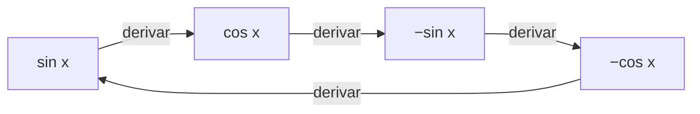

# B09-C05 — Derivadas trigonométricas

<!-- nav:top -->
[🏠 Programa](../../../../README.md) · [📚 Bloque B09](../../../tronco-comun/B09-calculo-diferencial-e-integral.md) · [← Anterior: B09-C04 — Reglas de derivación](../B09-C04-reglas-de-derivacion/CLASE.md) · [Siguiente: B09-C06 — Derivación implícita →](../B09-C06-derivacion-implicita/CLASE.md)
<!-- /nav -->

## 1. Ubicación, nivel y alcance

Quinta clase del bloque B09. Ya sabes derivar potencias, productos, cocientes y composiciones ([C04](../B09-C04-reglas-de-derivacion/CLASE.md)). Ahora derivas lo que gira y oscila: `sin`, `cos`, `tan`. Nivel N2. Verás de dónde sale `sin′ = cos`, las tres derivadas básicas, la cadena aplicada a ángulos que crecen con el tiempo, y un problema real de ingeniería: a qué velocidad hay que mover un telescopio para seguir una estrella. No verás derivación implícita (C06) ni series (C14).

## 2. Por qué esta clase existe

Un telescopio con montura altacimutal apunta con dos ejes: altitud y azimut. Para mantener una estrella en el centro del campo, cada eje debe girar a una **velocidad** que cambia con el tiempo. Esa velocidad es una derivada de funciones trigonométricas. Lo mismo ocurre con una antena que sigue un satélite o con una curva de luz periódica.

La decisión central: **¿cuál es la rapidez con que cambia un ángulo cuando todo es función de un ángulo que crece con el tiempo, y dónde se anula o se hace máxima?**

## 3. Lo que podrás hacer al terminar

1. Justificar `sin′ = cos` a partir de los límites de C01.
2. Derivar `sin`, `cos`, `tan` y sus composiciones con la regla de la cadena.
3. Derivar `arctan` a partir de la derivada de `tan`.
4. Expresar la velocidad de cambio de la altitud de un astro en función del ángulo horario.
5. Hallar los instantes en que una tasa se anula o es máxima.
6. Comprobar una derivada analítica con un cociente central y reconocer errores de unidades angulares.

La evidencia es la **tabla de velocidades de seguimiento con comprobación** del ejercicio 12 (sección 20).

## 4. Con qué llegas y cómo comprobarlo

Necesitas límites trigonométricos (C01), la regla de la cadena (C04) y el sistema horizontal ([B01-C11](../../B01/B01-C11-movimiento-aparente-del-sol-y-las-estrellas/CLASE.md)). Cinco preguntas:

1. ¿Cuánto vale `lim_{t→0} sin t / t`?
2. Deriva `(2x + 1)³`.
3. ¿Qué es el ángulo horario `H` de un astro?
4. ¿Cuántos grados tiene un radián, aproximadamente?
5. ¿Cuánto valen `sin 90°` y `cos 90°`?

<details>
<summary>Ver respuestas</summary>

1. 1. 2. `6(2x + 1)²`. 3. El ángulo, medido hacia el oeste desde el meridiano, que indica cuánto ha girado el cielo desde que el astro culminó. 4. 57,3°. 5. 1 y 0.
</details>

Con cuatro o cinco aciertos, sigue; si no, repasa C01, C04 y B01-C11.

## 5. Un caso real: seguir una estrella con una montura altacimutal

La Tierra gira respecto a las estrellas a una velocidad angular media nominal `ω = 7,292 115 × 10⁻⁵ rad/s` (S2), que equivale a `15,041″ por segundo` de tiempo. Para un observador a latitud `φ`, la altitud `h` de una estrella de declinación `δ` obedece (fórmula estándar de astronomía de posición, que esta clase comprueba con el caso del meridiano de B01-C11):

`sin h = sin φ sin δ + cos φ cos δ cos H`, con `H = ω t`.

Derivarla da la velocidad con que debe moverse el eje de altitud. **Ejemplo conductor:** observador a `φ = −33,45°` (el de B01-C11) y estrella en el ecuador celeste (`δ = 0`), una **situación sintética** de práctica. Se pide la tasa de cambio de la altitud en distintos ángulos horarios.

## 6. Vocabulario

La **declinación** `δ` de un astro es su latitud celeste; el **ángulo horario** `H` crece con la rotación de la Tierra. La **altitud** `h` es el ángulo sobre el horizonte. La **culminación** (o tránsito meridiano) es el momento en que el astro cruza el meridiano, con `H = 0`. Una **montura altacimutal** mueve el telescopio en altitud y azimut. La **velocidad de seguimiento** es la derivada del ángulo respecto al tiempo. Una **función periódica** se repite cada periodo `P`. La **amplitud** `A` es su valor máximo desde el centro. La **secante** es `sec x = 1/cos x`.

## 7. Modelo mental: la derivada de una onda es la misma onda desfasada

La gráfica de `sin x` sube más rápido en 0 (pendiente 1), se aplana en su máximo (pendiente 0) y baja en el cruce siguiente. La pendiente en cada punto describe otra onda: el coseno, desfasado un cuarto de ciclo. Derivar de nuevo desfasa otro cuarto: `sin → cos → −sin → −cos → sin`.



*Descripción textual:* cuatro derivaciones sucesivas devuelven la función original; cada una la adelanta un cuarto de ciclo.

Analogía: un péndulo, cuya posición es seno y cuya velocidad es coseno: es máxima donde la posición es cero. Su límite: la analogía supone amplitud pequeña y sin amortiguamiento.

## 8. La explicación, paso a paso

### 8.1 De dónde sale `sin′ = cos`

Por la identidad de la suma, `sin(x + h) = sin x cos h + cos x sin h`. Restando `sin x` y dividiendo por `h`: `[sin(x + h) − sin x]/h = sin x · (cos h − 1)/h + cos x · sin h / h`. Cuando `h → 0`: `sin h / h → 1` (C01) y `(cos h − 1)/h = −2 sin²(h/2)/h → 0`. Queda `sin′(x) = cos x` (con `x` en radianes). El laboratorio lo muestra: para `h = 10⁻⁵` el error es `−4,2 × 10⁻⁶`.

### 8.2 Las tres derivadas

`(sin x)′ = cos x`; `(cos x)′ = −sin x`; `(tan x)′ = 1/cos² x = sec² x` (regla del cociente sobre `sin/cos`: `(cos² + sin²)/cos² = 1/cos²`). Con la cadena: `(sin(ωt))′ = ω cos(ωt)`.

### 8.3 La inversa de la tangente

Si `y = arctan u`, entonces `u = tan y` y `du/dy = sec² y = 1 + u²`; luego `dy/du = 1/(1 + u²)`. Así: `(arctan u)′ = 1/(1 + u²)`.

### 8.4 Derivar la altitud

Derivando `sin h = sin φ sin δ + cos φ cos δ cos(ωt)` por la cadena: `cos h · dh/dt = −ω cos φ cos δ sin(ωt)`, es decir

`dh/dt = −ω cos φ cos δ sin H / cos h`.

(Esto es derivación implícita en pequeño; se generaliza en C06.) Se anula en `H = 0`: en la culminación la altitud deja de subir y todavía no baja. Su valor es máximo en magnitud cerca de la salida y la puesta.

### 8.5 Números del ejemplo conductor

Para `δ = 0`, `φ = −33,45°`: en `H = −90°` (salida, `h = 0`), `dh/dt = ω cos φ = 12,550″/s`; en `H = −60°` (`h = 24,66°`), `11,959″/s`; en `H = −30°`, `9,077″/s`; en `H = −10°`, `3,824″/s`; en `H = 0`, `0` (altura meridiana `56,55°`, como en B01-C11). El eje de azimut no se anula allí: eso es una segunda derivada que no se calcula en esta clase.

### 8.6 Oscilaciones

Una estrella variable sintética con `m(t) = m₀ + A sin(2πt/P)`, `A = 0,5 mag`, `P = 5,0 d` cambia a `dm/dt = (2πA/P) cos(2πt/P)`; la tasa máxima es `2πA/P = 0,628 mag/d`. La tasa de cambio más rápida ocurre cuando `m = m₀`, no en el máximo ni en el mínimo.

### 8.7 Unidades angulares

Estas fórmulas valen con **radianes**. Si `x` está en grados, `d/dx sin(x°) = (π/180) cos(x°)`. Olvidar el factor produce un resultado 57,3 veces mayor.

## 9. Magnitudes, símbolos y unidades

| Símbolo | Qué es | Unidad | Nota |
|---|---|---|---|
| `h` | altitud del astro | rad (o °) | sobre el horizonte |
| `H` | ángulo horario | rad (o °) | `H = ω t`, `H = 0` en el meridiano |
| `φ` | latitud del observador | rad (o °) | −33,45° (sintética) |
| `δ` | declinación | rad (o °) | 0 y −30° (sintéticas) |
| `ω` | velocidad angular de la Tierra | rad/s | `7,292 115 × 10⁻⁵` (S2) |
| `dh/dt` | tasa de cambio de la altitud | rad/s o ″/s | `1 rad = 206 264,8″` |
| `A`, `P` | amplitud y periodo | mag, d | 0,5 y 5,0 (sintéticos) |

## 10. Convenciones y referencias

`H` crece hacia el oeste, de modo que antes de la culminación es negativo. Se usan radianes en todo cálculo y se convierte a segundos de arco al final (`1″ = π/648 000 rad`). El modelo supone Tierra esférica, sin refracción atmosférica ni movimiento propio de la estrella. `ω` es un valor nominal medio: la rotación terrestre real varía a escalas pequeñas.

## 11. De dónde sale lo que afirmamos

| ID | Fuente | Localizador | Respalda | Estado |
|---|---|---|---|---|
| S1 | NIST, *Digital Library of Mathematical Functions* §1.4, versión 1.2.8 | https://dlmf.nist.gov/1.4 | Reglas del cociente (ec. 1.4.7) y de la cadena (ec. 1.4.10) usadas aquí | Consultada el 2026-11-05 mediante extracción automática |
| S2 | IERS, *IERS Conventions (2010)*, TN36, tabla 1.2 (GRS80) | https://iers-conventions.obspm.fr/content/tn36.pdf | `ω = 7,292 115 × 10⁻⁵ rad/s`, velocidad angular media nominal de la Tierra | Texto extraído del PDF el 2026-11-05 |
| S4 | IAU, Resolución B3 de 2015, arXiv:1510.07674 | https://arxiv.org/pdf/1510.07674 | `(GM)_E^N = 3,986 004 × 10¹⁴ m³ s⁻²`, `R_eE^N = 6,3781 × 10⁶ m` | Texto extraído del PDF el 2026-11-05 |
| S3 | NASA/NSSDC, *Earth Fact Sheet* (actualizada 2024-11-15) | https://nssdc.gsfc.nasa.gov/planetary/factsheet/earthfact.html | Periodo de rotación sideral 23,9345 h | Consultada el 2026-11-05 mediante extracción automática |

Límites: las derivadas de `sin`, `cos`, `tan`, `arctan` se deducen aquí (8.1–8.3) y se comprueban numéricamente; no se citan de S1. La fórmula de la altitud es estándar de astronomía de posición y se valida con el caso meridiano. La latitud y los astros son **sintéticos**. `2π/ω = 86 164,10 s = 23,9345 h` coincide con S3.

## 12. Cómo ver la tasa de seguimiento

Equivalente accesible a la gráfica de `dh/dt` frente a `H` (δ = 0, φ = −33,45°):

| `H` | `h` | `dh/dt` (″/s) |
|---|---|---|
| −90° | 0° | 12,550 |
| −60° | 24,66° | 11,959 |
| −30° | 46,27° | 9,077 |
| −10° | 55,25° | 3,824 |
| 0° | 56,55° | 0 |

Descripción larga: la curva baja de 12,55 a 0 ″/s, casi plana al principio y con más pendiente cerca de la culminación; después cambia de signo (la estrella desciende).

## 13. Ejemplo trabajado: tasa de altitud a las 4 h antes del tránsito

Una estrella (sintética) con `δ = 0`, observada a `φ = −33,45°`, a `H = −60°` (4 h antes de culminar, porque 15° ↔ 1 h sideral).

**Paso 1 · Altitud.** `sin h = cos φ · cos H = 0,83437 · 0,5 = 0,41718`; `h = 24,65°`.

**Paso 2 · Cos h.** `cos h = √(1 − 0,41718²) = 0,90882`.

**Paso 3 · Derivada.** `dh/dt = −ω cos φ sin H/cos h`; `sin(−60°) = −0,86603`. En ″/s: `15,0411 · 0,83437 · 0,86603/0,90882 = 11,959″/s`.

**Paso 4 · Comprobación.** El cociente central con `h = 1 s` da `11,9588″/s`, igual en seis cifras.

**Paso 5 · Sentido.** La altitud sube casi 12″ cada segundo: ≈ 0,2′ por segundo de tiempo. Un error de 1 % en esa tasa acumula `0,12″` por cada segundo de seguimiento sin corregir. La tasa de seguimiento es resultado de un modelo ideal; los telescopios reales añaden corrección de refracción y errores de montura.

## 14. Distintas formas de obtener la tasa

La **derivada analítica** es exacta y rápida de evaluar. El **cociente central** es útil para verificar. Un **modelo con efemérides** (por ejemplo, un sistema de coordenadas con nutación y precesión) calcula posiciones exactas y las deriva numéricamente; es más realista y más pesado (B13). Aquí la analítica sirve de referencia para el cociente numérico.

## 15. Práctica guiada

**Ejercicio 1 · con los pasos indicados.** Deriva `sin(3x)` y evalúa en `x = 0`. *Pasos:* cadena con `u = 3x`.

<details><summary>Solución comentada</summary>

`cos(3x) · 3`; en 0: `3`. La pendiente de `sin(3x)` en el origen es 3 porque oscila tres veces más rápido (8.2).
</details>

**Ejercicio 2 · con una pista.** Deriva `tan x` con la regla del cociente y evalúa en `π/4`. *Pista:* `sin² + cos² = 1`.

<details><summary>Solución comentada</summary>

`(cos · cos − sin · (−sin))/cos² = 1/cos²`. En `π/4`: `1/(1/2) = 2` (8.2).
</details>

**Ejercicio 3 · casi autónomo.** Deriva `cos² x` y evalúa en `x = π/6`.

<details><summary>Solución comentada</summary>

Cadena: `2 cos x · (−sin x) = −sin 2x`. En `π/6`: `−2 · 0,5 · 0,866 = −0,866`.
</details>

## 16. Práctica autónoma, transferencia e integrador

**Ejercicio 4.** Deriva `x sin x` y evalúa en `x = π`.

<details><summary>Solución comentada</summary>

Producto: `sin x + x cos x`; en `π`: `0 + π(−1) = −π ≈ −3,14`.
</details>

**Ejercicio 5.** Para la estrella variable sintética de 8.6, halla la tasa máxima de cambio de la magnitud y el instante.

<details><summary>Solución comentada</summary>

`dm/dt = (2πA/P) cos(2πt/P)`; máximo `2π · 0,5/5,0 = 0,628 mag/d` en `t = 0, P/2, P, …` (cuando `m = m₀`).
</details>

**Ejercicio 6.** Calcula la tasa de altitud en la salida (`H = −90°`, `δ = 0`) a `φ = −33,45°`.

<details><summary>Solución comentada</summary>

`h = 0`, `cos h = 1`: `dh/dt = ω cos φ = 15,041 · 0,83437 = 12,550″/s` (8.5).
</details>

**Ejercicio 7.** Deriva `arctan(x/2)` y evalúa en `x = 2`.

<details><summary>Solución comentada</summary>

Cadena: `1/(1 + (x/2)²) · ½`; en 2: `½ · ½ = 0,25`.
</details>

**Ejercicio 8.** Verifica el valor de `dh/dt` en `H = −60°` con la fórmula y con las cifras del ejemplo.

<details><summary>Solución comentada</summary>

Ver el ejemplo trabajado: `11,959″/s`. Si te sale `10,87`, olvidaste dividir por `cos h`.
</details>

**Ejercicio 9 · transferencia.** Un satélite sintético en órbita circular a 400 km pasa por el cenit de una estación. Con el modelo plano (la geometría de arco se ignora), el ángulo desde el cenit es `θ = arctan(v t/H)`. Calcula la velocidad angular de seguimiento en el cenit con `v = √[(GM)_E^N/(R + H)]`.

<details><summary>Solución comentada</summary>

`v = √[3,986 004 × 10¹⁴/(6,3781 × 10⁶ + 4,0 × 10⁵)] = 7668,6 m/s` (usando los valores nominales de S4). En el cenit `dθ/dt = v/H = 7668,6/4,0 × 10⁵ = 0,01917 rad/s = 1,098°/s`, unas 263 veces la tasa sideral (`15,04″/s = 0,00418°/s`). Por eso seguir satélites bajos exige monturas especiales. Cálculo indicativo (flat-Earth), sin rotación terrestre.
</details>

**Ejercicio 10 · transferencia.** Un compañero calcula `d/dx sin(x°)` en `x = 60` y obtiene `0,5`. ¿Qué olvidó y cuál es el valor correcto?

<details><summary>Solución comentada</summary>

Olvidó el factor `π/180`: el valor correcto es `(π/180) cos 60° = 0,008727` por grado. El `0,5` es `cos 60°`: sería correcto solo si `x` estuviera en radianes (8.7).
</details>

**Ejercicio 11 · transferencia.** «En el tránsito la estrella se detiene: no hace falta mover ningún eje.» Evalúa.

<details><summary>Solución comentada</summary>

Falso. Solo `dh/dt` se anula en `H = 0`. El azimut del eje cambia, y para `δ` cercana al cenit lo hace muy rápido. La derivada de una coordenada no dice nada de las demás.
</details>

**Ejercicio 12 · integrador.** Elabora tu *tabla de velocidades de seguimiento con comprobación*: elige latitud y declinación (sintéticas), calcula `h` y `dh/dt` en cinco ángulos horarios, compara con el cociente central, indica dónde `dh/dt = 0` y la altitud meridiana `90° − |φ − δ|`.

<details><summary>Solución modelo</summary>

Tabla como la de la sección 12, con una columna para el cociente central; la diferencia relativa entre analítico y numérico debe ser < 10⁻⁶; se declara que son parámetros sintéticos y que se omite la refracción.
</details>

## 17. Laboratorio: tasa de altitud

El script [seguimiento_de_estrella.py](seguimiento_de_estrella.py) calcula `h(H)` y `dh/dt` analítica y numérica para dos declinaciones, prueba que la altura meridiana es `90° − |φ − δ|`, que la tasa se anula en el tránsito, que en la salida vale `ω cos φ` y que `sin′ = cos` por cociente.

**Datos:** `ω` publicado nominal; latitud y declinaciones sintéticas. **Predice antes de ejecutar:** ¿qué tasa tiene la salida de un astro con `δ = 0`? (`ω cos φ = 12,55″/s`.) **Ejecución del 2026-11-05 (Python 3.12.9):**

```text
omega = 7.292115e-05 rad/s = 15.0411 arcsec/s = 86164.10 s (periodo sideral)
Declinación +0 deg: altura meridiana = 56.5500 deg (esperada 56.5500)
     -90      0.00              12.5498            12.5498
     -60     24.66              11.9588            11.9588
     -30     46.27               9.0771             9.0771
     -10     55.25               3.8237             3.8237
Salida de un astro de dec = 0: dh/dt = omega cos(phi) = 12.5498 arcsec/s
  1e-05    -5.000000e-06   -4.207362e-06
Pruebas superadas.
```

```bash
python programa/clases/B09/B09-C05-derivadas-trigonometricas/seguimiento_de_estrella.py
```

**Límites:** sin refracción ni movimiento propio; Tierra esférica; datos sintéticos; no es software de apuntado.

## 18. Errores frecuentes y cómo corregirlos

**Derivar con grados sin el factor `π/180`.** Se corrige con el ejercicio 10.

**Olvidar la derivada interna.** Se corrige con el ejercicio 1.

**Olvidar dividir por `cos h`.** Se corrige con el ejercicio 8.

**Creer que `dh/dt = 0` implica que todo se detuvo.** Se corrige con el ejercicio 11.

**Confundir signos de `sin′` y `cos′`.** Se corrige con el diagrama de la sección 7.

## 19. Cómo sabrás que vas bien

Tras 8.2: ¿derivas `cos² x`? Si no, ejercicio 3. Tras 8.4: ¿explicas por qué `dh/dt = 0` en el tránsito? Si no, ejercicio 11. Tras 8.7: ¿conviertes grados y radianes sin error? Si no, ejercicio 10. Tras el laboratorio: ¿qué prueba hace de referencia independiente? (la altura meridiana y el cociente central).

## 20. Qué entregas y cómo se evalúa

El producto es tu **tabla de velocidades de seguimiento con comprobación** (ejercicio 12).

| Criterio | Inicial | En desarrollo | Logrado | Destacado |
|---|---|---|---|---|
| Derivadas básicas | Confunde signos | Con ayuda | Correctas | Las deduce |
| Cadena y unidades | Olvida el factor | Parcial | Radianes y conversión | Detecta errores ajenos |
| Fórmula de seguimiento | No la deriva | La copia | La deriva con la cadena | Interpreta sus ceros |
| Comprobación | Ausente | Mental | Cociente central | Casos límite |
| Fuentes | Sin fuente | Sin fecha | Con localizador y fecha | Rotula sintético |

**Condiciones críticas (no se compensan con promedio):** trabajar en radianes; comprobar contra un método independiente; citar solo fuentes consultadas.

## 21. Ética, seguridad y límites

Una montura con velocidades mal calculadas puede dañar un instrumento o sus cables; esta clase es teoría y no sustituye el manual del fabricante. **Nunca apuntes un telescopio hacia el Sol sin filtro certificado.** Accesibilidad: tablas equivalentes a las gráficas, fórmulas en texto, ejercicios sin conexión.

## 22. Para cerrar y seguir

`sin′ = cos`, `cos′ = −sin`, `tan′ = sec²`, `arctan′ = 1/(1 + u²)`; con la cadena se obtiene la velocidad de seguimiento. Queda abierta una pregunta: la fórmula de la altitud es una relación entre `h` y `H` que no está despejada; ¿cómo se deriva sin despejar? Es la derivación implícita.

**Glosario español–inglés.** altitud · *altitude*; ángulo horario · *hour angle*; declinación · *declination*; culminación · *culmination (transit)*; montura altacimutal · *altazimuth mount*; velocidad de seguimiento · *tracking rate*; amplitud · *amplitude*.

**Continuidad.** B09-C06 reutiliza tu capacidad de **derivar con la cadena una relación entre variables** para derivar sin despejar.

**Referencias:** ver sección 11.

<!-- nav:bottom -->
---

[← Anterior: B09-C04 — Reglas de derivación](../B09-C04-reglas-de-derivacion/CLASE.md) · [📚 Bloque B09](../../../tronco-comun/B09-calculo-diferencial-e-integral.md) · [Siguiente: B09-C06 — Derivación implícita →](../B09-C06-derivacion-implicita/CLASE.md)
<!-- /nav -->
