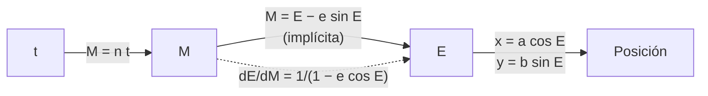

# B09-C06 — Derivación implícita

<!-- nav:top -->
[🏠 Programa](../../../../README.md) · [📚 Bloque B09](../../../tronco-comun/B09-calculo-diferencial-e-integral.md) · [← Anterior: B09-C05 — Derivadas trigonométricas](../B09-C05-derivadas-trigonometricas/CLASE.md) · [Siguiente: B09-C07 — Optimización con derivadas →](../B09-C07-optimizacion-con-derivadas/CLASE.md)
<!-- /nav -->

## 1. Ubicación, nivel y alcance

Sexta clase del bloque B09. Hasta ahora derivaste funciones dadas como `y = f(x)`. Muchas relaciones de la astronomía no se pueden despejar: la elipse de una órbita, la ecuación de Kepler. Aquí aprendes a **derivar sin despejar**. Nivel N2. Verás la derivación implícita, la pendiente de una elipse, la derivada de la ecuación de Kepler y el método de Newton que la resuelve. No verás derivadas parciales (C16) ni integración numérica (B11).

## 2. Por qué esta clase existe

Para saber dónde está un planeta en su órbita en un instante dado hay que resolver la **ecuación de Kepler**, `M = E − e sin E`, que no tiene solución en funciones elementales: no se puede despejar `E`. Pero sí se puede derivar, y esa derivada sirve para dos cosas: resolver la ecuación con rapidez y saber qué tan rápido se mueve el planeta en su órbita.

La decisión central: **¿cómo obtengo `dE/dM` sin despejar `E`, y cómo la uso para calcular y para controlar un método numérico?**

## 3. Lo que podrás hacer al terminar

1. Derivar implícitamente una curva `F(x, y) = 0` y evaluar la pendiente.
2. Reconocer los puntos donde la derivada implícita no existe.
3. Obtener `dE/dM = 1/(1 − e cos E)` a partir de la ecuación de Kepler.
4. Resolver la ecuación de Kepler con el método de Newton y verificar el residuo.
5. Calcular la velocidad radial de un planeta en su órbita a partir de `dE/dM`.
6. Resolver un problema de tasas relacionadas.

La evidencia es la **tabla de soluciones de Kepler con derivada y residuo** del ejercicio 12 (sección 20).

## 4. Con qué llegas y cómo comprobarlo

Necesitas la regla de la cadena ([C04](../B09-C04-reglas-de-derivacion/CLASE.md)) y las derivadas trigonométricas ([C05](../B09-C05-derivadas-trigonometricas/CLASE.md)). Cinco preguntas:

1. Deriva `sin(E)` respecto a `E` y `cos(E)` respecto a `E`.
2. Si `y` depende de `x`, ¿cuál es la derivada de `y²` respecto a `x`?
3. Deriva `x² + 3x`.
4. ¿Qué es la excentricidad `e` de una elipse?
5. ¿Cuánto vale `1/(1 − 0,5 · 0)`?

<details>
<summary>Ver respuestas</summary>

1. `cos E` y `−sin E`. 2. `2y · dy/dx` (regla de la cadena). 3. `2x + 3`. 4. Un número entre 0 y 1 que mide cuánto se aparta de un círculo. 5. 1.
</details>

Con cuatro o cinco aciertos, sigue; si no, repasa C04–C05.

## 5. Un caso real: dónde está la Tierra en su órbita

La página «Approximate Positions of the Planets» del JPL (S2) da, para el baricentro Tierra–Luna y el intervalo 1800–2050, un semieje mayor `a = 1,000 002 61 au` y una excentricidad `e = 0,016 711 23`, y describe cómo resolver la ecuación de Kepler `M = E − e sin E` por iteración: se parte de `E₀ = M + e sin M` y se corrige con `ΔE = [M − (E − e sin E)]/(1 − e cos E)` hasta que `|ΔE|` sea menor que una tolerancia de `10⁻⁶` grados. Ese denominador es la derivada que vas a deducir. Esta es la necesidad concreta: toda efeméride aproximada y todo propagador orbital sencillo la usan.

Nuestro **ejemplo conductor** es la órbita de la Tierra (valores de S2), contrastada con un cometa **sintético** de `e = 0,9`.

## 6. Vocabulario

Una relación **explícita** da `y` en función de `x`; una **implícita** la define mediante `F(x, y) = 0` (S1, §1.5(i)). La **derivación implícita** deriva ambos lados respecto a `x`, tratando `y` como función de `x`. Una **tasa relacionada** es un problema en el que dos cantidades cambian en el tiempo y se relacionan por una ecuación. La **anomalía media** `M` crece uniformemente con el tiempo, `M = n t`, con `n` el **movimiento medio**. La **anomalía excéntrica** `E` es un ángulo auxiliar que sitúa al planeta en la elipse. La **excentricidad** `e` mide cuán alargada es la elipse. El **perihelio** es el punto más cercano al Sol; el **afelio**, el más lejano. El **método de Newton** mejora una estimación restando el residuo dividido por la derivada.

## 7. Modelo mental: el rodeo mediante el tiempo

El tiempo `t` fija `M`; `M` fija `E` (por la ecuación de Kepler); `E` fija la posición. Para saber cómo cambia `E` con `M`, no se despeja `E`: se deriva la ecuación entera respecto a `M`, recordando que `E` depende de `M`.



*Descripción textual:* el tiempo determina la anomalía media; esta, mediante la ecuación implícita, determina la anomalía excéntrica; esta, la posición. La flecha punteada es la derivada implícita que enlaza los dos ángulos.

Analogía: un engranaje con holgura variable: `E` gira a velocidad desigual respecto a `M`. Su límite: para `e = 0` los dos ángulos coinciden y no hay holgura.

## 8. La explicación, paso a paso

### 8.1 Primer ejemplo: la circunferencia

`x² + y² = 25`. Se deriva cada término respecto a `x`: `2x + 2y y′ = 0`, luego `y′ = −x/y`. En `(3, 4)`: `−3/4`. Se puede comprobar despejando `y = √(25 − x²)`: `y′ = −x/√(25 − x²) = −3/4`. Ambos métodos coinciden.

### 8.2 La elipse

`x²/a² + y²/b² = 1` da `2x/a² + 2y y′/b² = 0` y `y′ = −b² x/(a² y)`. Con `a = 1`, `b = √(1 − 0,36) = 0,8` (`e = 0,6`) en `E = 50°` (punto `x = a cos E`, `y = b sin E`): `y′ = −0,671 28`, que coincide con la forma paramétrica `−(b/a) cot E`.

### 8.3 Dónde falla

`y′ = −x/y` no existe donde `y = 0`: en `(5, 0)` la tangente es vertical. En general, la derivada implícita `y′ = −F_x/F_y` requiere `F_y ≠ 0` (S1, §1.5(i)). Allí hay que despejar `x` en función de `y`.

### 8.4 La ecuación de Kepler

Se deriva `M = E − e sin E` respecto a `M`, con `e` constante: `1 = E′ − e cos E · E′`. Despejando `E′ = dE/dM`:

`dE/dM = 1/(1 − e cos E)`.

Para la Tierra (`e = 0,016 711`): vale entre `0,9835` (en `E = 180°`, afelio) y `1,0170` (en `E = 0°`, perihelio); en `M = 90°`, `0,999 72`. Para `e = 0,9`: vale `8,88` cerca del perihelio (`M = 1°`) y `0,526` en el afelio. Un cometa muy excéntrico barre la anomalía excéntrica muy rápido en el perihelio.

### 8.5 El método de Newton

Para resolver `f(E) = E − e sin E − M = 0`: `f′ = 1 − e cos E` (la derivada de 8.4) y `E_{n+1} = E_n − f(E_n)/f′(E_n)`. Con `M = 1 rad`, `e = 0,5`: `E₀ = M + e sin M = 1,420 74`; `ΔE₁ = +0,079 60` → `1,500 33`; `ΔE₂ = −0,001 63` → `1,498 70`; `ΔE₃ = −6,9 × 10⁻⁷` → `1,498 701`. El error baja cuadráticamente: cada paso duplica las cifras correctas.

### 8.6 Velocidad radial

La distancia al Sol es `r = a(1 − e cos E)`. Su derivada temporal es `dr/dt = a e sin E · dE/dt` y `dE/dt = n · dE/dM`. Con `n = √[(GM)_☉/a³] = 1,990 98 × 10⁻⁷ rad/s` (periodo `365,258 d`; modelo de dos cuerpos con el Sol solo), en `M = 90°`: `r = 1,000 282 au` y `dr/dt = 497,5 m/s`. Es una fracción pequeña de la velocidad orbital, `√[(GM)_☉/r] ≈ 29,78 km/s`, porque la órbita es casi circular.

### 8.7 Tasas relacionadas

Si una esfera tiene volumen `V = (4/3)π R³`, entonces `dV/dt = 4π R² dR/dt`. Una burbuja de gas **sintética** que crece a 2 mm/s cuando `R = 0,5 m` aumenta su volumen a `6,28 × 10⁻³ m³/s`. El método: relacionar, derivar respecto al tiempo con la cadena, sustituir.

## 9. Magnitudes, símbolos y unidades

| Símbolo | Qué es | Unidad | Nota |
|---|---|---|---|
| `M` | anomalía media | rad | `M = n t` |
| `E` | anomalía excéntrica | rad | solución de Kepler |
| `e` | excentricidad | adimensional | Tierra 0,016 711 23 (S2) |
| `a` | semieje mayor | m (o au) | 1,000 002 61 au (S2) |
| `n` | movimiento medio | rad/s | `√[(GM)_☉/a³]` |
| `(GM)_☉` | parámetro nominal solar | m³/s² | `1,327 124 4 × 10²⁰` (S3) |
| `r` | distancia al Sol | m | `a(1 − e cos E)` |
| `dE/dM` | razón de cambio de `E` | adimensional | `1/(1 − e cos E)` |

## 10. Convenciones y referencias

Los ángulos `M` y `E` van en **radianes** (JPL trabaja en grados; el laboratorio convierte). Se mide `E` desde el perihelio. El modelo supone dos cuerpos puntuales; el periodo calculado con el Sol solo difiere del real porque la Tierra y la Luna también ejercen atracción: no se compara aquí con ningún valor oficial del año. `au` se toma de S4 y el baricentro Tierra–Luna representa a la Tierra.

## 11. De dónde sale lo que afirmamos

| ID | Fuente | Localizador | Respalda | Estado |
|---|---|---|---|---|
| S1 | NIST, *Digital Library of Mathematical Functions* §1.5, versión 1.2.8 | https://dlmf.nist.gov/1.5 | Teorema de la función implícita: `g′(x) = −F_x/F_y` si `F_y ≠ 0` (§1.5(i)) | Consultada el 2026-11-05 mediante extracción automática |
| S2 | NASA/JPL, *Approximate Positions of the Planets* (Solar System Dynamics) | https://ssd.jpl.nasa.gov/planets/approx_pos.html | Ecuación de Kepler y su iteración; baricentro Tierra–Luna 1800–2050: `a = 1,000 002 61 au`, `e = 0,016 711 23` (tabla 1) | Consultada el 2026-11-05 mediante extracción automática |
| S3 | IAU, Resolución B3 de 2015, arXiv:1510.07674 | https://arxiv.org/pdf/1510.07674 | `(GM)_☉^N = 1,327 124 4 × 10²⁰ m³ s⁻²` | Texto extraído del PDF el 2026-11-05 |
| S4 | IERS, *IERS Conventions (2010)*, TN36 | https://iers-conventions.obspm.fr/content/tn36.pdf | `1 au = 1,495 978 707 × 10¹¹ m` | Texto extraído del PDF el 2026-11-05 |

Límites: S2 es una fórmula aproximada de uso educativo y de baja precisión; no sustituye una efeméride. El cometa de `e = 0,9` y la burbuja son **sintéticos**. La derivada `dE/dM` es deducción propia, comprobada numéricamente.

## 12. Cómo ver la solución de Kepler

Equivalente accesible a la gráfica de `E` frente a `M` (valores del laboratorio):

| `M` | `E` (e = 0,0167) | `dE/dM` | `E` (e = 0,9) | `dE/dM` |
|---|---|---|---|---|
| 1° | 1,0170° | 1,0170 | 9,5967° | 8,881 |
| 30° | 30,4858° | 1,0146 | 80,9200° | 1,166 |
| 90° | 90,9573° | 0,9997 | 129,6841° | 0,635 |
| 180° | 180° | 0,9836 | 180° | 0,526 |

Descripción larga: para `e` pequeño, `E` es casi `M`; para `e = 0,9`, la curva `E(M)` es muy empinada al inicio y casi plana al final.

## 13. Ejemplo trabajado: `E` y `dE/dM` para la Tierra a `M = 30°`

**Paso 1 · Datos.** `e = 0,016 711 23`, `M = 30° = 0,523 599 rad`.

**Paso 2 · Primera estimación.** `E₀ = M + e sin M = 0,523 599 + 0,008 356 = 0,531 955`.

**Paso 3 · Newton.** `ΔE = [M − (E₀ − e sin E₀)]/(1 − e cos E₀)` corrige a `E ≈ 0,532 05 rad = 30,486°` en 3 iteraciones.

**Paso 4 · Derivada.** `dE/dM = 1/(1 − e cos E) = 1/(1 − 0,016 711 · 0,8618) = 1,014 61`.

**Paso 5 · Comprobación.** El residuo `M − (E − e sin E)` es menor que `10⁻¹⁰`, y el cociente central de `E(M ± 10⁻⁶)` da `1,014 611` igual hasta seis decimales. Interpretación: en `M = 30°` el planeta barre `E` 1,46 % más rápido que `M`.

## 14. Distintas formas de resolver Kepler

El **método de Newton** converge en pocos pasos si el inicio es razonable (S2 lo propone). La **iteración de punto fijo** `E ← M + e sin E` es más simple y converge lento cuando `e` es grande. La **bisección** (C02) es segura pero lenta. Para `e` cercana a 1 hay que cuidar el valor inicial: con `e = 0,9` y `M = 1°` el Newton necesita 5 pasos. La derivada de 8.4 es la clave del método más usado.

## 15. Práctica guiada

**Ejercicio 1 · con los pasos indicados.** Halla la pendiente de `x² + y² = 25` en `(3, 4)`. *Pasos:* deriva ambos lados; despeja `y′`.

<details><summary>Solución comentada</summary>

`2x + 2y y′ = 0` → `y′ = −x/y = −3/4`. Comprobación: `y = √(25 − x²)`, `y′ = −3/4` (8.1).
</details>

**Ejercicio 2 · con una pista.** Halla `y′` en `(1, √3/2)` para `x²/4 + y² = 1`. *Pista:* `y′ = −x/(4y)`.

<details><summary>Solución comentada</summary>

`2x/4 + 2y y′ = 0` → `y′ = −x/(4y) = −1/(4 · 0,866) = −0,2887`. Comprueba que el punto está en la curva: `1/4 + 3/4 = 1` ✓.
</details>

**Ejercicio 3 · casi autónomo.** Deduce `dE/dM` desde `M = E − e sin E` y evalúalo para `e = 0,5`, `E = 90°`.

<details><summary>Solución comentada</summary>

`1 = E′ − e cos E · E′` → `E′ = 1/(1 − e cos E)`. Con `E = 90°`, `cos E = 0`: `E′ = 1`.
</details>

## 16. Práctica autónoma, transferencia e integrador

**Ejercicio 4.** Halla `y′` en `(3, 3)` para `x³ + y³ = 6xy`.

<details><summary>Solución comentada</summary>

`3x² + 3y² y′ = 6y + 6x y′` → `y′(3y² − 6x) = 6y − 3x²` → en `(3, 3)`: `y′ · 9 = −9`, `y′ = −1`.
</details>

**Ejercicio 5.** Calcula `dE/dM` para la Tierra a `M = 90°` con `E = 90,9573°`.

<details><summary>Solución comentada</summary>

`cos E = −0,016 707`; `1 − e cos E = 1 + 2,79 × 10⁻⁴`; `dE/dM = 0,999 721` (como en la tabla).
</details>

**Ejercicio 6.** Haz un paso de Newton para `M = 1 rad`, `e = 0,5` desde `E₀ = M + e sin M`.

<details><summary>Solución comentada</summary>

`E₀ = 1,420 74`; `ΔE = [1 − (1,420 74 − 0,5 · 0,988 76)]/(1 − 0,5 · 0,1499) = 0,0796`; `E₁ = 1,500 33`. (8.5)
</details>

**Ejercicio 7.** Comprueba con la fórmula implícita la pendiente de la elipse de 8.2.

<details><summary>Solución comentada</summary>

`x = cos 50° = 0,6428`, `y = 0,8 sin 50° = 0,6128`; `y′ = −b² x/(a² y) = −0,64 · 0,6428/0,6128 = −0,6713` ✓.
</details>

**Ejercicio 8.** Una esfera **sintética** crece con `dR/dt = 2 mm/s` cuando `R = 0,5 m`. Calcula `dV/dt`.

<details><summary>Solución comentada</summary>

`dV/dt = 4πR² dR/dt = 4π · 0,25 · 0,002 = 6,28 × 10⁻³ m³/s` (8.7).
</details>

**Ejercicio 9 · transferencia.** Con `e = 0,9` y `M = 1°`, `dE/dM = 8,88`. ¿Qué implica para un integrador con paso fijo en `E`?

<details><summary>Solución comentada</summary>

Un paso pequeño en el tiempo (`M`) produce un salto 8,9 veces mayor en `E`: cerca del perihelio los métodos de paso fijo pierden resolución y conviene reducir el paso o integrar en `E` (el laboratorio usa Newton, que no tiene ese problema). Comportamiento de un cometa **sintético**.
</details>

**Ejercicio 10 · transferencia.** Para la Tierra, `dr/dt = 497,5 m/s` en `M = 90°`. Compara con la velocidad orbital y di qué dice sobre la órbita.

<details><summary>Solución comentada</summary>

Velocidad orbital `√[(GM)_☉/r] = 29,78 km/s`. La fracción radial es 1,7 %: la órbita es casi circular. Con `e = 0,9` sería comparable a la orbital. Cálculo con modelo de dos cuerpos.
</details>

**Ejercicio 11 · transferencia.** Un estudiante afirma que `y′ = −x/y` da la pendiente de `x² + y² = 25` en `(5, 0)`. Evalúa.

<details><summary>Solución comentada</summary>

Da una división por cero: la tangente es vertical. La derivada implícita exige `F_y ≠ 0`; en ese punto se usa `x` como función de `y` (8.3).
</details>

**Ejercicio 12 · integrador.** Elabora tu *tabla de soluciones de Kepler con derivada y residuo*: para dos excentricidades (una publicada y otra sintética, rotuladas) y cuatro valores de `M`, da `E`, iteraciones, residuo, `dE/dM` analítica y numérica.

<details><summary>Solución modelo</summary>

Tabla con las columnas de la sección 12 más iteraciones y residuo; residuo < 10⁻¹⁰, diferencia entre derivada analítica y numérica < 10⁻⁶ relativa; se declara cuál excentricidad es publicada (S2) y cuál sintética, y que el modelo es de dos cuerpos.
</details>

## 17. Laboratorio: Kepler con Newton

El script [ecuacion_de_kepler.py](ecuacion_de_kepler.py) resuelve la ecuación con la iteración de S2 (parada más estricta que la de JPL), comprueba el residuo, compara `dE/dM` analítica con el cociente central, verifica la pendiente de la elipse por dos caminos y calcula la velocidad radial de la Tierra.

**Datos:** elementos publicados (S2) y excentricidad sintética 0,9. **Predice antes de ejecutar:** ¿cuántas iteraciones para `e = 0,9`, `M = 1°`? (unas 5.) **Ejecución del 2026-11-05 (Python 3.12.9):**

```text
e = 0.01671123
       30   30.4858     3   0.00e+00      1.014611      1.014611
e = 0.9
        1    9.5967     5   3.47e-18      8.881391      8.881391
Pendiente de la elipse e=0.6, E=50 deg: -0.671280 (paramétrica -0.671280)
Movimiento medio n = 1.990976e-07 rad/s -> periodo 365.258 d
M = 90 deg: r = 1.000282 au; dr/dt = 497.530 m/s; dE/dt = 1.990420e-07 rad/s
Pruebas superadas.
```

```bash
python programa/clases/B09/B09-C06-derivacion-implicita/ecuacion_de_kepler.py
```

**Límites:** dos cuerpos; sin perturbaciones; elementos de baja precisión; no es una efeméride.

## 18. Errores frecuentes y cómo corregirlos

**Olvidar `y′` al derivar un término en `y`.** Se corrige con el ejercicio 1.

**Dividir por cero en un punto de tangente vertical.** Se corrige con el ejercicio 11.

**Mezclar grados y radianes en `M` y `E`.** Se corrige con la sección 10.

**Usar `dE/dM` como si fuera constante.** Se corrige con el ejercicio 9.

**Detener el método de Newton sin comprobar el residuo.** Se corrige en el paso 5 del ejemplo trabajado.

## 19. Cómo sabrás que vas bien

Tras 8.1: ¿derivas `x² + y² = 25` sin despejar? Si no, ejercicio 1. Tras 8.4: ¿deduces `dE/dM`? Si no, ejercicio 3. Tras 8.5: ¿haces un paso de Newton? Si no, ejercicio 6. Tras el laboratorio: ¿qué prueba confirma la derivada implícita? (la comparación con el cociente central).

## 20. Qué entregas y cómo se evalúa

El producto es tu **tabla de soluciones de Kepler con derivada y residuo** (ejercicio 12).

| Criterio | Inicial | En desarrollo | Logrado | Destacado |
|---|---|---|---|---|
| Derivación implícita | Despeja siempre | Con ayuda | La aplica | Reconoce puntos singulares |
| Kepler | Copia la fórmula | Deduce `dE/dM` con ayuda | La deduce y la usa | Analiza `e` grande |
| Newton | No converge | Converge sin residuo | Con residuo | Compara con punto fijo |
| Comprobación | Ausente | Mental | Cociente central | Dos caminos independientes |
| Fuentes | Sin fuente | Sin fecha | Con localizador y fecha | Rotula sintético |

**Condiciones críticas (no se compensan con promedio):** trabajar en radianes; comprobar el residuo; citar solo fuentes consultadas.

## 21. Ética, seguridad y límites

Las posiciones aproximadas de S2 no sirven para operar una misión ni para pronosticar un fenómeno con exactitud; para eso se usan efemérides de precisión. Accesibilidad: tablas equivalentes a las gráficas, fórmulas en texto, ejercicios sin conexión.

## 22. Para cerrar y seguir

La derivación implícita permite derivar sin despejar; en Kepler, `dE/dM = 1/(1 − e cos E)` explica la velocidad y hace funcionar el método de Newton. Queda abierta una pregunta: si conoces la tasa de cambio de una cantidad, ¿cómo encuentras su **máximo o mínimo**? Es la optimización.

**Glosario español–inglés.** derivación implícita · *implicit differentiation*; ecuación de Kepler · *Kepler's equation*; anomalía media · *mean anomaly*; anomalía excéntrica · *eccentric anomaly*; excentricidad · *eccentricity*; método de Newton · *Newton's method*; tasas relacionadas · *related rates*; perihelio · *perihelion*.

**Continuidad.** B09-C07 reutiliza tu capacidad de **igualar una derivada a cero** (con el residuo de Newton) para optimizar.

**Referencias:** ver sección 11.

<!-- nav:bottom -->
---

[← Anterior: B09-C05 — Derivadas trigonométricas](../B09-C05-derivadas-trigonometricas/CLASE.md) · [📚 Bloque B09](../../../tronco-comun/B09-calculo-diferencial-e-integral.md) · [Siguiente: B09-C07 — Optimización con derivadas →](../B09-C07-optimizacion-con-derivadas/CLASE.md)
<!-- /nav -->
