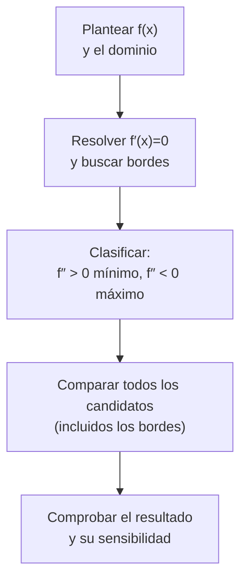

# B09-C07 — Optimización con derivadas

<!-- nav:top -->
[🏠 Programa](../../../../README.md) · [📚 Bloque B09](../../../tronco-comun/B09-calculo-diferencial-e-integral.md) · [← Anterior: B09-C06 — Derivación implícita](../B09-C06-derivacion-implicita/CLASE.md) · [Siguiente: B09-C08 — Integrales indefinidas →](../B09-C08-integrales-indefinidas/CLASE.md)
<!-- /nav -->

## 1. Ubicación, nivel y alcance

Séptima clase del bloque B09 y última del tramo de derivadas de una variable. Usas la derivada ([C03](../B09-C03-derivada-como-tasa-de-cambio/CLASE.md)–[C06](../B09-C06-derivacion-implicita/CLASE.md)) para encontrar **dónde una cantidad es máxima o mínima**. Nivel N2. Verás puntos críticos, la prueba de la segunda derivada, extremos en los bordes, un diseño (tanque de menor área) y un punto de equilibrio gravitatorio entre la Tierra y la Luna. No verás multiplicadores de Lagrange ni optimización de varias variables (B09-C16 en adelante).

## 2. Por qué esta clase existe

Un tanque de propelente cuesta masa en su pared: dado el volumen que necesita, ¿qué forma usa menos material? Un vehículo que viaja de la Tierra a la Luna pasa por una región donde la atracción de ambos cuerpos se compensa. En ambos casos la respuesta aparece donde una derivada vale cero.

La decisión central: **¿cómo encuentro el valor de la variable que optimiza una cantidad, cómo sé que es máximo o mínimo, y qué tan sensible es el resultado a desviarme del óptimo?**

## 3. Lo que podrás hacer al terminar

1. Plantear una función objetivo con una sola variable a partir de un enunciado.
2. Hallar puntos críticos y clasificarlos con la segunda derivada.
3. Comprobar los extremos en los bordes del dominio.
4. Resolver el problema del tanque de área mínima y comprobarlo numéricamente.
5. Hallar el punto de atracción igual entre dos cuerpos y distinguir máximo de mínimo del potencial.
6. Evaluar la sensibilidad de un diseño a desviarse del óptimo.

La evidencia es la **tabla de diseño óptimo con sensibilidad** del ejercicio 12 (sección 20).

## 4. Con qué llegas y cómo comprobarlo

Necesitas derivar con las reglas de [C04](../B09-C04-reglas-de-derivacion/CLASE.md) y resolver ecuaciones. Cinco preguntas:

1. Deriva `2πr² + 20/r`.
2. Resuelve `4πr − 20/r² = 0` para `r` (deja la raíz cúbica expresada).
3. ¿Qué significa que `f′(x₀) = 0`?
4. Si `f″(x₀) > 0`, ¿la curva es cóncava hacia arriba o hacia abajo?
5. Calcula el volumen de un cilindro de radio 1 m y largo 3 m.

<details>
<summary>Ver respuestas</summary>

1. `4πr − 20/r²`. 2. `r³ = 5/π`. 3. La tangente es horizontal. 4. Hacia arriba. 5. `π · 1² · 3 = 9,42 m³`.
</details>

Con cuatro o cinco aciertos, sigue; si no, repasa C03–C04.

## 5. Un caso real: el punto donde la Luna y la Tierra tiran igual

Sobre la línea que une la Tierra y la Luna existe un punto donde las dos atracciones son iguales y opuestas. Con el parámetro gravitacional nominal terrestre `(GM)_E^N = 3,986 004 × 10⁵ km³/s²` (S2), el lunar `GM_L = 4,90 × 10³ km³/s²` y la distancia media `d = 384 400 km` (S3), ese punto queda a unos `346 034 km` de la Tierra y `38 366 km` de la Luna. Es un modelo simple (cuerpos puntuales, sin el Sol ni el movimiento orbital): da el orden de magnitud, no la trayectoria de una misión. Es una necesidad concreta: separar el dominio gravitatorio de cada cuerpo al planificar una transferencia. El otro ejemplo es de ingeniería: el **tanque** de propelente de volumen dado y área de pared mínima (cifras **sintéticas**).

## 6. Vocabulario

Una **función objetivo** es la cantidad que se quiere maximizar o minimizar. Un **punto crítico** es un `x` donde `f′(x) = 0` o `f′` no existe. Un **máximo (mínimo) local** es un valor mayor (menor) que sus vecinos; un **extremo global** lo es en todo el dominio. La **prueba de la segunda derivada**: si `f′(x₀) = 0` y `f″(x₀) > 0`, hay mínimo local; si `f″(x₀) < 0`, máximo (S1, §1.4(iii)). Un **punto de inflexión** es donde cambia la concavidad. El **potencial gravitatorio** de una masa puntual es `Φ(r) = −GM/r`. El **punto de atracción igual** es donde la fuerza neta de dos cuerpos se anula. La **sensibilidad** mide cuánto cambia el objetivo al desviarse del óptimo. Una **restricción** es una condición que liga las variables (por ejemplo, un volumen fijo).

## 7. Modelo mental: la cima y el valle

En la cima de una colina la pendiente es cero; en la subida es positiva y en la bajada negativa. Si la pendiente pasa de positiva a negativa, es un máximo; si pasa de negativa a positiva, un mínimo. La segunda derivada resume lo mismo: mide cómo cambia la pendiente.



*Descripción textual:* se escribe el objetivo en una variable, se buscan puntos con derivada nula y los bordes, se clasifican con la segunda derivada, se comparan los valores y se verifica el resultado.

Analogía: una bola en un valle se detiene donde la pendiente es cero. Su límite: la bola puede detenerse también en una meseta o en un punto de inflexión como `x³` en 0, que no es ni máximo ni mínimo.

## 8. La explicación, paso a paso

### 8.1 Un primer problema

Rectángulo de perímetro 40 y área máxima: con base `x`, altura `20 − x`, `A = x(20 − x)`; `A′ = 20 − 2x = 0` → `x = 10`: un cuadrado; `A″ = −2 < 0` máximo; `A = 100`.

### 8.2 Clasificar

Para `f(x) = x³ − 3x`: `f′ = 3x² − 3 = 0` → `x = ±1`; `f″ = 6x`. En `−1`: `f″ = −6`, máximo con `f = 2`; en `1`: `f″ = 6`, mínimo con `f = −2`. Si `f″ = 0` la prueba no decide: en `x³`, `x = 0` es un punto de inflexión.

### 8.3 Los bordes

Sobre un intervalo cerrado `[a, b]` el extremo global está entre los puntos críticos y los bordes. En `f(x) = x²` sobre `[0, 3]`, el único crítico `x = 0` es mínimo y el máximo está en el borde `x = 3` (`f = 9`), aunque allí `f′ ≠ 0`.

### 8.4 El tanque de área mínima

Cilindro con tapas planas, volumen `V` fijo: `V = π r² L`, luego `L = V/(π r²)`. El área es `A(r) = 2πr² + 2πrL = 2πr² + 2V/r`. Derivando: `A′ = 4πr − 2V/r²`; igualando a 0: `r³ = V/(2π)`. Entonces `L = V/(π r²) = 2r`: el cilindro óptimo tiene altura igual al diámetro. La segunda derivada, `A″ = 4π + 4V/r³`, vale `12π > 0` en el óptimo: mínimo. Para `V = 10 m³`: `r* = 1,1675 m`, `L* = 2,3351 m`, `A* = 25,695 m²`.

### 8.5 Sensibilidad

Cerca del mínimo la curva es plana: con `r = 0,9 r*` o `1,1 r*` el área sube `+1,07 %` y `+0,94 %`. Con `r = 1,0 m` (un valor «redondo») sube `+2,29 %`. Por eso un diseño casi óptimo es casi tan bueno: la derivada nula implica que el error del objetivo es de segundo orden respecto al error en `r`. Al escalar el volumen, `A* ∝ V^(2/3)` (el laboratorio lo comprueba: `119,27/5,536 = 21,54 = 100^(2/3)`).

### 8.6 El punto de atracción igual

Sobre la línea, a una distancia `x` de la Tierra, el potencial es `Φ(x) = −GM_E/x − GM_L/(d − x)`. Su derivada es `Φ′ = GM_E/x² − GM_L/(d − x)²`, que es (menos) la aceleración neta. `Φ′ = 0` da `x/(d − x) = √(GM_E/GM_L)`, es decir `x* = d/(1 + √(GM_L/GM_E))`. Con `√(GM_L/GM_E) = 0,110 87`: `x* = 346 034 km`. La segunda derivada, `Φ″ = −2GM_E/x³ − 2GM_L/(d − x)³`, es negativa: sobre la línea, ese punto es un **máximo** del potencial. Una sonda que lo cruza «cambia de dominio»: antes cae hacia la Tierra, después hacia la Luna.

### 8.7 Cuando no hay solución limpia

Si `f′(x) = 0` no se puede resolver con álgebra, se usa Newton (C06) o un método sin derivada como la **sección áurea**, que reduce el intervalo de un mínimo y es el que usa el laboratorio para comprobar el tanque.

## 9. Magnitudes, símbolos y unidades

| Símbolo | Qué es | Unidad | Nota |
|---|---|---|---|
| `V` | volumen del tanque | m³ | 10 (sintético) |
| `r`, `L` | radio y largo | m | `L = 2r` en el óptimo |
| `A` | área de la pared | m² | objetivo |
| `Φ` | potencial gravitatorio | km²/s² | `−GM/r` |
| `x`, `d` | distancia a la Tierra y entre centros | km | `d = 384 400` (S3) |
| `GM_E`, `GM_L` | parámetros gravitacionales | km³/s² | `3,986 004 × 10⁵` (S2) y `4,90 × 10³` (S3) |
| `x*` | punto de atracción igual | km | 346 034 |

## 10. Convenciones y referencias

La coordenada `x` crece desde el centro de la Tierra hacia el de la Luna. No se aplica signo de «fuerza»: `Φ′` es positiva donde domina la Tierra, negativa donde domina la Luna. El tanque es un modelo geométrico con tapas planas y sin espesor ni soldaduras; un diseño real añade presión, material y costuras. Los datos lunares de la NASA tienen tres cifras; el resultado `346 034 km` no merece más de tres o cuatro cifras significativas.

## 11. De dónde sale lo que afirmamos

| ID | Fuente | Localizador | Respalda | Estado |
|---|---|---|---|---|
| S1 | NIST, *Digital Library of Mathematical Functions* §1.4, versión 1.2.8 | https://dlmf.nist.gov/1.4 | Derivadas y teorema del valor medio como base de los puntos críticos (§1.4(iii)) | Consultada el 2026-11-05 mediante extracción automática |
| S2 | IAU, Resolución B3 de 2015, arXiv:1510.07674 | https://arxiv.org/pdf/1510.07674 | `(GM)_E^N = 3,986 004 × 10¹⁴ m³ s⁻²` | Texto extraído del PDF el 2026-11-05 |
| S3 | NASA/NSSDC, *Moon Fact Sheet* (actualizada 2024-01-11) | https://nssdc.gsfc.nasa.gov/planetary/factsheet/moonfact.html | `GM_L = 0,004 90 × 10⁶ km³/s²`; semieje mayor de la órbita 384 400 km | Consultada el 2026-11-05 mediante extracción automática |

Límites: la prueba de la segunda derivada y la sensibilidad son resultados estándar del cálculo y se comprueban numéricamente aquí; no se citan de S1. El punto de atracción igual no se contrastó con una cifra publicada. El tanque es **sintético**.

## 12. Cómo ver el óptimo

Equivalente accesible a la gráfica de `A(r)` para `V = 10 m³` (valores del laboratorio):

| `r` (m) | `A` (m²) | Cambio respecto al mínimo |
|---|---|---|
| 1,051 (0,9 `r*`) | 25,971 | +1,07 % |
| 1,1675 (`r*`) | 25,695 | 0 |
| 1,284 (1,1 `r*`) | 25,936 | +0,94 % |
| 1,000 | 26,283 | +2,29 % |

Descripción larga: la curva baja, alcanza un mínimo suave en 1,17 m y vuelve a subir; es casi plana en una banda de ±10 % alrededor.

## 13. Ejemplo trabajado: el tanque de 10 m³

**Paso 1 · Objetivo y restricción.** Minimizar `A = 2πr² + 2πrL` con `π r² L = 10`.

**Paso 2 · Una variable.** `L = 10/(π r²)`: `A(r) = 2πr² + 20/r`, con `r > 0`.

**Paso 3 · Punto crítico.** `A′ = 4πr − 20/r² = 0` → `r³ = 20/(4π) = 1,5915` → `r = 1,1675 m`.

**Paso 4 · Clasificar.** `A″ = 4π + 40/r³ = 12,566 + 25,13 = 37,70 > 0`: mínimo. En los bordes (`r → 0` o `r → ∞`) `A → ∞`: es el mínimo global.

**Paso 5 · Resultado y comprobación.** `L = 10/(π · 1,3631) = 2,335 m = 2r`; `A = 25,695 m²`. La sección áurea da `r = 1,16754 m`, igual. Con `r = 1,0 m` el área sube 2,3 %. Sentido: el cilindro óptimo es «tan alto como ancho»; un tanque real tiene casquetes esféricos y otras restricciones.

## 14. Distintas formas de optimizar

El **cálculo** da el óptimo exacto cuando se puede resolver `f′ = 0`. La **búsqueda por sección áurea** no necesita derivada y funciona con funciones unimodales. El **barrido** (probar muchos valores) es simple pero costoso. El **método de Newton** aplicado a `f′` converge rápido pero necesita `f″`. En todos hay que comprobar los bordes y que el resultado sea máximo o mínimo, según corresponda.

## 15. Práctica guiada

**Ejercicio 1 · con los pasos indicados.** Halla el rectángulo de perímetro 40 con área máxima. *Pasos:* escribe `A(x)`, deriva, clasifica.

<details><summary>Solución comentada</summary>

`A = x(20 − x)`; `A′ = 20 − 2x = 0` → `x = 10`; `A″ = −2 < 0`: máximo, `A = 100` (8.1).
</details>

**Ejercicio 2 · con una pista.** Clasifica los puntos críticos de `f(x) = x³ − 3x`. *Pista:* `f″ = 6x`.

<details><summary>Solución comentada</summary>

Críticos `±1`; `f″(−1) = −6` → máximo (`f = 2`); `f″(1) = 6` → mínimo (`f = −2`) (8.2).
</details>

**Ejercicio 3 · casi autónomo.** Halla `r*`, `L*` y `A*` para un tanque de `V = 10 m³`.

<details><summary>Solución comentada</summary>

`r* = (10/2π)^{1/3} = 1,1675 m`; `L* = 2r* = 2,3351 m`; `A* = 25,695 m²` (8.4).
</details>

## 16. Práctica autónoma, transferencia e integrador

**Ejercicio 4.** Un proyectil **sintético** lanzado a `100 m/s` con ángulo `θ` tiene alcance `R(θ) = v² sin 2θ/g`. Halla el ángulo de alcance máximo y el alcance con `g = 9,7984 m/s²` (C03).

<details><summary>Solución comentada</summary>

`R′ = 2v² cos 2θ/g = 0` → `2θ = 90°`, `θ = 45°`; `R″ < 0` máximo. `R = 100²/9,7984 = 1020,6 m` (sin arrastre).
</details>

**Ejercicio 5.** Dos masas con cociente `GM_1 : GM_2 = 4 : 1` y distancia `d`: halla el punto de atracción igual.

<details><summary>Solución comentada</summary>

`x* = d/(1 + √(1/4)) = d/1,5 = 2d/3` medido desde la masa mayor.
</details>

**Ejercicio 6.** Halla el máximo de `f(x) = x²` en `[0, 3]`.

<details><summary>Solución comentada</summary>

El único punto crítico (`x = 0`) es mínimo (`f = 0`). El máximo está en el borde `x = 3` con `f = 9`, donde `f′ ≠ 0` (8.3).
</details>

**Ejercicio 7.** Con el tanque de 10 m³, ¿cuánto sube el área si usas `r = 1,0 m` en lugar de `r*`?

<details><summary>Solución comentada</summary>

`A(1,0) = 2π + 20 = 26,283 m²`; `26,283/25,695 − 1 = +2,29 %`.
</details>

**Ejercicio 8.** Comprueba que `A″(r*) = 12π` para cualquier `V`.

<details><summary>Solución comentada</summary>

`A″ = 4π + 4V/r³`; con `r³ = V/2π`: `4V/r³ = 8π`. Total `12π = 37,70` (independiente de `V`).
</details>

**Ejercicio 9 · transferencia.** Calcula con los datos de 8.6 la distancia del punto de atracción igual a la Luna y compárala con el radio medio lunar (1737,4 km, S3).

<details><summary>Solución comentada</summary>

`d − x* = 384 400 − 346 034 = 38 366 km`, unas 22 veces el radio lunar. El resultado es un modelo de dos cuerpos puntuales y no incluye al Sol ni el movimiento orbital: se interpreta como orden de magnitud.
</details>

**Ejercicio 10 · transferencia.** Demuestra el problema dual: un cilindro de área `A` dada tiene volumen máximo cuando `L = 2r`.

<details><summary>Solución comentada</summary>

`A = 2πr² + 2πrL` → `L = (A − 2πr²)/(2πr)`; `V = π r² L = r(A − 2πr²)/2 = (A r − 2π r³)/2`. `V′ = (A − 6πr²)/2 = 0` → `r² = A/(6π)`, y `L = (6πr² − 2πr²)/(2πr) = 2r`. Misma forma: minimizar el área para un volumen y maximizar el volumen para un área son el mismo cilindro.
</details>

**Ejercicio 11 · transferencia.** Un compañero dice: «`f′(0) = 0` para `f = x³`, así que hay un mínimo en 0». Evalúa.

<details><summary>Solución comentada</summary>

Falso: `f″(0) = 0`, la prueba no decide; los valores a la izquierda son menores y a la derecha mayores, así que es un punto de inflexión. Siempre hay que clasificar el punto crítico.
</details>

**Ejercicio 12 · integrador.** Elabora tu *tabla de diseño óptimo con sensibilidad*: para `V = 1, 10, 100 m³` (sintéticos) da `r*`, `L*`, `A*`, el cambio de `A` con `r = 0,9 r*` y `1,1 r*`, y verifica `A* ∝ V^{2/3}`; añade el punto de atracción igual con los datos publicados.

<details><summary>Solución modelo</summary>

Tabla con las columnas del laboratorio (`r* = 0,5419; 1,1675; 2,5154 m`; `A* = 5,536; 25,695; 119,27 m²`), cambio de +1,07 % y +0,94 % para ±10 % en `r` (independiente de `V`), y `x* = 346 034 km`. Se declara que el tanque es sintético y que el punto neutro es un modelo.
</details>

## 17. Laboratorio: tanque y punto neutro

El script [tanque_y_punto_neutro.py](tanque_y_punto_neutro.py) compara el óptimo analítico del tanque con una búsqueda por sección áurea para tres volúmenes, verifica `L = 2r`, `A″ > 0` y `A* ∝ V^{2/3}`, y calcula el punto de atracción igual por bisección y por fórmula.

**Datos:** tanque sintético; parámetros gravitacionales publicados. **Predice antes de ejecutar:** ¿qué valor tiene `A″(r*)`? (`12π = 37,70`.) **Ejecución del 2026-11-05 (Python 3.12.9):**

```text
  V [m3]    r* [m]     L* [m]     A* [m2]    A''(r*)   r_num [m]
     1.0    0.54193    1.08385     5.5358    37.699    0.54193
    10.0    1.16754    2.33509    25.6950    37.699    1.16754
   100.0    2.51540    5.03080   119.2654    37.699    2.51540
  V=10, r = 0.9 r*: A = 25.9709 m2 (+1.074%)
  V=10, r = 1.1 r*: A = 25.9363 m2 (+0.939%)
  V=10, r = 1.0 m: A = 26.2832 m2 (+2.289%)
  x* = 346033.9 km desde la Tierra;  a la Luna: 38366.1 km
Pruebas superadas.
```

```bash
python programa/clases/B09/B09-C07-optimizacion-con-derivadas/tanque_y_punto_neutro.py
```

**Límites:** tanque sin espesor ni presión; punto de atracción igual con cuerpos puntuales; no es un diseño ni una trayectoria.

## 18. Errores frecuentes y cómo corregirlos

**No comprobar si el punto crítico es máximo o mínimo.** Se corrige con el ejercicio 11.

**Olvidar los bordes del dominio.** Se corrige con el ejercicio 6.

**Optimizar con dos variables sin usar la restricción.** Se corrige en el paso 2 del ejemplo trabajado.

**Exagerar la precisión del óptimo.** Se corrige con la sensibilidad (sección 8.5) y el ejercicio 7.

**Confundir el óptimo matemático con el diseño real.** Se corrige releyendo la sección 10.

## 19. Cómo sabrás que vas bien

Tras 8.2: ¿clasificas `x³ − 3x`? Si no, ejercicio 2. Tras 8.4: ¿llegas a `L = 2r`? Si no, ejercicio 3. Tras 8.5: ¿por qué un 10 % de error en `r` cuesta solo 1 % de área? Si no lo sabes, ejercicio 7. Tras el laboratorio: ¿qué dos métodos independientes coinciden? (fórmula y sección áurea).

## 20. Qué entregas y cómo se evalúa

El producto es tu **tabla de diseño óptimo con sensibilidad** (ejercicio 12).

| Criterio | Inicial | En desarrollo | Logrado | Destacado |
|---|---|---|---|---|
| Planteamiento | Sin restricción | Con ayuda | Objetivo en una variable | Justifica el dominio |
| Cálculo del óptimo | Errores | Punto crítico | Punto crítico y clasificación | Compara con método numérico |
| Bordes | Ignorados | Mencionados | Evaluados | Explica cuándo mandan |
| Sensibilidad | Ausente | Cualitativa | Calculada | Explica el segundo orden |
| Fuentes | Sin fuente | Sin fecha | Con localizador y fecha | Rotula sintético y modelo |

**Condiciones críticas (no se compensan con promedio):** clasificar el punto crítico; rotular lo sintético; citar solo fuentes consultadas.

## 21. Ética, seguridad y límites

Un óptimo matemático no es un diseño aprobado: la presión, la fatiga, el costo y la seguridad imponen otras restricciones. Esta clase no habilita el diseño de recipientes a presión ni la planificación de misiones. Accesibilidad: tablas equivalentes a las gráficas, fórmulas en texto, ejercicios sin conexión.

## 22. Para cerrar y seguir

Un extremo local aparece donde `f′ = 0` (o en un borde); la segunda derivada lo clasifica; el óptimo es plano, por lo que un diseño casi óptimo cuesta poco. Con esto cierras el cálculo diferencial de una variable. Queda abierta una pregunta: ¿cómo se **deshace** una derivada, es decir, cómo se pasa de la aceleración a la velocidad? Es la integral.

**Glosario español–inglés.** optimización · *optimization*; función objetivo · *objective function*; punto crítico · *critical point*; segunda derivada · *second derivative*; sensibilidad · *sensitivity*; restricción · *constraint*; sección áurea · *golden-section search*; potencial gravitatorio · *gravitational potential*.

**Continuidad.** B09-C08 reutiliza tu capacidad de **derivar con exactitud** para definir su operación inversa: la antiderivada.

**Referencias:** ver sección 11.

<!-- nav:bottom -->
---

[← Anterior: B09-C06 — Derivación implícita](../B09-C06-derivacion-implicita/CLASE.md) · [📚 Bloque B09](../../../tronco-comun/B09-calculo-diferencial-e-integral.md) · [Siguiente: B09-C08 — Integrales indefinidas →](../B09-C08-integrales-indefinidas/CLASE.md)
<!-- /nav -->
