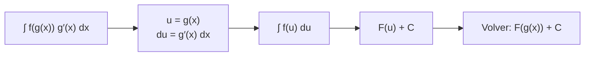

# B09-C09 — Integración por sustitución

<!-- nav:top -->
[🏠 Programa](../../../../README.md) · [📚 Bloque B09](../../../tronco-comun/B09-calculo-diferencial-e-integral.md) · [← Anterior: B09-C08 — Integrales indefinidas](../B09-C08-integrales-indefinidas/CLASE.md) · [Siguiente: B09-C10 — Integración por partes →](../B09-C10-integracion-por-partes/CLASE.md)
<!-- /nav -->

## 1. Ubicación, nivel y alcance

Novena clase del bloque B09. En [C08](../B09-C08-integrales-indefinidas/CLASE.md) integraste expresiones que coinciden con una integral básica. Casi nunca ocurre: lo habitual es una función compuesta. Aquí aprendes a **reconocerla y simplificarla con un cambio de variable**. Nivel N2. Verás la sustitución `u = g(x)` como la regla de la cadena al revés, el cambio de límites y un caso real: cuánta masa de atmósfera hay sobre una altitud. No verás integración por partes (C10) ni integrales definidas en profundidad (C11).

## 2. Por qué esta clase existe

La densidad del aire decae con la altitud de forma exponencial, y la masa de aire sobre un punto determina la presión y la extinción de la luz. Para obtenerla hay que integrar `e^{−h/H}`, que no es una integral básica: la variable aparece dentro de un exponente. La sustitución convierte ese problema en uno ya resuelto.

La decisión central: **¿qué parte de la expresión es la función interior `u`, qué hago con `du`, y cómo sé que la sustitución cerró?**

## 3. Lo que podrás hacer al terminar

1. Reconocer una composición y elegir `u`.
2. Calcular `du` y reescribir la integral completa en `u`.
3. Integrar y volver a `x` (o cambiar los límites).
4. Resolver integrales de la forma `∫ f(ax + b) dx`.
5. Calcular la masa de columna de una atmósfera exponencial.
6. Detectar cuándo la sustitución no cierra.

La evidencia es la **tabla de masa de columna y presión con comprobación numérica** del ejercicio 12 (sección 20).

## 4. Con qué llegas y cómo comprobarlo

Necesitas la regla de la cadena (C04) y las integrales básicas (C08). Cinco preguntas:

1. Deriva `(3x + 1)⁶`.
2. Deriva `sin(x²)`.
3. ¿Cuánto vale `∫ u⁵ du`?
4. ¿Cuánto es `e⁰`?
5. Si `u = −h/8`, ¿cuánto es `du` en función de `dh`?

<details>
<summary>Ver respuestas</summary>

1. `18(3x + 1)⁵`. 2. `2x cos(x²)`. 3. `u⁶/6 + C`. 4. 1. 5. `du = −dh/8`.
</details>

Con cuatro o cinco aciertos, sigue; si no, repasa C04 y C08.

## 5. Un caso real: cuánto aire hay encima

La presión que ejerce una atmósfera en equilibrio es el peso de la columna de aire por unidad de área: `p = g Σ`, con `Σ` la **masa de columna** (kg/m²). Para saberla hay que integrar la densidad hacia arriba. Usaremos una **atmósfera isotérmica sintética**: `ρ(h) = ρ₀ e^{−h/H}` con `ρ₀ = 1,2 kg/m³` y `H = 8,0 km`. Son parámetros de ejemplo con un orden de magnitud terrestre; **no** provienen de ninguna atmósfera estándar publicada. Con ellos, a nivel del suelo `Σ = 9600 kg/m²` y `p = g_n Σ = 9,41 × 10⁴ Pa` (`g_n = 9,806 65 m/s²`, S2), del orden de 10⁵ Pa, que es el orden de la presión atmosférica a nivel del mar (dato que no se consultó en esta clase). La necesidad concreta: el arrastre de un satélite y la extinción de la luz dependen de cuánta masa hay en el camino.

## 6. Vocabulario

La **sustitución** (o cambio de variable) reemplaza una expresión `u = g(x)` por una nueva variable; su justificación es la regla de la cadena: `∫ f(g(x)) g′(x) dx = ∫ f(u) du` (S1, §1.4(v), ec. 1.4.28 en forma definida). El **diferencial** `du = g′(x) dx` es la regla que traduce `dx` a `du`. La **función interior** es `g`, la **exterior** `f`. La **altura de escala** `H` de una atmósfera exponencial es la altitud en la que la densidad cae a `1/e`. La **masa de columna** `Σ(h₀)` es la masa de aire sobre una área unidad por encima de `h₀`. La **presión hidrostática** es `p = gΣ` con `g` constante. La **densidad** `ρ` es masa por volumen (kg/m³).

## 7. Modelo mental: la cadena al revés

Derivar `sin(x²)` produce `2x cos(x²)`: la derivada de lo de adentro aparece multiplicando. Integrar es reconocer ese patrón: si en la integral ves una función de `g(x)` multiplicada por `g′(x)` (salvo una constante), ya sabes que sale de una cadena.



*Descripción textual:* se nombra la función interior `u`, se traduce el diferencial, se integra en `u` y se devuelve el resultado a `x`.

Analogía: cambiar de unidades para que una cuenta sea fácil y volver luego. Su límite: el cambio funciona solo si **toda** la expresión (incluido `dx`) se reescribe; si queda un `x` suelto, la sustitución no cerró.

## 8. La explicación, paso a paso

### 8.1 Un caso lineal

`∫ (3x + 1)⁵ dx`. Con `u = 3x + 1`, `du = 3 dx` y `dx = du/3`: `∫ u⁵ du/3 = u⁶/18 + C = (3x + 1)⁶/18 + C`. Comprobación: la derivada es `6(3x + 1)⁵ · 3/18 = (3x + 1)⁵` ✓. Regla general: `∫ f(ax + b) dx = F(ax + b)/a + C`.

### 8.2 La derivada interior ya está

`∫ 2x cos(x²) dx`: con `u = x²`, `du = 2x dx` aparece exactamente: `∫ cos u du = sin u + C = sin(x²) + C`.

### 8.3 Falta una constante

`∫ x/(1 + x²) dx`: con `u = 1 + x²`, `du = 2x dx`, o sea `x dx = du/2`: `½ ∫ du/u = ½ ln|u| + C = ½ ln(1 + x²) + C`. Una constante faltante se compensa; una **variable** faltante no.

### 8.4 Cuando no cierra

`∫ sin(x²) dx` con `u = x²` deja `du = 2x dx` y quedaría un `x` sin traducir. No tiene antiderivada elemental; se calcula numéricamente (C11).

### 8.5 Cambio de límites

En una integral definida, `u = g(x)` cambia también los límites: `∫₀² 2x cos(x²) dx = ∫₀⁴ cos u du = sin 4 = −0,7568`. No hace falta volver a `x`.

### 8.6 Un logaritmo como interior

`∫ (ln x)/x dx`: con `u = ln x`, `du = dx/x` (se usa como dato `(ln x)′ = 1/x`): `∫ u du = (ln x)²/2 + C`. Aparece en el cálculo con magnitudes.

### 8.7 La atmósfera exponencial

`Σ(h₀) = ∫_{h₀}^{∞} ρ₀ e^{−h/H} dh`. Con `u = −h/H`, `du = −dh/H`, es decir `dh = −H du`: la antiderivada de `e^{−h/H}` es `−H e^{−h/H}` (se usa como dato `(eᵘ)′ = eᵘ`). Evaluando entre `h₀` y `∞` (donde `e^{−h/H} → 0`): `Σ(h₀) = ρ₀ H e^{−h₀/H}`. Con los parámetros sintéticos: `Σ(0) = 9600 kg/m²`; `Σ(10 km) = 2750,5 kg/m²` (28,7 %); `Σ(20 km) = 788,0`; `Σ(50 km) = 18,5`. La mitad de la masa queda sobre `H ln 2 = 5,545 km`.

## 9. Magnitudes, símbolos y unidades

| Símbolo | Qué es | Unidad | Nota |
|---|---|---|---|
| `ρ(h)` | densidad del aire | kg/m³ | `ρ₀ e^{−h/H}` (sintética) |
| `ρ₀` | densidad a `h = 0` | kg/m³ | 1,2 (sintética) |
| `H` | altura de escala | m | 8000 (sintética) |
| `Σ(h₀)` | masa de columna sobre `h₀` | kg/m² | `ρ₀ H e^{−h₀/H}` |
| `p` | presión hidrostática | Pa = N/m² | `g_n Σ` |
| `g_n` | aceleración estándar | m/s² | 9,806 65 (S2) |
| `u`, `du` | variable y diferencial auxiliares | según el caso | |

Comprobación dimensional: `ρ₀ H` = (kg/m³)·m = kg/m² ✓.

## 10. Convenciones y referencias

La altitud `h` se mide desde el suelo, hacia arriba. Se supone `g` constante en toda la columna (una simplificación: `g` cae con la altura, C04). El límite superior `∞` se interpreta como `lim_{b→∞}`. Los resultados dependen de dos parámetros sintéticos y no describen la atmósfera real, que no es isotérmica.

## 11. De dónde sale lo que afirmamos

| ID | Fuente | Localizador | Respalda | Estado |
|---|---|---|---|---|
| S1 | NIST, *Digital Library of Mathematical Functions* §1.4, versión 1.2.8 | https://dlmf.nist.gov/1.4 | Cambio de variable en integrales (§1.4(v), ec. 1.4.28) | Consultada el 2026-11-05 mediante extracción automática |
| S2 | NIST, CODATA 2022, `g_n` | https://physics.nist.gov/cgi-bin/cuu/Value?gn | `g_n = 9,806 65 m s⁻²`, exacta | Consultada el 2026-11-05 |

Límites: la atmósfera es **sintética**; las derivadas de `ln` y `exp` se usan como dato estándar sin cita; la presión de ~10⁵ Pa a nivel del mar es conocimiento general no consultado.

## 12. Cómo ver la columna

Equivalente accesible a la gráfica de `Σ` frente a `h₀` (laboratorio, atmósfera sintética):

| `h₀` (km) | `Σ` (kg/m²) | Fracción | `p = g_n Σ` (Pa) |
|---|---|---|---|
| 0 | 9600,0 | 1 | 94 143,8 |
| 5,545 | 4800,1 | 0,500 | 47 073,0 |
| 10 | 2750,5 | 0,287 | 26 972,7 |
| 20 | 788,0 | 0,082 | 7727,8 |
| 50 | 18,5 | 0,0019 | 181,7 |

Descripción larga: `Σ` cae como una exponencial: pierde la mitad cada 5,5 km, de modo que a 50 km queda menos del 0,2 % de la masa.

## 13. Ejemplo trabajado: masa sobre 10 km

**Paso 1 · Planteo.** `Σ(10 km) = ∫_{10 000}^{∞} 1,2 e^{−h/8000} dh`.

**Paso 2 · Sustitución.** `u = −h/8000`, `dh = −8000 du`. Límites: `h = 10 000 → u = −1,25`; `h → ∞ → u → −∞`.

**Paso 3 · Integral.** `1,2 · (−8000) ∫_{−1,25}^{−∞} eᵘ du = −9600 [eᵘ]_{−1,25}^{−∞} = −9600 (0 − e^{−1,25}) = 9600 e^{−1,25}`.

**Paso 4 · Número.** `e^{−1,25} = 0,28650`; `Σ = 2750,5 kg/m²`.

**Paso 5 · Comprobación y sentido.** La regla del trapecio hasta 100 km más arriba da el mismo valor a menos de 10⁻⁴ (laboratorio). Unidades: kg/m² ✓. Equivale a `p = 9,80665 · 2750,5 = 26 973 Pa`, el 28,7 % de la presión del suelo en este modelo.

## 14. Distintas formas de resolver una integral

La **sustitución** sirve cuando la derivada interior está presente. Las **tablas** o un **sistema algebraico** resuelven casos largos pero se validan derivando. La **integración numérica** (C11) siempre aplica, aun sin antiderivada elemental, con un error controlable. Cuando la sustitución falla, se prueba **partes** (C10).

## 15. Práctica guiada

**Ejercicio 1 · con los pasos indicados.** Calcula `∫ (3x + 1)⁵ dx`. *Pasos:* `u = 3x + 1`; `du`; integra; vuelve a `x`.

<details><summary>Solución comentada</summary>

`du = 3 dx`; `∫ u⁵ du/3 = u⁶/18 + C = (3x + 1)⁶/18 + C`. Entre 0 y 1: `(4⁶ − 1)/18 = 227,5` (8.1).
</details>

**Ejercicio 2 · con una pista.** Calcula `∫ 2x cos(x²) dx`. *Pista:* `u = x²`.

<details><summary>Solución comentada</summary>

`du = 2x dx` → `∫ cos u du = sin u + C = sin(x²) + C` (8.2).
</details>

**Ejercicio 3 · casi autónomo.** Calcula `∫ x/(1 + x²) dx`.

<details><summary>Solución comentada</summary>

`u = 1 + x²`, `x dx = du/2`: `½ ln(1 + x²) + C` (8.3). Derivada: `½ · 2x/(1 + x²) = x/(1 + x²)` ✓.
</details>

## 16. Práctica autónoma, transferencia e integrador

**Ejercicio 4.** Calcula `∫ e^{−h/H} dh`.

<details><summary>Solución comentada</summary>

`u = −h/H`, `dh = −H du`: `−H e^{−h/H} + C`.
</details>

**Ejercicio 5.** Calcula `Σ(10 km)` con los parámetros de la clase.

<details><summary>Solución comentada</summary>

`9600 · e^{−1,25} = 2750,5 kg/m²` (ejemplo trabajado).
</details>

**Ejercicio 6.** Calcula `∫ sec²(2x) dx`.

<details><summary>Solución comentada</summary>

Regla lineal: `tan(2x)/2 + C`. Derivada: `sec²(2x)` ✓.
</details>

**Ejercicio 7.** Evalúa `∫₀² 2x cos(x²) dx` cambiando los límites.

<details><summary>Solución comentada</summary>

`u = x²`: de 0 a 4. `∫₀⁴ cos u du = sin 4 = −0,7568` (8.5).
</details>

**Ejercicio 8.** Calcula `∫ (ln x)/x dx`.

<details><summary>Solución comentada</summary>

`u = ln x`, `du = dx/x`: `(ln x)²/2 + C`.
</details>

**Ejercicio 9 · transferencia.** Con la atmósfera sintética, ¿cuánta masa de columna queda sobre 100 km y cuántas veces menos que en el suelo?

<details><summary>Solución comentada</summary>

`9600 e^{−12,5} = 0,0358 kg/m²`; cociente `e^{12,5} = 2,7 × 10⁵`. Resultado del modelo sintético: da el orden de magnitud de la rapidez con que la masa se vuelve despreciable, no la masa real a 100 km.
</details>

**Ejercicio 10 · transferencia.** Un compañero escribe `∫ (3x + 1)⁵ dx = (3x + 1)⁶/6`. Detecta el error derivando.

<details><summary>Solución comentada</summary>

Derivada: `6(3x + 1)⁵ · 3/6 = 3(3x + 1)⁵`, no `(3x + 1)⁵`. Faltó dividir por 3: el factor `1/a` (8.1).
</details>

**Ejercicio 11 · transferencia.** ¿Se puede resolver `∫ sin(x²) dx` con `u = x²`? ¿Qué se hace entonces?

<details><summary>Solución comentada</summary>

No: faltaría el factor `2x` (8.4). La integral existe y se calcula numéricamente; no toda integral tiene antiderivada elemental.
</details>

**Ejercicio 12 · integrador.** Elabora tu *tabla de masa de columna y presión con comprobación numérica*: cinco altitudes con `Σ`, fracción y `p`, la altitud de la mitad de la masa y la comparación entre la fórmula y una integración numérica; rotula la atmósfera como sintética.

<details><summary>Solución modelo</summary>

Tabla como la de la sección 12 con una columna para el valor numérico y la diferencia relativa (< 10⁻⁴); `h_{1/2} = H ln 2 = 5,545 km`; nota de que `ρ₀ = 1,2` y `H = 8` son parámetros de ejemplo y que se supone `g` constante.
</details>

## 17. Laboratorio: masa de columna

El script [columna_de_atmosfera.py](columna_de_atmosfera.py) verifica tres integrales por sustitución con la regla del trapecio (que se estudia en C11) y calcula la masa de columna y la presión a cinco altitudes, comprobando la fórmula con integración numérica.

**Datos:** atmósfera sintética. **Predice antes de ejecutar:** ¿qué fracción de la masa queda sobre `H ln 2`? (0,5.) **Ejecución del 2026-11-05 (Python 3.12.9):**

```text
int_0^1 (3x+1)^5 dx = (4^6-1)/18: exacto = 227.50000000; trapecio = 227.50000001
int_0^2 2x cos(x^2) dx = sin 4: exacto = -0.75680250; trapecio = -0.75680250
    0.000        9600.00             1.0000          94143.8
   10.000        2750.45             0.2865          26972.7
   50.000          18.53             0.0019            181.7
Altitud que deja la mitad de la masa de columna encima = H ln 2 = 5.5452 km
Pruebas superadas.
```

```bash
python programa/clases/B09/B09-C09-integracion-por-sustitucion/columna_de_atmosfera.py
```

**Límites:** atmósfera isotérmica sintética; `g` constante; no sirve para calcular arrastre ni presión real.

## 18. Errores frecuentes y cómo corregirlos

**Olvidar el factor de `du`.** Se corrige con el ejercicio 10.

**Dejar una `x` en la integral en `u`.** Se corrige con el ejercicio 11.

**No cambiar los límites.** Se corrige con el ejercicio 7.

**No comprobar derivando.** Se corrige con el ejercicio 3.

**Tomar los parámetros sintéticos como reales.** Se corrige releyendo la sección 5 y 10.

## 19. Cómo sabrás que vas bien

Tras 8.1: ¿integras `(3x + 1)⁵` y compruebas? Si no, ejercicio 1. Tras 8.3: ¿cuándo vale la sustitución con una constante faltante? Si no lo sabes, ejercicio 3. Tras 8.7: ¿obtienes `Σ(h₀)`? Si no, ejercicios 4 y 5. Tras el laboratorio: ¿qué dos cálculos independientes coinciden? (fórmula y trapecio).

## 20. Qué entregas y cómo se evalúa

El producto es tu **tabla de masa de columna y presión con comprobación numérica** (ejercicio 12).

| Criterio | Inicial | En desarrollo | Logrado | Destacado |
|---|---|---|---|---|
| Elección de `u` | Al azar | Con ayuda | Reconoce la composición | Explica por qué cierra |
| Diferencial y límites | Olvida `du` | Parcial | Correcto | Cambia límites sin volver |
| Comprobación | Ausente | Mental | Derivando | Numérica independiente |
| Modelo físico | Sin unidades | Unidades parciales | Unidades y sentido | Discute el límite del modelo |
| Fuentes | Sin fuente | Sin fecha | Con localizador y fecha | Rotula sintético |

**Condiciones críticas (no se compensan con promedio):** rotular la atmósfera como sintética; comprobar el resultado; citar solo fuentes consultadas.

## 21. Ética, seguridad y límites

Una atmósfera sintética no sirve para predecir el decaimiento de un satélite ni la reentrada de un objeto; esos cálculos exigen modelos atmosféricos publicados y validados. Accesibilidad: tablas equivalentes a las gráficas, fórmulas en texto, ejercicios sin conexión.

## 22. Para cerrar y seguir

La sustitución es la regla de la cadena al revés: nombra `u`, traduce `du`, integra y vuelve; sirve para la masa de columna exponencial; no cierra si queda una variable suelta. Queda abierta una pregunta: ¿qué hacer con un **producto** de funciones que no es una derivada de cadena, como `x e^{−x}`? Se integra por partes.

**Glosario español–inglés.** sustitución · *substitution*; cambio de variable · *change of variables*; diferencial · *differential*; altura de escala · *scale height*; masa de columna · *column mass*; presión hidrostática · *hydrostatic pressure*; densidad · *density*.

**Continuidad.** B09-C10 reutiliza tu capacidad de **elegir qué parte de un producto derivar y cuál integrar** a partir de la regla del producto.

**Referencias:** ver sección 11.

<!-- nav:bottom -->
---

[← Anterior: B09-C08 — Integrales indefinidas](../B09-C08-integrales-indefinidas/CLASE.md) · [📚 Bloque B09](../../../tronco-comun/B09-calculo-diferencial-e-integral.md) · [Siguiente: B09-C10 — Integración por partes →](../B09-C10-integracion-por-partes/CLASE.md)
<!-- /nav -->
