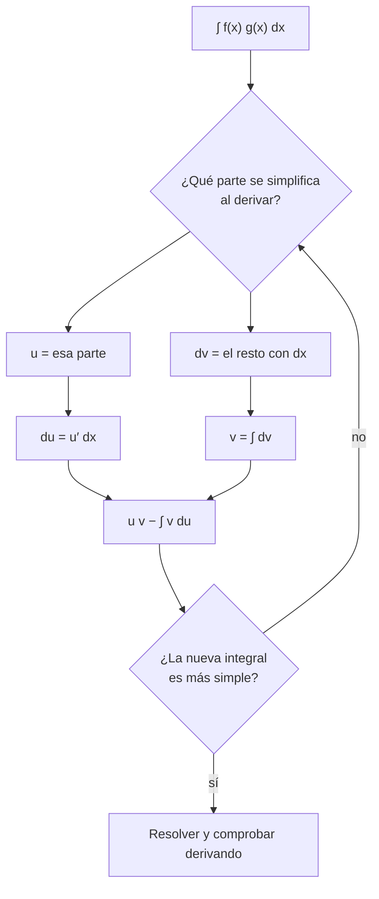

# B09-C10 — Integración por partes

<!-- nav:top -->
[🏠 Programa](../../../../README.md) · [📚 Bloque B09](../../../tronco-comun/B09-calculo-diferencial-e-integral.md) · [← Anterior: B09-C09 — Integración por sustitución](../B09-C09-integracion-por-sustitucion/CLASE.md) · [Siguiente: B09-C11 — Integrales definidas →](../B09-C11-integrales-definidas/CLASE.md)
<!-- /nav -->

## 1. Ubicación, nivel y alcance

Décima clase del bloque B09. La sustitución ([C09](../B09-C09-integracion-por-sustitucion/CLASE.md)) deshace la regla de la cadena; la **integración por partes** deshace la **regla del producto**. Nivel N2. Verás la fórmula, cómo elegir las partes, integrales repetidas y un caso físico: el tiempo medio entre dos fotones detectados. No verás integrales definidas en general (C11) ni probabilidad formal (bloque B12): aquí la distribución exponencial es solo el escenario.

## 2. Por qué esta clase existe

Un detector cuenta fotones que llegan al azar. Cuánto hay que esperar, en promedio, entre uno y el siguiente, y cuánto varía esa espera, decide el tiempo de exposición, el tiempo muerto aceptable y el ruido. Esas cantidades son integrales de la forma `∫ t e^{−λt} dt` y `∫ t² e^{−λt} dt`: un polinomio multiplicado por una exponencial, que la sustitución no resuelve.

La decisión central: **¿cómo elijo qué factor derivar y cuál integrar, de modo que la integral nueva sea más simple que la original?**

## 3. Lo que podrás hacer al terminar

1. Enunciar la fórmula de integración por partes a partir de la regla del producto.
2. Elegir `u` y `dv` con un criterio razonado.
3. Resolver integrales con polinomios por exponenciales o trigonométricas, y `∫ ln x dx`.
4. Aplicar la fórmula dos veces cuando haga falta.
5. Calcular la media y la varianza de un tiempo de espera exponencial.
6. Contrastar el resultado analítico con integración numérica y con una simulación.

La evidencia es la **tabla de momentos analíticos, numéricos y simulados** del ejercicio 12 (sección 20).

## 4. Con qué llegas y cómo comprobarlo

Necesitas la regla del producto (C04) y la sustitución (C09). Cinco preguntas:

1. Deriva `x e^x`.
2. Deriva `x sin x`.
3. Calcula `∫ e^{−λt} dt`.
4. ¿Qué es la tasa `λ` de conteo si llegan 100 fotones por segundo?
5. ¿Cuánto es `e^{−3}`?

<details>
<summary>Ver respuestas</summary>

1. `e^x + x e^x`. 2. `sin x + x cos x`. 3. `−e^{−λt}/λ + C`. 4. `λ = 100 s⁻¹`. 5. `0,0498`.
</details>

Con cuatro o cinco aciertos, sigue; si no, repasa C04 y C09.

## 5. Un caso real: esperar al siguiente fotón

Un detector cuenta fotones de una fuente estable con una tasa media `λ`. Si las llegadas son independientes y la tasa no cambia, el tiempo de espera entre una y la siguiente sigue una **distribución exponencial** con densidad `f(t) = λ e^{−λt}` para `t ≥ 0`; es el caso `μ = 0`, `β = 1/λ` de la densidad que recoge el *e-Handbook of Statistical Methods* de NIST (S2), cuya media es `μ + β`. En esta clase **deduces esa media** integrando por partes. **Ejemplo conductor:** `λ = 100 s⁻¹` (tasa **sintética**). Los tiempos de espera que se muestran están **simulados**; no son observaciones.

## 6. Vocabulario

La **integración por partes** dice que `∫ u dv = u v − ∫ v du` (S1, §1.4(iv), ec. 1.4.16). `u` y `dv` son las dos «partes» en que se separa el integrando. La **tasa de conteo** `λ` es el número medio de eventos por unidad de tiempo. El **tiempo de espera** es el intervalo entre dos eventos consecutivos. La **media** (o esperanza) de la espera es `∫₀^∞ t f(t) dt`. El **segundo momento** es `∫₀^∞ t² f(t) dt`. La **varianza** es el segundo momento menos el cuadrado de la media. El **tiempo muerto** es el intervalo tras un evento durante el cual el detector no registra otro. Una **simulación** genera datos sintéticos con un modelo y un generador de números aleatorios con semilla fija.

## 7. Modelo mental: repartir la derivada

La regla del producto, `(uv)′ = u′v + uv′`, integrada da `uv = ∫ u′v dx + ∫ u v′ dx`. Pasar un término al otro lado es la integración por partes. Se elige `u` como la parte que **se simplifica al derivar** (un polinomio, un logaritmo) y `dv` como la que **se sabe integrar** (una exponencial, un seno).



*Descripción textual:* se elige qué factor derivar y cuál integrar, se calcula `du` y `v`, se arma `uv − ∫ v du` y se verifica que la integral resultante sea más simple; si no, se intercambian los papeles.

Analogía: traspasar un peso de una mano a la otra hasta que sea liviano. Su límite: si la integral nueva es igual de compleja o peor, el intercambio no ayudó y hay que probar otra elección.

## 8. La explicación, paso a paso

### 8.1 Un ejemplo con exponencial

`∫ x eˣ dx`. Con `u = x` (se simplifica: `du = dx`) y `dv = eˣ dx` (`v = eˣ`, dato de C09): `x eˣ − ∫ eˣ dx = x eˣ − eˣ + C = (x − 1) eˣ + C`. Comprobación: la derivada es `(x − 1)eˣ + eˣ = x eˣ` ✓. Si se elige al revés (`u = eˣ`, `dv = x dx`), sale `x²eˣ/2 − ∫ x²eˣ/2 dx`: más difícil.

### 8.2 Un ejemplo trigonométrico

`∫ x sin x dx`: `u = x`, `dv = sin x dx`, `v = −cos x`: `−x cos x + ∫ cos x dx = −x cos x + sin x + C`. De 0 a `π`: `π`.

### 8.3 El logaritmo

`∫ ln x dx`: `u = ln x`, `dv = dx`: `du = dx/x`, `v = x`; `x ln x − ∫ dx = x ln x − x + C`. De 1 a `e`: `1`.

### 8.4 Dos veces

`∫ x² eˣ dx`: primera: `u = x²` → `x² eˣ − 2 ∫ x eˣ dx`; segunda (8.1): `x² eˣ − 2(x − 1)eˣ = (x² − 2x + 2)eˣ + C`. Cada aplicación baja un grado del polinomio.

### 8.5 La espera media entre fotones

Con `f(t) = λ e^{−λt}`: la media es `λ ∫₀^∞ t e^{−λt} dt`. Por partes (`u = t`, `dv = e^{−λt}dt`, `v = −e^{−λt}/λ`): `∫ t e^{−λt} dt = −(t/λ) e^{−λt} − e^{−λt}/λ²`. Evaluado de 0 a `∞` (los términos con `e^{−λt}` se anulan al crecer `t`): `1/λ²`. Entonces la media es `λ · 1/λ² = 1/λ`. Con `λ = 100 s⁻¹`: **10 ms**.

### 8.6 Varianza y mediana

El segundo momento sale con dos partes: `λ ∫₀^∞ t² e^{−λt} dt = 2/λ²`. La varianza es `2/λ² − 1/λ² = 1/λ²`: la desviación típica es igual a la media (10 ms). La **mediana** `t_m` cumple `e^{−λ t_m} = 1/2`: `t_m = ln 2/λ = 6,93 ms`, el 69 % de la media. La mayoría de las esperas son más cortas que el promedio, porque unas pocas muy largas lo elevan.

### 8.7 Comprobación numérica y simulada

La integración numérica de `t f` y `t² f` entre 0 y 1 s da `0,010 000 00 s` y varianza `1,000 000 01 × 10⁻⁴ s²`. Una simulación de 200 000 esperas **simuladas** da `9,990 × 10⁻³ s`, a 0,44 desviaciones típicas estadísticas del valor teórico, y `P(espera > 30 ms) = 0,0496` frente a `e⁻³ = 0,0498`.

## 9. Magnitudes, símbolos y unidades

| Símbolo | Qué es | Unidad | Nota |
|---|---|---|---|
| `λ` | tasa de conteo | s⁻¹ | 100 (sintética) |
| `t` | tiempo de espera | s | `t ≥ 0` |
| `f(t)` | densidad de la espera | s⁻¹ | `λ e^{−λt}` |
| `μ_1`, `μ_2` | media y segundo momento | s, s² | `1/λ` y `2/λ²` |
| `σ²` | varianza | s² | `1/λ²` |
| `t_m` | mediana | s | `ln 2/λ` |
| `u`, `v` | partes de la integral | según el caso | |

Comprobación dimensional: `∫ t f dt` = s · s⁻¹ · s = s ✓.

## 10. Convenciones y referencias

Se supone un proceso de llegadas independiente y tasa constante: es un modelo, no una medida. Se ignoran el tiempo muerto y el ruido de fondo. La integral hasta `∞` se interpreta como el límite cuando el extremo superior crece. Las muestras simuladas usan `random.Random(12345)` para ser reproducibles.

## 11. De dónde sale lo que afirmamos

| ID | Fuente | Localizador | Respalda | Estado |
|---|---|---|---|---|
| S1 | NIST, *Digital Library of Mathematical Functions* §1.4, versión 1.2.8 | https://dlmf.nist.gov/1.4 | Fórmula de integración por partes (§1.4(iv), ec. 1.4.16) | Consultada el 2026-11-05 mediante extracción automática |
| S2 | NIST/SEMATECH, *e-Handbook of Statistical Methods*, §1.3.6.6.7 «Exponential Distribution» | https://www.itl.nist.gov/div898/handbook/eda/section3/eda3667.htm | Densidad `f(x) = (1/β) e^{−(x−μ)/β}` y media `μ + β` | Consultada el 2026-11-05 mediante extracción automática (la página no da la varianza: la deducción de `σ² = β²` es propia) |

Límites: el modelo de llegadas independientes es una hipótesis; la tasa es **sintética** y las esperas **simuladas**; no se consultó una fuente sobre contadores de fotones reales.

## 12. Cómo ver la espera

Equivalente accesible a la gráfica de `f(t)` para `λ = 100 s⁻¹`:

| `t` (ms) | `f(t)` (s⁻¹) | `P(T > t) = e^{−λt}` |
|---|---|---|
| 0 | 100 | 1 |
| 6,93 (mediana) | 50 | 0,500 |
| 10 (media) | 36,8 | 0,368 |
| 30 | 5,0 | 0,0498 |

Descripción larga: la densidad es máxima en 0 y decae exponencialmente; el área bajo ella es 1; la media (10 ms) queda a la derecha de la mediana (6,9 ms).

## 13. Ejemplo trabajado: media de la espera

**Paso 1 · Planteo.** `μ = ∫₀^∞ t λ e^{−λt} dt`, `λ = 100 s⁻¹`.

**Paso 2 · Partes.** `u = t`, `du = dt`; `dv = e^{−λt}dt`, `v = −e^{−λt}/λ`.

**Paso 3 · Aplicar.** `∫ t e^{−λt} dt = −t e^{−λt}/λ + ∫ e^{−λt}/λ dt = −t e^{−λt}/λ − e^{−λt}/λ²`.

**Paso 4 · Límites.** En `∞` es 0 (la exponencial domina); en 0 vale `−1/λ²`. La integral definida es `0 − (−1/λ²) = 1/λ²`.

**Paso 5 · Resultado y comprobación.** `μ = λ/λ² = 1/λ = 10 ms`. Unidad: s ✓. La integración numérica da `0,010 000 00 s` y la simulación `9,99 ms` (0,44 σ). Sentido: a 100 fotones por segundo, el promedio entre uno y otro es 10 ms.

## 14. Distintas formas de obtener la media

Por **partes**: exacta y reutilizable. Por la **tabla de momentos** de la distribución (S2 da la media): rápida, pero depende de la fuente y no enseña el método. Por **integración numérica**: sirve cuando no hay antiderivada. Por **simulación**: muestra la variabilidad estadística, a costa de un error que decrece con `1/√N`. Las cuatro deben coincidir dentro de sus tolerancias.

## 15. Práctica guiada

**Ejercicio 1 · con los pasos indicados.** Calcula `∫ x eˣ dx`. *Pasos:* `u = x`, `dv = eˣ dx`.

<details><summary>Solución comentada</summary>

`x eˣ − ∫ eˣ dx = (x − 1)eˣ + C`. La derivada `x eˣ` confirma (8.1).
</details>

**Ejercicio 2 · con una pista.** Calcula `∫₀^π x sin x dx`. *Pista:* `v = −cos x`.

<details><summary>Solución comentada</summary>

`[−x cos x + sin x]₀^π = (π + 0) − 0 = π` (8.2).
</details>

**Ejercicio 3 · casi autónomo.** Calcula `∫₁^e ln x dx`.

<details><summary>Solución comentada</summary>

`[x ln x − x]₁^e = (e − e) − (0 − 1) = 1` (8.3).
</details>

## 16. Práctica autónoma, transferencia e integrador

**Ejercicio 4.** Calcula `∫ t e^{−λt} dt` y compruébala derivando.

<details><summary>Solución comentada</summary>

`−(t/λ + 1/λ²)e^{−λt} + C`. Derivada: `−(1/λ)e^{−λt} + (t/λ + 1/λ²)λ e^{−λt} = t e^{−λt}` ✓.
</details>

**Ejercicio 5.** Calcula `∫ x² eˣ dx`.

<details><summary>Solución comentada</summary>

Dos veces: `(x² − 2x + 2)eˣ + C` (8.4). Derivada: `(2x − 2)eˣ + (x² − 2x + 2)eˣ = x² eˣ` ✓.
</details>

**Ejercicio 6.** Con `λ = 100 s⁻¹`, ¿cuál es la mediana de la espera?

<details><summary>Solución comentada</summary>

`e^{−λ t_m} = 1/2` → `t_m = ln 2/100 = 6,93 ms`.
</details>

**Ejercicio 7.** ¿Cuánto vale la desviación típica de la espera?

<details><summary>Solución comentada</summary>

`σ = √(1/λ²) = 1/λ = 10 ms`: igual a la media (8.6).
</details>

**Ejercicio 8.** En `∫ x eˣ dx`, ¿qué pasa si eliges `u = eˣ` y `dv = x dx`?

<details><summary>Solución comentada</summary>

`v = x²/2` y la nueva integral es `∫ (x²/2) eˣ dx`, más compleja que la original. Se elige como `u` lo que se simplifica al derivar.
</details>

**Ejercicio 9 · transferencia.** Si el detector tiene un tiempo muerto de 1 ms, ¿qué fracción de los intervalos entre fotones (con `λ = 100 s⁻¹`, sintética) son más cortos que 1 ms?

<details><summary>Solución comentada</summary>

`P(T < 1 ms) = 1 − e^{−0,1} = 0,0952`: el 9,5 % de los fotones llega dentro del tiempo muerto del anterior y se pierde. Con tasas más altas la pérdida crece rápidamente: por eso se corrige por tiempo muerto. Cálculo del modelo exponencial.
</details>

**Ejercicio 10 · transferencia.** Un compañero dice: «la espera típica es 10 ms, así que casi todas son de unos 10 ms». Evalúa con las cifras de la clase.

<details><summary>Solución comentada</summary>

Falso: `σ = 10 ms` es igual a la media, así que hay mucha dispersión; la moda es 0 y la mediana 6,9 ms. El 36,8 % de las esperas supera la media (`e⁻¹`).
</details>

**Ejercicio 11 · transferencia.** Un estudiante obtiene `∫ x sin x dx = x cos x − sin x`. Detecta el error derivando.

<details><summary>Solución comentada</summary>

Derivada: `cos x − x sin x − cos x = −x sin x`: signo opuesto al integrando. El correcto es `−x cos x + sin x`. Faltó el signo de `v = −cos x` (8.2).
</details>

**Ejercicio 12 · integrador.** Elabora tu *tabla de momentos analíticos, numéricos y simulados* para `λ = 50, 100, 200 s⁻¹` (sintéticas): media, varianza, mediana, media simulada con su desviación en unidades de `σ/√N` y fracción de esperas mayor que `3/λ`; rotula lo simulado.

<details><summary>Solución modelo</summary>

Para cada `λ`: media `1/λ`, varianza `1/λ²`, mediana `ln 2/λ`, fracción `e⁻³ = 0,0498`; la media simulada queda a menos de 4 desviaciones estadísticas; se declara que son datos simulados y que el modelo supone llegadas independientes.
</details>

## 17. Laboratorio: espera entre fotones

El script [espera_entre_fotones.py](espera_entre_fotones.py) comprueba cuatro antiderivadas por partes derivándolas, calcula la media y la varianza por integración numérica, simula 200 000 esperas con semilla fija y compara la media y la cola con los valores teóricos.

**Datos:** simulados. **Predice antes de ejecutar:** ¿qué fracción supera 30 ms? (`e⁻³ ≈ 0,0498`.) **Ejecución del 2026-11-05 (Python 3.12.9):**

```text
int t e^(-lam t) dx: antiderivada comprobada derivando
media  : analítica 0.01000000 s  trapecio 0.01000000 s
var    : analítica 1.00000000e-04 s2  trapecio 1.00000001e-04 s2
Simulación (N = 200000): media = 9.990204e-03 s (esperada 1.000000e-02); desviación = -0.44 sigma
P(espera > 30 ms): simulada 0.0496, analítica exp(-3) = 0.0498
Pruebas superadas.
```

```bash
python programa/clases/B09/B09-C10-integracion-por-partes/espera_entre_fotones.py
```

**Límites:** llegadas independientes; sin tiempo muerto ni ruido; datos simulados; no es análisis de un detector real.

## 18. Errores frecuentes y cómo corregirlos

**Elegir `u` y `dv` al revés.** Se corrige con el ejercicio 8.

**Errores de signo en `v`.** Se corrige con el ejercicio 11.

**Olvidar evaluar el término `uv` en los límites.** Se corrige en el paso 4 del ejemplo trabajado.

**Confundir media con valor típico.** Se corrige con el ejercicio 10.

**Presentar datos simulados como observados.** Se corrige releyendo la sección 5 y el ejercicio 12.

## 19. Cómo sabrás que vas bien

Tras 8.1: ¿integras `x eˣ` y lo compruebas? Si no, ejercicio 1. Tras 8.4: ¿resuelves `x² eˣ` con dos partes? Si no, ejercicio 5. Tras 8.5: ¿deduces `1/λ`? Si no, ejercicio 4. Tras el laboratorio: ¿qué tres métodos coinciden? (analítico, trapecio, simulación).

## 20. Qué entregas y cómo se evalúa

El producto es tu **tabla de momentos analíticos, numéricos y simulados** (ejercicio 12).

| Criterio | Inicial | En desarrollo | Logrado | Destacado |
|---|---|---|---|---|
| Elección de partes | Al azar | Con ayuda | Justificada | Detecta cuándo no ayuda |
| Cálculo | Errores de signo | Resultado sin límites | Correcto con límites | Comprueba derivando |
| Interpretación | Sin unidades | Media sin dispersión | Media, varianza y mediana | Explica la asimetría |
| Triple comprobación | Ausente | Un método | Dos métodos | Los tres con tolerancia |
| Fuentes y rótulos | Sin fuente | Sin fecha | Con localizador y fecha | Rotula simulado |

**Condiciones críticas (no se compensan con promedio):** rotular lo simulado; comprobar derivando; citar solo fuentes consultadas.

## 21. Ética, seguridad y límites

Una media sin dispersión engaña: decir «un fotón cada 10 ms» sin la varianza sugiere regularidad que no existe. No presentes datos simulados como medidos. Esta clase no sustituye la caracterización de un detector real. Accesibilidad: tablas equivalentes a las gráficas, fórmulas en texto, ejercicios sin conexión.

## 22. Para cerrar y seguir

Por partes, `∫ u dv = uv − ∫ v du`: se deriva lo que se simplifica y se integra lo que se sabe; sirve para polinomios con exponenciales, logaritmos y para la media de una espera. Queda abierta una pregunta: hasta ahora integrabas sin límites; ¿qué número resulta si integras **entre dos valores**? Es la integral definida.

**Glosario español–inglés.** integración por partes · *integration by parts*; tiempo de espera · *waiting time*; tasa de conteo · *count rate*; distribución exponencial · *exponential distribution*; media · *mean*; varianza · *variance*; mediana · *median*; tiempo muerto · *dead time*; simulación · *simulation*.

**Continuidad.** B09-C11 reutiliza tu capacidad de **evaluar una antiderivada entre dos límites** para definir la integral definida y su aproximación numérica.

**Referencias:** ver sección 11.

<!-- nav:bottom -->
---

[← Anterior: B09-C09 — Integración por sustitución](../B09-C09-integracion-por-sustitucion/CLASE.md) · [📚 Bloque B09](../../../tronco-comun/B09-calculo-diferencial-e-integral.md) · [Siguiente: B09-C11 — Integrales definidas →](../B09-C11-integrales-definidas/CLASE.md)
<!-- /nav -->
