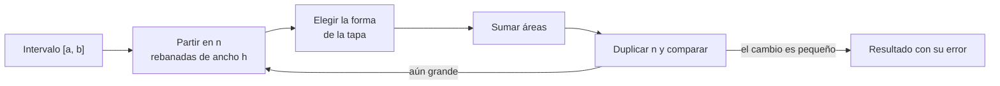

# B09-C11 — Integrales definidas

<!-- nav:top -->
[🏠 Programa](../../../../README.md) · [📚 Bloque B09](../../../tronco-comun/B09-calculo-diferencial-e-integral.md) · [← Anterior: B09-C10 — Integración por partes](../B09-C10-integracion-por-partes/CLASE.md) · [Siguiente: B09-C12 — Teorema fundamental del cálculo →](../B09-C12-teorema-fundamental-del-calculo/CLASE.md)
<!-- /nav -->

## 1. Ubicación, nivel y alcance

Undécima clase del bloque B09. En C08–C10 hallaste antiderivadas. Ahora integras **entre dos límites** y obtienes un número: la acumulación total de una cantidad. Nivel N2 → N3. Verás la integral definida como límite de sumas, sus propiedades, cuatro métodos de aproximación numérica (con sus órdenes de convergencia) y un caso real: el incremento de velocidad de una maniobra. No verás aún el teorema que une derivada e integral (C12) ni áreas y volúmenes en general (C13).

## 2. Por qué esta clase existe

Un motor entrega una aceleración que cambia con el tiempo; la maniobra cambia la velocidad del vehículo en la integral de esa aceleración durante el encendido. Los datos llegan como **muestras** de un acelerómetro, no como una fórmula. Hay que saber calcular la integral de datos discretos y estimar el error que se comete.

La decisión central: **¿cómo acumulo una cantidad que cambia con el tiempo, qué método numérico uso, con qué paso, y cuánto error acepto?**

## 3. Lo que podrás hacer al terminar

1. Definir la integral definida como límite de sumas de Riemann.
2. Aplicar sus propiedades: aditividad, inversión de límites, linealidad.
3. Calcular una integral definida con una antiderivada (cuando existe).
4. Aproximar con las reglas de Riemann, punto medio, trapecio y Simpson.
5. Medir el orden de convergencia de cada regla.
6. Estimar el error de una integral calculada con datos muestreados y con ruido.

La evidencia es la **tabla de convergencia de la cuadratura** del ejercicio 12 (sección 20).

## 4. Con qué llegas y cómo comprobarlo

Necesitas antiderivadas ([C08](../B09-C08-integrales-indefinidas/CLASE.md)) y sustitución ([C09](../B09-C09-integracion-por-sustitucion/CLASE.md)). Cinco preguntas:

1. Calcula `∫ x² dx`.
2. ¿Cuánto es `sin π`? ¿y `cos π`?
3. Evalúa `x³/3` en `x = 2` y en `x = 0`, y resta.
4. ¿Qué unidad tiene `∫ a dt` si `a` está en m/s²?
5. ¿Qué es un logaritmo base 2 de 16?

<details>
<summary>Ver respuestas</summary>

1. `x³/3 + C`. 2. 0 y −1. 3. `8/3`. 4. m/s. 5. 4.
</details>

Con cuatro o cinco aciertos, sigue; si no, repasa C08–C09.

## 5. Un caso real: cuánto cambia la velocidad en un encendido

Para un motor que acelera a un vehículo en línea recta, sin gravedad ni arrastre, `Δv = ∫ a dt` sobre la duración del encendido. **Ejemplo conductor** (cifras **sintéticas**): un pulso de aceleración propia `a(t) = A sin(πt/T)` con `A = 30 m/s²` (3,06 g con `g_n = 9,806 65 m/s²`, S2) y `T = 60 s`. Su integral exacta es `Δv = 2AT/π = 1145,9 m/s`. Segundo caso sintético: un empuje que decae `a(t) = A e^{−t/τ}` con `τ = 20 s`. La necesidad concreta: los registros reales son datos muestreados y la integral se calcula numéricamente.

## 6. Vocabulario

La **integral definida** `∫_a^b f(x) dx` es el límite de las **sumas de Riemann** `Σ f(x_i*) Δx` cuando `Δx → 0` (S1, §1.4(v)). Una **partición** divide `[a, b]` en `n` subintervalos de ancho `h = (b − a)/n`. La **regla del punto izquierdo (derecho)** toma `f` en el extremo izquierdo (derecho) de cada subintervalo. La **regla del punto medio** la toma en el centro. La **regla del trapecio** une los puntos con rectas. La **regla de Simpson** ajusta parábolas (necesita `n` par). El **orden** de un método es el exponente `p` tal que el error escala como `hᵖ`. La **aceleración media** sobre `[0, T]` es `Δv/T`. El **ruido** es una perturbación aleatoria de las muestras.

## 7. Modelo mental: apilar rebanadas

Partes el intervalo en rebanadas de ancho `h` y altura `f`. La suma de áreas aproxima el total acumulado; al afinar las rebanadas, la suma converge a un número. Los distintos métodos solo cambian la forma de la tapa de cada rebanada: rectángulo, rectángulo centrado, trapecio, parábola.



*Descripción textual:* se divide el intervalo, se elige una regla, se suma y se duplica `n` hasta que la diferencia entre resultados sea menor que la tolerancia.

Analogía: llenar un recipiente irregular con capas de agua cada vez más finas. Su límite: si la función oscila más rápido que el ancho de la rebanada, las capas ignoran las oscilaciones (aliasing).

## 8. La explicación, paso a paso

### 8.1 Con antiderivada

Si se conoce `F′ = f`, entonces `∫_a^b f dx = F(b) − F(a)` (se justifica en C12). Para `x²` entre 0 y 2: `8/3 = 2,667`. Para `sin x` entre 0 y `π`: `2`.

### 8.2 Propiedades

Aditividad: `∫_0^3 x² dx = ∫_0^1 + ∫_1^3 = 1/3 + 26/3 = 9`. Inversión: `∫_b^a = −∫_a^b`. Linealidad: constantes salen y sumas se separan. El signo de la integral es el de la acumulación neta: `∫_0^{2π} sin x dx = 0` aunque el área total sea 4.

### 8.3 Las reglas simples

Con `n = 4` para `x²` en `[0, 2]` (`h = 0,5`): izquierda `1,75`, derecha `3,75`, trapecio `(1,75 + 3,75)/2 = 2,75` (exacto `2,667`). El punto medio da `2,625`. Simpson con `n = 2` da exactamente `8/3`, porque es exacta para polinomios de grado hasta 3.

### 8.4 El pulso de aceleración

Con `a = 30 sin(πt/60)` y `Δv = 1145,92 m/s` exacto, el error de cada regla con `n = 4, 8, …, 64` baja así: punto medio `29,99 → 0,115`; trapecio `59,52 → 0,230`; Simpson `2,61 → 3,7 × 10⁻⁵`. Los órdenes observados: 2 y 4. Para este pulso, izquierda y derecha dan **igual** que el trapecio porque `a = 0` en ambos extremos: es un caso particular, no una regla general.

### 8.5 Un caso donde los extremos no son cero

Con `a = 30 e^{−t/20}` (exacto `570,128 m/s`) el orden de las reglas simples se ve limpio: izquierda `1,01`, derecha `0,99`, punto medio `2,00`, trapecio `2,00` y Simpson `4,00`. Eso significa que doblar `n` reduce el error a la mitad, a una cuarta parte o a una dieciseisava parte, respectivamente.

### 8.6 Datos muestreados

Un pulso de 8 s, `a = 30 sin(πt/8)`, muestreado a 1 s (9 puntos). Exacto: `152,789 m/s`. Trapecio: `150,820` (`−1,29 %`). Simpson: `152,809` (`+0,013 %`). Con pocos puntos, una regla de orden superior vale mucho.

### 8.7 Ruido

Si cada muestra tiene ruido independiente de desviación `σ` y paso `Δt`, el error en la integral crece como `σ Δt √N` (no como `N`). Con `σ = 0,3 m/s²`, `Δt = 0,1 s` y `N = 600`: `0,73 m/s`. La simulación dio `Δv = 1146,14 m/s`, a `+0,23 m/s` del exacto (0,31 σ). Datos **simulados**.

## 9. Magnitudes, símbolos y unidades

| Símbolo | Qué es | Unidad | Nota |
|---|---|---|---|
| `a(t)` | aceleración propia | m/s² | sintética |
| `A`, `T`, `τ` | amplitud, duración, constante de decaimiento | m/s², s, s | 30, 60, 20 |
| `Δv` | incremento de velocidad | m/s | `∫₀^T a dt` |
| `h`, `n` | ancho y número de rebanadas | s, 1 | `h = T/n` |
| `p` | orden del método | adimensional | 1, 2 o 4 |
| `σ` | desviación del ruido | m/s² | 0,3 (simulada) |
| `g_n` | aceleración estándar | m/s² | 9,806 65 (S2) |

## 10. Convenciones y referencias

El tiempo se mide desde el inicio del encendido. La aceleración es propia (sin gravedad ni arrastre). La integral se calcula en unidades SI; si `a` viniera en `g`, hay que convertir (`1 g_n = 9,806 65 m/s²`). El ruido simulado usa `random.Random(2026)`. Se declara siempre el número de puntos y la regla.

## 11. De dónde sale lo que afirmamos

| ID | Fuente | Localizador | Respalda | Estado |
|---|---|---|---|---|
| S1 | NIST, *Digital Library of Mathematical Functions* §1.4, versión 1.2.8 | https://dlmf.nist.gov/1.4 | Integral definida, sumas de Riemann y propiedades (§1.4(v)) | Consultada el 2026-11-05 mediante extracción automática |
| S2 | NIST, CODATA 2022, `g_n` | https://physics.nist.gov/cgi-bin/cuu/Value?gn | `g_n = 9,806 65 m s⁻²`, exacta | Consultada el 2026-11-05 |

Límites: las fórmulas de las reglas y sus órdenes de error son resultados estándar del análisis numérico que aquí se **miden** con el laboratorio; no se citan de S1. Todos los perfiles y el ruido son **sintéticos o simulados**.

## 12. Cómo ver la convergencia

Equivalente accesible a una gráfica log–log de error frente a `n` (pulso de 60 s, laboratorio):

| `n` | Punto medio | Trapecio | Simpson |
|---|---|---|---|
| 4 | 29,99 | 59,52 | 2,61 |
| 8 | 7,396 | 14,76 | 0,154 |
| 16 | 1,843 | 3,684 | 0,0095 |
| 32 | 0,460 | 0,920 | 5,9 × 10⁻⁴ |
| 64 | 0,115 | 0,230 | 3,7 × 10⁻⁵ |

Descripción larga: en escala log–log, los errores de punto medio y trapecio caen con pendiente −2 (un factor 4 por cada duplicación de `n`) y el de Simpson con pendiente −4 (un factor 16).

## 13. Ejemplo trabajado: `Δv` del pulso con 8 muestras

**Paso 1 · Datos.** Pulso de 8 s, `A = 30 m/s²`, muestras a `t = 0, 1, …, 8`: `0; 11,48; 21,21; 27,71; 30; 27,71; 21,21; 11,48; 0` m/s² (calculadas de `30 sin(πt/8)`).

**Paso 2 · Exacto.** `2AT/π = 2 · 30 · 8/π = 152,789 m/s`.

**Paso 3 · Trapecio.** `h = 1`: `1 · (0/2 + 11,48 + 21,21 + 27,71 + 30 + 27,71 + 21,21 + 11,48 + 0/2) = 150,80`; con más cifras, `150,820 m/s`.

**Paso 4 · Simpson.** `(h/3)[f₀ + 4(f₁ + f₃ + f₅ + f₇) + 2(f₂ + f₄ + f₆) + f₈] = 152,809 m/s`.

**Paso 5 · Comparación y sentido.** Errores: `−1,29 %` y `+0,013 %`. La unidad es m/s. Con 9 muestras el trapecio subestima porque la curva es cóncava: los trapecios quedan por debajo. La elección del método importa más que añadir ruido o decimales.

## 14. Distintas formas de calcular una integral definida

Con **antiderivada**: exacta, cuando existe. **Riemann** (izquierda o derecha): trivial y de orden 1. **Punto medio y trapecio**: orden 2; trapecio es natural para datos muestreados. **Simpson**: orden 4 si la función es suave. Para datos con ruido, un método de orden alto no mejora el error estadístico (8.7). La **cuadratura adaptativa** y la de Gauss, de uso profesional, se tratan en B11.

## 15. Práctica guiada

**Ejercicio 1 · con los pasos indicados.** Calcula `∫₀² x² dx` con antiderivada y con las reglas izquierda, derecha y trapecio con `n = 4`. *Pasos:* `h = 0,5`; suma.

<details><summary>Solución comentada</summary>

Antiderivada: `8/3 = 2,667`. Izquierda: `0,5(0 + 0,25 + 1 + 2,25) = 1,75`; derecha: `0,5(0,25 + 1 + 2,25 + 4) = 3,75`; trapecio: `2,75`. La izquierda subestima y la derecha sobreestima porque `x²` crece (8.3).
</details>

**Ejercicio 2 · con una pista.** Calcula `∫₀^π sin x dx`. *Pista:* `−cos x`.

<details><summary>Solución comentada</summary>

`[−cos x]₀^π = 1 − (−1) = 2`.
</details>

**Ejercicio 3 · casi autónomo.** Calcula `Δv` del pulso `a = A sin(πt/T)` con `A = 30`, `T = 60`.

<details><summary>Solución comentada</summary>

`∫₀^T A sin(πt/T) dt = A (T/π)[−cos]₀^π = 2AT/π = 1145,9 m/s` (con la sustitución `u = πt/T`).
</details>

## 16. Práctica autónoma, transferencia e integrador

**Ejercicio 4.** Al duplicar `n`, el error del trapecio baja de `59,52` a `14,76` m/s. ¿Qué orden observas?

<details><summary>Solución comentada</summary>

Razón `59,52/14,76 = 4,03`; `log₂ 4,03 = 2,01`: orden 2.
</details>

**Ejercicio 5.** Comprueba que Simpson con `n = 2` es exacto para `x²` en `[0, 2]`.

<details><summary>Solución comentada</summary>

`(h/3)[f₀ + 4f₁ + f₂]` con `h = 1`: `(1/3)(0 + 4 + 4) = 8/3` ✓ exacto.
</details>

**Ejercicio 6.** Calcula `∫₀³ x² dx` y compruébala con aditividad en `[0, 1]` y `[1, 3]`.

<details><summary>Solución comentada</summary>

Total: `9`. Partes: `1/3 + (27 − 1)/3 = 1/3 + 26/3 = 9` ✓.
</details>

**Ejercicio 7.** ¿Cuánto vale `∫₀^{2π} sin x dx`? ¿Cuál es el área total entre la curva y el eje?

<details><summary>Solución comentada</summary>

Integral: 0 (acumulación neta). Área total: `2 + 2 = 4`. La integral con signo no es el área.
</details>

**Ejercicio 8.** Calcula la aceleración media del pulso y compárala con el máximo.

<details><summary>Solución comentada</summary>

`Δv/T = 2A/π = 19,10 m/s²`, el 63,7 % del máximo (30 m/s²).
</details>

**Ejercicio 9 · transferencia.** Con las 9 muestras de 8.6, estima `Δv` con trapecio y con Simpson y compara el error con el exacto. ¿Qué método elegirías y por qué?

<details><summary>Solución comentada</summary>

Trapecio `150,82 m/s` (`−1,29 %`), Simpson `152,81 m/s` (`+0,013 %`). Para datos suaves y pocos puntos, Simpson; si los datos fueran ruidosos o `n` impar, el trapecio.
</details>

**Ejercicio 10 · transferencia.** Un registro viene en unidades `g` con `a_max = 3,059 g`. Un compañero integra y reporta `116,85 m/s`. ¿Qué falta?

<details><summary>Solución comentada</summary>

La integral está en `g·s`: falta multiplicar por `g_n = 9,806 65 m/s²`: `116,85 × 9,806 65 = 1145,9 m/s`. Siempre se verifica la unidad de salida.
</details>

**Ejercicio 11 · transferencia.** Con `σ = 0,3 m/s²`, `Δt = 0,1 s` y `N = 600` muestras, ¿qué incertidumbre estadística tiene `Δv`? Si pasas a `Δt = 0,01 s` con la misma `σ`, ¿mejora?

<details><summary>Solución comentada</summary>

`σ Δt √N = 0,3 · 0,1 · 24,5 = 0,735 m/s`. Con `Δt = 0,01` y `N = 6000`: `0,3 · 0,01 · 77,5 = 0,232 m/s`. Mejora como `√Δt`: muestrear más rápido reduce el ruido integrado.
</details>

**Ejercicio 12 · integrador.** Elabora tu *tabla de convergencia de la cuadratura*: para `a = A e^{−t/τ}` (sintética) y `n = 4…64`, el error de las cinco reglas, los órdenes observados y el `n` mínimo con error de Simpson < 0,01 m/s.

<details><summary>Solución modelo</summary>

Tabla con errores como en el laboratorio; órdenes 1, 1, 2, 2, 4; Simpson baja de `0,939` (n=4) a `0,0039` (n=16), por lo que `n = 16` basta; se rotula el perfil como sintético.
</details>

## 17. Laboratorio: cuadratura y ruido

El script [delta_v_por_integracion.py](delta_v_por_integracion.py) compara las cinco reglas con el valor exacto para dos perfiles, mide los órdenes, comprueba la aditividad y la inversión de límites, y estima la integral de muestras con ruido simulado.

**Datos:** perfiles sintéticos y ruido simulado. **Predice antes de ejecutar:** ¿qué orden tendrá Simpson? (4.) **Ejecución del 2026-11-05 (Python 3.12.9):**

```text
Delta v exacto = 2 A T / pi = 1145.915590 m/s
   64      2.301e-01      2.301e-01      1.151e-01      2.301e-01      3.697e-05
órdenes observados (último paso): izquierda 1.01, derecha 0.99, punto medio 2.00, trapecio 2.00, simpson 4.00
Aceleración media = Delta v / T = 19.0986 m/s2 (= 2A/pi = 19.0986)
Pulso de 8 s muestreado a 1 s: exacto 152.7887; trapecio 150.8202 (-1.29%); Simpson 152.8093 (+0.013%)
Trapecio con ruido simulado (sigma = 0.3 m/s2 a 10 Hz): 1146.1434 m/s; error = +0.2278 m/s; sigma esperada del error = 0.7348 m/s
Pruebas superadas.
```

```bash
python programa/clases/B09/B09-C11-integrales-definidas/delta_v_por_integracion.py
```

**Límites:** perfiles suaves; ruido blanco independiente; no es un procesado de acelerómetro real.

## 18. Errores frecuentes y cómo corregirlos

**Confundir integral con área.** Se corrige con el ejercicio 7.

**Olvidar convertir unidades.** Se corrige con el ejercicio 10.

**Usar Simpson con `n` impar.** Se corrige releyendo la sección 6.

**Esperar que más puntos eliminen el ruido.** Se corrige con el ejercicio 11.

**Extrapolar el orden de un caso particular.** Se corrige con la sección 8.4–8.5.

## 19. Cómo sabrás que vas bien

Tras 8.1: ¿calculas `∫₀² x²` con antiderivada? Si no, ejercicio 1. Tras 8.3: ¿sabes cuál regla sobreestima? Si no, ejercicio 1. Tras 8.5: ¿puedes decir el orden de cada regla? Si no, ejercicio 4. Tras el laboratorio: ¿por qué izquierda y trapecio coinciden en el pulso seno? (porque `a(0) = a(T) = 0`).

## 20. Qué entregas y cómo se evalúa

El producto es tu **tabla de convergencia de la cuadratura** (ejercicio 12).

| Criterio | Inicial | En desarrollo | Logrado | Destacado |
|---|---|---|---|---|
| Definición y propiedades | Memoriza | Aplica con ayuda | Aplica y comprueba | Explica casos particulares |
| Reglas numéricas | Una regla | Dos reglas | Cinco reglas | Elige según el problema |
| Orden observado | Ausente | Cualitativo | Calculado | Contrasta con la teoría |
| Unidades y ruido | Ignorados | Unidades | Unidades y error estadístico | Dimensiona el muestreo |
| Fuentes y rótulos | Sin fuente | Sin fecha | Con localizador y fecha | Rotula sintético/simulado |

**Condiciones críticas (no se compensan con promedio):** declarar la regla y `n`; verificar contra el valor exacto; rotular lo sintético o simulado.

## 21. Ética, seguridad y límites

Reportar un `Δv` sin su incertidumbre numérica y estadística puede llevar a decisiones erróneas en una maniobra. Esta clase no calcula maniobras reales. Accesibilidad: tablas equivalentes a las gráficas, fórmulas en texto, ejercicios sin conexión.

## 22. Para cerrar y seguir

La integral definida acumula una cantidad entre dos límites; se calcula con antiderivada o con reglas numéricas de órdenes 1, 2 y 4; con datos reales, el ruido limita el resultado. Queda abierta una pregunta: ¿por qué evaluar una antiderivada en los extremos da la integral? Es el teorema fundamental del cálculo.

**Glosario español–inglés.** integral definida · *definite integral*; suma de Riemann · *Riemann sum*; regla del trapecio · *trapezoidal rule*; regla de Simpson · *Simpson's rule*; punto medio · *midpoint rule*; orden de convergencia · *order of convergence*; ruido · *noise*; incremento de velocidad · *delta-v*.

**Continuidad.** B09-C12 reutiliza tu capacidad de **calcular una integral por antiderivada y por suma numérica** para demostrar su relación.

**Referencias:** ver sección 11.

<!-- nav:bottom -->
---

[← Anterior: B09-C10 — Integración por partes](../B09-C10-integracion-por-partes/CLASE.md) · [📚 Bloque B09](../../../tronco-comun/B09-calculo-diferencial-e-integral.md) · [Siguiente: B09-C12 — Teorema fundamental del cálculo →](../B09-C12-teorema-fundamental-del-calculo/CLASE.md)
<!-- /nav -->
