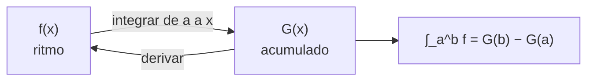

# B09-C12 — Teorema fundamental del cálculo

<!-- nav:top -->
[🏠 Programa](../../../../README.md) · [📚 Bloque B09](../../../tronco-comun/B09-calculo-diferencial-e-integral.md) · [← Anterior: B09-C11 — Integrales definidas](../B09-C11-integrales-definidas/CLASE.md) · [Siguiente: B09-C13 — Áreas y volúmenes por integración →](../B09-C13-areas-y-volumenes-por-integracion/CLASE.md)
<!-- /nav -->

## 1. Ubicación, nivel y alcance

Duodécima clase del bloque B09. Calculaste integrales definidas como límite de sumas ([C11](../B09-C11-integrales-definidas/CLASE.md)) y antiderivadas como operación inversa de la derivada ([C08](../B09-C08-integrales-indefinidas/CLASE.md)). El **teorema fundamental del cálculo** une las dos ideas. Nivel N3. Verás sus dos partes, qué condiciones exige, y su uso más famoso en astronáutica: la energía de escape. No verás áreas y volúmenes en general (C13) ni series (C14).

## 2. Por qué esta clase existe

Para que una sonda abandone la Tierra hay que darle energía suficiente para vencer la gravedad hasta una distancia infinita. Esa energía es una integral de la fuerza sobre una distancia sin cota superior. El teorema permite evaluarla sin sumar infinitos rectángulos: solo hay que evaluar una antiderivada en dos puntos.

La decisión central: **¿cuándo puedo reemplazar una suma infinita por una resta de dos valores de una antiderivada, y cómo compruebo que la reemplazo bien?**

## 3. Lo que podrás hacer al terminar

1. Enunciar las dos partes del teorema fundamental.
2. Evaluar una integral definida como `F(b) − F(a)`.
3. Derivar una función definida por una integral con límite variable, incluida la cadena.
4. Calcular el trabajo gravitatorio y la velocidad de escape.
5. Comprobar el resultado con integración numérica y con un valor publicado.
6. Reconocer cuándo el teorema no puede aplicarse (integrando discontinuo).

La evidencia es la **tabla de energía de escape con verificación** del ejercicio 12 (sección 20).

## 4. Con qué llegas y cómo comprobarlo

Necesitas antiderivadas y reglas numéricas (C08, C11). Cinco preguntas:

1. Calcula `∫ (2x + 1) dx`.
2. Evalúa `x² + x` en 3 y en 1 y resta.
3. ¿Qué es una función continua en un intervalo (C02)?
4. Deriva `x³/3`.
5. Simplifica `1/R − 1/(2R)`.

<details>
<summary>Ver respuestas</summary>

1. `x² + x + C`. 2. `12 − 2 = 10`. 3. Una función sin saltos ni asíntotas en ese intervalo. 4. `x²`. 5. `1/(2R)`.
</details>

Con cuatro o cinco aciertos, sigue; si no, repasa C02, C08 y C11.

## 5. Un caso real: la velocidad de escape de la Tierra

El trabajo por unidad de masa para llevar un cuerpo de la superficie al infinito contra la gravedad de una masa puntual es `W = ∫_R^∞ GM/r² dr = GM/R`. Si toda esa energía proviene de la energía cinética inicial, `½ v² = GM/R`, de modo que `v_esc = √(2GM/R)`. Con los valores nominales de la IAU, `(GM)_E^N = 3,986 004 × 10¹⁴ m³ s⁻²` (S2), y el radio medio `6371,000 km` de la ficha de la Tierra de la NASA (S3), sale `11 186,1 m/s`, igual a la cifra de la NASA, `11,186 km/s` (S3). Con el radio ecuatorial nominal `6,3781 × 10⁶ m` sale `11 179,9 m/s`. El **ejemplo conductor** es esta energía de escape, que toda misión interplanetaria debe suministrar o sobrepasar.

## 6. Vocabulario

El **teorema fundamental del cálculo, parte 1**: si `f` es continua en `[a, b]` y `F′ = f`, entonces `∫_a^b f dx = F(b) − F(a)` (S1, §1.4(v), ec. 1.4.26). **Parte 2**: la función `G(x) = ∫_a^x f(t) dt` cumple `G′(x) = f(x)` (ec. 1.4.27). Una **integral impropia** tiene un límite infinito; se define como `lim_{b→∞} ∫_a^b`. El **valor medio** de `f` en `[a, b]` es `(1/(b − a)) ∫_a^b f`. El **trabajo** por unidad de masa es la integral de la aceleración sobre la distancia. La **energía de escape** es el trabajo para llegar a `r → ∞`. La **velocidad circular** `v_c = √(GM/r)` es la de una órbita circular de radio `r`.

## 7. Modelo mental: la acumulación y su ritmo

Imagina un depósito: el volumen acumulado es la integral del caudal y el caudal es la derivada del volumen. La parte 2 dice que el ritmo con que crece lo acumulado es el integrando; la parte 1, que el total entre dos instantes es la diferencia del volumen en esos instantes.



*Descripción textual:* integrar el ritmo desde un punto fijo produce lo acumulado; derivar lo acumulado recupera el ritmo; el total entre dos valores es la diferencia de lo acumulado.

Analogía: el odómetro y el velocímetro. Su límite: el teorema requiere un integrando continuo; si el caudal salta o diverge, hay que partir el intervalo.

## 8. La explicación, paso a paso

### 8.1 Parte 1 en acción

`∫_1^3 (2x + 1) dx`: `F = x² + x`; `F(3) − F(1) = 12 − 2 = 10`. Se puede comprobar con trapecio: el integrando es lineal y el trapecio es exacto.

### 8.2 Parte 2 en acción

`G(x) = ∫_0^x t² dt = x³/3` y `G′ = x²`. Con límite variable `2x`: `d/dx ∫_0^{2x} t² dt = (2x)² · 2 = 8x²` (regla de la cadena de C04). El laboratorio verifica numéricamente `G′(2R) = g(2R)`: ambos valen `2,449 600 m/s²`.

### 8.3 Trabajo gravitatorio

Con `g(r) = GM/r²` y `F(r) = −GM/r`: `W(R → r_max) = F(r_max) − F(R) = GM(1/R − 1/r_max)`. Llevar 1 kg de `R` a `2R` cuesta `GM/(2R) = 3,125 × 10⁷ J/kg`, la mitad de la energía de escape; a `10R`, el 90 %; a `100R`, el 99 %; a `1000R`, el 99,9 %. Casi toda la energía se gasta en los primeros radios terrestres.

### 8.4 Integral impropia y escape

Cuando `r_max → ∞`, el término `1/r_max → 0` y `W = GM/R`. La integral de una función que decae como `1/r²` converge: el área bajo la curva es finita, a pesar de extenderse sin límite. Con `GM/R = 6,2495 × 10⁷ J/kg`: `v_esc = √(2 · 6,2495 × 10⁷) = 11 180 m/s` (radio ecuatorial nominal).

### 8.5 El valor medio

El valor medio de `g` entre `R` y `2R` es `(1/R) · GM/(2R) = g(R)/2 = 4,899 m/s²`: la mitad de la gravedad superficial, sin que `g` caiga linealmente (comprobado por el laboratorio con Simpson).

### 8.6 Velocidad circular y escape

A 400 km de altitud, `v_c = √(GM/(R + h)) = 7668,6 m/s` y `v_esc = √2 · v_c = 10 845,0 m/s`. Para escapar desde esa órbita circular hacen falta `3176 m/s` adicionales, en el modelo de masa puntual y sin rotación.

### 8.7 Cuándo no se aplica

`∫_{−1}^1 dx/x²` no es `[−1/x]_{−1}^1 = −2`: el integrando no es continuo en 0 y la integral diverge. Un resultado negativo para una función positiva es la señal de alarma. Toda aplicación debe comprobar la continuidad de `f` sobre el intervalo.

## 9. Magnitudes, símbolos y unidades

| Símbolo | Qué es | Unidad | Nota |
|---|---|---|---|
| `g(r)` | aceleración gravitatoria | m/s² | `GM/r²` |
| `GM` | parámetro gravitacional | m³/s² | `3,986 004 × 10¹⁴` (nominal, S2) |
| `R` | radio de referencia | m | 6,3781 × 10⁶ (nominal) o 6,371 × 10⁶ (medio, S3) |
| `W` | trabajo por unidad de masa | J/kg = m²/s² | `GM(1/R − 1/r_max)` |
| `v_esc` | velocidad de escape | m/s | `√(2GM/R)` |
| `v_c` | velocidad circular | m/s | `√(GM/r)` |
| `G(x)` | función acumulada | según el caso | parte 2 |

## 10. Convenciones y referencias

Tierra esférica y sin rotación, masa puntual, sin atmósfera: el escape real depende de la dirección y de la rotación. El radio puede ser el ecuatorial nominal (IAU) o el medio volumétrico (NASA): la diferencia entre ambos explica `11 180` frente a `11 186 m/s`. `r_max → ∞` se interpreta como límite. El signo del trabajo es el del agente externo.

## 11. De dónde sale lo que afirmamos

| ID | Fuente | Localizador | Respalda | Estado |
|---|---|---|---|---|
| S1 | NIST, *Digital Library of Mathematical Functions* §1.4, versión 1.2.8 | https://dlmf.nist.gov/1.4 | Teorema fundamental del cálculo (§1.4(v), ecs. 1.4.26 y 1.4.27) | Consultada el 2026-11-05 mediante extracción automática |
| S2 | IAU, Resolución B3 de 2015, arXiv:1510.07674 | https://arxiv.org/pdf/1510.07674 | `(GM)_E^N = 3,986 004 × 10¹⁴ m³ s⁻²`; `R_eE^N = 6,3781 × 10⁶ m` | Texto extraído del PDF el 2026-11-05 |
| S3 | NASA/NSSDC, *Earth Fact Sheet* (actualizada 2024-11-15) | https://nssdc.gsfc.nasa.gov/planetary/factsheet/earthfact.html | Radio medio volumétrico 6371,000 km; velocidad de escape 11,186 km/s | Consultada el 2026-11-05 mediante extracción automática |

Límites: el valor de la NASA sirve de comprobación independiente de la cifra que sale del modelo; no se verificó cómo la NASA lo calcula. La órbita de 400 km es un ejemplo, no un dato de misión.

## 12. Cómo ver la energía de escape

Equivalente accesible a la gráfica de `W` frente a `r_max/R` (valores del laboratorio):

| `r_max/R` | `W` (J/kg) | Fracción de `GM/R` |
|---|---|---|
| 2 | 3,125 × 10⁷ | 0,5000 |
| 10 | 5,625 × 10⁷ | 0,9000 |
| 100 | 6,187 × 10⁷ | 0,9900 |
| 1000 | 6,243 × 10⁷ | 0,9990 |
| ∞ | 6,250 × 10⁷ | 1 |

Descripción larga: la curva sube rápidamente y se aplana; se acerca asintóticamente a `GM/R`.

## 13. Ejemplo trabajado: la velocidad de escape

**Paso 1 · Planteo.** `W = ∫_R^∞ GM r⁻² dr`; `F(r) = −GM/r` es antiderivada y `g` es continua en `[R, ∞)`.

**Paso 2 · Parte 1.** `W = lim_{b→∞} [F(b) − F(R)] = 0 + GM/R`.

**Paso 3 · Números.** `GM/R = 3,986 004 × 10¹⁴ / 6,3781 × 10⁶ = 6,2495 × 10⁷ J/kg`.

**Paso 4 · Escape.** `v = √(2 · 6,2495 × 10⁷) = 11 179,9 m/s` (radio nominal) y `11 186,1 m/s` (radio medio).

**Paso 5 · Comprobación y sentido.** La NASA da `11,186 km/s` (S3): diferencia relativa `+1,2 × 10⁻⁵`. Unidades: (J/kg)^{1/2} = m/s ✓. Interpretación: ese es el mínimo para escapar desde la superficie, en el modelo ideal, sin atmósfera.

## 14. Distintas formas de calcular el trabajo

Con el **teorema** y una antiderivada: exacto. Con **Simpson** sobre un intervalo finito: sirve de comprobación, pero la cola infinita no se alcanza. Con un **cambio de variable** `u = 1/r`: la integral impropia se vuelve finita (`∫_0^{1/R} GM du`). Con **conservación de la energía**: si ya se conoce la fórmula del potencial, es inmediata. Los tres deben coincidir.

## 15. Práctica guiada

**Ejercicio 1 · con los pasos indicados.** Calcula `∫_1^3 (2x + 1) dx`. *Pasos:* antiderivada; evalúa en los límites.

<details><summary>Solución comentada</summary>

`F = x² + x`; `F(3) − F(1) = 12 − 2 = 10` (8.1).
</details>

**Ejercicio 2 · con una pista.** Deriva `d/dx ∫_0^{2x} t² dt`. *Pista:* regla de la cadena.

<details><summary>Solución comentada</summary>

`(2x)² · 2 = 8x²`. Comprobación: `∫_0^{2x} t² dt = (2x)³/3 = 8x³/3`, derivada `8x²` ✓ (8.2).
</details>

**Ejercicio 3 · casi autónomo.** Calcula el trabajo por kg para llevar un cuerpo de `R` a `2R`.

<details><summary>Solución comentada</summary>

`GM(1/R − 1/2R) = GM/(2R) = 3,986 004 × 10¹⁴/(1,275 62 × 10⁷) = 3,125 × 10⁷ J/kg` (8.3).
</details>

## 16. Práctica autónoma, transferencia e integrador

**Ejercicio 4.** Calcula la energía de escape por kg con `R = 6,3781 × 10⁶ m`.

<details><summary>Solución comentada</summary>

`GM/R = 6,2495 × 10⁷ J/kg` (8.4).
</details>

**Ejercicio 5.** Calcula `v_esc` con el radio medio de 6371,000 km y compárala con 11,186 km/s.

<details><summary>Solución comentada</summary>

`√(2 · 3,986 004 × 10¹⁴/6,371 × 10⁶) = 11 186,1 m/s`; coincide con la NASA a 1 parte en 10⁵.
</details>

**Ejercicio 6.** ¿Qué fracción de la energía de escape se invierte al subir hasta `10R`?

<details><summary>Solución comentada</summary>

`1 − 1/10 = 0,90`: el 90 % (8.3).
</details>

**Ejercicio 7.** Calcula el valor medio de `g` entre `R` y `2R` y compáralo con `g(R)`.

<details><summary>Solución comentada</summary>

`(1/R) ∫ GM r⁻² dr = (1/R) · GM/(2R) = g(R)/2 = 4,899 m/s²` (8.5).
</details>

**Ejercicio 8.** Calcula `∫_{2R}^{R} g dr`. ¿Qué signo tiene y qué significa?

<details><summary>Solución comentada</summary>

Inversión de límites: `−GM/(2R) = −3,125 × 10⁷ J/kg`. Es el trabajo de la gravedad al *bajar*: la gravedad entrega esa energía; el agente externo la entregó al subir.
</details>

**Ejercicio 9 · transferencia.** Desde una órbita circular a 400 km, ¿qué `Δv` falta para escapar, con el modelo de esta clase?

<details><summary>Solución comentada</summary>

`v_c = 7668,6 m/s`; `v_esc = √2 v_c = 10 845,0 m/s`; faltan `3176 m/s`. Es un cálculo de modelo ideal (masa puntual, sin atmósfera ni rotación), no de misión.
</details>

**Ejercicio 10 · transferencia.** Un compañero calcula `∫_R^∞ GM r⁻² dr` y obtiene `−GM/R`. ¿Qué hizo mal?

<details><summary>Solución comentada</summary>

Evaluó `F(R) = −GM/R` pero olvidó restarla: `F(∞) − F(R) = 0 − (−GM/R) = +GM/R`. El resultado debe ser positivo porque `g > 0` (parte 1: «arriba menos abajo»).
</details>

**Ejercicio 11 · transferencia.** Evalúa si `∫_{−1}^{1} dx/x² = [−1/x]_{−1}^{1} = −2` es válido.

<details><summary>Solución comentada</summary>

No: el integrando es positivo, no puede dar −2; no es continuo en 0 (diverge). El teorema exige continuidad en todo el intervalo (8.7).
</details>

**Ejercicio 12 · integrador.** Elabora tu *tabla de energía de escape con verificación*: para `r_max = 2, 10, 100, 1000 R` y `∞`, el trabajo numérico (Simpson), el analítico, la fracción de `GM/R`; la verificación `G′ = g`; `v_esc` con dos radios y la comparación con la cifra de la NASA.

<details><summary>Solución modelo</summary>

Tabla como la de la sección 12 más una columna numérica; diferencia relativa < 10⁻⁹; `G′(2R) = g(2R) = 2,4496 m/s²`; `v_esc = 11 179,9` y `11 186,1 m/s` frente a `11 186`; se declaran las simplificaciones del modelo.
</details>

## 17. Laboratorio: energía de escape

El script [energia_de_escape.py](energia_de_escape.py) integra `g` con Simpson hasta distintos `r_max`, la compara con `GM(1/R − 1/r_max)`, verifica numéricamente `G′ = g`, calcula el valor medio y la velocidad de escape con dos radios, y contrasta con la cifra de la NASA.

**Datos:** nominales de la IAU y ficha de la Tierra de la NASA. **Predice antes de ejecutar:** ¿qué fracción de `GM/R` se logra a `10R`? (0,90.) **Ejecución del 2026-11-05 (Python 3.12.9):**

```text
r_max/R    W numérico [J/kg]   W analítico [J/kg]   fracción de GM/R
      2        3.124758e+07        3.124758e+07       0.5000
     10        5.624565e+07        5.624565e+07       0.9000
   1000        6.243267e+07        6.243267e+07       0.9990
G'(2R) = 2.44959953 m/s2;  g(2R) = 2.44959953 m/s2
Energía de escape GM/R = 6.24952e+07 J/kg
v_esc (R nominal ecuatorial)  = 11179.91 m/s
v_esc (R medio 6371.000 km)   = 11186.14 m/s;  NASA = 11186 m/s;  dif. = +1.21e-05
A 400 km: v_circular = 7668.6 m/s; v_escape = 10845.0 m/s; Delta v para escapar = 3176.4 m/s
Pruebas superadas.
```

```bash
python programa/clases/B09/B09-C12-teorema-fundamental-del-calculo/energia_de_escape.py
```

**Límites:** masa puntual sin rotación ni atmósfera; el infinito se aproxima por 1000 R en el cálculo numérico; no es un cálculo de misión.

## 18. Errores frecuentes y cómo corregirlos

**Olvidar restar `F(a)`.** Se corrige con el ejercicio 10.

**Aplicar el teorema con integrando discontinuo.** Se corrige con el ejercicio 11.

**Olvidar la cadena en el límite variable.** Se corrige con el ejercicio 2.

**Confundir el signo del trabajo.** Se corrige con el ejercicio 8.

**Mezclar radio medio y ecuatorial sin decirlo.** Se corrige con la sección 10 y el ejercicio 5.

## 19. Cómo sabrás que vas bien

Tras 8.1: ¿evalúas `F(b) − F(a)`? Si no, ejercicio 1. Tras 8.2: ¿derivas con límite variable? Si no, ejercicio 2. Tras 8.4: ¿explicas por qué la integral hasta infinito es finita? Si no, ejercicio 6. Tras el laboratorio: ¿qué comprobación es independiente del modelo? (la cifra de la NASA).

## 20. Qué entregas y cómo se evalúa

El producto es tu **tabla de energía de escape con verificación** (ejercicio 12).

| Criterio | Inicial | En desarrollo | Logrado | Destacado |
|---|---|---|---|---|
| Enunciado del teorema | Memoriza | Una parte | Las dos partes | Cita las condiciones |
| Cálculo | Errores de signo | Resultado sin límites | Correcto | Verifica numéricamente |
| Integral impropia | Ignorada | Con ayuda | Límite explícito | Explica la convergencia |
| Comparación | Ausente | Mental | Con valor publicado | Explica la diferencia de radios |
| Fuentes | Sin fuente | Sin fecha | Con localizador y fecha | Declara el modelo |

**Condiciones críticas (no se compensan con promedio):** comprobar la continuidad del integrando; declarar el modelo y los radios; citar solo fuentes consultadas.

## 21. Ética, seguridad y límites

Una velocidad de escape ideal no es una especificación de lanzamiento: las pérdidas por gravedad, arrastre y dirección exigen más. Esta clase no sirve para planificar misiones. Accesibilidad: tablas equivalentes a las gráficas, fórmulas en texto, ejercicios sin conexión.

## 22. Para cerrar y seguir

El teorema fundamental une derivada e integral: el total acumulado es la diferencia de la antiderivada, y el ritmo de lo acumulado es el integrando. Con él, la energía de escape sale de una resta. Queda abierta una pregunta: la integral no solo acumula energía; también mide **áreas y volúmenes**, como los de un espejo o un tanque.

**Glosario español–inglés.** teorema fundamental del cálculo · *fundamental theorem of calculus*; integral impropia · *improper integral*; valor medio · *mean value*; velocidad de escape · *escape velocity*; velocidad circular · *circular velocity*; energía de escape · *escape energy*; trabajo · *work*.

**Continuidad.** B09-C13 reutiliza tu capacidad de **evaluar una integral definida con una antiderivada** para calcular áreas y volúmenes.

**Referencias:** ver sección 11.

<!-- nav:bottom -->
---

[← Anterior: B09-C11 — Integrales definidas](../B09-C11-integrales-definidas/CLASE.md) · [📚 Bloque B09](../../../tronco-comun/B09-calculo-diferencial-e-integral.md) · [Siguiente: B09-C13 — Áreas y volúmenes por integración →](../B09-C13-areas-y-volumenes-por-integracion/CLASE.md)
<!-- /nav -->
