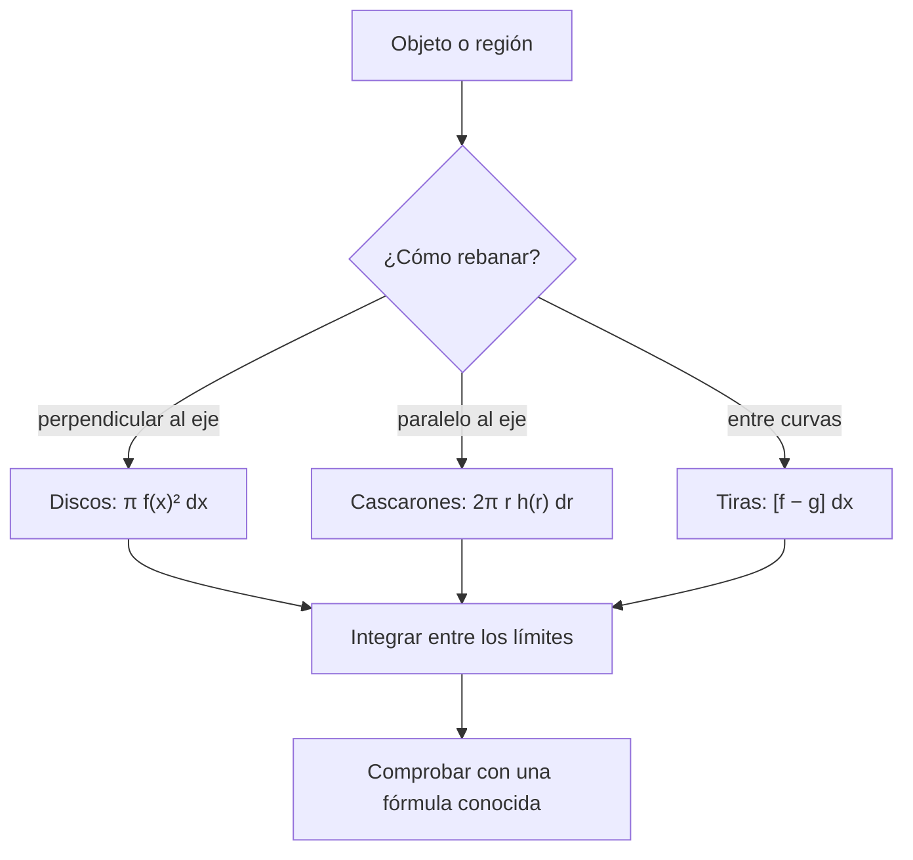

# B09-C13 — Áreas y volúmenes por integración

<!-- nav:top -->
[🏠 Programa](../../../../README.md) · [📚 Bloque B09](../../../tronco-comun/B09-calculo-diferencial-e-integral.md) · [← Anterior: B09-C12 — Teorema fundamental del cálculo](../B09-C12-teorema-fundamental-del-calculo/CLASE.md) · [Siguiente: B09-C14 — Series y aproximaciones →](../B09-C14-series-y-aproximaciones/CLASE.md)
<!-- /nav -->

## 1. Ubicación, nivel y alcance

Decimotercera clase del bloque B09. Con el teorema fundamental ([C12](../B09-C12-teorema-fundamental-del-calculo/CLASE.md)) ya puedes evaluar integrales definidas con exactitud. Ahora las aplicas a **geometría**: el área entre curvas, el volumen de sólidos de revolución y el área de una superficie. Nivel N3. Verás los métodos de discos y cascarones, el volumen del esferoide terrestre contrastado con la cifra de la NASA, el volumen y la superficie de un espejo parabólico, y el área de una elipse orbital. No verás integrales múltiples (C18) ni coordenadas curvilíneas (C19).

## 2. Por qué esta clase existe

Un telescopio necesita un espejo con forma de paraboloide. Cuánto vidrio hay que retirar de un disco plano para darle forma, cuánto pesa, y cuánta superficie hay que aluminizar son preguntas de volumen y área. Del mismo modo, la Tierra no es una esfera, y su volumen y el área barrida por el radio vector en una órbita son integrales.

La decisión central: **¿cómo planteo un área o un volumen como una integral de una variable, qué método uso y cómo lo verifico con una fórmula conocida o un valor publicado?**

## 3. Lo que podrás hacer al terminar

1. Calcular el área entre dos curvas.
2. Calcular el volumen de un sólido de revolución por discos y por cascarones.
3. Calcular el área de una superficie de revolución con la longitud de arco.
4. Obtener el volumen de un esferoide y compararlo con un valor publicado.
5. Dimensionar el volumen y la superficie de un espejo parabólico.
6. Obtener el área de una elipse y relacionarla con la segunda ley de Kepler.

La evidencia es la **hoja de geometría de un espejo y de un esferoide con verificación** del ejercicio 12 (sección 20).

## 4. Con qué llegas y cómo comprobarlo

Necesitas integrales definidas (C11–C12) y el volumen de un cilindro. Cinco preguntas:

1. Calcula `∫₀¹ x dx` y `∫₀¹ x² dx`.
2. ¿Cuánto es el área de un círculo de radio `R`?
3. ¿Cuánto es el volumen de un cilindro de radio `R` y altura `h`?
4. Despeja `y` en `x²/a² + y²/b² = 1`.
5. ¿Cuánto es `(1 + x²)^{3/2}` en `x = 0`?

<details>
<summary>Ver respuestas</summary>

1. `1/2` y `1/3`. 2. `π R²`. 3. `π R² h`. 4. `y = ±b√(1 − x²/a²)`. 5. 1.
</details>

Con cuatro o cinco aciertos, sigue; si no, repasa C11–C12 y B03-C17.

## 5. Un caso real: la Tierra no es una esfera

La IAU (2015) recomienda tomar como volumen nominal terrestre el de un esferoide de radios `R_eE^N = 6,3781 × 10⁶ m` (ecuatorial) y `R_pE^N = 6,3568 × 10⁶ m` (polar), es decir `V = (4π/3) R_eE² R_pE` (S2). Eso da `1,0832 × 10²¹ m³`. La ficha de la Tierra de la NASA lista un volumen de `108,321 × 10¹⁰ km³` (S3). Dos fuentes independientes que coinciden a 7 partes en un millón confirman que el modelo es razonable. **Ejemplo conductor 2** (sintético): un espejo primario parabólico de `1,0 m` de diámetro y `4,0 m` de distancia focal, de vidrio de `2500 kg/m³` (densidad de ejemplo).

## 6. Vocabulario

El **área entre curvas** es `∫_a^b [f(x) − g(x)] dx` con `f ≥ g` (S1, §1.4(v)). Un **sólido de revolución** se genera al girar una curva en torno a un eje. El **método de los discos** suma discos de radio `f(x)`: `V = ∫ π f(x)² dx`. El **método de los cascarones** suma cilindros huecos de radio `r` y altura `h(r)`: `V = ∫ 2π r h(r) dr`. La **longitud de arco** de `y = f(x)` es `∫ √(1 + f′²) dx`; el **área de una superficie de revolución** es `∫ 2π r ds`, con `ds = √(1 + z′²) dr`. Un **esferoide oblato** es una esfera achatada en los polos: semiejes `a` (ecuatorial) y `b < a`. La **flecha** (o sagita) es la profundidad del espejo en el borde. La **distancia focal** `f` de un paraboloide `z = r²/(4f)` es la distancia del vértice al foco. La **segunda ley de Kepler** dice que el radio vector barre áreas iguales en tiempos iguales.

## 7. Modelo mental: rebanar y sumar

Cualquier cantidad geométrica se obtiene rebanando el objeto en piezas de forma conocida (discos, cilindros huecos, tiras) y sumando con una integral. Lo esencial es elegir las rebanadas de modo que su aporte sea una fórmula sencilla de la variable de integración.



*Descripción textual:* se elige la rebanada según la geometría, se escribe su aporte como función de la variable, se integra y se verifica con un caso conocido.

Analogía: cortar un pan en rebanadas y sumar el volumen de cada una. Su límite: la rebanada solo es un disco exacto si la curva es continua; los bordes escalonados necesitan cuidado.

## 8. La explicación, paso a paso

### 8.1 Área entre curvas

Entre `y = x` y `y = x²` desde 0 hasta 1 (se cruzan en 0 y 1): `∫₀¹ (x − x²) dx = 1/2 − 1/3 = 1/6`.

### 8.2 Discos

`y = √x` girada alrededor del eje x entre 0 y 4: `V = ∫₀⁴ π (√x)² dx = π ∫₀⁴ x dx = 8π = 25,13`. Para una esfera, `y = √(R² − x²)`: `V = π ∫_{−R}^{R} (R² − x²) dx = 4πR³/3`.

### 8.3 El esferoide terrestre

Una elipse `x²/a² + z²/b² = 1` girada en torno al eje `z` tiene sección circular de radio `a√(1 − z²/b²)`: `V = π a² ∫_{−b}^{b} (1 − z²/b²) dz = π a² (2b − 2b/3) = 4π a² b/3`. Con los radios nominales: `V = 1,0832 × 10²¹ m³`, que difiere de la cifra de la NASA en `−6,6 × 10⁻⁶`. Una esfera de radio medio `6371,000 km` da `−2,9 × 10⁻⁶`.

### 8.4 Cascarones: el plato del espejo

El plato entre el plano del borde y el paraboloide: a radio `r`, su profundidad es `h(r) = (R² − r²)/(4f)`. Con cascarones: `V = ∫₀^R 2π r (R² − r²)/(4f) dr = (π/(2f)) (R⁴/2 − R⁴/4) = π R⁴/(8f)`. Para `R = 0,5 m` y `f = 4,0 m`: `V = 6,136 × 10⁻³ m³ = 6136 cm³`. Con `2500 kg/m³` (valor sintético), `15,3 kg` de vidrio retirado. La flecha en el borde es `R²/(4f) = 15,6 mm`.

### 8.5 Superficie del espejo

La superficie de revolución usa `ds = √(1 + (dz/dr)²) dr` con `dz/dr = r/(2f)`. Con la sustitución `u = 1 + r²/(4f²)`: `A = 2π ∫ r √u dr = (8π f²/3)[(1 + R²/(4f²))^{3/2} − 1]`. Para el espejo: `A = 0,786 165 m²`, frente a la apertura `π R² = 0,785 398 m²`: la superficie es solo `0,098 %` mayor, porque el espejo es muy poco profundo.

### 8.6 Una elipse

El área de `x²/a² + y²/b² = 1` es `4 ∫₀^a b √(1 − x²/a²) dx = π a b`. Para la órbita terrestre (`a = 1,000 002 61 au`, `e = 0,016 711 23`, S4), `b = a√(1 − e²) = 0,999 863 au` y `A = 3,141 170 au²`, casi un círculo. La segunda ley de Kepler dice que el radio vector barre esta área a razón constante; con el periodo del modelo de dos cuerpos de C06 (365,258 d), `dA/dt = 8,600 × 10⁻³ au²/d`.

### 8.7 Qué puede salir mal

Olvidar el factor `π` o el cuadrado en discos, confundir el radio con el diámetro, mezclar unidades (mm con m), y aplicar la fórmula de cascarones con límites del disco. El remedio: comprobar siempre con un caso conocido (esfera, cilindro, círculo) y revisar unidades: un volumen debe ser longitud³.

## 9. Magnitudes, símbolos y unidades

| Símbolo | Qué es | Unidad | Nota |
|---|---|---|---|
| `a`, `b` | semiejes ecuatorial y polar | m | `6,3781 × 10⁶` y `6,3568 × 10⁶` (S2) |
| `V` | volumen | m³ | `4π a² b/3` |
| `D`, `R`, `f` | diámetro, radio y distancia focal del espejo | m | 1,0; 0,5; 4,0 (sintéticos) |
| `z(r)` | perfil del paraboloide | m | `r²/(4f)` |
| `A` | área de superficie | m² | espejo 0,786 165 |
| `ρ` | densidad del vidrio | kg/m³ | 2500 (sintética) |
| `e`, `a` (órbita) | excentricidad y semieje mayor | adimensional, au | 0,016 711 23 y 1,000 002 61 (S4) |

## 10. Convenciones y referencias

Los volúmenes del esferoide son nominales (IAU): se usan como factores de conversión, no como medidas. La NASA da el volumen con seis cifras. El espejo es un paraboloide ideal, sin espesor ni tolerancias de fabricación: los espejos reales se miden en micrómetros. Todos los cálculos van en SI; la elipse se da en au por tratarse de una órbita.

## 11. De dónde sale lo que afirmamos

| ID | Fuente | Localizador | Respalda | Estado |
|---|---|---|---|---|
| S1 | NIST, *Digital Library of Mathematical Functions* §1.4, versión 1.2.8 | https://dlmf.nist.gov/1.4 | Integral definida y cambio de variable (§1.4(v)) como base de los cálculos | Consultada el 2026-11-05 mediante extracción automática |
| S2 | IAU, Resolución B3 de 2015, arXiv:1510.07674 | https://arxiv.org/pdf/1510.07674 | `R_eE^N`, `R_pE^N` y volumen nominal `4π R_eE² R_pE/3` (recomendación 6) | Texto extraído del PDF el 2026-11-05 |
| S3 | NASA/NSSDC, *Earth Fact Sheet* (actualizada 2024-11-15) | https://nssdc.gsfc.nasa.gov/planetary/factsheet/earthfact.html | Volumen `108,321 × 10¹⁰ km³`; radio medio volumétrico 6371,000 km | Consultada el 2026-11-05 mediante extracción automática |
| S4 | NASA/JPL, *Approximate Positions of the Planets* (tabla 1) | https://ssd.jpl.nasa.gov/planets/approx_pos.html | Baricentro Tierra–Luna: `a = 1,000 002 61 au`, `e = 0,016 711 23` | Consultada el 2026-11-05 mediante extracción automática |

Límites: las fórmulas de volumen y área se deducen aquí y se comprueban numéricamente; el espejo y la densidad son **sintéticos**.

## 12. Cómo ver los resultados

Equivalente accesible a un dibujo de cada sólido:

| Caso | Fórmula | Valor |
|---|---|---|
| Esferoide terrestre (IAU) | `4π a² b/3` | `1,0832 × 10²¹ m³` (NASA: `1,08321 × 10²¹`) |
| Plato del espejo | `π R⁴/(8f)` | `6135,9 cm³` |
| Superficie del espejo | `(8π f²/3)[…]` | `0,786 165 m²` |
| Elipse de la órbita | `π a b` | `3,141 170 au²` |

Descripción larga: el esferoide es una esfera apenas achatada (el polo mide 0,33 % menos que el ecuador); el espejo es un cuenco muy somero de 15,6 mm de profundidad en 1 m de diámetro; la elipse es casi indistinguible de un círculo de radio 1 au.

## 13. Ejemplo trabajado: volumen del plato del espejo

**Paso 1 · Planteo.** Cascarón de radio `r` y espesor `dr`: altura `h(r) = (R² − r²)/(4f)`; volumen `dV = 2π r h dr`.

**Paso 2 · Integral.** `V = (π/(2f)) ∫₀^R (R² r − r³) dr`.

**Paso 3 · Antiderivada.** `∫₀^R (R² r − r³) dr = R⁴/2 − R⁴/4 = R⁴/4`. Entonces `V = π R⁴/(8f)`.

**Paso 4 · Números.** `R = 0,5 m`, `f = 4,0 m`: `V = π · 0,0625/32 = 6,136 × 10⁻³ m³`.

**Paso 5 · Comprobación y sentido.** El laboratorio integra numéricamente (Simpson) y coincide a 10⁻⁹. Comprobación independiente: el plato equivale a la mitad del cilindro de altura `15,6 mm` y radio `0,5 m` (`π R² h/2 = 6136 cm³`), un resultado conocido de la geometría del paraboloide. La masa retirada con `2500 kg/m³` es `15,3 kg` (sintético).

## 14. Distintas formas de calcular un volumen

Los **discos** funcionan cuando la rebanada es perpendicular al eje de giro. Los **cascarones** son mejores cuando es paralela y la función se escribe como `h(r)`. La **fórmula cerrada** (cilindro, esfera) es la comprobación. La **integración numérica** (C11) sirve si la forma viene de datos medidos (por ejemplo, el perfil medido de un espejo). Un **modelo CAD** calcula lo mismo con mallas, a costa de transparencia.

## 15. Práctica guiada

**Ejercicio 1 · con los pasos indicados.** Halla el área entre `y = x` y `y = x²` en `[0, 1]`. *Pasos:* decide cuál está arriba; integra la diferencia.

<details><summary>Solución comentada</summary>

Para `0 < x < 1`, `x > x²`. `∫₀¹ (x − x²) dx = 1/2 − 1/3 = 1/6` (8.1).
</details>

**Ejercicio 2 · con una pista.** Calcula el volumen al girar `y = √x` en torno al eje x entre 0 y 4. *Pista:* discos, `π y²`.

<details><summary>Solución comentada</summary>

`π ∫₀⁴ x dx = π · 8 = 25,13` (8.2).
</details>

**Ejercicio 3 · casi autónomo.** Calcula el volumen del plato de un espejo de `R = 0,5 m` y `f = 4,0 m`.

<details><summary>Solución comentada</summary>

`π R⁴/(8f) = π · 0,0625/32 = 6,136 × 10⁻³ m³` (ejemplo trabajado).
</details>

## 16. Práctica autónoma, transferencia e integrador

**Ejercicio 4.** Calcula el área de la elipse `x²/4 + y² = 1`.

<details><summary>Solución comentada</summary>

`π a b = π · 2 · 1 = 2π = 6,283`. Con la integral: `4 ∫₀² √(1 − x²/4) dx` da el mismo valor (8.6).
</details>

**Ejercicio 5.** Deduce el volumen de una esfera de radio `R` por discos.

<details><summary>Solución comentada</summary>

`π ∫_{−R}^{R} (R² − x²) dx = π (2R³ − 2R³/3) = 4πR³/3` (8.2).
</details>

**Ejercicio 6.** ¿Cuánto mayor es la superficie del espejo que su apertura?

<details><summary>Solución comentada</summary>

`0,786 165/0,785 398 − 1 = 9,8 × 10⁻⁴`: un 0,098 % (8.5). Es pequeño porque el espejo es muy somero.
</details>

**Ejercicio 7.** Calcula el volumen del esferoide terrestre nominal y compáralo con el de una esfera de radio igual al ecuatorial.

<details><summary>Solución comentada</summary>

Esferoide: `1,0832 × 10²¹ m³`; esfera de radio `a`: `4πa³/3 = 1,0868 × 10²¹ m³`; razón `b/a = 0,99666`: el esferoide es `0,33 %` menor.
</details>

**Ejercicio 8.** Con `A = 3,141 170 au²` y `P = 365,258 d` (C06), ¿cuál es el área barrida por día?

<details><summary>Solución comentada</summary>

`3,141 170/365,258 = 8,600 × 10⁻³ au²/d`, constante por la segunda ley de Kepler (modelo de dos cuerpos).
</details>

**Ejercicio 9 · transferencia.** Un blanco de espejo es un cilindro de `0,5 m` de radio y `0,10 m` de espesor, de vidrio de `2500 kg/m³` (sintético). ¿Qué masa tiene antes y después de retirar el plato de 8.4?

<details><summary>Solución comentada</summary>

Antes: `π · 0,25 · 0,10 · 2500 = 196,3 kg`. Se retira `15,3 kg`: quedan `181,0 kg`. Cálculo con valores sintéticos.
</details>

**Ejercicio 10 · transferencia.** Un compañero calcula el volumen de `y = √x` (0 a 4) como `∫₀⁴ √x dx = 5,33`. ¿Qué error comete?

<details><summary>Solución comentada</summary>

Calculó el área bajo la curva, no el volumen: faltó el disco `π y²`. Además, un volumen debe tener unidades de longitud³. El valor correcto es `8π = 25,13`.
</details>

**Ejercicio 11 · transferencia.** El perfil del espejo se mide en milímetros: `R = 500 mm`, `f = 4000 mm`. Calcula el volumen del plato en mm³ y conviértelo a cm³ y m³.

<details><summary>Solución comentada</summary>

`π R⁴/(8f) = π · 6,25 × 10¹⁰/(32 000) = 6,136 × 10⁶ mm³`; `1 cm³ = 10³ mm³` → `6136 cm³`; `1 m³ = 10⁹ mm³` → `6,136 × 10⁻³ m³`. Coincide con el cálculo en m (8.4).
</details>

**Ejercicio 12 · integrador.** Elabora tu *hoja de geometría de un espejo y de un esferoide con verificación*: para el espejo (sintético) la flecha, el volumen del plato, la superficie y la masa retirada; para el esferoide, su volumen por discos y la comparación con el valor de la NASA; añade el área de la elipse orbital.

<details><summary>Solución modelo</summary>

Tabla como la de la sección 12, con una columna para el valor numérico (Simpson) y otra para la referencia; diferencias relativas < 10⁻⁶ en geometría y `−6,6 × 10⁻⁶` frente a la NASA; se rotulan sintéticos los datos del espejo y se declara la simplificación del paraboloide ideal.
</details>

## 17. Laboratorio: espejo, esferoide y elipse

El script [espejo_y_esferoide.py](espejo_y_esferoide.py) integra con Simpson el volumen del esferoide por discos, el volumen y la superficie del paraboloide, y el área de la elipse orbital, y los compara con fórmulas cerradas y con el volumen de la NASA.

**Datos:** nominales de la IAU, volumen de la NASA, elementos del JPL y espejo sintético. **Predice antes de ejecutar:** ¿qué diferencia relativa habrá con la NASA? (del orden de 10⁻⁵.) **Ejecución del 2026-11-05 (Python 3.12.9):**

```text
Esferoide nominal IAU: V_num = 1.08320e+21 m3; 4/3 pi a^2 b = 1.08320e+21 m3
NASA (108.321e10 km3) = 1.08321e+21 m3; dif. relativa = -6.57e-06
Espejo D = 1.0 m, f = 4.0 m: flecha en el borde = 15.625 mm
Volumen retirado (plato) = 6135.9 cm3; masa de vidrio (2500 kg/m3, sintética) = 15.340 kg
Superficie = 0.786165 m2; apertura = 0.785398 m2; razón = 1.000976
Área de la elipse orbital: numérica 3.14117019 au2; pi a b = 3.14117035 au2
Pruebas superadas.
```

```bash
python programa/clases/B09/B09-C13-areas-y-volumenes-por-integracion/espejo_y_esferoide.py
```

**Límites:** sólidos ideales; sin tolerancias de fabricación; el espejo es sintético; no es un diseño óptico.

## 18. Errores frecuentes y cómo corregirlos

**Calcular un área cuando se pide un volumen.** Se corrige con el ejercicio 10.

**Olvidar el cuadrado o el `π` en discos.** Se corrige con los ejercicios 2 y 5.

**Mezclar milímetros y metros.** Se corrige con el ejercicio 11.

**Elegir mal el método de rebanado.** Se corrige con el diagrama de la sección 7.

**No comprobar con una fórmula conocida.** Se corrige en el paso 5 del ejemplo trabajado.

## 19. Cómo sabrás que vas bien

Tras 8.1: ¿hallas el área entre dos curvas? Si no, ejercicio 1. Tras 8.2: ¿deduces el volumen de una esfera? Si no, ejercicio 5. Tras 8.4: ¿entiendes por qué `h(r)` decrece con `r`? Si no, ejercicio 3. Tras el laboratorio: ¿qué comparación es independiente del modelo? (el volumen de la NASA).

## 20. Qué entregas y cómo se evalúa

El producto es tu **hoja de geometría de un espejo y de un esferoide con verificación** (ejercicio 12).

| Criterio | Inicial | En desarrollo | Logrado | Destacado |
|---|---|---|---|---|
| Planteo de la integral | Sin rebanada | Con ayuda | Rebanada y límites | Compara dos métodos |
| Cálculo | Errores | Parcial | Correcto con unidades | Verifica numéricamente |
| Verificación | Ausente | Mental | Fórmula conocida | Valor publicado |
| Interpretación | Sin sentido físico | Descriptiva | Con orden de magnitud | Discute el modelo |
| Fuentes y rótulos | Sin fuente | Sin fecha | Con localizador y fecha | Rotula sintético |

**Condiciones críticas (no se compensan con promedio):** comprobar unidades; verificar con un caso conocido; rotular lo sintético.

## 21. Ética, seguridad y límites

Manipular espejos y vidrio requiere protección y técnica; esta clase solo calcula geometría ideal y no sirve para fabricar ni pulir ópticas. Un volumen o una masa sin tolerancias puede inducir a error en el diseño de soportes. Accesibilidad: tablas equivalentes a las figuras, fórmulas en texto, ejercicios sin conexión.

## 22. Para cerrar y seguir

Las integrales miden áreas y volúmenes si se elige bien la rebanada; el esferoide terrestre y el espejo parabólico se verifican con fórmulas cerradas y con un valor publicado. Queda abierta una pregunta: ¿cómo se aproxima una función complicada por otra más simple, con una cota del error? Es el tema de las series.

**Glosario español–inglés.** sólido de revolución · *solid of revolution*; método de discos · *disk method*; método de cascarones · *shell method*; esferoide oblato · *oblate spheroid*; paraboloide · *paraboloid*; distancia focal · *focal length*; flecha (sagita) · *sag*; segunda ley de Kepler · *Kepler's second law*.

**Continuidad.** B09-C14 reutiliza tu capacidad de **evaluar y comparar con una referencia** para controlar el error de una aproximación por series.

**Referencias:** ver sección 11.

<!-- nav:bottom -->
---

[← Anterior: B09-C12 — Teorema fundamental del cálculo](../B09-C12-teorema-fundamental-del-calculo/CLASE.md) · [📚 Bloque B09](../../../tronco-comun/B09-calculo-diferencial-e-integral.md) · [Siguiente: B09-C14 — Series y aproximaciones →](../B09-C14-series-y-aproximaciones/CLASE.md)
<!-- /nav -->
