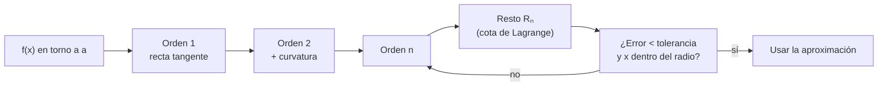

# B09-C14 — Series y aproximaciones

<!-- nav:top -->
[🏠 Programa](../../../../README.md) · [📚 Bloque B09](../../../tronco-comun/B09-calculo-diferencial-e-integral.md) · [← Anterior: B09-C13 — Áreas y volúmenes por integración](../B09-C13-areas-y-volumenes-por-integracion/CLASE.md) · [Siguiente: B09-C15 — Funciones de varias variables →](../B09-C15-funciones-de-varias-variables/CLASE.md)
<!-- /nav -->

## 1. Ubicación, nivel y alcance

Decimocuarta clase del bloque B09. En [C01](../B09-C01-limites-de-funciones-reales/CLASE.md) sustituiste `sin t` por `t` y en [C04](../B09-C04-reglas-de-derivacion/CLASE.md) la diferencia de gravedades por una derivada. Ambas son aproximaciones lineales. Aquí las sistematizas: la **serie de Taylor** da una aproximación polinómica de cualquier orden, con una **cota del error**. Nivel N3. Verás el polinomio de Taylor, el resto de Lagrange, la serie binomial, el radio de convergencia y su aplicación a la gravedad con la altitud y a la marea. No verás series de Fourier (B15) ni series de potencias complejas.

## 2. Por qué esta clase existe

Un cálculo orbital rápido usa `g(h) = g₀(1 − 2h/R)` para una altitud baja; uno más exigente necesita el siguiente término. Sin una cota del error no se sabe cuál usar. Y en el computador, las funciones `sin`, `exp` o `ln` se calculan con polinomios. Una aproximación sin cota es una apuesta; con cota, es una herramienta.

La decisión central: **¿cuántos términos necesito para un error dado, dentro de qué rango es válida la serie y qué ocurre fuera de él?**

## 3. Lo que podrás hacer al terminar

1. Escribir el polinomio de Taylor de una función en torno a un punto.
2. Acotar el error con el resto de Lagrange.
3. Desarrollar `(1 + x)ⁿ` con la serie binomial y reconocer su radio de convergencia.
4. Aproximar la gravedad y la velocidad circular a baja altitud con error controlado.
5. Reconocer que una serie truncada falla lejos del centro o fuera del radio de convergencia.
6. Reinterpretar una derivada de C04 como el primer término de una serie.

La evidencia es la **tabla de aproximaciones con cota de error** del ejercicio 12 (sección 20).

## 4. Con qué llegas y cómo comprobarlo

Necesitas derivadas de orden superior (C03–C05) y factoriales. Cinco preguntas:

1. Deriva tres veces `sin x`.
2. ¿Cuánto es `5!`?
3. Deriva `(1 + x)⁻²` dos veces.
4. ¿Cuánto vale `(1 + x)⁻²` en `x = 0`?
5. ¿Qué es un error relativo?

<details>
<summary>Ver respuestas</summary>

1. `−cos x`. 2. 120. 3. `−2(1 + x)⁻³` y `6(1 + x)⁻⁴`. 4. 1. 5. El error absoluto dividido por el valor exacto.
</details>

Con cuatro o cinco aciertos, sigue; si no, repasa C04–C05.

## 5. Un caso real: la gravedad a 400 km

Con los valores nominales de la IAU, `(GM)_E^N = 3,986 004 × 10¹⁴ m³ s⁻²` y `R_eE^N = 6,3781 × 10⁶ m` (S2), la gravedad en el ecuador nominal es `g₀ = GM/R² = 9,7984 m/s²`. A la altitud `h`, `g(h) = g₀ (1 + h/R)⁻²`. Cerca de la superficie conviene un polinomio. **Ejemplo conductor:** ¿qué orden de aproximación usar a 1, 10, 100, 400 y 1000 km (altitudes de ejemplo)? A 400 km, `x = h/R = 0,0627`; la fórmula exacta da `8,676 m/s²` y el primer orden se aparta `1,2 %`, el segundo `0,10 %` y el tercero `0,008 %`. Segundo ejemplo: la marea lunar de C04, que ahora se aproxima con un término más.

## 6. Vocabulario

El **polinomio de Taylor** de grado `n` de `f` en torno a `a` es `Σ_{k=0}^{n} f^{(k)}(a) (x − a)ᵏ/k!`. La **serie de Maclaurin** es el caso `a = 0`. El **resto** `Rₙ` es la diferencia entre `f` y su polinomio; en la forma de **Lagrange**, `Rₙ = f^{(n+1)}(ξ) (x − a)^{n+1}/(n + 1)!` para algún `ξ` entre `a` y `x` (S1, §1.4(vi), ecs. 1.4.35–1.4.36). El **radio de convergencia** es la distancia máxima a `a` dentro de la cual la serie converge. La **serie binomial**: `(1 + x)ᵖ = Σ C(p, k) xᵏ`, con radio 1 para `p` no entero positivo. Un **orden** de aproximación es el grado del polinomio. Una **aproximación lineal** es el orden 1. El **error relativo** es `|aprox − exacto|/|exacto|`.

## 7. Modelo mental: acercar una curva con polinomios cada vez más fieles

Cerca del punto `a`, una función suave se parece a su recta tangente; con un término más, a una parábola; con otro, a una cúbica. Cada polinomio «copia» una derivada más de la función en `a`, y por eso la copia es fiel cerca del centro y se separa lejos de él.



*Descripción textual:* se añaden términos de la serie hasta que la cota del resto sea menor que la tolerancia y se verifica que `x` esté dentro del radio de convergencia.

Analogía: un mapa cada vez más detallado de los alrededores de una ciudad. Su límite: lejos de la ciudad, un mapa local engaña, por detallado que sea.

## 8. La explicación, paso a paso

### 8.1 Los polinomios de `sin x`

Derivadas de `sin` en 0: `0, 1, 0, −1, 0, 1, …`. Entonces `sin x = x − x³/6 + x⁵/120 − x⁷/5040 + …`. En `x = 1` con 1, 2, 3, 4, 5 y 6 términos: `1,000 000`, `0,833 333`, `0,841 667`, `0,841 468`, `0,841 471 010`, `0,841 470 985`; exacto `0,841 470 985`.

### 8.2 La cota del resto

Como todas las derivadas de `sin` están acotadas por 1, `|Rₙ| ≤ |x|^{n+1}/(n + 1)!`. En `x = 1`: tras 3 términos (grado 5), `1/7! = 1,98 × 10⁻⁴` frente al error real `1,96 × 10⁻⁴`: la cota es casi exacta. Para un error menor que `10⁻⁶` en `x = 1` bastan los términos hasta `x⁹` (cota `1/10! = 2,8 × 10⁻⁷`).

### 8.3 Lejos del centro

En `x = 10`, tres términos dan `676,7` y `sin 10 = −0,544`. La cota `10⁷/7! ≈ 2000` lo avisa. Un polinomio de Taylor se usa **cerca** del centro.

### 8.4 La serie binomial y la gravedad

`(1 + x)⁻² = 1 − 2x + 3x² − 4x³ + …` para `|x| < 1`. Con `x = h/R`:

`g(h) = g₀ (1 − 2x + 3x² − 4x³ + …)`.

El primer orden `g₀(1 − 2h/R)` reproduce la derivada de C04: `dg/dh = −2g₀/R`.

### 8.5 El radio de convergencia

Para `x = 1,5` los términos `(n + 1) xⁿ` crecen y la suma parcial oscila sin acercarse al valor `0,16`: 3 términos dan `4,75`; 12 términos, `−643`; 24, `−1,6 × 10⁵`. Fuera del radio de convergencia (aquí `h > R`), la serie no vale.

### 8.6 La velocidad circular

`v = √(GM/(R + h)) = v₀ (1 + x)^{−1/2} = v₀ (1 − x/2 + 3x²/8 − …)` con `v₀ = √(GM/R) = 7905,4 m/s`. A 400 km: exacta `7668,58 m/s`; orden 1 `7657,50` (`−0,145 %`); orden 2 `7669,16` (`+0,0075 %`).

### 8.7 La marea de C04 por series

`g(d − a) − g(d) = g(d) [(1 − a/d)⁻² − 1] = g(d) (2a/d + 3a²/d² + …)`. El primer término es la derivada (`1,100 × 10⁻⁶ m/s²`, `−2,48 %` respecto al exacto); con el segundo, `1,1278 × 10⁻⁶` (`−0,055 %`). El cociente entre ambos términos es `3a/(2d) = 0,0249`: explica el `2,5 %` de C04.

## 9. Magnitudes, símbolos y unidades

| Símbolo | Qué es | Unidad | Nota |
|---|---|---|---|
| `g(h)` | gravedad a la altitud `h` | m/s² | `g₀(1 + x)⁻²` |
| `g₀` | gravedad en `R` | m/s² | 9,7984 (nominal, S2) |
| `x = h/R` | altitud relativa | adimensional | `< 1` |
| `Rₙ` | resto de orden `n` | como `f` | cota de Lagrange |
| `v₀` | velocidad circular en `R` | m/s | 7905,4 |
| `GM_L`, `d`, `a` | parámetros de la marea | km³/s², m, m | 4,90 × 10³; 3,844 × 10⁸; 6,378 137 × 10⁶ (S3, S4) |

## 10. Convenciones y referencias

Los polinomios se desarrollan en torno a la superficie (`h = 0`). Los ángulos están en radianes. El error es relativo al valor exacto del modelo `GM/(R + h)²`, **no** a la gravedad real, que depende además de la rotación y de la forma de la Tierra. Las altitudes son de ejemplo.

## 11. De dónde sale lo que afirmamos

| ID | Fuente | Localizador | Respalda | Estado |
|---|---|---|---|---|
| S1 | NIST, *Digital Library of Mathematical Functions* §1.4, versión 1.2.8 | https://dlmf.nist.gov/1.4 | Teorema de Taylor y formas del resto (§1.4(vi), ecs. 1.4.35–1.4.37) | Consultada el 2026-11-05 mediante extracción automática |
| S2 | IAU, Resolución B3 de 2015, arXiv:1510.07674 | https://arxiv.org/pdf/1510.07674 | `(GM)_E^N` y `R_eE^N` nominales | Texto extraído del PDF el 2026-11-05 |
| S3 | NASA/NSSDC, *Moon Fact Sheet* (actualizada 2024-01-11) | https://nssdc.gsfc.nasa.gov/planetary/factsheet/moonfact.html | `GM_L = 0,004 90 × 10⁶ km³/s²`; distancia 384 400 km | Consultada el 2026-11-05 mediante extracción automática |
| S4 | NASA/NSSDC, *Earth Fact Sheet* (actualizada 2024-11-15) | https://nssdc.gsfc.nasa.gov/planetary/factsheet/earthfact.html | Radio ecuatorial 6378,137 km | Consultada el 2026-11-05 mediante extracción automática |

Límites: la serie binomial y su radio de convergencia son resultados estándar que aquí se **comprueban numéricamente**; no se citan de S1. No se consultó una tabla de gravedad real a distintas altitudes.

## 12. Cómo ver la aproximación

Equivalente accesible a una gráfica de error frente al orden (laboratorio):

| `h` (km) | `g` exacta (m/s²) | Error orden 1 | Orden 2 | Orden 3 |
|---|---|---|---|---|
| 1 | 9,79533 | 7,4 × 10⁻⁸ | 1,5 × 10⁻¹¹ | 3,2 × 10⁻¹⁵ |
| 100 | 9,49822 | 7,5 × 10⁻⁴ | 1,6 × 10⁻⁵ | 3,1 × 10⁻⁷ |
| 400 | 8,67604 | 1,2 × 10⁻² | 1,0 × 10⁻³ | 8,1 × 10⁻⁵ |
| 1000 | 7,32232 | 8,1 × 10⁻² | 1,7 × 10⁻² | 3,4 × 10⁻³ |
| 3000 | 4,53219 | 0,87 | 0,56 | 0,34 |

Descripción larga: el error baja con el orden mientras `x` es pequeño; a 3000 km (`x = 0,47`) la mejora por orden es lenta, porque se acerca al radio de convergencia.

## 13. Ejemplo trabajado: gravedad a 400 km

**Paso 1 · Datos.** `g₀ = 9,7984 m/s²`, `R = 6,3781 × 10⁶ m`, `h = 4,0 × 10⁵ m`; `x = 0,062715`.

**Paso 2 · Exacta.** `g = g₀ (1 + x)⁻² = 9,7984/1,129 3 = 8,676 m/s²`.

**Paso 3 · Orden 1.** `1 − 2x = 0,87457`; `g ≈ 8,5694 m/s²`; error relativo `1,2 × 10⁻²`.

**Paso 4 · Orden 2.** `1 − 2x + 3x² = 0,88637`; `g ≈ 8,6851`; error `1,0 × 10⁻³`. Orden 3 (`−4x³ = −0,000986`): `8,6753`, error `8 × 10⁻⁵`.

**Paso 5 · Decisión y sentido.** Para un error menor que 1 % basta el segundo orden. La serie converge porque `x = 0,063 < 1`. Los resultados describen el modelo de masa puntual, no la gravedad real.

## 14. Distintas formas de aproximar

La **serie de Taylor** es sistemática y con cota. La **aproximación lineal** (C03–C04) es el caso `n = 1`. Un **ajuste por mínimos cuadrados** (B12) minimiza el error sobre un rango en vez de en un punto. Las **aproximaciones racionales** (Padé) convergen en más rango pero son más complejas. Los programas usan polinomios minimax para `sin` y `exp`. Cada método tiene su dominio: Taylor, cerca del centro.

## 15. Práctica guiada

**Ejercicio 1 · con los pasos indicados.** Escribe los tres primeros términos no nulos de `sin x` y evalúa en `x = 0,5`. *Pasos:* derivadas en 0; divide por `k!`.

<details><summary>Solución comentada</summary>

`x − x³/6 + x⁵/120 = 0,5 − 0,020 833 + 0,000 260 = 0,479 427`; exacto `0,479 426`. (8.1)
</details>

**Ejercicio 2 · con una pista.** Aproxima `e^{0,1}` con el polinomio de grado 3 y acota el error. *Pista:* todas las derivadas de `eˣ` son `eˣ`.

<details><summary>Solución comentada</summary>

`1 + 0,1 + 0,005 + 0,000 167 = 1,105 167`. Resto: `≤ e^{0,1} · 0,1⁴/24 = 4,6 × 10⁻⁶`. Exacto `1,105 171`; error real `4 × 10⁻⁶` ✓.
</details>

**Ejercicio 3 · casi autónomo.** Estima `g(100 km)` con primer orden y calcula el error relativo respecto a la fórmula exacta.

<details><summary>Solución comentada</summary>

`x = 0,015679`; `g ≈ 9,7984 (1 − 0,031358) = 9,4912`; exacto `9,4982`; error `7,5 × 10⁻⁴` (cuadro de la sección 12).
</details>

## 16. Práctica autónoma, transferencia e integrador

**Ejercicio 4.** Aproxima `(1 + x)⁻²` con tres términos para `x = 0,0627` y compara con el valor exacto.

<details><summary>Solución comentada</summary>

`1 − 0,12543 + 0,01180 = 0,88637`; exacto `0,88546`; error `1,0 × 10⁻³`.
</details>

**Ejercicio 5.** ¿Por qué la serie de `(1 + x)⁻²` no sirve para `x = 1,5`?

<details><summary>Solución comentada</summary>

El radio de convergencia es 1; para `|x| > 1`, `(n + 1) xⁿ` crece y la suma no converge (8.5).
</details>

**Ejercicio 6.** Calcula la velocidad circular a 400 km con orden 1 y orden 2 y su error.

<details><summary>Solución comentada</summary>

`v₀ = 7905,4`; orden 1: `7657,5` (`−0,145 %`); orden 2: `7669,2` (`+0,0075 %`); exacta `7668,6 m/s` (8.6).
</details>

**Ejercicio 7.** ¿Cuántos términos de `sin x` garantizan un error menor que `10⁻⁶` en `x = 1`?

<details><summary>Solución comentada</summary>

Se necesita `1/(n + 1)! < 10⁻⁶`: `n + 1 = 10` (`2,8 × 10⁻⁷`). Términos hasta `x⁹`: 5 términos (8.2).
</details>

**Ejercicio 8.** Usa la serie de `cos x` para obtener `lim (1 − cos x)/x²` (C01).

<details><summary>Solución comentada</summary>

`cos x = 1 − x²/2 + x⁴/24`; `(1 − cos x)/x² = 1/2 − x²/24 → 1/2` ✓.
</details>

**Ejercicio 9 · transferencia.** Con los términos de la serie, verifica que el segundo término de la marea de 8.7 explica la desviación de `2,5 %` de C04.

<details><summary>Solución comentada</summary>

Razón entre el segundo y el primer término: `3a²/d² ÷ 2a/d = 3a/(2d) = 3 · 6,378 × 10⁶/(2 · 3,844 × 10⁸) = 0,0249`: un 2,5 %. Coincide con la desviación de `2,482 %`.
</details>

**Ejercicio 10 · transferencia.** Un compañero evalúa `sin(10)` con los tres primeros términos y obtiene `676,7`. ¿Cuál es el error y qué lección da?

<details><summary>Solución comentada</summary>

El valor real es `−0,544`: el error es del orden de 677. El polinomio de Taylor vale cerca del centro; para ángulos grandes se reduce el ángulo (periodicidad) antes de aproximar.
</details>

**Ejercicio 11 · transferencia.** ¿Cuánto vale el error relativo de `sin θ ≈ θ` para `θ = 30°`? ¿Y de `sin θ ≈ θ − θ³/6`?

<details><summary>Solución comentada</summary>

`θ = 0,5236`: `sin = 0,5`; orden 1: `0,5236` (`+4,7 %`); orden 3: `0,5236 − 0,02392 = 0,49968` (`−0,064 %`).
</details>

**Ejercicio 12 · integrador.** Elabora tu *tabla de aproximaciones con cota de error*: para cinco altitudes (de ejemplo) calcula `g(h)` exacta y con 1, 2 y 3 órdenes, el error relativo, el orden mínimo que alcanza el 1 % y el radio de convergencia; añade `sin` en `x = 1` con la cota de Lagrange.

<details><summary>Solución modelo</summary>

Tabla como la de la sección 12 más la columna «orden mínimo para 1 %» (1 km: 1; 100 km: 1; 400 km: 2; 1000 km: 3); radio 1 (`h < R`); `sin 1` con cota `1/7! = 1,98 × 10⁻⁴` para 3 términos; se declara el modelo de masa puntual.
</details>

## 17. Laboratorio: series de la gravedad

El script [series_de_gravedad.py](series_de_gravedad.py) compara la gravedad exacta con los tres primeros órdenes de la serie binomial, calcula la velocidad circular, muestra la divergencia con `x = 1,5`, comprueba que el error de la serie de `sin` nunca supera la cota de Lagrange y aplica la serie a la marea lunar.

**Datos:** nominales de la IAU y NASA; altitudes de ejemplo. **Predice antes de ejecutar:** ¿qué orden basta a 400 km para <1 %? (el 2.°.) **Ejecución del 2026-11-05 (Python 3.12.9):**

```text
   400   6.2715e-02     8.67604        1.229e-02   1.033e-03   8.123e-05
v_circular a 400 km: exacta 7668.58 m/s; orden 1 7657.50 (-0.145%); orden 2 7669.16 (+0.0075%)
    24 términos: -1.6430e+05  (exacto 0.1600)
  3 términos: 0.8416666667  err = 1.957e-04  cota = 1.984e-04
sin(10) con 3 términos = 676.667; exacto = -0.544021
Marea lunar: exacta 1.1285e-06; orden 1 1.1004e-06 (-2.48%); orden 2 1.1278e-06 (-0.055%)
Pruebas superadas.
```

```bash
python programa/clases/B09/B09-C14-series-y-aproximaciones/series_de_gravedad.py
```

**Límites:** modelo de masa puntual; altitudes de ejemplo; no es un modelo de gravedad.

## 18. Errores frecuentes y cómo corregirlos

**Usar la serie fuera de su radio de convergencia.** Se corrige con el ejercicio 5.

**Aproximar lejos del centro.** Se corrige con el ejercicio 10.

**Olvidar el factorial.** Se corrige con el ejercicio 1.

**Usar grados en las series trigonométricas.** Se corrige con el ejercicio 11 (radianes).

**Dar una aproximación sin cota.** Se corrige con el ejercicio 7.

## 19. Cómo sabrás que vas bien

Tras 8.1: ¿escribes el polinomio de `sin`? Si no, ejercicio 1. Tras 8.2: ¿cuántos términos para `10⁻⁶`? Si no, ejercicio 7. Tras 8.4: ¿reconoces la derivada de C04 como primer término? Si no, ejercicio 3. Tras el laboratorio: ¿qué verifica que la cota de Lagrange es correcta? (error real ≤ cota en todos los casos).

## 20. Qué entregas y cómo se evalúa

El producto es tu **tabla de aproximaciones con cota de error** (ejercicio 12).

| Criterio | Inicial | En desarrollo | Logrado | Destacado |
|---|---|---|---|---|
| Polinomios de Taylor | Errores | Con ayuda | Correctos | Los deduce |
| Cota del error | Ausente | Cualitativa | Calculada | Compara con el error real |
| Radio de convergencia | Ignorado | Mencionado | Aplicado | Muestra divergencia |
| Elección del orden | Arbitraria | Con ayuda | Según tolerancia | Justifica por costo/beneficio |
| Fuentes y modelo | Sin fuente | Sin fecha | Con localizador y fecha | Declara el modelo |

**Condiciones críticas (no se compensan con promedio):** dar una cota o error numérico; declarar el rango de validez; citar solo fuentes consultadas.

## 21. Ética, seguridad y límites

Una aproximación fuera de su dominio puede dar resultados absurdos con apariencia de precisión; en aplicaciones críticas se valida contra el valor exacto o una referencia. Esta clase no justifica usar un polinomio en un sistema de navegación sin análisis de error. Accesibilidad: tablas equivalentes a las gráficas, fórmulas en texto, ejercicios sin conexión.

## 22. Para cerrar y seguir

Una serie de Taylor aproxima con una cota de error y un rango de validez; la derivada es su primer término; fuera del radio de convergencia o lejos del centro, falla. Con esto cierras el cálculo de una variable. Queda abierta una pregunta: la gravedad, la temperatura o el brillo dependen de **varias** variables a la vez; ¿cómo se extiende el cálculo a funciones de varias variables?

**Glosario español–inglés.** serie de Taylor · *Taylor series*; resto · *remainder*; radio de convergencia · *radius of convergence*; serie binomial · *binomial series*; aproximación lineal · *linear approximation*; orden de aproximación · *order of approximation*; error relativo · *relative error*.

**Continuidad.** B09-C15 reutiliza tu capacidad de **describir una cantidad que depende de una variable** para extenderla a dos o más variables.

**Referencias:** ver sección 11.

<!-- nav:bottom -->
---

[← Anterior: B09-C13 — Áreas y volúmenes por integración](../B09-C13-areas-y-volumenes-por-integracion/CLASE.md) · [📚 Bloque B09](../../../tronco-comun/B09-calculo-diferencial-e-integral.md) · [Siguiente: B09-C15 — Funciones de varias variables →](../B09-C15-funciones-de-varias-variables/CLASE.md)
<!-- /nav -->
