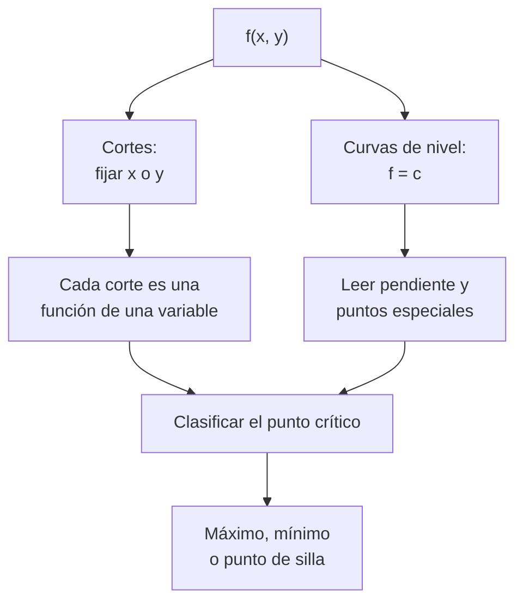

# B09-C15 — Funciones de varias variables

<!-- nav:top -->
[🏠 Programa](../../../../README.md) · [📚 Bloque B09](../../../tronco-comun/B09-calculo-diferencial-e-integral.md) · [← Anterior: B09-C14 — Series y aproximaciones](../B09-C14-series-y-aproximaciones/CLASE.md) · [Siguiente: B09-C16 — Derivadas parciales →](../B09-C16-derivadas-parciales/CLASE.md)
<!-- /nav -->

## 1. Ubicación, nivel y alcance

Decimoquinta clase del bloque B09 y primera del tramo de varias variables. Hasta aquí cada cantidad dependía de una sola variable (tiempo, distancia, altitud). La realidad espacial es de varias: el potencial depende de la posición en el plano o el espacio; la luminosidad de una estrella, de su radio **y** su temperatura. Nivel N3. Verás funciones de dos variables, dominio, cortes, curvas de nivel, el punto de silla y la idea de límite en dos variables. No verás derivadas parciales (C16) ni gradiente (C17).

## 2. Por qué esta clase existe

Una sonda que viaja de la Tierra a la Luna se mueve en un campo de potencial que depende de dos coordenadas del plano. Dónde están los puntos de equilibrio y qué forma tiene el campo alrededor de ellos se lee en un mapa de curvas de nivel. Del mismo modo, el diagrama de Hertzsprung–Russell es un mapa de curvas de nivel de radio estelar en el plano de temperatura y luminosidad.

La decisión central: **¿cómo describo, represento y exploro una cantidad que depende de dos variables, y cómo distingo un máximo, un mínimo y un punto de silla?**

## 3. Lo que podrás hacer al terminar

1. Evaluar una función de dos variables y determinar su dominio.
2. Dibujar o tabular cortes con una variable fija.
3. Describir curvas de nivel y leerlas como un mapa.
4. Distinguir máximo, mínimo y punto de silla mediante cortes.
5. Construir el potencial de dos cuerpos en un plano.
6. Decidir si el límite de una función de dos variables existe comparando trayectorias.

La evidencia es el **mapa de cortes y curvas de nivel con comprobación** del ejercicio 12 (sección 20).

## 4. Con qué llegas y cómo comprobarlo

Necesitas funciones de una variable, distancia en el plano y potencias (B04, C04). Cinco preguntas:

1. Calcula la distancia del punto `(3, 4)` al origen.
2. ¿Qué forma tiene `x² + y² = 4`?
3. Si `L = k R²`, ¿qué ocurre con `L` al duplicar `R`?
4. Si `L = k T⁴`, ¿qué ocurre al duplicar `T`?
5. ¿Cómo se llama un punto que es máximo en un sentido y mínimo en otro?

<details>
<summary>Ver respuestas</summary>

1. 5. 2. Una circunferencia de radio 2. 3. Se cuadruplica. 4. Se multiplica por 16. 5. Punto de silla.
</details>

Con cuatro o cinco aciertos, sigue; si no, repasa B04-C04 y C14.

## 5. Un caso real: dos cuerpos, un potencial

En el plano que contiene a la Tierra y la Luna, con la Tierra en el origen y la Luna en `(d, 0)`, `d = 384 400 km` (S3), el potencial gravitatorio (por unidad de masa, sin rotación ni Sol) es

`Φ(x, y) = −GM_E/r₁ − GM_L/r₂`, con `r₁ = √(x² + y²)` y `r₂ = √((x − d)² + y²)`.

Se usan `(GM)_E^N = 3,986 004 × 10⁵ km³/s²` (S2) y `GM_L = 4,90 × 10³ km³/s²` (S3). Es el modelo de dos cuerpos puntuales fijos: un **modelo educativo**, no el problema restringido de tres cuerpos. Su estructura revela un punto de silla donde las dos atracciones se compensan. Segundo ejemplo: la luminosidad de una estrella esférica de cuerpo negro, `L(R, T) = 4π R² σ T⁴`, con `σ = 5,670 374 419 × 10⁻⁸ W m⁻² K⁻⁴` (S4). Con los valores nominales solares, `R = 6,957 × 10⁸ m` y `T = 5772 K` (S2), sale `3,828 × 10²⁶ W`.

## 6. Vocabulario

Una **función de dos variables** asigna a cada par `(x, y)` de su **dominio** un número `f(x, y)` (S1, §1.5). Su **gráfica** es una superficie en tres dimensiones. Un **corte** (sección) fija una variable y deja la otra libre. Una **curva de nivel** es el conjunto de puntos donde `f` vale una constante `c`. Un **máximo (mínimo) local** es un punto cuyo valor supera (es inferior a) el de sus vecinos en todas las direcciones. Un **punto de silla** es máximo en una dirección y mínimo en otra. El **potencial gravitatorio** `Φ` es la energía potencial por unidad de masa. Un **límite en dos variables** exige que el valor sea el mismo por **cualquier** trayectoria. La **luminosidad** es la potencia total radiada.

## 7. Modelo mental: un terreno visto desde arriba

Una función de dos variables es un terreno: el valor es la altura. Un mapa topográfico dibuja las líneas de igual altura (curvas de nivel): juntas indican pendiente fuerte, separadas indican llanura. Una cumbre o un pozo son cerrados por curvas concéntricas; una silla de montar, por curvas en forma de cruz.



*Descripción textual:* una función de dos variables se estudia con cortes (funciones de una variable) y con curvas de nivel; ambos permiten clasificar puntos especiales como máximos, mínimos y sillas.

Analogía: el relieve de un paso de montaña, que sube en un sentido y baja en el otro. Su límite: la altura de un terreno real es un solo número por punto, pero la función puede dar valores con unidades físicas muy distintas; hay que fijar escalas.

## 8. La explicación, paso a paso

### 8.1 Evaluar y dominio

`f(x, y) = x² + y²` es `5` en `(1, 2)`; su dominio es todo el plano. Sus curvas de nivel `f = c` son circunferencias de radio `√c`: un mínimo en el origen. `Φ(x, y)` no está definida en `(0, 0)` ni en `(d, 0)`: allí `r₁` o `r₂` valen 0 y `Φ → −∞`.

### 8.2 Un punto de silla sencillo

`f(x, y) = x² − y²` vale 0 en el origen. A lo largo de `y = 0` es `x² ≥ 0` (mínimo); a lo largo de `x = 0`, `−y² ≤ 0` (máximo). Sus curvas de nivel son hipérbolas y la de `c = 0` son dos rectas que se cruzan.

### 8.3 Cortes del potencial Tierra–Luna

El punto de atracción igual sobre el eje está en `x* = d/(1 + √(GM_L/GM_E)) = 346 034 km` (C07), donde `Φ(x*, 0) = −1,2796 km²/s²`. Cortes a lo largo del eje `x` (con `y = 0`): `Φ(x* ± 5000) = −1,2818` y `−1,2824`, ambos **menores**: el punto es un **máximo** en esa dirección. Cortes a lo largo de `y` (con `x = x*`): `Φ(x*, 5000) = −1,2784`, `Φ(x*, 20 000) = −1,2632`, `Φ(x*, 50 000) = −1,2178`: todos **mayores**: es un **mínimo** en la dirección perpendicular. Una sonda que pasa por ahí «cae» fuera del eje por los lados: **punto de silla**.

### 8.4 Campo lejano

Lejos de ambos cuerpos, `Φ ≈ −(GM_E + GM_L)/r`: a `10⁸ km`, el valor calculado es `−4,0352 × 10⁻³ km²/s²` frente a `−4,0350 × 10⁻³`. El sistema se ve como una sola masa.

### 8.5 Dos variables que importan: `R` y `T`

`L(R, T) = 4π R² σ T⁴`. Con `T` fijo, es una parábola en `R` (duplicar `R` cuadruplica `L`); con `R` fijo, crece como `T⁴` (duplicar `T` multiplica por 16). Con los nominales solares, `L = 3,827 99 × 10²⁶ W`, a `−2,4 × 10⁻⁶` de `L_☉^N = 3,828 × 10²⁶ W` (S2): coherencia entre dos cifras publicadas.

### 8.6 Curvas de nivel de luminosidad

`L = L_☉` define `R = √(L/(4πσ)) / T²`. Sobre esa curva: `T = 2886 K` → `R = 4,000 R_☉`; `5772 K` → `1,000 R_☉`; `11 544 K` → `0,2500 R_☉`; `23 088 K` → `0,0625 R_☉`. Duplicar `T` divide `R` por 4. En un diagrama de Hertzsprung–Russell esas curvas son rectas en escala logarítmica.

### 8.7 Límites en dos variables

`f(x, y) = xy/(x² + y²)` en el origen: por `y = 0` vale 0; por `y = x` vale `1/2`. Dos trayectorias, dos valores: **no hay límite**. Para que exista, todas las trayectorias deben coincidir; una sola discordante basta para refutarlo.

## 9. Magnitudes, símbolos y unidades

| Símbolo | Qué es | Unidad | Nota |
|---|---|---|---|
| `Φ(x, y)` | potencial por unidad de masa | km²/s² | `−GM_E/r₁ − GM_L/r₂` |
| `x`, `y` | coordenadas en el plano | km | Tierra en el origen |
| `d` | distancia Tierra–Luna | km | 384 400 (S3) |
| `GM_E`, `GM_L` | parámetros gravitacionales | km³/s² | 3,986 004 × 10⁵ (S2); 4,90 × 10³ (S3) |
| `L(R, T)` | luminosidad de cuerpo negro | W | `4π R² σ T⁴` |
| `R`, `T` | radio y temperatura efectiva | m, K | nominales solares (S2) |
| `σ` | constante de Stefan–Boltzmann | W m⁻² K⁻⁴ | 5,670 374 419 × 10⁻⁸ (S4) |

## 10. Convenciones y referencias

El potencial es negativo y tiende a 0 en el infinito. El plano de `Φ` es inercial y no rota con la Luna (se ignora la fuerza centrífuga). La luminosidad supone cuerpo negro: es una definición de temperatura efectiva, no una medida de la estrella real. Los valores solares son **nominales** (conversión), por lo que la comparación con `L_☉^N` es una coherencia de constantes, no una validación física.

## 11. De dónde sale lo que afirmamos

| ID | Fuente | Localizador | Respalda | Estado |
|---|---|---|---|---|
| S1 | NIST, *Digital Library of Mathematical Functions* §1.5, versión 1.2.8 | https://dlmf.nist.gov/1.5 | Cálculo de dos o más variables (§1.5) como marco | Consultada el 2026-11-05 mediante extracción automática |
| S2 | IAU, Resolución B3 de 2015, arXiv:1510.07674 | https://arxiv.org/pdf/1510.07674 | `(GM)_E^N`, `R_☉^N = 6,957 × 10⁸ m`, `T_eff^N = 5772 K`, `L_☉^N = 3,828 × 10²⁶ W` | Texto extraído del PDF el 2026-11-05 |
| S3 | NASA/NSSDC, *Moon Fact Sheet* (actualizada 2024-01-11) | https://nssdc.gsfc.nasa.gov/planetary/factsheet/moonfact.html | `GM_L = 0,004 90 × 10⁶ km³/s²`; distancia 384 400 km | Consultada el 2026-11-05 mediante extracción automática |
| S4 | NIST, CODATA 2022, constante `σ` | https://physics.nist.gov/cgi-bin/cuu/Value?sigma | `σ = 5,670 374 419… × 10⁻⁸ W m⁻² K⁻⁴`, exacta | Consultada el 2026-11-05 |

Límites: S1 se cita solo como marco general de la sección; las clasificaciones por cortes y los límites por trayectorias se explican y comprueban aquí. El modelo de dos cuerpos fijos no es la dinámica real del sistema Tierra–Luna.

## 12. Cómo ver el terreno

Equivalente accesible a un mapa de curvas de nivel (cortes del laboratorio):

| Corte | Posición | `Φ` (km²/s²) | Relación con `Φ(x*, 0) = −1,2796` |
|---|---|---|---|
| Eje x | `x* − 5000` | −1,2818 | menor |
| Eje x | `x* + 5000` | −1,2824 | menor |
| Eje y | `y = 5000` | −1,2784 | mayor |
| Eje y | `y = 50 000` | −1,2178 | mayor |

Descripción larga: en torno al punto de silla, el potencial desciende hacia la Tierra y la Luna (a lo largo del eje) y asciende hacia los lados; las curvas de nivel forman una cruz con ramas hacia ambos cuerpos.

## 13. Ejemplo trabajado: clasificar el punto de atracción igual

**Paso 1 · Planteo.** Dos cuerpos fijos, `Φ(x, y) = −GM_E/r₁ − GM_L/r₂`.

**Paso 2 · Punto candidato.** En el eje, `x* = 346 034 km` (C07). `Φ(x*, 0) = −3,986 × 10⁵/346 034 − 4,90 × 10³/38 366 = −1,1519 − 0,1277 = −1,2796 km²/s²`.

**Paso 3 · Corte a lo largo de `x`.** A `±5000 km`: `−1,2818` y `−1,2824`, ambos menores. Máximo en esa dirección.

**Paso 4 · Corte a lo largo de `y`.** A `5000, 20 000, 50 000 km`: `−1,2784; −1,2632; −1,2178`, todos mayores. Mínimo en esa dirección.

**Paso 5 · Conclusión y comprobación.** Máximo en una dirección y mínimo en otra: punto de silla. La simetría `y → −y` se verifica numéricamente. Es un resultado del modelo de dos cuerpos fijos; en el sistema real, el movimiento orbital cambia la estructura (puntos de Lagrange, que no se tratan aquí).

## 14. Distintas formas de explorar una función de dos variables

Los **cortes** reducen el problema a una variable. Las **curvas de nivel** dan una visión global en el plano. La **gráfica 3D** da intuición pero oculta valores. La **tabla de valores** es la versión accesible de la gráfica. Las **derivadas parciales** (C16) y el **gradiente** (C17) darán una clasificación formal. Es conveniente usar al menos dos de estas vistas, porque cada una oculta algo.

## 15. Práctica guiada

**Ejercicio 1 · con los pasos indicados.** Evalúa `f(x, y) = x² + y²` en `(1, 2)` y describe sus curvas de nivel. *Pasos:* sustituye; iguala a `c`.

<details><summary>Solución comentada</summary>

`f(1, 2) = 5`. `x² + y² = c` son circunferencias de radio `√c`; mínimo en el origen (8.1).
</details>

**Ejercicio 2 · con una pista.** Clasifica el origen para `f = x² − y²` con cortes. *Pista:* corte `y = 0` y corte `x = 0`.

<details><summary>Solución comentada</summary>

`y = 0`: `x²` (mínimo en 0). `x = 0`: `−y²` (máximo en 0). Punto de silla (8.2).
</details>

**Ejercicio 3 · casi autónomo.** Calcula `L(R, T)` para `R = 2R_☉`, `T = 5772 K`, y para `R = R_☉`, `T = 2886 K`.

<details><summary>Solución comentada</summary>

Primera: `4 L_☉ = 1,531 × 10²⁷ W`. Segunda: `(1/2)⁴ L_☉ = L_☉/16 = 2,39 × 10²⁵ W` (8.5).
</details>

## 16. Práctica autónoma, transferencia e integrador

**Ejercicio 4.** ¿Qué radio tiene una estrella con `L = L_☉` y `T = 11 544 K`?

<details><summary>Solución comentada</summary>

`R = R_☉ (T_☉/T)² = 6,957 × 10⁸ · (1/2)² = 1,739 × 10⁸ m` (8.6).
</details>

**Ejercicio 5.** Con `T` fija, ¿cómo cambia `L` si el radio sube un 10 %?

<details><summary>Solución comentada</summary>

`(1,10)² = 1,21`: sube 21 %.
</details>

**Ejercicio 6.** Calcula `Φ(x*, 0)` con `x* = 346 034 km`.

<details><summary>Solución comentada</summary>

`−3,986 004 × 10⁵/346 034 − 4,90 × 10³/38 366 = −1,1519 − 0,1277 = −1,2796 km²/s²` (13, paso 2).
</details>

**Ejercicio 7.** ¿Dónde no está definida `Φ(x, y)` y cuánto vale su límite al acercarse a la Tierra?

<details><summary>Solución comentada</summary>

En `(0, 0)` y `(d, 0)`. Al acercarse a la Tierra, `r₁ → 0` y `Φ → −∞` (8.1).
</details>

**Ejercicio 8.** Muestra que `f = xy/(x² + y²)` no tiene límite en el origen.

<details><summary>Solución comentada</summary>

Por `y = 0`: `0`. Por `y = x`: `x²/(2x²) = 1/2`. Valores distintos: no existe el límite (8.7).
</details>

**Ejercicio 9 · transferencia.** Una estrella **sintética** tiene `T = 11 544 K` y `L = 100 L_☉`. ¿Qué radio tiene en radios solares?

<details><summary>Solución comentada</summary>

`R/R_☉ = √(L/L_☉) (T_☉/T)² = 10 · 0,25 = 2,5`. Es el tamaño de una estrella caliente y luminosa de ejemplo (cuerpo negro).
</details>

**Ejercicio 10 · transferencia.** Un compañero afirma que cerca del punto de atracción igual «solo cuenta la Tierra». Evalúa con `Φ`.

<details><summary>Solución comentada</summary>

El término terrestre solo vale `−1,1519` y el total `−1,2796`: la Luna aporta el 10 % del potencial en ese punto. Ignorarla elimina el punto de silla y el cambio de dominio.
</details>

**Ejercicio 11 · transferencia.** En un mapa de curvas de nivel de una función, dos curvas de niveles distintos parecen cruzarse. ¿Es posible?

<details><summary>Solución comentada</summary>

No: en un punto la función tiene un solo valor. Solo la curva de **un mismo** nivel puede cruzarse consigo misma, y ocurre en un punto de silla (como `x² − y² = 0`).
</details>

**Ejercicio 12 · integrador.** Elabora tu *mapa de cortes y curvas de nivel con comprobación*: tabula `Φ` a lo largo de los dos ejes por el punto de atracción igual (cinco puntos por eje), clasifícalo, verifica la simetría `y → −y` y añade 4 puntos de la curva de nivel `L = L_☉`.

<details><summary>Solución modelo</summary>

Tablas de cortes como la de la sección 12 con la clasificación «punto de silla»; simetría verificada con diferencia < 10⁻¹²; la curva de nivel con `R = 4; 1; 0,25; 0,0625 R_☉`; se declara el modelo de dos cuerpos fijos y el cuerpo negro.
</details>

## 17. Laboratorio: potencial y luminosidad

El script [potencial_y_luminosidad.py](potencial_y_luminosidad.py) evalúa `Φ(x, y)` en cortes por el punto de atracción igual, prueba el máximo en un eje y el mínimo en el otro, comprueba la simetría y el campo lejano, y evalúa `L(R, T)` con su curva de nivel.

**Datos:** nominales de la IAU, `σ` de NIST, datos lunares de la NASA. **Predice antes de ejecutar:** ¿qué signo tendrá el corte a lo largo de `y`? (sube.) **Ejecución del 2026-11-05 (Python 3.12.9):**

```text
Punto de atracción igual sobre el eje: x* = 346033.9 km;  Phi(x*, 0) = -1.2796
    x*   -5000 km: Phi = -1.2818  (< Phi(x*,0))
    y =   5000 km: Phi = -1.2784
  -> máximo en un corte y mínimo en el otro: PUNTO DE SILLA
L(R_sol^N, T_sol^N) = 3.82799e+26 W;  L_sol^N = 3.828e+26 W;  dif. relativa = -2.38e-06
    T =    11544 K -> R = 1.7393e+08 m = 0.2500 R_sol
Pruebas superadas.
```

```bash
python programa/clases/B09/B09-C15-funciones-de-varias-variables/potencial_y_luminosidad.py
```

**Límites:** dos cuerpos puntuales fijos; cuerpo negro; no es el problema restringido de tres cuerpos ni un modelo estelar.

## 18. Errores frecuentes y cómo corregirlos

**Confundir un punto de silla con un máximo o un mínimo.** Se corrige con el ejercicio 2.

**Concluir un límite con una sola trayectoria.** Se corrige con el ejercicio 8.

**Ignorar el segundo cuerpo.** Se corrige con el ejercicio 10.

**Mezclar unidades (km y m) en `GM`.** Se corrige con la tabla de la sección 9.

**Creer que dos curvas de nivel distintas se cruzan.** Se corrige con el ejercicio 11.

## 19. Cómo sabrás que vas bien

Tras 8.2: ¿clasificas `x² − y²` en el origen? Si no, ejercicio 2. Tras 8.3: ¿explicas por qué el punto es de silla? Si no, ejercicio 6. Tras 8.6: ¿lees `R` sobre una curva de nivel? Si no, ejercicio 4. Tras el laboratorio: ¿qué dos cortes demuestran la silla?

## 20. Qué entregas y cómo se evalúa

El producto es tu **mapa de cortes y curvas de nivel con comprobación** (ejercicio 12).

| Criterio | Inicial | En desarrollo | Logrado | Destacado |
|---|---|---|---|---|
| Evaluación y dominio | Errores | Sin dominio | Con dominio | Analiza singularidades |
| Cortes | Uno solo | Dos sin conclusión | Dos con clasificación | Con verificación numérica |
| Curvas de nivel | No las usa | Dibuja sin leer | Las lee | Las deduce analíticamente |
| Comprobación | Ausente | Mental | Simetría y límites | Dos modelos comparados |
| Fuentes y modelo | Sin fuente | Sin fecha | Con localizador y fecha | Declara el modelo y sus límites |

**Condiciones críticas (no se compensan con promedio):** declarar el modelo (dos cuerpos fijos, cuerpo negro); clasificar con cortes en ambos ejes; citar solo fuentes consultadas.

## 21. Ética, seguridad y límites

Un mapa de potencial simplificado no sirve para planificar trayectorias reales: se necesitan modelos de múltiples cuerpos y efemérides. Los puntos de equilibrio de este modelo no son los puntos de Lagrange. Accesibilidad: tablas equivalentes a los mapas, fórmulas en texto, ejercicios sin conexión.

## 22. Para cerrar y seguir

Una función de varias variables se explora con cortes y curvas de nivel; un punto de silla es máximo en una dirección y mínimo en otra; un límite exige coincidir por todas las trayectorias. Queda abierta una pregunta: ¿con qué rapidez cambia la función al moverse **en una dirección concreta**? Son las derivadas parciales.

**Glosario español–inglés.** función de varias variables · *multivariable function*; curva de nivel · *level curve (contour)*; corte · *cross-section (slice)*; punto de silla · *saddle point*; dominio · *domain*; potencial gravitatorio · *gravitational potential*; luminosidad · *luminosity*; temperatura efectiva · *effective temperature*.

**Continuidad.** B09-C16 reutiliza tu capacidad de **trabajar con un corte (una variable fija)** para definir las derivadas parciales.

**Referencias:** ver sección 11.

<!-- nav:bottom -->
---

[← Anterior: B09-C14 — Series y aproximaciones](../B09-C14-series-y-aproximaciones/CLASE.md) · [📚 Bloque B09](../../../tronco-comun/B09-calculo-diferencial-e-integral.md) · [Siguiente: B09-C16 — Derivadas parciales →](../B09-C16-derivadas-parciales/CLASE.md)
<!-- /nav -->
