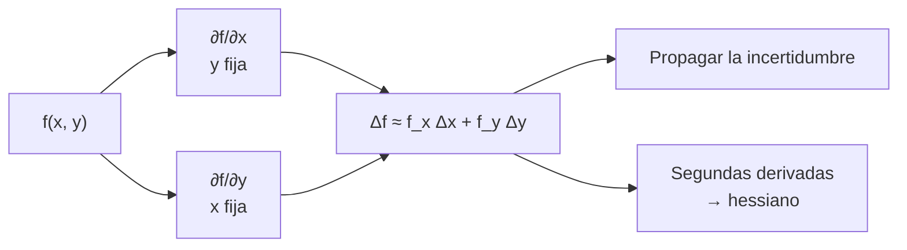

# B09-C16 — Derivadas parciales

<!-- nav:top -->
[🏠 Programa](../../../../README.md) · [📚 Bloque B09](../../../tronco-comun/B09-calculo-diferencial-e-integral.md) · [← Anterior: B09-C15 — Funciones de varias variables](../B09-C15-funciones-de-varias-variables/CLASE.md) · [Siguiente: B09-C17 — Gradiente y derivada direccional →](../B09-C17-gradiente-y-derivada-direccional/CLASE.md)
<!-- /nav -->

## 1. Ubicación, nivel y alcance

Decimosexta clase del bloque B09. En [C15](../B09-C15-funciones-de-varias-variables/CLASE.md) exploraste funciones de dos variables con cortes. Cada corte es una función de una variable, y su derivada es una **derivada parcial**. Nivel N3. Verás la definición, el cálculo, las derivadas de segundo orden y mixtas, la propagación de incertidumbre en la luminosidad de una estrella, y la clasificación de un punto crítico con el hessiano. No verás el gradiente ni la derivada direccional (C17) ni integrales múltiples (C18).

## 2. Por qué esta clase existe

La luminosidad de una estrella calculada con su radio y su temperatura tiene una incertidumbre que viene de las dos. ¿Cuál pesa más? ¿Vale la pena medir mejor el radio o la temperatura? La respuesta está en cuánto cambia `L` cuando cambia una variable manteniendo la otra fija: derivadas parciales. También sirven para decidir si un punto de un campo es máximo, mínimo o silla.

La decisión central: **¿cómo cuantifico la sensibilidad de una cantidad a cada una de sus variables, cómo propago incertidumbres y cómo clasifico un punto crítico en dos variables?**

## 3. Lo que podrás hacer al terminar

1. Calcular derivadas parciales de primer y segundo orden.
2. Interpretar una derivada parcial con sus unidades.
3. Comprobar la igualdad de las derivadas mixtas.
4. Propagar incertidumbres independientes en `L(R, T)` y compararlo con una simulación.
5. Calcular el hessiano y clasificar un punto crítico con el discriminante.
6. Reconocer los límites de la aproximación lineal.

La evidencia es la **tabla de sensibilidades con propagación de incertidumbre** del ejercicio 12 (sección 20).

## 4. Con qué llegas y cómo comprobarlo

Necesitas derivar con reglas (C04) y funciones de dos variables (C15). Cinco preguntas:

1. Deriva `x² y` respecto a `x`, tratando `y` como constante.
2. Deriva `T⁴` respecto a `T`.
3. Si `L = k R²`, ¿cuánto vale `dL/dR`?
4. ¿Qué es un error relativo?
5. ¿Qué es un punto de silla?

<details>
<summary>Ver respuestas</summary>

1. `2xy`. 2. `4T³`. 3. `2kR`. 4. Error absoluto entre valor. 5. Máximo en una dirección y mínimo en otra.
</details>

Con cuatro o cinco aciertos, sigue; si no, repasa C04 y C15.

## 5. Un caso real: ¿qué pesa más en la luminosidad?

La luminosidad de una estrella esférica que radia como cuerpo negro es `L(R, T) = 4π R² σ T⁴` (C15), con `σ = 5,670 374 419 × 10⁻⁸ W m⁻² K⁻⁴` (S3). Con los valores nominales solares de la IAU, `R = 6,957 × 10⁸ m` y `T = 5772 K` (S2), `L = 3,828 × 10²⁶ W`. Si el radio se conoce con 1 % y la temperatura con 0,5 % (**incertidumbres sintéticas** de ejemplo), ¿qué incertidumbre hereda `L`? Y para el campo gravitatorio Tierra–Luna de C15 (parámetros lunares de S4), ¿cómo se confirma analíticamente el punto de silla?

## 6. Vocabulario

La **derivada parcial** de `f(x, y)` respecto a `x` es `∂f/∂x = lim_{h→0} [f(x + h, y) − f(x, y)]/h`, con `y` constante (S1, §1.5(i), ecs. 1.5.3–1.5.4). Las **derivadas de segundo orden** son `f_xx`, `f_yy` y las **mixtas** `f_xy = ∂²f/∂y∂x`. El **teorema de las derivadas mixtas** dice que `f_xy = f_yx` si son continuas (ec. 1.5.6). El **hessiano** es la matriz de segundas derivadas; su **discriminante** es `D = f_xx f_yy − f_xy²`. La **propagación de incertidumbre** estima la incertidumbre de una función a partir de las de sus variables. Una **variable independiente** es la que no está correlacionada con otra. La **simulación Monte Carlo** muestrea valores al azar con las incertidumbres dadas. El **laplaciano** `∇²Φ = Φ_xx + Φ_yy + Φ_zz` mide la curvatura total del campo.

## 7. Modelo mental: mover una perilla a la vez

Cada variable es una perilla. Una derivada parcial mide cuánto cambia la salida al girar **solo una** perilla, con las demás quietas. Con dos perillas pequeñas movidas a la vez, los cambios se suman (aproximación lineal): `ΔL ≈ L_R ΔR + L_T ΔT`.



*Descripción textual:* se calculan las dos derivadas parciales, se combinan en el cambio total aproximado, que sirve para propagar incertidumbres; las segundas derivadas forman el hessiano que clasifica puntos críticos.

Analogía: sintonizar una radio con dos diales. Su límite: si los diales interactúan (términos mixtos grandes), el efecto de uno depende de dónde está el otro.

## 8. La explicación, paso a paso

### 8.1 Calcular

Para `f = x² y + 3y`: `f_x = 2xy` y `f_y = x² + 3`. En `(2, 1)`: `4` y `7`. Cada derivada parcial es una derivada ordinaria con la otra variable como constante.

### 8.2 Las parciales de la luminosidad

`∂L/∂R = 8π R σ T⁴ = 2L/R = 1,1005 × 10¹⁸ W/m`; `∂L/∂T = 16π R² σ T³ = 4L/T = 2,6528 × 10²³ W/K`. Sus unidades son potencia sobre la unidad de la variable. En términos relativos: `ΔL/L ≈ 2 ΔR/R + 4 ΔT/T`. Un 1 K de aumento (`0,0173 %`) sube `L` en `0,0693 %`.

### 8.3 Derivadas mixtas

`L_RT = ∂²L/∂R∂T = 32π R σ T³ = 8L/(RT)` y `L_TR` es la misma. El laboratorio da `7,626 28 × 10¹⁴` numérico frente a `7,626 277 × 10¹⁴` analítico. Para `f = x² y³`: `f_xy = 6xy²` en cualquier orden.

### 8.4 Propagación de incertidumbre

Con errores independientes pequeños, `σ_L/L = √[(2 σ_R/R)² + (4 σ_T/T)²]`. Con `σ_R/R = 1 %` y `σ_T/T = 0,5 %`: `√(0,02² + 0,02²) = 2,83 %`. Cada variable aporta la mitad de la varianza: la temperatura pesa lo mismo que el radio a pesar de ser la mitad de incierta, por el exponente 4.

### 8.5 Comprobación Monte Carlo

Se simulan 200 000 pares `(R, T)` con distribución normal (semilla 7). La desviación relativa de `L` es `2,8288 %` frente a `2,8284 %` de la propagación lineal; la media simulada es `1,00034`, apenas sesgada. Estos son datos **simulados**.

### 8.6 Cuando la linealidad falla

Para cambios grandes, la aproximación lineal subestima. Si `T` pasa de `5772` a `6772 K` (+1000 K), el cálculo lineal da `+0,693 L_☉` pero el cambio exacto es `(6772/5772)⁴ − 1 = +0,895 L_☉`: se subestima 23 %. Es la serie de C14 en dos variables: el término de segundo orden crece con el cambio.

### 8.7 Clasificar un punto crítico: el hessiano

En un punto crítico, `f_xx f_yy − f_xy² > 0` con `f_xx > 0` es mínimo; con `f_xx < 0`, máximo; `< 0` es silla. Para el potencial Tierra–Luna en `x*` (`y = 0`): `Φ_xx = −2GM_E/x³ − 2GM_L/(d − x)³ = −1,928 × 10⁻¹⁰ s⁻²`, `Φ_yy = +GM_E/x³ + GM_L/(d − x)³ = +9,639 × 10⁻¹¹ s⁻²`, `Φ_xy = 0` (por simetría). El discriminante vale `−1,86 × 10⁻²⁰ s⁻⁴ < 0`: **silla**, confirmando los cortes de C15. Además `Φ_xx + 2Φ_yy = 0` (la tercera dirección, perpendicular al plano, es igual a `y`): se cumple la ecuación de Laplace en el vacío.

## 9. Magnitudes, símbolos y unidades

| Símbolo | Qué es | Unidad | Nota |
|---|---|---|---|
| `L(R, T)` | luminosidad | W | `4π R² σ T⁴` |
| `∂L/∂R` | sensibilidad a `R` | W/m | `2L/R` |
| `∂L/∂T` | sensibilidad a `T` | W/K | `4L/T` |
| `σ_R/R`, `σ_T/T` | incertidumbres relativas | adimensional | 1 % y 0,5 % (sintéticas) |
| `Φ_xx`, `Φ_yy`, `Φ_xy` | segundas derivadas del potencial | s⁻² | en `x*` |
| `D` | discriminante del hessiano | s⁻⁴ | `< 0` en una silla |
| `σ` | constante de Stefan–Boltzmann | W m⁻² K⁻⁴ | exacta (S3) |

## 10. Convenciones y referencias

Las incertidumbres se combinan en cuadratura solo si son independientes y pequeñas; si están correlacionadas, hay que añadir el término de covarianza. Los valores solares son nominales (conversión): la `L` calculada es coherente con las constantes, no es una medición. `σ_R` y `σ_T` son relativas. El potencial se evalúa en km²/s² y sus segundas derivadas en s⁻² (km²/s² ÷ km²).

## 11. De dónde sale lo que afirmamos

| ID | Fuente | Localizador | Respalda | Estado |
|---|---|---|---|---|
| S1 | NIST, *Digital Library of Mathematical Functions* §1.5, versión 1.2.8 | https://dlmf.nist.gov/1.5 | Derivadas parciales (ecs. 1.5.3–1.5.4), mixtas (1.5.5) e igualdad de mixtas (1.5.6) | Consultada el 2026-11-05 mediante extracción automática |
| S2 | IAU, Resolución B3 de 2015, arXiv:1510.07674 | https://arxiv.org/pdf/1510.07674 | `R_☉^N`, `T_eff^N`, `L_☉^N`, `(GM)_E^N` | Texto extraído del PDF el 2026-11-05 |
| S3 | NIST, CODATA 2022, constante `σ` | https://physics.nist.gov/cgi-bin/cuu/Value?sigma | `σ = 5,670 374 419… × 10⁻⁸ W m⁻² K⁻⁴`, exacta | Consultada el 2026-11-05 |
| S4 | NASA/NSSDC, *Moon Fact Sheet* (actualizada 2024-01-11) | https://nssdc.gsfc.nasa.gov/planetary/factsheet/moonfact.html | `GM_L` y distancia Tierra–Luna | Consultada el 2026-11-05 mediante extracción automática |

Límites: la fórmula de propagación en cuadratura y la prueba del discriminante son resultados estándar que aquí se **comprueban** (Monte Carlo y cortes) y no se citan de S1. Incertidumbres y muestras son **sintéticas y simuladas**.

## 12. Cómo ver las sensibilidades

Equivalente accesible a una gráfica de contribuciones (laboratorio):

| Cantidad | Valor | Unidad |
|---|---|---|
| `∂L/∂R` | `1,1005 × 10¹⁸` | W/m |
| `∂L/∂T` | `2,6528 × 10²³` | W/K |
| `σ_L/L` (lineal) | `2,828 %` | — |
| `σ_L/L` (Monte Carlo, simulado) | `2,829 %` | — |
| Aporte de `R` / `T` a la varianza | `50 % / 50 %` | — |

Descripción larga: dos barras de igual altura (la mitad cada una) para la contribución a la varianza de `L`; una segunda gráfica compara la propagación lineal y la simulación, que se superponen.

## 13. Ejemplo trabajado: incertidumbre de `L`

**Paso 1 · Datos.** `R = 6,957 × 10⁸ m` (1 %), `T = 5772 K` (0,5 %); `L = 3,828 × 10²⁶ W`.

**Paso 2 · Parciales.** `∂L/∂R = 2L/R = 1,1005 × 10¹⁸ W/m`; `∂L/∂T = 4L/T = 2,6528 × 10²³ W/K`.

**Paso 3 · Aportes absolutos.** `σ_R = 6,957 × 10⁶ m` → `7,66 × 10²⁴ W`; `σ_T = 28,86 K` → `7,66 × 10²⁴ W`. Mismos aportes.

**Paso 4 · Cuadratura.** `σ_L = √(2 · (7,66 × 10²⁴)²) = 1,083 × 10²⁵ W`, es decir `2,83 %` de `L`.

**Paso 5 · Comprobación y sentido.** La simulación da `2,829 %`. La incertidumbre queda dominada por partes iguales; mejorar solo el radio de 1 % a 0,5 % bajaría el total a `√(0,01² + 0,02²) = 2,24 %`. Datos sintéticos.

## 14. Distintas formas de propagar incertidumbre

La **diferencial total** da un cálculo rápido con parciales. La **cuadratura** (independientes) es la regla habitual. La **simulación Monte Carlo** maneja no linealidades y correlaciones sin derivar. El **cálculo simbólico** de la matriz de covarianza es estándar en ajustes (B12). Las dos primeras coinciden para incertidumbres pequeñas; la tercera las verifica.

## 15. Práctica guiada

**Ejercicio 1 · con los pasos indicados.** Calcula `f_x` y `f_y` de `f = x² y + 3y` en `(2, 1)`. *Pasos:* deriva respecto a una variable, la otra constante.

<details><summary>Solución comentada</summary>

`f_x = 2xy = 4`; `f_y = x² + 3 = 7` (8.1).
</details>

**Ejercicio 2 · con una pista.** Calcula `∂L/∂R` y `∂L/∂T` para los nominales solares. *Pista:* `2L/R` y `4L/T`.

<details><summary>Solución comentada</summary>

`2 · 3,828 × 10²⁶/6,957 × 10⁸ = 1,1005 × 10¹⁸ W/m`; `4 · 3,828 × 10²⁶/5772 = 2,6528 × 10²³ W/K` (8.2).
</details>

**Ejercicio 3 · casi autónomo.** ¿En qué porcentaje cambia `L` si `T` sube 1 K?

<details><summary>Solución comentada</summary>

`4 ΔT/T = 4/5772 = 6,93 × 10⁻⁴`: `+0,0693 %`.
</details>

## 16. Práctica autónoma, transferencia e integrador

**Ejercicio 4.** Comprueba que `f_xy = f_yx` para `f = x² y³`.

<details><summary>Solución comentada</summary>

`f_x = 2xy³` → `f_xy = 6xy²`; `f_y = 3x² y²` → `f_yx = 6xy²` ✓ (8.3).
</details>

**Ejercicio 5.** Calcula `σ_L/L` con `σ_R/R = 1 %` y `σ_T/T = 0,5 %`.

<details><summary>Solución comentada</summary>

`√((2 %)² + (2 %)²) = 2,83 %` (8.4).
</details>

**Ejercicio 6.** Con `σ_R/R = 0,5 %` y `σ_T/T = 1 %`, ¿qué variable domina y cuánto?

<details><summary>Solución comentada</summary>

`√((1 %)² + (4 %)²) = 4,12 %`; la temperatura aporta `16/17 = 94 %` de la varianza.
</details>

**Ejercicio 7.** Calcula `∂Φ/∂x` para `Φ = −GM/√(x² + y² + z²)` en `(R, 0, 0)` y compáralo con `g`.

<details><summary>Solución comentada</summary>

`∂Φ/∂x = GM x/r³`; en `(R, 0, 0)`: `GM/R² = g = 9,7984 m/s²` (nominales). La aceleración es `−∂Φ/∂x` (apunta al centro).
</details>

**Ejercicio 8.** Clasifica el origen para `x² + y²` y para `x² − y²` con el hessiano.

<details><summary>Solución comentada</summary>

Primera: `f_xx = 2`, `f_yy = 2`, `D = 4 > 0` con `f_xx > 0`: mínimo. Segunda: `f_xx = 2`, `f_yy = −2`, `D = −4 < 0`: silla.
</details>

**Ejercicio 9 · transferencia.** Un radio estelar se mide con 2 % y la temperatura con 1 % (**sintéticas**). ¿Qué incertidumbre tiene `L` y cuál variable domina?

<details><summary>Solución comentada</summary>

`√((2 · 2 %)² + (4 · 1 %)²) = √(16 + 16) % = 5,66 %`. Aportes iguales (50 % cada uno).
</details>

**Ejercicio 10 · transferencia.** Si los errores de `R` y `T` estuvieran perfectamente correlacionados con el mismo signo (1 % y 0,5 %), ¿cuánto sería `σ_L/L`? ¿Por qué difiere de 2,83 %?

<details><summary>Solución comentada</summary>

Suma lineal: `2 · 1 % + 4 · 0,5 % = 4 %`. La cuadratura supone independencia; con correlación positiva los errores se suman en vez de compensarse a veces.
</details>

**Ejercicio 11 · transferencia.** Un compañero usa `∂L/∂T` para decir que subir 1000 K aumenta `L` en `2,65 × 10²⁶ W`. Evalúa.

<details><summary>Solución comentada</summary>

La estimación lineal es `+0,693 L_☉ = 2,65 × 10²⁶ W`; el cambio exacto es `+0,895 L_☉ = 3,43 × 10²⁶ W`: subestima 23 %. La derivada vale para cambios pequeños (8.6).
</details>

**Ejercicio 12 · integrador.** Elabora tu *tabla de sensibilidades con propagación de incertidumbre*: parciales de `L`, derivada mixta, propagación lineal y Monte Carlo para dos pares de incertidumbres (sintéticas), y el hessiano del potencial Tierra–Luna en `x*`.

<details><summary>Solución modelo</summary>

Tabla como la de la sección 12 con dos filas de incertidumbre; comparación lineal/MC en 2 % de acuerdo; hessiano `Φ_xx = −1,928 × 10⁻¹⁰`, `Φ_yy = 9,639 × 10⁻¹¹`, `D < 0`, silla; se rotulan las incertidumbres como sintéticas y las muestras como simuladas.
</details>

## 17. Laboratorio: sensibilidad y silla

El script [sensibilidad_y_silla.py](sensibilidad_y_silla.py) compara parciales analíticas y numéricas de `L`, verifica la igualdad de derivadas mixtas, propaga incertidumbres por la regla lineal y por Monte Carlo, y calcula y clasifica el hessiano del potencial Tierra–Luna.

**Datos:** nominales de la IAU, `σ` de NIST, datos lunares de la NASA, incertidumbres sintéticas y muestras simuladas. **Predice antes de ejecutar:** ¿qué incertidumbre dará la propagación? (2,83 %.) **Ejecución del 2026-11-05 (Python 3.12.9):**

```text
dL/dR : analítica 2L/R = 1.100472e+18 W/m ; numérica 1.100472e+18
dL/dT : analítica 4L/T = 2.652800e+23 W/K ; numérica 2.652800e+23
  propagación lineal: 2.8284%;  Monte Carlo (simulado): 2.8288%;  media MC = 1.00034
  Phi_xx = -1.9277e-10 (numérica -1.9277e-10);  Phi_yy = 9.6387e-11 (numérica 9.6387e-11);  Phi_xy ≈ 0.0e+00
  discriminante Phi_xx*Phi_yy - Phi_xy^2 = -1.858e-20 < 0 -> punto de silla
  Phi_xx + 2 Phi_yy = 0.000e+00 (Laplace en 3D)
Pruebas superadas.
```

```bash
python programa/clases/B09/B09-C16-derivadas-parciales/sensibilidad_y_silla.py
```

**Límites:** errores independientes y gaussianos; cuerpo negro; dos cuerpos fijos; no es un análisis de incertidumbre de una estrella real.

## 18. Errores frecuentes y cómo corregirlos

**Derivar tratando la otra variable como si dependiera de la primera.** Se corrige con el ejercicio 1.

**Sumar incertidumbres en lugar de combinarlas en cuadratura.** Se corrige con los ejercicios 5 y 10.

**Olvidar el exponente al ponderar la contribución.** Se corrige con el ejercicio 6.

**Extrapolar la aproximación lineal.** Se corrige con el ejercicio 11.

**Clasificar un punto crítico solo con `f_xx`.** Se corrige con el ejercicio 8.

## 19. Cómo sabrás que vas bien

Tras 8.1: ¿calculas `f_x` y `f_y`? Si no, ejercicio 1. Tras 8.4: ¿propagas `σ_L/L`? Si no, ejercicio 5. Tras 8.7: ¿clasificas con el hessiano? Si no, ejercicio 8. Tras el laboratorio: ¿qué verifica la propagación lineal? (la simulación Monte Carlo).

## 20. Qué entregas y cómo se evalúa

El producto es tu **tabla de sensibilidades con propagación de incertidumbre** (ejercicio 12).

| Criterio | Inicial | En desarrollo | Logrado | Destacado |
|---|---|---|---|---|
| Derivadas parciales | Errores | Con ayuda | Correctas con unidades | Verifica numéricamente |
| Propagación | Suma simple | Cuadratura sin justificar | Cuadratura justificada | Compara con Monte Carlo |
| Hessiano | Ausente | Calcula sin clasificar | Clasifica | Conecta con los cortes |
| Linealidad | Ignorada | Mencionada | Cuantifica el error | Propone corrección |
| Fuentes y rótulos | Sin fuente | Sin fecha | Con localizador y fecha | Rotula sintético y simulado |

**Condiciones críticas (no se compensan con promedio):** declarar independencia de errores; rotular sintético y simulado; citar solo fuentes consultadas.

## 21. Ética, seguridad y límites

Una incertidumbre mal propagada puede dar falsa confianza o hacer descartar un resultado válido. No presentes incertidumbres sintéticas como reales. Esta clase no sustituye un análisis estadístico completo (B12). Accesibilidad: tablas equivalentes a las gráficas, fórmulas en texto, ejercicios sin conexión.

## 22. Para cerrar y seguir

La derivada parcial mide la sensibilidad a una variable con las demás fijas; con ellas se propagan incertidumbres y se clasifican puntos críticos con el hessiano. Queda abierta una pregunta: ¿cómo se combinan las parciales para saber hacia dónde cambia más rápido una función y con qué rapidez en cualquier dirección? Es el gradiente.

**Glosario español–inglés.** derivada parcial · *partial derivative*; derivada mixta · *mixed derivative*; hessiano · *Hessian*; discriminante · *discriminant*; propagación de incertidumbre · *uncertainty propagation*; Monte Carlo · *Monte Carlo*; laplaciano · *Laplacian*; sensibilidad · *sensitivity*.

**Continuidad.** B09-C17 reutiliza tu capacidad de **calcular parciales** para definir el gradiente y la derivada direccional.

**Referencias:** ver sección 11.

<!-- nav:bottom -->
---

[← Anterior: B09-C15 — Funciones de varias variables](../B09-C15-funciones-de-varias-variables/CLASE.md) · [📚 Bloque B09](../../../tronco-comun/B09-calculo-diferencial-e-integral.md) · [Siguiente: B09-C17 — Gradiente y derivada direccional →](../B09-C17-gradiente-y-derivada-direccional/CLASE.md)
<!-- /nav -->
