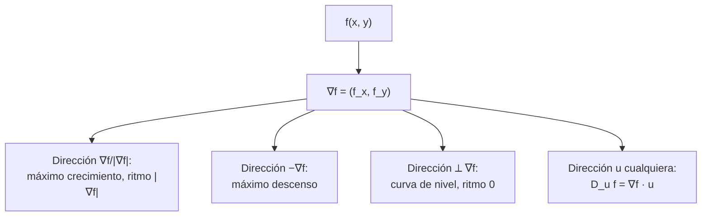

# B09-C17 — Gradiente y derivada direccional

<!-- nav:top -->
[🏠 Programa](../../../../README.md) · [📚 Bloque B09](../../../tronco-comun/B09-calculo-diferencial-e-integral.md) · [← Anterior: B09-C16 — Derivadas parciales](../B09-C16-derivadas-parciales/CLASE.md) · [Siguiente: B09-C18 — Integrales dobles y triples →](../B09-C18-integrales-dobles-y-triples/CLASE.md)
<!-- /nav -->

## 1. Ubicación, nivel y alcance

Decimoséptima clase del bloque B09. Con las derivadas parciales ([C16](../B09-C16-derivadas-parciales/CLASE.md)) sabes cuánto cambia una función al moverte a lo largo de un eje. Aquí pasas a **cualquier dirección**: el gradiente reúne las parciales en un vector que apunta hacia donde la función crece más rápido. Nivel N3. Verás el gradiente, la derivada direccional, su relación con las curvas de nivel y la gravedad como menos el gradiente del potencial. No verás divergencia ni rotacional (C19) ni integrales múltiples (C18).

## 2. Por qué esta clase existe

La gravedad no es un número: es un vector que apunta a un lado y tiene una magnitud. En un campo con dos cuerpos, como Tierra–Luna, esa dirección cambia de punto a punto. Una sonda que se mueve en una dirección dada ve cómo cambia su energía potencial: eso es una derivada direccional. Y un algoritmo de optimización que busca el mínimo de una función de varias variables sigue el gradiente.

La decisión central: **¿cómo obtengo la dirección y la rapidez del mayor cambio de una función, y cómo calculo su cambio en una dirección cualquiera?**

## 3. Lo que podrás hacer al terminar

1. Calcular el gradiente de una función de dos o tres variables.
2. Calcular la derivada direccional con un vector unitario.
3. Determinar la dirección de máximo y mínimo crecimiento y su valor.
4. Relacionar el gradiente con las curvas de nivel (perpendicularidad).
5. Obtener la gravedad como `−∇Φ` en el campo Tierra–Luna y en un cuerpo solo.
6. Reconocer que el gradiente depende de las unidades de las variables.

La evidencia es la **tabla de gradiente y derivadas direccionales con verificación** del ejercicio 12 (sección 20).

## 4. Con qué llegas y cómo comprobarlo

Necesitas derivadas parciales (C16), vectores y producto escalar ([B04-C13](../../B04/B04-C13-producto-escalar-y-angulo-entre-vectores/CLASE.md)). Cinco preguntas:

1. Calcula `f_x` y `f_y` de `x² y + 3y`.
2. Calcula el producto escalar de `(4, 7)` y `(3, 4)`.
3. ¿Qué es un vector unitario?
4. ¿Cuánto vale el coseno de un ángulo de 90°?
5. ¿Qué es una curva de nivel?

<details>
<summary>Ver respuestas</summary>

1. `2xy` y `x² + 3`. 2. `4·3 + 7·4 = 40`. 3. Un vector de módulo 1. 4. 0. 5. El conjunto donde la función vale una constante.
</details>

Con cuatro o cinco aciertos, sigue; si no, repasa C15–C16 y B04-C13.

## 5. Un caso real: hacia dónde cae una sonda entre la Tierra y la Luna

Con el potencial de C15, `Φ(x, y) = −GM_E/r₁ − GM_L/r₂` (km²/s²), `(GM)_E^N = 3,986 004 × 10⁵ km³/s²` (S2) y `GM_L = 4,90 × 10³ km³/s²` (S3), tomamos un punto **de práctica** `(200 000, 100 000) km`. Allí `∇Φ = (7,0325 × 10⁻⁶, 3,6183 × 10⁻⁶) km/s²`, con módulo `7,909 × 10⁻⁶ km/s² = 7,91 × 10⁻³ m/s²`, apuntando a `27,23°` del eje `x`. La aceleración de la gravedad es `g = −∇Φ`, apunta a `207,23°`, es decir, de vuelta hacia la Tierra con una pequeña desviación hacia la Luna. Es un modelo de dos cuerpos fijos, sin rotación.

## 6. Vocabulario

El **gradiente** de `f(x, y, z)` es el vector `∇f = (f_x, f_y, f_z)` (S1, §1.6(iii), ec. 1.6.20). La **derivada direccional** de `f` en la dirección del vector unitario `u` es `D_u f = ∇f · u`. El **vector unitario** tiene módulo 1; la dirección de `v` es `v/|v|`. Una **curva de nivel** es `f = c`; el gradiente es perpendicular a ella. La **dirección de máximo crecimiento** es `∇f/|∇f|` y el **ritmo máximo** es `|∇f|`. Un **punto crítico** es donde `∇f = 0`. La **gravedad** es `g = −∇Φ`: apunta hacia el descenso más rápido del potencial. El **descenso del gradiente** es el algoritmo que avanza en la dirección `−∇f`.

## 7. Modelo mental: la pendiente más fuerte de la ladera

En una ladera, el gradiente apunta cuesta arriba por la línea de máxima pendiente y su longitud es esa pendiente. Caminar por una curva de nivel no sube ni baja. En cualquier otra dirección, la pendiente es la proyección del gradiente sobre ese rumbo.



*Descripción textual:* el gradiente define la dirección de mayor ascenso, la de mayor descenso (su opuesta), la de variación nula (perpendicular) y, para cualquier otra, la derivada es la proyección del gradiente sobre el vector unitario.

Analogía: la línea de caída de una gota de lluvia sobre una ladera. Su límite: el gradiente depende de las unidades de las variables; si estiras un eje, cambia su dirección.

## 8. La explicación, paso a paso

### 8.1 Calcular el gradiente

Para `f = x² y + 3y`: `∇f = (2xy, x² + 3)`. En `(2, 1)`: `(4, 7)` y `|∇f| = √65 = 8,062`.

### 8.2 La derivada direccional

Con `u = (3/5, 4/5)` (unitario): `D_u f = 4 · 0,6 + 7 · 0,8 = 8,0`. Si se usa por error `(3, 4)` sin normalizar, sale `40`, cinco veces más: hay que dividir por el módulo.

### 8.3 Máximo, mínimo y nulo

`D_u f = |∇f| cos α`, con `α` el ángulo entre `u` y `∇f`. Máximo `|∇f| = 8,062` con `α = 0`; mínimo `−8,062` con `α = 180°`; cero con `α = 90°`: `u = (7, −4)/√65`. Para el potencial Tierra–Luna en el punto de práctica, el laboratorio da `D_u/|∇Φ| = +1,000; +0,707; 0; −1,000; 0` para `α = 0; 45°; 90°; 180°; −90°`.

### 8.4 Perpendicular a las curvas de nivel

Un paso de `100 km` a lo largo de la tangente a la curva de nivel cambia `Φ` en `1,75 × 10⁻⁷ km²/s²`; a lo largo del gradiente, en `7,90 × 10⁻⁴`. El primero no es exactamente cero porque la curva se curva (efecto de segundo orden), pero es 4500 veces menor.

### 8.5 La gravedad como `−∇Φ`

Para un cuerpo solo, `Φ = −GM/r` y `∇Φ = GM r̂/r²`: `g = −GM r̂/r²`, atractiva y radial. En `r = 6378,1 km`, `|∇Φ| = 9,7984 m/s²`. Para la Luna, `GM_L/R² = 4,90 × 10³/1737,4² km/s² = 1,623 m/s²`, que coincide a 0,2 % con los `1,62 m/s²` de la ficha lunar de la NASA (S3), dentro de las cifras de ese dato.

### 8.6 Dependencia de las unidades

Para `L(R, T)` en los nominales solares, `∇L = (1,1005 × 10¹⁸ W/m, 2,6528 × 10²³ W/K)`: sumar vectores con unidades distintas no tiene sentido físico. Usando variables adimensionales `(ln R, ln T)`, el gradiente de `ln L` es `(2, 4)`: la dirección de mayor crecimiento relativo es `(1, 2)/√5`, es decir, aumentar `T` pesa el doble que `R`, en relativo. Siempre se declara en qué variables se calcula el gradiente.

### 8.7 Puntos críticos

En el punto de atracción igual del eje, `∇Φ = 0` (el laboratorio da `8,9 × 10⁻²¹ km/s²`, el valor residual del redondeo): es un punto crítico (silla, C16). Seguir el gradiente descendente de `Φ` desde cualquier punto conduce hacia la Tierra o la Luna (los mínimos), nunca al punto de silla, salvo trayectorias exactas.

## 9. Magnitudes, símbolos y unidades

| Símbolo | Qué es | Unidad | Nota |
|---|---|---|---|
| `Φ` | potencial gravitatorio | km²/s² | `−GM_E/r₁ − GM_L/r₂` |
| `∇Φ` | gradiente | km/s² (o m/s²) | `g = −∇Φ` |
| `u` | vector unitario | adimensional | `|u| = 1` |
| `D_u Φ` | derivada direccional | km/s² | `∇Φ · u` |
| `α` | ángulo entre `u` y `∇` | grado | `D_u = |∇| cos α` |
| `GM_E`, `GM_L` | parámetros gravitacionales | km³/s² | 3,986 004 × 10⁵ (S2); 4,90 × 10³ (S3) |
| `R_L` | radio medio lunar | km | 1737,4 (S3) |

## 10. Convenciones y referencias

La dirección se mide en grados desde el eje `x` (Tierra → Luna), en sentido antihorario. El potencial es el de dos cuerpos fijos en un plano inercial: no incluye rotación ni al Sol. El punto de práctica `(200 000, 100 000) km` es una elección didáctica. El gradiente se calcula en km y km²/s²; para pasar a m/s² se multiplica por 10³.

## 11. De dónde sale lo que afirmamos

| ID | Fuente | Localizador | Respalda | Estado |
|---|---|---|---|---|
| S1 | NIST, *Digital Library of Mathematical Functions* §1.6, versión 1.2.8 | https://dlmf.nist.gov/1.6 | Definición del gradiente con el operador nabla (§1.6(iii), ec. 1.6.20) | Consultada el 2026-11-05 mediante extracción automática |
| S2 | IAU, Resolución B3 de 2015, arXiv:1510.07674 | https://arxiv.org/pdf/1510.07674 | `(GM)_E^N = 3,986 004 × 10¹⁴ m³ s⁻²` | Texto extraído del PDF el 2026-11-05 |
| S3 | NASA/NSSDC, *Moon Fact Sheet* (actualizada 2024-01-11) | https://nssdc.gsfc.nasa.gov/planetary/factsheet/moonfact.html | `GM_L = 0,004 90 × 10⁶ km³/s²`; radio medio 1737,4 km; distancia 384 400 km; gravedad superficial 1,62 m/s² | Consultada el 2026-11-05 mediante extracción automática |

Límites: la derivada direccional `D_u f = ∇f · u` y la perpendicularidad con las curvas de nivel son resultados estándar que aquí se **comprueban numéricamente**; no se citan de S1. El potencial de dos cuerpos fijos es un modelo educativo.

## 12. Cómo ver el gradiente

Equivalente accesible a una gráfica de flechas en el punto de práctica (laboratorio):

| Dirección de `u` | Ángulo | `D_u Φ / |∇Φ|` |
|---|---|---|
| Gradiente | 27,23° | +1,000 |
| 45° girados | 72,23° | +0,707 |
| Perpendicular | 117,23° | 0 |
| Opuesta (gravedad) | 207,23° | −1,000 |

Descripción larga: el gradiente es una flecha que apunta ligeramente por encima de la dirección radial desde la Tierra; la gravedad es la flecha opuesta; la curva de nivel pasa perpendicular a ambas.

## 13. Ejemplo trabajado: derivada direccional en el campo Tierra–Luna

**Paso 1 · Datos.** Punto `(200 000, 100 000) km`; `r₁ = 223 607 km`; `r₂ = √(184 400² + 100 000²) = 209 770 km`.

**Paso 2 · Gradiente.** `Φ_x = GM_E x/r₁³ + GM_L (x − d)/r₂³ = 7,0325 × 10⁻⁶ km/s²`; `Φ_y = GM_E y/r₁³ + GM_L y/r₂³ = 3,6183 × 10⁻⁶ km/s²`.

**Paso 3 · Módulo y dirección.** `|∇Φ| = 7,9087 × 10⁻⁶ km/s²`; ángulo `atan2(3,6183; 7,0325) = 27,23°`.

**Paso 4 · Derivada direccional.** Hacia la Luna (`u = (1, 0)`): `D_u Φ = Φ_x = 7,03 × 10⁻⁶ km/s²` (positivo: el potencial sube al alejarse de la Tierra). A 45° del gradiente: `0,707 · 7,9087 × 10⁻⁶ = 5,59 × 10⁻⁶`.

**Paso 5 · Comprobación y sentido.** El gradiente numérico (diferencias centrales con paso de 1 km) coincide a 10⁻⁷. La gravedad de `7,9 × 10⁻³ m/s²` apunta a `207,2°`: hacia la Tierra. Es un campo débil: 0,08 % de la gravedad superficial.

## 14. Distintas formas de obtener la dirección de cambio

Con el **gradiente analítico**: exacto. Con **diferencias finitas**: sirve cuando no hay fórmula. Con la **curva de nivel**: da la dirección de cambio nulo (perpendicular). Con un **mapa de colores**: visual pero cualitativo. En optimización, el **descenso del gradiente** usa `−∇f`; métodos más avanzados (B11, B14) usan segundas derivadas.

## 15. Práctica guiada

**Ejercicio 1 · con los pasos indicados.** Calcula `∇f` para `f = x² y + 3y` en `(2, 1)` y su módulo. *Pasos:* parciales; evalúa.

<details><summary>Solución comentada</summary>

`∇f = (2xy, x² + 3) = (4, 7)`; `|∇f| = √65 = 8,062` (8.1).
</details>

**Ejercicio 2 · con una pista.** Calcula `D_u f` en `(2, 1)` para `u = (3/5, 4/5)`. *Pista:* `u` ya es unitario.

<details><summary>Solución comentada</summary>

`4 · 3/5 + 7 · 4/5 = 12/5 + 28/5 = 8,0` (8.2).
</details>

**Ejercicio 3 · casi autónomo.** Halla la dirección, el ritmo máximo y una dirección de cambio nulo para la misma función.

<details><summary>Solución comentada</summary>

Máximo: dirección `(4, 7)/8,062`, ritmo `8,062`. Nulo: perpendicular, `(7, −4)/8,062` (8.3).
</details>

## 16. Práctica autónoma, transferencia e integrador

**Ejercicio 4.** Calcula el gradiente de `Φ = −GM/√(x² + y² + z²)` y su módulo en `(R, 0, 0)` con los nominales terrestres.

<details><summary>Solución comentada</summary>

`∇Φ = GM (x, y, z)/r³`; en `(R, 0, 0)`: `(GM/R², 0, 0)`; `|∇Φ| = 9,7984 m/s²` (8.5).
</details>

**Ejercicio 5.** Para `L = 4πR²σT⁴`, calcula `∇(ln L)` respecto a `(ln R, ln T)` y la dirección de mayor crecimiento relativo.

<details><summary>Solución comentada</summary>

`ln L = const + 2 ln R + 4 ln T`: `(2, 4)`; dirección `(1, 2)/√5` (8.6).
</details>

**Ejercicio 6.** Para `f = x² + y²` en `(3, 4)`, ¿cuál es la dirección tangente a la curva de nivel? ¿Cuánto vale `D_u f` allí?

<details><summary>Solución comentada</summary>

`∇f = (6, 8)`. Tangente: `(−4, 3)/5`. `D_u f = (6)(−0,8) + 8(0,6) = 0` ✓.
</details>

**Ejercicio 7.** Calcula la gravedad superficial de la Luna con `GM_L` y `1737,4 km` y compárala con la ficha de la NASA.

<details><summary>Solución comentada</summary>

`4,90 × 10¹²/(1,7374 × 10⁶)² = 1,623 m/s²`; NASA `1,62` → `+0,2 %` (diferencia dentro de las tres cifras del dato).
</details>

**Ejercicio 8.** ¿Qué indica que `∇Φ = 0` en el punto de atracción igual?

<details><summary>Solución comentada</summary>

Que la aceleración gravitatoria neta es nula allí: es un punto crítico. No dice si es máximo, mínimo o silla; eso lo decide el hessiano (C16): silla.
</details>

**Ejercicio 9 · transferencia.** En el punto de práctica, ¿cuánto cambia `Φ` por kilómetro al moverse hacia la Luna (`u = (1, 0)`) y en qué sentido?

<details><summary>Solución comentada</summary>

`D_u Φ = Φ_x = 7,03 × 10⁻⁶ km²/s² por km`: `Φ` sube al alejarse de la Tierra, es decir, la aceleración tira hacia atrás. Valor del modelo de dos cuerpos fijos.
</details>

**Ejercicio 10 · transferencia.** Un estudiante calcula `D_u f` con `u = (3, 4)` sin normalizar y obtiene `40`. ¿Qué error comete?

<details><summary>Solución comentada</summary>

`|u| = 5`: debe dividir por 5, lo que da `8`. La derivada direccional exige un vector unitario (8.2).
</details>

**Ejercicio 11 · transferencia.** «El gradiente de `Φ` apunta hacia donde cae la sonda.» Evalúa con las cifras de la clase.

<details><summary>Solución comentada</summary>

Falso: `∇Φ` apunta a `27,23°`, cuesta arriba; la sonda cae hacia `−∇Φ`, a `207,23°` (hacia la Tierra).
</details>

**Ejercicio 12 · integrador.** Elabora tu *tabla de gradiente y derivadas direccionales con verificación* para dos puntos de práctica del plano Tierra–Luna: `∇Φ`, `|∇Φ|`, dirección de `g`, `D_u` en cinco direcciones y comprobación con diferencias centrales; añade la comprobación de la gravedad lunar con la NASA.

<details><summary>Solución modelo</summary>

Una tabla por punto con las cinco direcciones (`+1; +0,707; 0; −1; 0`), cociente central con diferencia < 10⁻⁷, y la gravedad lunar `1,623` frente a `1,62 m/s²`; se declara el modelo de dos cuerpos fijos y los puntos como de práctica.
</details>

## 17. Laboratorio: gradiente y dirección

El script [gradiente_y_direccion.py](gradiente_y_direccion.py) calcula el gradiente analítico y numérico del potencial Tierra–Luna, las derivadas direccionales en varias direcciones, la perpendicularidad con la curva de nivel, la gravedad superficial lunar y el gradiente nulo en el punto de silla.

**Datos:** nominales de la IAU y NASA; punto de práctica. **Predice antes de ejecutar:** ¿qué valor tiene `D_u` perpendicular al gradiente? (0.) **Ejecución del 2026-11-05 (Python 3.12.9):**

```text
Punto (200000, 100000) km:  grad Phi = (7.032493e-06, 3.618275e-06) km/s2;  |grad| = 7.908721e-06 km/s2 = 0.00791 m/s2
Dirección de máximo crecimiento: 27.23 deg respecto al eje x; la gravedad apunta a 207.23 deg
       27.23      7.908721e-06      +1.000000
       72.23      5.592310e-06      +0.707107
Paso de 100 km: a lo largo de la tangente ΔPhi = 1.754e-07; a lo largo del gradiente ΔPhi = 7.905e-04
Luna: GM_L/R^2 = 1.6233 m/s2;  NASA = 1.62 m/s2;  dif. = +0.20%
En x* = 346033.9 km, y = 0: grad Phi = (8.89e-21, 0.00e+00) km/s2 (nulo: punto crítico)
Pruebas superadas.
```

```bash
python programa/clases/B09/B09-C17-gradiente-y-derivada-direccional/gradiente_y_direccion.py
```

**Límites:** dos cuerpos puntuales fijos; punto de práctica; no es un cálculo de trayectoria.

## 18. Errores frecuentes y cómo corregirlos

**No normalizar el vector de dirección.** Se corrige con el ejercicio 10.

**Confundir el gradiente con la dirección de caída.** Se corrige con el ejercicio 11.

**Comparar componentes con unidades distintas.** Se corrige con el ejercicio 5.

**Olvidar que el gradiente es perpendicular a la curva de nivel.** Se corrige con el ejercicio 6.

**Creer que `∇f = 0` implica mínimo.** Se corrige con el ejercicio 8.

## 19. Cómo sabrás que vas bien

Tras 8.1: ¿calculas `∇f`? Si no, ejercicio 1. Tras 8.2: ¿normalizas `u`? Si no, ejercicio 10. Tras 8.3: ¿das el máximo, el mínimo y el nulo? Si no, ejercicio 3. Tras el laboratorio: ¿qué comprobación valida que el gradiente es perpendicular a la curva de nivel? (paso de 100 km).

## 20. Qué entregas y cómo se evalúa

El producto es tu **tabla de gradiente y derivadas direccionales con verificación** (ejercicio 12).

| Criterio | Inicial | En desarrollo | Logrado | Destacado |
|---|---|---|---|---|
| Gradiente | Errores | Con ayuda | Correcto con unidades | Verifica numéricamente |
| Derivada direccional | No normaliza | Con ayuda | Correcta | Interpreta `|∇| cos α` |
| Interpretación física | Sin signo | Gravedad sin signo | `g = −∇Φ` con dirección | Discute el modelo |
| Comprobación | Ausente | Mental | Diferencias centrales | Contra valor publicado |
| Fuentes y rótulos | Sin fuente | Sin fecha | Con localizador y fecha | Declara el modelo |

**Condiciones críticas (no se compensan con promedio):** normalizar `u`; declarar el signo de `g = −∇Φ`; citar solo fuentes consultadas.

## 21. Ética, seguridad y límites

Un campo gravitatorio simplificado no sirve para navegar. Los puntos de práctica no son posiciones de misión. Accesibilidad: tablas equivalentes a los diagramas, fórmulas en texto, ejercicios sin conexión.

## 22. Para cerrar y seguir

El gradiente apunta al máximo crecimiento con módulo igual a la pendiente máxima; la derivada direccional es su proyección; la gravedad es `−∇Φ`. Queda abierta una pregunta: ¿cómo se **suma** una cantidad sobre una región, por ejemplo la masa de un planeta con densidad variable? Son las integrales dobles y triples.

**Glosario español–inglés.** gradiente · *gradient*; derivada direccional · *directional derivative*; vector unitario · *unit vector*; curva de nivel · *level curve*; descenso del gradiente · *gradient descent*; punto crítico · *critical point*; potencial gravitatorio · *gravitational potential*.

**Continuidad.** B09-C18 reutiliza tu capacidad de **trabajar en el plano y en el espacio con coordenadas** para integrar sobre regiones.

**Referencias:** ver sección 11.

<!-- nav:bottom -->
---

[← Anterior: B09-C16 — Derivadas parciales](../B09-C16-derivadas-parciales/CLASE.md) · [📚 Bloque B09](../../../tronco-comun/B09-calculo-diferencial-e-integral.md) · [Siguiente: B09-C18 — Integrales dobles y triples →](../B09-C18-integrales-dobles-y-triples/CLASE.md)
<!-- /nav -->
