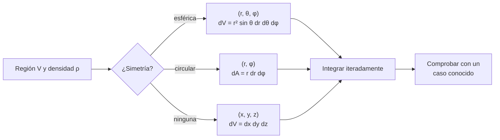

# B09-C18 — Integrales dobles y triples

<!-- nav:top -->
[🏠 Programa](../../../../README.md) · [📚 Bloque B09](../../../tronco-comun/B09-calculo-diferencial-e-integral.md) · [← Anterior: B09-C17 — Gradiente y derivada direccional](../B09-C17-gradiente-y-derivada-direccional/CLASE.md) · [Siguiente: B09-C19 — Cálculo vectorial introductorio →](../B09-C19-calculo-vectorial-introductorio/CLASE.md)
<!-- /nav -->

## 1. Ubicación, nivel y alcance

Decimoctava clase del bloque B09. Hasta ahora integraste sobre un intervalo ([C11](../B09-C11-integrales-definidas/CLASE.md)–[C13](../B09-C13-areas-y-volumenes-por-integracion/CLASE.md)). Un planeta tiene masa distribuida en tres dimensiones y recibe luz sobre una superficie: hay que integrar sobre regiones del plano y del espacio. Nivel N3 → N4. Verás integrales dobles y triples iteradas, el cambio a coordenadas polares y esféricas con su jacobiano, la masa y el momento de inercia de un planeta con densidad variable, y la potencia solar interceptada. No verás integrales de línea ni de superficie generales (C19).

## 2. Por qué esta clase existe

La masa de la Tierra se conoce mucho mejor que la distribución de esa masa en su interior. Un solo número, la densidad media, no basta: el momento de inercia depende de cómo se reparte la masa. Para pasar de una densidad que cambia con la profundidad a una masa y un momento de inercia, hay que integrar sobre el volumen. Y para saber cuánta energía solar intercepta un planeta, hay que integrar el flujo sobre su superficie iluminada.

La decisión central: **¿cómo planteo una integral doble o triple, con qué coordenadas y qué jacobiano, y cómo la verifico con casos conocidos y con datos publicados?**

## 3. Lo que podrás hacer al terminar

1. Calcular una integral doble iterada sobre un rectángulo o una región simple.
2. Cambiar el orden de integración y obtener el mismo resultado.
3. Pasar a coordenadas polares y esféricas con el jacobiano correcto.
4. Calcular masa y momento de inercia de una esfera con densidad radial.
5. Ajustar un modelo de dos capas a la masa y al momento de inercia publicados.
6. Calcular la potencia interceptada por una esfera iluminada.

La evidencia es la **hoja de masa, inercia y potencia con verificación** del ejercicio 12 (sección 20).

## 4. Con qué llegas y cómo comprobarlo

Necesitas integrales de una variable (C11–C13) y coordenadas esféricas ([B04-C11](../../B04/B04-C11-coordenadas-esfericas/CLASE.md)). Cinco preguntas:

1. Calcula `∫₀² x dx`.
2. Calcula `∫₀^π sin θ dθ`.
3. Escribe `x`, `y`, `z` en coordenadas esféricas `(r, θ, φ)`.
4. ¿Cuánto es el volumen de una esfera de radio `R`?
5. ¿Qué es la densidad media de un cuerpo?

<details>
<summary>Ver respuestas</summary>

1. 2. 2. 2. 3. `x = r sin θ cos φ`, `y = r sin θ sin φ`, `z = r cos θ`. 4. `4πR³/3`. 5. Masa dividida por volumen.
</details>

Con cuatro o cinco aciertos, sigue; si no, repasa C11–C13 y B04-C11.

## 5. Un caso real: ¿cómo está repartida la masa de la Tierra?

La ficha de la Tierra de la NASA (S2) da la masa `5,9722 × 10²⁴ kg`, el radio medio volumétrico `6371,000 km`, la densidad media `5513 kg/m³` y el factor de momento de inercia polar `I/(MR²) = 0,3308`. Una esfera uniforme tendría `0,4`. El valor menor indica que la masa se concentra hacia el centro. Con un núcleo de `3500 km` de radio (**hipótesis de partida sintética**), dos capas uniformes y las dos cifras publicadas, se pueden **estimar** las densidades de cada capa: ese ajuste da `12 387 kg/m³` (núcleo) y `4147 kg/m³` (manto). Son estimaciones de un modelo de juguete, no mediciones; un modelo geofísico real usa ondas sísmicas. **Segundo ejemplo:** la potencia solar interceptada por la Tierra, con la irradiancia nominal `1361 W/m²` (S3).

## 6. Vocabulario

Una **integral doble** `∬_D f dA` suma `f` sobre una región `D` del plano; se calcula por **integración iterada** `∫∫ f dx dy` (S1, §1.5(v), ecs. 1.5.27 y 1.5.31). Una **integral triple** `∭_V f dV` lo hace sobre un volumen (ec. 1.5.37). El **teorema de Fubini** permite cambiar el orden si `f` es continua (ec. 1.5.35). El **jacobiano** es el factor que corrige el elemento de área o volumen al cambiar de coordenadas: `r` en polares, `r² sin θ` en esféricas (ecs. 1.5.39 y 1.5.41). La **densidad** `ρ` es masa por volumen. El **momento de inercia** `I = ∭ ρ ρ_⊥² dV`, con `ρ_⊥` la distancia al eje. El **factor de momento de inercia** es `I/(MR²)`. La **irradiancia** `S` es la potencia por unidad de área (W/m²). Un **ajuste** busca parámetros que reproducen datos.

## 7. Modelo mental: cortar en cubitos

Se divide la región en pedacitos de volumen `dV`, se multiplica cada uno por la densidad y se suma. En coordenadas adecuadas el pedacito es un trozo de corteza esférica de grosor `dr`, ancho `r dθ` y largo `r sin θ dφ`: su volumen es `r² sin θ dr dθ dφ`.



*Descripción textual:* se elige el sistema de coordenadas según la simetría, se escribe el elemento de volumen con su jacobiano, se integra iterativamente y se verifica con un caso conocido.

Analogía: cortar una cebolla en capas finas. Su límite: si olvidas el jacobiano, las capas externas pesan igual que las internas, lo cual es falso.

## 8. La explicación, paso a paso

### 8.1 Integral doble sobre un rectángulo

`∬ xy dA` sobre `[0, 2] × [0, 3]`: `∫₀² x dx · ∫₀³ y dy = 2 · 4,5 = 9`. Para regiones no rectangulares, los límites de la integral interior dependen de la variable exterior: `0 ≤ x ≤ y ≤ 1`: `∫₀¹ ∫₀^y xy dx dy = ∫₀¹ y³/2 dy = 1/8`. Cambiando el orden: `∫₀¹ ∫_x^1 xy dy dx = ∫₀¹ x(1 − x²)/2 dx = 1/8` ✓.

### 8.2 Polares y el jacobiano

Con `x = r cos φ`, `y = r sin φ`: `dA = r dr dφ`. El área de un disco es `∫₀^{2π} ∫₀^R r dr dφ = π R²`. Un anillo entre `r₁` y `r₂`: `π (r₂² − r₁²)`.

### 8.3 Esféricas y el jacobiano

`dV = r² sin θ dr dθ dφ`. Para una esfera: `∫₀^R r² dr · ∫₀^π sin θ dθ · ∫₀^{2π} dφ = (R³/3)(2)(2π) = 4πR³/3`. Sin el jacobiano daría `2π² ≈ 19,7` para `R = 1`, unas 4,7 veces más que `4,19`.

### 8.4 Masa con densidad radial

Si `ρ = ρ(r)`: `M = 4π ∫₀^R ρ r² dr`. El momento de inercia respecto a un eje usa `ρ_⊥² = r² sin²θ`: `I = ∭ ρ r² sin²θ dV = (8π/3) ∫₀^R ρ r⁴ dr`. Para una esfera uniforme: `I = (8π/15) ρ R⁵ = (2/5) M R²`: el factor `0,4`. El laboratorio lo comprueba integrando numéricamente en tres variables.

### 8.5 Densidad media y ajuste de dos capas

Densidad media: `M/V = 5,9722 × 10²⁴/(4π (6,371 × 10⁶)³/3) = 5513,4 kg/m³`, a `8 × 10⁻⁵` de los `5513` de la NASA. Para dos capas (núcleo de radio `r_c`, densidades `ρ_c`, `ρ_m`): `M = (4π/3)[ρ_c r_c³ + ρ_m (R³ − r_c³)]` y `I = (8π/15)[ρ_c r_c⁵ + ρ_m (R⁵ − r_c⁵)]`. Con `M` y `I/(MR²) = 0,3308` se resuelve el sistema 2×2: `ρ_c = 12 387 kg/m³`, `ρ_m = 4147 kg/m³`. La integración numérica del modelo reproduce `M` y `I` a 10⁻⁹. El núcleo guarda el `37,2 %` de la masa en el `16,6 %` del volumen.

### 8.6 Potencia interceptada

El flujo solar llega paralelo; cada elemento de superficie iluminado intercepta `S cos θ dA`, con `dA = R² sin θ dθ dφ`. Sobre el hemisferio iluminado: `P = S R² ∫₀^{π/2} cos θ sin θ dθ ∫₀^{2π} dφ = S R² (1/2)(2π) = S π R²`. Con `S = 1361 W/m²` y `R = 6,3781 × 10⁶ m` (nominales de la IAU, S3): `P = 1,7394 × 10¹⁷ W`. El resultado es independiente de cómo se reparta la luz sobre la esfera: coincide con el área de la sombra (un disco).

### 8.7 Promedio sobre toda la superficie

Dividiendo `P` entre la superficie `4πR²`, la irradiancia media sobre la superficie es `S/4 = 340,25 W/m²`. Es la razón por la que el balance de energía de un planeta usa un factor 1/4.

## 9. Magnitudes, símbolos y unidades

| Símbolo | Qué es | Unidad | Nota |
|---|---|---|---|
| `ρ` | densidad | kg/m³ | `ρ_c`, `ρ_m` estimadas |
| `M`, `R` | masa y radio medio | kg, m | 5,9722 × 10²⁴; 6,371 × 10⁶ (S2) |
| `I` | momento de inercia | kg m² | `(8π/3) ∫ ρ r⁴ dr` |
| `I/(MR²)` | factor de inercia | adimensional | 0,3308 (S2) |
| `r_c` | radio del núcleo | m | 3,5 × 10⁶ (sintético) |
| `S` | irradiancia solar nominal | W/m² | 1361 (S3) |
| `P` | potencia interceptada | W | `S π R²` |
| `(r, θ, φ)` | coordenadas esféricas | m, rad, rad | `θ` desde el polo |

## 10. Convenciones y referencias

`θ` es la colatitud (0 en el polo) y `φ` la longitud. Las capas son uniformes y concéntricas; el núcleo es una hipótesis, no un dato. `I/(MR²)` se refiere al eje de rotación y al radio medio de la ficha de la NASA (S2); no se verificó cuál radio usa exactamente la NASA para ese factor. El valor `S` es nominal (conversión). La irradiancia es perpendicular a los rayos y paralela; se ignora la atmósfera.

## 11. De dónde sale lo que afirmamos

| ID | Fuente | Localizador | Respalda | Estado |
|---|---|---|---|---|
| S1 | NIST, *Digital Library of Mathematical Functions* §1.5, versión 1.2.8 | https://dlmf.nist.gov/1.5 | Integrales dobles y triples, Fubini, jacobianos (§1.5(v)–(vi), ecs. 1.5.27–1.5.43) | Consultada el 2026-11-05 mediante extracción automática |
| S2 | NASA/NSSDC, *Earth Fact Sheet* (actualizada 2024-11-15) | https://nssdc.gsfc.nasa.gov/planetary/factsheet/earthfact.html | Masa `5,9722 × 10²⁴ kg`; radio medio `6371,000 km`; densidad media `5513 kg/m³`; `I/(MR²) = 0,3308` | Consultada el 2026-11-05 mediante extracción automática |
| S3 | IAU, Resolución B3 de 2015, arXiv:1510.07674 | https://arxiv.org/pdf/1510.07674 | `S_☉^N = 1361 W/m²`; `R_eE^N = 6,3781 × 10⁶ m` | Texto extraído del PDF el 2026-11-05 |

Límites: el modelo de dos capas **no es** un modelo de la Tierra; sus densidades son estimaciones de un ajuste sobre dos cifras. No se comparó con un perfil sísmico publicado.

## 12. Cómo ver los resultados

Equivalente accesible a un corte de la Tierra de dos capas:

| Capa | Rango | Densidad estimada (kg/m³) | Fracción de masa |
|---|---|---|---|
| Núcleo (sintético) | 0 – 3500 km | 12 387 | 37,2 % |
| Manto | 3500 – 6371 km | 4147 | 62,8 % |

| Cantidad | Modelo | NASA / fórmula |
|---|---|---|
| Masa | `5,9722 × 10²⁴ kg` | `5,9722 × 10²⁴` |
| `I/(MR²)` | `0,33080` | `0,3308` |
| Densidad media | `5513,4 kg/m³` | `5513` |
| Potencia interceptada | `1,7394 × 10¹⁷ W` | `S π R²` |

Descripción larga: el corte muestra un círculo central pequeño y denso rodeado de una capa gruesa menos densa; la masa del núcleo es más de un tercio del total.

## 13. Ejemplo trabajado: ajustar las dos capas

**Paso 1 · Ecuaciones.** `M = (4π/3)[ρ_c r_c³ + ρ_m (R³ − r_c³)]` y `I = (8π/15)[ρ_c r_c⁵ + ρ_m (R⁵ − r_c⁵)]` con `I = 0,3308 M R²`.

**Paso 2 · Datos.** `M = 5,9722 × 10²⁴ kg`, `R = 6,371 × 10⁶ m`, `r_c = 3,5 × 10⁶ m`.

**Paso 3 · Sistema.** Dos ecuaciones lineales en `ρ_c` y `ρ_m`; por Cramer: `ρ_c = 12 387 kg/m³`, `ρ_m = 4147 kg/m³`.

**Paso 4 · Verificación.** Integrando de nuevo `4π ∫ ρ r² dr` y `(8π/3) ∫ ρ r⁴ dr`: `M = 5,97220 × 10²⁴ kg`, `I/(MR²) = 0,33080`. Fracción de masa del núcleo: `37,2 %`.

**Paso 5 · Sentido.** El núcleo, en un 16,6 % del volumen, concentra el 37,2 % de la masa: es más denso, y el factor de inercia queda bajo `0,4`. Estas densidades pertenecen al modelo de dos capas y no a la Tierra real.

## 14. Distintas formas de integrar sobre un volumen

En **coordenadas cartesianas**, siempre posible pero con límites complicados. En **esféricas**, ideal con simetría. **Aprovechar la simetría** reduce una triple integral a una de una variable (`4π ∫ ρ r² dr`). La **integración numérica** en 2D y 3D (Simpson iterada o Monte Carlo) sirve cuando no hay fórmula. Para geometrías realistas se usan mallas (B11, B14).

## 15. Práctica guiada

**Ejercicio 1 · con los pasos indicados.** Calcula `∬ xy dA` sobre `[0, 2] × [0, 3]`. *Pasos:* separa en dos integrales.

<details><summary>Solución comentada</summary>

`∫₀² x dx = 2`; `∫₀³ y dy = 4,5`; producto `9` (8.1).
</details>

**Ejercicio 2 · con una pista.** Calcula el área de un disco de radio `R` en polares. *Pista:* `dA = r dr dφ`.

<details><summary>Solución comentada</summary>

`∫₀^{2π} dφ ∫₀^R r dr = 2π · R²/2 = π R²` (8.2).
</details>

**Ejercicio 3 · casi autónomo.** Deduce el volumen de una esfera en coordenadas esféricas.

<details><summary>Solución comentada</summary>

`(R³/3)(2)(2π) = 4πR³/3` (8.3).
</details>

## 16. Práctica autónoma, transferencia e integrador

**Ejercicio 4.** Calcula la masa del núcleo del modelo de dos capas.

<details><summary>Solución comentada</summary>

`(4π/3) ρ_c r_c³ = 4,18879 · 12 387 · (3,5 × 10⁶)³ = 2,225 × 10²⁴ kg`, el 37,2 % de la masa total.
</details>

**Ejercicio 5.** Calcula la densidad media de la Tierra con los datos de la NASA y compárala con `5513 kg/m³`.

<details><summary>Solución comentada</summary>

`5,9722 × 10²⁴/(4π (6,371 × 10⁶)³/3) = 5513,4 kg/m³`; diferencia `+8 × 10⁻⁵` (8.5).
</details>

**Ejercicio 6.** Calcula el área de un anillo entre `r₁ = 1` y `r₂ = 3` en polares.

<details><summary>Solución comentada</summary>

`2π · (r₂² − r₁²)/2 = π (9 − 1) = 8π = 25,13`.
</details>

**Ejercicio 7.** Demuestra que una esfera uniforme tiene `I = (2/5) M R²`.

<details><summary>Solución comentada</summary>

`I = (8π/3) ρ ∫₀^R r⁴ dr = (8π/15) ρ R⁵`; con `M = (4π/3) ρ R³`: `I = (2/5) M R²` (8.4).
</details>

**Ejercicio 8.** Calcula `∬ xy dA` sobre `0 ≤ x ≤ y ≤ 1` en los dos órdenes.

<details><summary>Solución comentada</summary>

`∫₀¹ y³/2 dy = 1/8`; `∫₀¹ x(1 − x²)/2 dx = 1/2(1/2 − 1/4) = 1/8` (8.1).
</details>

**Ejercicio 9 · transferencia.** Calcula la potencia solar que intercepta la Tierra y la irradiancia media sobre su superficie, con los nominales.

<details><summary>Solución comentada</summary>

`P = S π R² = 1361 · π · (6,3781 × 10⁶)² = 1,7394 × 10¹⁷ W`; media sobre `4πR²`: `S/4 = 340,25 W/m²` (8.6–8.7). Es energía incidente, sin considerar reflexión ni atmósfera.
</details>

**Ejercicio 10 · transferencia.** Un compañero calcula el volumen de la esfera unitaria como `∫₀¹ ∫₀^π ∫₀^{2π} dφ dθ dr = 19,7`. ¿Qué olvidó?

<details><summary>Solución comentada</summary>

El jacobiano `r² sin θ`. Con él sale `4π/3 = 4,19`. Sin jacobiano se integra un volumen de «cubos» en el espacio de coordenadas, no en el espacio real (8.3).
</details>

**Ejercicio 11 · transferencia.** El factor `I/(MR²) = 0,3308 < 0,4`. ¿Qué dice sobre la estructura interna? ¿Qué no dice?

<details><summary>Solución comentada</summary>

Dice que la masa está más concentrada hacia el centro que en una esfera uniforme. No dice cómo ni cuántas capas hay, ni sus densidades: existen muchos perfiles distintos con el mismo factor; por eso el ajuste de dos capas es solo una ilustración.
</details>

**Ejercicio 12 · integrador.** Elabora tu *hoja de masa, inercia y potencia con verificación*: esfera uniforme (volumen e `I/(MR²)` por triple integral numérica), densidad media frente a la NASA, ajuste de dos capas con un núcleo de otro radio (sintético) y potencia interceptada.

<details><summary>Solución modelo</summary>

Tabla con volumen `4,18879`, `I/(MR²) = 0,400000`; densidad `5513,4` vs `5513`; para otro `r_c` nuevas densidades `ρ_c`, `ρ_m` que reproducen `M` y `I` a 10⁻⁹; potencia `1,7394 × 10¹⁷ W`; se declara que las densidades de capa son estimaciones de un modelo de juguete.
</details>

## 17. Laboratorio: masa, inercia y potencia

El script [masa_e_inercia.py](masa_e_inercia.py) integra numéricamente en tres variables el volumen y el momento de inercia de una esfera uniforme, compara la densidad media con la de la NASA, resuelve y verifica el modelo de dos capas, y calcula la potencia interceptada con una integral doble.

**Datos:** NASA, IAU; núcleo sintético. **Predice antes de ejecutar:** ¿qué factor `I/(MR²)` dará la esfera uniforme? (0,4.) **Ejecución del 2026-11-05 (Python 3.12.9):**

```text
Esfera uniforme: V = 4.18879021 (4pi/3 = 4.18879020);  I/(M R^2) = 0.400000 (esperado 0.4)
Densidad media = M/V = 5513.4 kg/m3 (NASA: 5513); dif. = +8.04e-05
  rho_núcleo = 12387 kg/m3;  rho_manto = 4147 kg/m3  (ESTIMADAS por ajuste)
  M integrada = 5.97220e+24 kg (NASA 5.9722e+24);  I/(M R^2) integrada = 0.33080 (NASA 0.3308)
  fracción de masa en el núcleo = 37.2%; fracción del volumen = 16.6%
Potencia solar interceptada (S nominal, R ecuatorial nominal): numérica 1.73936e+17 W; S*pi*R^2 = 1.73936e+17 W
Pruebas superadas.
```

```bash
python programa/clases/B09/B09-C18-integrales-dobles-y-triples/masa_e_inercia.py
```

**Límites:** simetría esférica; capas uniformes; núcleo sintético; no es un modelo geofísico.

## 18. Errores frecuentes y cómo corregirlos

**Olvidar el jacobiano.** Se corrige con el ejercicio 10.

**Confundir colatitud con latitud.** Se corrige con la sección 10 y el ejercicio 3.

**Presentar las densidades ajustadas como medidas.** Se corrige con el ejercicio 11.

**Límites de integración mal puestos en una región triangular.** Se corrige con el ejercicio 8.

**Mezclar radio medio y ecuatorial.** Se corrige con la sección 10.

## 19. Cómo sabrás que vas bien

Tras 8.2: ¿obtienes el área de un disco? Si no, ejercicio 2. Tras 8.3: ¿escribes `r² sin θ`? Si no, ejercicio 3. Tras 8.5: ¿resuelves el sistema de dos capas? Si no, ejercicio 4. Tras el laboratorio: ¿qué comprobación demuestra que el jacobiano está bien puesto? (volumen de la esfera).

## 20. Qué entregas y cómo se evalúa

El producto es tu **hoja de masa, inercia y potencia con verificación** (ejercicio 12).

| Criterio | Inicial | En desarrollo | Logrado | Destacado |
|---|---|---|---|---|
| Planteo | Sin límites | Con ayuda | Región y límites | Elige coordenadas por simetría |
| Jacobiano | Ausente | Memorizado | Aplicado | Justificado |
| Verificación | Ausente | Mental | Esfera y NASA | Integración numérica independiente |
| Interpretación | Sin unidades | Unidades sin sentido | Con orden de magnitud | Discute la no unicidad |
| Fuentes y rótulos | Sin fuente | Sin fecha | Con localizador y fecha | Rotula sintético y estimado |

**Condiciones críticas (no se compensan con promedio):** incluir el jacobiano; rotular estimado y sintético; citar solo fuentes consultadas.

## 21. Ética, seguridad y límites

Un modelo de dos capas con densidades «ajustadas» no debe presentarse como el interior de la Tierra. La interpretación geofísica requiere datos sísmicos y revisión disciplinar. Accesibilidad: tablas equivalentes a los cortes, fórmulas en texto, ejercicios sin conexión.

## 22. Para cerrar y seguir

Una integral múltiple suma sobre regiones; el jacobiano corrige el elemento de volumen; la masa y la inercia de un planeta salen de integrales radiales, y la potencia interceptada de una integral doble. Queda abierta una pregunta: ¿cuál es la relación entre el campo gravitatorio y la masa que lo origina, medida en una superficie? Es el cálculo vectorial.

**Glosario español–inglés.** integral doble · *double integral*; integral triple · *triple integral*; jacobiano · *Jacobian*; coordenadas esféricas · *spherical coordinates*; momento de inercia · *moment of inertia*; densidad media · *mean density*; irradiancia · *irradiance*; colatitud · *colatitude*.

**Continuidad.** B09-C19 reutiliza tu capacidad de **integrar sobre superficies y volúmenes** para enunciar el flujo y el teorema de Gauss.

**Referencias:** ver sección 11.

<!-- nav:bottom -->
---

[← Anterior: B09-C17 — Gradiente y derivada direccional](../B09-C17-gradiente-y-derivada-direccional/CLASE.md) · [📚 Bloque B09](../../../tronco-comun/B09-calculo-diferencial-e-integral.md) · [Siguiente: B09-C19 — Cálculo vectorial introductorio →](../B09-C19-calculo-vectorial-introductorio/CLASE.md)
<!-- /nav -->
