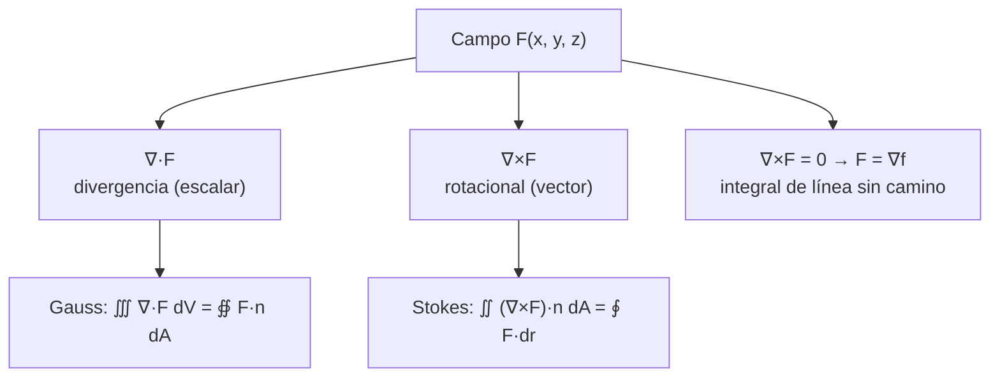

# B09-C19 — Cálculo vectorial introductorio

<!-- nav:top -->
[🏠 Programa](../../../../README.md) · [📚 Bloque B09](../../../tronco-comun/B09-calculo-diferencial-e-integral.md) · [← Anterior: B09-C18 — Integrales dobles y triples](../B09-C18-integrales-dobles-y-triples/CLASE.md) · [Siguiente: B09-C20 — Aplicaciones a campos gravitatorios →](../B09-C20-aplicaciones-a-campos-gravitatorios/CLASE.md)
<!-- /nav -->

## 1. Ubicación, nivel y alcance

Decimonovena clase del bloque B09. Hasta aquí los campos eran escalares (el potencial) y su gradiente era el único vector ([C17](../B09-C17-gradiente-y-derivada-direccional/CLASE.md)). Ahora tratas **campos vectoriales** en general: la gravedad, la velocidad de un fluido o de una superficie que gira. Nivel N3 → N4. Verás la divergencia, el rotacional, la integral de línea, el flujo, el teorema de Gauss y el de Stokes, con dos campos de ciencias espaciales: la gravedad de una masa puntual y la rotación rígida de la Tierra. No verás ecuaciones diferenciales en derivadas parciales (B11) ni relatividad (B19).

## 2. Por qué esta clase existe

La gravedad no tiene fuentes fuera de la masa que la produce, y eso permite calcular la gravedad de un planeta esférico sin sumar cada átomo: basta medir el flujo. La rotación de la Tierra produce un campo de velocidades con circulación no nula, y esa circulación mide cuánto «gira» el campo. Estas dos ideas, divergencia y rotacional, son el lenguaje de la gravitación, del magnetismo y de la dinámica de fluidos.

La decisión central: **¿qué mide la divergencia, qué mide el rotacional, cuándo una integral de línea no depende del camino, y cómo conectan esos conceptos los teoremas de Gauss y Stokes?**

## 3. Lo que podrás hacer al terminar

1. Calcular la divergencia y el rotacional de un campo dado.
2. Calcular una integral de línea y decidir si el campo es conservativo.
3. Calcular el flujo de un campo a través de una esfera.
4. Enunciar y usar el teorema de Gauss con la gravedad: flujo `= −4πGM`.
5. Enunciar y usar el teorema de Stokes con la rotación terrestre.
6. Distinguir qué mide cada operador y qué no.

La evidencia es la **tabla de divergencia, rotacional, flujo y circulación con verificación** del ejercicio 12 (sección 20).

## 4. Con qué llegas y cómo comprobarlo

Necesitas el gradiente (C17), integrales dobles (C18) y el producto escalar. Cinco preguntas:

1. Calcula el gradiente de `x² y`.
2. Calcula `∫₀^{2π} cos² t dt`.
3. ¿Qué es un vector normal a una superficie?
4. ¿Cuánto es el área de una esfera de radio `R`?
5. ¿Qué es un campo conservativo en términos de trabajo?

<details>
<summary>Ver respuestas</summary>

1. `(2xy, x²)`. 2. `π`. 3. Perpendicular a la superficie en cada punto. 4. `4πR²`. 5. Aquel donde el trabajo entre dos puntos no depende de la trayectoria.
</details>

Con cuatro o cinco aciertos, sigue; si no, repasa C17–C18.

## 5. Un caso real: la gravedad y la rotación de la Tierra

La gravedad de una masa puntual es `g(r) = −GM r/|r|³` (hacia el centro). Con el parámetro nominal `(GM)_E^N = 3,986 004 × 10¹⁴ m³ s⁻²` (S2), en `R = 6,3781 × 10⁶ m` vale `9,7984 m/s²`. Fuera del origen su divergencia es cero, pero el flujo a través de cualquier esfera que la encierra es `−4πGM = −5,009 × 10¹⁵ m³/s²`: la fuente está «concentrada» en el origen. El segundo campo es la velocidad de un punto de la Tierra por su rotación, `v = ω × r`, con `ω = 7,292 115 × 10⁻⁵ rad/s` y radio ecuatorial `a_E = 6 378 137 m` (S3): `|v| = 465,10 m/s` en el ecuador, con rotacional `2ω` y divergencia cero. Ambos son **modelos**: masa puntual y rotación rígida.

## 6. Vocabulario

Un **campo vectorial** asigna un vector a cada punto. La **divergencia** `∇·F = ∂F₁/∂x + ∂F₂/∂y + ∂F₃/∂z` mide cuánto «sale» el campo de un punto (S1, §1.6(iii), ec. 1.6.21). El **rotacional** `∇×F` mide cuánto «gira» (ec. 1.6.22). La **integral de línea** `∫_C F·dr` suma la componente tangencial a lo largo de una curva (ec. 1.6.38). Un campo es **conservativo** si `F = ∇f`; entonces `∫_C F·dr = f(B) − f(A)` (ec. 1.6.42) y `∇×F = 0`. El **flujo** `∬_S F·n dA` es lo que atraviesa una superficie. El **teorema de Gauss (divergencia)**: `∭_V ∇·F dV = ∯_S F·n dA` (ec. 1.6.58). El **teorema de Stokes**: `∬_S (∇×F)·n dA = ∮_{∂S} F·dr` (ec. 1.6.57). La **circulación** es la integral de línea sobre una curva cerrada.

## 7. Modelo mental: grifos y remolinos

La divergencia es un grifo (o un sumidero) en cada punto: positiva si el campo sale, negativa si entra, cero si lo que entra, sale. El rotacional es un remolino: una ruedita de paletas colocada en el campo gira si el rotacional no es nulo. Gauss dice que el total de grifos dentro es lo que sale por la superficie; Stokes dice que el total de remolino en una superficie es la circulación en su borde.



*Descripción textual:* de un campo se derivan la divergencia y el rotacional; la divergencia se conecta con el flujo por la superficie (Gauss), el rotacional con la circulación por el borde (Stokes), y un rotacional nulo permite un potencial y la independencia de la trayectoria.

Analogía: un río con manantiales (divergencia) y remolinos (rotacional). Su límite: los campos reales pueden tener singularidades (como la masa puntual) donde los operadores no están definidos y hay que tratar la fuente aparte.

## 8. La explicación, paso a paso

### 8.1 Divergencia

Para `F = (x², y², z²)`: `∇·F = 2x + 2y + 2z`; en `(1, 2, 3)`: `12`. Para la gravedad de una masa puntual: `∂/∂x (x/r³) = 1/r³ − 3x²/r⁵`; sumando las tres derivadas: `3/r³ − 3(x² + y² + z²)/r⁵ = 0`. Así, `∇·g = 0` fuera del origen. El laboratorio da `|∇·g| < 10⁻¹³ s⁻²`, frente a una escala `|g|/r ≈ 1,5 × 10⁻⁶ s⁻²`.

### 8.2 Rotacional

Para `F = (−y, x, 0)`: `∇×F = (0, 0, 1 − (−1)) = (0, 0, 2)`. Para la gravedad, el rotacional es cero (laboratorio: `< 10⁻¹⁵ s⁻²`): el campo es conservativo.

### 8.3 Integral de línea y potencial

Para `g`, el trabajo por unidad de masa al ir de `R` a `2R` es `Φ(A) − Φ(B) = −GM/R + GM/(2R) = −GM/(2R) = −3,1248 × 10⁷ J/kg`, por **cualquier** camino (recto o en arco): el laboratorio da el mismo valor para ambos. El signo negativo dice que el campo se opone al ascenso.

### 8.4 Flujo y Gauss

El flujo de `g` a través de una esfera de radio `r` centrada en la masa es `g(r) · 4πr² = −GM/r² · 4πr² = −4πGM`, **independiente del radio**: el laboratorio da `−5,008 96 × 10¹⁵ m³/s²` para `r = R, 2R, 10R`. Para una esfera que **no** encierra la masa, el flujo es cero (valor numérico `−6,9 × 10⁴`, sobre una escala de `5 × 10¹⁵`). La ley de Gauss para la gravedad es `∯ g·n dA = −4πG M_encerrada`.

### 8.5 La densidad y la ecuación de Poisson

Dentro de una esfera uniforme de densidad `ρ`, el campo es `g = −(GM/R³) r` y `∇·g = −3GM/R³ = −4πGρ`. Con `M = 5,9722 × 10²⁴ kg`, `R = 6,371 × 10⁶ m` (S5) y `G = 6,674 30 × 10⁻¹¹ m³ kg⁻¹ s⁻²` (S4): `4πGρ = 4,6242 × 10⁻⁶ s⁻²`, igual que `3GM/R³ = 4,6242 × 10⁻⁶` con `GM` nominal.

### 8.6 La rotación terrestre y Stokes

Para `v = ω × r = (−ωy, ωx, 0)`: `∇·v = 0` y `∇×v = (0, 0, 2ω) = 1,4584 × 10⁻⁴ rad/s`. La circulación a lo largo del ecuador es `∮ v·dr = 2π a_E · (ω a_E) = 2π a_E² ω = 1,8639 × 10¹⁰ m²/s`. Por Stokes debe ser igual a `(∇×v)·área = 2ω · π a_E² = 1,8639 × 10¹⁰ m²/s` ✓: el laboratorio las iguala a 10⁻⁷.

### 8.7 Qué no miden

Divergencia cero no significa «sin fuente»: la gravedad tiene fuente en el origen, donde el campo no está definido; el flujo la detecta. Rotacional cero no significa «sin movimiento». Y los teoremas requieren campos diferenciables en toda la región: la superficie de Gauss no debe pasar por una singularidad.

## 9. Magnitudes, símbolos y unidades

| Símbolo | Qué es | Unidad | Nota |
|---|---|---|---|
| `g` | campo gravitatorio | m/s² | `−GM r/|r|³` |
| `GM` | parámetro gravitacional | m³/s² | `3,986 004 × 10¹⁴` (nominal, S2) |
| `∇·F` | divergencia | s⁻² para `g` | |
| `∇×F` | rotacional | s⁻² (g) ; s⁻¹ (v) | |
| `Φ_flujo` | flujo gravitatorio | m³/s² | `−4πGM` |
| `v = ω × r` | velocidad de rotación | m/s | 465,10 en el ecuador |
| `ω`, `a_E` | velocidad angular y radio ecuatorial | rad/s, m | 7,292 115 × 10⁻⁵; 6 378 137 (S3) |
| `G` | constante de gravitación | m³ kg⁻¹ s⁻² | 6,674 30 × 10⁻¹¹ (S4) |

## 10. Convenciones y referencias

La normal de una superficie cerrada apunta hacia afuera; la orientación de una curva sigue la regla de la mano derecha respecto a la normal de la superficie que encierra. El campo gravitatorio apunta hacia la masa (de ahí el signo menos). La rotación terrestre se modela como rígida, con `ω` el valor nominal medio de GRS80: no incluye variaciones de la rotación ni precesión.

## 11. De dónde sale lo que afirmamos

| ID | Fuente | Localizador | Respalda | Estado |
|---|---|---|---|---|
| S1 | NIST, *Digital Library of Mathematical Functions* §1.6, versión 1.2.8 | https://dlmf.nist.gov/1.6 | Divergencia, rotacional, integrales de línea, Gauss y Stokes (§1.6(iii)–(v), ecs. 1.6.21–1.6.22, 1.6.38, 1.6.42, 1.6.57–1.6.58) | Consultada el 2026-11-05 mediante extracción automática |
| S2 | IAU, Resolución B3 de 2015, arXiv:1510.07674 | https://arxiv.org/pdf/1510.07674 | `(GM)_E^N = 3,986 004 × 10¹⁴ m³ s⁻²`; `R_eE^N` | Texto extraído del PDF el 2026-11-05 |
| S3 | IERS, *IERS Conventions (2010)*, TN36, tabla 1.2 (GRS80) | https://iers-conventions.obspm.fr/content/tn36.pdf | `ω = 7,292 115 × 10⁻⁵ rad/s`; `a_E = 6 378 137 m` | Texto extraído del PDF el 2026-11-05 |
| S4 | NIST, CODATA 2022, constante `G` | https://physics.nist.gov/cgi-bin/cuu/Value?bg | `G = 6,674 30(15) × 10⁻¹¹ m³ kg⁻¹ s⁻²` | Consultada el 2026-11-05 |
| S5 | NASA/NSSDC, *Earth Fact Sheet* (actualizada 2024-11-15) | https://nssdc.gsfc.nasa.gov/planetary/factsheet/earthfact.html | Masa `5,9722 × 10²⁴ kg`; radio medio volumétrico `6371,000 km` | Consultada el 2026-11-05 mediante extracción automática |

Límites: S1 se consultó mediante una extracción de la página; los enunciados se usan como resultados estándar y aquí se **comprueban numéricamente** para estos campos. La masa y el radio de 8.5 provienen de S5.

## 12. Cómo ver los operadores

Equivalente accesible a un diagrama de flechas:

| Campo | `∇·F` | `∇×F` | Qué se ve |
|---|---|---|---|
| `g = −GM r/r³` (fuera del origen) | 0 | 0 | flechas hacia el centro, más cortas al alejarse |
| `v = ω × r` | 0 | `(0, 0, 2ω)` | flechas tangentes, más largas lejos del eje |
| `F = (x², y², z²)` | `2(x + y + z)` | `(0, 0, 0)` | flechas que se alejan del origen |

Descripción larga: la gravedad es un campo radial que decrece con el cuadrado de la distancia; la rotación es un campo circular que crece con la distancia al eje; ninguno de los dos se «acumula» ni se «expande» (div = 0), pero el segundo gira (rot ≠ 0).

## 13. Ejemplo trabajado: ley de Gauss para la gravedad

**Paso 1 · Campo.** `g = −GM r̂/r²`; superficie: esfera de radio `r` centrada en la masa, normal `n = r̂`.

**Paso 2 · Producto escalar.** `g·n = −GM/r²`, constante sobre la esfera.

**Paso 3 · Flujo.** `∯ g·n dA = (−GM/r²)(4πr²) = −4πGM`.

**Paso 4 · Números.** `−4π · 3,986 004 × 10¹⁴ = −5,00896 × 10¹⁵ m³/s²`.

**Paso 5 · Comprobación y sentido.** El laboratorio integra numéricamente `g·n r² sin θ` con Simpson doble para `r = R, 2R, 10R` y obtiene el mismo valor a 10⁻⁷: el flujo no depende del radio, porque `g` decae como `1/r²` y el área crece como `r²`. Con la divergencia nula fuera del origen, Gauss exige que el flujo sea el mismo en cualquier esfera: ✓.

## 14. Distintas formas de calcular una integral de línea

Por **parametrización** (calcular `F(r(t))·r′(t) dt`) para cualquier campo. Por **potencial** cuando el campo es conservativo: basta evaluar en los extremos. Por **Stokes** para una curva cerrada: se convierte en una integral de superficie del rotacional. La elección más simple depende del problema; comprobar con una segunda vía evita errores de signo.

## 15. Práctica guiada

**Ejercicio 1 · con los pasos indicados.** Calcula `∇·F` para `F = (x², y², z²)` en `(1, 2, 3)`. *Pasos:* suma `∂F_i/∂x_i`.

<details><summary>Solución comentada</summary>

`2x + 2y + 2z = 2 + 4 + 6 = 12` (8.1).
</details>

**Ejercicio 2 · con una pista.** Calcula `∇×F` para `F = (−y, x, 0)`. *Pista:* solo la componente `z` es no nula.

<details><summary>Solución comentada</summary>

`(0, 0, ∂x/∂x − ∂(−y)/∂y) = (0, 0, 1 + 1) = (0, 0, 2)` (8.2).
</details>

**Ejercicio 3 · casi autónomo.** Demuestra que `∇·g = 0` fuera del origen para `g = −GM r/r³`.

<details><summary>Solución comentada</summary>

Cada componente: `∂/∂x (x/r³) = 1/r³ − 3x²/r⁵`; suma: `3/r³ − 3r²/r⁵ = 0`. El factor `−GM` multiplica y no cambia el resultado (8.1).
</details>

## 16. Práctica autónoma, transferencia e integrador

**Ejercicio 4.** Calcula el flujo de `g` a través de una esfera de radio `R = 6,3781 × 10⁶ m` (nominales).

<details><summary>Solución comentada</summary>

`−g(R) · 4πR² = −9,7984 · 5,1118 × 10¹⁴ = −5,009 × 10¹⁵ m³/s² = −4πGM` (8.4).
</details>

**Ejercicio 5.** Si mides un flujo de `−5,009 × 10¹⁵ m³/s²` a través de una esfera, ¿qué `GM` encierra?

<details><summary>Solución comentada</summary>

`GM = −flujo/(4π) = 3,986 × 10¹⁴ m³/s²`. La ley de Gauss permite inferir la masa encerrada a partir del flujo medido (modelo de masa puntual).
</details>

**Ejercicio 6.** Calcula el trabajo por kg de `g` entre `R` y `2R`.

<details><summary>Solución comentada</summary>

`Φ(A) − Φ(B) = −GM/(2R) = −3,1248 × 10⁷ J/kg` (8.3), para cualquier camino.
</details>

**Ejercicio 7.** ¿Es conservativo `F = (y, −x, 0)`? Calcula su rotacional y la circulación sobre la circunferencia unitaria.

<details><summary>Solución comentada</summary>

`∇×F = (0, 0, −1 − 1) = (0, 0, −2) ≠ 0`: no. Circulación en sentido antihorario: `∮ (y dx − x dy) = −2π`, igual a `(∇×F)·área = −2 · π`. No es conservativo.
</details>

**Ejercicio 8.** Calcula la circulación de la velocidad de rotación a lo largo del ecuador y verifica con Stokes.

<details><summary>Solución comentada</summary>

`2π a_E² ω = 1,8639 × 10¹⁰ m²/s`; `2ω π a_E²` es lo mismo ✓ (8.6).
</details>

**Ejercicio 9 · transferencia.** Con la ecuación `∇·g = −4πGρ`, calcula `∇·g` dentro de una Tierra uniforme con la densidad media (`5513,4 kg/m³`) y `G = 6,674 30 × 10⁻¹¹`, y compáralo con `−3GM/R³`.

<details><summary>Solución comentada</summary>

`−4π · 6,674 30 × 10⁻¹¹ · 5513,4 = −4,6242 × 10⁻⁶ s⁻²`; `−3GM/R³ = −4,6242 × 10⁻⁶ s⁻²` con `GM` nominal y `R = 6,371 × 10⁶ m`. Coinciden a 5 × 10⁻⁶: coherencia entre `G` (CODATA) y `GM` (IAU) con la masa de la NASA. Modelo de Tierra uniforme.
</details>

**Ejercicio 10 · transferencia.** Un compañero dice: «como `∇·g = 0`, la masa no genera gravedad, pues no hay fuentes». Evalúa.

<details><summary>Solución comentada</summary>

La divergencia es cero **fuera** de la masa. La fuente está en el origen, donde `g` no está definido; el flujo `−4πGM ≠ 0` a través de cualquier esfera que la encierre la delata. Gauss exige superficies que no atraviesen singularidades.
</details>

**Ejercicio 11 · transferencia.** Una esfera de radio `0,5R` centrada en `(3R, 0, 0)` no contiene la masa. ¿Qué flujo esperas y qué indica el valor numérico `−6,9 × 10⁴ m³/s²`?

<details><summary>Solución comentada</summary>

Cero: `∇·g = 0` en toda la región. El valor numérico es el error de cuadratura: `1,4 × 10⁻¹¹` del flujo total `4πGM`. Un cero numérico se compara con una escala, no con 0.
</details>

**Ejercicio 12 · integrador.** Elabora tu *tabla de divergencia, rotacional, flujo y circulación con verificación*: `div` y `rot` de `g` en tres puntos, flujo a través de tres esferas, trabajo por dos caminos, y la circulación de la rotación terrestre con Stokes.

<details><summary>Solución modelo</summary>

Tabla con `div g < 10⁻¹³`, `rot g < 10⁻¹⁵`, flujos `−5,00896 × 10¹⁵` para `R, 2R, 10R`, trabajo `−3,1248 × 10⁷ J/kg` por camino recto y en arco, y `1,8639 × 10¹⁰ m²/s` por circulación y por Stokes; se declaran los modelos de masa puntual y rotación rígida.
</details>

## 17. Laboratorio: flujo, línea y circulación

El script [divergencia_rotacional_flujo.py](divergencia_rotacional_flujo.py) calcula numéricamente la divergencia y el rotacional de la gravedad, los flujos a través de esferas que encierran o no la masa, las integrales de línea por dos caminos y la circulación de la rotación terrestre comparada con Stokes.

**Datos:** nominales de la IAU y de GRS80. **Predice antes de ejecutar:** ¿qué flujo da una esfera de radio `10R`? (el mismo que la de radio `R`.) **Ejecución del 2026-11-05 (Python 3.12.9):**

```text
Flujo de g a través de esferas (m3/s2):  -4 pi GM = -5.008960e+15
  esfera de radio  1.0 R centrada en la masa: -5.008960e+15
  esfera de radio 10.0 R centrada en la masa: -5.008960e+15
  esfera de radio 0.5 R centrada en (3R, 0, 0), sin la masa: -6.900e+04
Integral de línea de g de R a 2R: recto -3.124758e+07; arco -3.124758e+07; Phi(A)-Phi(B) = -3.124758e+07 J/kg
v = omega x r: rot v = (0, 0, 1.458423e-04) rad/s = 2 omega = 1.458423e-04;  div v = 0.0e+00
Circulación en el ecuador: 1.863893e+10 m2/s;  rot . area = 2 omega pi a^2 = 1.863893e+10 m2/s
Pruebas superadas.
```

```bash
python programa/clases/B09/B09-C19-calculo-vectorial-introductorio/divergencia_rotacional_flujo.py
```

**Límites:** masa puntual; rotación rígida; derivadas por cociente central y cuadratura de Simpson; no incluye marcos no inerciales.

## 18. Errores frecuentes y cómo corregirlos

**Confundir divergencia (escalar) con rotacional (vector).** Se corrige con los ejercicios 1 y 2.

**Aplicar Gauss con una superficie que atraviesa la singularidad.** Se corrige con el ejercicio 10.

**Olvidar el signo del campo gravitatorio.** Se corrige con el ejercicio 4.

**Esperar un cero exacto en un cálculo numérico.** Se corrige con el ejercicio 11.

**Creer que rotacional nulo implica sin movimiento.** Se corrige con la sección 8.7.

## 19. Cómo sabrás que vas bien

Tras 8.1: ¿calculas una divergencia? Si no, ejercicio 1. Tras 8.2: ¿calculas un rotacional? Si no, ejercicio 2. Tras 8.4: ¿explicas por qué el flujo no depende del radio? Si no, ejercicio 4. Tras el laboratorio: ¿qué dos cálculos igualan la circulación de la rotación? (la integral de línea y Stokes).

## 20. Qué entregas y cómo se evalúa

El producto es tu **tabla de divergencia, rotacional, flujo y circulación con verificación** (ejercicio 12).

| Criterio | Inicial | En desarrollo | Logrado | Destacado |
|---|---|---|---|---|
| Operadores | Confunde | Con ayuda | Correctos | Interpreta físicamente |
| Teoremas | No los usa | Enuncia | Aplica Gauss o Stokes | Aplica ambos y verifica |
| Integral de línea | Una vía | Dos con error | Dos vías coinciden | Explica el potencial |
| Singularidades | Ignoradas | Mencionadas | Evitadas en la superficie | Interpreta el flujo como fuente |
| Fuentes y modelo | Sin fuente | Sin fecha | Con localizador y fecha | Declara masa puntual y rotación rígida |

**Condiciones críticas (no se compensan con promedio):** no cruzar singularidades; declarar el modelo; citar solo fuentes consultadas.

## 21. Ética, seguridad y límites

Los modelos de masa puntual y rotación rígida no describen la gravedad ni la rotación reales con la precisión de una misión. Esta clase es matemática introductoria; el uso en geodesia o navegación exige modelos y marcos de referencia especializados (B13). Accesibilidad: tablas equivalentes a los diagramas, fórmulas en texto, ejercicios sin conexión.

## 22. Para cerrar y seguir

La divergencia mide fuentes, el rotacional mide giro; Gauss liga volumen y superficie; Stokes, superficie y borde; un campo conservativo se deriva de un potencial. Queda abierta una pregunta: ¿cómo usar todo esto para calcular el campo gravitatorio de cuerpos extensos, dentro y fuera, y con pequeñas desviaciones de la esfera?

**Glosario español–inglés.** campo vectorial · *vector field*; divergencia · *divergence*; rotacional · *curl*; integral de línea · *line integral*; flujo · *flux*; teorema de Gauss · *divergence theorem*; teorema de Stokes · *Stokes' theorem*; campo conservativo · *conservative field*; circulación · *circulation*.

**Continuidad.** B09-C20 reutiliza tu capacidad de **usar flujo, simetría y potencial** para calcular campos gravitatorios de cuerpos extensos.

**Referencias:** ver sección 11.

<!-- nav:bottom -->
---

[← Anterior: B09-C18 — Integrales dobles y triples](../B09-C18-integrales-dobles-y-triples/CLASE.md) · [📚 Bloque B09](../../../tronco-comun/B09-calculo-diferencial-e-integral.md) · [Siguiente: B09-C20 — Aplicaciones a campos gravitatorios →](../B09-C20-aplicaciones-a-campos-gravitatorios/CLASE.md)
<!-- /nav -->
