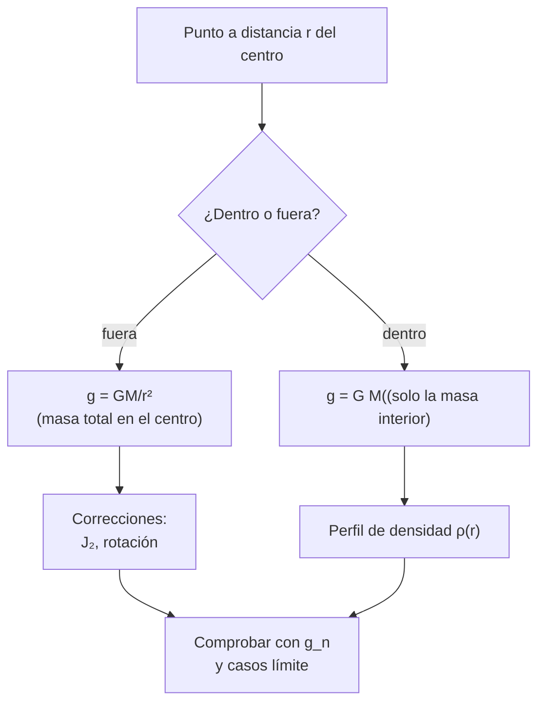

# B09-C20 — Aplicaciones a campos gravitatorios

<!-- nav:top -->
[🏠 Programa](../../../../README.md) · [📚 Bloque B09](../../../tronco-comun/B09-calculo-diferencial-e-integral.md) · [← Anterior: B09-C19 — Cálculo vectorial introductorio](../B09-C19-calculo-vectorial-introductorio/CLASE.md) · [Siguiente: B10-C01 — Espacios vectoriales →](../../B10/B10-C01-espacios-vectoriales/CLASE.md)
<!-- /nav -->

## 1. Ubicación, nivel y alcance

Vigésima y última clase del bloque B09. Reúne las herramientas del bloque (derivadas, integrales, series, gradiente, integrales múltiples, flujo y potencial) para responder una pregunta central de las ciencias espaciales: **¿cuál es el campo gravitatorio de un cuerpo extenso?** Nivel N4. Verás el teorema de la capa (a mano y por integración numérica), la gravedad dentro de una esfera uniforme y de un modelo de dos capas, y la corrección por el achatamiento (`J₂`) y la rotación. No verás armónicos esféricos de orden superior, geodesia de precisión ni relatividad (B13, B19).

## 2. Por qué esta clase existe

Una sonda en órbita, un satélite geodésico o un gravímetro en una montaña reciben la atracción de un cuerpo que no es un punto: tiene tamaño, forma achatada, rotación y estructura interna. Reducirlo a un punto es correcto fuera de una esfera homogénea, pero deja de serlo cuando importa el achatamiento o el interior. Decidir cuándo vale cada modelo es la competencia que cierra este bloque.

La decisión central: **¿cuándo puedo tratar un cuerpo como masa puntual, cómo cambia el campo dentro y fuera, y cuánto aportan el achatamiento y la rotación?**

## 3. Lo que podrás hacer al terminar

1. Enunciar y verificar el teorema de la capa por integración.
2. Calcular `g(r)` fuera y dentro de una esfera uniforme.
3. Calcular `g(r)` de un modelo de dos capas con la masa encerrada `M(<r)`.
4. Estimar la diferencia de gravedad entre el ecuador y el polo con `J₂` y la rotación.
5. Reconocer el rango de validez del modelo de masa puntual.
6. Integrar las herramientas del bloque en un cálculo con verificación y fuentes.

La evidencia es la **hoja de campo gravitatorio de un cuerpo extenso con verificación** del ejercicio 12 (sección 20).

## 4. Con qué llegas y cómo comprobarlo

Necesitas gradiente (C17), integrales triples (C18) y Gauss (C19). Cinco preguntas:

1. ¿Cuánto vale el flujo de `g` a través de una esfera que encierra una masa `M`?
2. Calcula `∫₀^π sin θ dθ`.
3. ¿Cuál es el volumen de una esfera de radio `r`?
4. ¿Cómo se obtiene `g` a partir del potencial?
5. ¿Qué es la densidad media?

<details>
<summary>Ver respuestas</summary>

1. `−4πGM`. 2. 2. 3. `4πr³/3`. 4. `g = −∇Φ`. 5. Masa entre volumen.
</details>

Con cuatro o cinco aciertos, sigue; si no, repasa C17–C19.

## 5. Un caso real: ¿pesa igual un kilogramo en el ecuador que en el polo?

La Tierra está achatada (`1/f = 298,257 222 101`, S3) y gira (`ω = 7,292 115 × 10⁻⁵ rad/s`, S3). Con el parámetro nominal `(GM)_E^N = 3,986 004 × 10¹⁴ m³ s⁻²` (S2), el coeficiente de achatamiento dinámico `J₂ = 1,082 63 × 10⁻³` y el radio ecuatorial `a_E = 6 378 137 m` (S3), un modelo de masa puntual con `J₂` y rotación da una gravedad efectiva de `9,7803 m/s²` en el ecuador y `9,8321 m/s²` en el polo, es decir, `0,0518 m/s²` más en el polo. El valor convencional `g_n = 9,806 65 m/s²` (S4) cae entre ambos. Es una **estimación del modelo** (no se contrastó con una medida geodésica publicada). **Ejemplo conductor:** el campo gravitatorio de un cuerpo extenso, en tres escalas: la capa, la esfera con núcleo y la Tierra achatada.

## 6. Vocabulario

El **teorema de la capa** (Newton): una capa esférica uniforme atrae a un punto exterior como si toda su masa estuviera en el centro y no atrae a un punto interior. El **potencial de una capa** de masa `M_s` y radio `a` es `−GM_s/r` si `r > a` y `−GM_s/a` si `r < a`. La **masa encerrada** `M(<r)` es la masa dentro del radio `r`. Para simetría esférica, `g(r) = GM(<r)/r²` (Gauss, C19; S1, §1.6(v)). El **achatamiento** `f = (a − c)/a` mide cuánto se aplana un esferoide. El coeficiente **`J₂`** mide el exceso de masa ecuatorial: en el potencial, `V = (GM/r)[1 − J₂ (a/r)² P₂(sin φ)]` con `P₂(s) = (3s² − 1)/2` y `φ` la latitud. La **gravedad efectiva** resta la aceleración centrífuga `ω² r cos²φ`. La **gravedad estándar** `g_n` es un valor convencional.

## 7. Modelo mental: lo de afuera cuenta como un punto; lo de adentro, solo lo que está más adentro

Al estar dentro de un cuerpo esférico, las capas más externas se compensan entre sí y no aportan: solo cuenta la masa que hay *por debajo* de ti. Al estar fuera, cuenta toda la masa, como si estuviera en el centro. Las desviaciones de la esfera (achatamiento, rotación) añaden correcciones pequeñas y ordenadas, que se estudian como una serie.



*Descripción textual:* según el punto esté fuera o dentro, el campo depende de la masa total o de la masa encerrada; las correcciones por achatamiento y rotación se añaden afuera y el perfil de densidad decide dentro; se comprueba con casos límite.

Analogía: una cebolla vista desde dentro: las capas de afuera no empujan; solo las de adentro. Su límite: la regla vale para capas **esféricas y uniformes**; una capa achatada o con irregularidades sí ejerce fuerza en el interior.

## 8. La explicación, paso a paso

### 8.1 El teorema de la capa por integración

El potencial en el punto a distancia `r` de una capa de radio `a` y masa `M_s` es `Φ(r) = −(GM_s/2) ∫₀^π sin θ dθ / √(r² + a² − 2 r a cos θ)` (se integró ya en el ángulo azimutal). Con la sustitución `u = r² + a² − 2ra cos θ` queda `∫ du/(2ra√u)`: `Φ = −(GM_s/(2ra)) [√u]`, evaluado entre `(r − a)²` y `(r + a)²`: si `r > a`, `√u` va de `r − a` a `r + a` y `Φ = −GM_s/r`; si `r < a`, de `a − r` a `a + r` y `Φ = −GM_s/a` (constante). El laboratorio verifica ambos casos para `r = 0,25a … 5a` con `1 × 10⁻⁶` de acuerdo (`−3,986 × 10⁷ J/kg` dentro y `−GM/r` fuera).

### 8.2 Esfera uniforme

Con `M(<r) = M (r/R)³` y el teorema, dentro `g(r) = GM r/R³`: lineal. En `r = R/2`, `g = g(R)/2 = 4,9101 m/s²` con `R = 6,371 × 10⁶ m`. Fuera, `g = GM/r²`: en `2R`, `g(R)/4`.

### 8.3 Modelo de dos capas

Con el núcleo sintético de `3500 km` y las densidades **estimadas** de C18 (`12 387` y `4147 kg/m³`), `M(<r)` es `(4π/3) ρ_c r³` hasta `r_c` y luego añade la contribución del manto. Valores del laboratorio: `r = 1000 km`: `M(<r)/M = 0,0087`, `g = 3,46 m/s²`; `3500 km`: `0,3725`, `12,12 m/s²`; `4500 km`: `0,5129`, `10,09`; `5500 km`: `0,7317`, `9,64`; `6371 km`: `1`, `9,82 m/s²`. En este modelo `g` no es monótona: sube hacia el núcleo, donde alcanza su máximo (`12,12 m/s²`), y en el manto es casi constante. Es consecuencia del modelo de juguete; no se comparó con un perfil sísmico.

### 8.4 La gravedad en la superficie desde el interior

En la superficie, `g(R) = GM/R² = 9,8202 m/s²` (con `R = 6,371 × 10⁶ m`), idéntico en el modelo de dos capas y en el de masa puntual: lo único que importa en la superficie es la masa total. Con el radio ecuatorial nominal sale `9,7984`. La diferencia es de 0,22 %: una forma de ver cuánto pesa elegir bien el radio (C13).

### 8.5 El achatamiento: `J₂`

Para un punto del eje del polo (`φ = 90°`, `P₂ = 1`) y del ecuador (`φ = 0`, `P₂ = −1/2`), el módulo de la atracción es `g = GM/r² [1 − 3 J₂ (a/r)² P₂]`. Ecuador: `r = a`: `GM/a² (1 + 3J₂/2) = 9,7983 · 1,001 624 = 9,8142 m/s²`. Polo: `r = c = a(1 − f) = 6 356 752,3 m`: `GM/c² [1 − 3J₂ (a/c)²] = 9,8321 m/s²` (laboratorio).

### 8.6 La rotación

La aceleración centrífuga en el ecuador es `ω² a_E = 0,033 92 m/s²`, el 0,346 % de `GM/a²`; en el polo es cero. La gravedad efectiva en el ecuador es `9,8142 − 0,0339 = 9,7803 m/s²`. La diferencia polo–ecuador de `0,0518 m/s²` (0,53 %) se debe en unos dos tercios a la rotación (`0,034`) y el resto a la diferencia de distancia al centro y al achatamiento.

### 8.7 Cuándo basta el punto

Fuera de una esfera homogénea el modelo puntual es exacto. Para la Tierra, el error de usar `GM/R²` con un `R` genérico es del orden de 0,5 %; la corrección de `J₂` en órbita decae como `(a/r)²` (a 400 km de altitud, `J₂ (a/r)² ≈ 9,6 × 10⁻⁴`): una corrección de esa magnitud no puede ignorarse en un seguimiento orbital preciso (B11, B13).

## 9. Magnitudes, símbolos y unidades

| Símbolo | Qué es | Unidad | Nota |
|---|---|---|---|
| `Φ(r)` | potencial | J/kg | capa: `−GM_s/r` o `−GM_s/a` |
| `M(<r)` | masa encerrada | kg | modelo de dos capas |
| `g(r)` | aceleración gravitatoria | m/s² | `GM(<r)/r²` |
| `GM` | parámetro gravitacional | m³/s² | `3,986 004 × 10¹⁴` (S2) |
| `J₂` | coeficiente de achatamiento dinámico | adimensional | `1,082 63 × 10⁻³` (S3) |
| `a_E`, `c` | radio ecuatorial y polar | m | 6 378 137 y 6 356 752,3 |
| `f` | achatamiento geométrico | adimensional | `1/298,257 222 101` (S3) |
| `ω` | velocidad angular | rad/s | `7,292 115 × 10⁻⁵` (S3) |
| `g_n` | gravedad estándar | m/s² | 9,806 65 exacta (S4) |

## 10. Convenciones y referencias

El potencial es negativo y se anula en el infinito. La gravedad efectiva incluye la aceleración centrífuga; la gravitacional pura, no. Los parámetros `J₂`, `a_E`, `ω` y `1/f` son los del sistema GRS80 (S3). `g_n` no es la gravedad de un lugar sino una convención. Las densidades de las capas son **estimadas** de un modelo de dos capas con núcleo sintético (C18): no deben usarse como datos geofísicos.

## 11. De dónde sale lo que afirmamos

| ID | Fuente | Localizador | Respalda | Estado |
|---|---|---|---|---|
| S1 | NIST, *Digital Library of Mathematical Functions* §1.6, versión 1.2.8 | https://dlmf.nist.gov/1.6 | Gauss (ec. 1.6.58) y gradiente (1.6.20) usados para `g = −∇Φ` y `g = GM(<r)/r²` | Consultada el 2026-11-05 mediante extracción automática |
| S2 | IAU, Resolución B3 de 2015, arXiv:1510.07674 | https://arxiv.org/pdf/1510.07674 | `(GM)_E^N = 3,986 004 × 10¹⁴ m³ s⁻²` | Texto extraído del PDF el 2026-11-05 |
| S3 | IERS, *IERS Conventions (2010)*, TN36, tablas 1.1–1.2 | https://iers-conventions.obspm.fr/content/tn36.pdf | `J₂ = 1,082 63 × 10⁻³`, `a_E = 6 378 137 m`, `ω = 7,292 115 × 10⁻⁵ rad/s`, `1/f = 298,257 222 101` | Texto extraído del PDF el 2026-11-05 |
| S4 | NIST, CODATA 2022, `g_n` | https://physics.nist.gov/cgi-bin/cuu/Value?gn | `g_n = 9,806 65 m s⁻²`, exacta | Consultada el 2026-11-05 |
| S5 | NASA/NSSDC, *Earth Fact Sheet* (actualizada 2024-11-15) | https://nssdc.gsfc.nasa.gov/planetary/factsheet/earthfact.html | Masa `5,9722 × 10²⁴ kg`; radio medio `6371,000 km`; `I/(MR²) = 0,3308` | Consultada el 2026-11-05 mediante extracción automática |

Límites: la fórmula del potencial con `J₂` es estándar de geodesia y **no se extrajo** de S3 (que da los valores numéricos); las gravedades ecuatorial y polar son **estimaciones del modelo**, no se contrastaron con una fuente de gravedad publicada. El núcleo y las densidades son sintéticos o estimados.

## 12. Cómo ver los perfiles

Equivalente accesible a la gráfica de `g(r)` (laboratorio):

| `r` (km) | `M(<r)/M` | `g` (m/s²) |
|---|---|---|
| 1000 | 0,0087 | 3,463 |
| 2000 | 0,0695 | 6,926 |
| 3500 | 0,3725 | 12,121 |
| 4500 | 0,5129 | 10,095 |
| 5500 | 0,7317 | 9,642 |
| 6371 | 1 | 9,820 |

Descripción larga: `g` crece linealmente en el núcleo (densidad constante), llega a un máximo en su borde, baja ligeramente en el manto y vuelve a subir un poco hacia la superficie; para una esfera uniforme sería una recta que sube hasta la superficie.

## 13. Ejemplo trabajado: gravedad en el ecuador y en el polo

**Paso 1 · Datos.** `GM = 3,986 004 × 10¹⁴`, `J₂ = 1,082 63 × 10⁻³`, `a = 6 378 137 m`, `ω = 7,292 115 × 10⁻⁵`, `1/f = 298,257 222 101`.

**Paso 2 · Ecuador, atracción.** `GM/a² = 9,7983`; factor `1 + 3J₂/2 = 1,001 624`; `9,8142 m/s²`.

**Paso 3 · Ecuador, centrífuga.** `ω² a = 0,033 92 m/s²`; efectiva: `9,7803 m/s²`.

**Paso 4 · Polo.** `c = a(1 − f) = 6 356 752,3 m`; `GM/c² = 9,8648`; factor `1 − 3 J₂ (a/c)² = 0,996 73`; `9,8321 m/s²`.

**Paso 5 · Comprobación y sentido.** Ambas quedan a los lados de `g_n = 9,806 65 m/s²` (S4), como debe ser para un valor convencional intermedio. Diferencia polo–ecuador: `0,0518 m/s²` (0,53 %). Estimaciones del modelo con constantes de GRS80, sin contrastar con mediciones.

## 14. Distintas formas de obtener el campo

**Masa puntual**: rápido, exacto fuera de una esfera homogénea. **Teorema de la capa y masa encerrada**: sirve para esferas con perfil radial. **Serie de armónicos esféricos** (`J₂`, `J₃`, …): para cuerpos achatados y órbitas. **Integración directa** (sumar sobre el volumen con una malla): general pero costosa. **Medidas** (gravímetros, seguimiento de satélites): son la referencia final. Cada nivel se justifica por la precisión pedida.

## 15. Práctica guiada

**Ejercicio 1 · con los pasos indicados.** Para una capa de radio `a = 10⁷ m` y `GM_s = 3,986 004 × 10¹⁴ m³/s²`, ¿cuánto vale el potencial en `r = 0,5a` y la gravedad allí? *Pasos:* teorema de la capa.

<details><summary>Solución comentada</summary>

Dentro: `Φ = −GM_s/a = −3,986 × 10⁷ J/kg`, constante, por lo que `g = −dΦ/dr = 0` (8.1).
</details>

**Ejercicio 2 · con una pista.** Calcula `g(R/2)` dentro de una esfera uniforme del tamaño de la Tierra (`R = 6,371 × 10⁶ m`, radio medio de S5). *Pista:* `g = GM r/R³`.

<details><summary>Solución comentada</summary>

`g(R) = GM/R² = 9,8202`; `g(R/2) = g(R)/2 = 4,9101 m/s²` (8.2).
</details>

**Ejercicio 3 · casi autónomo.** Calcula `g` en `2R` (fuera) con los nominales de la Tierra.

<details><summary>Solución comentada</summary>

`GM/(2R)² = 9,7984/4 = 2,4496 m/s²`.
</details>

## 16. Práctica autónoma, transferencia e integrador

**Ejercicio 4.** Con el modelo de dos capas, ¿cuánto vale `g` en `r = 3500 km` y por qué es máximo allí?

<details><summary>Solución comentada</summary>

`12,12 m/s²`. En el núcleo, `M(<r)` crece como `r³` y `g` como `r`; fuera de él, `M(<r)` crece más despacio que `r²` (el manto es menos denso), de modo que `g` baja (8.3).
</details>

**Ejercicio 5.** Calcula `M(<4500 km)/M` con las densidades del modelo y comprueba con el laboratorio.

<details><summary>Solución comentada</summary>

`(4π/3)[12 387 · (3,5 × 10⁶)³ + 4147 ((4,5 × 10⁶)³ − (3,5 × 10⁶)³)]/(5,9722 × 10²⁴) = 0,5129`.
</details>

**Ejercicio 6.** Por Gauss, ¿qué flujo de `g` hay a través de la esfera de 4500 km? Expresa `g(4500 km)` desde el flujo.

<details><summary>Solución comentada</summary>

Flujo `= −4πG M(<r)`; `g · 4π r² = 4πG M(<r)` → `g = GM(<r)/r² = 10,09 m/s²` (C19).
</details>

**Ejercicio 7.** Calcula la gravedad atractiva en el ecuador con `J₂`.

<details><summary>Solución comentada</summary>

`GM/a² (1 + 3J₂/2) = 9,7983 · 1,001 624 = 9,8142 m/s²` (8.5).
</details>

**Ejercicio 8.** Calcula la aceleración centrífuga en el ecuador y su fracción de `GM/a²`.

<details><summary>Solución comentada</summary>

`ω² a_E = (7,292 115 × 10⁻⁵)² · 6 378 137 = 0,033 92 m/s²`; fracción `0,346 %` (8.6).
</details>

**Ejercicio 9 · transferencia.** Con las gravedades del modelo en el ecuador y el polo, ¿dónde queda `g_n`? ¿Qué significa que sea «estándar»?

<details><summary>Solución comentada</summary>

`9,7803 < 9,806 65 < 9,8321`: entre ambas. Es un valor convencional exacto que se define para calibrar fuerzas y masas (S4), no la gravedad de un sitio concreto.
</details>

**Ejercicio 10 · transferencia.** Un estudiante calcula la gravedad a `R/2` dentro de la Tierra uniforme con `GM/r²` y obtiene `39,2 m/s²`. ¿Cuál es el error?

<details><summary>Solución comentada</summary>

Usó la masa total en vez de la encerrada. Dentro, `M(<r) = M/8` y `g = GM(<r)/r² = (GM/8)/(R/2)² = 4,90 m/s²`: ocho veces menor que `39,2`. La fórmula del punto vale solo fuera (8.2).
</details>

**Ejercicio 11 · transferencia.** «La gravedad aumenta siempre al descender hacia el centro.» Evalúa con el modelo de dos capas y con la esfera uniforme.

<details><summary>Solución comentada</summary>

En la esfera uniforme **disminuye** linealmente hacia el centro. En el modelo de dos capas baja primero (`9,82 → 9,64`) y sube después hacia el núcleo (`12,12 m/s²`). Depende del perfil de densidad; las cifras son del modelo de juguete de C18.
</details>

**Ejercicio 12 · integrador.** Elabora tu *hoja de campo gravitatorio de un cuerpo extenso con verificación*: potencial de una capa fuera y dentro (6 puntos), `g(r)` del modelo de dos capas (6 radios) con la comprobación `g(R) = GM/R²`, y la gravedad ecuatorial y polar con `J₂` y rotación frente a `g_n`; indica qué cifras son publicadas, estimadas o sintéticas.

<details><summary>Solución modelo</summary>

Tabla de la capa con `Φ` constante dentro (`−3,986 × 10⁷`) y `−GM/r` fuera; perfil `g(r)` como en la sección 12 con `g(R) = 9,8202`; gravedades `9,7803` y `9,8321`; clasificación: `GM`, `J₂`, `ω`, `g_n` publicados; densidades y gravedades de modelo estimadas; núcleo sintético.
</details>

## 17. Laboratorio: capa, interior y achatamiento

El script [teorema_de_la_capa_y_gravedad_interior.py](teorema_de_la_capa_y_gravedad_interior.py) verifica el teorema de la capa por integración numérica, calcula el perfil `g(r)` del modelo de dos capas, comprueba que `g(R) = GM/R²`, y estima la gravedad ecuatorial y polar con `J₂` y rotación, comprobando que `g_n` queda entre ellas.

**Datos:** nominales de la IAU y de GRS80, NASA y NIST; núcleo sintético. **Predice antes de ejecutar:** ¿qué potencial da una capa en un punto interior? (constante.) **Ejecución del 2026-11-05 (Python 3.12.9):**

```text
   r = 0.50 a: Phi numérico = -3.986004e+07;  esperado (-GM/a) = -3.986004e+07 J/kg
   r = 2.00 a: Phi numérico = -1.993002e+07;  esperado (-GM/r) = -1.993002e+07 J/kg
   3500   0.37250     12.1206
   6371   1.00000      9.8202
   esfera uniforme: g(R/2) = 4.9101 m/s2 (= g(R)/2 = 4.9101)
   g_ecuador = 9.7803 m/s2;  g_polo = 9.8321 m/s2;  diferencia = 0.0518 m/s2
   g_n = 9.80665 m/s2 queda entre ambas: True
Pruebas superadas.
```

```bash
python programa/clases/B09/B09-C20-aplicaciones-a-campos-gravitatorios/teorema_de_la_capa_y_gravedad_interior.py
```

**Límites:** cuerpo esférico en las partes 1–2; `J₂` solo; sin armónicos de orden superior; núcleo sintético; no es un modelo geodésico.

## 18. Errores frecuentes y cómo corregirlos

**Usar la masa total dentro del cuerpo.** Se corrige con el ejercicio 10.

**Creer que la gravedad siempre sube hacia el centro.** Se corrige con el ejercicio 11.

**Mezclar gravedad atractiva y efectiva.** Se corrige con la sección 8.6 y el ejercicio 8.

**Tomar las densidades del ajuste como datos.** Se corrige con la sección 10.

**Ignorar la elección del radio.** Se corrige con la sección 8.4.

## 19. Cómo sabrás que vas bien

Tras 8.1: ¿explicas por qué el potencial es constante dentro de la capa? Si no, ejercicio 1. Tras 8.2: ¿calculas `g` dentro de la esfera uniforme? Si no, ejercicio 2. Tras 8.5: ¿distingues atractiva y efectiva? Si no, ejercicios 7–8. Tras el laboratorio: ¿qué comprobación es independiente del modelo? (`g_n` entre ecuador y polo).

## 20. Qué entregas y cómo se evalúa

El producto es tu **hoja de campo gravitatorio de un cuerpo extenso con verificación** (ejercicio 12).

| Criterio | Inicial | En desarrollo | Logrado | Destacado |
|---|---|---|---|---|
| Teorema de la capa | Lo cita | Lo aplica | Lo verifica numéricamente | Lo deduce |
| Masa encerrada | Usa la total | Con ayuda | La usa bien | Interpreta el perfil |
| `J₂` y rotación | Ausentes | Una de las dos | Ambas | Cuantifica cada aporte |
| Clasificación de cifras | Mezcla | Parcial | Publicado, estimado y sintético | Justifica el uso de cada una |
| Fuentes | Sin fuente | Sin fecha | Con localizador y fecha | Declara los límites del modelo |

**Condiciones críticas (no se compensan con promedio):** distinguir dentro de fuera; clasificar publicado, estimado y sintético; citar solo fuentes consultadas.

## 21. Ética, seguridad y límites

Estas estimaciones no sirven para calibrar instrumentos, planificar órbitas ni hacer geodesia: esos trabajos usan modelos de gravedad publicados, marcos de referencia y revisión profesional. No presentes un modelo de juguete como el interior real de la Tierra. Accesibilidad: tablas equivalentes a los perfiles, fórmulas en texto, ejercicios sin conexión.

## 22. Para cerrar y seguir

Fuera de un cuerpo esférico el campo es el de un punto; dentro, solo cuenta la masa encerrada; el achatamiento y la rotación añaden correcciones de décimas de porcentaje en la superficie. Con esto cierras el bloque de cálculo: del límite al campo gravitatorio de un cuerpo extenso. Queda abierta una pregunta: ¿cómo se mueve una masa sometida a este campo? Es el estudio de las ecuaciones diferenciales (B11).

**Glosario español–inglés.** teorema de la capa · *shell theorem*; masa encerrada · *enclosed mass*; achatamiento · *flattening*; coeficiente `J₂` · *J2 coefficient (dynamic oblateness)*; gravedad efectiva · *effective gravity*; aceleración centrífuga · *centrifugal acceleration*; gravedad estándar · *standard gravity*; campo gravitatorio · *gravitational field*.

**Continuidad.** B11-C01 reutiliza tu capacidad de **expresar la aceleración como función de la posición** para plantear y resolver las ecuaciones de movimiento.

**Referencias:** ver sección 11.

<!-- nav:bottom -->
---

[← Anterior: B09-C19 — Cálculo vectorial introductorio](../B09-C19-calculo-vectorial-introductorio/CLASE.md) · [📚 Bloque B09](../../../tronco-comun/B09-calculo-diferencial-e-integral.md) · [Siguiente: B10-C01 — Espacios vectoriales →](../../B10/B10-C01-espacios-vectoriales/CLASE.md)
<!-- /nav -->
