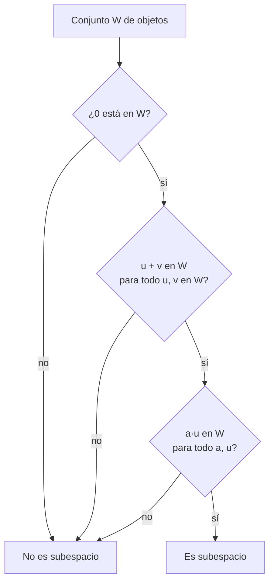

# B10-C01 — Espacios vectoriales

<!-- nav:top -->
[🏠 Programa](../../../../README.md) · [📚 Bloque B10](../../../tronco-comun/B10-algebra-lineal-y-matematicas-geometricas.md) · [← Anterior: B09-C20 — Aplicaciones a campos gravitatorios](../../../tronco-comun/B09-calculo-diferencial-e-integral.md#b09-c20) · [Siguiente: B10-C02 — Bases y dimensión →](../B10-C02-bases-y-dimension/CLASE.md)
<!-- /nav -->

## 1. Ubicación, nivel y alcance

Primera clase del bloque B10 y del álgebra lineal del programa. Ya trabajaste con vectores como flechas y componentes en [B04-C12](../../B04/B04-C12-vectores-y-componentes/CLASE.md) y con el producto escalar en [B04-C13](../../B04/B04-C13-producto-escalar-y-angulo-entre-vectores/CLASE.md). Aquí das el paso de abstracción: un **espacio vectorial** es cualquier colección de objetos que se puede sumar y escalar con las reglas de siempre, sin importar si los objetos son flechas, listas de seis números, polinomios o señales. Nivel N2. Verás qué es un espacio y un subespacio, cómo se comprueba y por qué algunas colecciones físicas lo son y otras no. No verás bases ni dimensión (C02), matrices (C03) ni producto interno (C06).

## 2. Por qué esta clase existe

El estado de un satélite en un instante se describe con seis números: tres de posición y tres de velocidad. Los programas de navegación suman, restan y multiplican por escalares esos «vectores de estado» todo el tiempo: promedian estimaciones, corrigen con un error medido, propagan pequeñas perturbaciones. Esas operaciones solo tienen sentido si el conjunto de objetos con el que trabajas está **cerrado** bajo ellas. ¿Es válido sumar dos órbitas circulares y obtener otra órbita circular? ¿Es válido sumar dos velocidades que están en un mismo plano orbital?

La decisión central: **¿este conjunto de objetos admite suma y escalamiento sin salirse de él, y por tanto puedo usar las herramientas del álgebra lineal?**

## 3. Lo que podrás hacer al terminar

1. Enunciar los ocho axiomas de un espacio vectorial real y reconocerlos en `ℝⁿ`.
2. Decidir si un subconjunto es un subespacio con la prueba de tres pasos (contiene al cero, cerrado bajo suma, cerrado bajo escalamiento).
3. Dar un contraejemplo preciso cuando un conjunto no es subespacio.
4. Reconocer ejemplos físicos: planos orbitales, soluciones de ecuaciones homogéneas, espacio de estados.
5. Explicar por qué la superposición vale para perturbaciones pequeñas y no para órbitas completas.
6. Comprobar por muestreo, con un programa, una propiedad de cierre.

La evidencia es la **ficha de subespacios** del ejercicio 12 (sección 20).

## 4. Con qué llegas y cómo comprobarlo

Necesitas manejar vectores en el espacio ([B04-C12](../../B04/B04-C12-vectores-y-componentes/CLASE.md)) y resolver ecuaciones lineales simples ([B04-C03](../../B04/B04-C03-sistemas-de-ecuaciones-elementales/CLASE.md)). Cinco preguntas:

1. Calcula `(2, −1, 3) + (1, 4, −2)`.
2. Calcula `3 · (1, −2, 0)`.
3. ¿Qué vector `u` cumple `v + u = v` para todo `v`?
4. ¿Es `(1, 2, 3)` solución de `x + y − z = 0`?
5. ¿Qué es el vector opuesto de `(a, b)`?

<details>
<summary>Ver respuestas</summary>

1. `(3, 3, 1)`. 2. `(3, −6, 0)`. 3. El vector cero. 4. Sí: `1 + 2 − 3 = 0`. 5. `(−a, −b)`.
</details>

Con cuatro o cinco aciertos, sigue; si no, repasa B04-C12.

## 5. Un caso real: el vector de estado de un satélite

Un satélite en órbita circular de 7000 km de radio alrededor de la Tierra se mueve a unos `7,546 km/s` (esto sale de `v = √(GM/r)` con el parámetro gravitacional terrestre nominal `GM = 3,986 005 × 10¹⁴ m³/s²`, S2). Su **vector de estado** `(x, y, z, vₓ, v_y, v_z)` tiene seis componentes: es un elemento de `ℝ⁶`. Los datos de esta clase son **sintéticos**: no corresponden a ningún satélite real. Este es el **ejemplo conductor**: ¿qué se puede sumar y escalar con esos vectores sin que dejen de ser lo que son?

## 6. Vocabulario

Un **espacio vectorial real** es un conjunto `V` con una suma `u + v` y un producto por escalares reales `a·u` que cumplen ocho propiedades: la suma es conmutativa y asociativa; existe un vector **cero** que no cambia nada; todo vector tiene un **opuesto**; y el producto por escalares es distributivo sobre la suma de vectores y de escalares, asociativo y con `1·u = u` (S1 usa `ℝⁿ` con estas operaciones en §1.2(v)). Un **escalar** es un número real. Un **subespacio** es un subconjunto de `V` que, con las mismas operaciones, es en sí un espacio vectorial; basta comprobar tres cosas (sección 8.3). Una **combinación lineal** de `u₁, …, u_k` es `a₁u₁ + … + a_k u_k`. El **espacio generado** (span) por un conjunto es el conjunto de todas sus combinaciones lineales. Un **contraejemplo** es un caso concreto que hace falsa una afirmación.

## 7. Modelo mental: el conjunto «cerrado»

Imagina una habitación sin puertas: lo que haces con los objetos de adentro (sumarlos, escalarlos) nunca te saca de la habitación. Un espacio vectorial es una «habitación» así.



*Descripción textual:* se comprueba primero que el cero pertenece; luego que la suma de dos elementos sigue dentro; luego que cualquier múltiplo sigue dentro. Un solo fallo basta para descartar el conjunto; las tres pruebas superadas para **todos** los elementos lo prueban.

Analogía: una habitación sin puertas. Su límite: en una habitación real puedes salir por una puerta que olvidaste; en matemática debes comprobar cada operación para cada par de elementos, no solo los que se te ocurren.

## 8. La explicación, paso a paso

### 8.1 Los ocho axiomas, en `ℝⁿ`

En `ℝⁿ` sumas componente a componente y multiplicas cada componente por el escalar. Las ocho propiedades se heredan de las de los números reales. Por ejemplo, en `ℝ⁶`: `(1, 0, 2, 0, 0, 1) + (0, 3, 0, 1, 0, 0) = (1, 3, 2, 1, 0, 1)`, y es lo mismo en el otro orden. El laboratorio comprueba los ocho axiomas con 200 muestras al azar: eso no los demuestra, pero detectaría un error de implementación.

### 8.2 Ejemplos y no ejemplos

`ℝ²`, `ℝ³`, `ℝ⁶` son espacios. El conjunto de **polinomios de grado a lo más 2** también: la suma de dos polinomios de grado ≤ 2 tiene grado ≤ 2 y un múltiplo también. En cambio, el conjunto de **polinomios de grado exactamente 2** no lo es: `(x² + x) + (−x²) = x` tiene grado 1, y el cero ni siquiera está. Las **señales** `s(t)` que oscilan con amplitud finita también forman un espacio (se usará en B15).

### 8.3 Prueba de subespacio en tres pasos

Para `W ⊆ V`: (1) `0 ∈ W`; (2) si `u, v ∈ W`, entonces `u + v ∈ W`; (3) si `u ∈ W` y `a` es escalar, entonces `a·u ∈ W`. Si las tres se cumplen, los ocho axiomas se heredan de `V`.

**Ejemplo.** `W = {(x, y, 0)}`, el plano `xy` de `ℝ³`. (1) `(0, 0, 0)` está. (2) `(x, y, 0) + (x′, y′, 0) = (x + x′, y + y′, 0)` está. (3) `a(x, y, 0) = (ax, ay, 0)` está. Es un subespacio.

**Contraejemplo.** `W = {(x, y, 1)}`, el plano `z = 1`: `(0, 0, 0)` no está, y `(1, 0, 1) + (0, 1, 1) = (1, 1, 2)` no está. No es subespacio. El plano `z = 1` pasa «al lado» del origen.

### 8.4 Soluciones de ecuaciones homogéneas

Una ecuación lineal homogénea es una de la forma `a x + b y + c z = 0`. Sus soluciones forman un subespacio: si `u` y `v` la cumplen, `a(u + v) = a u + a v = 0`, y `a(k u) = k·0 = 0`. La palabra clave es **homogénea** (lado derecho cero). Con lado derecho distinto de cero no hay subespacio (el origen no es solución). Esto explica por qué el plano orbital, que pasa por el centro de la Tierra, es un subespacio y un plano cualquiera, no.

### 8.5 El plano orbital

Para una órbita con posición `r` y velocidad `v`, el vector `h = r × v` (momento angular específico, [B04-C14](../../B04/B04-C14-producto-vectorial-y-orientacion/CLASE.md)) es perpendicular al plano orbital. Los vectores `x` con `x · h = 0` forman el plano orbital, que pasa por el origen: es un subespacio de `ℝ³` (es una ecuación homogénea). En el ejemplo del satélite sintético, `h = (0, 0, 52 822,4) km²/s`, así que el plano orbital es el plano `xy`. Un error de posición contenido en ese plano se puede sumar con otro y seguir en el plano.

### 8.6 Superposición: cuándo vale y cuándo no

Las **perturbaciones pequeñas** a una órbita obedecen, con muy buena aproximación, ecuaciones lineales (se verá en C19 y B11): si dos perturbaciones son posibles, su suma también lo es. Las **órbitas completas** no: la suma de los estados de dos órbitas circulares de igual radio, una en `θ = 0` y otra en `θ = 90°`, tiene posición `(7000, 7000, 0)` km, velocidad `(−7,546; 7,546; 0)` km/s y cumple `|r||v|²/GM = 2,83`, no `1`. No es una órbita circular. Conclusión: el conjunto de órbitas circulares **no es un subespacio**; el conjunto de pequeñas desviaciones respecto de una órbita de referencia sí se trata como tal.

## 9. Magnitudes, símbolos y unidades

| Símbolo | Qué es | Unidad | Nota |
|---|---|---|---|
| `V`, `W` | espacio y subespacio | — | conjuntos de vectores |
| `u, v` | vectores | según el caso | elementos de `V` |
| `a, b` | escalares reales | — | adimensionales |
| `0` | vector cero | igual que `V` | neutro de la suma |
| `r, v` | posición y velocidad | km, km/s | estado sintético |
| `h = r × v` | momento angular específico | km²/s | perpendicular al plano |
| `GM` | parámetro gravitacional | km³/s² | `3,986 005 × 10⁵` (S2) |

## 10. Convenciones y referencias

Escalares reales (no complejos) en toda la clase. Los vectores de `ℝⁿ` se escriben como columnas o como `(x₁, …, x_n)`. Estados en km y km/s, en un sistema inercial genérico centrado en la Tierra (sin precisar aún cuál; ver C16). Un conjunto vacío no es un subespacio, porque debe contener al cero.

## 11. De dónde sale lo que afirmamos

| ID | Fuente | Localizador | Respalda | Estado |
|---|---|---|---|---|
| S1 | NIST, *Digital Library of Mathematical Functions* §1.2(v)–(vi), versión vigente en línea al consultar (no se registró el número) | https://dlmf.nist.gov/1.2 | `ℝⁿ`, suma, producto por escalar, ortogonalidad (1.2.38–1.2.44); matrices especiales | Consultada el 2026-11-05 mediante extracción automática |
| S2 | IERS, *IERS Conventions (2010)*, TN36, tabla 1.2 (GRS80) | https://iers-conventions.obspm.fr/content/tn36.pdf | `GM⊕ = 3,986 005 × 10¹⁴ m³ s⁻²` | Texto extraído del PDF el 2026-11-05 |

Límites: los ocho axiomas se enuncian con el uso estándar; S1 no los lista uno por uno en las secciones leídas. Los estados orbitales son **sintéticos**. La superposición de perturbaciones se anuncia aquí y se justifica en C19.

## 12. Cómo ver los subespacios

Equivalente accesible a una figura de planos en `ℝ³`:

| Conjunto | ¿Contiene el 0? | ¿Suma cerrada? | ¿Escalamiento cerrado? | Veredicto |
|---|---|---|---|---|
| Plano `z = 0` | sí | sí | sí | subespacio |
| Plano orbital `x·h = 0` | sí | sí | sí | subespacio |
| Plano `z = 1` | no | no | no | no |
| Esfera unidad `|x| = 1` | no | no | no | no |
| Cuadrante `x ≥ 0, y ≥ 0` | sí | sí | no (`−1`) | no |

Descripción larga: imagina el espacio como una caja; los subespacios son planos o rectas que atraviesan el centro de la caja. Cualquier plano desplazado, o una cáscara esférica, no pasa por el centro.

## 13. Ejemplo trabajado: ¿es subespacio el plano orbital del satélite?

**Paso 1 · Datos.** `r = (7000, 0, 0)` km; `v = (0; 7,546; 0)` km/s (sintéticos).

**Paso 2 · Vector normal.** `h = r × v = (0, 0, 7000 · 7,546) = (0, 0, 52 822)` km²/s.

**Paso 3 · Conjunto.** `W = {x ∈ ℝ³ : x · h = 0} = {(x, y, 0)}`.

**Paso 4 · Prueba.** Cero: `0 · h = 0` ✓. Suma: `(u + v) · h = u · h + v · h = 0 + 0` ✓. Escalar: `(a u) · h = a (u · h) = 0` ✓.

**Paso 5 · Sentido.** Es un subespacio. Eso permite tratar los errores de posición contenidos en el plano orbital como un espacio de dimensión menor que 3 (C02). El resultado es una afirmación **exacta** sobre los datos sintéticos, no una estimación física.

## 14. Distintas formas de decidir

**Axiomas:** exacta, exige demostrar. **Prueba de tres pasos:** exacta, más corta. **Contraejemplo numérico:** basta uno para refutar. **Muestreo por programa:** detecta fallos pero no demuestra (si pasa 300 muestras puede fallar en un caso raro). Las cuatro deben coincidir; si el programa dice «no» y tu demostración «sí», hay un error en una.

## 15. Práctica guiada

**Ejercicio 1 · con los pasos indicados.** Calcula `u + v` y `2u − v` para `u = (2, −1, 3)`, `v = (1, 4, −2)`. *Pasos:* operar componente a componente (8.1).

<details><summary>Solución comentada</summary>

`u + v = (3, 3, 1)`. `2u = (4, −2, 6)`; `2u − v = (3, −6, 8)`.
</details>

**Ejercicio 2 · con una pista.** ¿Es `W = {(x, y, z) : x + y + z = 0}` un subespacio de `ℝ³`? *Pista:* ecuación homogénea (8.4).

<details><summary>Solución comentada</summary>

Sí. El cero cumple `0 = 0`. Si `u` y `v` suman cero en sus componentes, `u + v` también (`0 + 0`); y `a u` suma `a · 0 = 0`.
</details>

**Ejercicio 3 · casi autónomo.** Demuestra que `{(x, y, 1)}` no es subespacio, con dos razones distintas.

<details><summary>Solución comentada</summary>

(a) No contiene al `0 = (0, 0, 0)`. (b) `(1, 0, 1) + (0, 1, 1) = (1, 1, 2)` tiene tercera componente 2, no 1 (8.3).
</details>

## 16. Práctica autónoma, transferencia e integrador

**Ejercicio 4.** ¿Es el cuadrante `{(x, y) : x ≥ 0, y ≥ 0}` un subespacio de `ℝ²`? Si no, da el contraejemplo.

<details><summary>Solución comentada</summary>

No. Cero y suma están, pero `−1 · (1, 1) = (−1, −1)` sale del cuadrante: no es cerrado bajo escalamiento (12).
</details>

**Ejercicio 5.** Describe el conjunto de soluciones de `x + 2y + 3z = 0` y comprueba que `(−2, 1, 0)` y `(−3, 0, 1)` están en él. ¿Está su suma?

<details><summary>Solución comentada</summary>

`−2 + 2 = 0` ✓ y `−3 + 3 = 0` ✓. Suma `(−5, 1, 1)`: `−5 + 2 + 3 = 0` ✓. Es un plano por el origen (8.4).
</details>

**Ejercicio 6.** ¿Forman un espacio vectorial los polinomios de grado a lo más 2? Justifica el cierre con dos polinomios concretos.

<details><summary>Solución comentada</summary>

Sí. `(1 + 2x + x²) + (3 − x²) = 4 + 2x`; `5(1 + 2x + x²) = 5 + 10x + 5x²`; ambos de grado ≤ 2 (8.2).
</details>

**Ejercicio 7.** Con los estados sintéticos de 8.6, comprueba que `s₀ + s₁` no es órbita circular: calcula `|r||v|²/GM`.

<details><summary>Solución comentada</summary>

`|r| = 7000√2 = 9899,5` km; `|v|² = 2 · 56,943 = 113,89` km²/s²; producto `1,1274 × 10⁶`; dividido entre `GM = 3,986 × 10⁵` da `2,83 = 2√2`. Para una órbita circular debía dar 1. No es subespacio.
</details>

**Ejercicio 8.** Un conjunto contiene solo al vector `(1, 1)` y a sus múltiplos positivos. ¿Es subespacio? ¿Y si se permiten todos los múltiplos reales?

<details><summary>Solución comentada</summary>

Con múltiplos positivos, no: falta el cero y `−1 · (1, 1)`. Con todos los reales, sí: es la recta `y = x`, un subespacio.
</details>

**Ejercicio 9 · transferencia.** Un error de posición de un seguimiento satelital cumple `|e| ≤ 1 km`. ¿Forma un subespacio el conjunto de esos errores? ¿Y qué significa para sumar errores?

<details><summary>Solución comentada</summary>

No: contiene al cero, pero `(0,8; 0; 0) + (0,8; 0; 0) = (1,6; 0; 0)` tiene módulo 1,6 > 1; no es cerrado bajo la suma. Los errores se suman en la práctica, pero su cota no se conserva: se necesitará una regla de propagación (B12).
</details>

**Ejercicio 10 · transferencia.** Una cámara satelital apunta siempre perpendicular al eje `ĥ = (0, 0, 1)`. ¿Forman un subespacio los vectores de apuntado posibles? ¿De qué dimensión «intuitiva»?

<details><summary>Solución comentada</summary>

Los vectores `x` con `x · ĥ = 0` forman el plano `xy`, subespacio (8.5). Intuitivamente, dos grados de libertad (planos: dos números describen un vector). La dimensión se define bien en C02.
</details>

**Ejercicio 11 · transferencia.** Un compañero dice: «las órbitas circulares forman un espacio vectorial, porque `7000 km` más `7000 km` son `14 000 km`». Detecta el error.

<details><summary>Solución comentada</summary>

Confunde sumar **radios** (números) con sumar **estados** (vectores). Sumar vectores de estado no da un estado circular de radio doble (8.6, ejercicio 7). Además, un conjunto de órbitas a un radio fijo no contiene al 0.
</details>

**Ejercicio 12 · integrador.** Elabora tu **ficha de subespacios**: cinco conjuntos (al menos dos del contexto espacial), cada uno con veredicto, prueba de tres pasos o contraejemplo, y una comprobación por muestreo con el laboratorio.

<details><summary>Solución modelo</summary>

La tabla de la sección 12 ampliada: plano orbital, soluciones de una ecuación homogénea, polinomios de grado ≤ 2, esfera unidad, cuadrante. Para cada uno, prueba o contraejemplo y la línea del laboratorio. Cierre: «las perturbaciones se tratan como espacio; las órbitas completas no».
</details>

## 17. Laboratorio: axiomas y subespacios por muestreo

El script [espacios_vectoriales.py](espacios_vectoriales.py) comprueba los ocho axiomas en `ℝ⁶`, aplica la prueba de subespacio por muestreo a cuatro conjuntos y verifica que la suma de dos órbitas circulares sintéticas deja de serlo.

**Datos:** sintéticos; `GM` de IERS (S2). **Predice antes de ejecutar:** ¿qué conjunto fallará primero y por qué? **Ejecución del 2026-11-05 (Python 3.12.9, numpy 2.4.4):**

```text
R^6: 8 axiomas superados en 200 muestras
h = r x v = [    0.       -0.    52822.377] km2/s
plano z=0            : True - pasa el muestreo
plano orbital (x.h=0): True - pasa el muestreo
plano z=1            : False - no contiene al 0
esfera unidad        : False - no contiene al 0
s0+s1 es orbita circular? False | |r||v|^2/GM = 2.8284
Pruebas superadas.
```

```bash
python programa/clases/B10/B10-C01-espacios-vectoriales/espacios_vectoriales.py
```

**Límites:** el muestreo no es demostración; los estados son sintéticos; el modelo es de dos cuerpos.

## 18. Errores frecuentes y cómo corregirlos

**Olvidar comprobar el cero.** Se corrige con el ejercicio 3.

**Probar la suma con un solo par de ejemplos y declarar «cerrado».** Se corrige con el ejercicio 9.

**Creer que todo plano es subespacio.** Se corrige con el ejercicio 3 y la sección 8.4.

**Confundir sumar números (radios) con sumar vectores (estados).** Se corrige con el ejercicio 11.

**Aceptar el cierre bajo escalares positivos como si fuera cierre bajo todos.** Se corrige con el ejercicio 4.

## 19. Cómo sabrás que vas bien

Tras 8.3: ¿decides si `{(x, y, 1)}` es subespacio en menos de un minuto? Si no, ejercicio 3. Tras 8.4: ¿por qué una ecuación homogénea da subespacio? Si no lo sabes, ejercicio 5. Tras 8.6: ¿por qué la superposición vale para perturbaciones pero no para órbitas? Si no, ejercicio 7. Tras el laboratorio: ¿qué prueba te convencería más, el muestreo o la demostración?

## 20. Qué entregas y cómo se evalúa

El producto es tu **ficha de subespacios** (ejercicio 12).

| Criterio | Inicial | En desarrollo | Logrado | Destacado |
|---|---|---|---|---|
| Aplicación de la prueba | Omite pasos | Comprueba dos pasos | Los tres pasos | Los tres y justifica con álgebra |
| Contraejemplos | Ausentes | Vagos | Concretos | Mínimos y explicados |
| Contexto espacial | Sin relación | Menciona satélites | Plano orbital correcto | Distingue perturbación y órbita |
| Comprobación | Sin programa | Programa sin interpretar | Resultado correcto | Discute límite del muestreo |
| Fuentes y rotulado | Sin fuente | Sin fecha | Con localizador y fecha | Rotula sintético |

**Condiciones críticas (no se compensan con promedio):** probar los tres pasos o dar contraejemplo; rotular los datos sintéticos; citar solo fuentes consultadas.

## 21. Ética, seguridad y límites

Un conjunto «cerrado» en matemática no garantiza que un modelo físico lo sea: usar superposición fuera de su rango de validez puede dar trayectorias falsas. Esta clase no sirve para diseñar maniobras reales. Accesibilidad: tablas equivalentes a las figuras, fórmulas en texto, ejercicios sin conexión.

## 22. Para cerrar y seguir

Un espacio vectorial es un conjunto cerrado bajo suma y escalamiento; un subespacio lo prueba con tres pasos; el plano orbital y las soluciones homogéneas son subespacios; las órbitas completas no, las perturbaciones pequeñas sí (en buena aproximación). Queda abierta una pregunta: ¿cuántos números hacen falta para describir un vector de un subespacio?

**Glosario español–inglés.** espacio vectorial · *vector space*; subespacio · *subspace*; combinación lineal · *linear combination*; espacio generado · *span*; contraejemplo · *counterexample*; vector de estado · *state vector*; superposición · *superposition*.

**Continuidad.** B10-C02 reutiliza tu capacidad de **probar un subespacio** para definir base y dimensión.

**Referencias:** ver sección 11.

<!-- nav:bottom -->
---

[← Anterior: B09-C20 — Aplicaciones a campos gravitatorios](../../../tronco-comun/B09-calculo-diferencial-e-integral.md#b09-c20) · [📚 Bloque B10](../../../tronco-comun/B10-algebra-lineal-y-matematicas-geometricas.md) · [Siguiente: B10-C02 — Bases y dimensión →](../B10-C02-bases-y-dimension/CLASE.md)
<!-- /nav -->
