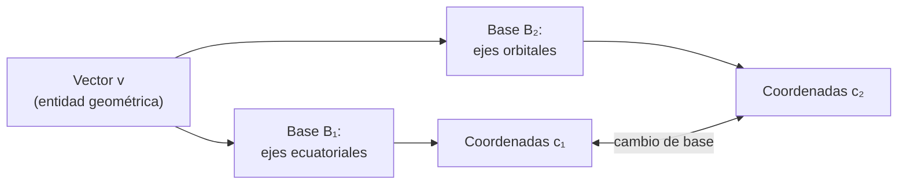

# B10-C02 — Bases y dimensión

<!-- nav:top -->
[🏠 Programa](../../../../README.md) · [📚 Bloque B10](../../../tronco-comun/B10-algebra-lineal-y-matematicas-geometricas.md) · [← Anterior: B10-C01 — Espacios vectoriales](../B10-C01-espacios-vectoriales/CLASE.md) · [Siguiente: B10-C03 — Matrices y operadores lineales →](../B10-C03-matrices-y-operadores-lineales/CLASE.md)
<!-- /nav -->

## 1. Ubicación, nivel y alcance

Segunda clase del bloque B10. En la [clase anterior](../B10-C01-espacios-vectoriales/CLASE.md) aprendiste a decidir si un conjunto es un espacio o subespacio. Aquí respondes cuántos números hacen falta para describir un vector de él y cómo se eligen: **base**, **coordenadas**, **independencia lineal**, **dimensión** y **rango**. Nivel N2. Usarás un plano orbital inclinado como ejemplo conductor. No verás matrices en general (C03) ni sistemas por eliminación (C05).

## 2. Por qué esta clase existe

Un vector es una entidad geométrica; sus «componentes» dependen de los ejes que elijas. Un operador de estación terrestre describe un satélite con ejes ligados al ecuador; el satélite mismo, con ejes ligados a su órbita; un instrumento, con ejes del instrumento. Es el mismo vector, con números distintos. Saber cambiar de ejes sin perder información exige entender qué es una base.

La decisión central: **¿qué conjunto mínimo de vectores describe todo el espacio, y cómo se obtienen las coordenadas de un vector en él?**

## 3. Lo que podrás hacer al terminar

1. Decidir si un conjunto de vectores es linealmente independiente.
2. Reconocer una base y contar la dimensión de un espacio o subespacio.
3. Calcular las coordenadas de un vector en una base dada (ortogonal o no).
4. Relacionar rango, nulidad y número de columnas.
5. Construir la base orbital (perifocal simplificada) de una órbita inclinada.
6. Detectar con un programa la dependencia entre vectores.

La evidencia es el **cuaderno de bases** del ejercicio 12 (sección 20).

## 4. Con qué llegas y cómo comprobarlo

Necesitas la prueba de subespacio ([C01](../B10-C01-espacios-vectoriales/CLASE.md)) y producto escalar ([B04-C13](../../B04/B04-C13-producto-escalar-y-angulo-entre-vectores/CLASE.md)). Cinco preguntas:

1. ¿Es el plano `x + y + z = 0` un subespacio de `ℝ³`?
2. Calcula `(1, 0, 0) · (0, 1, 0)`.
3. ¿Cuánto es `cos 50°`? (aprox.)
4. Resuelve `c₁ + c₂ = 3`, `c₂ = 1`.
5. ¿Cuándo dos vectores son proporcionales?

<details>
<summary>Ver respuestas</summary>

1. Sí (homogénea). 2. `0`. 3. `0,643`. 4. `c₂ = 1`, `c₁ = 2`. 5. Cuando uno es un múltiplo escalar del otro.
</details>

## 5. Un caso real: la base orbital de una órbita inclinada

Una órbita de inclinación `i` respecto del ecuador define tres direcciones naturales: la **línea de nodos** `P̂ = (1, 0, 0)` (donde la órbita corta el ecuador), una dirección `Q̂ = (0, cos i, sin i)` dentro del plano orbital y perpendicular a `P̂`, y la normal `Ŵ = (0, −sin i, cos i)`. Con `i = 50°` (valor **didáctico**, sin relación con un satélite real) estas tres direcciones son una base del espacio. Ejemplo conductor: expresar en ella un vector medido en ejes ecuatoriales.

## 6. Vocabulario

Un conjunto de vectores es **linealmente independiente** si ninguna combinación lineal no trivial da el cero; si no, es **dependiente**. Un **generador** produce el espacio por combinaciones lineales (espacio generado, C01). Una **base** es un generador linealmente independiente. Las **coordenadas** de `v` en la base `{b₁, …, b_n}` son los números `c_k` tales que `v = Σ c_k b_k`. La **dimensión** es el número de vectores de cualquier base. Una **base ortonormal** tiene vectores perpendiculares entre sí y de longitud 1 (S1: ortogonalidad, ec. 1.2.44). El **rango** de un conjunto de vectores es la dimensión de su espacio generado; la **nulidad** es el número de relaciones de dependencia independientes.

## 7. Modelo mental: ejes que se pueden cambiar

Una base es una **regla de medir** con ejes: los números que anotas dependen de la regla, el vector no.



*Descripción textual:* un mismo vector se expresa con dos listas de números según la base; el cambio de base convierte una lista en la otra sin alterar el vector.

Analogía: leer la misma temperatura en grados Celsius o Fahrenheit. Su límite: allí el cambio es una fórmula de una variable; aquí varios números se mezclan entre sí.

## 8. La explicación, paso a paso

### 8.1 Independencia

`(1, 2)` y `(2, 4)` son dependientes: `2·(1, 2) − (2, 4) = 0`. `(1, 0)` y `(0, 1)` son independientes: `a(1, 0) + b(0, 1) = (a, b) = 0` solo si `a = b = 0`. En general, para probar independencia planteas `a₁b₁ + … + a_k b_k = 0` y verificas que solo la solución trivial lo cumple.

### 8.2 Base y coordenadas

En `ℝ³` la base canónica es `{(1,0,0), (0,1,0), (0,0,1)}` y las coordenadas son las componentes habituales. Otra base: `b₁ = (1, 0, 0)`, `b₂ = (1, 1, 0)`, `b₃ = (0, 1, 1)`. Para `v = (3, 2, 1)` buscas `c₁, c₂, c₃` con `c₁b₁ + c₂b₂ + c₃b₃ = v`: la tercera componente da `c₃ = 1`; la segunda, `c₂ + c₃ = 2`, o sea `c₂ = 1`; la primera, `c₁ + c₂ = 3`, o sea `c₁ = 2`. Coordenadas `(2, 1, 1)`. Siempre es un sistema lineal (se resolverá sistemáticamente en C05).

### 8.3 Base ortonormal: coordenadas por producto escalar

Si la base es ortonormal, `c_k = b_k · v`: no hay que resolver nada. Con la base orbital (`i = 50°`) y `v = (3, 2, 1)`: `c_P = 3`; `c_Q = 2 cos 50° + sin 50° = 2,0516`; `c_W = −2 sin 50° + cos 50° = −0,8893`. Comprobación: `3 P̂ + 2,0516 Q̂ − 0,8893 Ŵ` devuelve `(3, 2, 1)`. Que la parte `Ŵ` sea negativa dice que `v` apunta ligeramente hacia el lado opuesto de la normal orbital.

### 8.4 Dimensión

Todas las bases de un espacio tienen el mismo número de vectores: eso es la dimensión. `ℝⁿ` tiene dimensión `n`. El plano `x + y + z = 0` tiene dimensión 2 (base `(1, −1, 0)`, `(0, 1, −1)`). Si un conjunto tiene más vectores que la dimensión, es dependiente; por ejemplo, cuatro vectores en `ℝ³`. Los polinomios de grado ≤ 3 tienen dimensión 4 (base `1, x, x², x³`).

### 8.5 Rango y nulidad

Para `{e₁, e₂, e₁ + e₂, e₃}` (cuatro vectores en `ℝ³`) el rango es 3 y la nulidad es 1, porque hay una relación independiente: `e₁ + e₂ − (e₁ + e₂) = 0`. Regla: **rango + nulidad = número de vectores**. En la práctica numérica el rango se calcula con valores singulares (C11): un valor casi cero indica dependencia aproximada.

### 8.6 Cuándo una base es «buena»

Una base ortonormal es cómoda (coordenadas por producto escalar) y numéricamente estable. Una base casi dependiente (vectores casi paralelos) da coordenadas enormes y muy sensibles al error: se verá en C05 y C11.

## 9. Magnitudes, símbolos y unidades

| Símbolo | Qué es | Unidad | Nota |
|---|---|---|---|
| `b_k` | vectores de una base | según el caso | elementos del espacio |
| `c_k` | coordenadas | igual que `v` | números |
| `P̂, Q̂, Ŵ` | ejes orbitales | adimensional | `‖·‖ = 1` |
| `i` | inclinación | grado o rad | 50° (didáctica) |
| `dim V` | dimensión | — | entero |

## 10. Convenciones y referencias

Los ejes orbitales de esta clase son una versión simplificada del sistema perifocal: `P̂` en la línea de nodos, `Q̂` a 90° dentro del plano, `Ŵ` normal; sistema derecho (`P̂ × Q̂ = Ŵ`). Los ángulos se miden en grados salvo indicación. Se trabaja en `ℝⁿ` con el producto escalar usual.

## 11. De dónde sale lo que afirmamos

| ID | Fuente | Localizador | Respalda | Estado |
|---|---|---|---|---|
| S1 | NIST, *Digital Library of Mathematical Functions* §1.2(v), versión vigente en línea al consultar | https://dlmf.nist.gov/1.2 | Producto escalar y ortogonalidad (1.2.40–1.2.44) | Consultada el 2026-11-05 mediante extracción automática |
| S2 | NIST, *DLMF* §1.3(iv) | https://dlmf.nist.gov/1.3 | Expansión en una base ortonormal (1.3.20–1.3.21) | Consultada el 2026-11-05 mediante extracción automática |

Límites: la definición de base, dimensión y rango sigue la exposición estándar de álgebra lineal; las secciones de S1 y S2 leídas no las definen explícitamente. La inclinación y el vector de ejemplo son **sintéticos**.

## 12. Cómo ver las bases

Equivalente accesible a una figura de tres ejes inclinados:

| Eje | Componentes en ejes ecuatoriales | Coordenada de `v = (3, 2, 1)` |
|---|---|---|
| `P̂` | `(1; 0; 0)` | `3,0000` |
| `Q̂` | `(0; 0,6428; 0,7660)` | `2,0516` |
| `Ŵ` | `(0; −0,7660; 0,6428)` | `−0,8893` |

Descripción larga: los ejes `Q̂` y `Ŵ` son los ejes `y` y `z` girados 50° alrededor de `x`; `P̂` no se mueve.

## 13. Ejemplo trabajado: coordenadas de una dirección en ejes orbitales

**Paso 1 · Datos.** Dirección al Sol (sintética) `v = (0, 1, 0)` en ejes ecuatoriales; `i = 50°`.

**Paso 2 · Coordenadas.** `c_P = 0`; `c_Q = cos 50° = 0,6428`; `c_W = −sin 50° = −0,7660`.

**Paso 3 · Comprobación de longitud.** `0² + 0,6428² + 0,7660² = 1`. Un vector unitario conserva su módulo al cambiar de base ortonormal.

**Paso 4 · Sentido.** El ángulo entre la dirección y el plano orbital es `arcsin |c_W| = arcsin 0,7660 = 50°`, igual a la inclinación, como debe ser: el eje `y` ecuatorial está inclinado 50° respecto del plano orbital, y el signo negativo dice que queda del lado opuesto a `Ŵ`. Dato sintético: ilustra el método, no una geometría real.

## 14. Distintas formas de obtener coordenadas

**Por producto escalar** (base ortonormal): directo. **Resolviendo un sistema** (base cualquiera): general (8.2). **Por programa** (`solve`): confirma. Si la base es ortonormal y los dos primeros métodos no coinciden, hay un error.

## 15. Práctica guiada

**Ejercicio 1 · con los pasos indicados.** ¿Son independientes `(1, 2)` y `(2, 4)`? *Pasos:* plantea `a(1,2) + b(2,4) = 0` (8.1).

<details><summary>Solución comentada</summary>

`a + 2b = 0` y `2a + 4b = 0` son la misma ecuación: `a = −2b`. Hay soluciones no triviales (`a = −2, b = 1`): dependientes.
</details>

**Ejercicio 2 · con una pista.** Halla las coordenadas de `(3, 2, 1)` en la base `b₁ = (1,0,0)`, `b₂ = (1,1,0)`, `b₃ = (0,1,1)`. *Pista:* empieza por la tercera componente.

<details><summary>Solución comentada</summary>

`(2, 1, 1)` (8.2). Comprobación: `2(1,0,0) + (1,1,0) + (0,1,1) = (3,2,1)` ✓.
</details>

**Ejercicio 3 · casi autónomo.** Da una base del plano `x + y + z = 0` y su dimensión.

<details><summary>Solución comentada</summary>

`(1, −1, 0)` y `(0, 1, −1)` son independientes y están en el plano; todo `(x, y, z)` con `z = −x − y` es `x(1, 0, −1) + y(0, 1, −1)`. Dimensión 2 (8.4).
</details>

## 16. Práctica autónoma, transferencia e integrador

**Ejercicio 4.** ¿Cuántos vectores independientes hay en `{e₁, e₂, e₁ + e₂, e₃}`? ¿Cuál es la nulidad?

<details><summary>Solución comentada</summary>

Rango 3, nulidad 1: `e₁ + e₂ − (e₁ + e₂) = 0` es la única relación independiente (8.5).
</details>

**Ejercicio 5.** Con la base orbital de `i = 50°`, calcula las coordenadas de `v = (0, 1, 0)` y comprueba que su módulo se conserva.

<details><summary>Solución comentada</summary>

`(0; 0,6428; −0,7660)`, módulo `√(0,4132 + 0,5868) = 1` (8.3 y 13).
</details>

**Ejercicio 6.** Escribe las coordenadas del polinomio `p = 2 + 3x − x³` en la base `{1, x, x², x³}`.

<details><summary>Solución comentada</summary>

`(2, 3, 0, −1)`. El espacio tiene dimensión 4 (8.4).
</details>

**Ejercicio 7.** ¿Forman base `(1,2,3)`, `(4,5,6)`, `(7,8,9)`? Justifica.

<details><summary>Solución comentada</summary>

No: `(7,8,9) = 2(4,5,6) − (1,2,3)`. Son dependientes; el rango es 2.
</details>

**Ejercicio 8.** Explica por qué cuatro vectores en `ℝ³` nunca son una base.

<details><summary>Solución comentada</summary>

Una base de `ℝ³` tiene 3 vectores (dimensión 3); cuatro vectores son siempre dependientes (8.4).
</details>

**Ejercicio 9 · transferencia.** Un sensor de nave da la dirección `(1, 2, 3)` en ejes de cuerpo. Los ejes de cuerpo expresados en ejes inerciales son `b₁ = (0,1,0)`, `b₂ = (−1,0,0)`, `b₃ = (0,0,1)`. ¿Cuál es la dirección en ejes inerciales?

<details><summary>Solución comentada</summary>

`1·b₁ + 2·b₂ + 3·b₃ = (0,1,0) + (−2,0,0) + (0,0,3) = (−2, 1, 3)`. Es el mismo vector, con otra lista de números.
</details>

**Ejercicio 10 · transferencia.** En el espacio de estados `ℝ⁶`, el conjunto de estados con posición cero ¿es subespacio? ¿De qué dimensión?

<details><summary>Solución comentada</summary>

Sí (`x = y = z = 0` es homogéneo, C01). Base: los tres vectores unitarios de velocidad. Dimensión 3.
</details>

**Ejercicio 11 · transferencia.** Un compañero dice: «tres vectores de `ℝ³` siempre forman una base». Da un contraejemplo.

<details><summary>Solución comentada</summary>

El del ejercicio 7, o `(1,0,0)`, `(2,0,0)`, `(0,1,0)`: son tres y generan solo un plano.
</details>

**Ejercicio 12 · integrador.** Elabora tu **cuaderno de bases**: (a) la base orbital para `i = 50°` con su comprobación de ortonormalidad; (b) las coordenadas de dos vectores en esa base y en una base no ortogonal; (c) un conjunto dependiente con su relación y su rango; (d) la lectura del laboratorio.

<details><summary>Solución modelo</summary>

(a) `BᵀB = I`; (b) tabla 12 y el caso `(2,1,1)`; (c) el de 8.5, rango 3, nulidad 1; (d) las seis líneas del laboratorio con lo que prueba cada una.
</details>

## 17. Laboratorio: coordenadas y rango

El script [bases_y_dimension.py](bases_y_dimension.py) construye la base orbital, calcula coordenadas en una base ortonormal y en otra que no lo es, y determina rangos.

**Datos:** sintéticos. **Predice antes de ejecutar:** ¿qué rango esperas para cuatro vectores en `ℝ³`? **Ejecución del 2026-11-05 (Python 3.12.9, numpy 2.4.4):**

```text
coordenadas de v en la base orbital: [ 3.        2.05162  -0.889301]
coordenadas en base no ortogonal   : [2. 1. 1.]
rango de 4 vectores en R^3 = 3 | nulidad = 1
rango de {1,x,x^2,x^3} evaluados en 9 puntos = 4
Pruebas superadas.
```

```bash
python programa/clases/B10/B10-C02-bases-y-dimension/bases_y_dimension.py
```

**Límites:** el rango numérico depende de un umbral (`10⁻¹⁰` relativo); datos sintéticos.

## 18. Errores frecuentes y cómo corregirlos

**Pensar que las coordenadas son el vector.** Se corrige con el ejercicio 9.

**Usar `c_k = b_k · v` con una base no ortonormal.** Se corrige con el ejercicio 2.

**Declarar base a un conjunto que no es independiente.** Se corrige con los ejercicios 7 y 11.

**Confundir dimensión del espacio con número de vectores dados.** Se corrige con el ejercicio 4.

**Olvidar que la base orbital debe ser derecha.** Se corrige con la sección 10.

## 19. Cómo sabrás que vas bien

Tras 8.1: ¿decides si dos vectores son dependientes sin calcular? Si no, ejercicio 1. Tras 8.3: ¿cuándo puedes usar producto escalar para las coordenadas? Si no, ejercicio 2. Tras 8.5: ¿qué suma rango más nulidad? Si no, ejercicio 4. Tras el laboratorio: ¿por qué `[2. 1. 1.]` y no `[3. 2. 1.]`?

## 20. Qué entregas y cómo se evalúa

El producto es tu **cuaderno de bases** (ejercicio 12).

| Criterio | Inicial | En desarrollo | Logrado | Destacado |
|---|---|---|---|---|
| Independencia | Sin criterio | Intuición | Planteo `Σ a b = 0` | Con rango y comprobación |
| Coordenadas | Errores de signo | Solo base canónica | Ortonormal y no ortonormal | Con verificación de reconstrucción |
| Dimensión y rango | Confunde | Cuenta vectores | Rango + nulidad correctos | Explica la dependencia hallada |
| Contexto espacial | Ausente | Menciona ejes | Base orbital correcta | Discute elección de ejes |
| Fuentes y rotulado | Sin fuente | Sin fecha | Con localizador y fecha | Rotula sintético |

**Condiciones críticas:** comprobar la reconstrucción `v = Σ c_k b_k`; rotular lo sintético; citar solo fuentes consultadas.

## 21. Ética, seguridad y límites

Elegir mal la base (casi dependiente) puede arruinar un cálculo sin que se note; declara siempre en qué ejes está cada número. Esta clase no define sistemas de referencia astronómicos oficiales (C16). Accesibilidad: tablas equivalentes a las figuras, fórmulas en texto, ejercicios sin conexión.

## 22. Para cerrar y seguir

Una base es un generador independiente; su tamaño es la dimensión; las coordenadas dependen de la base, el vector no; con base ortonormal se obtienen por producto escalar; rango más nulidad es el número de vectores. Queda abierta una pregunta: ¿cómo se transforman las coordenadas cuando cambia la base, y qué objeto representa esa transformación?

**Glosario español–inglés.** base · *basis*; coordenadas · *coordinates*; independencia lineal · *linear independence*; dimensión · *dimension*; rango · *rank*; nulidad · *nullity*; base ortonormal · *orthonormal basis*.

**Continuidad.** B10-C03 reutiliza tu capacidad de **expresar un vector en una base** para representar operadores con matrices.

**Referencias:** ver sección 11.

<!-- nav:bottom -->
---

[← Anterior: B10-C01 — Espacios vectoriales](../B10-C01-espacios-vectoriales/CLASE.md) · [📚 Bloque B10](../../../tronco-comun/B10-algebra-lineal-y-matematicas-geometricas.md) · [Siguiente: B10-C03 — Matrices y operadores lineales →](../B10-C03-matrices-y-operadores-lineales/CLASE.md)
<!-- /nav -->
