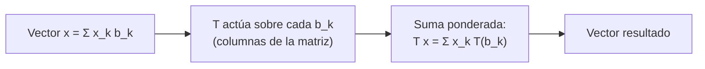

# B10-C03 — Matrices y operadores lineales

<!-- nav:top -->
[🏠 Programa](../../../../README.md) · [📚 Bloque B10](../../../tronco-comun/B10-algebra-lineal-y-matematicas-geometricas.md) · [← Anterior: B10-C02 — Bases y dimensión](../B10-C02-bases-y-dimension/CLASE.md) · [Siguiente: B10-C04 — Determinantes y soluciones →](../B10-C04-determinantes-y-soluciones/CLASE.md)
<!-- /nav -->

## 1. Ubicación, nivel y alcance

Tercera clase del bloque B10. En [C02](../B10-C02-bases-y-dimension/CLASE.md) aprendiste que un vector se describe con coordenadas en una base. Aquí aparece el objeto que **actúa** sobre los vectores: el **operador lineal**, y su descripción numérica, la **matriz**. Nivel N2. Verás la regla de linealidad, cómo se construye una matriz columna a columna, el producto como composición y por qué el orden importa. Ya rotaste puntos en [B04-C15](../../B04/B04-C15-rotacion-de-puntos-y-ejes/CLASE.md); aquí entiendes qué es esa rotación. No verás determinantes (C04), sistemas (C05) ni autovalores (C08).

## 2. Por qué esta clase existe

Una estación terrestre está fija respecto de la Tierra, pero la Tierra gira respecto del espacio inercial. Para saber dónde está la estación en el sistema inercial a cada instante hay que aplicar una transformación que depende del tiempo. Esa transformación es lineal y se escribe con una matriz. Lo mismo ocurre con un cambio de ejes, una proyección sobre un plano, una escala o una derivada.

La decisión central: **¿esta transformación es lineal y, si lo es, cuál es su matriz y en qué orden se componen varias?**

## 3. Lo que podrás hacer al terminar

1. Comprobar si una transformación es lineal.
2. Construir la matriz de un operador a partir de su efecto sobre una base.
3. Multiplicar matrices e interpretar el producto como composición.
4. Explicar y mostrar con un ejemplo por qué `AB ≠ BA` en general.
5. Calcular la posición inercial de una estación terrestre tras un tiempo `t`.
6. Representar la derivada de un polinomio como matriz.

La evidencia es la **hoja de operadores** del ejercicio 12 (sección 20).

## 4. Con qué llegas y cómo comprobarlo

Necesitas bases y coordenadas ([C02](../B10-C02-bases-y-dimension/CLASE.md)) y trigonometría básica. Cinco preguntas:

1. ¿Cuáles son las coordenadas de `(3, 4)` en la base canónica de `ℝ²`?
2. ¿Cuánto vale `cos 90°`? ¿y `sin 90°`?
3. Calcula `2 · 3 + (−1) · 5`.
4. ¿Cuánto es `360° / 24 h`?
5. Si `T(x) = 2x`, ¿cuánto es `T(3 + 4)` y `T(3) + T(4)`?

<details>
<summary>Ver respuestas</summary>

1. `(3, 4)`. 2. `0` y `1`. 3. `1`. 4. `15°/h`. 5. `14` y `14`.
</details>

## 5. Un caso real: una estación en una Tierra que gira

Una estación en el ecuador está a `6378,137 km` del centro (radio ecuatorial, S3). La Tierra gira con velocidad angular nominal `ω = 7,292 115 × 10⁻⁵ rad/s` (S2). En un plano ecuatorial simplificado, la posición inercial de la estación es la matriz de giro `R(ωt)` aplicada a su posición inicial. Después de una hora la estación está girada `15,0411°`. Estas cifras son **datos publicados**; el modelo (Tierra rígida, sin precesión ni movimiento polar) es una **simplificación didáctica**, válida para horas.

## 6. Vocabulario

Un **operador lineal** (o transformación lineal) `T` cumple `T(a u + b v) = a T(u) + b T(v)` para todo par de vectores y escalares. Una **matriz** `m × n` es una tabla de números con `m` filas y `n` columnas; actúa sobre un vector de `n` componentes y produce uno de `m` (S1 trata matrices como operadores lineales en §1.3(iv)). La **matriz de `T` en una base** tiene como `k`‑ésima columna las coordenadas de `T(b_k)`. El **producto matricial** `AB` aplica primero `B` y luego `A`. La **matriz identidad** `I` no cambia nada. La **transpuesta** `Aᵀ` intercambia filas y columnas. Una matriz es **cuadrada** si `m = n`. Una **proyección** deja un vector sobre un subespacio. Un operador **nilpotente** cumple `Tᵏ = 0` para algún `k`.

## 7. Modelo mental: la matriz es una receta de columnas

Una matriz dice qué hace el operador con cada vector de la base; todo lo demás sale por linealidad.



*Descripción textual:* se descompone el vector en la base, se aplica el operador a cada vector de la base (esas imágenes son las columnas) y se recombina con las mismas coordenadas.

Analogía: una máquina de panadería con una receta por ingrediente; mezclas las recetas según las cantidades. Su límite: en una máquina real las cantidades no pueden ser negativas, y aquí sí.

## 8. La explicación, paso a paso

### 8.1 Linealidad

`T(x) = 2x` es lineal. `T(x) = x + 1` no lo es: `T(0) = 1 ≠ 0`. Una **traslación** nunca es lineal, aunque sea muy común; por eso las traslaciones se tratan aparte (C16). La función norma `x → ‖x‖` tampoco es lineal: `‖−x‖ = ‖x‖ ≠ −‖x‖`.

### 8.2 Matriz columna a columna

Para la rotación en el plano un ángulo `θ` (antihorario): `T(1, 0) = (cos θ, sin θ)` y `T(0, 1) = (−sin θ, cos θ)`. Esas son las columnas:

`R(θ) = [[cos θ, −sin θ], [sin θ, cos θ]]`.

Con `θ = 90°`: `R = [[0, −1], [1, 0]]`, y `R(1, 0) = (0, 1)`.

### 8.3 Producto matricial

`(AB)ᵢⱼ = Σₖ Aᵢₖ Bₖⱼ`: fila de `A` por columna de `B`. Para `A = [[1, 2], [0, 1]]` y `B = [[1, 0], [3, 1]]`: `AB = [[7, 2], [3, 1]]` y `BA = [[1, 2], [3, 7]]`. **No conmutan**. Interpretación: aplicar primero un cizallamiento y luego otro no es lo mismo que hacerlo al revés. Las rotaciones del **mismo eje** sí conmutan: `R(30°)R(60°) = R(90°) = R(60°)R(30°)`; las de ejes distintos no (C13).

### 8.4 La estación que gira

`R(ωt)` con `ω = 7,292 115 × 10⁻⁵ rad/s` y `t = 3600 s` da `ωt = 0,262 516 rad = 15,0411°`. Posición inicial `(6378,137; 0)` km. Resultado: `(6378,137 cos 15,0411°; 6378,137 sin 15,0411°) = (6159,62; 1655,20)` km. El módulo se conserva (6378,137 km): la rotación no cambia longitudes. El periodo `2π/ω = 86 164,10 s = 23,93447 h`, que coincide con el periodo sideral de la ficha NASA (`23,9345 h`, S3). Es **menor** que 24 h porque el día solar incluye el avance de la Tierra en su órbita.

### 8.5 Un operador que no rota: la derivada

En polinomios de grado ≤ 3 con base `{1, x, x², x³}`, la derivada manda `1 → 0`, `x → 1`, `x² → 2x`, `x³ → 3x²`. Su matriz tiene esas imágenes en las columnas:

`D = [[0, 1, 0, 0], [0, 0, 2, 0], [0, 0, 0, 3], [0, 0, 0, 0]]`.

Para `p = 2 + 3x − x³`, con coordenadas `(2, 3, 0, −1)`, `D p = (3, 0, −3, 0)`, es decir, `3 − 3x²`. Derivar cuatro veces da cero: `D⁴ = 0` (nilpotente).

### 8.6 Proyección

La proyección sobre el plano `xy` en `ℝ³` es `P = diag(1, 1, 0)`. Cumple `P² = P`: proyectar dos veces es lo mismo que una. Perderás información (la componente `z`): no tiene operador inverso (C04).

## 9. Magnitudes, símbolos y unidades

| Símbolo | Qué es | Unidad | Nota |
|---|---|---|---|
| `T` | operador lineal | — | actúa sobre vectores |
| `A, B` | matrices | según el caso | `m × n` |
| `R(θ)` | rotación plana | adimensional | `θ` en rad |
| `ω` | velocidad angular terrestre | rad/s | `7,292 115 × 10⁻⁵` (S2) |
| `t` | tiempo transcurrido | s | |
| `D` | matriz de la derivada | — | sobre `{1,x,x²,x³}` |
| `I` | identidad | — | |

## 10. Convenciones y referencias

Los vectores son columnas; `A x` significa «`A` actúa sobre `x`». El ángulo positivo es antihorario visto desde el eje `z` positivo (regla de la mano derecha). Aquí `R(θ)` **rota el vector**; la convención de SPICE para matrices de transformación de marco usa el signo opuesto (C13 y C16 lo precisan). Se usa el valor nominal de `ω`: el real varía y se publica por el IERS.

## 11. De dónde sale lo que afirmamos

| ID | Fuente | Localizador | Respalda | Estado |
|---|---|---|---|---|
| S1 | NIST, *DLMF* §1.3(iv), versión vigente en línea al consultar | https://dlmf.nist.gov/1.3 | Matrices como operadores lineales; matrices ortogonales cuando las columnas son ortonormales | Consultada el 2026-11-05 mediante extracción automática |
| S2 | IERS, *IERS Conventions (2010)*, TN36, tabla 1.2 (GRS80) | https://iers-conventions.obspm.fr/content/tn36.pdf | `ω = 7,292 115 × 10⁻⁵ rad s⁻¹` nominal | Texto extraído del PDF el 2026-11-05 |
| S3 | NASA/NSSDC, *Earth Fact Sheet* (actualizada 2024-11-15) | https://nssdc.gsfc.nasa.gov/planetary/factsheet/earthfact.html | Radio ecuatorial 6378,137 km; periodo sideral de rotación 23,9345 h | Consultada el 2026-11-05 mediante extracción automática |

Límites: la matriz de la derivada, la proyección y las propiedades de la composición son resultados estándar sin cita específica. La estación y su giro son un **modelo simplificado**; los valores de `ω` y del radio son **datos publicados** con la precisión citada.

## 12. Cómo ver las matrices

Equivalente accesible a una figura de la estación girando:

| `t` (h) | Ángulo (°) | `x` (km) | `y` (km) |
|---|---|---|---|
| 0 | 0 | 6378,137 | 0 |
| 1 | 15,0411 | 6159,62 | 1655,20 |
| 6 | 90,2464 | −27,43 | 6378,08 |
| 23,93447 | 360 | 6378,137 | 0 |

Descripción larga: la estación recorre una circunferencia de radio constante en sentido antihorario; en 6 h pasa casi exactamente al eje `y` y en un periodo sideral regresa a su punto inicial.

## 13. Ejemplo trabajado: dónde está la estación a las 6 horas

**Paso 1 · Datos.** `ω = 7,292 115 × 10⁻⁵ rad/s`, `t = 21 600 s`, posición inicial `(6378,137; 0)` km.

**Paso 2 · Ángulo.** `ωt = 1,575 10 rad = 90,2464°`.

**Paso 3 · Matriz.** `R = [[cos, −sin], [sin, cos]]` con `cos = −0,004 300`, `sin = 0,999 991`.

**Paso 4 · Producto.** `R (6378,137; 0) = (6378,137 · cos; 6378,137 · sin) = (−27,43; 6378,08)` km.

**Paso 5 · Comprobación y sentido.** Módulo `√(27,43² + 6378,08²) = 6378,14` ✓. La estación pasó cerca del eje `y` inercial: un cuarto de vuelta aproximado. Dato publicado con modelo simplificado: la precisión de la posición angular depende de la precisión de `ω`.

## 14. Distintas formas de aplicar una transformación

**Con la matriz explícita:** claro, útil para componer. **Con la fórmula componente a componente:** equivalente. **Con un programa:** ideal para muchas estaciones; verifica con un caso conocido (periodo sideral, conservación del módulo). Deben coincidir; si el módulo cambia, hay un error.

## 15. Práctica guiada

**Ejercicio 1 · con los pasos indicados.** Aplica `R(90°)` a `(1, 0)` y a `(0, 1)`. *Pasos:* usa `R = [[0, −1], [1, 0]]` (8.2).

<details><summary>Solución comentada</summary>

`R(1, 0) = (0, 1)`; `R(0, 1) = (−1, 0)`. Son las columnas de la matriz.
</details>

**Ejercicio 2 · con una pista.** Calcula `AB` y `BA` para `A = [[1, 2], [0, 1]]` y `B = [[1, 0], [3, 1]]`. *Pista:* fila por columna.

<details><summary>Solución comentada</summary>

`AB = [[7, 2], [3, 1]]`; `BA = [[1, 2], [3, 7]]`. Distintas (8.3).
</details>

**Ejercicio 3 · casi autónomo.** Escribe la matriz de la derivada sobre polinomios de grado ≤ 2 y aplícala a `4 − x + 3x²`.

<details><summary>Solución comentada</summary>

`D = [[0,1,0],[0,0,2],[0,0,0]]`; `p = (4, −1, 3)`; `Dp = (−1, 6, 0)`, o sea `−1 + 6x` ✓ (8.5).
</details>

## 16. Práctica autónoma, transferencia e integrador

**Ejercicio 4.** ¿Es `T(x, y) = (x + 1, y)` un operador lineal? Justifica.

<details><summary>Solución comentada</summary>

No: `T(0, 0) = (1, 0) ≠ (0, 0)`. Es una traslación (8.1).
</details>

**Ejercicio 5.** Aplica `R(90°)` a `(2, 3)`.

<details><summary>Solución comentada</summary>

`(−3, 2)`: `[[0,−1],[1,0]] (2,3) = (0·2 − 3; 2 + 0)`.
</details>

**Ejercicio 6.** Calcula la posición de la estación a las 6 h y su módulo.

<details><summary>Solución comentada</summary>

`(−27,43; 6378,08)` km, módulo `6378,14` (sección 13).
</details>

**Ejercicio 7.** Comprueba que `R(30°)R(60°) = R(90°)`.

<details><summary>Solución comentada</summary>

`cos 30° cos 60° − sin 30° sin 60° = cos 90° = 0` y `sin 30° cos 60° + cos 30° sin 60° = sin 90° = 1`: primera columna `(0, 1)`. Coincide con `R(90°)` (8.3).
</details>

**Ejercicio 8.** Aplica `S = diag(2, 1)` a `(1, 1)` y describe el efecto geométrico.

<details><summary>Solución comentada</summary>

`(2, 1)`: estira el eje `x` por 2 y deja `y`.
</details>

**Ejercicio 9 · transferencia.** Calcula `2π/ω` en segundos y horas, y compáralo con las 24 h del día solar medio. ¿Cuántos segundos más corto es?

<details><summary>Solución comentada</summary>

`86 164,10 s = 23,93447 h`. `86 400 − 86 164,10 = 235,9 s`: la Tierra da una vuelta respecto de las estrellas unos 3 min 56 s antes que respecto del Sol. Coincide con la ficha (`23,9345 h`).
</details>

**Ejercicio 10 · transferencia.** Un instrumento solo registra la componente del vector en el plano `xy`. Escribe su matriz, aplícala a `(3, 2, 1)` y comprueba `P² = P`.

<details><summary>Solución comentada</summary>

`P = diag(1,1,0)`; `P(3,2,1) = (3,2,0)`; `P² = P` porque `1² = 1` y `0² = 0` (8.6). Pierde la componente `z`.
</details>

**Ejercicio 11 · transferencia.** Un compañero afirma que «aplicar primero una escala y luego un giro es igual que el giro y luego la escala». Refútalo con `S = diag(2,1)` y `R(30°)`.

<details><summary>Solución comentada</summary>

`RS − SR` tiene entradas `±0,5` fuera de la diagonal (laboratorio: `[[0, 0,5],[0,5, 0]]` para `AS − SA`). Distinto de cero: no conmutan.
</details>

**Ejercicio 12 · integrador.** Elabora tu **hoja de operadores**: tres operadores (rotación, escala o proyección, derivada) con su matriz, una comprobación de linealidad, un producto que no conmute y el cálculo de la estación a una hora elegida.

<details><summary>Solución modelo</summary>

Tabla de matrices (8.2, 8.5, 8.6), linealidad comprobada con `a=2, b=−3`, `AB ≠ BA` del ejercicio 2, y la estación a 6 h (sección 13), con fuentes S2–S3 y fecha.
</details>

## 17. Laboratorio: rotación terrestre y operadores

El script [matrices_y_operadores.py](matrices_y_operadores.py) aplica la rotación a una estación, verifica el periodo contra la ficha de la NASA, la no conmutatividad, la linealidad y la matriz de la derivada.

**Datos:** `ω` nominal (IERS), radio y periodo (NASA). **Predice antes de ejecutar:** ¿cuántos grados gira la Tierra en una hora? **Ejecución del 2026-11-05 (Python 3.12.9, numpy 2.4.4):**

```text
giro en 1 h = 15.0411 grados; estacion -> [6159.622 1655.199] km
periodo = 86164.10 s = 23.93447 h (ficha NASA: 23.9345 h)
A S - S A =
 [[0.  0.5]
 [0.5 0. ]]
D p = [ 3.  0. -3.  0.]
Pruebas superadas.
```

```bash
python programa/clases/B10/B10-C03-matrices-y-operadores-lineales/matrices_y_operadores.py
```

**Límites:** Tierra rígida, rotación uniforme; sin precesión ni movimiento polar; válido para horas.

## 18. Errores frecuentes y cómo corregirlos

**Suponer que `AB = BA`.** Se corrige con los ejercicios 2 y 11.

**Considerar lineal una traslación.** Se corrige con el ejercicio 4.

**Leer la matriz por filas en vez de por columnas.** Se corrige con el ejercicio 1.

**Mezclar radianes y grados.** Se corrige con los ejercicios 6 y 9.

**Olvidar que el producto aplica primero la matriz de la derecha.** Se corrige con la sección 8.3.

## 19. Cómo sabrás que vas bien

Tras 8.2: ¿construyes la matriz de una rotación de 45° sin mirarla? Si no, ejercicio 1. Tras 8.3: ¿cuándo conmutan dos rotaciones? Si no lo sabes, ejercicio 7. Tras 8.4: ¿por qué el periodo sideral es menor que 24 h? Si no, ejercicio 9. Tras el laboratorio: ¿qué comprobación impediría una rotación mal implementada?

## 20. Qué entregas y cómo se evalúa

El producto es tu **hoja de operadores** (ejercicio 12).

| Criterio | Inicial | En desarrollo | Logrado | Destacado |
|---|---|---|---|---|
| Linealidad | Sin criterio | Un ejemplo | Prueba con escalares | Contraejemplo y prueba |
| Construcción de la matriz | Al azar | Con ayuda | Columna a columna | Con comprobación de columnas |
| Composición | Orden confuso | Algunos errores | Producto y orden correctos | Muestra no conmutatividad |
| Contexto espacial | Sin unidades | Unidades parciales | Estación con módulo conservado | Discute límites del modelo |
| Fuentes y rotulado | Sin fuente | Sin fecha | Con localizador y fecha | Rotula publicado y simplificado |

**Condiciones críticas:** declarar unidades y ángulo en radianes; mostrar el orden de composición; citar solo fuentes consultadas.

## 21. Ética, seguridad y límites

Un modelo de rotación simplificado no sirve para apuntar antenas ni para predecir pasos de satélites con precisión: eso exige precesión, nutación, movimiento polar y `UT1` (C16, B13). Accesibilidad: tablas equivalentes a las figuras, fórmulas en texto, ejercicios sin conexión.

## 22. Para cerrar y seguir

Un operador lineal respeta suma y escalamiento; su matriz tiene por columnas las imágenes de la base; el producto es composición y no conmuta; la rotación terrestre se describe con `R(ωt)`. Queda abierta una pregunta: ¿cuándo una matriz se puede «deshacer» y cuándo la información se pierde para siempre?

**Glosario español–inglés.** operador lineal · *linear operator*; matriz · *matrix*; producto matricial · *matrix product*; transpuesta · *transpose*; identidad · *identity*; proyección · *projection*; nilpotente · *nilpotent*.

**Continuidad.** B10-C04 reutiliza tu capacidad de **componer y reconocer operadores** para estudiar cuándo son invertibles mediante el determinante.

**Referencias:** ver sección 11.

<!-- nav:bottom -->
---

[← Anterior: B10-C02 — Bases y dimensión](../B10-C02-bases-y-dimension/CLASE.md) · [📚 Bloque B10](../../../tronco-comun/B10-algebra-lineal-y-matematicas-geometricas.md) · [Siguiente: B10-C04 — Determinantes y soluciones →](../B10-C04-determinantes-y-soluciones/CLASE.md)
<!-- /nav -->
