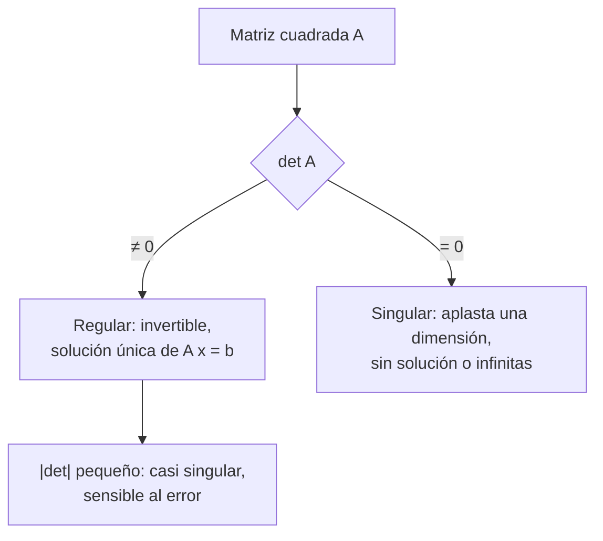

# B10-C04 — Determinantes y soluciones

<!-- nav:top -->
[🏠 Programa](../../../../README.md) · [📚 Bloque B10](../../../tronco-comun/B10-algebra-lineal-y-matematicas-geometricas.md) · [← Anterior: B10-C03 — Matrices y operadores lineales](../B10-C03-matrices-y-operadores-lineales/CLASE.md) · [Siguiente: B10-C05 — Sistemas lineales y eliminación →](../../../tronco-comun/B10-algebra-lineal-y-matematicas-geometricas.md#b10-c05)
<!-- /nav -->

## 1. Ubicación, nivel y alcance

Cuarta clase del bloque B10. En [C03](../B10-C03-matrices-y-operadores-lineales/CLASE.md) viste que una matriz es un operador y que la proyección pierde información. Aquí aparece un número que resume si una matriz cuadrada conserva o pierde información: el **determinante**. Nivel N2. Verás su definición para `2×2` y `3×3`, su sentido geométrico (área y volumen), sus propiedades, la regla de Cramer y el caso de la triangulación con dos estaciones. No verás eliminación general (C05) ni autovalores (C08).

## 2. Por qué esta clase existe

Dos estaciones terrestres miden la dirección hacia un mismo objeto y quieren fijar su posición cruzando las visuales. Si el objeto está cerca y las visuales forman un buen ángulo, el cruce es nítido. Si el objeto está muy lejos, las dos visuales casi se vuelven paralelas y un pequeño error de ángulo mueve mucho la solución. El determinante del sistema mide justamente eso.

La decisión central: **¿este sistema tiene solución única y, si la tiene, qué tan sensible es a los errores?**

## 3. Lo que podrás hacer al terminar

1. Calcular determinantes `2×2` y `3×3` por expansión en cofactores.
2. Interpretarlos como área o volumen con signo.
3. Usar las propiedades `det(AB) = det(A) det(B)` y `det(Aᵀ) = det(A)`.
4. Decidir si un sistema `A x = b` tiene solución única.
5. Resolver un sistema pequeño con la regla de Cramer.
6. Explicar la degradación de una triangulación cuando las visuales casi coinciden.

La evidencia es el **informe de geometría de visuales** del ejercicio 12 (sección 20).

## 4. Con qué llegas y cómo comprobarlo

Necesitas matrices y su producto ([C03](../B10-C03-matrices-y-operadores-lineales/CLASE.md)) y resolver sistemas `2×2` ([B04-C03](../../B04/B04-C03-sistemas-de-ecuaciones-elementales/CLASE.md)). Cinco preguntas:

1. Calcula `[[1, 2], [3, 4]] · (1, 1)`.
2. ¿Cuánto es el área de un rectángulo de lados 3 y 2?
3. Resuelve `x + y = 3`, `x − y = 1`.
4. Si `a·b = 0`, ¿qué sabes de `a` o `b`?
5. ¿Cuánto vale `cos² θ + sin² θ`?

<details>
<summary>Ver respuestas</summary>

1. `(3, 7)`. 2. `6`. 3. `x = 2, y = 1`. 4. Al menos uno es cero. 5. `1`.
</details>

## 5. Un caso real: triangulación con dos estaciones

Dos estaciones en `(0, 0)` y `(1000, 0)` km miden la dirección hacia un objeto. La posición verdadera (**sintética**, conocida para poder comprobar) es `(400, 600)` km. Cada estación define una recta; el objeto está en su cruce. El ejemplo conductor es resolver ese cruce y ver qué ocurre cuando el objeto se aleja. No hay datos reales en esta clase: el objetivo es la herramienta.

## 6. Vocabulario

El **determinante** de `[[a, b], [c, d]]` es `ad − bc`; el de una matriz `3×3` se obtiene por **expansión por cofactores**: se desarrolla por una fila sumando cada elemento por el determinante de la submatriz que queda al tachar su fila y columna, con signo alterno (S1, §1.3(i), ecs. 1.3.1–1.3.4). Un **menor** es ese determinante de la submatriz. Una matriz es **singular** si su determinante es 0, y **regular** en caso contrario. La **inversa** de `A`, si existe, cumple `A A⁻¹ = I`. La **regla de Cramer** da cada incógnita de `A x = b` como cociente de dos determinantes. El **área con signo** de un paralelogramo es el determinante de la matriz formada por sus lados.

## 7. Modelo mental: cuánto escala el operador

El determinante es el factor por el que el operador multiplica áreas (en 2D) o volúmenes (en 3D); su signo dice si invierte la orientación.



*Descripción textual:* si el determinante no es cero el operador es invertible y el sistema tiene una única solución; si es cero, aplasta el espacio y se pierde información; si es muy pequeño, está cerca de aplastar y la solución es sensible al ruido.

Analogía: una sombra. Una sombra completa (det = 0) no permite reconstruir el objeto; una sombra casi plana lo permite, pero con mucha incertidumbre. Su límite: una sombra real tiene siempre al menos un área, y el determinante puede ser exactamente cero.

## 8. La explicación, paso a paso

### 8.1 Determinante 2×2

`det [[a, b], [c, d]] = ad − bc`. Para `[[3, 1], [2, 4]]`: `12 − 2 = 10`. Geométricamente, es el área con signo del paralelogramo cuyos lados son las columnas `(3, 2)` y `(1, 4)`. Para `u = (3, 0)` y `v = (1, 2)` el área es `6` (el laboratorio lo comprueba).

### 8.2 Determinante 3×3

Por cofactores sobre la primera fila: `det A = a₁₁ M₁₁ − a₁₂ M₁₂ + a₁₃ M₁₃`, con `Mⱼ` el menor. Para `[[1,2,3],[0,1,4],[5,6,0]]`: `1·(0·1 − 4·6) − 2·(0·0 − 4·5) + 3·(0·6 − 1·5) = −24 + 40 − 15 = 1`. En una matriz triangular o diagonal, el determinante es el **producto de la diagonal**: `det [[2,0,0],[0,3,0],[1,1,4]] = 24`.

### 8.3 Propiedades

`det(AB) = det(A) det(B)` (S1, ec. 1.3.7); `det(Aᵀ) = det(A)`; `det(A⁻¹) = 1/det(A)` (S1, ec. 1.3.6); intercambiar dos filas cambia el signo; una fila nula o dos filas proporcionales dan `det = 0`. No vale `det(A + B) = det(A) + det(B)`: con `A = B = I` de `2×2`, `det(2I) = 4 ≠ 2`. Para la rotación `R(θ)`: `cos² θ + sin² θ = 1`; el determinante vale 1, así que conserva áreas y orientación.

### 8.4 Cuándo hay solución única

El sistema cuadrado `A x = b` tiene solución única si y solo si `det A ≠ 0`. Si `det A = 0` hay o ninguna solución o infinitas. Esto conecta con C02: `det A = 0` equivale a que las columnas sean linealmente dependientes (rango menor que `n`). Por ejemplo, `(1,2,3), (4,5,6), (7,8,9)` tienen determinante 0 porque `(7,8,9) = 2(4,5,6) − (1,2,3)`.

### 8.5 Regla de Cramer (2×2)

Para `2x + y = 5`, `x − y = 1`: `det = 2·(−1) − 1·1 = −3`. `x = det[[5, 1], [1, −1]]/(−3) = (−5 − 1)/(−3) = 2`; `y = det[[2, 5], [1, 1]]/(−3) = (2 − 5)/(−3) = 1`. La regla sirve para sistemas muy pequeños o para razonar; para sistemas grandes es demasiado costosa (C05).

### 8.6 Triangulación con dos visuales

Si el vector unitario de la estación 1 al objeto es `d₁` y el de la estación 2 es `d₂`, la posición `P` satisface `s₁ + t₁ d₁ = s₂ + t₂ d₂`, o sea `[d₁ −d₂][t₁; t₂] = s₂ − s₁`. Con `s₁ = (0, 0)`, `s₂ = (1000, 0)` y `P = (400, 600)`: `d₁ = (0,5547; 0,8321)` y `d₂ = (−0,7071; 0,7071)`. El determinante vale `−0,9806`, que es menos el seno del ángulo entre visuales (`78,69°`). Cramer da `t₁ = 721,1 km`, y `P = t₁ d₁ = (400; 600)` ✓.

Si el objeto está lejos, el ángulo entre las visuales se reduce y el determinante cae: con el objeto a `10³ km` de altura, `|det| = 0,796`; a `10⁵ km`, `0,010`; a `10⁷ km`, `10⁻⁴`. El número de condición (cuánto se amplifican los errores relativos) crece de `2` a `200` y a `20 000`. Cuando las visuales son exactamente paralelas el determinante es 0 y no hay cruce único.

## 9. Magnitudes, símbolos y unidades

| Símbolo | Qué es | Unidad | Nota |
|---|---|---|---|
| `det A` | determinante | según las unidades de las columnas | un número |
| `s₁, s₂` | posiciones de las estaciones | km | sintéticas |
| `d₁, d₂` | direcciones unitarias | adimensional | `‖d‖ = 1` |
| `t₁, t₂` | distancias a lo largo de cada visual | km | incógnitas |
| `P` | posición del objeto | km | verdad conocida (sintética) |
| `κ` | número de condición | adimensional | amplificación de error |

## 10. Convenciones y referencias

Plano `xy` en kilómetros; direcciones como vectores unitarios columna; determinantes con signo. Las filas se numeran desde 1. La expansión se hace siempre por la primera fila en el programa. El número de condición se calcula con la norma 2 (se define en C11).

## 11. De dónde sale lo que afirmamos

| ID | Fuente | Localizador | Respalda | Estado |
|---|---|---|---|---|
| S1 | NIST, *DLMF* §1.3(i), versión vigente en línea al consultar | https://dlmf.nist.gov/1.3 | Determinantes `2×2` y `3×3` y cofactores (1.3.1–1.3.4), determinante de la inversa (1.3.6), producto (1.3.7) | Consultada el 2026-11-05 mediante extracción automática |
| S2 | NIST, *DLMF* §1.2(vi) | https://dlmf.nist.gov/1.2 | Determinante, inversa y `n` ecuaciones con `n` incógnitas (1.2.58–1.2.61) | Consultada el 2026-11-05 mediante extracción automática |

Límites: la regla de Cramer, el sentido geométrico y el número de condición se tratan como resultados estándar sin cita específica. La geometría de las estaciones es **sintética**.

## 12. Cómo ver la triangulación

Equivalente accesible a una figura de dos rectas que se cruzan:

| Altura del objeto (km) | `\|det\|` | `κ` | Lectura |
|---|---|---|---|
| 600 (caso del texto) | 0,981 | 1,2 | cruce nítido |
| 1000 | 0,796 | 2,0 | bien condicionado |
| 100 000 | 0,010 | 200 | errores ×200 |
| 10 000 000 | 0,0001 | 20 000 | casi inservible |

Descripción larga: las dos rectas parten de puntos separados 1000 km; a mayor altura se acercan a la dirección vertical y el ángulo que forman tiende a cero.

## 13. Ejemplo trabajado: ¿qué tan bien fija la posición un objeto lejano?

**Paso 1 · Datos.** Estaciones en `(0, 0)` y `(1000, 0)` km; objeto (sintético) en `(500, 5000)` km.

**Paso 2 · Direcciones.** `d₁ = (0,0995; 0,9950)` y `d₂ = (−0,0995; 0,9950)`.

**Paso 3 · Determinante.** `det[d₁ −d₂] = 0,0995·(−0,9950) − 0,0995·(0,9950) = −0,198`.

**Paso 4 · Ángulo.** `sin(ángulo) = 0,198` → ángulo `≈ 11,4°`.

**Paso 5 · Sentido.** `κ = 10` (calculado con numpy): un error relativo de `1 %` en las direcciones puede llegar al `10 %` en la posición. Para un objeto a 600 km de altura el factor era de ~1,2. Es una **estimación de sensibilidad**, no una predicción de error real.

## 14. Distintas formas de resolver `A x = b`

**Cramer:** transparente para `2×2`. **Inversa:** `x = A⁻¹ b`; innecesario calcular la inversa completa. **Eliminación (C05):** estándar. **Biblioteca (`solve`):** rápida. Si el determinante es casi 0, ninguna da un resultado fiable: el problema, no el método, es el que está mal condicionado.

## 15. Práctica guiada

**Ejercicio 1 · con los pasos indicados.** Calcula `det [[3, 1], [2, 4]]` e interprétalo como área. *Pasos:* `ad − bc` (8.1).

<details><summary>Solución comentada</summary>

`3·4 − 1·2 = 10`. Es el área del paralelogramo de lados `(3,2)` y `(1,4)`.
</details>

**Ejercicio 2 · con una pista.** Calcula `det [[2,0,0],[0,3,0],[1,1,4]]`. *Pista:* es triangular inferior.

<details><summary>Solución comentada</summary>

Producto de la diagonal: `2·3·4 = 24` (8.2).
</details>

**Ejercicio 3 · casi autónomo.** Resuelve `2x + y = 5`, `x − y = 1` por Cramer.

<details><summary>Solución comentada</summary>

`det = −3`; `x = 2`, `y = 1`. Comprobación: `4 + 1 = 5`, `2 − 1 = 1` ✓ (8.5).
</details>

## 16. Práctica autónoma, transferencia e integrador

**Ejercicio 4.** Calcula `det [[1,2],[2,4]]` y explica por qué `A x = b` no tiene solución única.

<details><summary>Solución comentada</summary>

`4 − 4 = 0`. La segunda fila es el doble de la primera; las columnas son proporcionales (8.4).
</details>

**Ejercicio 5.** Comprueba `det(AB) = det A · det B` con `A = [[1,2],[0,1]]` y `B = [[1,0],[3,1]]`.

<details><summary>Solución comentada</summary>

`det A = 1`, `det B = 1`; `AB = [[7,2],[3,1]]`, `det = 7 − 6 = 1` ✓ (8.3).
</details>

**Ejercicio 6.** ¿Cuánto vale `det R(θ)`? ¿Qué implica para el área?

<details><summary>Solución comentada</summary>

`cos² θ + sin² θ = 1`. La rotación conserva áreas y orientación (8.3).
</details>

**Ejercicio 7.** Halla el volumen del paralelepípedo de lados `(1,0,0)`, `(1,2,0)`, `(1,1,3)`.

<details><summary>Solución comentada</summary>

Matriz con esas columnas: triangular superior `[[1,1,1],[0,2,1],[0,0,3]]`; `det = 6`.
</details>

**Ejercicio 8.** Calcula `det [[1,2,3],[0,1,4],[5,6,0]]` por cofactores.

<details><summary>Solución comentada</summary>

`1`, ver 8.2. Comprobación con el programa: `1,0`.
</details>

**Ejercicio 9 · transferencia.** Para el objeto en `(500, 5000)` km, comprueba `|det| = 0,198` y estima cuánto empeora la sensibilidad respecto del objeto en `(400, 600)`.

<details><summary>Solución comentada</summary>

Ver sección 13: `0,198` frente a `0,981`; `κ` pasa de 1,2 a 10, unas ocho veces más sensible. Estimación de orden de magnitud.
</details>

**Ejercicio 10 · transferencia.** Tres vectores de posición relativa de un enjambre de sensores son `(1,2,3)`, `(4,5,6)`, `(7,8,9)`. ¿Definen un volumen? ¿Qué dice eso de su geometría?

<details><summary>Solución comentada</summary>

`det = 0`: volumen nulo, los tres son coplanares (el tercero es `2·segundo − primero`). Con ellos no se puede triangular en 3D (8.4).
</details>

**Ejercicio 11 · transferencia.** Alguien dice que `det(A + B) = det A + det B` y que por eso «sumar sensores» no cambia el determinante. Da un contraejemplo.

<details><summary>Solución comentada</summary>

`A = B = I₂`: `det(A + B) = det(2I) = 4`, `det A + det B = 2` (8.3).
</details>

**Ejercicio 12 · integrador.** Elabora tu **informe de geometría de visuales**: para un par de estaciones elegidas, tres objetos sintéticos a distancias crecientes, con determinante, ángulo, número de condición y una frase de interpretación; incluye la comprobación por Cramer y por el programa.

<details><summary>Solución modelo</summary>

Tabla como la de la sección 12 con tres distancias, Cramer resuelto en una de ellas y su verificación con el laboratorio, declarando que los datos son sintéticos y que `κ` es una estimación de sensibilidad.
</details>

## 17. Laboratorio: determinantes y triangulación

El script [determinantes_y_soluciones.py](determinantes_y_soluciones.py) implementa el determinante por cofactores (comprobado contra numpy), verifica `det(AB) = det A det B`, resuelve la triangulación por Cramer y muestra la degradación con la distancia.

**Datos:** sintéticos. **Predice antes de ejecutar:** ¿qué pasa con `|det|` cuando el objeto se aleja? **Ejecución del 2026-11-05 (Python 3.12.9, numpy 2.4.4):**

```text
area del paralelogramo = 6.0
det = -0.980581  posicion recuperada = [400. 600.] km
objeto a      1000 km: |det| = 7.962e-01  cond = 2.016e+00
objeto a    100000 km: |det| = 1.000e-02  cond = 2.000e+02
objeto a  10000000 km: |det| = 1.000e-04  cond = 2.000e+04
visuales paralelas: det = 0: sin solucion unica
Pruebas superadas.
```

```bash
python programa/clases/B10/B10-C04-determinantes-y-soluciones/determinantes_y_soluciones.py
```

**Límites:** plano, sin ruido; la sensibilidad es un indicador, no un error medido.

## 18. Errores frecuentes y cómo corregirlos

**Restar mal `ad − bc` (cambiar de signo).** Se corrige con el ejercicio 1.

**Pensar que `det(A + B) = det A + det B`.** Se corrige con el ejercicio 11.

**Olvidar el signo alterno en los cofactores.** Se corrige con el ejercicio 8.

**Creer que `det ≠ 0` basta para un buen resultado numérico.** Se corrige con el ejercicio 9 y la sección 8.6.

**Usar Cramer en sistemas grandes.** Se corrige en la sección 14.

## 19. Cómo sabrás que vas bien

Tras 8.2: ¿calculas un `3×3` por cofactores y lo compruebas por otra fila? Si no, ejercicio 8. Tras 8.4: ¿ves por qué `det = 0` implica columnas dependientes? Si no, ejercicio 10. Tras 8.6: ¿por qué un objeto lejano se localiza peor? Si no, ejercicio 9.

## 20. Qué entregas y cómo se evalúa

El producto es tu **informe de geometría de visuales** (ejercicio 12).

| Criterio | Inicial | En desarrollo | Logrado | Destacado |
|---|---|---|---|---|
| Cálculo del determinante | Errores de signo | Algún error | Correcto en `2×2` y `3×3` | Con verificación cruzada |
| Interpretación | Sin sentido | Solo «es cero o no» | Área, volumen, invertibilidad | Relaciona con sensibilidad |
| Resolución | Sin método | Sustitución | Cramer correcto | Contrasta con programa |
| Contexto espacial | Sin geometría | Dibujo sin cifras | Tres distancias con `κ` | Discute límites del modelo |
| Fuentes y rotulado | Sin fuente | Sin fecha | Con localizador y fecha | Rotula sintético |

**Condiciones críticas:** comprobar al menos un resultado con un método independiente; rotular lo sintético; citar solo fuentes consultadas.

## 21. Ética, seguridad y límites

Una posición obtenida con visuales casi paralelas puede parecer precisa y no serlo. No uses este modelo para localizar objetos reales ni para tomar decisiones de maniobra o seguridad; la determinación orbital exige modelos de error (B12, B22). Accesibilidad: tablas equivalentes a las figuras, fórmulas en texto, ejercicios sin conexión.

## 22. Para cerrar y seguir

El determinante mide cuánto escala un operador el área o el volumen; cero significa información perdida; las propiedades de producto e inversa permiten razonar sin calcular; en una triangulación, el seno del ángulo entre visuales controla la calidad de la solución. Queda abierta una pregunta: ¿cómo se resuelven de forma ordenada y estable sistemas de decenas de ecuaciones?

**Glosario español–inglés.** determinante · *determinant*; cofactor · *cofactor*; menor · *minor*; matriz singular · *singular matrix*; matriz inversa · *inverse matrix*; regla de Cramer · *Cramer's rule*; triangulación · *triangulation*; número de condición · *condition number*.

**Continuidad.** B10-C05 reutiliza tu capacidad de **decidir si un sistema tiene solución única** para resolverlo por eliminación.

**Referencias:** ver sección 11.

<!-- nav:bottom -->
---

[← Anterior: B10-C03 — Matrices y operadores lineales](../B10-C03-matrices-y-operadores-lineales/CLASE.md) · [📚 Bloque B10](../../../tronco-comun/B10-algebra-lineal-y-matematicas-geometricas.md) · [Siguiente: B10-C05 — Sistemas lineales y eliminación →](../../../tronco-comun/B10-algebra-lineal-y-matematicas-geometricas.md#b10-c05)
<!-- /nav -->
