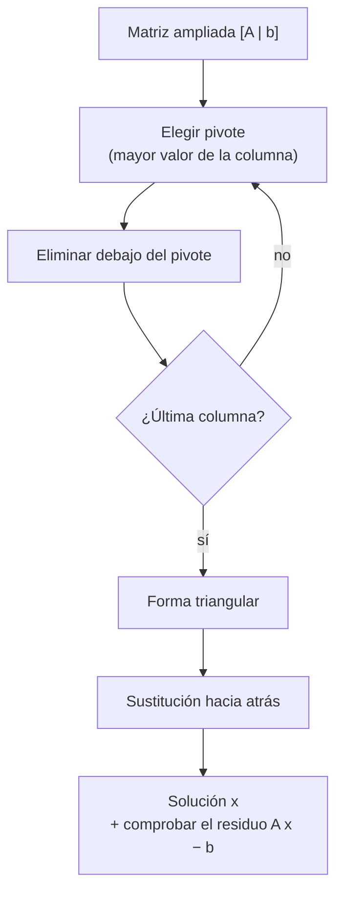

# B10-C05 — Sistemas lineales y eliminación

<!-- nav:top -->
[🏠 Programa](../../../../README.md) · [📚 Bloque B10](../../../tronco-comun/B10-algebra-lineal-y-matematicas-geometricas.md) · [← Anterior: B10-C04 — Determinantes y soluciones](../B10-C04-determinantes-y-soluciones/CLASE.md) · [Siguiente: B10-C06 — Producto interno y ortogonalidad →](../B10-C06-producto-interno-y-ortogonalidad/CLASE.md)
<!-- /nav -->

## 1. Ubicación, nivel y alcance

Quinta clase del bloque B10 y cierre del primer tramo. En [C04](../B10-C04-determinantes-y-soluciones/CLASE.md) supiste cuándo un sistema `A x = b` tiene solución única y viste que la sensibilidad puede ser enorme. Aquí aprendes el método con el que se resuelve de verdad: la **eliminación gaussiana** con **pivoteo**, y cómo medir cuánto confiar en el resultado. Nivel N2. Verás eliminación, sustitución hacia atrás, sistemas sin solución o con infinitas, pivoteo, número de condición y una trilateración plana. No verás factorizaciones formales (C10) ni mínimos cuadrados (C07).

## 2. Por qué esta clase existe

Para fijar la posición de un objeto a partir de las distancias a tres estaciones se plantean tres ecuaciones con dos incógnitas (plano). Los sistemas reales tienen decenas o miles de incógnitas: parámetros orbitales, sesgos de relojes, coeficientes de calibración. Calcularlos con la regla de Cramer sería inviable y calcular la inversa, innecesario. La eliminación es el método estándar de todas las bibliotecas.

La decisión central: **¿cómo resuelvo `A x = b` de forma ordenada y estable, y cómo sé si la respuesta es de fiar?**

## 3. Lo que podrás hacer al terminar

1. Resolver un sistema pequeño por eliminación gaussiana y sustitución hacia atrás.
2. Clasificar un sistema: solución única, ninguna o infinitas.
3. Explicar y aplicar el pivoteo parcial.
4. Estimar la pérdida de cifras con el número de condición.
5. Plantear y resolver una trilateración plana.
6. Contar el costo aproximado de la eliminación.

La evidencia es la **bitácora de eliminación** del ejercicio 12 (sección 20).

## 4. Con qué llegas y cómo comprobarlo

Necesitas determinantes y la idea de matriz singular ([C04](../B10-C04-determinantes-y-soluciones/CLASE.md)) y sistemas pequeños ([B04-C03](../../B04/B04-C03-sistemas-de-ecuaciones-elementales/CLASE.md)). Cinco preguntas:

1. Resuelve `x + y = 3`, `x − y = 1`.
2. ¿Qué significa `det A = 0`?
3. Si `y = 2` y `x + y = 5`, ¿cuánto es `x`?
4. ¿Cuánto es `2·(1000, 200)·(400, 600)` (producto escalar por 2)?
5. ¿Qué es una matriz triangular superior?

<details>
<summary>Ver respuestas</summary>

1. `x = 2, y = 1`. 2. Que la matriz es singular: no hay solución única. 3. `3`. 4. `2·(400 000 + 120 000) = 1 040 000`. 5. Una con ceros debajo de la diagonal.
</details>

## 5. Un caso real: trilateración plana

Tres estaciones en `(0, 0)`, `(1000, 200)` y `(300, 1000)` km miden la distancia a un objeto. La posición verdadera (**sintética**, para poder comprobar) es `(400, 600)` km y las distancias son exactas: `721,11`, `721,11` y `412,31` km. Cada distancia da una circunferencia; restando la primera ecuación a las otras dos desaparecen los términos cuadráticos y queda un sistema **lineal** `2×2` para la posición. Es el ejemplo conductor y es una versión plana de cómo funcionan los sistemas de navegación por distancias.

## 6. Vocabulario

Un **sistema lineal** es un conjunto de ecuaciones lineales `A x = b`. La **matriz ampliada** `[A | b]` junta los coeficientes y los términos independientes. Una **operación elemental de fila** es intercambiar dos filas, multiplicar una por un número no nulo, o sumar a una fila un múltiplo de otra; no cambian las soluciones. La **eliminación gaussiana** las usa para llegar a una forma triangular superior. La **sustitución hacia atrás** despeja desde la última ecuación. Un **pivote** es el elemento de la diagonal usado para eliminar. El **pivoteo parcial** elige como pivote el mayor valor absoluto de la columna. Un sistema es **compatible** si tiene solución e **incompatible** si no (S1, §1.2(vi): `n` ecuaciones con `n` incógnitas). El **número de condición** `κ(A)` mide cuánto puede amplificarse el error relativo (se define con valores singulares en C11).

## 7. Modelo mental: escalera y descenso

Eliminar es convertir el sistema en una escalera; luego bajas escalón por escalón.



*Descripción textual:* se elige un pivote, se anulan los elementos debajo de él, se repite con la columna siguiente; con la matriz triangular se despeja de abajo hacia arriba y se comprueba sustituyendo en el sistema original.

Analogía: una escalera que se construye peldaño a peldaño. Su límite: si un peldaño es casi inexistente (pivote diminuto), la escalera es inestable aunque exista.

## 8. La explicación, paso a paso

### 8.1 Un sistema 3×3 a mano

`x + y + z = 6`, `2x − y + z = 3`, `x + 2y − z = 2`. A la fila 2 le restas 2 veces la fila 1: `(0, −3, −1 | −9)`. A la fila 3 le restas la fila 1: `(0, 1, −2 | −4)`. A la fila 3 le sumas `1/3` de la nueva fila 2: `(0, 0, −7/3 | −7)`. Entonces `z = 3`; luego `−3y − 3 = −9` da `y = 2`; y `x + 2 + 3 = 6` da `x = 1`. Comprobación en la primera ecuación: `1 + 2 + 3 = 6` ✓.

### 8.2 Sin solución o con infinitas

`x + y = 1`, `2x + 2y = 3`: al eliminar queda `0 = 1`, imposible: **incompatible**. `x + y = 1`, `2x + 2y = 2`: queda `0 = 0`: **infinitas** soluciones (`x = 1 − y`). Ambos casos corresponden a `det A = 0` (C04) y a columnas dependientes (C02).

### 8.3 Pivoteo

Con `[[10⁻²⁰, 1], [1, 1]] x = (1, 2)`, la solución exacta es casi `(1, 1)`. Si usas `10⁻²⁰` como pivote, el multiplicador es `10²⁰` y los números pequeños se pierden en la resta: el programa devuelve `(0, 1)`, incorrecto. Si intercambias filas (pivoteo) y usas `1` como pivote, obtienes `(1, 1)`. Regla: **siempre pivotea**, aunque la matriz sea regular.

### 8.4 La trilateración

Para `|P − sₖ|² = rₖ²`, resta la primera ecuación a las demás: `2(sₖ − s₁)·P = |sₖ|² − |s₁|² − (rₖ² − r₁²)`. Con los datos: `[[2000, 400], [600, 2000]] P = (1 040 000; 1 440 000)`. A la fila 2 le restas `0,3` veces la fila 1: `(0, 1880 | 1 128 000)`, así que `y = 600`; luego `2000x = 1 040 000 − 240 000`, `x = 400` ✓. El número de condición es `κ = 1,67`: bien condicionado.

### 8.5 Mal condicionamiento

Con estaciones casi alineadas (`(0,0)`, `(500; 0,001)`, `(1000; 0,0025)`) el sistema es casi singular: `κ = 5 × 10⁶`. La matriz de Hilbert da otro ejemplo: `κ = 1,5 × 10⁴` para `n = 4`, `1,5 × 10¹⁰` para `n = 8` y `1,8 × 10¹⁶` para `n = 12`, y los errores observados al resolver con solución conocida son `1,5 × 10⁻¹³`, `7,0 × 10⁻⁸` y `0,52`. Regla práctica: se pierden unas `log₁₀ κ` cifras de las 16 de la aritmética de doble precisión; con `κ ≈ 10¹⁶` no queda ninguna.

### 8.6 Costo

La eliminación cuesta unas `2n³/3` operaciones: unas `7 × 10⁸` para `n = 1000` y ocho veces más al duplicar `n`. Por eso no se calcula la inversa y por eso se aprovechan estructuras especiales (matrices dispersas, B21).

## 9. Magnitudes, símbolos y unidades

| Símbolo | Qué es | Unidad | Nota |
|---|---|---|---|
| `A` | matriz de coeficientes | según el caso | `n × n` |
| `b` | términos independientes | según el caso | |
| `x` | incógnitas | según el caso | |
| `sₖ` | posición de la estación `k` | km | sintética |
| `rₖ` | distancia medida | km | exacta (sintética) |
| `P` | posición buscada | km | |
| `κ(A)` | número de condición | adimensional | `≥ 1` |
| `ε` | épsilon de máquina | adimensional | `≈ 1,1 × 10⁻¹⁶` en doble precisión |

## 10. Convenciones y referencias

Plano `xy` en km. Las filas de `[A | b]` se numeran desde 1. El pivoteo es parcial (por columnas). `κ` se calcula con la norma 2 con la función de la biblioteca. Un sistema se da por resuelto solo cuando se ha comprobado el **residuo** `A x − b`.

## 11. De dónde sale lo que afirmamos

| ID | Fuente | Localizador | Respalda | Estado |
|---|---|---|---|---|
| S1 | NIST, *DLMF* §1.2(vi), versión vigente en línea al consultar | https://dlmf.nist.gov/1.2 | Inversa y `n` ecuaciones lineales con `n` incógnitas (1.2.60–1.2.61) | Consultada el 2026-11-05 mediante extracción automática |

Límites: el algoritmo de eliminación, el pivoteo, el conteo de operaciones y la relación entre `κ` y la pérdida de cifras son resultados estándar de análisis numérico sin cita específica; DLMF §3.2 los trata, pero no fue consultada. Los datos de la trilateración son **sintéticos**.

## 12. Cómo ver la eliminación

Equivalente accesible a un diagrama de escalera, para el sistema de 8.1:

| Paso | Fila 1 | Fila 2 | Fila 3 |
|---|---|---|---|
| Inicial | `1, 1, 1 \| 6` | `2, −1, 1 \| 3` | `1, 2, −1 \| 2` |
| Tras eliminar columna 1 | `1, 1, 1 \| 6` | `0, −3, −1 \| −9` | `0, 1, −2 \| −4` |
| Tras eliminar columna 2 | `1, 1, 1 \| 6` | `0, −3, −1 \| −9` | `0, 0, −7/3 \| −7` |

Descripción larga: cada paso deja ceros debajo del pivote, hasta formar una matriz triangular superior.

## 13. Ejemplo trabajado: trilateración con tres estaciones

**Paso 1 · Datos.** Estaciones `(0,0)`, `(1000,200)`, `(300,1000)` km; distancias `721,11`, `721,11`, `412,31` km (sintéticas).

**Paso 2 · Linealizar.** `r₁² = 520 000`, `r₂² = 520 000`, `r₃² = 170 000`. Fila 2: `2·(1000, 200)·P = 1 040 000 − (520 000 − 520 000) = 1 040 000`. Fila 3: `2·(300, 1000)·P = 1 090 000 − (170 000 − 520 000) = 1 440 000`.

**Paso 3 · Eliminar.** `[[2000, 400 | 1 040 000], [600, 2000 | 1 440 000]]` → fila 2 − 0,3·fila 1 → `[0, 1880 | 1 128 000]`.

**Paso 4 · Sustituir.** `y = 1 128 000/1880 = 600`; `x = (1 040 000 − 400·600)/2000 = 400`.

**Paso 5 · Comprobar.** Fila 2 original: `600·400 + 2000·600 = 240 000 + 1 200 000 = 1 440 000` ✓. Distancia a la estación 3: `√(100² + 400²) = 412,31` ✓. Con `κ = 1,67` el resultado es robusto frente a errores pequeños de las distancias. Resultado exacto sobre datos sintéticos.

## 14. Distintas formas de resolver `A x = b`

**Cramer:** solo para `2×2` o `3×3`. **Inversa:** `x = A⁻¹ b`; más costosa y menos precisa. **Eliminación con pivoteo:** estándar. **Biblioteca (`solve`):** hace lo mismo con rutinas optimizadas. **Iterativos** (B21): para sistemas enormes y dispersos. El laboratorio compara la eliminación propia con `solve` en una matriz aleatoria de `30×30`; la diferencia es menor que `10⁻⁹`.

## 15. Práctica guiada

**Ejercicio 1 · con los pasos indicados.** Resuelve `2x + y = 5`, `x − y = 1` por eliminación. *Pasos:* fila 2 menos la mitad de la fila 1 (8.1).

<details><summary>Solución comentada</summary>

Fila 2: `(1 − 1, −1 − 0,5 | 1 − 2,5) = (0, −1,5 | −1,5)`; `y = 1`; `2x + 1 = 5`, `x = 2`.
</details>

**Ejercicio 2 · con una pista.** Resuelve el sistema 3×3 de 8.1 y comprueba en la segunda ecuación. *Pista:* sigue la tabla de la sección 12.

<details><summary>Solución comentada</summary>

`(1, 2, 3)`. Segunda ecuación: `2 − 2 + 3 = 3` ✓.
</details>

**Ejercicio 3 · casi autónomo.** Trilatera el punto `(400, 600)` con estaciones `(0,0)`, `(1000,0)`, `(0,1000)` y distancias exactas.

<details><summary>Solución comentada</summary>

`r₁² = 520 000`, `r₂² = 720 000`, `r₃² = 320 000`. Filas: `2000x = 10⁶ − (720 000 − 520 000) = 800 000` → `x = 400`; `2000y = 10⁶ − (320 000 − 520 000) = 1 200 000` → `y = 600` ✓ (8.4).
</details>

## 16. Práctica autónoma, transferencia e integrador

**Ejercicio 4.** Resuelve `[[0, 1], [1, 1]] x = (1, 2)` y explica por qué hace falta intercambiar filas.

<details><summary>Solución comentada</summary>

El primer pivote es `0`. Se intercambian: `x + y = 2`, `y = 1` → `x = 1`, `y = 1` (8.3).
</details>

**Ejercicio 5.** Clasifica `x + y = 1`, `2x + 2y = 3`.

<details><summary>Solución comentada</summary>

Fila 2 − 2·fila 1: `0 = 1`. Incompatible (8.2).
</details>

**Ejercicio 6.** Clasifica `x + y = 1`, `2x + 2y = 2` y describe las soluciones.

<details><summary>Solución comentada</summary>

`0 = 0`: infinitas; `(x, y) = (1 − t, t)` para cualquier `t`.
</details>

**Ejercicio 7.** Resuelve por sustitución hacia atrás `[[2,1,1],[0,3,2],[0,0,4]] x = (7, 8, 4)`.

<details><summary>Solución comentada</summary>

`z = 1`; `3y + 2 = 8` → `y = 2`; `2x + 2 + 1 = 7` → `x = 2`. Solución `(2, 2, 1)`.
</details>

**Ejercicio 8.** Estima las operaciones para `n = 1000` y para `n = 2000`.

<details><summary>Solución comentada</summary>

`2n³/3`: `6,7 × 10⁸` y `5,3 × 10⁹` (ocho veces más) (8.6).
</details>

**Ejercicio 9 · transferencia.** Con las estaciones casi alineadas de 8.5 (`κ = 5 × 10⁶`), un error relativo de `10⁻⁶` en los datos ¿qué error relativo máximo en la posición permite temer?

<details><summary>Solución comentada</summary>

Hasta `κ × 10⁻⁶ = 5` (500 %): el problema no tiene información suficiente; es una **cota superior**, no el error real.
</details>

**Ejercicio 10 · transferencia.** Para la matriz de Hilbert con `n = 8` (`κ = 1,5 × 10¹⁰`) estima el error relativo en doble precisión y compáralo con el observado (`7 × 10⁻⁸`).

<details><summary>Solución comentada</summary>

`κ ε ≈ 1,5 × 10¹⁰ · 1,1 × 10⁻¹⁶ = 1,7 × 10⁻⁶`; lo observado es menor (la cota es pesimista) pero del orden de la pérdida de unas 8–10 cifras.
</details>

**Ejercicio 11 · transferencia.** Alguien dice: «si `det ≠ 0` no necesito pivotear». Refútalo con la matriz de 8.3.

<details><summary>Solución comentada</summary>

Su determinante es `10⁻²⁰ − 1 ≠ 0`, y sin pivoteo el programa devuelve `(0, 1)` en vez de `(1, 1)`. La regularidad no garantiza estabilidad.
</details>

**Ejercicio 12 · integrador.** Elabora tu **bitácora de eliminación**: un sistema 3×3 resuelto a mano con cada paso, su comprobación del residuo, una trilateración con tus propios datos sintéticos (con su `κ`) y una nota sobre un caso mal condicionado.

<details><summary>Solución modelo</summary>

Tablas como la de la sección 12; trilateración con posición verdadera conocida, `κ` calculado; segunda trilateración con estaciones casi alineadas y su `κ` grande; rotulado «sintético».
</details>

## 17. Laboratorio: eliminación, pivoteo y condición

El script [sistemas_y_eliminacion.py](sistemas_y_eliminacion.py) implementa la eliminación con y sin pivoteo, resuelve el sistema 3×3, la trilateración, la matriz de Hilbert y compara con `solve`.

**Datos:** sintéticos. **Predice antes de ejecutar:** ¿qué pasará con el error en la matriz de Hilbert al crecer `n`? **Ejecución del 2026-11-05 (Python 3.12.9, numpy 2.4.4):**

```text
sistema 3x3 -> [1. 2. 3.]
sin pivoteo: [0. 1.] | con pivoteo: [1. 1.] | exacta ~ (1, 1)
distancias (km): [721.1103 721.1103 412.3106]
posicion estimada (km): [400. 600.] | error: 0.0
cond(M) = 1.666
cond(M) estaciones casi colineales = 5.000e+06
Hilbert n= 4: cond = 1.55e+04, error max = 1.52e-13
Hilbert n= 8: cond = 1.53e+10, error max = 6.98e-08
Hilbert n=12: cond = 1.76e+16, error max = 5.20e-01
Pruebas superadas.
```

```bash
python programa/clases/B10/B10-C05-sistemas-lineales-y-eliminacion/sistemas_y_eliminacion.py
```

**Límites:** distancias exactas y sin ruido; plano; el error de Hilbert depende de la implementación.

## 18. Errores frecuentes y cómo corregirlos

**No pivotear.** Se corrige con los ejercicios 4 y 11.

**Dar por resuelto un sistema sin comprobar el residuo.** Se corrige con los ejercicios 2 y 3.

**Confundir incompatible con indeterminado.** Se corrige con los ejercicios 5 y 6.

**Calcular la inversa para resolver.** Se corrige en la sección 14.

**Ignorar el número de condición.** Se corrige con los ejercicios 9 y 10.

## 19. Cómo sabrás que vas bien

Tras 8.1: ¿resuelves un 3×3 a mano y compruebas el residuo? Si no, ejercicio 2. Tras 8.3: ¿por qué un pivote pequeño es peligroso? Si no, ejercicio 11. Tras 8.5: ¿cuántas cifras pierdes con `κ = 10¹⁰`? Si no, ejercicio 10.

## 20. Qué entregas y cómo se evalúa

El producto es tu **bitácora de eliminación** (ejercicio 12).

| Criterio | Inicial | En desarrollo | Logrado | Destacado |
|---|---|---|---|---|
| Eliminación | Pasos al azar | Con errores | Correcta y ordenada | Con pivoteo justificado |
| Clasificación | No distingue | Distingue sin explicar | Única/ninguna/infinitas | Relaciona con rango |
| Comprobación | Ausente | Mental | Residuo calculado | Con método independiente |
| Condición | Ignora | La nombra | Calcula `κ` | Predice pérdida de cifras |
| Fuentes y rotulado | Sin fuente | Sin fecha | Con localizador y fecha | Rotula sintético |

**Condiciones críticas:** comprobar el residuo; rotular lo sintético; citar solo fuentes consultadas.

## 21. Ética, seguridad y límites

Un sistema mal condicionado puede dar un resultado con muchos decimales y ninguna cifra correcta. En navegación real eso significa una posición falsa con apariencia de precisión. Esta clase no sirve para determinar posición de objetos reales. Accesibilidad: tablas equivalentes a las figuras, fórmulas en texto, ejercicios sin conexión.

## 22. Para cerrar y seguir

La eliminación con pivoteo resuelve `A x = b`; se comprueba con el residuo; los sistemas pueden no tener solución o tener infinitas; el número de condición dice cuántas cifras se pierden; la trilateración se linealiza restando ecuaciones. Queda abierta una pregunta: cuando hay más ecuaciones que incógnitas y los datos tienen ruido, ¿qué significa «la mejor solución»?

**Glosario español–inglés.** eliminación gaussiana · *Gaussian elimination*; pivote · *pivot*; sustitución hacia atrás · *back substitution*; matriz ampliada · *augmented matrix*; residuo · *residual*; número de condición · *condition number*; trilateración · *trilateration*; mal condicionado · *ill-conditioned*.

**Continuidad.** B10-C06 reutiliza tu capacidad de **resolver sistemas** para introducir el producto interno y la ortogonalidad, que simplifican la solución.

**Referencias:** ver sección 11.

<!-- nav:bottom -->
---

[← Anterior: B10-C04 — Determinantes y soluciones](../B10-C04-determinantes-y-soluciones/CLASE.md) · [📚 Bloque B10](../../../tronco-comun/B10-algebra-lineal-y-matematicas-geometricas.md) · [Siguiente: B10-C06 — Producto interno y ortogonalidad →](../B10-C06-producto-interno-y-ortogonalidad/CLASE.md)
<!-- /nav -->
