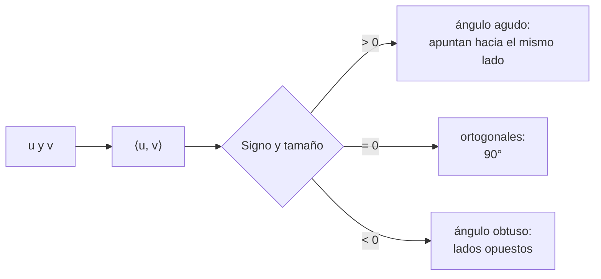

# B10-C06 — Producto interno y ortogonalidad

<!-- nav:top -->
[🏠 Programa](../../../../README.md) · [📚 Bloque B10](../../../tronco-comun/B10-algebra-lineal-y-matematicas-geometricas.md) · [← Anterior: B10-C05 — Sistemas lineales y eliminación](../B10-C05-sistemas-lineales-y-eliminacion/CLASE.md) · [Siguiente: B10-C07 — Proyecciones y mínimos cuadrados →](../B10-C07-proyecciones-y-minimos-cuadrados/CLASE.md)
<!-- /nav -->

## 1. Ubicación, nivel y alcance

Sexta clase del bloque B10 y apertura del segundo tramo. Ya usaste el producto escalar para ángulos entre vectores en [B04-C13](../../B04/B04-C13-producto-escalar-y-angulo-entre-vectores/CLASE.md). Aquí lo generalizas a **producto interno**, defines **norma** y **ortogonalidad** en cualquier dimensión, demuestras la desigualdad de Cauchy–Schwarz y construyes bases ortonormales con **Gram–Schmidt**. Nivel N2. Verás el ángulo de incidencia de la luz solar sobre un panel. No verás proyecciones ni mínimos cuadrados (C07).

## 2. Por qué esta clase existe

La potencia que recibe un panel solar depende del ángulo entre su normal y la dirección al Sol: más inclinado, menos luz. El control de actitud, la orientación de antenas y de instrumentos usan el mismo cálculo. Además, trabajar con direcciones perpendiculares simplifica todo: coordenadas por producto escalar, sin resolver sistemas (C02).

La decisión central: **¿cómo mido ángulos y perpendicularidad con un número, y cómo construyo ejes perpendiculares a partir de vectores cualesquiera sin perder precisión?**

## 3. Lo que podrás hacer al terminar

1. Calcular producto interno, norma y ángulo entre vectores de `ℝⁿ`.
2. Reconocer la ortogonalidad y aplicar el teorema de Pitágoras vectorial.
3. Enunciar y comprobar la desigualdad de Cauchy–Schwarz.
4. Calcular la fracción de luz que recibe un panel según su orientación.
5. Ortonormalizar un conjunto con Gram–Schmidt e interpretar `QᵀQ = I`.
6. Detectar la pérdida de ortogonalidad en el método clásico.

La evidencia es la **ficha de ángulos y bases ortonormales** del ejercicio 12 (sección 20).

## 4. Con qué llegas y cómo comprobarlo

Necesitas bases y coordenadas ([C02](../B10-C02-bases-y-dimension/CLASE.md)) y trigonometría. Cinco preguntas:

1. Calcula `(1, 2, 2) · (2, 0, 1)`.
2. Calcula `‖(3, 4)‖`.
3. ¿Cuánto vale `cos 60°`?
4. ¿Qué ángulo hay entre `(1, 0)` y `(0, 1)`?
5. ¿Qué significa que una base sea ortonormal?

<details>
<summary>Ver respuestas</summary>

1. `4`. 2. `5`. 3. `0,5`. 4. `90°`. 5. Vectores de longitud 1 y perpendiculares entre sí.
</details>

## 5. Un caso real: la luz del Sol sobre un panel

Un panel plano tiene su normal exterior `n̂ = (0, 0, 1)` y el Sol llega con elevación `ε` sobre el plano del panel, con dirección unitaria `ŝ = (cos ε, 0, sin ε)`. La luz incidente por unidad de área del panel es proporcional a `n̂ · ŝ = sin ε`, mientras sea positivo. Los datos de esta clase son **sintéticos** (direcciones inventadas); el modelo (panel plano, sin sombras ni reflexión) solo captura la geometría.

## 6. Vocabulario

El **producto interno** (escalar) de `u, v ∈ ℝⁿ` es `⟨u, v⟩ = Σ uᵢ vᵢ`; es simétrico, lineal en cada argumento y `⟨u, u⟩ > 0` si `u ≠ 0` (S1, §1.2(v), ecs. 1.2.40–1.2.43). La **norma** es `‖u‖ = √⟨u, u⟩`. Dos vectores son **ortogonales** si `⟨u, v⟩ = 0` (S1, 1.2.44). Un **vector unitario** tiene norma 1. Una base **ortonormal** reúne vectores unitarios y ortogonales entre sí. La **desigualdad de Cauchy–Schwarz** dice `|⟨u, v⟩| ≤ ‖u‖‖v‖`, con igualdad solo si uno es múltiplo del otro (S1, 1.2.51); la **desigualdad triangular**, `‖u + v‖ ≤ ‖u‖ + ‖v‖` (S1, 1.2.52). El **ángulo** entre vectores no nulos cumple `cos θ = ⟨u, v⟩/(‖u‖‖v‖)`. Una matriz **ortogonal** `Q` cumple `QᵀQ = I`: sus columnas son ortonormales. **Gram–Schmidt** es el procedimiento que ortonormaliza vectores uno por uno.

## 7. Modelo mental: la sombra de un vector sobre otro

El producto interno mide cuánto de un vector «cabe» en la dirección de otro.



*Descripción textual:* el signo del producto interno da el tipo de ángulo; cero significa perpendicular; el valor dividido por las normas es el coseno.

Analogía: la sombra de un palo sobre el suelo cuando el Sol está sobre él. Su límite: la sombra física depende de la luz y del plano, aquí solo hay vectores.

## 8. La explicación, paso a paso

### 8.1 Cálculo e interpretación

Para `u = (1, 2, 2)` y `v = (2, 0, 1)`: `⟨u, v⟩ = 2 + 0 + 2 = 4`; `‖u‖ = 3`; `‖v‖ = √5 = 2,236`; `cos θ = 4/6,708 = 0,5963`, `θ = 53,4°`. Dos vectores con `⟨u, v⟩ = 0`, como `(1, 2, −1)` y `(3, −1, 1)` (`3 − 2 − 1 = 0`), son ortogonales.

### 8.2 Pitágoras y desigualdades

Si `u ⟂ v`, `‖u + v‖² = ‖u‖² + ‖v‖²`: con `(3, 0, 0)` y `(0, 4, 0)` la suma tiene norma `5`. Cauchy–Schwarz: para `(1, 2, 3)` y `(−1, 0, 2)`, `⟨u, v⟩ = 5` y `‖u‖‖v‖ = √14 · √5 = 8,37 ≥ 5` ✓. Gracias a ella el coseno de la fórmula del ángulo nunca sale de `[−1, 1]`.

### 8.3 El panel solar

`ŝ · n̂ = sin ε`. Con `ε = 90°` (Sol de frente) el ángulo con la normal es `0°` y el factor `1`; con `ε = 60°`, `30°` y `0,866`; con `ε = 30°`, `60°` y `0,5`; con `ε = 0°` (Sol rasante) `90°` y `0`; con `ε = −10°` el Sol está detrás del panel, el producto es negativo y la luz recibida es `0`. Por eso el factor es `max(0, cos θ)`.

### 8.4 Coordenadas en base ortonormal

Si `{q₁, …, qₙ}` es ortonormal, las coordenadas de `v` son `cₖ = ⟨qₖ, v⟩` (S2, §1.3, ecs. 1.3.20–1.3.21 para la expansión en una base ortonormal). Y `‖v‖² = Σ cₖ²` (igualdad de Parseval). No hace falta resolver un sistema.

### 8.5 Gram–Schmidt

Dados vectores independientes `a₁, a₂, …`: `q₁ = a₁/‖a₁‖`; luego `ã₂ = a₂ − ⟨q₁, a₂⟩ q₁` (le quitas su componente a lo largo de `q₁`) y `q₂ = ã₂/‖ã₂‖`; y así sucesivamente. Con `a₁ = (1, 1, 0)` y `a₂ = (1, 0, 1)`: `q₁ = (0,7071; 0,7071; 0)`; `⟨q₁, a₂⟩ = 0,7071`; `ã₂ = (1, 0, 1) − 0,7071·q₁ = (0,5; −0,5; 1)`, de norma `√1,5 = 1,2247`; `q₂ = (0,4082; −0,4082; 0,8165)`. Comprobación: `⟨q₁, q₂⟩ = 0,2887 − 0,2887 = 0` ✓.

### 8.6 Estabilidad: clásico y modificado

La versión **clásica** resta todas las componentes calculadas con el vector original; la **modificada** las resta una a una del vector ya corregido. Con vectores casi paralelos (`ε = 10⁻⁸`), el laboratorio da `‖QᵀQ − I‖ = 0,5` para el clásico (ortogonalidad perdida) y `7 × 10⁻⁹` para el modificado. En la práctica se usan métodos aún más estables (C10).

## 9. Magnitudes, símbolos y unidades

| Símbolo | Qué es | Unidad | Nota |
|---|---|---|---|
| `⟨u, v⟩` | producto interno | producto de las unidades | un número |
| `‖u‖` | norma | unidad de `u` | `≥ 0` |
| `θ` | ángulo entre vectores | ° o rad | `0 ≤ θ ≤ 180°` |
| `n̂`, `ŝ` | normal del panel y dirección al Sol | adimensional | unitarios |
| `ε` | elevación solar sobre el panel | ° | sintética |
| `Q` | matriz de columnas ortonormales | — | `QᵀQ = I` |

## 10. Convenciones y referencias

Producto interno usual de `ℝⁿ`. Ángulos entre 0° y 180°. La normal del panel apunta hacia fuera de su cara activa. El «factor» es solo geométrico (coseno), sin constante solar, eficiencia ni atenuación. En el programa, `arccos` se aplica a un valor recortado a `[−1, 1]` para evitar errores de redondeo.

## 11. De dónde sale lo que afirmamos

| ID | Fuente | Localizador | Respalda | Estado |
|---|---|---|---|---|
| S1 | NIST, *DLMF* §1.2(v), versión vigente en línea al consultar | https://dlmf.nist.gov/1.2 | Producto escalar (1.2.40–1.2.43), ortogonalidad (1.2.44), normas, Cauchy–Schwarz (1.2.51), desigualdad triangular (1.2.52) | Consultada el 2026-11-05 mediante extracción automática |
| S2 | NIST, *DLMF* §1.3 | https://dlmf.nist.gov/1.3 | Expansión en una base ortonormal y Parseval (1.3.20–1.3.21); matrices ortogonales | Consultada el 2026-11-05 mediante extracción automática |

Límites: Gram–Schmidt y su variante modificada son resultados estándar sin cita específica. El panel solar es un **modelo geométrico** con datos **sintéticos**.

## 12. Cómo ver el factor del panel

Equivalente accesible a una gráfica de `max(0, sin ε)`:

| Elevación `ε` (°) | Ángulo con la normal (°) | Factor |
|---|---|---|
| 90 | 0 | 1,0000 |
| 60 | 30 | 0,8660 |
| 30 | 60 | 0,5000 |
| 0 | 90 | 0,0000 |
| −10 | 100 | 0,0000 |

Descripción larga: la curva sube desde 0 con una pendiente decreciente hasta 1 cuando el Sol está sobre el panel; bajo el horizonte del panel se queda en cero.

## 13. Ejemplo trabajado: panel inclinado

**Paso 1 · Datos.** Panel con normal `n̂ = (sin 20°, 0, cos 20°) = (0,3420; 0; 0,9397)`. Sol con elevación `60°` sobre el plano base: `ŝ = (0,5; 0; 0,8660)`.

**Paso 2 · Producto interno.** `n̂ · ŝ = 0,1710 + 0,8138 = 0,9848`.

**Paso 3 · Ángulo.** Ambos unitarios, así que `cos θ = 0,9848` y `θ = 10,0°`.

**Paso 4 · Comprobación geométrica.** El Sol está a `30°` del cenit (`90° − 60°`) y la normal a `20°` del cenit, en el mismo plano: diferencia `10°` ✓.

**Paso 5 · Sentido.** El panel inclinado recibe `98,5 %` de la luz que recibiría de frente. Con direcciones **sintéticas**, el resultado es exacto en la geometría y no incluye efectos ópticos.

## 14. Distintas formas de obtener ángulos

**Con el producto interno:** estable salvo cerca de 0° y 180° (el `arccos` es muy sensible allí). **Con producto vectorial** (`‖u × v‖ = ‖u‖‖v‖ sin θ`, B04-C14): mejor para ángulos pequeños. **Con `arctan2` de ambos:** el más robusto. Para ángulos muy pequeños no uses `arccos` directamente.

## 15. Práctica guiada

**Ejercicio 1 · con los pasos indicados.** Calcula el ángulo entre `u = (1, 2, 2)` y `v = (2, 0, 1)`. *Pasos:* producto, normas, coseno (8.1).

<details><summary>Solución comentada</summary>

`⟨u, v⟩ = 4`, `‖u‖ = 3`, `‖v‖ = 2,236`; `cos θ = 0,5963`, `θ = 53,4°`.
</details>

**Ejercicio 2 · con una pista.** ¿Son ortogonales `(1, 2, −1)` y `(3, −1, 1)`? *Pista:* un solo producto.

<details><summary>Solución comentada</summary>

`3 − 2 − 1 = 0`: sí (8.1).
</details>

**Ejercicio 3 · casi autónomo.** Panel con normal `(0, 0, 1)` y Sol con elevación `45°`: ángulo y factor.

<details><summary>Solución comentada</summary>

`ŝ = (0,7071; 0; 0,7071)`; `n̂ · ŝ = 0,7071`; `θ = 45°`; factor `0,7071` (8.3).
</details>

## 16. Práctica autónoma, transferencia e integrador

**Ejercicio 4.** Comprueba Pitágoras con `u = (3, 0, 0)` y `v = (0, 4, 0)`.

<details><summary>Solución comentada</summary>

`‖u + v‖ = ‖(3, 4, 0)‖ = 5`; `3² + 4² = 25 = 5²` ✓ (8.2).
</details>

**Ejercicio 5.** Ortonormaliza `(1, 1, 0)` y `(1, 0, 1)` y comprueba `⟨q₁, q₂⟩ = 0`.

<details><summary>Solución comentada</summary>

`q₁ = (0,7071; 0,7071; 0)`, `q₂ = (0,4082; −0,4082; 0,8165)`; producto `0` (8.5).
</details>

**Ejercicio 6.** Calcula las coordenadas de `v = (2, 3, 1)` respecto de los dos vectores ortonormales `q₁`, `q₂` del ejercicio 5 y la parte de `v` que queda fuera del plano que generan.

<details><summary>Solución comentada</summary>

`c₁ = ⟨q₁, v⟩ = 3,5355`; `c₂ = ⟨q₂, v⟩ = 0,4082 · 2 − 0,4082 · 3 + 0,8165 = 0,4082`. Parte en el plano: `c₁q₁ + c₂q₂ = (2,6667; 2,3333; 0,3333)`. Resto: `(−0,6667; 0,6667; 0,6667)`, ortogonal a ambos.
</details>

**Ejercicio 7.** Comprueba Cauchy–Schwarz para `(1, 2, 3)` y `(−1, 0, 2)`.

<details><summary>Solución comentada</summary>

`5 ≤ 8,37` ✓ (8.2).
</details>

**Ejercicio 8.** Elevación solar de `−10°`: ¿qué ángulo y qué factor? Explica el `max(0, ·)`.

<details><summary>Solución comentada</summary>

`θ = 100°`; `cos < 0` significa que el Sol está detrás del panel; no hay luz sobre la cara activa: factor `0` (8.3).
</details>

**Ejercicio 9 · transferencia.** Un panel con normal `(0,3420; 0; 0,9397)` ve el Sol con elevación `20°` en el mismo plano. ¿Qué ángulo y qué factor?

<details><summary>Solución comentada</summary>

`ŝ = (0,9397; 0; 0,3420)`; `n̂ · ŝ = 0,3214 + 0,3214 = 0,6428`; `θ = 50°` (= `70° − 20°`); factor `0,643`.
</details>

**Ejercicio 10 · transferencia.** Con Gram–Schmidt clásico sobre columnas casi paralelas el laboratorio da `‖QᵀQ − I‖ = 0,5`. ¿Qué te dice de la base obtenida y qué harías?

<details><summary>Solución comentada</summary>

Que las columnas **no** son ortonormales aunque el algoritmo «terminó». Usarías la versión modificada o una factorización QR por reflexiones (C10) y comprobarías `QᵀQ = I`.
</details>

**Ejercicio 11 · transferencia.** Un compañero calcula el ángulo entre `(2, 0, 0)` y `(3, 0, 0)` como `arccos(6)`. Detecta el error.

<details><summary>Solución comentada</summary>

Olvidó dividir por las normas: `cos θ = 6/(2 · 3) = 1`, `θ = 0°`. Un coseno de `6` es imposible (Cauchy–Schwarz).
</details>

**Ejercicio 12 · integrador.** Elabora tu **ficha de ángulos y bases ortonormales**: tabla de factor de panel para cinco elevaciones, el panel inclinado de la sección 13 con su comprobación geométrica, una base ortonormal obtenida por Gram–Schmidt con `QᵀQ`, y la nota del caso casi paralelo.

<details><summary>Solución modelo</summary>

Tabla de 12, cálculo de 13, base del ejercicio 5 con `QᵀQ − I = 2 × 10⁻¹⁶`, y el contraste clásico/modificado del laboratorio.
</details>

## 17. Laboratorio: ángulos y Gram–Schmidt

El script [producto_interno.py](producto_interno.py) calcula el ángulo y el factor del panel, comprueba Cauchy–Schwarz y la desigualdad triangular con 1000 pares aleatorios, y contrasta los dos Gram–Schmidt.

**Datos:** sintéticos. **Predice antes de ejecutar:** ¿qué método perderá ortogonalidad con columnas casi paralelas? **Ejecución del 2026-11-05 (Python 3.12.9, numpy 2.4.4):**

```text
elevacion   90 deg -> angulo con la normal =   0.000 deg, factor = 1.0000
elevacion   60 deg -> angulo con la normal =  30.000 deg, factor = 0.8660
elevacion   30 deg -> angulo con la normal =  60.000 deg, factor = 0.5000
elevacion    0 deg -> angulo con la normal =  90.000 deg, factor = 0.0000
elevacion  -10 deg -> angulo con la normal = 100.000 deg, factor = 0.0000
Q^T Q - I (max) = 2.220446049250313e-16
columnas casi paralelas: |Q^T Q - I| clasico = 5.00e-01, modificado = 7.07e-09
Pruebas superadas.
```

```bash
python programa/clases/B10/B10-C06-producto-interno-y-ortogonalidad/producto_interno.py
```

**Límites:** panel plano, sin sombras; las desigualdades se comprueban por muestreo, no se demuestran.

## 18. Errores frecuentes y cómo corregirlos

**Olvidar normalizar al calcular el coseno.** Se corrige con el ejercicio 11.

**Aplicar `arccos` cerca de 0° o 180° sin cuidado.** Se corrige en la sección 14.

**Creer que un algoritmo que termina entrega una base ortonormal.** Se corrige con el ejercicio 10.

**Olvidar que luz negativa no existe.** Se corrige con el ejercicio 8.

**Mezclar grados y radianes.** Se corrige con los ejercicios 3 y 9.

## 19. Cómo sabrás que vas bien

Tras 8.1: ¿calculas el ángulo entre dos vectores y lo interpretas? Si no, ejercicio 1. Tras 8.3: ¿por qué el factor es `max(0, cos θ)`? Si no, ejercicio 8. Tras 8.5: ¿por qué `⟨q₁, q₂⟩ = 0`? Si no, ejercicio 5. Tras el laboratorio: ¿por qué cambia el resultado entre los dos Gram–Schmidt?

## 20. Qué entregas y cómo se evalúa

El producto es tu **ficha de ángulos y bases ortonormales** (ejercicio 12).

| Criterio | Inicial | En desarrollo | Logrado | Destacado |
|---|---|---|---|---|
| Cálculo de ángulos | Sin normalizar | Con errores | Correcto con comprobación | Elige el método estable |
| Ortogonalidad | Confunde | La reconoce | La verifica con `QᵀQ` | Detecta pérdida numérica |
| Contexto espacial | Sin unidades | Unidades parciales | Panel con factor correcto | Discute límites del modelo |
| Comprobación | Ausente | Mental | Con segunda vía | Con laboratorio y análisis |
| Fuentes y rotulado | Sin fuente | Sin fecha | Con localizador y fecha | Rotula sintético |

**Condiciones críticas:** normalizar antes de calcular el coseno; comprobar `QᵀQ = I`; citar solo fuentes consultadas.

## 21. Ética, seguridad y límites

Un cálculo geométrico no sustituye el análisis de potencia, térmico ni de sombras de un satélite. No se debe usar para dimensionar un sistema real sin datos y modelos adecuados. Accesibilidad: tablas equivalentes a las figuras, fórmulas en texto, ejercicios sin conexión.

## 22. Para cerrar y seguir

El producto interno mide ángulos y longitudes; ortogonal significa producto cero; Cauchy–Schwarz garantiza que el coseno sea válido; Gram–Schmidt construye ejes perpendiculares, con cuidado numérico. Queda abierta una pregunta: si un vector no cabe exactamente en un subespacio, ¿cuál es el punto del subespacio más cercano a él?

**Glosario español–inglés.** producto interno · *inner product*; norma · *norm*; ortogonal · *orthogonal*; ortonormal · *orthonormal*; desigualdad de Cauchy–Schwarz · *Cauchy–Schwarz inequality*; Gram–Schmidt · *Gram–Schmidt process*; panel solar · *solar panel*.

**Continuidad.** B10-C07 reutiliza tu capacidad de **calcular componentes ortogonales** para proyectar y ajustar datos por mínimos cuadrados.

**Referencias:** ver sección 11.

<!-- nav:bottom -->
---

[← Anterior: B10-C05 — Sistemas lineales y eliminación](../B10-C05-sistemas-lineales-y-eliminacion/CLASE.md) · [📚 Bloque B10](../../../tronco-comun/B10-algebra-lineal-y-matematicas-geometricas.md) · [Siguiente: B10-C07 — Proyecciones y mínimos cuadrados →](../B10-C07-proyecciones-y-minimos-cuadrados/CLASE.md)
<!-- /nav -->
