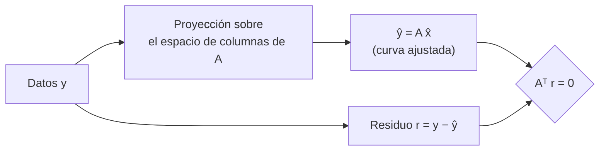

# B10-C07 — Proyecciones y mínimos cuadrados

<!-- nav:top -->
[🏠 Programa](../../../../README.md) · [📚 Bloque B10](../../../tronco-comun/B10-algebra-lineal-y-matematicas-geometricas.md) · [← Anterior: B10-C06 — Producto interno y ortogonalidad](../B10-C06-producto-interno-y-ortogonalidad/CLASE.md) · [Siguiente: B10-C08 — Autovalores y autovectores →](../B10-C08-autovalores-y-autovectores/CLASE.md)
<!-- /nav -->

## 1. Ubicación, nivel y alcance

Séptima clase del bloque B10. En [C06](../B10-C06-producto-interno-y-ortogonalidad/CLASE.md) aprendiste a medir ángulos y a quitarle a un vector su componente a lo largo de otro. Aquí usas esa idea para el problema central del análisis de datos: cuando hay **más ecuaciones que incógnitas** y los datos tienen ruido, no existe una solución exacta y se busca la mejor. Nivel N2–N3. Verás proyección ortogonal, ecuaciones normales, residuos, ajuste de una trayectoria y por qué importa la forma de calcular. No verás incertidumbre estadística completa (B12) ni problemas inversos (B22).

## 2. Por qué esta clase existe

Una estación mide la distancia a un satélite cada segundo durante diez segundos. Hay once medidas y solo tres parámetros que describir (posición, velocidad y aceleración radiales). Las medidas tienen ruido: ninguna curva pasa por todos los puntos. Hay que decidir qué curva se considera la mejor y cuánto creerle.

La decisión central: **¿qué significa «la mejor curva», cómo se calcula de forma estable y cómo se comprueba?**

## 3. Lo que podrás hacer al terminar

1. Proyectar un vector sobre una recta o sobre un subespacio.
2. Plantear y resolver las ecuaciones normales de un ajuste lineal.
3. Comprobar que el residuo es ortogonal al espacio de columnas.
4. Ajustar una recta o una parábola a datos con ruido.
5. Explicar por qué QR es más estable que las ecuaciones normales.
6. Reconocer la sensibilidad de mínimos cuadrados a un dato atípico.

La evidencia es el **informe de ajuste con residuos** del ejercicio 12 (sección 20).

## 4. Con qué llegas y cómo comprobarlo

Necesitas producto interno y ortogonalidad ([C06](../B10-C06-producto-interno-y-ortogonalidad/CLASE.md)) y sistemas ([C05](../B10-C05-sistemas-lineales-y-eliminacion/CLASE.md)). Cinco preguntas:

1. Calcula `(2, 3) · (1, 1)`.
2. Resuelve `4a + 6b = 10`, `6a + 14b = 20`.
3. ¿Qué significa que un vector sea ortogonal a un subespacio?
4. ¿Qué es un residuo en un ajuste?
5. Si `κ(A) = 10⁸`, ¿cuánto vale `κ(AᵀA)`?

<details>
<summary>Ver respuestas</summary>

1. `5`. 2. `a = 1, b = 1` (con `det = 56 − 36 = 20`: `a = (140 − 120)/20 = 1`, `b = (80 − 60)/20 = 1`). 3. Que es perpendicular a todos los vectores del subespacio. 4. La diferencia entre dato y modelo. 5. `κ(AᵀA) = κ(A)² = 10¹⁶` (se justificará en C11).
</details>

## 5. Un caso real: la distancia a una estación

Se mide la distancia `r(t)` de un objeto a una estación en once instantes `t = 0, 1, …, 10 s`. El modelo es una parábola `r(t) = a + b t + c t²`. Los datos de esta clase son **sintéticos**: se generan con `a = 100 km`, `b = 2 km/s`, `c = −0,05 km/s²` y se les suma ruido gaussiano de `σ = 0,05 km` con semilla fija. Como conocemos la verdad, podemos comprobar si el método la recupera. Es el ejemplo conductor.

## 6. Vocabulario

La **proyección ortogonal** de `v` sobre un subespacio `W` es el vector de `W` más cercano a `v`; la diferencia `v − P v` es ortogonal a `W`. Para una recta con vector director `u`, `P v = (⟨u, v⟩/⟨u, u⟩) u`. La **matriz de diseño** `A` tiene como columnas las funciones del modelo evaluadas en los instantes (`1, t, t²`). Los **mínimos cuadrados** buscan `x` que minimiza `‖A x − y‖²`. Las **ecuaciones normales** son `AᵀA x = Aᵀ y`. El **residuo** es `y − A x`. La **matriz de proyección** `P = A(AᵀA)⁻¹Aᵀ` es simétrica e idempotente (`P² = P`). La **factorización QR** escribe `A = Q R` con `Q` de columnas ortonormales y `R` triangular superior. Un **dato atípico** (*outlier*) es una medida que no sigue el modelo.

## 7. Modelo mental: la sombra más cercana

Ajustar es proyectar el vector de datos sobre el conjunto de todas las curvas que el modelo puede describir; lo que sobra es perpendicular.



*Descripción textual:* el vector de datos se descompone en una parte que el modelo puede explicar (la proyección) y un residuo perpendicular a todas las columnas de `A`.

Analogía: el punto de una pared más cercano a una mosca, trazando una perpendicular. Su límite: la distancia mínima no dice nada sobre si el modelo (la pared) es el adecuado.

## 8. La explicación, paso a paso

### 8.1 Proyección sobre una recta

Para `v = (2, 3)` y `u = (1, 1)`: `⟨u, v⟩ = 5`, `⟨u, u⟩ = 2`, `P v = 2,5 (1, 1) = (2,5; 2,5)`; el residuo `v − P v = (−0,5; 0,5)` es ortogonal a `u` (`−0,5 + 0,5 = 0`) y su norma `0,7071` es la distancia de `v` a la recta.

### 8.2 Ecuaciones normales

Minimizar `‖A x − y‖²` equivale a exigir que el residuo sea ortogonal a cada columna de `A`: `Aᵀ(y − A x) = 0`, o sea `AᵀA x = Aᵀ y`. Si las columnas son independientes, `AᵀA` es invertible y la solución es única.

### 8.3 Una recta ajustada a mano

Puntos `(0; 1,0)`, `(1; 2,1)`, `(2; 2,9)`, `(3; 4,1)`, modelo `y = a + b t`. Sumas: `n = 4`, `Σt = 6`, `Σt² = 14`, `Σy = 10,1`, `Σty = 20,2`. Ecuaciones normales: `4a + 6b = 10,1`, `6a + 14b = 20,2`, con `det = 20`: `a = 1,01`, `b = 1,01`. Residuos: `−0,01; 0,08; −0,13; 0,06`. Comprobación: suman 0 y `Σ t·res = 0 + 0,08 − 0,26 + 0,18 = 0` ✓ (ortogonales a las columnas `1` y `t`).

### 8.4 La parábola de la estación

Con los once datos sintéticos, el laboratorio da `a = 100,00085`, `b = 1,99151`, `c = −0,04901` por tres métodos (normales, QR y `lstsq`) idénticos hasta `10⁻⁸`. Frente a la verdad (`100; 2; −0,05`), las diferencias son `0,0009`, `−0,0085`, `0,0010`. Las incertidumbres a 1σ (que se derivan de la matriz `σ²(AᵀA)⁻¹`, ver B12) son `0,038; 0,0177; 0,0017`: las diferencias valen `0,02σ`, `0,48σ` y `0,58σ`, compatibles con el ruido. El residuo rms es `0,036 km` (con `σ = 0,05` esperado: coherente con 8 grados de libertad). Esto es un resultado sobre datos **sintéticos**.

### 8.5 La matriz de proyección

`P = A(AᵀA)⁻¹Aᵀ` proyecta cualquier vector de datos sobre las curvas del modelo; cumple `P² = P` y `Pᵀ = P`, y su traza es el número de parámetros (aquí `3`).

### 8.6 Estabilidad: normales frente a QR

Con QR, `A = QR` y las ecuaciones normales se convierten en `R x = Qᵀ y`, sin formar `AᵀA`. Como `κ(AᵀA) = κ(A)²`, las normales pierden el doble de cifras. En un ajuste polinómico de grado 11 con 40 puntos, `κ(A) = 1,2 × 10⁸`, el error de las normales fue `0,39` y el de QR `2,7 × 10⁻⁹`.

### 8.7 Datos atípicos

Con los cuatro puntos de 8.3, si el último dato pasa de `4,1` a `8,1`, la recta cambia de `1,01 + 1,01 t` a `0,21 + 2,21 t`: un solo dato modifica la pendiente más del doble. Mínimos cuadrados penaliza los errores grandes al cuadrado y por eso es sensible; las alternativas robustas se verán en B22.

## 9. Magnitudes, símbolos y unidades

| Símbolo | Qué es | Unidad | Nota |
|---|---|---|---|
| `t` | tiempo | s | 0 a 10 |
| `r(t)` | distancia a la estación | km | datos sintéticos |
| `a, b, c` | coeficientes del modelo | km, km/s, km/s² | verdad `100; 2; −0,05` |
| `A` | matriz de diseño | — | columnas `1, t, t²` |
| `σ` | desviación del ruido | km | `0,05` |
| `P` | matriz de proyección | — | `P² = P` |
| `ŷ, r` | ajuste y residuo | km | `y = ŷ + r` |

## 10. Convenciones y referencias

Los coeficientes se escriben en orden creciente de potencia. El residuo se define `y − A x`. «Mejor» significa mínimo de la suma de cuadrados de los residuos, que es óptimo si el ruido es independiente, de igual varianza y modelo correcto. Cuando estas condiciones no se cumplen, el ajuste puede ser engañoso (B12, B22).

## 11. De dónde sale lo que afirmamos

| ID | Fuente | Localizador | Respalda | Estado |
|---|---|---|---|---|
| S1 | NIST, *DLMF* §1.2(v), versión vigente en línea al consultar | https://dlmf.nist.gov/1.2 | Producto escalar y ortogonalidad (1.2.40–1.2.44) que fundamenta la proyección | Consultada el 2026-11-05 mediante extracción automática |
| S2 | NIST, *DLMF* §1.3 | https://dlmf.nist.gov/1.3 | Expansión en una base ortonormal (1.3.20–1.3.21) | Consultada el 2026-11-05 mediante extracción automática |

Límites: las ecuaciones normales, la proyección, QR y la sensibilidad a datos atípicos son resultados estándar sin cita específica. Los datos de la estación son **sintéticos**; los valores de incertidumbre son **estimaciones** bajo el supuesto de ruido blanco conocido.

## 12. Cómo ver el ajuste

Equivalente accesible a una gráfica de puntos y curva ajustada, con la verdad conocida:

| Cantidad | Verdad | Estimado | Diferencia | En unidades de σ |
|---|---|---|---|---|
| `a` (km) | 100 | 100,00085 | 0,00085 | 0,02 |
| `b` (km/s) | 2 | 1,99151 | −0,00849 | 0,48 |
| `c` (km/s²) | −0,05 | −0,04901 | 0,00099 | 0,58 |

Descripción larga: la parábola ajustada sigue a los puntos con desviaciones del orden de 0,04 km; la curva ajustada y la verdadera se distinguen apenas.

## 13. Ejemplo trabajado: ¿dónde estará a los 12 s?

**Paso 1 · Datos.** Coeficientes ajustados `a = 100,00085`, `b = 1,99151`, `c = −0,04901` (sintéticos, de 8.4).

**Paso 2 · Predicción.** `r(12) = 100,00085 + 1,99151 · 12 − 0,04901 · 144 = 100,00085 + 23,89812 − 7,05744 = 116,8415 km`.

**Paso 3 · Verdad.** `100 + 24 − 7,2 = 116,8 km`; diferencia `0,04 km`.

**Paso 4 · Cautela.** `12 s` está **fuera** del intervalo `0–10 s`: es extrapolación. La incertidumbre crece fuera del rango ajustado; un modelo parabólico solo vale mientras la aceleración sea constante.

**Paso 5 · Sentido.** La predicción es una **estimación**; coincide con la verdad (conocida solo porque los datos son sintéticos) dentro de su incertidumbre. En un caso real no se dispone de la verdad.

## 14. Distintas formas de resolver mínimos cuadrados

**Ecuaciones normales:** sencillas, inestables si `κ(A)` es grande. **QR:** estable y estándar. **SVD** (C11): la más robusta, permite descartar direcciones sin información. **Biblioteca (`lstsq`):** usa SVD. En el laboratorio las tres coinciden con los datos bien condicionados.

## 15. Práctica guiada

**Ejercicio 1 · con los pasos indicados.** Proyecta `v = (2, 3)` sobre `u = (1, 1)` y calcula la distancia a la recta. *Pasos:* fórmula de 8.1.

<details><summary>Solución comentada</summary>

`P v = (2,5; 2,5)`, residuo `(−0,5; 0,5)`, distancia `0,7071`.
</details>

**Ejercicio 2 · con una pista.** Ajusta una recta a `(0; 1,0)`, `(1; 2,1)`, `(2; 2,9)`, `(3; 4,1)`. *Pista:* ecuaciones normales con las sumas de 8.3.

<details><summary>Solución comentada</summary>

`y = 1,01 + 1,01 t`; residuos `−0,01; 0,08; −0,13; 0,06`, suma cero y ortogonales a `t`.
</details>

**Ejercicio 3 · casi autónomo.** Ajusta una constante a `2, 4, 9` y comprueba que el residuo es ortogonal a `(1, 1, 1)`.

<details><summary>Solución comentada</summary>

La columna es `(1,1,1)`; `a = (2 + 4 + 9)/3 = 5` (la media). Residuos `−3; −1; 4`, suma `0` ✓.
</details>

## 16. Práctica autónoma, transferencia e integrador

**Ejercicio 4.** Escribe la matriz de proyección sobre `u = (1, 1)/√2` y comprueba `P² = P` y la traza.

<details><summary>Solución comentada</summary>

`P = u uᵀ = [[0,5; 0,5], [0,5; 0,5]]`. `P² = P` (cada entrada `0,25 + 0,25 = 0,5`). Traza `1` = dimensión de la recta.
</details>

**Ejercicio 5.** Calcula el rms del residuo del ejercicio 2 con `n − 2` grados de libertad.

<details><summary>Solución comentada</summary>

`Σ res² = 0,0001 + 0,0064 + 0,0169 + 0,0036 = 0,027`; `0,027/2 = 0,0135`; raíz `0,116`.
</details>

**Ejercicio 6.** Si `κ(A) = 1,2 × 10⁸`, ¿cuánto vale `κ(AᵀA)` y qué esperas del error de las normales en doble precisión (`ε ≈ 10⁻¹⁶`)?

<details><summary>Solución comentada</summary>

`κ(AᵀA) ≈ 1,4 × 10¹⁶`: el producto `κ ε` supera 1, no queda ninguna cifra fiable. Lo observado: error `0,39` (8.6).
</details>

**Ejercicio 7.** ¿Qué valor debe tener la traza de `P` al ajustar una parábola, y por qué?

<details><summary>Solución comentada</summary>

`3`: es la dimensión del espacio de columnas (número de parámetros) (8.5).
</details>

**Ejercicio 8.** Con los cuatro puntos de 8.3 cambia el último valor a `8,1` y calcula la recta. ¿Cuánto cambió la pendiente?

<details><summary>Solución comentada</summary>

`Σy = 14,1`, `Σty = 32,2`; `a = 0,21`, `b = 2,21`. La pendiente pasó de `1,01` a `2,21` (8.7).
</details>

**Ejercicio 9 · transferencia.** Expresa en unidades de σ la diferencia entre el `c` ajustado y el verdadero, y concluye.

<details><summary>Solución comentada</summary>

`(−0,04901 + 0,05)/0,00171 = 0,58σ`: compatible con el ruido; el ajuste no contradice a la verdad.
</details>

**Ejercicio 10 · transferencia.** Predice `r(12)` con los coeficientes ajustados y compara con la verdad. ¿Por qué esa predicción es menos fiable que una dentro de `0–10 s`?

<details><summary>Solución comentada</summary>

`116,8415` frente a `116,8` (sección 13). Es extrapolación: el error de los coeficientes se amplifica con `t` y `t²`, y el modelo podría dejar de valer.
</details>

**Ejercicio 11 · transferencia.** Un colega descarta el residuo porque «el ajuste pasa por la mayoría de los puntos». ¿Qué falta comprobar?

<details><summary>Solución comentada</summary>

Que el residuo sea ortogonal a las columnas (suma cero y `Σ t·res = 0`), que no tenga estructura (curvatura sistemática indicaría modelo insuficiente) y que no haya datos atípicos dominantes (8.7).
</details>

**Ejercicio 12 · integrador.** Elabora tu **informe de ajuste con residuos**: datos sintéticos con verdad conocida (los tuyos o los del laboratorio), ajuste por dos métodos, tabla de verdad–estimado–σ, comprobación de ortogonalidad del residuo, una extrapolación con su cautela y el efecto de un dato atípico.

<details><summary>Solución modelo</summary>

Tablas como las de 12 y 13, `AᵀRes ≈ 3 × 10⁻¹²` del laboratorio, la extrapolación a 12 s y el ejemplo de 8.7, con las fuentes S1–S2 y el rotulado «sintético / estimado».
</details>

## 17. Laboratorio: ajuste, ortogonalidad y estabilidad

El script [minimos_cuadrados.py](minimos_cuadrados.py) genera los datos sintéticos, ajusta por tres métodos, verifica que el residuo es ortogonal, calcula incertidumbres y proyección, y compara normales con QR en un caso mal condicionado.

**Datos:** sintéticos, semilla fija. **Predice antes de ejecutar:** ¿qué método fallará con grado 11? **Ejecución del 2026-11-05 (Python 3.12.9, numpy 2.4.4):**

```text
verdad          : [ 1.e+02  2.e+00 -5.e-02]
normales        : [ 1.0000085e+02  1.9915100e+00 -4.9010000e-02]
QR              : [ 1.0000085e+02  1.9915100e+00 -4.9010000e-02]
lstsq           : [ 1.0000085e+02  1.9915100e+00 -4.9010000e-02]
A^T residuo (max) = 3.481659405224491e-12
rms del residuo = 0.0361 km (sigma = 0.05)
incertidumbres (1 sigma): [0.03809 0.01772 0.00171]
traza de P = 3.0 (= numero de parametros)
grado 11: cond(A) = 1.18e+08; error normales = 3.92e-01; error QR = 2.68e-09
Pruebas superadas.
```

```bash
python programa/clases/B10/B10-C07-proyecciones-y-minimos-cuadrados/minimos_cuadrados.py
```

**Límites:** ruido gaussiano independiente; modelo correcto; las incertidumbres suponen `σ` conocida.

## 18. Errores frecuentes y cómo corregirlos

**Creer que el ajuste «pasa por» los datos.** Se corrige con los ejercicios 2 y 11.

**Usar normales con matrices mal condicionadas.** Se corrige con el ejercicio 6.

**Extrapolar sin cautela.** Se corrige con el ejercicio 10.

**Ignorar datos atípicos.** Se corrige con el ejercicio 8.

**Confundir residuo con error verdadero.** El residuo es dato menos modelo; el error es dato menos verdad (solo conocida en simulación). Se corrige en la sección 13.

## 19. Cómo sabrás que vas bien

Tras 8.1: ¿calculas una proyección y su residuo ortogonal? Si no, ejercicio 1. Tras 8.3: ¿por qué el residuo suma cero? Si no, ejercicio 2. Tras 8.6: ¿por qué QR es más estable? Si no, ejercicio 6. Tras el laboratorio: ¿qué comprobación te dice que el ajuste es el mínimo?

## 20. Qué entregas y cómo se evalúa

El producto es tu **informe de ajuste con residuos** (ejercicio 12).

| Criterio | Inicial | En desarrollo | Logrado | Destacado |
|---|---|---|---|---|
| Planteo | Sin matriz de diseño | Con errores | Normales o QR correctos | Compara métodos |
| Comprobación | Ausente | Gráfica sin cifras | Residuo ortogonal verificado | Con σ y unidades de σ |
| Interpretación | Sin juicio | Dice «ajusta bien» | Discute extrapolación | Discute modelo y atípicos |
| Estabilidad | Ignora | La nombra | Calcula `κ` | Predice pérdida de cifras |
| Fuentes y rotulado | Sin fuente | Sin fecha | Con localizador y fecha | Rotula sintético y estimado |

**Condiciones críticas:** verificar la ortogonalidad del residuo; rotular lo sintético y lo estimado; citar solo fuentes consultadas.

## 21. Ética, seguridad y límites

Un ajuste bonito no prueba que el modelo sea correcto, y extrapolar una trayectoria sin incertidumbre es peligroso para cualquier decisión de seguridad (por ejemplo, riesgo de colisión). Esta clase no sustituye la determinación de órbita (B22). Accesibilidad: tablas equivalentes a las figuras, fórmulas en texto, ejercicios sin conexión.

## 22. Para cerrar y seguir

Mínimos cuadrados proyecta los datos sobre el espacio del modelo; el residuo es ortogonal; QR es más estable que las normales; extrapolar y los datos atípicos exigen cautela. Queda abierta una pregunta: ¿existen direcciones especiales en las que un operador solo estira o encoge?

**Glosario español–inglés.** proyección ortogonal · *orthogonal projection*; mínimos cuadrados · *least squares*; ecuaciones normales · *normal equations*; residuo · *residual*; matriz de diseño · *design matrix*; factorización QR · *QR factorization*; dato atípico · *outlier*; extrapolación · *extrapolation*.

**Continuidad.** B10-C08 reutiliza tu capacidad de **trabajar con ortogonalidad y proyección** para estudiar las direcciones propias de un operador.

**Referencias:** ver sección 11.

<!-- nav:bottom -->
---

[← Anterior: B10-C06 — Producto interno y ortogonalidad](../B10-C06-producto-interno-y-ortogonalidad/CLASE.md) · [📚 Bloque B10](../../../tronco-comun/B10-algebra-lineal-y-matematicas-geometricas.md) · [Siguiente: B10-C08 — Autovalores y autovectores →](../B10-C08-autovalores-y-autovectores/CLASE.md)
<!-- /nav -->
