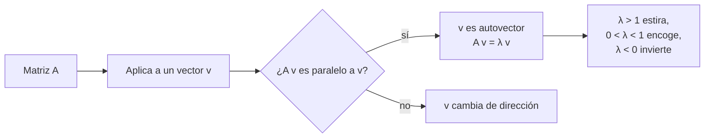

# B10-C08 — Autovalores y autovectores

<!-- nav:top -->
[🏠 Programa](../../../../README.md) · [📚 Bloque B10](../../../tronco-comun/B10-algebra-lineal-y-matematicas-geometricas.md) · [← Anterior: B10-C07 — Proyecciones y mínimos cuadrados](../B10-C07-proyecciones-y-minimos-cuadrados/CLASE.md) · [Siguiente: B10-C09 — Diagonalización y estabilidad →](../../../tronco-comun/B10-algebra-lineal-y-matematicas-geometricas.md#b10-c09)
<!-- /nav -->

## 1. Ubicación, nivel y alcance

Octava clase del bloque B10. Hasta ahora usaste matrices para transformar vectores. Aquí buscas las **direcciones especiales** en las que una matriz solo estira o encoge sin girar: los **autovectores**, y los factores de estiramiento, los **autovalores**. Nivel N3. Verás la ecuación característica, la traza y el determinante como suma y producto de autovalores, los ejes principales de inercia de un satélite y la iteración de la potencia. No verás diagonalización completa ni estabilidad (C09) ni SVD (C11).

## 2. Por qué esta clase existe

Un satélite que rota libremente no gira igual alrededor de cualquier eje: tiene tres ejes especiales —los **ejes principales de inercia**— en los que la rotación es simple. Conocerlos permite diseñar su estabilización, decidir dónde colocar instrumentos sensibles al giro y entender por qué ciertos giros se desestabilizan. Matemáticamente, esos ejes son los autovectores del tensor de inercia.

La decisión central: **¿en qué direcciones actúa la matriz de forma simple y cuánto vale su efecto en cada una?**

## 3. Lo que podrás hacer al terminar

1. Enunciar y verificar `A v = λ v`.
2. Calcular autovalores de una matriz `2×2` con la ecuación característica.
3. Hallar autovectores resolviendo `(A − λI) v = 0`.
4. Usar `traza = Σλ` y `det = Πλ` como comprobación.
5. Calcular los momentos y ejes principales de un tensor de inercia simétrico.
6. Aplicar la iteración de la potencia para el mayor autovalor.

La evidencia es la **ficha de ejes principales** del ejercicio 12 (sección 20).

## 4. Con qué llegas y cómo comprobarlo

Necesitas determinantes ([C04](../B10-C04-determinantes-y-soluciones/CLASE.md)), sistemas homogéneos ([C05](../B10-C05-sistemas-lineales-y-eliminacion/CLASE.md)) y la idea de ortogonalidad ([C06](../B10-C06-producto-interno-y-ortogonalidad/CLASE.md)). Cinco preguntas:

1. Calcula `det [[4−λ, 1], [2, 3−λ]]` como polinomio en `λ`.
2. Resuelve `λ² − 7λ + 10 = 0`.
3. ¿Qué vectores `v` cumplen `[[1,1],[1,1]] v = 0`?
4. ¿Cuándo tiene un sistema homogéneo solución no nula?
5. ¿Qué tienen de especial las matrices simétricas (`A = Aᵀ`)?

<details>
<summary>Ver respuestas</summary>

1. `λ² − 7λ + 10`. 2. `λ = 2` y `λ = 5`. 3. Los múltiplos de `(1, −1)`. 4. Cuando el determinante es 0. 5. Son iguales a su transpuesta; sus autovalores son reales (S1) y sus autovectores pueden elegirse ortonormales.
</details>

## 5. Un caso real: ejes principales de un satélite

Un satélite ficticio (**datos sintéticos**) tiene tensor de inercia, en `kg m²`, respecto de ejes del cuerpo:

`I = [[120, −10, 0], [−10, 100, 0], [0, 0, 150]]`.

El valor `−10` fuera de la diagonal (producto de inercia) dice que los ejes `x` e `y` no son los principales. Los autovalores serán los **momentos principales de inercia** y los autovectores, los **ejes principales**. Es el ejemplo conductor. Los números no representan a ningún satélite real.

## 6. Vocabulario

Un **autovector** de una matriz cuadrada `A` es un vector no nulo `v` tal que `A v = λ v`; el número `λ` es su **autovalor** (S1, §1.2(vi), ec. 1.2.70). Los autovalores son las raíces de la **ecuación característica** `det(A − λI) = 0` (S1, 1.2.71); el polinomio correspondiente es el **polinomio característico**. Para cada autovalor, los autovectores resuelven `(A − λI) v = 0` (S1, 1.2.72). El **espectro** es el conjunto de autovalores. Los autovalores pueden ser complejos aunque `A` sea real. La **traza** es la suma de la diagonal. Los **ejes principales** de un tensor de inercia son sus autovectores; los **momentos principales**, sus autovalores. Un **cociente de Rayleigh** es `vᵀA v/vᵀv`.

## 7. Modelo mental: las direcciones que no giran

Si aplicas `A` a todos los vectores del plano, casi todos cambian de dirección; unos pocos solo cambian de longitud.



*Descripción textual:* se prueba si la imagen de un vector es paralela al propio vector; si lo es, el vector es un autovector y el factor de proporcionalidad es el autovalor.

Analogía: las líneas de pliegue de un papel que se estira a lo largo de dos direcciones. Su límite: si el papel se gira, ninguna línea conserva su dirección y no hay autovalores reales (rotación).

## 8. La explicación, paso a paso

### 8.1 Matriz diagonal

Para `diag(2, 3)`, `e₁` y `e₂` son autovectores con autovalores `2` y `3`. En una matriz diagonal los ejes coordenados ya son los ejes especiales.

### 8.2 Una matriz 2×2

Para `A = [[4, 1], [2, 3]]`: `det(A − λI) = (4 − λ)(3 − λ) − 2 = λ² − 7λ + 10 = 0`, o sea `λ = 5` y `λ = 2`. Para `λ = 5`: `[[−1, 1], [2, −2]] v = 0` da `v = (1, 1)`. Para `λ = 2`: `[[2, 1], [2, 1]] v = 0` da `v = (1, −2)`. Comprobación: `A(1, 1) = (5, 5) = 5(1, 1)` ✓ y `A(1, −2) = (2, −4) = 2(1, −2)` ✓. La traza `7 = 5 + 2` y el determinante `10 = 5 · 2` cumplen las relaciones generales (S1, 1.2.74–1.2.75, para matrices no defectuosas).

### 8.3 Matrices simétricas

Para `[[2, 1], [1, 2]]`: `λ² − 4λ + 3 = 0`, `λ = 3` y `λ = 1`, con autovectores `(1, 1)` y `(1, −1)`, perpendiculares entre sí. En general, una matriz real simétrica tiene autovalores reales y un conjunto de autovectores ortonormales (S2, §1.3, sobre operadores autoadjuntos). Los tensores de inercia son simétricos, por lo que sus ejes principales son perpendiculares.

### 8.4 Rotación: autovalores complejos

La rotación de `90°`, `[[0, −1], [1, 0]]`, tiene `λ² + 1 = 0`, o sea `λ = ±i`: ningún vector real conserva su dirección. Los autovalores complejos señalan giro u oscilación (C09).

### 8.5 El tensor de inercia del satélite

El bloque `xy` es `[[120, −10], [−10, 100]]`: `λ² − 220 λ + 11 900 = 0`, `λ = 110 ± √200 = 124,142` y `95,858`. El eje `z` ya es principal con `150`. Los tres momentos principales son `95,858`, `124,142` y `150 kg m²`. Traza: `120 + 100 + 150 = 370 = 95,858 + 124,142 + 150` ✓. Determinante: `150 · (12 000 − 100) = 1 785 000 = 95,858 · 124,142 · 150` ✓. El eje de `124,142` forma un ángulo `θ` con `x` dado por `tan 2θ = 2 a_xy/(a_xx − a_yy) = −20/20 = −1`, o sea `θ = −22,5°`, con autovector `(0,9239; −0,3827)`; el de `95,858` es perpendicular, a `67,5°`: `(0,3827; 0,9239)`. Comprobación: `I (0,9239; −0,3827) = (114,69; −47,51) = 124,142 · (0,9239; −0,3827)` ✓.

### 8.6 Iteración de la potencia

Aplicando `A` una y otra vez a un vector y normalizando, la dirección converge al autovector del mayor autovalor en módulo. Para `[[2, 1], [1, 2]]` con `v₀ = (1, 0)`: el cociente de Rayleigh vale `2` al inicio, `2,8` tras un paso y `2,976` tras dos, camino del `3`. Con el tensor de inercia, el laboratorio converge a `150` (el mayor).

### 8.7 Qué dicen los ejes sobre la rotación libre

En ausencia de torques, un cuerpo rígido gira con estabilidad alrededor de su eje de mayor y de menor momento, y de forma inestable alrededor del eje intermedio (resultado estándar de la dinámica del cuerpo rígido, sin cita específica aquí). Para el satélite ficticio: estable en `z` (150) y en el eje de `95,858`, inestable en el de `124,142`. Esto se retoma en B16; aquí importa que son los autovectores los que dan los ejes.

## 9. Magnitudes, símbolos y unidades

| Símbolo | Qué es | Unidad | Nota |
|---|---|---|---|
| `A` | matriz cuadrada | según el caso | |
| `λ` | autovalor | misma unidad que `A` | puede ser complejo |
| `v` | autovector | arbitrario | solo su dirección importa |
| `I` | tensor de inercia | kg m² | simétrico, sintético |
| `I₁, I₂, I₃` | momentos principales | kg m² | `95,858; 124,142; 150` |
| `θ` | ángulo del eje principal | ° | `−22,5°` |
| `tr A`, `det A` | traza y determinante | — | `370`, `1 785 000` |

## 10. Convenciones y referencias

Los autovectores se normalizan a longitud 1; su signo es arbitrario (`v` y `−v` son el mismo eje). Para `I` se escribe el producto de inercia con su signo de matriz (`−10`). Los ángulos se miden desde `x` en sentido antihorario. Los autovalores de matrices simétricas se ordenan de menor a mayor.

## 11. De dónde sale lo que afirmamos

| ID | Fuente | Localizador | Respalda | Estado |
|---|---|---|---|---|
| S1 | NIST, *DLMF* §1.2(vi), versión vigente en línea al consultar | https://dlmf.nist.gov/1.2 | `A a = λ a` (1.2.70), ecuación característica (1.2.71), sistema homogéneo (1.2.72), `det` = producto y `tr` = suma de autovalores (1.2.74–1.2.75) | Consultada el 2026-11-05 mediante extracción automática |
| S2 | NIST, *DLMF* §1.3 | https://dlmf.nist.gov/1.3 | Matrices simétricas y hermíticas: autovalores reales y autovectores ortonormales | Consultada el 2026-11-05 mediante extracción automática |

Límites: la iteración de la potencia, el ángulo de ejes principales y la estabilidad de la rotación libre son resultados estándar sin cita específica. El tensor de inercia es **sintético**.

## 12. Cómo ver los ejes principales

Equivalente accesible a una figura de elipse de inercia en el plano `xy`:

| Eje | Dirección (desde `x`) | Momento (kg m²) |
|---|---|---|
| Principal 1 (mínimo) | 67,5° | 95,858 |
| Principal 2 (intermedio) | −22,5° | 124,142 |
| Principal 3 (máximo, `z`) | — | 150 |

Descripción larga: en el plano `xy` los dos ejes forman una cruz girada 22,5° respecto de los ejes del cuerpo; el eje `z` es perpendicular a ese plano.

## 13. Ejemplo trabajado: ejes principales del satélite

**Paso 1 · Datos.** `I = [[120, −10, 0], [−10, 100, 0], [0, 0, 150]] kg m²` (sintético).

**Paso 2 · Bloque xy.** `λ² − 220λ + 11 900 = 0` → `λ = 110 ± 14,142`.

**Paso 3 · Autovector del mayor (124,142).** `(120 − 124,142) vₓ − 10 v_y = 0` → `v_y = −0,4142 vₓ` → `v ∝ (1; −0,4142)`; normalizado `(0,9239; −0,3827)`.

**Paso 4 · Autovector del menor (95,858).** Perpendicular: `(0,3827; 0,9239)`.

**Paso 5 · Comprobación y sentido.** Traza y determinante coinciden; `v₁ · v₂ = 0,3535 − 0,3535 = 0` ✓. Los ejes principales están girados 22,5° respecto de los del cuerpo: un instrumento o un volante alineado con `x` no está sobre un eje principal. Resultados exactos para datos sintéticos.

## 14. Distintas formas de obtener autovalores

**Ecuación característica:** exacta para `2×2` y `3×3`. **Iteración de la potencia:** simple, solo da el mayor. **Biblioteca (`eigh` para simétricas, `eig` en general):** estándar; para simétricas use siempre `eigh` (más rápida y con autovalores reales ordenados). Para matrices grandes nunca se usa el polinomio característico: es inestable.

## 15. Práctica guiada

**Ejercicio 1 · con los pasos indicados.** Halla autovalores y autovectores de `diag(2, 3)`.

<details><summary>Solución comentada</summary>

`λ = 2` con `e₁` y `λ = 3` con `e₂` (8.1).
</details>

**Ejercicio 2 · con una pista.** Halla autovalores y autovectores de `[[4, 1], [2, 3]]`. *Pista:* ecuación característica `λ² − (tr)λ + det = 0`.

<details><summary>Solución comentada</summary>

`λ = 5` con `(1, 1)`; `λ = 2` con `(1, −2)` (8.2). Traza y determinante: `7` y `10` ✓.
</details>

**Ejercicio 3 · casi autónomo.** Halla autovalores y autovectores de `[[2, 1], [1, 2]]` y comprueba que son ortogonales.

<details><summary>Solución comentada</summary>

`3` con `(1, 1)` y `1` con `(1, −1)`; `(1, 1)·(1, −1) = 0` (8.3).
</details>

## 16. Práctica autónoma, transferencia e integrador

**Ejercicio 4.** ¿Tiene la rotación de `90°` autovectores reales?

<details><summary>Solución comentada</summary>

No: `λ² + 1 = 0` da `±i` (8.4).
</details>

**Ejercicio 5.** Comprueba traza y determinante del tensor de inercia de 5.

<details><summary>Solución comentada</summary>

`tr = 370`; `det = 1 785 000`; igual a la suma y producto de `95,858; 124,142; 150` (8.5).
</details>

**Ejercicio 6.** Un bloque `xy` es `[[300, −50], [−50, 100]]`. Halla los autovalores y el ángulo del eje del mayor.

<details><summary>Solución comentada</summary>

`λ = 200 ± √(100² + 50²) = 200 ± 111,80` → `311,80` y `88,20`. `tan 2θ = −100/200 = −0,5` → `θ = −13,28°`.
</details>

**Ejercicio 7.** Haz dos pasos de la iteración de la potencia con `[[2,1],[1,2]]` y `v₀ = (1, 0)`; calcula el cociente de Rayleigh en cada uno.

<details><summary>Solución comentada</summary>

Inicio: `2`. Paso 1: `A v₀ = (2, 1)`, Rayleigh `(2,1)·(5,4)/5 = 2,8`. Paso 2: `A(2,1) = (5,4)`, Rayleigh `(5,4)·(14,13)/41 = 122/41 = 2,976` (8.6).
</details>

**Ejercicio 8.** Para `[[1, 2], [3, 4]]` calcula traza, determinante y autovalores.

<details><summary>Solución comentada</summary>

`tr = 5`, `det = −2`; `λ² − 5λ − 2 = 0` → `λ = (5 ± √33)/2 = 5,372` y `−0,372`. Suma `5` ✓, producto `−2` ✓.
</details>

**Ejercicio 9 · transferencia.** Con los momentos principales del satélite, ¿alrededor de qué ejes es estable la rotación libre y alrededor de cuál no?

<details><summary>Solución comentada</summary>

Estable alrededor de los ejes de `150` (z) y de `95,858` (67,5°); inestable alrededor del de `124,142` (8.7; resultado estándar sin cita, se retoma en B16).
</details>

**Ejercicio 10 · transferencia.** La matriz `[[1, 1], [0, 1]]` tiene el autovalor 1 repetido. ¿Cuántos autovectores independientes tiene? ¿Qué implica?

<details><summary>Solución comentada</summary>

`(A − I) v = 0` → `v₂ = 0`: solo `(1, 0)`. Falta un autovector independiente: la matriz es **defectuosa** y no es diagonalizable (C09).
</details>

**Ejercicio 11 · transferencia.** Un compañero afirma que los autovectores son únicos y que `(1, 1)` y `(2, 2)` son «distintos». ¿Qué le dices?

<details><summary>Solución comentada</summary>

Un autovector está definido salvo múltiplo escalar (incluido el signo); `(1, 1)` y `(2, 2)` generan la misma dirección. Lo único es el **subespacio propio**.
</details>

**Ejercicio 12 · integrador.** Elabora tu **ficha de ejes principales**: un tensor de inercia sintético simétrico `3×3`, sus momentos y ejes, la comprobación de traza, determinante y ortogonalidad, el ángulo de rotación de los ejes y una frase sobre la estabilidad.

<details><summary>Solución modelo</summary>

Como la sección 13 con tus propios números, más `V ᵀ V = I`, la iteración de la potencia y la nota de estabilidad con el rotulado «sintético».
</details>

## 17. Laboratorio: ejes principales de inercia

El script [autovalores.py](autovalores.py) calcula los autovalores con `eigh`, los compara con la solución analítica, comprueba traza, determinante y ortogonalidad, el ángulo del eje y la iteración de la potencia.

**Datos:** sintéticos. **Predice antes de ejecutar:** ¿cuál será el menor momento principal? **Ejecución del 2026-11-05 (Python 3.12.9, numpy 2.4.4):**

```text
momentos principales (kg m^2): [ 95.857864 124.142136 150.      ]
traza: 370.0 = suma de autovalores 370.0
det  : 1785000.0 = producto 1785000.0
angulo del eje (tan 2t = 2 Ixy/(Ixx-Iyy)): -22.5 grados
autovector del mayor valor del bloque (grados respecto de x): 157.5
iteracion de la potencia: lambda mayor = 150.0
autovalores de R(90 deg): [0.+1.j 0.-1.j]
Pruebas superadas.
```

El ángulo `157,5°` del programa equivale a `−22,5°` (mismo eje, `±180°`).

```bash
python programa/clases/B10/B10-C08-autovalores-y-autovectores/autovalores.py
```

**Límites:** tensor sintético; cuerpo rígido; solo matrices simétricas.

## 18. Errores frecuentes y cómo corregirlos

**Aceptar el vector cero como autovector.** Se corrige en el vocabulario y el ejercicio 11.

**No comprobar `A v = λ v` tras resolver.** Se corrige con los ejercicios 2 y 3.

**Usar el polinomio característico para matrices grandes.** Se corrige en la sección 14.

**Creer que toda matriz real tiene autovalores reales.** Se corrige con el ejercicio 4.

**Creer que toda matriz tiene suficientes autovectores.** Se corrige con el ejercicio 10.

## 19. Cómo sabrás que vas bien

Tras 8.2: ¿resuelves un `2×2` y compruebas con traza y determinante? Si no, ejercicio 2. Tras 8.3: ¿por qué son perpendiculares los ejes de una matriz simétrica? Si no, ejercicio 3. Tras 8.5: ¿por qué el eje principal está girado 22,5°? Si no, ejercicio 6.

## 20. Qué entregas y cómo se evalúa

El producto es tu **ficha de ejes principales** (ejercicio 12).

| Criterio | Inicial | En desarrollo | Logrado | Destacado |
|---|---|---|---|---|
| Cálculo | Errores de álgebra | Autovalores sin vectores | Valores y vectores correctos | Con comprobación `A v = λ v` |
| Verificación | Ausente | Traza o determinante | Ambas | Y ortogonalidad |
| Interpretación | Sin sentido físico | Define ejes | Relaciona con inercia | Discute estabilidad |
| Método | Un solo camino | Dos sin comparar | Analítico y por programa | Con iteración de la potencia |
| Fuentes y rotulado | Sin fuente | Sin fecha | Con localizador y fecha | Rotula sintético |

**Condiciones críticas:** comprobar `A v = λ v`; rotular el tensor como sintético; citar solo fuentes consultadas.

## 21. Ética, seguridad y límites

Un tensor de inercia real se mide o se calcula con modelos de masa detallados; usar números inventados para decidir un diseño es un error. La estabilidad de la rotación libre cambia con la disipación de energía (flexión, líquidos) y no se concluye con este modelo rígido. Accesibilidad: tablas equivalentes a las figuras, fórmulas en texto, ejercicios sin conexión.

## 22. Para cerrar y seguir

Un autovector es una dirección que la matriz solo estira; el autovalor es el factor; traza y determinante controlan el cálculo; las matrices simétricas tienen autovalores reales y ejes perpendiculares; el tensor de inercia tiene tres ejes principales. Queda abierta una pregunta: si conozco todos los autovalores y autovectores, ¿puedo resumir toda la dinámica de un sistema lineal y saber si es estable?

**Glosario español–inglés.** autovalor · *eigenvalue*; autovector · *eigenvector*; ecuación característica · *characteristic equation*; traza · *trace*; ejes principales · *principal axes*; momento de inercia · *moment of inertia*; iteración de la potencia · *power iteration*; matriz defectuosa · *defective matrix*.

**Continuidad.** B10-C09 reutiliza tu capacidad de **hallar autovalores y autovectores** para diagonalizar matrices y estudiar la estabilidad de sistemas lineales.

**Referencias:** ver sección 11.

<!-- nav:bottom -->
---

[← Anterior: B10-C07 — Proyecciones y mínimos cuadrados](../B10-C07-proyecciones-y-minimos-cuadrados/CLASE.md) · [📚 Bloque B10](../../../tronco-comun/B10-algebra-lineal-y-matematicas-geometricas.md) · [Siguiente: B10-C09 — Diagonalización y estabilidad →](../../../tronco-comun/B10-algebra-lineal-y-matematicas-geometricas.md#b10-c09)
<!-- /nav -->
