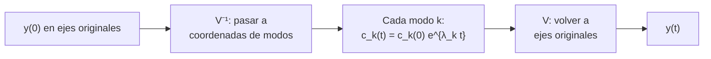

# B10-C09 — Diagonalización y estabilidad

<!-- nav:top -->
[🏠 Programa](../../../../README.md) · [📚 Bloque B10](../../../tronco-comun/B10-algebra-lineal-y-matematicas-geometricas.md) · [← Anterior: B10-C08 — Autovalores y autovectores](../B10-C08-autovalores-y-autovectores/CLASE.md) · [Siguiente: B10-C10 — Descomposiciones matriciales →](../B10-C10-descomposiciones-matriciales/CLASE.md)
<!-- /nav -->

## 1. Ubicación, nivel y alcance

Novena clase del bloque B10. En [C08](../B10-C08-autovalores-y-autovectores/CLASE.md) encontraste autovalores y autovectores. Aquí los usas para **diagonalizar** una matriz, calcular potencias y la exponencial `exp(A t)` y decidir si un sistema lineal es **estable**. Nivel N3. Verás la factorización `A = V Λ V⁻¹`, la solución de `y′ = A y`, la regla «parte real negativa», un ejemplo de oscilación amortiguada y por qué un método numérico puede ser inestable aunque el sistema físico no lo sea. No verás las ecuaciones diferenciales en general (B11) ni control (B16).

## 2. Por qué esta clase existe

Un panel solar largo y delgado vibra después de una maniobra. Si la vibración se amortigua, el panel es estable; si crece, hay un problema serio. Mirar cada instante por simulación es lento y no explica nada; los autovalores de la matriz que describe la vibración responden de un vistazo. Y cuando se simula con un paso de tiempo grande, el programa puede inventar una inestabilidad que el panel no tiene.

La decisión central: **¿cómo resumen los autovalores la evolución de un sistema lineal y cuándo puedo fiarme de la simulación?**

## 3. Lo que podrás hacer al terminar

1. Diagonalizar una matriz `2×2` y reconocer cuándo no se puede.
2. Calcular `Aᵏ` y `exp(A t)` con `V Λ V⁻¹`.
3. Clasificar la estabilidad por la parte real de los autovalores.
4. Escribir y resolver la oscilación amortiguada como `y′ = A y`.
5. Distinguir estabilidad continua y estabilidad numérica (radio espectral).
6. Leer en los autovalores la frecuencia y el amortiguamiento.

La evidencia es el **informe de estabilidad** del ejercicio 12 (sección 20).

## 4. Con qué llegas y cómo comprobarlo

Necesitas autovalores y autovectores ([C08](../B10-C08-autovalores-y-autovectores/CLASE.md)), exponenciales ([B04-C05](../../B04/B04-C05-funciones-exponenciales-y-logaritmicas/CLASE.md)) y la derivada como tasa ([B09-C03](../../B09/B09-C03-derivada-como-tasa-de-cambio/CLASE.md)). Cinco preguntas:

1. ¿Cuáles son los autovalores de `diag(2, 3)`?
2. ¿Cuánto es `e^{−2}`? (aprox.)
3. Si `x′ = −x`, ¿cuál es `x(t)` con `x(0) = 1`?
4. ¿Cuánto es `e^{i θ}` en términos de seno y coseno?
5. ¿Qué es una matriz defectuosa?

<details>
<summary>Ver respuestas</summary>

1. `2` y `3`. 2. `0,135`. 3. `e^{−t}`. 4. `cos θ + i sin θ`. 5. Una con menos autovectores independientes que su tamaño (C08, ejercicio 10).
</details>

## 5. Un caso real: la vibración de un panel solar

Un modo de flexión de un panel (modelo **sintético**, no de un panel real) tiene frecuencia `0,5 Hz` (`ω = π rad/s`) y razón de amortiguamiento `ζ = 0,02`. Su posición `x` cumple `x″ + 2ζω x′ + ω² x = 0`. Se escribe como sistema de primer orden con `y = (x, x′)`:

`y′ = A y`, con `A = [[0, 1], [−ω², −2ζω]]`.

Ejemplo conductor: leer en los autovalores de `A` si la vibración se extingue, con qué rapidez y con qué frecuencia, y simular el movimiento.

## 6. Vocabulario

Una matriz es **diagonalizable** si existe una matriz invertible `V` cuyas columnas son autovectores y `A = V Λ V⁻¹` con `Λ` diagonal de autovalores (S1, §1.2(vi), ec. 1.2.73: es el caso de las matrices no defectuosas). Dos matrices relacionadas por `B = V⁻¹ A V` son **semejantes** y comparten autovalores, traza y determinante. La **exponencial matricial** es `exp(A t) = Σ (A t)ᵏ/k!`; si `A = V Λ V⁻¹`, entonces `exp(A t) = V exp(Λ t) V⁻¹`. Un sistema `y′ = A y` es **asintóticamente estable** si todos los autovalores tienen parte real negativa, **marginalmente estable** si alguno tiene parte real cero y ninguno positiva (con autovectores completos), e **inestable** si alguno tiene parte real positiva. El **radio espectral** `ρ(M)` es el mayor módulo de los autovalores de `M`; un mapa discreto `y_{k+1} = M y_k` es estable si `ρ(M) < 1`. La **razón de amortiguamiento** `ζ` mide la pérdida de energía por ciclo.

## 7. Modelo mental: cada modo evoluciona por su cuenta

Al diagonalizar, el sistema se separa en modos independientes: cada autovector evoluciona multiplicado por `e^{λt}`.



*Descripción textual:* se expresa el estado inicial en la base de autovectores, cada coordenada se multiplica por su exponencial y se regresa a la base original.

Analogía: descomponer una melodía en notas puras, tratar cada nota por separado y recomponer. Su límite: si no hay suficientes autovectores (matriz defectuosa), las notas no bastan y aparecen términos como `t e^{λt}`.

## 8. La explicación, paso a paso

### 8.1 Diagonalizar y potenciar

Para `A = [[4, 1], [2, 3]]` (C08): `λ = 5, 2`, `V = [[1, 1], [1, −2]]`, `V⁻¹ = (1/3)[[2, 1], [1, −1]]`. Entonces `A³ = V diag(125, 8) V⁻¹ = [[86, 39], [78, 47]]`, que coincide con multiplicar `A · A · A`. Para `Aᵏ` con `k` grande, domina el autovalor mayor (`5ᵏ`).

### 8.2 Un ejemplo con solución a mano

`x″ + 3x′ + 2x = 0` con `x(0) = 1`, `x′(0) = 0`. Matriz `A = [[0, 1], [−2, −3]]`, polinomio `λ² + 3λ + 2 = 0`, `λ = −1, −2`. La solución es `x(t) = c₁ e^{−t} + c₂ e^{−2t}`; las condiciones iniciales dan `c₁ + c₂ = 1` y `−c₁ − 2c₂ = 0`, o sea `c₂ = −1`, `c₁ = 2`: `x(t) = 2e^{−t} − e^{−2t}`. En `t = 1`: `0,7358 − 0,1353 = 0,6004`. Ambos autovalores son negativos: estable, sin oscilación.

### 8.3 La regla de la parte real

Un autovalor `λ = a + bi` contribuye `e^{at}(cos bt + i sin bt)`: la **parte real `a`** controla si crece o se amortigua; la parte imaginaria `b`, la frecuencia. Estable si `a < 0` para todos. Es lo que importa: un autovalor `−0,06 + 3,14i` es estable aunque oscile rápido.

### 8.4 El panel solar

Los autovalores de `A` son `λ = −ζω ± iω√(1 − ζ²) = −0,062 83 ± 3,140 96 i`. La parte real negativa dice «estable»; la imaginaria da la frecuencia amortiguada `ω_d = 3,141 rad/s`. La envolvente decae como `e^{−ζωt}`; se reduce a la mitad en `ln 2/(ζω) = 11,03 s`. Traza `−2ζω = −0,125 66` y determinante `ω² = 9,8696` coinciden con la suma y el producto de los autovalores. Si `ζ = 0`, la parte real es 0 (marginal: oscila sin extinguirse); si `ζ = −0,02`, es `+0,0628` (inestable: la vibración crece).

### 8.5 La solución por diagonalización

`y(t) = V exp(Λ t) V⁻¹ y(0)`. Con `x(0) = 1` y `x′(0) = 0`, la solución exacta conocida es `x(t) = e^{−ζωt}[cos ω_d t + (ζω/ω_d) sin ω_d t]`. El laboratorio compara: `x(1) = −0,939 089`, `x(5) = −0,730 353`, `x(10) = 0,533 410`, `x(30) = 0,151 752`, idénticas hasta `10⁻¹²`. Resultado exacto sobre datos **sintéticos**.

### 8.6 Estabilidad numérica

Si simulas con el método de Euler explícito, `y_{k+1} = (I + hA) y_k`, necesitas `ρ(I + hA) < 1`. Con `h = 0,1 s`, `|1 + hλ| = 1,042 18 > 1`: el programa dice que la vibración **crece** (tras 100 pasos, `|x| = 42,4` en vez de `0,533`) aunque el panel es estable. La inestabilidad es del método, no del sistema. Solución: pasos más pequeños o métodos mejores (B11).

### 8.7 Cuando no se puede diagonalizar

`[[1, 1], [0, 1]]` tiene el autovalor 1 doble pero un solo autovector `(1, 0)`. Al pedir `V` a la biblioteca devuelve vectores casi paralelos (`κ(V) ≈ 9 × 10¹⁵`) y el cálculo no es fiable. Para estos casos se usan otras descomposiciones (forma de Jordan, Schur) o `expm` directo.

## 9. Magnitudes, símbolos y unidades

| Símbolo | Qué es | Unidad | Nota |
|---|---|---|---|
| `x` | desplazamiento modal | m (o adimensional) | sintético |
| `ω` | frecuencia natural | rad/s | `π` (0,5 Hz) |
| `ζ` | razón de amortiguamiento | adimensional | `0,02` |
| `λ` | autovalor | s⁻¹ | `−0,0628 ± 3,1410 i` |
| `ω_d` | frecuencia amortiguada | rad/s | `ω√(1 − ζ²)` |
| `h` | paso de tiempo | s | `0,1` |
| `ρ` | radio espectral | adimensional | `1,042 18` |

## 10. Convenciones y referencias

Estado `y = (x, x′)`; los autovalores se dan con parte imaginaria positiva primero. «Estable» significa asintóticamente estable salvo indicación. Los autovectores se normalizan. En el programa, `exp(A t)` por diagonalización se compara con la solución exacta, no con `scipy.linalg.expm`.

## 11. De dónde sale lo que afirmamos

| ID | Fuente | Localizador | Respalda | Estado |
|---|---|---|---|---|
| S1 | NIST, *DLMF* §1.2(vi), versión vigente en línea al consultar | https://dlmf.nist.gov/1.2 | Matrices no defectuosas diagonalizables por semejanza `Λ = S⁻¹AS` (1.2.73); traza y determinante (1.2.74–1.2.75); `det(exp A) = exp(tr A)` (1.2.77) | Consultada el 2026-11-05 mediante extracción automática |

Límites: la solución de `y′ = A y`, el criterio de la parte real, la oscilación amortiguada y el criterio del radio espectral son resultados estándar sin cita específica. Los parámetros del panel son **sintéticos**.

## 12. Cómo ver la vibración

Equivalente accesible a una gráfica de `x(t)`:

| `t` (s) | `x(t)` | Envolvente `e^{−ζωt}` |
|---|---|---|
| 0 | 1,0000 | 1,0000 |
| 1 | −0,9391 | 0,9391 |
| 5 | −0,7304 | 0,7304 |
| 10 | 0,5334 | 0,5335 |
| 30 | 0,1518 | 0,1518 |

Descripción larga: una oscilación que cruza el cero cada ~1 s y cuya amplitud baja lentamente; en `t = 30 s` queda un 15 % de la amplitud inicial.

## 13. Ejemplo trabajado: ¿estable y cuánto tarda en apagarse?

**Paso 1 · Datos.** `ω = π rad/s`, `ζ = 0,02` (sintéticos).

**Paso 2 · Matriz y autovalores.** `A = [[0, 1], [−9,8696, −0,1257]]`; `λ² + 0,1257 λ + 9,8696 = 0`; `λ = −0,0628 ± 3,1410 i`.

**Paso 3 · Estabilidad.** Parte real `−0,0628 < 0`: asintóticamente estable.

**Paso 4 · Tiempo de decaimiento.** Mitad de amplitud: `ln 2/0,0628 = 11,03 s`; 5 % de amplitud (`e^{−3}`): `3/0,0628 = 47,7 s`.

**Paso 5 · Sentido.** A los 30 s la amplitud es 15 % (`e^{−1,885} = 0,1518`). El resultado es **exacto** para el modelo sintético; en un panel real habría varios modos y amortiguamiento a identificar con ensayos.

## 14. Distintas formas de obtener `exp(A t)`

**Diagonalización:** clara, exige `V` bien condicionada. **Serie truncada:** costosa. **`expm` (escalado y cuadrado):** estándar y robusta para cualquier `A`. **Integración numérica:** común, pero introduce su propia estabilidad (8.6). Para `A` defectuosa, solo `expm` o Jordan.

## 15. Práctica guiada

**Ejercicio 1 · con los pasos indicados.** Calcula `A⁵` para `A = diag(2, 3)`. *Pasos:* diagonal, potencia de cada entrada.

<details><summary>Solución comentada</summary>

`diag(32, 243)`.
</details>

**Ejercicio 2 · con una pista.** Con `A = [[4,1],[2,3]]`, calcula `A³` por diagonalización y compara con el producto directo. *Pista:* `V` en 8.1.

<details><summary>Solución comentada</summary>

`V diag(125, 8) V⁻¹ = [[86, 39], [78, 47]]`; directo: `A² = [[18, 7], [14, 11]]`, `A³ = [[86, 39], [78, 47]]` ✓.
</details>

**Ejercicio 3 · casi autónomo.** Resuelve `x″ + 3x′ + 2x = 0` con `x(0) = 1`, `x′(0) = 0` y calcula `x(1)`.

<details><summary>Solución comentada</summary>

`x(t) = 2e^{−t} − e^{−2t}`; `x(1) = 0,6004` (8.2).
</details>

## 16. Práctica autónoma, transferencia e integrador

**Ejercicio 4.** Clasifica `[[0, 1], [−4, 0]]` (oscilador sin amortiguamiento).

<details><summary>Solución comentada</summary>

`λ² + 4 = 0`, `λ = ±2i`: parte real cero: marginal, oscila sin extinguirse.
</details>

**Ejercicio 5.** Clasifica `[[1, 2], [0, −3]]`.

<details><summary>Solución comentada</summary>

Triangular: autovalores `1` y `−3`. Hay uno con parte real positiva: inestable.
</details>

**Ejercicio 6.** ¿Son estables los mapas `y_{k+1} = 0,9 y_k` y `y_{k+1} = [[0,5; 0,4], [0; 1,1]] y_k`?

<details><summary>Solución comentada</summary>

Primero: `ρ = 0,9 < 1`, estable. Segundo: triangular, autovalores `0,5` y `1,1`, `ρ = 1,1 > 1`: inestable.
</details>

**Ejercicio 7.** Con el panel de 5, ¿qué fracción de la amplitud queda a los 30 s y qué tiempo hace falta para bajar al 5 %?

<details><summary>Solución comentada</summary>

`e^{−0,0628 · 30} = 0,152`. Al 5 %: `ln 20/0,0628 = 47,7 s`.
</details>

**Ejercicio 8.** Verifica traza y determinante de `A` del panel con sus autovalores.

<details><summary>Solución comentada</summary>

Traza `−0,1257 = −0,0628 · 2`; determinante `9,8696 = 0,0628² + 3,1410²` ✓.
</details>

**Ejercicio 9 · transferencia.** Con Euler explícito y `h = 0,1`, explica por qué la simulación crece si todos los `Re λ` son negativos.

<details><summary>Solución comentada</summary>

La matriz del paso es `I + hA` y sus autovalores son `1 + hλ`. Con `λ = −0,0628 + 3,1410 i`: `|1 + hλ| = √(0,9937² + 0,3141²) = 1,0422 > 1`. Cada paso aumenta la amplitud 4 %: inestabilidad numérica (8.6).
</details>

**Ejercicio 10 · transferencia.** Para una matriz defectuosa, ¿qué indicador del programa te avisa de que no se puede diagonalizar con fiabilidad?

<details><summary>Solución comentada</summary>

El número de condición de `V`: `κ ≈ 9 × 10¹⁵`, es decir, columnas casi paralelas (8.7).
</details>

**Ejercicio 11 · transferencia.** Alguien dice: «`λ = −0,06 + 3,14i` es inestable porque la frecuencia es alta». Corrígelo.

<details><summary>Solución comentada</summary>

La estabilidad la fija la parte **real** (`−0,06 < 0`): se amortigua. La parte imaginaria solo fija la frecuencia (8.3).
</details>

**Ejercicio 12 · integrador.** Elabora tu **informe de estabilidad**: un oscilador sintético con tus `ω` y `ζ`, su matriz, autovalores, clasificación, solución por diagonalización contrastada con la exacta, tiempo de decaimiento y un caso de Euler explícito inestable.

<details><summary>Solución modelo</summary>

Como las secciones 13 y 8.6 con tus números, la tabla de 12, la comprobación `10⁻¹²` del laboratorio y la distinción entre estabilidad del sistema y del método.
</details>

## 17. Laboratorio: exponencial por diagonalización y estabilidad

El script [diagonalizacion_estabilidad.py](diagonalizacion_estabilidad.py) diagonaliza el oscilador, compara con la solución exacta, clasifica tres amortiguamientos, muestra la inestabilidad de Euler y el caso defectuoso.

**Datos:** sintéticos. **Predice antes de ejecutar:** ¿qué hará Euler explícito con `h = 0,1`? **Ejecución del 2026-11-05 (Python 3.12.9, numpy 2.4.4):**

```text
autovalores: [-0.062832+3.140964j -0.062832-3.140964j]
traza = -0.125664 = suma de autovalores -0.125664
det   = 9.869604 = producto 9.869604
t=  1.0 s: x(diag) = -0.9390893774  x(exacta) = -0.9390893774
t=  5.0 s: x(diag) = -0.7303531797  x(exacta) = -0.7303531797
t= 10.0 s: x(diag) =  0.5334104986  x(exacta) =  0.5334104986
t= 30.0 s: x(diag) =  0.1517515688  x(exacta) =  0.1517515688
vida media de la envolvente: ln2/(zeta omega) = 11.032 s
zeta = +0.02: max Re(lambda) = -0.06283 ->  estable
zeta = +0.00: max Re(lambda) = -0.00000 ->  marginal
zeta = -0.02: max Re(lambda) = +0.06283 ->  inestable
Euler explicito h=0.1: radio espectral = 1.04218; |x| tras 100 pasos = 42.407 (exacta 0.5334)
defectuosa: cond(V) = 9.01e+15 (autovectores casi paralelos)
Pruebas superadas.
```

```bash
python programa/clases/B10/B10-C09-diagonalizacion-y-estabilidad/diagonalizacion_estabilidad.py
```

**Límites:** sistema lineal de un modo; sin forzamiento; parámetros sintéticos.

## 18. Errores frecuentes y cómo corregirlos

**Mirar la parte imaginaria para decidir estabilidad.** Se corrige con el ejercicio 11.

**Diagonalizar sin comprobar los autovectores.** Se corrige con los ejercicios 2 y 10.

**Confundir estabilidad del sistema con la del método numérico.** Se corrige con el ejercicio 9.

**Usar el criterio continuo (`Re λ < 0`) en un mapa discreto.** Se corrige con el ejercicio 6.

**Olvidar `V⁻¹` al reconstruir `A`.** Se corrige con el ejercicio 2.

## 19. Cómo sabrás que vas bien

Tras 8.2: ¿resuelves un oscilador sobreamortiguado a mano? Si no, ejercicio 3. Tras 8.3: ¿qué controla la parte real? Si no, ejercicio 11. Tras 8.6: ¿por qué el programa crece? Si no, ejercicio 9.

## 20. Qué entregas y cómo se evalúa

El producto es tu **informe de estabilidad** (ejercicio 12).

| Criterio | Inicial | En desarrollo | Logrado | Destacado |
|---|---|---|---|---|
| Diagonalización | Errores de álgebra | Valores sin `V` | `V Λ V⁻¹` verificada | Con condición de `V` |
| Clasificación | Sin criterio | Mira la frecuencia | Parte real correcta | Distingue continuo y discreto |
| Solución | Sin comprobación | Aproximada | Contrastada con exacta | Con error cuantificado |
| Interpretación | Sin tiempos | Tiempos sin unidad | Decaimiento con unidades | Discute realismo |
| Fuentes y rotulado | Sin fuente | Sin fecha | Con localizador y fecha | Rotula sintético |

**Condiciones críticas:** clasificar con la parte real; contrastar con una solución exacta; rotular lo sintético; citar solo fuentes consultadas.

## 21. Ética, seguridad y límites

Un modo con amortiguamiento incierto puede ser estable en el modelo e inestable en el hardware. Los modelos reales de paneles incluyen muchos modos y acoplamiento con el control (B16). Esta clase no es base para decisiones de ingeniería. Accesibilidad: tablas equivalentes a las figuras, fórmulas en texto, ejercicios sin conexión.

## 22. Para cerrar y seguir

Diagonalizar separa un sistema lineal en modos; `exp(At) = V exp(Λt) V⁻¹`; la parte real de los autovalores decide la estabilidad y la imaginaria, la frecuencia; un método numérico tiene su propia estabilidad. Queda abierta una pregunta: ¿qué otras factorizaciones existen cuando la matriz no es diagonalizable o es muy grande?

**Glosario español–inglés.** diagonalización · *diagonalization*; matrices semejantes · *similar matrices*; exponencial matricial · *matrix exponential*; estabilidad asintótica · *asymptotic stability*; radio espectral · *spectral radius*; razón de amortiguamiento · *damping ratio*; modo · *mode*.

**Continuidad.** B10-C10 reutiliza tu capacidad de **factorizar matrices** para presentar LU, QR y Cholesky como herramientas de cálculo.

**Referencias:** ver sección 11.

<!-- nav:bottom -->
---

[← Anterior: B10-C08 — Autovalores y autovectores](../B10-C08-autovalores-y-autovectores/CLASE.md) · [📚 Bloque B10](../../../tronco-comun/B10-algebra-lineal-y-matematicas-geometricas.md) · [Siguiente: B10-C10 — Descomposiciones matriciales →](../B10-C10-descomposiciones-matriciales/CLASE.md)
<!-- /nav -->
