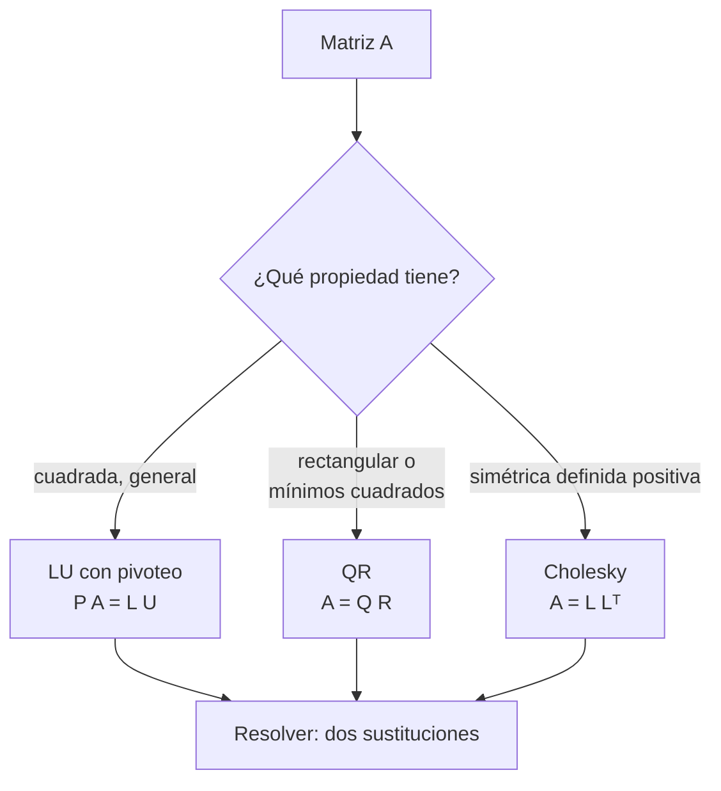

# B10-C10 — Descomposiciones matriciales

<!-- nav:top -->
[🏠 Programa](../../../../README.md) · [📚 Bloque B10](../../../tronco-comun/B10-algebra-lineal-y-matematicas-geometricas.md) · [← Anterior: B10-C09 — Diagonalización y estabilidad](../B10-C09-diagonalizacion-y-estabilidad/CLASE.md) · [Siguiente: B10-C11 — Valores singulares y SVD →](../B10-C11-valores-singulares-y-svd/CLASE.md)
<!-- /nav -->

## 1. Ubicación, nivel y alcance

Décima clase del bloque B10. Ya sabes resolver sistemas por eliminación ([C05](../B10-C05-sistemas-lineales-y-eliminacion/CLASE.md)), ortogonalizar ([C06](../B10-C06-producto-interno-y-ortogonalidad/CLASE.md)) y diagonalizar ([C09](../B10-C09-diagonalizacion-y-estabilidad/CLASE.md)). Aquí ves que casi todo eso son **factorizaciones**: escribir una matriz como producto de otras más simples. Nivel N3. Verás **LU con pivoteo**, **QR** y **Cholesky**, cuándo conviene cada una, cómo verificarlas y cómo la de Cholesky genera errores correlacionados para simulaciones. La **SVD** es la clase siguiente. No verás factorizaciones para matrices dispersas ni complejas.

## 2. Por qué esta clase existe

Un filtro de navegación resuelve el mismo sistema con miles de lados derechos distintos; una simulación necesita muestras aleatorias con una covarianza dada; un ajuste de mínimos cuadrados quiere estabilidad. En cada caso el trabajo se hace una vez al factorizar y luego se reutiliza. Por eso las bibliotecas no «invierten matrices»: las factorizan.

La decisión central: **¿qué factorización uso para este problema y cómo compruebo que la hice bien?**

## 3. Lo que podrás hacer al terminar

1. Calcular una factorización `P A = L U` y usarla para resolver sistemas.
2. Obtener el determinante a partir de `U` y de las permutaciones.
3. Describir `A = Q R` y su uso en mínimos cuadrados.
4. Calcular una factorización de Cholesky `A = L Lᵀ` de una matriz simétrica definida positiva.
5. Generar muestras con una covarianza prescrita.
6. Elegir la factorización adecuada y verificar el producto reconstruido.

La evidencia es el **cuaderno de factorizaciones** del ejercicio 12 (sección 20).

## 4. Con qué llegas y cómo comprobarlo

Necesitas eliminación con pivoteo ([C05](../B10-C05-sistemas-lineales-y-eliminacion/CLASE.md)) y ortogonalidad ([C06](../B10-C06-producto-interno-y-ortogonalidad/CLASE.md)). Cinco preguntas:

1. ¿Qué operación elemental anula `4` en la fila `(4, 3)` usando la fila `(2, 1)`?
2. ¿Qué es una matriz triangular inferior?
3. ¿Qué significa `QᵀQ = I`?
4. ¿Qué es una matriz simétrica?
5. ¿Cuál es el determinante de una matriz triangular?

<details>
<summary>Ver respuestas</summary>

1. Restar 2 veces la fila `(2, 1)`. 2. Una con ceros por encima de la diagonal. 3. Que las columnas de `Q` son ortonormales. 4. La que cumple `A = Aᵀ`. 5. El producto de la diagonal.
</details>

## 5. Un caso real: errores de posición correlacionados

Un objeto tiene un error de posición con covarianza (**sintética**, en km²)

`P = [[4, 1, 0,5], [1, 3, 0,2], [0,5, 0,2, 2]]`.

La diagonal son las varianzas de `x`, `y`, `z`; los demás términos, las covarianzas (los errores están correlacionados). Se quieren generar miles de errores posibles con esa estructura para una simulación de Monte Carlo (B12). La factorización de Cholesky de `P` lo permite. Además, un sistema con la matriz `A` de LU sirve para ilustrar la reutilización. Los números no son de ningún objeto real.

## 6. Vocabulario

Una **factorización** (o descomposición) escribe `A` como producto de factores con estructura. **LU:** `P A = L U` con `L` triangular inferior de unos en la diagonal, `U` triangular superior y `P` una **matriz de permutación** (reordena filas) —es la eliminación gaussiana guardada—. **QR:** `A = Q R` con `Q` de columnas ortonormales y `R` triangular superior. **Cholesky:** `A = L Lᵀ` con `L` triangular inferior de diagonal positiva, para `A` simétrica **definida positiva** (`xᵀA x > 0` para todo `x ≠ 0`; sus autovalores son positivos, C08). Una **matriz de covarianza** es simétrica y semidefinida positiva (S1: matrices simétricas, §1.2(vi), ecs. 1.2.54–1.2.56). El **factor** de Cholesky es una «raíz cuadrada» de la matriz.

## 7. Modelo mental: preparar una vez, usar muchas

Factorizar es pagar un costo inicial para que cada resolución posterior sea barata.



*Descripción textual:* según la forma de la matriz se escoge LU (general), QR (rectangular o ajuste) o Cholesky (simétrica definida positiva); en todos los casos resolver el sistema se reduce a sustituciones con matrices triangulares.

Analogía: una receta ya preparada en porciones. Su límite: preparar la receta cuesta; si solo se necesita una porción, no vale la pena.

## 8. La explicación, paso a paso

### 8.1 LU con pivoteo

Para `A = [[2, 1, 1], [4, −6, 0], [−2, 7, 2]]`: la mayor entrada de la primera columna es `4` (fila 2): se intercambian filas 1 y 2. Multiplicadores: `2/4 = 0,5` y `−2/4 = −0,5`. Filas tras eliminar: `[0, 4, 1]` y `[0, 4, 2]`. En la segunda columna ambos pivotes valen `4`; se resta una de otra: `[0, 0, 1]`. Entonces

`U = [[4, −6, 0], [0, 4, 1], [0, 0, 1]]`, `L = [[1, 0, 0], [0,5, 1, 0], [−0,5, 1, 1]]`, con `P` el intercambio de las filas 1 y 2.

Comprobación: `P A − L U = 0` (el laboratorio da `0,0`).

### 8.2 Usar la factorización

Para `A x = b`: primero `P A x = P b`, es decir `L U x = P b`. Se resuelve `L y = P b` (hacia adelante) y `U x = y` (hacia atrás). Con `b = (5, −2, 9)` el resultado es `x = (1, 1, 2)`. Comprobación: `2 + 1 + 2 = 5`, `4 − 6 + 0 = −2`, `−2 + 7 + 4 = 9` ✓. Cambiar `b` solo cuesta dos sustituciones, unas `2n²` operaciones, en vez de repetir las `2n³/3` de la eliminación.

### 8.3 Determinante

`det A = (±1) · producto de la diagonal de U`, con el signo de la permutación. Aquí: un intercambio (`−1`) y `4 · 4 · 1 = 16`, o sea `det A = −16`, que coincide con el valor directo.

### 8.4 QR

Cada columna de `A` se ortogonaliza respecto de las anteriores (Gram–Schmidt, C06), y `R` guarda los coeficientes. Para `A` rectangular `m × n` sirve para mínimos cuadrados: `R x = Qᵀ b` (C07). El laboratorio reconstruye `A` con error `2 × 10⁻¹⁵` y `‖QᵀQ − I‖ = 4 × 10⁻¹⁶`. Para una sola columna `(3, 4)`: `Q = (0,6; 0,8)` y `R = 5`.

### 8.5 Cholesky

Para `A = [[4, 2], [2, 5]]`: `L₁₁ = √4 = 2`; `L₂₁ = 2/2 = 1`; `L₂₂ = √(5 − 1²) = 2`. `L = [[2, 0], [1, 2]]` y `L Lᵀ = [[4, 2], [2, 5]]` ✓. Para la covarianza `P` del ejemplo conductor:

`L = [[2, 0, 0], [0,5, 1,6583, 0], [0,25, 0,0452, 1,3912]]`.

Cada paso exige que la cantidad bajo la raíz sea positiva; si no lo es, la matriz **no** es definida positiva y el algoritmo se detiene. Con `[[1, 2], [2, 1]]` (autovalores `3` y `−1`) falla.

### 8.6 Muestras con covarianza dada

Si `w` tiene componentes independientes de varianza 1 y `z = L w`, entonces la covarianza de `z` es `L Lᵀ = P`. Así, de ruido simple se obtienen errores correlacionados: por ejemplo la varianza de `y` es `L₂₁² + L₂₂² = 0,25 + 2,75 = 3`, igual a `P₂₂`. Con `400 000` muestras sintéticas, la covarianza muestral se separa de `P` en `0,29 %` del mayor elemento.

### 8.7 Costos y elección

Aproximadamente: LU cuesta `2n³/3` operaciones, Cholesky `n³/3` (la mitad, por usar la simetría), QR cerca de `4n³/3` para matrices cuadradas. Estas cifras son resultados estándar de análisis numérico sin cita específica aquí. Regla práctica: Cholesky si hay simetría definida positiva; LU para cuadradas generales; QR para mínimos cuadrados.

## 9. Magnitudes, símbolos y unidades

| Símbolo | Qué es | Unidad | Nota |
|---|---|---|---|
| `P` (en LU) | matriz de permutación | — | reordena filas |
| `L`, `U` | triangulares inferior y superior | según el caso | `P A = L U` |
| `Q`, `R` | ortogonal y triangular | — | `A = Q R` |
| `L` (Cholesky) | factor triangular | km | `A = L Lᵀ` |
| `P` (covarianza) | matriz de covarianza | km² | sintética |
| `w`, `z` | ruido simple y errores correlacionados | — , km | `z = L w` |

## 10. Convenciones y referencias

La letra `P` se usa para la permutación y para la covarianza: el contexto lo distingue. `L` de LU tiene unos en la diagonal; `L` de Cholesky no. El pivoteo es parcial. Los factores se verifican siempre reconstruyendo el producto. La covarianza se interpreta como esperanza de `z zᵀ` con media cero.

## 11. De dónde sale lo que afirmamos

| ID | Fuente | Localizador | Respalda | Estado |
|---|---|---|---|---|
| S1 | NIST, *DLMF* §1.2(vi), versión vigente en línea al consultar | https://dlmf.nist.gov/1.2 | Matrices diagonal, simétrica real y hermítica (1.2.54–1.2.56); determinante e inversa (1.2.58–1.2.60) | Consultada el 2026-11-05 mediante extracción automática |
| S2 | NIST, *DLMF* §1.3(i) | https://dlmf.nist.gov/1.3 | Determinante de una matriz triangular o diagonal (producto de la diagonal) y del producto (1.3.7) | Consultada el 2026-11-05 mediante extracción automática |

Límites: LU, QR, Cholesky y sus costos son resultados estándar de álgebra lineal numérica sin cita específica; DLMF §3.2 los trata, pero no fue consultada. La covarianza es **sintética**; la covarianza muestral es una **estimación** por Monte Carlo.

## 12. Cómo ver las factorizaciones

Equivalente accesible a un diagrama de bloques, para el ejemplo de 8.1:

| Matriz | Fila 1 | Fila 2 | Fila 3 |
|---|---|---|---|
| `U` | `4, −6, 0` | `0, 4, 1` | `0, 0, 1` |
| `L` | `1, 0, 0` | `0,5, 1, 0` | `−0,5, 1, 1` |
| `L` Cholesky de `P` | `2, 0, 0` | `0,5, 1,6583, 0` | `0,25, 0,0452, 1,3912` |

Descripción larga: `U` guarda el resultado de la eliminación y `L` guarda los multiplicadores usados; el factor de Cholesky tiene el patrón triangular con una diagonal positiva.

## 13. Ejemplo trabajado: generar errores correlacionados

**Paso 1 · Datos.** `P` del ejemplo conductor (km², sintética).

**Paso 2 · Factor.** `L₁₁ = 2`; `L₂₁ = 1/2 = 0,5`; `L₃₁ = 0,5/2 = 0,25`; `L₂₂ = √(3 − 0,25) = 1,6583`; `L₃₂ = (0,2 − 0,25 · 0,5)/1,6583 = 0,0452`; `L₃₃ = √(2 − 0,0625 − 0,00205) = 1,3912`.

**Paso 3 · Comprobación.** `L Lᵀ` reproduce `P` con error `< 10⁻¹²`.

**Paso 4 · Muestras.** Con `w` normal estándar de tres componentes, `z = L w`: la desviación de `x` es `2 km` (`√4`), la de `y`, `√3 = 1,73 km`, la de `z`, `√2 = 1,41 km`; el coeficiente de correlación `x`–`y` es `1/√(4·3) = 0,289`.

**Paso 5 · Sentido.** Las muestras tienen los errores de `x` e `y` ligeramente correlacionados, como `P` indica. Resultado sintético; una covarianza real saldría de una determinación de órbita (B22).

## 14. Distintas formas de resolver o factorizar

**LU:** general; reutilizable. **Cholesky:** el doble de rápida y más estable, solo simétrica definida positiva. **QR:** estable para ajustes. **Inversa explícita:** evítala. **SVD** (C11): la más robusta y cara. La comparación sensata es siempre contra una **verificación independiente**: reconstruir `P A − L U`, `A − Q R`, `A − L Lᵀ`.

## 15. Práctica guiada

**Ejercicio 1 · con los pasos indicados.** Factoriza `A = [[2, 1], [4, 3]]` sin pivoteo. *Pasos:* multiplicador `4/2 = 2`.

<details><summary>Solución comentada</summary>

`L = [[1, 0], [2, 1]]`, `U = [[2, 1], [0, 1]]`; `L U = [[2, 1], [4, 3]]` ✓.
</details>

**Ejercicio 2 · con una pista.** Con esa factorización, resuelve `A x = (3, 7)`. *Pista:* hacia adelante y luego hacia atrás.

<details><summary>Solución comentada</summary>

`L y = b`: `y₁ = 3`, `y₂ = 7 − 6 = 1`. `U x = y`: `x₂ = 1`, `x₁ = (3 − 1)/2 = 1`. `x = (1, 1)` ✓.
</details>

**Ejercicio 3 · casi autónomo.** Calcula el factor de Cholesky de `[[4, 2], [2, 5]]`.

<details><summary>Solución comentada</summary>

`L = [[2, 0], [1, 2]]` (8.5).
</details>

## 16. Práctica autónoma, transferencia e integrador

**Ejercicio 4.** Obtén `det A` para el `A` de 8.1 a partir de `U` y del intercambio.

<details><summary>Solución comentada</summary>

`(−1)¹ · 4 · 4 · 1 = −16` (8.3).
</details>

**Ejercicio 5.** Intenta Cholesky de `[[1, 2], [2, 1]]` y explica el resultado.

<details><summary>Solución comentada</summary>

`L₁₁ = 1`, `L₂₁ = 2`, `L₂₂ = √(1 − 4) = √(−3)`: imposible. La matriz tiene autovalores `3` y `−1`: no es definida positiva.
</details>

**Ejercicio 6.** Calcula `Q` y `R` para la columna `A = (3, 4)ᵗ`.

<details><summary>Solución comentada</summary>

`R = ‖A‖ = 5`, `Q = A/5 = (0,6; 0,8)`.
</details>

**Ejercicio 7.** Estima operaciones de LU y de Cholesky para `n = 1000`.

<details><summary>Solución comentada</summary>

LU `2n³/3 ≈ 6,7 × 10⁸`; Cholesky `n³/3 ≈ 3,3 × 10⁸` (8.7).
</details>

**Ejercicio 8.** Si debes resolver 500 sistemas con la misma matriz `n = 1000` y distintos lados derechos, ¿cuántas operaciones aproximadas con factorización y sin ella?

<details><summary>Solución comentada</summary>

Con LU: `6,7 × 10⁸ + 500 · 2 · 10⁶ = 6,7 × 10⁸ + 10⁹ ≈ 1,7 × 10⁹`. Sin reutilizar: `500 · 6,7 × 10⁸ ≈ 3,3 × 10¹¹`, doscientas veces más.
</details>

**Ejercicio 9 · transferencia.** A partir del factor `L` de la covarianza `P`, calcula la desviación de `y` y el coeficiente de correlación entre `x` e `y`.

<details><summary>Solución comentada</summary>

`σ_y = √(L₂₁² + L₂₂²) = √3 = 1,73 km`; correlación `P₁₂/(σ_x σ_y) = 1/(2 · 1,73) = 0,289`.
</details>

**Ejercicio 10 · transferencia.** Un colega propone una covarianza con correlación exacta 1: `[[1, 1], [1, 1]]`. ¿Se puede factorizar con Cholesky? ¿Qué significa físicamente?

<details><summary>Solución comentada</summary>

`L₁₁ = 1`, `L₂₁ = 1`, `L₂₂ = √(1 − 1) = 0`: la matriz es semidefinida, no definida positiva. Significa que ambos errores son el mismo (una sola fuente de incertidumbre): el problema tiene un grado de libertad menos.
</details>

**Ejercicio 11 · transferencia.** Alguien afirma: «si `det A ≠ 0`, la LU sin pivoteo siempre existe». Refútalo con `[[0, 1], [1, 0]]`.

<details><summary>Solución comentada</summary>

El primer pivote es `0`: la eliminación sin pivoteo falla aunque `det = −1`. Con pivoteo (intercambiar filas), `P A = I`.
</details>

**Ejercicio 12 · integrador.** Elabora tu **cuaderno de factorizaciones**: una LU con pivoteo (hecha a mano, con verificación `P A = L U`), una resolución con dos lados derechos, un Cholesky de tu propia covarianza sintética con muestras y la comprobación de la covarianza muestral.

<details><summary>Solución modelo</summary>

Como 8.1–8.3 y 13, con tus números, la reconstrucción de los productos con error `< 10⁻¹²` y la covarianza muestral frente a la prescrita (error relativo ~0,3 % con 400 000 muestras).
</details>

## 17. Laboratorio: LU, QR y Cholesky

El script [descomposiciones.py](descomposiciones.py) implementa LU con pivoteo y Cholesky, verifica los productos, resuelve con LU, compara QR y genera muestras con la covarianza.

**Datos:** sintéticos, semilla fija. **Predice antes de ejecutar:** ¿qué error relativo tendrá la covarianza muestral con 400 000 muestras? **Ejecución del 2026-11-05 (Python 3.12.9, numpy 2.4.4):**

```text
P A - L U (max) = 0.0
det por LU = -16.0 | det directo = -16.0
A x = b -> [1. 1. 2.]
QR: |A - QR| max = 2.4424906541753444e-15 | |Q^T Q - I| max = 4.440892098500626e-16
Cholesky L =
 [[2.       0.       0.      ]
 [0.5      1.658312 0.      ]
 [0.25     0.045227 1.391206]]
[[1,2],[2,1]]: la matriz no es definida positiva
covarianza muestral - P (max relativo) = 0.0029
Pruebas superadas.
```

```bash
python programa/clases/B10/B10-C10-descomposiciones-matriciales/descomposiciones.py
```

**Límites:** matrices pequeñas reales; la covarianza muestral depende de la semilla.

## 18. Errores frecuentes y cómo corregirlos

**Calcular la inversa para resolver.** Se corrige en la sección 14 y el ejercicio 8.

**Olvidar la permutación.** Se corrige con los ejercicios 4 y 11.

**Aplicar Cholesky a una matriz que no es definida positiva.** Se corrige con los ejercicios 5 y 10.

**No comprobar el producto reconstruido.** Se corrige en la sección 14.

**Confundir `L` de LU con `L` de Cholesky.** Se corrige en la sección 10.

## 19. Cómo sabrás que vas bien

Tras 8.1: ¿haces una LU de `3×3` con pivoteo y la verificas? Si no, ejercicio 1. Tras 8.5: ¿por qué falla Cholesky en una matriz con autovalor negativo? Si no, ejercicio 5. Tras 8.6: ¿cómo se obtienen errores correlacionados? Si no, ejercicio 9.

## 20. Qué entregas y cómo se evalúa

El producto es tu **cuaderno de factorizaciones** (ejercicio 12).

| Criterio | Inicial | En desarrollo | Logrado | Destacado |
|---|---|---|---|---|
| Factorización | Con errores | Sin pivoteo | Con pivoteo y permutación | Con costos |
| Verificación | Ausente | Mental | Producto reconstruido | Y determinante independiente |
| Elección | Siempre inversa | Elige sin razón | Justifica LU/QR/Cholesky | Discute estabilidad |
| Contexto | Sin significado | Menciona covarianza | Muestras correlacionadas | Compara con la covarianza prescrita |
| Fuentes y rotulado | Sin fuente | Sin fecha | Con localizador y fecha | Rotula sintético y estimado |

**Condiciones críticas:** reconstruir el producto; rotular lo sintético y la covarianza muestral como estimación; citar solo fuentes consultadas.

## 21. Ética, seguridad y límites

Una covarianza inventada puede dar una falsa sensación de rigor. Las simulaciones de Monte Carlo de riesgo de colisión o de reingreso exigen covarianzas reales, validadas, y el análisis de su validez (B12, B22, B118). Accesibilidad: tablas equivalentes a las figuras, fórmulas en texto, ejercicios sin conexión.

## 22. Para cerrar y seguir

LU, QR y Cholesky guardan el trabajo de eliminación, ortogonalización y «raíz cuadrada» para reutilizarlo; se verifican reconstruyendo el producto; Cholesky genera ruido con una covarianza dada. Queda abierta una pregunta: ¿existe una factorización que sirva para cualquier matriz, incluso rectangular o casi singular, y que revele directamente su rango?

**Glosario español–inglés.** factorización · *factorization*; descomposición LU · *LU decomposition*; descomposición QR · *QR decomposition*; factorización de Cholesky · *Cholesky factorization*; matriz de permutación · *permutation matrix*; definida positiva · *positive definite*; matriz de covarianza · *covariance matrix*.

**Continuidad.** B10-C11 reutiliza tu capacidad de **factorizar y verificar** para presentar la descomposición en valores singulares.

**Referencias:** ver sección 11.

<!-- nav:bottom -->
---

[← Anterior: B10-C09 — Diagonalización y estabilidad](../B10-C09-diagonalizacion-y-estabilidad/CLASE.md) · [📚 Bloque B10](../../../tronco-comun/B10-algebra-lineal-y-matematicas-geometricas.md) · [Siguiente: B10-C11 — Valores singulares y SVD →](../B10-C11-valores-singulares-y-svd/CLASE.md)
<!-- /nav -->
