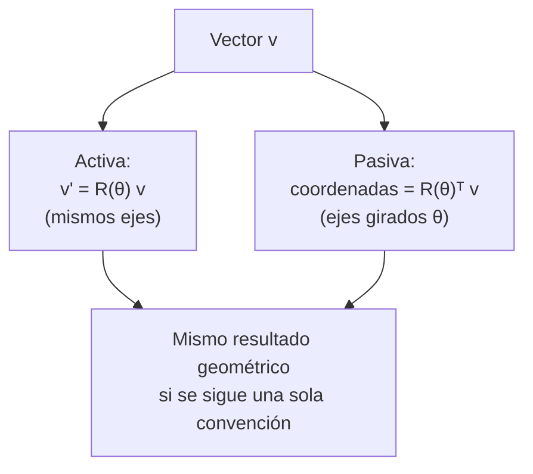

# B10-C12 — Rotaciones en el plano y espacio

<!-- nav:top -->
[🏠 Programa](../../../../README.md) · [📚 Bloque B10](../../../tronco-comun/B10-algebra-lineal-y-matematicas-geometricas.md) · [← Anterior: B10-C11 — Valores singulares y SVD](../B10-C11-valores-singulares-y-svd/CLASE.md) · [Siguiente: B10-C13 — Matrices de rotación tridimensional →](../B10-C13-matrices-de-rotacion-tridimensional/CLASE.md)
<!-- /nav -->

## 1. Ubicación, nivel y alcance

Duodécima clase del bloque B10 y apertura del tercer tramo, dedicado a la orientación. Ya rotaste puntos y ejes en [B04-C15](../../B04/B04-C15-rotacion-de-puntos-y-ejes/CLASE.md) y conoces la matriz de giro de [C03](../B10-C03-matrices-y-operadores-lineales/CLASE.md). Aquí fijas lo esencial: qué es una rotación (una matriz ortogonal con determinante `+1`), la diferencia entre rotar el **vector** y rotar los **ejes**, el giro alrededor de un eje del espacio y la velocidad de un punto que gira. Nivel N3. Usarás la rotación diaria de la Tierra. No verás matrices de rotación en 3D completas (C13), ángulos de Euler (C14) ni cuaterniones (C15).

## 2. Por qué esta clase existe

La Tierra gira una vuelta cada 23,93 horas: una estación de seguimiento ve pasar los satélites porque sus ejes locales rotan respecto del espacio inercial. Un satélite recibe órdenes expresadas en ejes terrestres y debe saber dónde están en ejes inerciales. Y un lanzamiento aprovecha la velocidad de giro del terreno. Para todo eso, hay que saber rotar bien, sin confundir si se rota el vector o el sistema de ejes, y con la convención de signos declarada.

La decisión central: **¿rota el objeto o rotan los ejes, en qué sentido y con qué ángulo?**

## 3. Lo que podrás hacer al terminar

1. Escribir la matriz de rotación en el plano y alrededor de `z`.
2. Demostrar y usar que `R(θ)⁻¹ = R(−θ) = R(θ)ᵀ` y `det R = 1`.
3. Distinguir rotación **activa** (del vector) y **pasiva** (de los ejes).
4. Calcular la posición de una estación en un instante dado.
5. Calcular su velocidad con `v = ω ẑ × r` y verificarla numéricamente.
6. Explicar por qué la velocidad de giro baja con la latitud.

La evidencia es la **hoja de rotaciones con convenciones** del ejercicio 12 (sección 20).

## 4. Con qué llegas y cómo comprobarlo

Necesitas la matriz de giro ([C03](../B10-C03-matrices-y-operadores-lineales/CLASE.md)) y el producto vectorial ([B04-C14](../../B04/B04-C14-producto-vectorial-y-orientacion/CLASE.md)). Cinco preguntas:

1. Calcula `R(90°) (1, 0)`.
2. Calcula `(0, 0, 1) × (1, 0, 0)`.
3. ¿Cuánto vale `cos² θ + sin² θ`?
4. Si algo da una vuelta en 24 h, ¿cuántos grados gira por hora?
5. ¿Cuál es el determinante de una rotación plana?

<details>
<summary>Ver respuestas</summary>

1. `(0, 1)`. 2. `(0, 1, 0)`. 3. `1`. 4. `15°`. 5. `1`.
</details>

## 5. Un caso real: una estación en la Tierra que gira

Una estación en latitud `30°` (valor **sintético**) está sobre una Tierra idealizada como esfera rígida de radio `6378,137 km` (radio ecuatorial, S3), que gira con velocidad angular nominal `ω = 7,292 115 × 10⁻⁵ rad/s` (S2) alrededor del eje `z`. Su posición inicial es `r₀ = a (cos 30°, 0, sin 30°) = (5523,63; 0; 3189,07)` km. La pregunta es cuál es su posición y su velocidad en los ejes inerciales una hora, seis horas y un periodo sideral después. Es el ejemplo conductor. Los números de ω y radio son **datos publicados**; la latitud, la esfera y la rotación uniforme son un **modelo simplificado**.

## 6. Vocabulario

Una **rotación** es una transformación lineal que conserva longitudes y ángulos y no invierte la orientación: su matriz `R` cumple `RᵀR = I` y `det R = +1` (una matriz ortogonal, con el determinante de C04). La rotación **activa** mueve el vector y deja fijos los ejes; la **pasiva** deja fijo el vector y expresa sus coordenadas en ejes girados. El **eje de rotación** es el conjunto de puntos que no se mueve. El **ángulo de rotación** `θ` es positivo en sentido antihorario visto desde el extremo positivo del eje (regla de la mano derecha). La **velocidad angular** `ω` es el ángulo girado por unidad de tiempo. La **velocidad lineal** de un punto que gira es `v = ω × r`. El **periodo sideral** es el tiempo para una vuelta completa respecto de las estrellas. SPICE (S1) distingue «rotación de coordenadas» y «rotación de vectores» por el signo del ángulo.

## 7. Modelo mental: el mismo giro visto desde dos lados

Rotar un vector un ángulo `θ` equivale a rotar los ejes `−θ`: mover la mesa o mover la silla.



*Descripción textual:* para un mismo ángulo, la rotación activa aplica `R(θ)` y la pasiva aplica su transpuesta; los números se parecen pero los signos difieren, y confundirlas es el error más común.

Analogía: bailar dando una vuelta al salón o quedarte quieto mientras el salón gira. Su límite: en el segundo caso, todos los demás puntos del salón giran a la vez, lo que hace más difícil seguir un objeto concreto.

## 8. La explicación, paso a paso

### 8.1 Rotación plana

`R(θ) = [[cos θ, −sin θ], [sin θ, cos θ]]`. Propiedades: `R(a) R(b) = R(a + b)` (los giros del mismo eje se suman y conmutan); `R(θ)ᵀR(θ) = I`; `det R(θ) = 1`; `R(θ)⁻¹ = R(−θ) = R(θ)ᵀ`. No hace falta invertir una rotación: basta transponer.

### 8.2 Activa y pasiva

Con `θ = 30°` y `v = (1, 0)`: activa, `R(30°) v = (0,866; 0,5)` (el vector se gira hacia arriba); pasiva, `R(30°)ᵀ v = (0,866; −0,5)` (las coordenadas de `v` en ejes que giraron 30° tienen la componente `y` negativa). En SPICE, la matriz `[w]ᵢ` «rota el sistema de coordenadas `w` radianes alrededor del eje `i` y rota los vectores `−w`» (S1): su matriz es la transpuesta de la activa.

### 8.3 Giro alrededor de `z` en el espacio

`R_z(θ) = [[cos θ, −sin θ, 0], [sin θ, cos θ, 0], [0, 0, 1]]`. Deja el eje `z` fijo y gira el plano `xy`. Por ejemplo `R_z(90°)(1, 2, 3) = (−2, 1, 3)`.

### 8.4 La estación a distintas horas

La posición inercial es `r(t) = R_z(ωt) r₀`. Con ωt en radianes: después de `1 h`, `ωt = 0,262 516 rad = 15,0411°` y `r = (5334,39; 1433,44; 3189,07)` km; después de `6 h`, `90,2464°` y `r = (−23,75; 5523,58; 3189,07)`; después de un periodo sideral `2π/ω = 86 164,10 s = 23,934 47 h`, vuelve a `(5523,63; 0; 3189,07)`. El módulo (6378,137 km) y la altura `z` no cambian. La cuerda entre la posición inicial y la de 1 h es `2 a cos φ sin(Δ/2) = 1445,9 km`.

### 8.5 Velocidad de giro

`v = ω ẑ × r`. Para `r(1 h)`: `v = (−104,53; 388,99; 0) m/s`, de módulo `402,79 m/s`. El laboratorio lo verifica con una diferencia central de posiciones (`Δt = 1 s`), con coincidencia relativa mejor que `10⁻⁹`. En el ecuador, `ω a = 465,10 m/s`; a latitud `φ`, `ω a cos φ`; con `φ = 30°`, `402,79 m/s` (razón `0,866 = cos 30°`). En los polos, cero. Por eso las bases de lanzamiento cercanas al ecuador aprovechan más la rotación terrestre hacia el este.

### 8.6 Rotación de los ejes terrestres

Visto desde los ejes que giran con la Tierra, una estrella fija en `(1, 0, 0)` inercial tiene coordenadas `R_z(−ωt)(1, 0, 0)`, es decir, gira en sentido contrario. A las 6 h: `(cos, −sin) = (−0,0043; −1,0000)`. Los dos puntos de vista describen la misma geometría.

## 9. Magnitudes, símbolos y unidades

| Símbolo | Qué es | Unidad | Nota |
|---|---|---|---|
| `θ` | ángulo de rotación | rad | antihorario positivo |
| `R(θ)`, `R_z(θ)` | matrices de rotación | — | ortogonales, `det = 1` |
| `ω` | velocidad angular terrestre | rad/s | `7,292 115 × 10⁻⁵` (S2) |
| `a` | radio ecuatorial | km | `6378,137` (S3) |
| `φ` | latitud | ° | 30 (sintética) |
| `r`, `v` | posición y velocidad | km, m/s | ejes inerciales |
| `T` | periodo sideral | s o h | `2π/ω` |

## 10. Convenciones y referencias

Ángulos en radianes en las fórmulas; la conversión a grados solo al informar. Rotación activa antihorario positiva; la pasiva usa la transpuesta. Se rotan vectores columna con `R v`. Los ejes inerciales son un sistema genérico con `z` en el eje de rotación terrestre (el sistema oficial se precisa en C16). `ω` nominal GRS80: el valor instantáneo varía y el IERS lo publica (S2, sin consultar aquí sus series).

## 11. De dónde sale lo que afirmamos

| ID | Fuente | Localizador | Respalda | Estado |
|---|---|---|---|---|
| S1 | NASA/JPL NAIF, *SPICE Rotation Required Reading* | https://naif.jpl.nasa.gov/pub/naif/toolkit_docs/C/req/rotation.html | Convención de signos: `[w]ᵢ` rota el sistema de coordenadas `w` y los vectores `−w`; regla de la mano derecha, ángulos en radianes | Consultada el 2026-11-05 mediante extracción automática |
| S2 | IERS, *IERS Conventions (2010)*, TN36, tabla 1.2 (GRS80) | https://iers-conventions.obspm.fr/content/tn36.pdf | `ω = 7,292 115 × 10⁻⁵ rad s⁻¹` nominal | Texto extraído del PDF el 2026-11-05 |
| S3 | NASA/NSSDC, *Earth Fact Sheet* (actualizada 2024-11-15) | https://nssdc.gsfc.nasa.gov/planetary/factsheet/earthfact.html | Radio ecuatorial `6378,137 km`; periodo sideral de rotación `23,9345 h` | Consultada el 2026-11-05 mediante extracción automática |

Límites: las propiedades de las matrices ortogonales y `v = ω × r` son resultados estándar sin cita específica. La esfera, la latitud y la rotación uniforme son un **modelo simplificado**; no incluye precesión, nutación ni movimiento polar.

## 12. Cómo ver la rotación

Equivalente accesible a un dibujo de la estación girando sobre un paralelo:

| `t` (h) | Giro (°) | `x` (km) | `y` (km) | `z` (km) |
|---|---|---|---|---|
| 0 | 0 | 5523,63 | 0 | 3189,07 |
| 1 | 15,0411 | 5334,39 | 1433,44 | 3189,07 |
| 6 | 90,2464 | −23,75 | 5523,58 | 3189,07 |
| 23,93447 | 360 | 5523,63 | 0 | 3189,07 |

Descripción larga: la estación recorre un círculo horizontal de radio `a cos 30° = 5523,63 km` a una altura constante `z = 3189,07 km`, en sentido antihorario visto desde el polo norte.

## 13. Ejemplo trabajado: posición y velocidad a las 6 horas

**Paso 1 · Datos.** `ω = 7,292 115 × 10⁻⁵ rad/s`, `t = 21 600 s`, `r₀ = (5523,63; 0; 3189,07)` km.

**Paso 2 · Ángulo.** `ωt = 1,575 097 rad = 90,2464°`; `cos = −0,004 300`, `sin = 0,999 991`.

**Paso 3 · Posición.** `r = R_z r₀ = (5523,63 · (−0,0043); 5523,63 · 0,999 991; 3189,07) = (−23,75; 5523,58; 3189,07)` km.

**Paso 4 · Velocidad.** `v = ω ẑ × r = ω(−r_y, r_x, 0) = 7,292 115 × 10⁻⁵ · (−5523,58; −23,75; 0) = (−0,4028; −0,0017; 0)` km/s, o `402,79 m/s` en módulo, hacia `−x` (la estación se mueve ahora hacia `−x` porque está sobre el eje `y`).

**Paso 5 · Sentido.** El módulo de la velocidad es el mismo que a la hora 1 (`402,79 m/s`): la rotación uniforme conserva la rapidez; solo cambia su dirección. Resultado de un modelo simplificado con datos publicados.

## 14. Distintas formas de calcular la velocidad

**Con la fórmula `ω × r`:** exacta. **Con diferencias finitas de la posición:** aproximada (en el laboratorio coincide a `10⁻⁹`). **Con la derivada de `R_z`:** `dR_z/dt = ω [[−sin, −cos, 0], [cos, −sin, 0], [0, 0, 0]]` (usa la derivada de B09). Las tres deben coincidir; si no, hay un error de signo o de unidades.

## 15. Práctica guiada

**Ejercicio 1 · con los pasos indicados.** Calcula `R(90°)(1, 0)` y `R(−90°)(1, 0)`. *Pasos:* matriz de 8.1.

<details><summary>Solución comentada</summary>

`(0, 1)` y `(0, −1)`.
</details>

**Ejercicio 2 · con una pista.** Halla las coordenadas de `(1, 0)` en unos ejes girados `30°`. *Pista:* rotación pasiva = transpuesta.

<details><summary>Solución comentada</summary>

`R(30°)ᵀ(1, 0) = (cos 30°, −sin 30°) = (0,866; −0,5)` (8.2).
</details>

**Ejercicio 3 · casi autónomo.** Calcula `R_z(90°)(1, 2, 3)`.

<details><summary>Solución comentada</summary>

`(−2, 1, 3)`: `x′ = −y`, `y′ = x`, `z` igual (8.3).
</details>

## 16. Práctica autónoma, transferencia e integrador

**Ejercicio 4.** Comprueba que `R(30°) R(−30°) = I` y que `det R = 1`.

<details><summary>Solución comentada</summary>

`R(30°) R(−30°) = R(0) = I` (8.1). `cos² 30° + sin² 30° = 0,75 + 0,25 = 1`.
</details>

**Ejercicio 5.** ¿Dónde está la estación a las 6 h? Verifica el módulo.

<details><summary>Solución comentada</summary>

`(−23,75; 5523,58; 3189,07)` km; `√(23,75² + 5523,58² + 3189,07²) = 6378,14` ✓ (13).
</details>

**Ejercicio 6.** Calcula la velocidad de giro de un punto del ecuador y de uno a latitud `45°`.

<details><summary>Solución comentada</summary>

Ecuador `465,10 m/s`; `45°`: `465,10 · 0,7071 = 328,88 m/s`.
</details>

**Ejercicio 7.** ¿Qué velocidad de giro tiene un punto a `60°` y en el polo?

<details><summary>Solución comentada</summary>

`60°`: `465,10 · 0,5 = 232,55 m/s`. Polo: `0`.
</details>

**Ejercicio 8.** Calcula la cuerda recorrida en una hora a latitud `30°`.

<details><summary>Solución comentada</summary>

`2 · 5523,63 · sin(7,5206°) = 1445,9 km`.
</details>

**Ejercicio 9 · transferencia.** ¿Cuánto más rápido va el terreno al este en el ecuador que a `30°`? Interpreta para un lanzamiento.

<details><summary>Solución comentada</summary>

`465,10 − 402,79 = 62,3 m/s` más; un lanzamiento hacia el este desde el ecuador parte con esa ventaja de velocidad (modelo esférico y rígido; el efecto real incluye más factores).
</details>

**Ejercicio 10 · transferencia.** Un compañero calcula `R_z(ωt)` con `ω = 15,04` (grados por hora) y `t = 6` (horas) como si fueran radianes. ¿Qué ángulo obtiene y qué debió hacer?

<details><summary>Solución comentada</summary>

`ωt = 90,24 rad = 5170°` (aprox. 14,4 vueltas): resultado absurdo. Debió convertir a radianes (`15,04° = 0,2625 rad`; `ωt = 1,575 rad`) o usar `7,292 115 × 10⁻⁵ rad/s` con `t` en segundos.
</details>

**Ejercicio 11 · transferencia.** Una estrella está en `(1, 0, 0)` inercial. ¿Qué coordenadas tiene a las 6 h en ejes que giran con la Tierra?

<details><summary>Solución comentada</summary>

`R_z(−ωt)(1,0,0) = (cos ωt, −sin ωt, 0) = (−0,0043; −0,99999; 0)`: gira al revés (8.6).
</details>

**Ejercicio 12 · integrador.** Elabora tu **hoja de rotaciones con convenciones**: matrices plana y `R_z` con sus propiedades, una comparación activa/pasiva, la posición y velocidad de una estación en tres instantes (a una latitud tuya), la verificación numérica de la velocidad y las convenciones declaradas.

<details><summary>Solución modelo</summary>

Como las secciones 8.4, 8.5 y 13 con tus datos, la tabla de 12, la verificación `ω × r` frente a diferencia central, y una línea que diga si cada rotación es activa o pasiva y de qué fuentes salen `ω` y el radio.
</details>

## 17. Laboratorio: rotación terrestre y velocidad

El script [rotaciones.py](rotaciones.py) comprueba las propiedades de las rotaciones, compara activa y pasiva, calcula la estación a cuatro instantes, verifica la velocidad por dos vías y el periodo sideral.

**Datos:** `ω` (IERS) y radio (NASA); latitud sintética. **Predice antes de ejecutar:** ¿qué razón esperas entre la velocidad a 30° y la del ecuador? **Ejecución del 2026-11-05 (Python 3.12.9, numpy 2.4.4):**

```text
activa  R(30) v : [0.866025 0.5     ] | pasiva (coordenadas en ejes girados 30): [ 0.866025 -0.5     ]
t =   0.00000 h: r = [5523.629    0.    3189.068] km, |r| = 6378.137000 km, giro = 0.0000 deg
t =   1.00000 h: r = [5334.39  1433.444 3189.068] km, |r| = 6378.137000 km, giro = 15.0411 deg
t =   6.00000 h: r = [ -23.754 5523.578 3189.068] km, |r| = 6378.137000 km, giro = 90.2464 deg
t =  23.93447 h: r = [5523.629   -0.    3189.068] km, |r| = 6378.137000 km, giro = 0.0000 deg
v (formula) = [-104.528392  388.989819    0.      ] m/s | v (numerica) = [-104.528392  388.989819    0.      ] m/s
|v| = 402.7894 m/s; en el ecuador = 465.1011 m/s; razon = 0.866025 = cos(lat) = 0.866025
periodo sideral = 86164.10 s = 23.93447 h
Pruebas superadas.
```

```bash
python programa/clases/B10/B10-C12-rotaciones-en-el-plano-y-espacio/rotaciones.py
```

**Límites:** Tierra esférica y rígida, `ω` nominal constante; sin precesión, nutación, movimiento polar ni variaciones de `UT1`.

## 18. Errores frecuentes y cómo corregirlos

**Confundir rotación activa y pasiva (signo).** Se corrige con los ejercicios 2 y 11.

**Usar grados donde la fórmula pide radianes.** Se corrige con el ejercicio 10.

**Invertir una rotación con algoritmos generales en vez de transponer.** Se corrige en la sección 8.1.

**Olvidar que la velocidad de giro depende de la latitud.** Se corrige con los ejercicios 6 y 7.

**Creer que `R_z` y `R_x` conmutan.** No conmutan (C13). Se anticipa en C03.

## 19. Cómo sabrás que vas bien

Tras 8.2: ¿qué diferencia hay entre `R v` y `Rᵀ v`? Si no, ejercicio 2. Tras 8.5: ¿por qué baja la velocidad con la latitud? Si no, ejercicios 6 y 7. Tras 8.6: ¿por qué la estrella gira al revés en los ejes terrestres? Si no, ejercicio 11.

## 20. Qué entregas y cómo se evalúa

El producto es tu **hoja de rotaciones con convenciones** (ejercicio 12).

| Criterio | Inicial | En desarrollo | Logrado | Destacado |
|---|---|---|---|---|
| Matrices | Errores de signo | Solo plano | Plano y `R_z` con propiedades | Con verificación de `RᵀR` y `det` |
| Convención | Ausente | Implícita | Declarada (activa o pasiva) | Con la convención de SPICE |
| Cálculo | Sin unidades | Unidades parciales | Posición y velocidad correctas | Con dos vías independientes |
| Interpretación | Sin sentido físico | Menciona latitud | Razón `cos φ` explicada | Discute límites del modelo |
| Fuentes y rotulado | Sin fuente | Sin fecha | Con localizador y fecha | Rotula publicado y simplificado |

**Condiciones críticas:** declarar activa o pasiva; trabajar en radianes; citar solo fuentes consultadas.

## 21. Ética, seguridad y límites

Un error de signo en una rotación puede apuntar una antena o un instrumento hacia el lado contrario. El modelo de esta clase es solo geométrico y no sirve para predicciones de pasos de satélites ni de visibilidad, que requieren los parámetros de orientación terrestre del IERS (C16, B13). Accesibilidad: tablas equivalentes a las figuras, fórmulas en texto, ejercicios sin conexión.

## 22. Para cerrar y seguir

Una rotación es una matriz ortogonal de determinante 1; su inversa es su transpuesta; activa y pasiva difieren en el signo; la velocidad de un punto es `ω × r` y baja con la latitud. Queda abierta una pregunta: ¿cómo se representan rotaciones alrededor de varios ejes, y cuáles propiedades se conservan al componerlas?

**Glosario español–inglés.** rotación · *rotation*; rotación activa · *active rotation*; rotación pasiva · *passive rotation*; eje de rotación · *rotation axis*; velocidad angular · *angular velocity*; periodo sideral · *sidereal period*; latitud · *latitude*.

**Continuidad.** B10-C13 reutiliza tu capacidad de **declarar la convención de una rotación** para construir las matrices de rotación tridimensional y componerlas.

**Referencias:** ver sección 11.

<!-- nav:bottom -->
---

[← Anterior: B10-C11 — Valores singulares y SVD](../B10-C11-valores-singulares-y-svd/CLASE.md) · [📚 Bloque B10](../../../tronco-comun/B10-algebra-lineal-y-matematicas-geometricas.md) · [Siguiente: B10-C13 — Matrices de rotación tridimensional →](../B10-C13-matrices-de-rotacion-tridimensional/CLASE.md)
<!-- /nav -->
