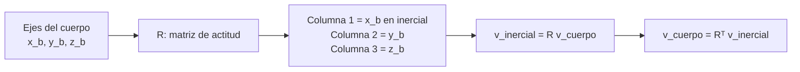

# B10-C13 — Matrices de rotación tridimensional

<!-- nav:top -->
[🏠 Programa](../../../../README.md) · [📚 Bloque B10](../../../tronco-comun/B10-algebra-lineal-y-matematicas-geometricas.md) · [← Anterior: B10-C12 — Rotaciones en el plano y espacio](../B10-C12-rotaciones-en-el-plano-y-espacio/CLASE.md) · [Siguiente: B10-C14 — Ángulos de Euler y singularidades →](../B10-C14-angulos-de-euler-y-singularidades/CLASE.md)
<!-- /nav -->

## 1. Ubicación, nivel y alcance

Decimotercera clase del bloque B10. En [C12](../B10-C12-rotaciones-en-el-plano-y-espacio/CLASE.md) rotaste alrededor de `z` y distinguiste rotación activa y pasiva. Aquí construyes las tres rotaciones elementales, las compones, ves que el orden importa, obtienes el eje y el ángulo de una rotación cualquiera con la fórmula de Rodrigues y fijas la convención de SPICE. Nivel N3. Verás el grupo de las rotaciones, la deriva numérica al componer muchas y cómo corregirla. No verás ángulos de Euler (C14) ni cuaterniones (C15).

## 2. Por qué esta clase existe

La actitud de un satélite (hacia dónde apuntan sus ejes) se guarda como una matriz de rotación: sus columnas son los ejes del cuerpo expresados en el sistema inercial. Con ella, un seguidor estelar, un panel o una antena se orientan sin ambigüedad. Pero hay que saber construirla, componerla en el orden correcto y detectar cuando un error de redondeo la deja de ser una rotación.

La decisión central: **¿cómo se construye y compone una orientación tridimensional sin equivocar el orden ni la convención?**

## 3. Lo que podrás hacer al terminar

1. Escribir `Rₓ`, `R_y` y `R_z` y comprobar que son ortogonales con `det = +1`.
2. Componer rotaciones y mostrar que no conmutan.
3. Leer una matriz de actitud: columnas = ejes del cuerpo en ejes inerciales.
4. Obtener eje y ángulo de una rotación; construir la rotación con Rodrigues.
5. Usar la matriz de marco de SPICE (la transpuesta) y sus filas.
6. Detectar y corregir la deriva de ortogonalidad.

La evidencia es el **cuaderno de matrices de rotación** del ejercicio 12 (sección 20).

## 4. Con qué llegas y cómo comprobarlo

Necesitas rotaciones planas y activa/pasiva ([C12](../B10-C12-rotaciones-en-el-plano-y-espacio/CLASE.md)), producto matricial ([C03](../B10-C03-matrices-y-operadores-lineales/CLASE.md)) y traza ([C08](../B10-C08-autovalores-y-autovectores/CLASE.md)). Cinco preguntas:

1. Calcula `R_z(90°)(1, 0, 0)`.
2. ¿Cuál es la inversa de una matriz ortogonal?
3. Calcula la traza de `[[0, 0, 1], [1, 0, 0], [0, 1, 0]]`.
4. ¿Conmutan dos matrices en general?
5. ¿Cuánto vale `1 − cos 90°`?

<details>
<summary>Ver respuestas</summary>

1. `(0, 1, 0)`. 2. Su transpuesta. 3. `0`. 4. No. 5. `1`.
</details>

## 5. Un caso real: hacia dónde mira un seguidor estelar

Un satélite (escenario **sintético**) lleva un seguidor estelar cuyo eje de mirada es el eje `z` del cuerpo, `(0, 0, 1)`. Su actitud respecto del sistema inercial se obtiene girando primero `90°` alrededor de `x` y luego `90°` alrededor de `z` (ambos ejes inerciales fijos): `A = R_z(90°) R_x(90°)`. La pregunta es hacia qué dirección inercial mira el instrumento y qué cambia si se invierte el orden. El ejemplo conductor usa solo ángulos inventados; ningún dato corresponde a una misión real.

## 6. Vocabulario

Las **rotaciones elementales** (activas, regla de la mano derecha) son
`Rₓ(a) = [[1, 0, 0], [0, cos a, −sin a], [0, sin a, cos a]]`,
`R_y(a) = [[cos a, 0, sin a], [0, 1, 0], [−sin a, 0, cos a]]`,
`R_z(a) = [[cos a, −sin a, 0], [sin a, cos a, 0], [0, 0, 1]]`.
El **grupo SO(3)** es el conjunto de matrices `3×3` con `RᵀR = I` y `det R = +1`: está cerrado bajo el producto y la inversa (S1: las matrices ortogonales tienen columnas ortonormales, §1.3). Una matriz **antisimétrica** cumple `Kᵀ = −K`; la del eje unitario `u` es `K = [[0, −u₃, u₂], [u₃, 0, −u₁], [−u₂, u₁, 0]]` y cumple `K v = u × v`. La **fórmula de Rodrigues** da la rotación de ángulo `θ` alrededor de `u`: `R = I + sin θ K + (1 − cos θ) K²`. La **matriz de transformación de marco** (convención de SPICE) es la transpuesta de la activa; sus filas son los ejes del marco nuevo expresados en el viejo (S2). Una **deriva** es la pérdida acumulada de ortogonalidad por redondeo.

## 7. Modelo mental: los tres ejes del cuerpo como columnas

Una matriz de rotación dice dónde caen los tres ejes del cuerpo: su primera columna es el eje `x` del cuerpo en el sistema inercial, la segunda el `y`, la tercera el `z`.



*Descripción textual:* las columnas de `R` son los vectores del cuerpo escritos en el sistema inercial; para pasar un vector del cuerpo al inercial se multiplica por `R`, y para ir al revés, por su transpuesta.

Analogía: sostener una caja en la mano y describir dónde apuntan sus aristas. Su límite: la caja se puede girar de maneras distintas que acaban en la misma posición final (varias secuencias dan la misma matriz).

## 8. La explicación, paso a paso

### 8.1 Ortogonalidad y determinante

Cada `Rₓ`, `R_y`, `R_z` tiene columnas unitarias y perpendiculares y `det = +1`. El producto de dos rotaciones también: `(AB)ᵀ(AB) = BᵀAᵀAB = I` y `det(AB) = 1` (C04). Una matriz `3×3` tiene 9 números, 6 condiciones de ortonormalidad, por lo que una rotación depende de **3 parámetros** libres.

### 8.2 El orden importa

Con `a = b = 90°`: `R_z(90°) R_x(90°) = [[0, 0, 1], [1, 0, 0], [0, 1, 0]]` y `R_x(90°) R_z(90°) = [[0, −1, 0], [0, 0, −1], [1, 0, 0]]`. Son distintas. Sobre `e₁ = (1, 0, 0)`: la primera lo manda a `(0, 1, 0)` (`R_x` lo deja fijo y `R_z` lo gira a `y`); la segunda a `(0, 0, 1)` (`R_z` lo lleva a `y` y `R_x` lo lleva a `z`). Convención: `A B v` aplica **primero `B`** (el factor de la derecha).

### 8.3 Leer la actitud

Para `A = R_z(90°) R_x(90°)`: columna 1 `(0, 1, 0)`: el eje `x` del cuerpo cae sobre `y` inercial; columna 2 `(0, 0, 1)`: `y` cuerpo sobre `z` inercial; columna 3 `(1, 0, 0)`: **el eje `z` del cuerpo (el del seguidor estelar) mira al eje `x` inercial**. Con el orden inverso, la columna 3 es `(0, −1, 0)`: miraría a `−y`.

### 8.4 Eje y ángulo

Cualquier rotación es un giro de un ángulo `θ` alrededor de un eje `u`. De la traza: `cos θ = (tr R − 1)/2`. Del resto: `u ∝ (R₃₂ − R₂₃, R₁₃ − R₃₁, R₂₁ − R₁₂)`. Para `A`: `tr = 0`, `cos θ = −1/2`, `θ = 120°`; el vector `(1, 1, 1)`, luego `u = (1, 1, 1)/√3`. Es decir, dos giros de 90° alrededor de ejes distintos equivalen a uno de 120° alrededor de la diagonal del cubo; los ángulos no se suman. Esa fórmula falla si `θ = 180°` (el vector de antisimetría se anula) y es sensible cerca de `0°`.

### 8.5 Rodrigues

Con `u = (0, 0, 1)` y `θ = 90°`: `K = [[0, −1, 0], [1, 0, 0], [0, 0, 0]]`, `K² = diag(−1, −1, 0)` y `R = I + K + K² = [[0, −1, 0], [1, 0, 0], [0, 0, 1]] = R_z(90°)`. El laboratorio compara Rodrigues con la exponencial matricial `exp(θK)` en tres ejes y ángulos y coincide a `10⁻¹²`.

### 8.6 Convención de SPICE

SPICE define `[w]ᵢ` como la matriz que rota el **sistema de coordenadas** `w` radianes alrededor del eje `i` (y, por tanto, rota los **vectores** `−w`) y señala que las filas de una matriz de transformación son los vectores de la nueva base expresados en la vieja (S2). Con `w = 30°` y `M = R_z(30°)ᵀ`, las filas son `(0,866; 0,5; 0)`, `(−0,5; 0,866; 0)` y `(0, 0, 1)`, y `M (1, 0, 0) = (0,866; −0,5; 0)`, igual que girar el vector `−30°`. Para componer marcos sucesivos se multiplican las matrices de marco en el orden en que se aplican, igual que las activas. Comprobar siempre con un caso conocido cuál convención usa una herramienta.

### 8.7 Deriva y re-ortonormalización

Componer un millón de rotaciones de `10⁻³ rad` alrededor de `(1,1,1)` deja `‖RᵀR − I‖ = 8,5 × 10⁻¹¹`. Se corrige proyectando de nuevo sobre SO(3): con la SVD `R = U Σ Vᵀ`, `R′ = U Vᵀ`; el laboratorio da `7,5 × 10⁻¹⁶` y `det = 1`. Es la matriz ortogonal más cercana (C11).

## 9. Magnitudes, símbolos y unidades

| Símbolo | Qué es | Unidad | Nota |
|---|---|---|---|
| `Rₓ, R_y, R_z` | rotaciones elementales activas | — | `det = +1` |
| `A` | matriz de actitud cuerpo → inercial | — | columnas = ejes del cuerpo |
| `u` | eje de rotación | adimensional | unitario |
| `θ` | ángulo de rotación | rad | `0 ≤ θ ≤ π` |
| `K` | matriz antisimétrica del eje | — | `K v = u × v` |
| `M` | matriz de marco (SPICE) | — | `M = Rᵀ` |
| `ε` | ortogonalidad perdida | adimensional | `‖RᵀR − I‖` |

## 10. Convenciones y referencias

Rotaciones activas, ángulo positivo antihorario (regla de la mano derecha), en radianes en las fórmulas. `A B` significa «primero `B`, luego `A`», con ejes fijos (extrínseco). La actitud lleva vectores del cuerpo al sistema inercial. La matriz de marco es la transpuesta de la activa. Ejes y valores de esta clase son **sintéticos**.

## 11. De dónde sale lo que afirmamos

| ID | Fuente | Localizador | Respalda | Estado |
|---|---|---|---|---|
| S1 | NIST, *DLMF* §1.3, versión vigente en línea al consultar | https://dlmf.nist.gov/1.3 | Matrices ortogonales (columnas ortonormales); determinante del producto (1.3.7) | Consultada el 2026-11-05 mediante extracción automática |
| S2 | NASA/JPL NAIF, *SPICE Rotation Required Reading* | https://naif.jpl.nasa.gov/pub/naif/toolkit_docs/C/req/rotation.html | `[w]ᵢ` rota el sistema de coordenadas `w` y los vectores `−w`; filas de la matriz = nueva base en la vieja; regla de la mano derecha | Consultada el 2026-11-05 mediante extracción automática |

Límites: la fórmula de Rodrigues, el grupo SO(3) y la extracción de eje y ángulo son resultados estándar sin cita específica. La actitud del satélite y los ángulos son **sintéticos**.

## 12. Cómo ver la actitud

Equivalente accesible a un dibujo de tres ejes girados, para `A = R_z(90°) R_x(90°)`:

| Eje del cuerpo | Dirección en el sistema inercial |
|---|---|
| `x_b` (columna 1) | `(0, 1, 0)` |
| `y_b` (columna 2) | `(0, 0, 1)` |
| `z_b` (columna 3, seguidor estelar) | `(1, 0, 0)` |

Descripción larga: los tres ejes del cuerpo se han permutado cíclicamente respecto de los inerciales (`x → y → z → x`), lo que equivale a una rotación de `120°` alrededor de la diagonal `(1, 1, 1)`.

## 13. Ejemplo trabajado: ¿hacia dónde mira el instrumento?

**Paso 1 · Datos.** Eje de mirada en el cuerpo `(0, 0, 1)`; `A = R_z(90°) R_x(90°)` (sintético).

**Paso 2 · Producto.** `R_x(90°) = [[1, 0, 0], [0, 0, −1], [0, 1, 0]]`; `R_z(90°) = [[0, −1, 0], [1, 0, 0], [0, 0, 1]]`. `A = R_z R_x = [[0, 0, 1], [1, 0, 0], [0, 1, 0]]`.

**Paso 3 · Aplicar.** `A (0, 0, 1) = (1, 0, 0)`: el instrumento mira al eje `x` inercial.

**Paso 4 · Invertir el orden.** `B = R_x R_z`, `B (0, 0, 1) = (0, −1, 0)`: mira a `−y`. Con un orden equivocado, la mirada queda a 90° de la deseada.

**Paso 5 · Comprobación y sentido.** Para `A`: `AᵀA = I` y `det = +1`; eje de rotación `(1, 1, 1)/√3` y ángulo `120°` (traza `0`). Resultado exacto sobre datos sintéticos; en una misión real el orden y la convención estarían escritos en el documento de interfaz.

## 14. Distintas formas de representar una orientación

**Matriz `3×3`:** sin ambigüedad, 9 números, fácil de componer, redundante. **Eje y ángulo:** 4 números, intuitivo, singular en `0` y `π`. **Euler** (C14): 3 números, con singularidades. **Cuaternión** (C15): 4 números, sin singularidades y barato. Todas deben dar la misma matriz; el laboratorio lo verifica entre matriz y Rodrigues.

## 15. Práctica guiada

**Ejercicio 1 · con los pasos indicados.** Calcula `Rₓ(90°)(0, 1, 0)`. *Pasos:* matriz de la sección 13.

<details><summary>Solución comentada</summary>

`[[1,0,0],[0,0,−1],[0,1,0]] (0,1,0) = (0, 0, 1)`: el eje `y` pasa a `z`.
</details>

**Ejercicio 2 · con una pista.** Calcula `R_z(90°) R_x(90°) e₁` y `R_x(90°) R_z(90°) e₁`. *Pista:* aplica primero el factor de la derecha.

<details><summary>Solución comentada</summary>

Primero: `R_x e₁ = e₁`; `R_z e₁ = (0, 1, 0)`. Segundo: `R_z e₁ = (0, 1, 0)`; `R_x (0, 1, 0) = (0, 0, 1)`. Distintos (8.2).
</details>

**Ejercicio 3 · casi autónomo.** Verifica con Rodrigues que la rotación de `90°` alrededor de `z` es `R_z(90°)`.

<details><summary>Solución comentada</summary>

`I + K + K² = [[0, −1, 0], [1, 0, 0], [0, 0, 1]]` (8.5).
</details>

## 16. Práctica autónoma, transferencia e integrador

**Ejercicio 4.** Comprueba que las columnas de `A` son ortonormales y que `det A = +1`.

<details><summary>Solución comentada</summary>

Columnas `(0,1,0)`, `(0,0,1)`, `(1,0,0)`: unitarias y perpendiculares. Es una permutación cíclica, de signo `+1`.
</details>

**Ejercicio 5.** Si `R = R_z(60°)`, obtén `θ` de la traza.

<details><summary>Solución comentada</summary>

`tr = 1 + 2 cos 60° = 2`; `cos θ = (2 − 1)/2 = 0,5`; `θ = 60°`.
</details>

**Ejercicio 6.** Con `M = R_z(30°)ᵀ`, calcula las coordenadas de `(1, 0, 0)` en el marco girado 30° alrededor de `z`.

<details><summary>Solución comentada</summary>

`M (1, 0, 0) = (cos 30°, −sin 30°, 0) = (0,866; −0,5; 0)` (8.6).
</details>

**Ejercicio 7.** Gira el marco primero `90°` alrededor de `z` y luego `90°` alrededor de `x` (matrices de marco `M₁ = R_z(90°)ᵀ`, `M₂ = R_x(90°)ᵀ`). ¿Qué coordenadas tiene `(1, 2, 3)`?

<details><summary>Solución comentada</summary>

`M₁ (1, 2, 3) = (2, −1, 3)`; `M₂ (2, −1, 3) = (2, 3, 1)`: `M₂ M₁ v` aplica primero `M₁`.
</details>

**Ejercicio 8.** ¿Cuántos parámetros libres tiene una rotación y por qué?

<details><summary>Solución comentada</summary>

`9 − 6 = 3`: nueve entradas con seis condiciones (3 de norma y 3 de ortogonalidad) (8.1).
</details>

**Ejercicio 9 · transferencia.** Con la actitud `B = R_x(90°) R_z(90°)`, ¿hacia qué dirección inercial miraría el seguidor estelar? Compara con `A`.

<details><summary>Solución comentada</summary>

Tercera columna de `B`: `(0, −1, 0)`; con `A` miraba a `(1, 0, 0)`: 90° de diferencia (sección 13).
</details>

**Ejercicio 10 · transferencia.** Tras componer un millón de pasos pequeños, `‖RᵀR − I‖ = 8,5 × 10⁻¹¹`. ¿Es importante? ¿Qué harías?

<details><summary>Solución comentada</summary>

Es pequeño, pero crece con los pasos y puede degradar un cálculo de actitud. Se proyecta sobre SO(3) con la SVD (`R′ = U Vᵀ`) periódicamente, y se verifica `det = +1` (8.7).
</details>

**Ejercicio 11 · transferencia.** Un compañero afirma que girar 90° alrededor de `x` y luego 90° alrededor de `z` equivale a girar 180°. Refútalo.

<details><summary>Solución comentada</summary>

La traza de `A` es `0`, luego `θ = 120°` (no 180°) alrededor de `(1,1,1)/√3` (8.4). Los ángulos solo se suman si los ejes son el mismo.
</details>

**Ejercicio 12 · integrador.** Elabora tu **cuaderno de matrices de rotación**: tres matrices elementales con su verificación, una composición de dos giros en ambos órdenes con el efecto sobre un vector, el eje y el ángulo de la composición, la matriz de marco de SPICE y la prueba de deriva.

<details><summary>Solución modelo</summary>

Como las secciones 8.1–8.7 y 13 con tus ángulos, la tabla de 12 con las columnas de la actitud, la traza y el eje, y la salida del laboratorio con `‖RᵀR − I‖` antes y después de re-ortonormalizar.
</details>

## 17. Laboratorio: rotaciones 3D, Rodrigues y deriva

El script [rotacion_3d.py](rotacion_3d.py) construye las rotaciones, comprueba ortogonalidad, compara los dos órdenes, extrae eje y ángulo, compara Rodrigues con `expm`, aplica la convención de marco y mide la deriva.

**Datos:** sintéticos. **Predice antes de ejecutar:** ¿qué ángulo tiene la composición de dos giros de 90°? **Ejecución del 2026-11-05 (Python 3.12.9, numpy 2.4.4, scipy 1.17.1):**

```text
Rz(90)Rx(90) =
 [[ 0. -0.  1.]
 [ 1.  0. -0.]
 [ 0.  1.  0.]]
Rx(90)Rz(90) =
 [[ 0. -1.  0.]
 [ 0.  0. -1.]
 [ 1.  0.  0.]]
eje-angulo de Rz(90)Rx(90): eje = [0.57735 0.57735 0.57735] angulo = 120.0 grados
filas de M = ejes del marco nuevo en el viejo: [0.866025 0.5      0.      ] [-0.5       0.866025  0.      ] [0. 0. 1.]
v en el marco nuevo (M v) = [ 0.866025 -0.5       0.      ] | vector rotado -w (Rz(-w) v) = [ 0.866025 -0.5       0.      ]
tras 1e6 productos: |R^T R - I| = 8.46e-11; tras re-ortonormalizar: 7.54e-16; det = 1.000000000000
Pruebas superadas.
```

```bash
python programa/clases/B10/B10-C13-matrices-de-rotacion-tridimensional/rotacion_3d.py
```

**Límites:** aritmética de doble precisión; extracción de eje y ángulo en `(0, π)`; la deriva depende del número y tamaño de pasos.

## 18. Errores frecuentes y cómo corregirlos

**Invertir el orden de composición.** Se corrige con los ejercicios 2 y 9.

**Sumar ángulos de ejes distintos.** Se corrige con el ejercicio 11.

**Confundir la matriz activa con la de marco (transpuesta).** Se corrige con los ejercicios 6 y 7.

**Olvidar la deriva en cálculos largos.** Se corrige con el ejercicio 10.

**Leer las columnas como filas.** Se corrige en la sección 8.3.

## 19. Cómo sabrás que vas bien

Tras 8.2: ¿por qué `AB ≠ BA`? Si no, ejercicio 2. Tras 8.3: ¿lees hacia dónde apunta el instrumento sin calcular? Si no, ejercicio 9. Tras 8.6: ¿cuál es la diferencia entre `R` y `M`? Si no, ejercicio 6.

## 20. Qué entregas y cómo se evalúa

El producto es tu **cuaderno de matrices de rotación** (ejercicio 12).

| Criterio | Inicial | En desarrollo | Logrado | Destacado |
|---|---|---|---|---|
| Construcción | Errores de signo | Solo un eje | Tres ejes verificados | Con Rodrigues y `expm` |
| Composición | Orden confuso | Un orden | Ambos órdenes comparados | Eje y ángulo del resultado |
| Convención | Ausente | Implícita | Activa y de marco declaradas | Con comprobación SPICE |
| Numérica | Ignora | La nombra | Mide deriva | Corrige y verifica `det` |
| Fuentes y rotulado | Sin fuente | Sin fecha | Con localizador y fecha | Rotula sintético |

**Condiciones críticas:** declarar activa o de marco y el orden de composición; verificar `RᵀR = I` y `det = +1`; citar solo fuentes consultadas.

## 21. Ética, seguridad y límites

Un error de orden o de transposición apunta un instrumento a otra parte. Mezclar datos de dos herramientas sin comprobar su convención puede producir errores de actitud; verifica siempre con una rotación de prueba. Esta clase no sustituye la documentación de interfaz de una misión. Accesibilidad: tablas equivalentes a las figuras, fórmulas en texto, ejercicios sin conexión.

## 22. Para cerrar y seguir

Una rotación 3D es una matriz ortogonal con determinante `+1`; el orden importa; las columnas son los ejes del cuerpo; Rodrigues y la traza dan eje y ángulo; SPICE usa la transpuesta para marcos; la deriva se corrige con la SVD. Queda abierta una pregunta: ¿se puede describir una orientación con solo tres ángulos, y qué se rompe en algunas posiciones?

**Glosario español–inglés.** matriz de rotación · *rotation matrix*; actitud · *attitude*; eje y ángulo · *axis–angle*; fórmula de Rodrigues · *Rodrigues' formula*; matriz antisimétrica · *skew-symmetric matrix*; transformación de marco · *frame transformation*; deriva · *drift*.

**Continuidad.** B10-C14 reutiliza tu capacidad de **componer rotaciones elementales en un orden** para estudiar los ángulos de Euler y sus singularidades.

**Referencias:** ver sección 11.

<!-- nav:bottom -->
---

[← Anterior: B10-C12 — Rotaciones en el plano y espacio](../B10-C12-rotaciones-en-el-plano-y-espacio/CLASE.md) · [📚 Bloque B10](../../../tronco-comun/B10-algebra-lineal-y-matematicas-geometricas.md) · [Siguiente: B10-C14 — Ángulos de Euler y singularidades →](../B10-C14-angulos-de-euler-y-singularidades/CLASE.md)
<!-- /nav -->
