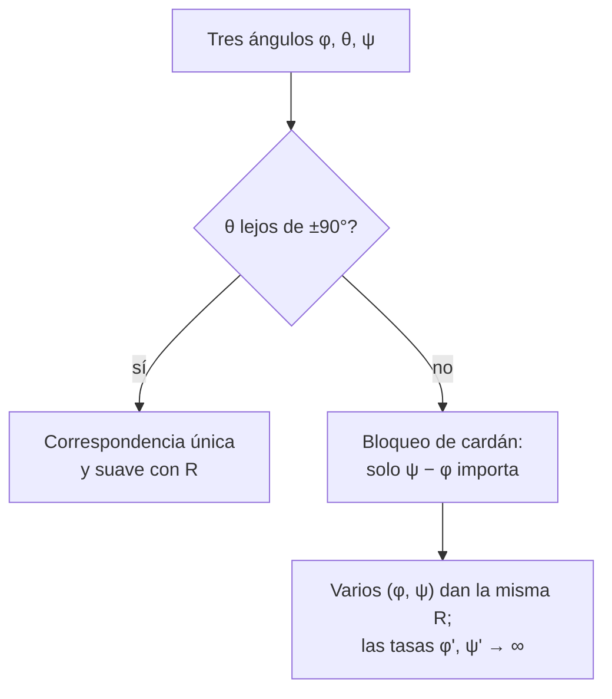

# B10-C14 — Ángulos de Euler y singularidades

<!-- nav:top -->
[🏠 Programa](../../../../README.md) · [📚 Bloque B10](../../../tronco-comun/B10-algebra-lineal-y-matematicas-geometricas.md) · [← Anterior: B10-C13 — Matrices de rotación tridimensional](../B10-C13-matrices-de-rotacion-tridimensional/CLASE.md) · [Siguiente: B10-C15 — Cuaterniones unitarios →](../B10-C15-cuaterniones-unitarios/CLASE.md)
<!-- /nav -->

## 1. Ubicación, nivel y alcance

Decimocuarta clase del bloque B10. En [C13](../B10-C13-matrices-de-rotacion-tridimensional/CLASE.md) compusiste rotaciones elementales y viste que una rotación depende de solo tres parámetros. Los **ángulos de Euler** usan esa idea: describen cualquier orientación con tres giros sucesivos alrededor de ejes elegidos. Son intuitivos y los usan pilotos, ingenieros y simuladores, pero tienen **singularidades**: orientaciones donde los tres ángulos dejan de estar bien definidos (el llamado **bloqueo de cardán**, *gimbal lock*). Nivel N3. Verás la secuencia 3‑2‑1 (guiñada, cabeceo, alabeo), la extracción de ángulos, el bloqueo y su efecto en las tasas de variación. No verás cuaterniones (C15), que evitan el problema.

## 2. Por qué esta clase existe

Un satélite que apunta una antena al cenit tiene el cabeceo cerca de `90°`; si la actitud se guarda con ángulos de Euler, justo ahí el cálculo se vuelve inestable: ángulos que cambian muy rápido para movimientos pequeños, o dos conjuntos de ángulos distintos para la misma orientación. Los operadores de misión necesitan reconocer esa zona y no confiar en esos números.

La decisión central: **¿cuándo es seguro describir una orientación con tres ángulos y cuándo hay que usar otra representación?**

## 3. Lo que podrás hacer al terminar

1. Construir la matriz de una secuencia 3‑2‑1 y extraer los ángulos.
2. Explicar el bloqueo de cardán con un ejemplo numérico.
3. Cuantificar la amplificación de error cerca de la singularidad.
4. Relacionar las tasas de Euler con la velocidad angular del cuerpo.
5. Elegir una secuencia que evite la singularidad esperada.
6. Detectar errores de envolvimiento angular (por ejemplo, promediar 359° y 1°).

La evidencia es el **informe de singularidad** del ejercicio 12 (sección 20).

## 4. Con qué llegas y cómo comprobarlo

Necesitas matrices de rotación ([C13](../B10-C13-matrices-de-rotacion-tridimensional/CLASE.md)) y trigonometría inversa ([B04-C06](../../B04/B04-C06-identidades-trigonometricas/CLASE.md)). Cinco preguntas:

1. ¿Cuánto es `arcsin(0,5)`?
2. ¿Qué devuelve `atan2(1, 1)` en grados?
3. ¿Cuánto es `tan 30°`?
4. ¿Cuál es el valor de `cos 90°`?
5. ¿Cuántos parámetros libres tiene una rotación 3D?

<details>
<summary>Ver respuestas</summary>

1. `30°`. 2. `45°`. 3. `0,577`. 4. `0`. 5. Tres.
</details>

## 5. Un caso real: un satélite que apunta casi al cenit

Un satélite (escenario **sintético**) describe su actitud con la secuencia 3‑2‑1: **guiñada** `ψ` alrededor de `z`, **cabeceo** `θ` alrededor de `y` y **alabeo** `φ` alrededor de `x`, con `R = R_z(ψ) R_y(θ) R_x(φ)` (activa, cuerpo → inercial). Se pide que mire casi hacia arriba: `θ` cercano a `90°`. Ejemplo conductor: ver qué pasa con los ángulos y las tasas al acercarse. Los ángulos y las tasas son inventados.

## 6. Vocabulario

Los **ángulos de Euler** son tres rotaciones sucesivas alrededor de ejes del cuerpo (o fijos) que componen una orientación. Una secuencia de **tipo Tait–Bryan** usa tres ejes distintos (3‑2‑1: `z`, `y`, `x`); una de **Euler propio** repite el primero y el tercero (3‑1‑3: `z`, `x`, `z`). La **guiñada** (*yaw*) gira alrededor de `z`, el **cabeceo** (*pitch*) alrededor de `y`, el **alabeo** (*roll*) alrededor de `x`. El **bloqueo de cardán** ocurre cuando el ángulo intermedio hace que el primer y el tercer eje coincidan, de modo que dos giros se confunden y solo importa su suma o diferencia. La **velocidad angular del cuerpo** `ω` es el vector de giro expresado en ejes del cuerpo. Una **singularidad** es una orientación donde la correspondencia con los ángulos no es única o su derivada no está acotada. SPICE advierte que algunas matrices corresponden a más de un conjunto de ángulos de Euler, que los ángulos en el borde de su intervalo pueden saltar al extremo opuesto con una perturbación mínima y que las funciones de ida y vuelta no son inversas exactas en las singularidades (S1).

## 7. Modelo mental: dos anillos que se alinean

En un giroscopio de tres anillos, cuando el anillo intermedio gira `90°` los anillos exterior e interior quedan alineados: dos movimientos distintos producen el mismo efecto y se pierde un grado de libertad.



*Descripción textual:* con el cabeceo lejos de `±90°`, cada orientación tiene un único trío de ángulos que varía suavemente; cuando el cabeceo se acerca a `±90°`, el alabeo y la guiñada se mezclan, varias parejas dan la misma matriz y las tasas de cambio crecen sin límite.

Analogía: el polo norte, donde todas las longitudes coinciden en el mismo punto. Su límite: en el polo el problema es del sistema de coordenadas, no del objeto; en el bloqueo de cardán lo mismo, la orientación es perfectamente normal.

## 8. La explicación, paso a paso

### 8.1 La matriz de la secuencia 3‑2‑1

Para `φ = 20°`, `θ = 30°`, `ψ = 40°`:

`R = [[0,6634; −0,4730; 0,5798], [0,5567; 0,8298; 0,0400], [−0,5000; 0,2962; 0,8138]]`.

Se puede comprobar que `R₃₁ = −sin θ = −0,5` (así sale el cabeceo).

### 8.2 Extracción de los ángulos

`θ = −arcsin R₃₁ = 30°`; `φ = atan2(R₃₂, R₃₃) = atan2(0,2962; 0,8138) = 20°`; `ψ = atan2(R₂₁, R₁₁) = atan2(0,5567; 0,6634) = 40°`. El laboratorio hace la ida y vuelta con error `< 10⁻¹²`. Se usa `atan2` (no `arctan`) para obtener el cuadrante correcto.

### 8.3 Bloqueo de cardán

Con `θ = 90°`, `cos θ = 0` y `R₃₁ = −1`; entonces `R₃₂ = R₃₃ = R₂₁ = R₁₁ = 0` y la matriz solo depende de **`ψ − φ`**. Verificación del laboratorio: `(φ, θ, ψ) = (10°, 90°, 50°)` y `(30°, 90°, 70°)` (ambos con `ψ − φ = 40°`) dan la **misma** matriz; `(10°, 90°, 60°)` (con `ψ − φ = 50°`) da otra. En esa posición `atan2(0, 0)` no está definido: la extracción pierde dos ángulos y conserva su diferencia.

### 8.4 Amplificación de errores

Lejos de la singularidad, un error de `10⁻⁸` en las entradas de `R` se convierte en un error angular de ese orden; cerca, se amplifica por `1/cos θ`. Con la perturbación fija del laboratorio: `θ = 0°` → `2,8 × 10⁻⁸ rad`; `60°` → `5,6 × 10⁻⁸`; `80°` → `1,6 × 10⁻⁷`; `89°` → `1,6 × 10⁻⁶`; `89,9°` → `1,6 × 10⁻⁵`; `89,99°` → `1,6 × 10⁻⁴` (factor `1/cos θ = 5730`). Tolerancias razonables a `θ = 0°` se vuelven inservibles a `89,99°`.

### 8.5 Velocidad angular y tasas de Euler

Para la secuencia 3‑2‑1 y `ω = (ω_x, ω_y, ω_z)` en ejes del cuerpo (relaciones cinemáticas estándar, sin cita específica):

`φ′ = ω_x + (ω_y sin φ + ω_z cos φ) tan θ`,
`θ′ = ω_y cos φ − ω_z sin φ`,
`ψ′ = (ω_y sin φ + ω_z cos φ)/cos θ`.

En `(20°, 30°, 40°)` con tasas `(0,02; −0,01; 0,03) rad/s`, la velocidad del cuerpo es `ω = (0,0050; −0,000511; 0,027834) rad/s`, y las fórmulas devuelven las tasas originales (el laboratorio obtiene `(0,02; −0,01; 0,03)`, error `< 10⁻⁸`). Dividir por `cos θ` es el origen de la singularidad.

### 8.6 Tasas necesarias cerca del cenit

Con esa **misma** velocidad del cuerpo, `ψ′` necesita ser `0,0520 rad/s` a `θ = 60°`, `0,298` a `85°`, `1,489` a `89°` y `14,886 rad/s` a `89,9°`. Un movimiento físicamente suave exigiría que la guiñada diera más de 2 vueltas por segundo. Ningún sistema real de control debe depender de esas tasas.

### 8.7 Qué hacer

Se elige una secuencia cuya singularidad quede lejos de la actitud típica (si el vehículo suele apuntar al cenit, usar una secuencia cuyo ángulo medio no tienda a `±90°`) o se abandonan los ángulos para propagar la actitud y se usan solo para visualizar: cuaterniones (C15). Una secuencia propia (3‑1‑3) es singular cuando el ángulo intermedio es `0` o `180°` (resultado estándar).

## 9. Magnitudes, símbolos y unidades

| Símbolo | Qué es | Unidad | Nota |
|---|---|---|---|
| `φ, θ, ψ` | alabeo, cabeceo, guiñada | rad (° al informar) | secuencia 3‑2‑1 |
| `R` | matriz de actitud cuerpo → inercial | — | `R_z R_y R_x` |
| `ω` | velocidad angular en ejes del cuerpo | rad/s | |
| `φ′, θ′, ψ′` | tasas de Euler | rad/s | |
| `1/cos θ` | factor de amplificación | adimensional | diverge en `±90°` |

## 10. Convenciones y referencias

Secuencia 3‑2‑1 con rotaciones activas y ejes fijos extrínsecos: `R = R_z(ψ) R_y(θ) R_x(φ)`. Los ángulos se informan en grados con rango `φ, ψ ∈ (−180°, 180°]`, `θ ∈ [−90°, 90°]`. Otras comunidades usan otras secuencias y definiciones (intrínseca/extrínseca, activa/pasiva): hay que declararlas. SPICE usa `M = [ang₂]ᵢ₂ [ang₁]ᵢ₁ [ang₀]ᵢ₀`, con rotaciones de coordenadas y un intervalo de salida específico (S1); no se confundan con las de esta clase.

## 11. De dónde sale lo que afirmamos

| ID | Fuente | Localizador | Respalda | Estado |
|---|---|---|---|---|
| S1 | NASA/JPL NAIF, *SPICE Rotation Required Reading* | https://naif.jpl.nasa.gov/pub/naif/toolkit_docs/C/req/rotation.html | Definición de la secuencia de tres rotaciones (índice central distinto de los extremos), intervalos de los ángulos, no unicidad, sensibilidad en los bordes y no reversibilidad exacta en singularidades | Consultada el 2026-11-05 mediante extracción automática |

Límites: las fórmulas de las tasas de Euler y la singularidad de las secuencias propias son resultados estándar sin cita específica. Todos los ángulos y tasas son **sintéticos**. La fuente SPICE se resumió por extracción automática: sus afirmaciones sobre casos singulares tenían matices (la propia página sugería verificarlos); aquí solo se usa lo que el laboratorio confirma.

## 12. Cómo ver la singularidad

Equivalente accesible a una gráfica de error contra cabeceo:

| `θ` (°) | `1/cos θ` | Error angular (rad) para una perturbación de `10⁻⁸` |
|---|---|---|
| 0 | 1,00 | 2,8 × 10⁻⁸ |
| 60 | 2,00 | 5,6 × 10⁻⁸ |
| 80 | 5,76 | 1,6 × 10⁻⁷ |
| 89 | 57,3 | 1,6 × 10⁻⁶ |
| 89,9 | 573 | 1,6 × 10⁻⁵ |
| 89,99 | 5730 | 1,6 × 10⁻⁴ |

Descripción larga: el error es casi plano hasta unos 60° y después se dispara de forma hiperbólica al acercarse a 90°.

## 13. Ejemplo trabajado: ¿qué ángulos dar cerca del cenit?

**Paso 1 · Datos.** Velocidad del cuerpo `ω = (0,0050; −0,000511; 0,027834) rad/s` y `φ = 20°` (sintéticos).

**Paso 2 · Auxiliar.** `ω_y sin φ + ω_z cos φ = −0,000511 · 0,3420 + 0,027834 · 0,9397 = 0,025981 rad/s`.

**Paso 3 · Guiñada a distintos cabeceos.** `ψ′ = 0,025981/cos θ`: `θ = 30°` → `0,0300`; `60°` → `0,0520`; `89°` → `1,489`; `89,9°` → `14,89 rad/s`.

**Paso 4 · Comparación.** De `30°` a `89,9°`, `ψ′` crece `496` veces (`cos 30°/cos 89,9° = 0,8660/0,001745`), mientras que el cuerpo gira siempre a `0,0283 rad/s` de módulo.

**Paso 5 · Sentido.** La singularidad está en la representación, no en el satélite: el movimiento es suave, pero los ángulos de Euler no pueden seguirlo. Resultado sobre datos **sintéticos**.

## 14. Distintas formas de representar y extraer

**Ángulos de Euler:** intuitivos, singulares. **Matriz** (C13): sin singularidades, redundante. **Cuaterniones** (C15): sin singularidades, más compactos. **Extracción por `atan2`:** robusta en cuadrantes pero no en la singularidad. En la práctica de vuelo se propaga con cuaterniones o matriz y se convierte a Euler solo para mostrar.

## 15. Práctica guiada

**Ejercicio 1 · con los pasos indicados.** Dada `R₃₁ = −0,5`, ¿cuánto vale `θ`? *Pasos:* `θ = −arcsin R₃₁`.

<details><summary>Solución comentada</summary>

`θ = −arcsin(−0,5) = 30°` (8.2).
</details>

**Ejercicio 2 · con una pista.** Con `R₃₂ = 0,2962` y `R₃₃ = 0,8138`, calcula `φ`. *Pista:* `atan2`.

<details><summary>Solución comentada</summary>

`φ = atan2(0,2962; 0,8138) = 20°`.
</details>

**Ejercicio 3 · casi autónomo.** Explica por qué `(10°, 90°, 50°)` y `(30°, 90°, 70°)` son la misma orientación.

<details><summary>Solución comentada</summary>

Con `θ = 90°`, la matriz solo depende de `ψ − φ`; ambos tienen `ψ − φ = 40°` (8.3).
</details>

## 16. Práctica autónoma, transferencia e integrador

**Ejercicio 4.** Calcula `1/cos θ` para `θ = 80°` y `89°` y estima el error angular que produce una perturbación de `10⁻⁸` en `R`.

<details><summary>Solución comentada</summary>

`5,76` y `57,3`; errores del orden de `1,6 × 10⁻⁷` y `1,6 × 10⁻⁶ rad` (8.4).
</details>

**Ejercicio 5.** Con `ω = (0,005; −0,000511; 0,027834)` y `(φ, θ) = (20°, 30°)`, calcula `θ′`.

<details><summary>Solución comentada</summary>

`θ′ = ω_y cos φ − ω_z sin φ = −0,000511 · 0,9397 − 0,027834 · 0,3420 = −0,000480 − 0,009519 = −0,0100 rad/s` ✓.
</details>

**Ejercicio 6.** Calcula `ψ′` con los mismos datos.

<details><summary>Solución comentada</summary>

`ψ′ = 0,025981/cos 30° = 0,025981/0,8660 = 0,0300 rad/s`.
</details>

**Ejercicio 7.** Con el mismo `ω`, ¿qué `ψ′` hace falta a `θ = 89,9°` y cuántas veces mayor es que a `30°`?

<details><summary>Solución comentada</summary>

`0,025981/0,001745 = 14,89 rad/s`, unas `496` veces `0,0300`.
</details>

**Ejercicio 8.** ¿En qué orientaciones es singular la secuencia 3‑1‑3?

<details><summary>Solución comentada</summary>

Cuando el ángulo intermedio es `0` o `180°` (primer y tercer eje coinciden). Es la singularidad típica de las secuencias de Euler propio (resultado estándar).
</details>

**Ejercicio 9 · transferencia.** Un vehículo suele apuntar cerca del cenit. ¿Qué harías para describir su actitud?

<details><summary>Solución comentada</summary>

Elegir una secuencia cuya singularidad esté lejos (por ejemplo, una con ángulo medio cercano a `0` en la actitud típica) o propagar con cuaterniones (C15) y convertir a Euler solo para visualizar (8.7).
</details>

**Ejercicio 10 · transferencia.** El programa de un colega da `(10°, 90°, 50°)` para una actitud y `(30°, 90°, 70°)` para la siguiente, y concluye que el satélite «giró 20° en alabeo y 20° en guiñada». ¿Es correcto?

<details><summary>Solución comentada</summary>

No: son la misma matriz (8.3); el satélite no se movió. Los ángulos cambiaron por el bloqueo.
</details>

**Ejercicio 11 · transferencia.** Un script promedia los alabeos `359°` y `1°` y obtiene `180°`. ¿Cuál es el promedio correcto y qué técnica evita el error?

<details><summary>Solución comentada</summary>

Correcto: `0°`. Hay que promediar en el círculo (por ejemplo, con `atan2(Σ sin, Σ cos)`) o comparar rotaciones con matrices o cuaterniones, nunca los ángulos como números lineales.
</details>

**Ejercicio 12 · integrador.** Elabora tu **informe de singularidad**: la matriz de una secuencia 3‑2‑1 con tus ángulos, su extracción, dos conjuntos de ángulos que den la misma matriz en `θ = 90°`, la tabla de amplificación de error y la de tasas de guiñada, y una recomendación para el vehículo del ejemplo.

<details><summary>Solución modelo</summary>

Como 8.1–8.6 con tus ángulos; las tablas de 12 y la de 13; y la conclusión de 8.7 con la advertencia de que los datos son sintéticos y las fórmulas de tasas son relaciones estándar.
</details>

## 17. Laboratorio: ida y vuelta, bloqueo y amplificación

El script [euler_y_singularidades.py](euler_y_singularidades.py) construye la matriz 3‑2‑1, extrae los ángulos, demuestra el bloqueo con tres tríos, mide el error angular al perturbar la matriz y verifica las tasas de Euler contra la velocidad angular obtenida de `RᵀṘ`.

**Datos:** sintéticos, semilla fija. **Predice antes de ejecutar:** ¿cuánto se amplifica un error de `10⁻⁸` a `θ = 89,99°`? **Ejecución del 2026-11-05 (Python 3.12.9, numpy 2.4.4):**

```text
R(20,30,40) =
 [[ 0.663414 -0.473021  0.579769]
 [ 0.55667   0.829769  0.040009]
 [-0.5       0.296198  0.813798]]
ida y vuelta (grados): [20. 30. 40.]
(10,90,50) y (30,90,70) dan la misma R? True
(10,90,50) y (10,90,60) dan la misma R? False
theta (deg)   1/cos(theta)   error angular maximo tras perturbar R en 1e-8
    0.00           1.00   2.795e-08 rad
   60.00           2.00   5.590e-08 rad
   80.00           5.76   1.610e-07 rad
   89.00          57.30   1.601e-06 rad
   89.90         572.96   1.601e-05 rad
   89.99        5729.58   1.601e-04 rad
omega cuerpo (rad/s) = [ 0.005      -0.00051098  0.02783413]
tasas de Euler recuperadas: [ 0.02 -0.01  0.03]
theta =  60.0 deg: psi' necesaria =  0.0520 rad/s (misma omega del cuerpo)
theta =  85.0 deg: psi' necesaria =  0.2981 rad/s (misma omega del cuerpo)
theta =  89.0 deg: psi' necesaria =  1.4887 rad/s (misma omega del cuerpo)
theta =  89.9 deg: psi' necesaria = 14.8859 rad/s (misma omega del cuerpo)
Pruebas superadas.
```

```bash
python programa/clases/B10/B10-C14-angulos-de-euler-y-singularidades/euler_y_singularidades.py
```

**Límites:** secuencia 3‑2‑1 fija; perturbación determinista; ω calculada por diferencias centrales con `h = 10⁻⁶`.

## 18. Errores frecuentes y cómo corregirlos

**Interpretar un cambio de ángulos como un movimiento físico cerca de la singularidad.** Se corrige con el ejercicio 10.

**Usar `arctan` en vez de `atan2`.** Se corrige en la sección 8.2.

**Promediar ángulos como números.** Se corrige con el ejercicio 11.

**Mezclar secuencias o convenciones de Euler.** Se corrige en la sección 10.

**Esperar que las tasas de Euler sean suaves siempre.** Se corrige con los ejercicios 6 y 7.

## 19. Cómo sabrás que vas bien

Tras 8.2: ¿extraes los tres ángulos de una matriz dada? Si no, ejercicios 1 y 2. Tras 8.3: ¿por qué dos conjuntos distintos dan la misma matriz? Si no, ejercicio 3. Tras 8.6: ¿por qué `ψ′` explota? Si no, ejercicio 7.

## 20. Qué entregas y cómo se evalúa

El producto es tu **informe de singularidad** (ejercicio 12).

| Criterio | Inicial | En desarrollo | Logrado | Destacado |
|---|---|---|---|---|
| Matriz y extracción | Errores | Solo ida | Ida y vuelta verificada | Con cuadrantes y rangos |
| Singularidad | No la reconoce | Descripción verbal | Ejemplo numérico de la misma matriz | Con amplificación cuantificada |
| Tasas | Sin fórmula | Fórmula sin verificar | Verificadas con `RᵀṘ` | Interpreta el resultado |
| Recomendación | Ausente | Genérica | Secuencia o cuaterniones justificados | Con convención declarada |
| Fuentes y rotulado | Sin fuente | Sin fecha | Con localizador y fecha | Rotula sintético y estándar |

**Condiciones críticas:** declarar la secuencia y las convenciones; mostrar un caso de singularidad; citar solo fuentes consultadas.

## 21. Ética, seguridad y límites

Una representación con singularidad puede dar valores absurdos justo en la actitud que más importa (por ejemplo, un apuntado al cenit). Las rutinas de vuelo reales usan representaciones sin singularidad para la propagación y verifican el control de actitud con simulación y pruebas (B16). Esta clase es didáctica. Accesibilidad: tablas equivalentes a las figuras, fórmulas en texto, ejercicios sin conexión.

## 22. Para cerrar y seguir

Tres ángulos describen cualquier orientación, pero con singularidades: en `θ = ±90°` (secuencia 3‑2‑1) se pierde un grado de libertad, varias ternas dan la misma matriz y las tasas de Euler divergen. Queda abierta una pregunta: ¿hay una representación de cuatro números sin singularidades, barata de componer y fácil de renormalizar?

**Glosario español–inglés.** ángulos de Euler · *Euler angles*; guiñada · *yaw*; cabeceo · *pitch*; alabeo · *roll*; bloqueo de cardán · *gimbal lock*; singularidad · *singularity*; velocidad angular del cuerpo · *body angular velocity*.

**Continuidad.** B10-C15 reutiliza tu capacidad de **reconocer una representación singular** para introducir los cuaterniones unitarios.

**Referencias:** ver sección 11.

<!-- nav:bottom -->
---

[← Anterior: B10-C13 — Matrices de rotación tridimensional](../B10-C13-matrices-de-rotacion-tridimensional/CLASE.md) · [📚 Bloque B10](../../../tronco-comun/B10-algebra-lineal-y-matematicas-geometricas.md) · [Siguiente: B10-C15 — Cuaterniones unitarios →](../B10-C15-cuaterniones-unitarios/CLASE.md)
<!-- /nav -->
