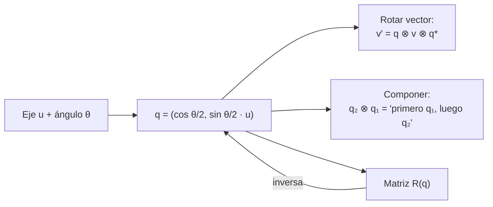

# B10-C15 — Cuaterniones unitarios

<!-- nav:top -->
[🏠 Programa](../../../../README.md) · [📚 Bloque B10](../../../tronco-comun/B10-algebra-lineal-y-matematicas-geometricas.md) · [← Anterior: B10-C14 — Ángulos de Euler y singularidades](../B10-C14-angulos-de-euler-y-singularidades/CLASE.md) · [Siguiente: B10-C16 — Transformación de marcos de referencia →](../B10-C16-transformacion-de-marcos-de-referencia/CLASE.md)
<!-- /nav -->

## 1. Ubicación, nivel y alcance

Decimoquinta clase del bloque B10. En [C14](../B10-C14-angulos-de-euler-y-singularidades/CLASE.md) viste que tres ángulos describen una orientación pero se bloquean en ciertas posiciones. Los **cuaterniones unitarios** usan cuatro números, no tienen singularidades, se componen con pocas operaciones y se renormalizan con una división. Por eso son la representación habitual para propagar la actitud de un satélite. Nivel N3. Verás el álgebra de Hamilton, la relación con el eje y el ángulo, la rotación de un vector, la composición, la doble cobertura (`q` y `−q`), la conversión con la matriz, la interpolación y la deriva de la norma. No verás la cinemática en función del tiempo (C20).

## 2. Por qué esta clase existe

Un seguidor estelar entrega la actitud del satélite varias veces por segundo; el sistema de control la combina con las lecturas de giróscopos, la propaga y la compara con la actitud deseada. Hacerlo con ángulos de Euler es frágil; hacerlo con matrices cuesta más y acumula deriva. Un cuaternión cabe en cuatro números y se compone con 16 productos.

La decisión central: **¿cómo represento, compongo y convierto una orientación con cuaterniones sin equivocar la convención?**

## 3. Lo que podrás hacer al terminar

1. Construir el cuaternión de un eje y un ángulo: `q = (cos(θ/2), sin(θ/2) u)`.
2. Multiplicar cuaterniones con la regla de Hamilton.
3. Rotar un vector con `v′ = q v q*` y relacionarlo con la matriz.
4. Componer rotaciones y mostrar que el orden importa.
5. Explicar por qué `q` y `−q` son la misma rotación.
6. Convertir entre cuaternión, matriz y eje–ángulo, e interpolar con SLERP.

La evidencia es la **hoja de cuaterniones verificada** del ejercicio 12 (sección 20).

## 4. Con qué llegas y cómo comprobarlo

Necesitas rotaciones 3D y eje–ángulo ([C13](../B10-C13-matrices-de-rotacion-tridimensional/CLASE.md)) y los problemas del Euler ([C14](../B10-C14-angulos-de-euler-y-singularidades/CLASE.md)). Cinco preguntas:

1. ¿Cuánto es `cos 45°`?
2. ¿Qué eje y ángulo tiene `R_z(90°)`?
3. ¿Cuál es la norma de `(0,5; 0,5; 0,5; 0,5)`?
4. ¿Por qué se necesitan cuatro números si una rotación tiene tres grados de libertad?
5. ¿Qué es el conjugado de un número complejo `a + bi`?

<details>
<summary>Ver respuestas</summary>

1. `0,7071`. 2. Eje `z`, `90°`. 3. `1`. 4. Por una restricción de norma: de las cuatro componentes, una queda determinada por las otras tres. 5. `a − bi`.
</details>

## 5. Un caso real: componer la actitud que entrega un seguidor estelar

Escenario didáctico (**sintético**): el satélite conoce su actitud con dos giros sucesivos de `90°` alrededor de `x` y luego de `90°` alrededor de `z`, los mismos de C13, y el sistema de control quiere el resultado como un cuaternión, para componerlo con una corrección posterior sin singularidades. Es el ejemplo conductor: obtener `q = q_z ⊗ q_x`, su eje y su ángulo, y comprobar que coincide con la matriz de C13. Los números son inventados.

## 6. Vocabulario

Un **cuaternión** es `q = (q₀, q₁, q₂, q₃) = q₀ + q₁ i + q₂ j + q₃ k` con `i² = j² = k² = ijk = −1`. La **parte escalar** es `q₀` y la **parte vectorial** `q⃗ = (q₁, q₂, q₃)`. Aquí se escribe con el **escalar primero**, que es la disposición de SPICE (S1: `q₀ = cos(ángulo/2)` y la parte vectorial es `sin(ángulo/2)` por el eje unitario). El **producto de Hamilton** `p ⊗ q` es la multiplicación que respeta esas reglas (sección 8.2). El **conjugado** es `q* = (q₀, −q⃗)`. Un cuaternión es **unitario** si `|q| = 1`. Un **cuaternión puro** `(0, v)` representa un vector. La **doble cobertura** significa que `q` y `−q` representan la misma rotación (S1). **SLERP** es la interpolación esférica entre dos cuaterniones.

## 7. Modelo mental: el eje y medio ángulo en una esfera de cuatro dimensiones

Los cuaterniones unitarios forman una esfera de cuatro dimensiones. Cada punto es una rotación (y su antípoda, la misma): el ángulo se guarda a la mitad.



*Descripción textual:* a partir de eje y ángulo se obtiene el cuaternión; con él se puede rotar un vector, componer con otro o formar la matriz; y de la matriz se vuelve al cuaternión (salvo el signo global).

Analogía: un dial que da una vuelta por cada dos vueltas de la aguja: dos posiciones del dial (`θ` y `θ + 360°`) marcan la misma hora. Su límite: aquí las dos posiciones son `q` y `−q` y difieren en el signo de las cuatro componentes.

## 8. La explicación, paso a paso

### 8.1 Eje y ángulo

Para `θ = 90°` alrededor de `z`: `q_z = (cos 45°, 0, 0, sin 45°) = (0,7071; 0; 0; 0,7071)`. Alrededor de `x`: `q_x = (0,7071; 0,7071; 0; 0)`. Un cuaternión unitario tiene tres grados de libertad reales (cuatro números, una restricción de norma), igual que una rotación. El ángulo del cuaternión es **la mitad** del de la rotación: `θ = 2 arccos q₀`.

### 8.2 Producto de Hamilton

`p ⊗ q =`
`(p₀q₀ − p₁q₁ − p₂q₂ − p₃q₃,`
` p₀q₁ + p₁q₀ + p₂q₃ − p₃q₂,`
` p₀q₂ − p₁q₃ + p₂q₀ + p₃q₁,`
` p₀q₃ + p₁q₂ − p₂q₁ + p₃q₀)`.
No es conmutativo. Con `a = 0,7071`: `q_z ⊗ q_x = (a², a·a, a·a, a·a) = (0,5; 0,5; 0,5; 0,5)`; el orden inverso da `q_x ⊗ q_z = (0,5; 0,5; −0,5; 0,5)`.

### 8.3 Eje y ángulo del producto

`q = (0,5; 0,5; 0,5; 0,5)`: `θ = 2 arccos 0,5 = 120°` y eje `(0,5; 0,5; 0,5)/0,8660 = (1, 1, 1)/√3`. Es el resultado de C13: dos giros de `90°` equivalen a uno de `120°` alrededor de la diagonal. La norma es `√(4 · 0,25) = 1`. La regla de SPICE (S1) coincide: si `q₁` y `q₂` representan `R₁` y `R₂`, entonces `q₂ ⊗ q₁` representa `R₂(R₁)`: el producto se escribe en el mismo orden que el de las matrices.

### 8.4 Rotar un vector

`v′ = q ⊗ (0, v) ⊗ q*`. Con `q_z` y `v = (1, 2, 3)`, el resultado es `(−2, 1, 3)`, igual que `R_z(90°) v` (laboratorio). Con las componentes de `q`, la matriz de la rotación es

`R(q) = [[1 − 2(q₂² + q₃²), 2(q₁q₂ − q₀q₃), 2(q₁q₃ + q₀q₂)], [2(q₁q₂ + q₀q₃), 1 − 2(q₁² + q₃²), 2(q₂q₃ − q₀q₁)], [2(q₁q₃ − q₀q₂), 2(q₂q₃ + q₀q₁), 1 − 2(q₁² + q₂²)]]`.

### 8.5 Doble cobertura y conjugado

`−q` da la misma matriz que `q` (la matriz tiene términos cuadráticos y productos de pares). Por eso SPICE normaliza `q₀ ≥ 0` (ángulo en `[0, π]`) y señala que el resultado es único salvo cuando el ángulo es `π` (S1). El conjugado es el inverso: `q ⊗ q* = (1, 0, 0, 0)`, y `R(q*) = R(q)ᵀ`. En el ejemplo: `q* = (0,5; −0,5; −0,5; −0,5)` y `q ⊗ q*` tiene escalar `0,25 · 4 = 1`.

### 8.6 Matriz ↔ cuaternión

Para pasar de matriz a cuaternión se usa el elemento de la diagonal más grande para evitar dividir por números pequeños (método de Shepperd). El laboratorio hace 2000 ida y vuelta con cuaterniones al azar: la matriz se recupera a `10⁻¹²` y el cuaternión, salvo signo, a `10⁻¹⁰`; la ortogonalidad máxima perdida es `1,8 × 10⁻¹⁵`.

### 8.7 Interpolación y deriva

SLERP entre `(1, 0, 0, 0)` (sin giro) y `q_y(100°)` en `t = 0,5` da una rotación de `50,000 000 000°`: gira a velocidad angular constante. Al multiplicar un millón de veces por un cuaternión de `10⁻³ rad`, la norma se desvía `4,3 × 10⁻¹¹`; se corrige dividiendo por la norma (el laboratorio devuelve `0`), un coste mucho menor que re-ortonormalizar una matriz con la SVD.

### 8.8 Advertencia de convenciones

Hay bibliotecas con el escalar al final, con el producto en orden inverso, o cuyos cuaterniones representan la rotación de **coordenadas** (el conjugado del que usa esta clase). SPICE describe sus rotaciones en términos de rotaciones de coordenadas (S1). Antes de mezclar datos hay que probar con un caso conocido: el cuaternión de `90°` sobre `z` aplicado a `(1, 0, 0)`, y ver si la herramienta devuelve `(0, 1, 0)` o `(0, −1, 0)`.

## 9. Magnitudes, símbolos y unidades

| Símbolo | Qué es | Unidad | Nota |
|---|---|---|---|
| `q = (q₀, q₁, q₂, q₃)` | cuaternión unitario | adimensional | escalar primero, `|q| = 1` |
| `θ` | ángulo de rotación | rad | `θ = 2 arccos q₀` |
| `u` | eje de rotación | adimensional | unitario |
| `⊗` | producto de Hamilton | — | no conmutativo |
| `q*` | conjugado | — | inverso si `|q| = 1` |
| `R(q)` | matriz de rotación | — | activa, `RᵀR = I` |
| `t` | parámetro de interpolación | — | `0 ≤ t ≤ 1` |

## 10. Convenciones y referencias

Hamilton, escalar primero, rotación activa de vectores `v′ = q ⊗ v ⊗ q*`, composición `q₂ ⊗ q₁` («primero `q₁`»). La forma canónica tiene `q₀ ≥ 0`. Las comparaciones entre cuaterniones se hacen módulo signo. SPICE usa escalar primero (S1); sus rotaciones están descritas como rotaciones de coordenadas, cuya matriz es la transpuesta de la activa (C13). Los cuaterniones y ángulos de esta clase son **sintéticos**.

## 11. De dónde sale lo que afirmamos

| ID | Fuente | Localizador | Respalda | Estado |
|---|---|---|---|---|
| S1 | NASA/JPL NAIF, *SPICE Rotation Required Reading* | https://naif.jpl.nasa.gov/pub/naif/toolkit_docs/C/req/rotation.html | Cuaternión escalar‑primero `q₀ = cos(ángulo/2)`; forma canónica con ángulo en `[0, π]`; `q` y `−q` son la misma rotación; unicidad salvo ángulo `π`; si `q₁, q₂` representan `R₁, R₂`, `q₂ * q₁` representa `R₂(R₁)` | Consultada el 2026-11-05 mediante extracción automática |

Límites: el producto de Hamilton, la fórmula de la matriz, el método de Shepperd y SLERP son resultados estándar sin cita específica. La correspondencia exacta entre los cuaterniones de SPICE y la matriz activa de esta clase **no** se verificó con el código de SPICE: se advierte probar con un caso conocido. Los datos son **sintéticos**.

## 12. Cómo ver los cuaterniones

Equivalente accesible a una tabla de casos:

| Rotación | Cuaternión `(q₀, q₁, q₂, q₃)` | Efecto sobre `(1, 2, 3)` |
|---|---|---|
| Sin giro | `(1, 0, 0, 0)` | `(1, 2, 3)` |
| 90° sobre `z` | `(0,7071; 0; 0; 0,7071)` | `(−2, 1, 3)` |
| 90° sobre `x` | `(0,7071; 0,7071; 0; 0)` | `(1, −3, 2)` |
| `q_z ⊗ q_x` | `(0,5; 0,5; 0,5; 0,5)` | `(3, 1, 2)` |
| 180° sobre `x` | `(0; 1; 0; 0)` | `(1, −2, −3)` |

Descripción larga: la composición `q_z ⊗ q_x` equivale a una rotación de `120°` alrededor de la diagonal, que permuta las coordenadas de forma cíclica.

## 13. Ejemplo trabajado: componer y comprobar

**Paso 1 · Datos.** `q_x = (a, a, 0, 0)` y `q_z = (a, 0, 0, a)` con `a = 0,7071` (90° sobre `x` y `z`).

**Paso 2 · Producto.** `q = q_z ⊗ q_x`: escalar `a·a − 0 − 0 − 0 = 0,5`; `q₁ = p₀q₁ + p₁q₀ + p₂q₃ − p₃q₂ = a·a + 0 + 0 − 0 = 0,5`; `q₂ = p₀q₂ − p₁q₃ + p₂q₀ + p₃q₁ = 0 − 0 + 0 + a·a = 0,5`; `q₃ = p₀q₃ + p₁q₂ − p₂q₁ + p₃q₀ = 0 + 0 − 0 + a·a = 0,5`.

**Paso 3 · Eje y ángulo.** `θ = 2 arccos 0,5 = 120°`; eje `(1,1,1)/√3`.

**Paso 4 · Aplicar al instrumento.** La matriz `R(q)` tiene por tercera columna `(1, 0, 0)`: el eje `z` del cuerpo mira al eje `x` inercial (igual que en C13).

**Paso 5 · Sentido.** El mismo resultado que la matriz con menos operaciones y sin riesgo de bloqueo. Con el orden inverso se obtiene `(0,5; 0,5; −0,5; 0,5)` y un instrumento apuntando a `−y`. Datos **sintéticos**; la convención de una herramienta real debe verificarse (8.8).

## 14. Distintas formas de componer y comparar

**Matriz × matriz:** 27 productos, deriva en ortogonalidad. **Cuaternión ⊗ cuaternión:** 16 productos, deriva solo en la norma. **Euler:** no se componen directamente. Para comparar orientaciones se usa el ángulo de `q₁* ⊗ q₂`, no la diferencia de componentes. Los tres caminos deben dar la misma rotación; el laboratorio lo confirma con matrices.

## 15. Práctica guiada

**Ejercicio 1 · con los pasos indicados.** Escribe el cuaternión de una rotación de `90°` alrededor de `z`. *Pasos:* `(cos θ/2, sin θ/2 u)`.

<details><summary>Solución comentada</summary>

`(cos 45°, 0, 0, sin 45°) = (0,7071; 0; 0; 0,7071)`.
</details>

**Ejercicio 2 · con una pista.** Rota `(1, 0, 0)` con ese cuaternión. *Pista:* equivale a `R_z(90°)`.

<details><summary>Solución comentada</summary>

`(0, 1, 0)` (8.4).
</details>

**Ejercicio 3 · casi autónomo.** Calcula `q_z ⊗ q_x` y su eje y ángulo.

<details><summary>Solución comentada</summary>

`(0,5; 0,5; 0,5; 0,5)`, `120°` sobre `(1,1,1)/√3` (13).
</details>

## 16. Práctica autónoma, transferencia e integrador

**Ejercicio 4.** Comprueba que `(0,5; 0,5; 0,5; 0,5)` es unitario.

<details><summary>Solución comentada</summary>

`4 · 0,25 = 1`.
</details>

**Ejercicio 5.** Calcula el conjugado y el producto `q ⊗ q*`.

<details><summary>Solución comentada</summary>

`q* = (0,5; −0,5; −0,5; −0,5)`; el escalar de `q ⊗ q*` es `0,25 + 3 · 0,25 = 1` y el vector es `0`: `(1, 0, 0, 0)`.
</details>

**Ejercicio 6.** ¿Qué rotación representa `−q = (−0,5; −0,5; −0,5; −0,5)`?

<details><summary>Solución comentada</summary>

La misma que `q`: `240°` alrededor de `−(1,1,1)/√3`, equivalente a `120°` alrededor de `(1,1,1)/√3` (8.5).
</details>

**Ejercicio 7.** Calcula el cuaternión de `180°` sobre `x` y rota `(0, 1, 0)`.

<details><summary>Solución comentada</summary>

`(cos 90°, sin 90°, 0, 0) = (0, 1, 0, 0)`; `(0, 1, 0) → (0, −1, 0)`.
</details>

**Ejercicio 8.** Calcula el cuaternión del punto medio (SLERP) entre «sin giro» y `100°` alrededor de `y`.

<details><summary>Solución comentada</summary>

Rotación de `50°` sobre `y`: `(cos 25°, 0, sin 25°, 0) = (0,9063; 0; 0,4226; 0)` (8.7).
</details>

**Ejercicio 9 · transferencia.** ¿Hay alguna orientación que un cuaternión no pueda representar?

<details><summary>Solución comentada</summary>

No: toda rotación tiene un cuaternión (y su opuesto), sin singularidades; es la ventaja frente a Euler (C14). El precio: cuatro números con una restricción.
</details>

**Ejercicio 10 · transferencia.** Compara el número de productos para componer dos actitudes con cuaterniones y con matrices `3×3`, y la corrección de deriva en cada caso.

<details><summary>Solución comentada</summary>

Cuaterniones: 16 productos y se corrige dividiendo por la norma. Matrices: 27 productos y se corrige proyectando sobre SO(3), por ejemplo con la SVD (C13, C11). (Conteos estándar, sin cita específica.)
</details>

**Ejercicio 11 · transferencia.** Un compañero invierte el orden y obtiene `q_x ⊗ q_z`. ¿Qué diferencia produce y cómo lo detectarías?

<details><summary>Solución comentada</summary>

`(0,5; 0,5; −0,5; 0,5)`: otra rotación (eje `(1, −1, 1)/√3`). Se detecta aplicándolas a un vector conocido, por ejemplo la tercera columna de la matriz, que apuntaría a `−y` y no a `x`.
</details>

**Ejercicio 12 · integrador.** Elabora tu **hoja de cuaterniones verificada**: tres cuaterniones con eje y ángulo, la composición en ambos órdenes, la conversión a matriz y de vuelta, la prueba de `q ≡ −q`, la interpolación y una prueba de convención con la rotación de `90°` sobre `z`.

<details><summary>Solución modelo</summary>

Como la tabla de 12 y la sección 13, con `R(q)` verificada contra el producto de matrices de C13, la ida y vuelta a `10⁻¹²`, el SLERP a 50° y la línea con la convención usada.
</details>

## 17. Laboratorio: álgebra de cuaterniones y conversiones

El script [cuaterniones.py](cuaterniones.py) implementa el producto, la conjugación, la matriz y su inversa (Shepperd), SLERP y la deriva de la norma, y verifica contra rotaciones de matriz.

**Datos:** sintéticos, semilla fija. **Predice antes de ejecutar:** ¿qué escalar tendrá `q_z ⊗ q_x`? **Ejecución del 2026-11-05 (Python 3.12.9, numpy 2.4.4):**

```text
q(z,90) = [0.707107 0.       0.       0.707107] | q(x,90) = [0.707107 0.707107 0.       0.      ]
rotar (z,90) (1,2,3) = [-2.  1.  3.] | matriz: [-2.  1.  3.]
qz (x) qx = [0.5 0.5 0.5 0.5] | escalar = cos(60) = 0.5
2000 ida y vuelta matriz<->cuaternion: error maximo de ortogonalidad 1.78e-15
slerp a mitad de camino: angulo = 50.000000000 grados (esperado 50)
tras 1e6 productos: |q| - 1 = 4.28e-11; tras renormalizar: 0.00e+00
Pruebas superadas.
```

```bash
python programa/clases/B10/B10-C15-cuaterniones-unitarios/cuaterniones.py
```

**Límites:** convención Hamilton, escalar primero, rotación activa; no se contrasta con el código de SPICE.

## 18. Errores frecuentes y cómo corregirlos

**Usar el ángulo completo en lugar del medio ángulo.** Se corrige con los ejercicios 1 y 7.

**Invertir el orden del producto.** Se corrige con los ejercicios 3 y 11.

**Comparar `q` con `q′` componente a componente (olvidando `±`).** Se corrige con el ejercicio 6.

**Mezclar escalar‑primero y escalar‑último.** Se corrige en la sección 8.8.

**No renormalizar tras muchos pasos.** Se corrige en la sección 8.7.

## 19. Cómo sabrás que vas bien

Tras 8.1: ¿escribes el cuaternión de cualquier eje y ángulo? Si no, ejercicio 1. Tras 8.3: ¿por qué dos giros de 90° dan 120°? Si no, ejercicio 3. Tras 8.5: ¿por qué `q` y `−q` son iguales? Si no, ejercicio 6.

## 20. Qué entregas y cómo se evalúa

El producto es tu **hoja de cuaterniones verificada** (ejercicio 12).

| Criterio | Inicial | En desarrollo | Logrado | Destacado |
|---|---|---|---|---|
| Construcción | Ángulo completo | Con errores | `(cos θ/2, sin θ/2 u)` correcta | Con eje y ángulo recuperados |
| Composición | Orden confuso | Un orden | Ambos órdenes comparados | Verificada con matrices |
| Doble cobertura | No la conoce | La menciona | Muestra `q ≡ −q` | Usa forma canónica |
| Convención | Ausente | Implícita | Declarada y probada | Con prueba de `90°` en `z` |
| Fuentes y rotulado | Sin fuente | Sin fecha | Con localizador y fecha | Rotula sintético y estándar |

**Condiciones críticas:** declarar escalar‑primero y orden de composición; verificar contra la matriz; citar solo fuentes consultadas.

## 21. Ética, seguridad y límites

Una convención de cuaterniones mal entendida entre equipos o bibliotecas produce una actitud espejada o invertida sin avisar. Es obligatorio documentar la convención y probarla con un caso conocido. Esta clase es didáctica y no sirve para implementar software de vuelo. Accesibilidad: tablas equivalentes a las figuras, fórmulas en texto, ejercicios sin conexión.

## 22. Para cerrar y seguir

Un cuaternión unitario `(cos θ/2, sin θ/2 u)` representa una rotación sin singularidades; se compone con el producto de Hamilton; `q` y `−q` son la misma; se renormaliza dividiendo; las convenciones deben declararse y probarse. Queda abierta una pregunta: ¿cómo evoluciona el cuaternión en el tiempo cuando el satélite gira con una velocidad angular dada, y cómo pasar de un marco a otro con la rotación de la Tierra?

**Glosario español–inglés.** cuaternión · *quaternion*; producto de Hamilton · *Hamilton product*; conjugado · *conjugate*; doble cobertura · *double cover*; interpolación esférica · *spherical linear interpolation (SLERP)*; cuaternión unitario · *unit quaternion*; escalar primero · *scalar-first*.

**Continuidad.** B10-C16 reutiliza tu capacidad de **componer rotaciones en el orden correcto** para encadenar marcos de referencia; B10-C20 usa el cuaternión para integrar la orientación en el tiempo.

**Referencias:** ver sección 11.

<!-- nav:bottom -->
---

[← Anterior: B10-C14 — Ángulos de Euler y singularidades](../B10-C14-angulos-de-euler-y-singularidades/CLASE.md) · [📚 Bloque B10](../../../tronco-comun/B10-algebra-lineal-y-matematicas-geometricas.md) · [Siguiente: B10-C16 — Transformación de marcos de referencia →](../B10-C16-transformacion-de-marcos-de-referencia/CLASE.md)
<!-- /nav -->
