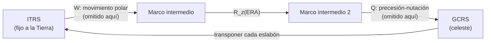

# B10-C16 — Transformación de marcos de referencia

<!-- nav:top -->
[🏠 Programa](../../../../README.md) · [📚 Bloque B10](../../../tronco-comun/B10-algebra-lineal-y-matematicas-geometricas.md) · [← Anterior: B10-C15 — Cuaterniones unitarios](../B10-C15-cuaterniones-unitarios/CLASE.md) · [Siguiente: B10-C17 — Tensores y notación indicial →](../../../tronco-comun/B10-algebra-lineal-y-matematicas-geometricas.md#b10-c17)
<!-- /nav -->

## 1. Ubicación, nivel y alcance

Decimosexta clase del bloque B10 y cierre del tercer tramo. Ya sabes construir y componer rotaciones ([C13](../B10-C13-matrices-de-rotacion-tridimensional/CLASE.md)) y representarlas con cuaterniones ([C15](../B10-C15-cuaterniones-unitarios/CLASE.md)). Aquí las usas para lo que en la práctica se hace todos los días: pasar la posición y la **velocidad** de un objeto de un **marco de referencia** a otro, en particular del marco que gira con la Tierra al marco inercial. Nivel N3. Verás qué es un marco, la cadena `Q R W` del IERS, el ángulo de rotación terrestre (ERA), cómo cambia la velocidad en un marco giratorio, la matriz de estado de `6×6` y un ejemplo geoestacionario. No verás las matrices `Q` (precesión–nutación) ni `W` (movimiento polar), que quedan para B13 y los bloques de astrometría.

## 2. Por qué esta clase existe

Una estación terrestre tiene coordenadas fijas en la Tierra. Un satélite se propaga en un sistema inercial, donde las leyes de Newton valen. Para saber hacia dónde apuntar la antena, o a qué hora pasará el satélite sobre la estación, hay que convertir entre ambos marcos con una rotación que depende del tiempo. Y un satélite geoestacionario, que se mueve a 3 km/s en el marco inercial, parece inmóvil visto desde la Tierra: ¿cómo se ve eso en las ecuaciones?

La decisión central: **¿en qué marco está cada vector, con qué rotación paso al otro y cómo transformo también la velocidad?**

## 3. Lo que podrás hacer al terminar

1. Definir un marco de referencia y distinguir uno inercial de otro giratorio.
2. Escribir la cadena `[GCRS] = Q(t) R(t) W(t) [ITRS]` y reconocer qué parte se calcula aquí.
3. Calcular el ángulo de rotación terrestre `ERA` para una fecha UT1.
4. Transformar una posición entre el marco terrestre y el inercial simplificado.
5. Transformar la velocidad: `v_rot = Rᵀ(v_i − ω × r_i)`.
6. Armar la matriz de transformación de estado `6×6` y componer cadenas de marcos.

La evidencia es la **cadena de marcos documentada** del ejercicio 12 (sección 20).

## 4. Con qué llegas y cómo comprobarlo

Necesitas rotaciones y composición ([C13](../B10-C13-matrices-de-rotacion-tridimensional/CLASE.md)), la rotación diaria de la Tierra ([C12](../B10-C12-rotaciones-en-el-plano-y-espacio/CLASE.md)) y el producto vectorial ([B04-C14](../../B04/B04-C14-producto-vectorial-y-orientacion/CLASE.md)). Cinco preguntas:

1. ¿En qué sentido gira la Tierra visto desde el polo norte?
2. Calcula `(0, 0, 1) × (1, 0, 0)`.
3. ¿Cuánto vale `R_z(90°)ᵀ` aplicado a `(0, 1, 0)`?
4. ¿Qué es un sistema inercial?
5. ¿Cuántos grados gira la Tierra por hora, aproximadamente?

<details>
<summary>Ver respuestas</summary>

1. Antihorario (hacia el este). 2. `(0, 1, 0)`. 3. `(1, 0, 0)`. 4. Un sistema en el que se cumplen las leyes de Newton sin fuerzas ficticias; no rota respecto de las estrellas. 5. `15,04°`.
</details>

## 5. Un caso real: de la estación al cielo y del satélite al suelo

Dos escenarios: (1) una estación en latitud `30°`, longitud `0°` (**sintética**) sobre una Tierra esférica de `6378,137 km` (radio ecuatorial, S4): ¿dónde está en el marco inercial a distintas horas? (2) Un satélite geoestacionario: ¿qué velocidad tiene en cada marco? Los parámetros de rotación son **datos publicados** (IERS, S1); el modelo (sin precesión, nutación ni movimiento polar) es una **simplificación didáctica**: no es la transformación oficial.

## 6. Vocabulario

Un **marco de referencia** es un conjunto de ejes coordenados ligado a un punto; el subsistema de marcos de SPICE define cómo se relacionan para que las transformaciones sean automáticas (S2). Un marco **inercial** no rota respecto del fondo de estrellas y en él valen las leyes de Newton (S2); los demás, por ejemplo los ligados a un cuerpo, rotan o cambian de orientación con el tiempo y requieren datos para calcular su transformación (S2). El **GCRS** (sistema celeste geocéntrico) y el **ITRS** (sistema terrestre internacional) son sistemas de referencia; el IERS los relaciona con `[GCRS] = Q(t) R(t) W(t) [ITRS]`, donde `Q` es el movimiento del polo celeste, `R` la rotación de la Tierra alrededor del eje del polo y `W` el movimiento polar (S1, ec. 5.1). El **ángulo de rotación terrestre** (ERA) es el ángulo de `R`, y se define por `ERA(Tu) = 2π(0,7790572732640 + 1,00273781191135448 Tu)` con `Tu = (fecha juliana UT1 − 2451545,0)` (S1, ec. 5.14). La **matriz de transformación de estado** `6×6` lleva posición y velocidad de un marco a otro. El **término de transporte** `ω × r` es la velocidad de arrastre de un marco giratorio. Un satélite **geoestacionario** tiene periodo igual al sidereal y órbita circular ecuatorial.

## 7. Modelo mental: cadena de ruedas dentadas

Pasar del marco terrestre al inercial es pasar por una cadena de giros; cada eslabón se multiplica por la izquierda y se invierte transponiendo.



*Descripción textual:* la posición terrestre se convierte en la celeste aplicando sucesivamente el movimiento polar, la rotación terrestre y la precesión‑nutación; esta clase conserva solo la rotación `R_z(ERA)`, y el camino de vuelta usa las transpuestas en orden inverso.

Analogía: pasar de un mapa a otro por varias hojas encadenadas. Su límite: en el mapa, las hojas son fijas; aquí cada eslabón depende del tiempo y cada error se acumula.

## 8. La explicación, paso a paso

### 8.1 El ángulo de rotación terrestre

En `J2000.0` (`Tu = 0`), `ERA = 2π · 0,7790572732640 = 280,4606°`. Cada día solar medio añade `360° · 1,00273781191135448 = 360,9856°`: el exceso sobre `360°` (`0,9856°`) es el avance de la Tierra en su órbita. La tasa es `ω_ERA = 2π · 1,00273781191135448/86 400 s = 7,292 115 147 × 10⁻⁵ rad/s`, que difiere en `2,0 × 10⁻⁸` (relativo) del valor nominal GRS80 `7,292 115 × 10⁻⁵` (S1, tabla 1.2). El día sideral es `86 400/1,002 737 811… = 86 164,0989 s = 23,934 472 h`, coherente con `23,9345 h` de la ficha de la NASA (S4).

### 8.2 Posición: de la Tierra al espacio

Con `Q = W = I`: `r_i = R_z(ERA) r_ITRS` y de vuelta `r_ITRS = R_z(ERA)ᵀ r_i`. La estación en latitud `30°` y longitud `0°` tiene `r_ITRS = 6378,137 (cos 30°, 0, sin 30°) = (5523,63; 0; 3189,07)` km. En `Tu = 0`: `ERA = 280,4606°` y `r_i = (1002,87; −5431,83; 3189,07)` km; en `Tu = 0,25 d` (`ERA = 10,7070°`): `(5427,46; 1026,22; 3189,07)`; en `Tu = 0,5 d` (`ERA = 100,9534°`): `(−1049,55; 5423,00; 3189,07)`. La tercera componente no cambia: `R_z` no la toca.

### 8.3 Velocidad en un marco que gira

Si un vector es `r_i = R r_rot` con `R = R_z(ωt)` variable, derivando: `v_i = R v_rot + ω × r_i`. Entonces

`v_rot = Rᵀ (v_i − ω × r_i)`,

donde `ω = (0, 0, ω_E)`. Un punto fijo en la Tierra tiene `v_rot = 0` y `v_i = ω × r_i`. Un objeto inmóvil en el marco inercial parece moverse en el marco giratorio con la velocidad `−ω × r`.

### 8.4 El satélite geoestacionario

Un satélite que da una vuelta por periodo sideral `T = 2π/ω = 86 164,10 s` en órbita circular tiene radio `a = (GM/ω²)^{1/3}` (tercera ley de Kepler; resultado estándar). Con `GM = 3,986 005 × 10⁵ km³/s²` y `ω = 7,292 115 × 10⁻⁵ rad/s` (S1, tabla 1.2): `a = 42 164,175 km`. Su velocidad circular `√(GM/a) = 3,074 660 km/s` coincide con `ω a = 3,074 660 km/s`. En el marco inercial se mueve a `3,07 km/s`; en el giratorio, `v_rot = 0` (el laboratorio devuelve `10⁻⁹ km/s` o menos): está quieto. Esta coincidencia es la definición de «geoestacionario».

### 8.5 La matriz de estado

El estado `x = (r, v)` se transforma con la matriz de `6×6` (la idea de la función `sxform` de SPICE, S2):

`x_rot = [[Rᵀ, 0], [−Rᵀ [ω]ₓ, Rᵀ]] x_i`,

donde `[ω]ₓ` es la matriz antisimétrica de `ω` (C13). SPICE también ofrece solo la matriz `3×3` de posición cuando no hay velocidad angular disponible (S2). El laboratorio comprueba que esta matriz reproduce posición y velocidad del geoestacionario.

### 8.6 Cadenas de marcos

Para encadenar `cuerpo → orbital → inercial` se multiplican en orden: `R_total = R_2 R_1`, igual que en C13 y como describe SPICE al componer marcos a través de un marco base (S2). Con `R_1 = R_x(90°)` y `R_2 = R_z(30°)`: el eje `y` del cuerpo cae en `(0, 0, 1)` y el `z` en `(0,5; −0,866; 0)`. Si inviertes el orden, el eje `y` cae en `(−0,5; 0; 0,866)`: no es el mismo.

### 8.7 Qué se omite y por qué importa

Esta clase omite `Q` y `W` y supone `UT1` conocido. El modelo oficial incluye precesión, nutación, movimiento polar y las correcciones del IERS (S1, cap. 5). El rótulo «inercial» aquí es «inercial simplificado». Además, SPICE avisa de que la diferencia de orientación entre el marco `J2000` y el `ICRS` es menor que `0,1″` y de que al exportar datos hay que saber en qué marco están (S2).

## 9. Magnitudes, símbolos y unidades

| Símbolo | Qué es | Unidad | Nota |
|---|---|---|---|
| `Tu` | `JD UT1 − 2451545,0` | días | época UT1 |
| `ERA` | ángulo de rotación terrestre | rad (° al informar) | ec. 5.14 (S1) |
| `ω` | velocidad angular terrestre | rad/s | `7,292 115 × 10⁻⁵` (S1) |
| `r_i`, `r_ITRS` | posición inercial y terrestre | km | marcos declarados |
| `v_i`, `v_rot` | velocidad inercial y relativa al marco giratorio | km/s | |
| `GM` | parámetro gravitacional | km³/s² | `3,986 005 × 10⁵` (S1) |
| `S` | matriz de estado `6×6` | — | `x_rot = S x_i` |

## 10. Convenciones y referencias

Rotación activa `R_z(ERA)` de ITRS a marco inercial simplificado; `ω` en el eje `z`; posiciones en km y velocidades en km/s; fechas en UT1 (no UTC). El «GCRS» de esta clase es una aproximación con `Q = I`. Se usa `ω` nominal (GRS80) para la velocidad de arrastre y la tasa de ERA para el ángulo: difieren en `2 × 10⁻⁸` relativo. La convención de rotación pasiva/activa de SPICE se detalla en C13.

## 11. De dónde sale lo que afirmamos

| ID | Fuente | Localizador | Respalda | Estado |
|---|---|---|---|---|
| S1 | IERS, *IERS Conventions (2010)*, TN36, §5.1 (ec. 5.1), §5.5.3 (ec. 5.14) y tabla 1.2 (GRS80) | https://iers-conventions.obspm.fr/content/tn36.pdf | `[GCRS] = Q R W [ITRS]`; fórmula del ERA; `GM = 3,986 005 × 10¹⁴ m³ s⁻²`, `ω = 7,292 115 × 10⁻⁵ rad s⁻¹`, `a_E = 6378137 m` | Texto extraído del PDF el 2026-11-05 |
| S2 | NASA/JPL NAIF, *SPICE Frames Required Reading* | https://naif.jpl.nasa.gov/pub/naif/toolkit_docs/C/req/frames.html | Definición de marco; marcos inerciales frente a no inerciales; `sxform`/`pxform`; J2000–ICRS `< 0,1″`; encadenamiento a través de un marco base | Consultada el 2026-11-05 mediante extracción automática (parte inicial de la página; el resto no se leyó) |
| S3 | NASA/JPL NAIF, *SPICE Rotation Required Reading* | https://naif.jpl.nasa.gov/pub/naif/toolkit_docs/C/req/rotation.html | Convenciones de rotación de coordenadas y de vectores | Consultada el 2026-11-05 mediante extracción automática |
| S4 | NASA/NSSDC, *Earth Fact Sheet* (actualizada 2024-11-15) | https://nssdc.gsfc.nasa.gov/planetary/factsheet/earthfact.html | Radio ecuatorial `6378,137 km`; periodo sideral `23,9345 h` | Consultada el 2026-11-05 mediante extracción automática |

Límites: la fórmula de velocidad en un marco giratorio, la tercera ley de Kepler y la matriz de estado son resultados estándar sin cita específica. Solo se leyeron el inicio de S2 y la ecuación citada de S1; el resto de las matrices del IERS no se usó. Las estaciones y satélites son **sintéticos**.

## 12. Cómo ver la transformación

Equivalente accesible a una gráfica de la estación en el marco inercial:

| `Tu` (d) | `ERA` (°) | `x` (km) | `y` (km) | `z` (km) |
|---|---|---|---|---|
| 0 | 280,4606 | 1002,87 | −5431,83 | 3189,07 |
| 0,25 | 10,7070 | 5427,46 | 1026,22 | 3189,07 |
| 0,50 | 100,9534 | −1049,55 | 5423,00 | 3189,07 |

Descripción larga: la estación recorre el paralelo de latitud 30° en sentido antihorario, a 15,04° por hora, con altura constante.

## 13. Ejemplo trabajado: un geoestacionario visto desde ambos marcos

**Paso 1 · Datos.** `GM = 3,986 005 × 10⁵ km³/s²`, `ω = 7,292 115 × 10⁻⁵ rad/s`.

**Paso 2 · Radio.** `a = (GM/ω²)^{1/3} = (7,4958 × 10¹³)^{1/3} = 42 164,2 km`.

**Paso 3 · Velocidad inercial.** `v = √(GM/a) = 3,0747 km/s`; igual a `ω a = 7,292 115 × 10⁻⁵ · 42 164,2 = 3,0747 km/s` (consistencia).

**Paso 4 · Velocidad de arrastre.** `ω × r` tiene módulo `ω a = 3,0747 km/s` y dirección tangencial prográda: la misma que `v_i`.

**Paso 5 · Marco giratorio.** `v_rot = Rᵀ(v_i − ω × r_i) = 0`. El satélite está quieto sobre un punto del ecuador (por ejemplo, en el marco giratorio `r_rot = (40 281, 12 460, 0) km` para un desfase de `0,3 rad`). Datos y modelo sintéticos; el radio es **calculado** con constantes publicadas.

## 14. Distintas formas de transformar

**Matriz `3×3` de posición + fórmula de velocidad:** transparente. **Matriz de estado `6×6`:** un solo producto. **Biblioteca (SPICE, ERFA, SOFA):** completa (incluye `Q` y `W`), pero hay que conocer sus convenciones (C13, C15). El laboratorio compara fórmula y matriz de estado: coinciden a `10⁻⁹`.

## 15. Práctica guiada

**Ejercicio 1 · con los pasos indicados.** Calcula `ERA` en `Tu = 0` en grados. *Pasos:* `0,7790572732640 × 360°`.

<details><summary>Solución comentada</summary>

`280,4606°` (8.1).
</details>

**Ejercicio 2 · con una pista.** Calcula la duración del día sideral en segundos. *Pista:* `86 400/1,00273781191135448`.

<details><summary>Solución comentada</summary>

`86 164,0989 s` (`23,934 472 h`) (8.1).
</details>

**Ejercicio 3 · casi autónomo.** Una estación ecuatorial en `(6378,137; 0; 0)` km del marco terrestre se observa cuando `ERA = 90°`. ¿Cuál es su posición inercial?

<details><summary>Solución comentada</summary>

`R_z(90°)(a, 0, 0) = (0, a, 0) = (0; 6378,137; 0)` km.
</details>

## 16. Práctica autónoma, transferencia e integrador

**Ejercicio 4.** Con `r_i = (0; 6378,137; 0)` y `ERA = 90°`, ¿cuál es `r_ITRS`?

<details><summary>Solución comentada</summary>

`R_z(−90°) r_i = (6378,137; 0; 0)` (8.2).
</details>

**Ejercicio 5.** Cadena `cuerpo → orbital → inercial` con `R₁ = R_x(90°)` y `R₂ = R_z(30°)`: ¿a dónde van los ejes `y` y `z` del cuerpo?

<details><summary>Solución comentada</summary>

`R₂R₁ e₂ = R₂(0, 0, 1) = (0, 0, 1)`; `R₂R₁ e₃ = R₂(0, −1, 0) = (0,5; −0,866; 0)` (8.6).
</details>

**Ejercicio 6.** ¿Qué velocidad tiene la estación de latitud 30° en el marco inercial y en el giratorio?

<details><summary>Solución comentada</summary>

Inercial: `ω a cos 30° = 402,8 m/s`; giratorio: `0` (8.3 y C12).
</details>

**Ejercicio 7.** Calcula `a = (GM/ω²)^{1/3}` y compáralo con `42 164 km`.

<details><summary>Solución comentada</summary>

`GM/ω² = 3,986 005 × 10⁵/5,3175 × 10⁻⁹ = 7,4958 × 10¹³`; raíz cúbica `42 164 km` ✓.
</details>

**Ejercicio 8.** La tasa de ERA y la `ω` nominal difieren en `1,47 × 10⁻¹³ rad/s`. ¿Qué ángulo y qué distancia en el suelo suponen en un día?

<details><summary>Solución comentada</summary>

`1,47 × 10⁻¹³ · 86 400 = 1,27 × 10⁻⁸ rad = 0,0026″`; en la superficie, `6 378 km × 1,27 × 10⁻⁸ = 0,08 m`. Es una estimación de orden de magnitud; despreciable para esta clase.
</details>

**Ejercicio 9 · transferencia.** Un satélite en órbita circular ecuatorial prográda a `7000 km` tiene `v_i = 7,546 km/s`. ¿Qué velocidad tiene en el marco giratorio?

<details><summary>Solución comentada</summary>

`ω a = 7,292 115 × 10⁻⁵ · 7000 = 0,5104 km/s`; `v_rot = 7,546 − 0,510 = 7,036 km/s` (módulo, misma dirección tangencial). Datos sintéticos.
</details>

**Ejercicio 10 · transferencia.** Un programa usa UTC donde la fórmula pide UT1 y se equivoca en 1 s. ¿Qué error de posición produce en el ecuador?

<details><summary>Solución comentada</summary>

`ω · 1 s = 7,29 × 10⁻⁵ rad = 15,04″` ⇒ `465 m` en el ecuador (`ω a`). (El diferencial real UT1−UTC lo publica el IERS: aquí solo es un valor didáctico.)
</details>

**Ejercicio 11 · transferencia.** Un colega invierte el orden de la cadena del ejercicio 5. ¿Cuál es el error para el eje `y` del cuerpo?

<details><summary>Solución comentada</summary>

`R₁R₂ e₂ = R_x(90°)(−0,5; 0,866; 0) = (−0,5; 0; 0,866)`, en vez de `(0, 0, 1)`: 30° de error (8.6).
</details>

**Ejercicio 12 · integrador.** Elabora tu **cadena de marcos documentada**: un diagrama textual de los marcos usados, el ERA en tres épocas elegidas, la posición de una estación tuya en el marco inercial simplificado, la verificación de la velocidad de un satélite (geoestacionario o de órbita baja) en ambos marcos y una lista de lo que tu modelo omite.

<details><summary>Solución modelo</summary>

Como la tabla de 12 y el ejemplo 13, con `S` de `6×6` verificada, la composición de dos marcos en ambos órdenes y la lista «sin `Q`, sin `W`, UT1 supuesto, Tierra rígida».
</details>

## 17. Laboratorio: ERA, posición, velocidad y geoestacionario

El script [marcos_de_referencia.py](marcos_de_referencia.py) calcula el ERA, la tasa, el día sideral, la posición de una estación en tres épocas, el radio y la velocidad geoestacionarios, la transformación de velocidad y la matriz de estado.

**Datos:** IERS (constantes publicadas); estación y satélite sintéticos. **Predice antes de ejecutar:** ¿qué velocidad relativa esperas del satélite geoestacionario? **Ejecución del 2026-11-05 (Python 3.12.9, numpy 2.4.4):**

```text
ERA(J2000.0, Tu = 0) = 280.460618 grados
tasa de ERA = 7.292115146707e-05 rad/s | omega nominal GRS80 = 7.292115000000e-05 | dif. relativa = 2.01e-08
dia sideral = 86164.0989 s = 23.934472 h
grados por dia solar medio = 360.985612
Tu = 0.00 dias: ERA =  280.4606 deg; r_GCRS = [ 1002.868 -5431.826  3189.068] km
Tu = 0.25 dias: ERA =   10.7070 deg; r_GCRS = [5427.462 1026.219 3189.068] km
Tu = 0.50 dias: ERA =  100.9534 deg; r_GCRS = [-1049.55   5422.999  3189.068] km
radio geoestacionario = 42164.175 km; v circular = 3.074660 km/s; omega*a = 3.074660 km/s
posicion en el marco giratorio: [40280.975 12460.366     0.   ] km; velocidad relativa: [0. 0. 0.] km/s
Pruebas superadas.
```

El programa rotula `r_GCRS` por brevedad; en esta clase es el marco inercial simplificado (`Q = I`).

```bash
python programa/clases/B10/B10-C16-transformacion-de-marcos-de-referencia/marcos_de_referencia.py
```

**Límites:** sin `Q` ni `W`; Tierra rígida; UT1 supuesto; datos sintéticos; no es la transformación oficial.

## 18. Errores frecuentes y cómo corregirlos

**Usar UTC donde se pide UT1.** Se corrige con el ejercicio 10.

**Transformar la posición pero olvidar el término `ω × r` en la velocidad.** Se corrige con los ejercicios 6 y 9.

**Invertir el orden de la cadena.** Se corrige con los ejercicios 5 y 11.

**Llamar «GCRS» o «inercial exacto» a un modelo simplificado.** Se corrige en las secciones 8.7 y 10.

**Mezclar rotación activa y de marco.** Se corrige con C13.

## 19. Cómo sabrás que vas bien

Tras 8.2: ¿conviertes una posición entre ITRS y el inercial simplificado? Si no, ejercicios 3 y 4. Tras 8.3: ¿qué velocidad tiene una estación en cada marco? Si no, ejercicio 6. Tras 8.4: ¿por qué un geoestacionario está quieto en el marco giratorio? Si no, ejercicio 7.

## 20. Qué entregas y cómo se evalúa

El producto es tu **cadena de marcos documentada** (ejercicio 12).

| Criterio | Inicial | En desarrollo | Logrado | Destacado |
|---|---|---|---|---|
| Declaración de marcos | Ausente | Nombres sin definición | Cada vector con su marco | Con eslabones omitidos listados |
| Posición | Errores de signo | Una época | Tres épocas correctas | Con inversa verificada |
| Velocidad | Ignora `ω × r` | Fórmula sin verificar | `v_rot` correcta | Matriz `6×6` contrastada |
| Fuentes | Sin fuente | Sin fecha | Con localizador y fecha | Distingue publicado y simplificado |
| Honestidad del modelo | Lo presenta como oficial | Menciona límites | Rotula «simplificado» | Cuantifica o acota lo omitido |

**Condiciones críticas:** declarar el marco de cada vector; no presentar el modelo simplificado como la transformación oficial; citar solo fuentes consultadas.

## 21. Ética, seguridad y límites

Una transformación de marcos mal hecha desplaza un objeto en el cielo o en el suelo: antenas mal apuntadas, pases mal predichos, sensores inconsistentes. El modelo de esta clase omite precesión, nutación, movimiento polar y los parámetros de orientación terrestre del IERS; no sirve para operaciones. Para trabajo real se usan bibliotecas validadas y los datos vigentes del IERS (B13). Accesibilidad: tablas equivalentes a las figuras, fórmulas en texto, ejercicios sin conexión.

## 22. Para cerrar y seguir

Un marco es un conjunto de ejes ligado a un punto; el IERS relaciona los sistemas terrestre y celeste con `Q R W`; esta clase conserva `R_z(ERA)`; la velocidad en un marco giratorio añade `ω × r`; la matriz de estado `6×6` lo resume; las cadenas se componen en orden y se declaran. Queda abierta una pregunta: ¿qué herramientas hacen falta para tratar las magnitudes que dependen de la dirección (como la inercia y la marea) sin depender de la base elegida?

**Glosario español–inglés.** marco de referencia · *reference frame*; marco inercial · *inertial frame*; ángulo de rotación terrestre · *Earth Rotation Angle (ERA)*; movimiento polar · *polar motion*; precesión‑nutación · *precession–nutation*; geoestacionario · *geostationary*; matriz de estado · *state transformation matrix*.

**Continuidad.** B10-C17 reutiliza tu capacidad de **cambiar de base** para introducir los tensores y la notación indicial; B10-C20 reutiliza la composición de marcos para la orientación de un satélite.

**Referencias:** ver sección 11.

<!-- nav:bottom -->
---

[← Anterior: B10-C15 — Cuaterniones unitarios](../B10-C15-cuaterniones-unitarios/CLASE.md) · [📚 Bloque B10](../../../tronco-comun/B10-algebra-lineal-y-matematicas-geometricas.md) · [Siguiente: B10-C17 — Tensores y notación indicial →](../../../tronco-comun/B10-algebra-lineal-y-matematicas-geometricas.md#b10-c17)
<!-- /nav -->
