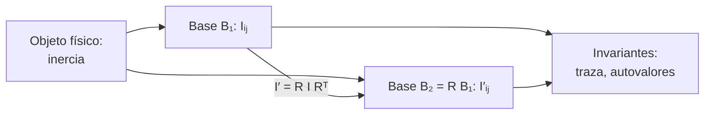

# B10-C17 — Tensores y notación indicial

<!-- nav:top -->
[🏠 Programa](../../../../README.md) · [📚 Bloque B10](../../../tronco-comun/B10-algebra-lineal-y-matematicas-geometricas.md) · [← Anterior: B10-C16 — Transformación de marcos de referencia](../B10-C16-transformacion-de-marcos-de-referencia/CLASE.md) · [Siguiente: B10-C18 — Producto tensorial y contracción →](../B10-C18-producto-tensorial-y-contraccion/CLASE.md)
<!-- /nav -->

## 1. Ubicación, nivel y alcance

Decimoséptima clase del bloque B10 y apertura de su último tramo. Hasta ahora tratabas vectores y matrices con las operaciones de siempre. Aquí aprendes la **notación indicial** (con la convención de suma de Einstein), que escribe cualquier operación lineal en una línea, y la idea de **tensor**: una magnitud física cuyas componentes cambian de un modo preciso cuando cambias de base. Ejemplo conductor: el tensor de inercia de un cuerpo. Nivel N3. Verás índices libres y mudos, `δᵢⱼ`, `εᵢⱼₖ`, la ley de transformación y la energía de rotación. No verás el producto tensorial general ni la marea (C18), ni tensores en relatividad.

## 2. Por qué esta clase existe

La inercia de un satélite frente a un giro depende de la dirección: se necesita nueve números ordenados en una matriz, y esos nueve números cambian si cambias los ejes del cuerpo, pero de forma que la física no cambie. Saber cuándo una tabla de números es un tensor (y cómo se transforma) evita errores de ejes al combinar datos de ingeniería, y la notación indicial hace legibles las fórmulas largas.

La decisión central: **¿cómo se escribe y se transforma una magnitud direccional sin depender de la base elegida?**

## 3. Lo que podrás hacer al terminar

1. Leer y escribir expresiones con índices libres y mudos y la convención de suma.
2. Usar `δᵢⱼ` y `εᵢⱼₖ` para producto escalar y vectorial.
3. Calcular el tensor de inercia de masas puntuales.
4. Aplicar la ley de transformación `I′ᵢⱼ = Rᵢₐ Rⱼ_b Iₐ_b`.
5. Calcular la energía de rotación `T = ½ ωᵢ Iᵢⱼ ωⱼ`.
6. Verificar con `einsum` una identidad indicial.

La evidencia es la **hoja de notación indicial** del ejercicio 12 (sección 20).

## 4. Con qué llegas y cómo comprobarlo

Necesitas matrices y su producto ([C03](../B10-C03-matrices-y-operadores-lineales/CLASE.md)), autovalores ([C08](../B10-C08-autovalores-y-autovectores/CLASE.md)) y rotaciones ([C13](../B10-C13-matrices-de-rotacion-tridimensional/CLASE.md)). Cinco preguntas:

1. Calcula `(1, 2, 3) · (−1, 0,5, 2)`.
2. Calcula `(1, 2, 3) × (−1, 0,5, 2)`.
3. ¿Qué es la traza de una matriz?
4. ¿Cómo se transforma una matriz de operador al cambiar de base ortonormal por `R`?
5. ¿Qué mide la energía cinética de rotación?

<details>
<summary>Ver respuestas</summary>

1. `6`. 2. `(2,5; −5; 2,5)`. 3. La suma de la diagonal. 4. `A′ = R A Rᵀ`. 5. El trabajo para poner el cuerpo en rotación: `½ ω · L`.
</details>

## 5. Un caso real: la inercia de un cuerpo de cuatro masas

Un cuerpo **sintético** de cuatro masas puntuales: `2 kg` en `(±1, 0, 0) m` y `1 kg` en `(0, ±2, 0) m`, todas giradas `30°` alrededor de `z`. Su tensor de inercia permite calcular cuánta energía cuesta girarlo según el eje. Es el ejemplo conductor; los datos son inventados.

## 6. Vocabulario

La **convención de suma de Einstein** dice que un índice repetido en un término se suma de 1 a 3: `aᵢ bᵢ = Σ aᵢ bᵢ`. Un índice **mudo** (repetido) puede renombrarse; un índice **libre** aparece una vez por término y define la componente. La **delta de Kronecker** `δᵢⱼ` vale 1 si `i = j` y 0 si no; es la matriz identidad. El **símbolo de Levi‑Civita** `εᵢⱼₖ` vale `+1` para permutaciones pares de `123`, `−1` para impares y `0` si algún índice se repite; da el producto vectorial `(a × b)ᵢ = εᵢⱼₖ aⱼ bₖ`. Un **tensor cartesiano de rango 2** es una colección `Tᵢⱼ` que, al girar los ejes con `R`, se transforma `T′ᵢⱼ = Rᵢₐ Rⱼ_b Tₐ_b`; un vector es de rango 1 y un escalar de rango 0. El **tensor de inercia** es `Iᵢⱼ = Σₙ mₙ (rₙ·rₙ δᵢⱼ − rₙᵢ rₙⱼ)`. La **traza** es la contracción `Tᵢᵢ` (S1: suma de la diagonal, §1.2(vi), ec. 1.2.62). Aquí se usan solo bases ortonormales derechas.

## 7. Modelo mental: la tabla cambia, la cosa no

Un tensor es el objeto físico; sus componentes son su «fotografía» en una base.



*Descripción textual:* el mismo objeto tiene tablas distintas en dos bases, relacionadas por `I′ = R I Rᵀ`; la traza y los autovalores son iguales en ambas.

Analogía: la fotografía de una escultura desde dos ángulos. Su límite: las dos fotos pueden parecer muy distintas, pero existe una regla exacta que pasa de una a otra.

## 8. La explicación, paso a paso

### 8.1 Índices libres y mudos

`aᵢ bᵢ` es un escalar (índice mudo `i`). `Aᵢⱼ xⱼ` es un vector con índice libre `i` (producto matriz–vector). `Aᵢⱼ Bⱼₖ` tiene índices libres `i, k` (producto matricial). `Aᵢᵢ` es la traza. Una ecuación debe tener los mismos índices libres en ambos lados.

### 8.2 Deltas y Levi‑Civita

`δᵢⱼ aⱼ = aᵢ` («cambia el índice»). `(a × b)ᵢ = εᵢⱼₖ aⱼ bₖ`: con `a = (1, 2, 3)` y `b = (−1, 0,5, 2)` da `(2,5; −5; 2,5)` y `aᵢbᵢ = 6`, como en el laboratorio. La identidad `εᵢⱼₖ εᵢₗₘ = δⱼₗ δₖₘ − δⱼₘ δₖₗ` se verifica numéricamente con `einsum` y sirve para demostrar identidades vectoriales.

### 8.3 El tensor de inercia

Para una masa `m` en `r`: `m(r² δᵢⱼ − rᵢ rⱼ)`. El cuerpo sin girar (masas en los ejes) da `I = diag(8, 4, 12) kg m²`: `Iₓₓ = Σ m (y² + z²) = 4 + 4 = 8`, `I_yy = 2 + 2 = 4`, `I_zz = 2 + 2 + 4 + 4 = 12`. Girado `30°` alrededor de `z`:

`I = [[7; 1,7321; 0], [1,7321; 5; 0], [0; 0; 12]] kg m²`.

El término fuera de la diagonal aparece porque los ejes ya no son principales (C08).

### 8.4 Ley de transformación

`I′ = R I₀ Rᵀ`, es decir `I′ᵢⱼ = Rᵢₐ Rⱼ_b I₀ₐ_b`. Con `R = R_z(30°)`: `I′ₓₓ = 8 cos²30° + 4 sin²30° = 7`, `I′_yy = 8 sin²30° + 4 cos²30° = 5`, `I′ₓ_y = (8 − 4) cos 30° sin 30° = 1,7321`. El laboratorio calcula la inercia directamente con las masas giradas y obtiene la misma matriz que con la ley, a `10⁻¹²`.

### 8.5 Invariantes

La traza (`24 kg m²`) y los autovalores (`4, 8, 12`) no cambian al girar los ejes. La traza vale además `2 Σ m r²` (`2 · 12 = 24`).

### 8.6 Energía de rotación

`T = ½ ωᵢ Iᵢⱼ ωⱼ`. Con `ω = (0,1; −0,2; 0,3) rad/s`: `ωᵀIω = 7·0,01 + 5·0,04 + 12·0,09 + 2·1,7321·(0,1)(−0,2) = 1,2807`, y `T = 0,6404 J`. Directamente como `½ Σ m |ω × r|²` da el mismo valor (`0,640 359 J`).

## 9. Magnitudes, símbolos y unidades

| Símbolo | Qué es | Unidad | Nota |
|---|---|---|---|
| `δᵢⱼ` | delta de Kronecker | — | identidad |
| `εᵢⱼₖ` | símbolo de Levi‑Civita | — | `±1, 0` |
| `Iᵢⱼ` | tensor de inercia | kg m² | simétrico |
| `m`, `r` | masa y posición | kg, m | sintéticas |
| `ω` | velocidad angular | rad/s | |
| `T` | energía de rotación | J | `½ ωᵢ Iᵢⱼ ωⱼ` |
| `R` | rotación de ejes | — | ortogonal |

## 10. Convenciones y referencias

Bases ortonormales derechas; índices de 1 a 3 (en el código, de 0 a 2). Convención de suma en índices repetidos. `Iᵢⱼ` con el signo habitual (productos de inercia con signo negativo en la fórmula). La transformación usa la rotación activa `R` de C13 aplicada a las posiciones. Cartesianos solamente: no se distinguen componentes covariantes y contravariantes.

## 11. De dónde sale lo que afirmamos

| ID | Fuente | Localizador | Respalda | Estado |
|---|---|---|---|---|
| S1 | NIST, *DLMF* §1.2(vi), versión vigente en línea al consultar | https://dlmf.nist.gov/1.2 | La traza como suma de la diagonal (1.2.62) y matrices simétricas (1.2.55) | Consultada el 2026-11-05 mediante extracción automática |
| S2 | NIST, *DLMF* §1.3(i) | https://dlmf.nist.gov/1.3 | Determinantes y cofactores, relacionados con `ε` (1.3.1–1.3.4) | Consultada el 2026-11-05 mediante extracción automática |

Límites: la definición de tensor cartesiano, la notación de Einstein y el tensor de inercia son resultados estándar sin cita específica; DLMF no trata tensores. Las masas y posiciones son **sintéticas**.

## 12. Cómo ver el tensor

Equivalente accesible a una elipse de inercia:

| Cantidad | Antes de girar | Girado `30°` |
|---|---|---|
| `Iₓₓ` | 8 | 7 |
| `I_yy` | 4 | 5 |
| `I_zz` | 12 | 12 |
| `Iₓ_y` | 0 | 1,7321 |
| traza | 24 | 24 |
| autovalores | 4, 8, 12 | 4, 8, 12 |

Descripción larga: al girar el cuerpo los dos momentos del plano se acercan y aparece un término cruzado; el eje `z` y los invariantes no cambian.

## 13. Ejemplo trabajado: energía de rotación

**Paso 1 · Datos.** `I` girado de 8.3; `ω = (0,1; −0,2; 0,3) rad/s`.

**Paso 2 · Producto.** `Iω = (7·0,1 + 1,7321·(−0,2); 1,7321·0,1 + 5·(−0,2); 12·0,3) = (0,3536; −0,8268; 3,6)`.

**Paso 3 · Contracción.** `ω · (Iω) = 0,0354 + 0,1654 + 1,08 = 1,2807`.

**Paso 4 · Energía.** `T = 0,6404 J`.

**Paso 5 · Comprobación y sentido.** `½ Σ m |ω × r|² = 0,6404 J`. Girar el cuerpo alrededor de `z` cuesta más (12 kg m²) que alrededor de `y` (4 kg m²). Resultado exacto para datos sintéticos.

## 14. Distintas formas de calcular

**Con bucles explícitos** sobre `i, j, a, b`: lento y propenso a error. **Con matrices** (`R I Rᵀ`): compacto. **Con `einsum`**: copia la notación indicial y sirve de verificación. Las tres deben coincidir.

## 15. Práctica guiada

**Ejercicio 1 · con los pasos indicados.** Calcula `aᵢbᵢ` y `εᵢⱼₖ aⱼ bₖ` para `a = (1, 2, 3)`, `b = (−1, 0,5, 2)`. *Pasos:* 8.2.

<details><summary>Solución comentada</summary>

`6` y `(2,5; −5; 2,5)`.
</details>

**Ejercicio 2 · con una pista.** Calcula la inercia (sin girar) de las cuatro masas. *Pista:* `m(r² δ − r r)`.

<details><summary>Solución comentada</summary>

`diag(8, 4, 12)` (8.3).
</details>

**Ejercicio 3 · casi autónomo.** Gira esa inercia `30°` alrededor de `z` con la ley de transformación.

<details><summary>Solución comentada</summary>

`I′ₓₓ = 7`, `I′_yy = 5`, `I′ₓ_y = 1,7321` (8.4).
</details>

## 16. Práctica autónoma, transferencia e integrador

**Ejercicio 4.** Escribe en notación indicial la traza de `A B`.

<details><summary>Solución comentada</summary>

`Aᵢⱼ Bⱼᵢ`.
</details>

**Ejercicio 5.** ¿Qué valor tiene `δᵢᵢ` en tres dimensiones?

<details><summary>Solución comentada</summary>

`3` (suma de tres unos).
</details>

**Ejercicio 6.** Calcula `εᵢⱼₖ εᵢⱼₖ`.

<details><summary>Solución comentada</summary>

Contrayendo la identidad de 8.2 (`j = l`, `k = m`): `δⱼⱼ δₖₖ − δⱼₖ δₖⱼ = 9 − 3 = 6`.
</details>

**Ejercicio 7.** Comprueba la traza y los autovalores del tensor girado.

<details><summary>Solución comentada</summary>

Traza `7 + 5 + 12 = 24`; el bloque `xy` tiene `λ² − 12λ + 32 = 0`, `λ = 4, 8`; y `12`.
</details>

**Ejercicio 8.** Calcula `T` para `ω = (0, 0, 1)`.

<details><summary>Solución comentada</summary>

`½ I_zz = 6 J`.
</details>

**Ejercicio 9 · transferencia.** Un instrumento añade una masa de `1 kg` en `(0, 0, 1) m`. ¿Cómo cambia el tensor sin girar?

<details><summary>Solución comentada</summary>

Suma `m(r² δ − r r) = 1·(1·I − diag(0,0,1)) = diag(1, 1, 0)`: `diag(9, 5, 12)`.
</details>

**Ejercicio 10 · transferencia.** Un ingeniero tiene `I` en ejes del cuerpo y necesita `ω` en ejes inerciales con `R`. ¿Cómo transformas `I` y `ω`?

<details><summary>Solución comentada</summary>

`ω′ = R ω` e `I′ = R I Rᵀ`; luego `T = ½ ω′ᵀ I′ ω′` es igual (invariante).
</details>

**Ejercicio 11 · transferencia.** Un compañero transforma `I′ = Rᵀ I R` con `R` activa del cuerpo al inercial. ¿Qué ocurre?

<details><summary>Solución comentada</summary>

Usa la transpuesta equivocada: obtendría la inercia en ejes girados `−θ`. Hay que verificar con `T` invariante y con los autovalores (iguales en ambos casos), pero los ejes serían incorrectos.
</details>

**Ejercicio 12 · integrador.** Elabora tu **hoja de notación indicial**: cinco expresiones con su lectura de índices, una identidad con `ε` y `δ` verificada con `einsum`, la inercia de tus propias masas en dos bases, la comprobación de invariantes y la energía de rotación calculada de dos formas.

<details><summary>Solución modelo</summary>

Como 8.1–8.6 y la tabla 12 con tus datos; el laboratorio como verificación; y una nota que rotule los datos como sintéticos.
</details>

## 17. Laboratorio: identidades, inercia y transformación

El script [tensores_indicial.py](tensores_indicial.py) verifica la identidad de Levi‑Civita, el producto vectorial indicial, el tensor de inercia, su transformación, sus invariantes y la energía.

**Datos:** sintéticos. **Predice antes de ejecutar:** ¿qué trazas esperas antes y después de girar? **Ejecución del 2026-11-05 (Python 3.12.9, numpy 2.4.4):**

```text
a x b (indicial) = [ 2.5 -5.   2.5] | a.b = 6.0
I0 =
 [[ 8.  0.  0.]
 [ 0.  4.  0.]
 [ 0.  0. 12.]]
I (giradas 30 grados) =
 [[ 7.        1.732051  0.      ]
 [ 1.732051  5.        0.      ]
 [ 0.        0.       12.      ]]
autovalores = [ 4.  8. 12.] | traza = 24.0 | 2*sum m r^2/..:  24.0
T = 0.640358984 J (indicial) | 0.640358984 J (directa)
Pruebas superadas.
```

```bash
python programa/clases/B10/B10-C17-tensores-y-notacion-indicial/tensores_indicial.py
```

**Límites:** masas puntuales; bases cartesianas; sin tensores de rango superior.

## 18. Errores frecuentes y cómo corregirlos

**Repetir un índice tres veces.** Se corrige con el ejercicio 4.

**Índices libres distintos en ambos lados de una ecuación.** Se corrige en la sección 8.1.

**Transformar con la transpuesta equivocada.** Se corrige con el ejercicio 11.

**Olvidar que las componentes dependen de la base.** Se corrige en 8.4.

**Confundir `Iᵢⱼ` con la matriz de covarianza.** Son tensores distintos con la misma forma de tabla.

## 19. Cómo sabrás que vas bien

Tras 8.1: ¿lees `Aᵢⱼ Bⱼₖ`? Si no, ejercicio 4. Tras 8.4: ¿qué cambia y qué no al girar? Si no, ejercicio 7. Tras 8.6: ¿cómo verificas `T`? Si no, ejercicio 8.

## 20. Qué entregas y cómo se evalúa

El producto es tu **hoja de notación indicial** (ejercicio 12).

| Criterio | Inicial | En desarrollo | Logrado | Destacado |
|---|---|---|---|---|
| Notación | Índices mezclados | Con errores | Libres y mudos correctos | Identidades verificadas |
| Transformación | Sin ley | Fórmula sin probar | `R I Rᵀ` verificada | Con invariantes |
| Inercia | Errores | Solo diagonal | Completa y con energía | Dos vías |
| Verificación | Ausente | Mental | `einsum` o directo | Y análisis de convención |
| Fuentes y rotulado | Sin fuente | Sin fecha | Con localizador y fecha | Rotula sintético |

**Condiciones críticas:** declarar la base y la rotación; comprobar invariantes; citar solo fuentes consultadas.

## 21. Ética, seguridad y límites

Un tensor de inercia mal transformado desorienta un controlador de actitud sin dar señales evidentes. La clase es didáctica: la inercia real se mide o se calcula con modelos de masa validados. Accesibilidad: tablas equivalentes a las figuras, fórmulas en texto, ejercicios sin conexión.

## 22. Para cerrar y seguir

La notación indicial escribe operaciones lineales con índices; `δ` y `ε` dan el escalar y el vectorial; un tensor se transforma con una `R` por índice; traza y autovalores son invariantes; la energía de rotación se escribe `½ ωᵢ Iᵢⱼ ωⱼ`. Queda abierta una pregunta: ¿cómo se construye un tensor a partir de dos vectores y cómo se reducen sus índices para obtener escalares y vectores, por ejemplo en la marea?

**Glosario español–inglés.** notación indicial · *index notation*; convención de Einstein · *Einstein summation convention*; delta de Kronecker · *Kronecker delta*; símbolo de Levi‑Civita · *Levi‑Civita symbol*; tensor de inercia · *inertia tensor*; índice mudo · *dummy index*; índice libre · *free index*.

**Continuidad.** B10-C18 reutiliza tu capacidad de **manejar índices** para el producto tensorial, la contracción y el tensor de marea.

**Referencias:** ver sección 11.

<!-- nav:bottom -->
---

[← Anterior: B10-C16 — Transformación de marcos de referencia](../B10-C16-transformacion-de-marcos-de-referencia/CLASE.md) · [📚 Bloque B10](../../../tronco-comun/B10-algebra-lineal-y-matematicas-geometricas.md) · [Siguiente: B10-C18 — Producto tensorial y contracción →](../B10-C18-producto-tensorial-y-contraccion/CLASE.md)
<!-- /nav -->
