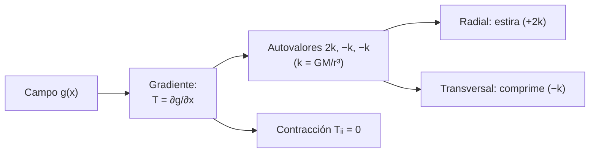

# B10-C18 — Producto tensorial y contracción

<!-- nav:top -->
[🏠 Programa](../../../../README.md) · [📚 Bloque B10](../../../tronco-comun/B10-algebra-lineal-y-matematicas-geometricas.md) · [← Anterior: B10-C17 — Tensores y notación indicial](../B10-C17-tensores-y-notacion-indicial/CLASE.md) · [Siguiente: B10-C19 — Jacobianos y linealización →](../B10-C19-jacobianos-y-linealizacion/CLASE.md)
<!-- /nav -->

## 1. Ubicación, nivel y alcance

Decimoctava clase del bloque B10. En [C17](../B10-C17-tensores-y-notacion-indicial/CLASE.md) aprendiste la notación indicial y el tensor de inercia. Aquí aprendes las dos operaciones que construyen y reducen tensores: el **producto tensorial** (o externo), que arma un tensor de rango 2 a partir de dos vectores, y la **contracción**, que suma un índice repetido y baja el rango (la traza, el producto escalar, la matriz por un vector). Usas ambas para el **tensor de marea gravitatoria** de un satélite, que conecta con la derivada de `g(r)` de [B09-C04](../../B09/B09-C04-reglas-de-derivacion/CLASE.md). Nivel N3. No verás relatividad ni tensores de rango superior a 2 más que de pasada.

## 2. Por qué esta clase existe

La gravedad no es uniforme a lo largo de un satélite: lo que está más cerca de la Tierra se acelera más que lo que está lejos, y lo que está a los lados se comprime. Con una sola derivada `dg/dr` solo describes la dirección radial; el **tensor de marea** describe las tres direcciones a la vez. Es la causa de que ciertos satélites alineen su eje con la vertical (estabilización por gradiente de gravedad) y de que se deformen los cuerpos grandes.

La decisión central: **¿cómo describo con un solo objeto cómo cambia un campo en todas las direcciones y cómo extraigo de él un número útil?**

## 3. Lo que podrás hacer al terminar

1. Formar `Tᵢⱼ = aᵢ bⱼ` y reconocer que tiene rango 1.
2. Contraer índices: traza, producto escalar, matriz por vector.
3. Construir el tensor de marea `T = (GM/r³)(3 n̂ n̂ − I)`.
4. Comprobar que su traza es cero y sus autovalores son `2, −1, −1` veces `GM/r³`.
5. Calcular la aceleración diferencial entre dos puntos del satélite.
6. Verificar el tensor con diferencias finitas del campo `g`.

La evidencia es la **ficha del tensor de marea** del ejercicio 12 (sección 20).

## 4. Con qué llegas y cómo comprobarlo

Necesitas índices y `δᵢⱼ` ([C17](../B10-C17-tensores-y-notacion-indicial/CLASE.md)), autovalores ([C08](../B10-C08-autovalores-y-autovectores/CLASE.md)) y la derivada de `g` ([B09-C04](../../B09/B09-C04-reglas-de-derivacion/CLASE.md)). Cinco preguntas:

1. ¿Cuánto vale `δᵢᵢ` en 3D?
2. ¿Cuál es la derivada de `GM/r²` respecto de `r`?
3. ¿Qué rango tiene una matriz `a bᵀ`?
4. ¿Qué es un vector unitario?
5. ¿Qué eigenvalores tiene `diag(2, −1, −1)`?

<details>
<summary>Ver respuestas</summary>

1. `3`. 2. `−2 GM/r³`. 3. Uno. 4. Uno de norma 1. 5. `2, −1, −1`.
</details>

## 5. Un caso real: la marea sobre un satélite en órbita baja

Un satélite **sintético** a `r = 7000 km` del centro de la Tierra, con `GM = 3,986 005 × 10¹⁴ m³/s²` (nominal, S1). El campo es `g(x) = −GM x/|x|³`. Se quiere saber cuánto difiere la aceleración entre dos puntos del satélite separados 1 m, radialmente y transversalmente. Es una aceleración **diferencial** (cambia de un punto a otro), no la aceleración del satélite entero. El modelo (masa puntual central) es una simplificación; los números son **calculados** con constantes publicadas.

## 6. Vocabulario

El **producto tensorial** (o externo) de `a` y `b` es el tensor de rango 2 `(a ⊗ b)ᵢⱼ = aᵢ bⱼ` (una matriz `a bᵀ`). Un tensor de la forma `a ⊗ b` tiene **rango 1** (en el sentido de matrices, C02). La **contracción** de un par de índices los iguala y suma: `Tᵢᵢ` (traza), `Tᵢⱼ bⱼ` (producto por un vector), `aᵢ bᵢ` (producto escalar). La **traza** (S2: suma de la diagonal, 1.2.62) es un invariante. El **gradiente** de un campo vectorial `g` es el tensor `∂gᵢ/∂xⱼ`. El **tensor de marea** es el gradiente del campo gravitatorio: `Tᵢⱼ = ∂gᵢ/∂xⱼ = (GM/r³)(3 nᵢ nⱼ − δᵢⱼ)` con `n̂ = x/|x|`. Un campo cuyo gradiente tiene traza nula es de **divergencia cero** (la divergencia es la traza de su gradiente).

## 7. Modelo mental: estira en una dirección, comprime en las otras

Visto desde el satélite, la Tierra estira a lo largo de la línea que los une y comprime en el plano perpendicular.



*Descripción textual:* el gradiente de la gravedad es un tensor simétrico con un autovalor `+2k` en la dirección radial y dos autovalores `−k` en las perpendiculares; su traza es nula.

Analogía: una masa de pan que se estira en una dirección y se aprieta en las otras manteniendo el volumen. Su límite: aquí el volumen se conserva a primer orden porque la traza es cero, algo que no se cumpliría en un campo con densidad.

## 8. La explicación, paso a paso

### 8.1 Producto tensorial y rango

Con `a = (1, 2, 3)` y `b = (4, 5, 6)`: `a ⊗ b = [[4, 5, 6], [8, 10, 12], [12, 15, 18]]`, cuyas filas son múltiplos de una sola: rango 1. La contracción de sus dos índices da `4 + 10 + 18 = 32 = a · b`, y la contracción de un índice con `b` da `(a ⊗ b) b = a (b · b)`.

### 8.2 Gradiente de la gravedad

Derivando `gᵢ = −GM xᵢ/r³`: `∂gᵢ/∂xⱼ = −GM (δᵢⱼ/r³ − 3 xᵢ xⱼ/r⁵) = (GM/r³)(3 nᵢ nⱼ − δᵢⱼ)`. Es la derivada de B09-C04 en dirección radial: `nᵢ nⱼ` proyecta sobre `n̂`, así que en esa dirección vale `2 GM/r³` (el valor de `|dg/dr|`) y en las perpendiculares `−GM/r³`.

### 8.3 Traza y autovalores

`Tᵢᵢ = (GM/r³)(3 − 3) = 0`. Autovalores `+2k` (autovector `n̂`) y `−k` doble (cualquier vector perpendicular a `n̂`). Suma `2k − k − k = 0`, coherente con la traza (C08).

### 8.4 El satélite a 7000 km

`k = GM/r³ = 3,986 005 × 10¹⁴/(7,0 × 10⁶)³ = 1,1621 × 10⁻⁶ s⁻²`. Con `n̂ = (1, 0, 0)`: `T = diag(2,3242; −1,1621; −1,1621) × 10⁻⁶ s⁻²`. Dos puntos separados 1 m en la dirección radial tienen una diferencia de aceleración `T · (1, 0, 0) m = 2,324 × 10⁻⁶ m/s²` (hacia afuera: el punto más lejano se separa); separados 1 m en `y`, `T · (0, 1, 0) m = (0; −1,162 × 10⁻⁶; 0) m/s²` (hacia el eje: se juntan).

### 8.5 Comprobación con diferencias finitas

El laboratorio calcula `∂g/∂xⱼ` por diferencias centrales con paso 1 m y compara con la fórmula: error relativo `5,8 × 10⁻¹⁰`. Es una verificación independiente del cálculo analítico.

### 8.6 Cómo se transforma

Si giras los ejes con `R`, `n̂′ = R n̂` y `T′ = R T Rᵀ`; el laboratorio lo comprueba con una rotación de `0,7 rad`. Los autovalores no cambian.

### 8.7 Uso: estabilización por gradiente de gravedad

Un cuerpo alargado (inercia distinta según el eje) sometido a este tensor de marea tiende a alinear su eje de menor inercia con la vertical local. Es un resultado estándar de la dinámica de actitud, sin cita específica en esta clase, y se estudia en B16.

## 9. Magnitudes, símbolos y unidades

| Símbolo | Qué es | Unidad | Nota |
|---|---|---|---|
| `g` | aceleración gravitatoria | m/s² | `−GM x/r³` |
| `T` | tensor de marea | s⁻² | `∂gᵢ/∂xⱼ` |
| `k` | `GM/r³` | s⁻² | `1,1621 × 10⁻⁶` a 7000 km |
| `n̂` | dirección radial | adimensional | unitario |
| `GM` | parámetro gravitacional | m³/s² | `3,986 005 × 10¹⁴` (S1) |
| `r` | distancia al centro | m | `7,0 × 10⁶` |
| `δa` | aceleración diferencial | m/s² | `T · δx` |

## 10. Convenciones y referencias

Ejes inerciales genéricos centrados en la Tierra; `n̂` apunta del centro al satélite. `T = ∂g/∂x` (con signo): positivo estira. Tierra de masa puntual, sin achatamiento. Se usa `GM` nominal GRS80. El satélite es puntual: la marea se evalúa en su posición y se multiplica por un desplazamiento pequeño (válido mientras `|δx| ≪ r`).

## 11. De dónde sale lo que afirmamos

| ID | Fuente | Localizador | Respalda | Estado |
|---|---|---|---|---|
| S1 | IERS, *IERS Conventions (2010)*, TN36, tabla 1.2 (GRS80) | https://iers-conventions.obspm.fr/content/tn36.pdf | `GM⊕ = 3,986 005 × 10¹⁴ m³ s⁻²` | Texto extraído del PDF el 2026-11-05 |
| S2 | NIST, *DLMF* §1.2(vi), versión vigente en línea al consultar | https://dlmf.nist.gov/1.2 | La traza como suma de la diagonal (1.2.62) | Consultada el 2026-11-05 mediante extracción automática |

Límites: el producto tensorial, la contracción y la fórmula del gradiente gravitatorio son resultados estándar (derivación explícita en 8.2) sin cita específica. El satélite es **sintético**; los valores de `k` y `T` están **calculados** con una constante publicada y un modelo de masa puntual.

## 12. Cómo ver el tensor

Equivalente accesible a un diagrama de flechas de marea:

| Dirección | Autovalor de `T` (s⁻²) | Efecto sobre 1 m de separación |
|---|---|---|
| radial (`n̂`) | `+2,3242 × 10⁻⁶` | separa: `2,324 × 10⁻⁶ m/s²` hacia afuera |
| transversal 1 | `−1,1621 × 10⁻⁶` | junta: `1,162 × 10⁻⁶ m/s²` hacia el eje |
| transversal 2 | `−1,1621 × 10⁻⁶` | junta: igual |

Descripción larga: tres flechas en un punto; la radial es el doble de larga que las otras y apunta hacia afuera; las otras dos apuntan hacia adentro.

## 13. Ejemplo trabajado: marea sobre 10 metros de estructura

**Paso 1 · Datos.** Una antena de `10 m` alineada con la vertical: extremos separados `δx = (10, 0, 0) m`.

**Paso 2 · Tensor.** `T = diag(2,3242; −1,1621; −1,1621) × 10⁻⁶ s⁻²` (8.4).

**Paso 3 · Contracción.** `δa = T δx = (2,3242 × 10⁻⁵; 0; 0) m/s²`.

**Paso 4 · Comparación.** `2,32 × 10⁻⁵ m/s²` es `2,4 × 10⁻⁶` veces `g` en la superficie (`9,8 m/s²`): una tensión minúscula pero continua.

**Paso 5 · Sentido.** La misma antena horizontal (`δx = (0, 10, 0)`) recibe `−1,162 × 10⁻⁵ m/s²`: se comprime. Resultado **calculado** con constantes publicadas y masa puntual; no incluye achatamiento de la Tierra ni otros cuerpos.

## 14. Distintas formas de obtener el gradiente

**Analítica** (8.2): exacta. **Diferencias finitas centrales**: independiente, con error de truncamiento y redondeo. **Diferenciación automática** (B09-C04, B14): exacta y automática. Las tres deben coincidir; en el laboratorio, la diferencia es `5,8 × 10⁻¹⁰` relativo.

## 15. Práctica guiada

**Ejercicio 1 · con los pasos indicados.** Calcula `a ⊗ b` para `a = (1, 2)`, `b = (3, 4)` y su traza. *Pasos:* `aᵢ bⱼ`.

<details><summary>Solución comentada</summary>

`[[3, 4], [6, 8]]`; traza `3 + 8 = 11 = a · b` (8.1).
</details>

**Ejercicio 2 · con una pista.** Calcula `k = GM/r³` a 7000 km. *Pista:* en metros.

<details><summary>Solución comentada</summary>

`3,986 005 × 10¹⁴/3,43 × 10²⁰ = 1,1621 × 10⁻⁶ s⁻²`.
</details>

**Ejercicio 3 · casi autónomo.** Escribe `T` para `n̂ = (1, 0, 0)` y comprueba que su traza es cero.

<details><summary>Solución comentada</summary>

`k diag(2, −1, −1)`, traza `0` (8.3).
</details>

## 16. Práctica autónoma, transferencia e integrador

**Ejercicio 4.** ¿Qué rango tiene `a ⊗ b`?

<details><summary>Solución comentada</summary>

Uno (cada fila es múltiplo de `b`).
</details>

**Ejercicio 5.** Calcula `(a ⊗ b) c` para `a = (1, 2)`, `b = (3, 4)`, `c = (1, 1)`.

<details><summary>Solución comentada</summary>

`a (b · c) = (1, 2)·7 = (7, 14)`.
</details>

**Ejercicio 6.** Calcula `T` si el satélite está en `n̂ = (0, 1, 0)`.

<details><summary>Solución comentada</summary>

`k diag(−1, 2, −1)`: el autovalor `2k` va en la dirección radial.
</details>

**Ejercicio 7.** Compara `|dg/dr|` de B09-C04 con el autovalor radial de `T`.

<details><summary>Solución comentada</summary>

`dg/dr = −2GM/r³` (en módulo `2k`), igual al autovalor radial: el tensor generaliza la derivada (el signo cambia porque `g` apunta hacia adentro).
</details>

**Ejercicio 8.** Calcula `δa` para dos puntos separados `(0, 0, 5) m`.

<details><summary>Solución comentada</summary>

`T (0,0,5) = (0, 0, −1,1621 × 10⁻⁶ · 5) = (0, 0, −5,81 × 10⁻⁶) m/s²`.
</details>

**Ejercicio 9 · transferencia.** A 42 164 km (órbita geoestacionaria) ¿cuánto valen `k` y el autovalor radial?

<details><summary>Solución comentada</summary>

`k = 3,986 005 × 10¹⁴/(4,2164 × 10⁷)³ = 5,32 × 10⁻⁹ s⁻²`; radial `1,06 × 10⁻⁸ s⁻²`: unas 220 veces menor que a 7000 km.
</details>

**Ejercicio 10 · transferencia.** El tensor de marea tiene traza nula. ¿Qué implica para el volumen de una nube de partículas muy pequeña en caída libre?

<details><summary>Solución comentada</summary>

La divergencia del campo es cero: al primer orden el volumen no cambia; se estira en una dirección y se comprime en las otras (8.3).
</details>

**Ejercicio 11 · transferencia.** Un estudiante usa `T = (GM/r³)(3 n̂ n̂ − I)` con `n̂` de norma 2. ¿Qué error comete y cómo lo detecta?

<details><summary>Solución comentada</summary>

La traza sería `3·4 − 3 = 9 ≠ 0` y el autovalor radial sería `11k`. Se detecta verificando traza nula y autovalores `2, −1, −1`.
</details>

**Ejercicio 12 · integrador.** Elabora tu **ficha del tensor de marea**: tensor a una altitud tuya, autovalores y traza, aceleración diferencial para una estructura de largo elegido en dos orientaciones, verificación por diferencias finitas y comparación con `dg/dr` de B09-C04.

<details><summary>Solución modelo</summary>

Como 8.4, 13 y la tabla 12 con tus números; el laboratorio como verificación (error `10⁻¹⁰`); rotulado «calculado con constante publicada, masa puntual».
</details>

## 17. Laboratorio: tensor de marea y contracciones

El script [tensor_de_marea.py](tensor_de_marea.py) comprueba producto tensorial y contracción, forma el tensor de marea, verifica su traza y autovalores, lo contrasta con diferencias finitas y comprueba su transformación bajo una rotación.

**Datos:** `GM` de IERS; satélite sintético. **Predice antes de ejecutar:** ¿qué traza y qué autovalores? **Ejecución del 2026-11-05 (Python 3.12.9, numpy 2.4.4):**

```text
traza(a (x) b) = 32.0 = a.b = 32.0
GM/r^3 = 1.162101e-06 s^-2
T (s^-2) =
 [[ 2.32420117e-06  0.00000000e+00  0.00000000e+00]
 [ 0.00000000e+00 -1.16210058e-06  0.00000000e+00]
 [ 0.00000000e+00  0.00000000e+00 -1.16210058e-06]]
autovalores = [-1.16210058e-06 -1.16210058e-06  2.32420117e-06]
gradiente por diferencias centrales: error relativo = 5.78e-10
da (radial 1 m)      = [2.32420117e-06 0.00000000e+00 0.00000000e+00] m/s2
da (transversal 1 m) = [ 0.00000000e+00 -1.16210058e-06  0.00000000e+00] m/s2
Pruebas superadas.
```

```bash
python programa/clases/B10/B10-C18-producto-tensorial-y-contraccion/tensor_de_marea.py
```

**Límites:** masa puntual; sin achatamiento (J2) ni otros cuerpos; válido para desplazamientos pequeños frente a `r`.

## 18. Errores frecuentes y cómo corregirlos

**Confundir `a ⊗ b` con `b ⊗ a`.** Son transpuestos; se corrige con el ejercicio 1.

**Esperar traza distinta de cero.** Se corrige con los ejercicios 3 y 11.

**Usar kilómetros en vez de metros.** Se corrige con el ejercicio 2.

**Olvidar que el autovalor radial es `2k` y no `k`.** Se corrige con los ejercicios 6 y 7.

**Aplicar la marea a un desplazamiento grande.** Se corrige en la sección 10.

## 19. Cómo sabrás que vas bien

Tras 8.1: ¿construyes `a ⊗ b` y contraes? Si no, ejercicios 1 y 5. Tras 8.3: ¿por qué `2, −1, −1`? Si no, ejercicio 3. Tras 8.4: ¿qué aceleración diferencial hay en 10 m? Si no, ejercicio 8.

## 20. Qué entregas y cómo se evalúa

El producto es tu **ficha del tensor de marea** (ejercicio 12).

| Criterio | Inicial | En desarrollo | Logrado | Destacado |
|---|---|---|---|---|
| Construcción | Sin fórmula | Con errores | `k(3n̂n̂ − I)` correcto | Con derivación |
| Verificación | Ausente | Traza sola | Traza, autovalores y diferencias | Y rotación |
| Unidades | Mezcla km y m | Parciales | SI coherente | Con orden de magnitud |
| Interpretación | Sin sentido físico | Menciona marea | Radial y transversal | Compara con B09-C04 |
| Fuentes y rotulado | Sin fuente | Sin fecha | Con localizador y fecha | Rotula calculado y simplificado |

**Condiciones críticas:** verificar traza nula; declarar el modelo de masa puntual; citar solo fuentes consultadas.

## 21. Ética, seguridad y límites

El tensor de marea de masa puntual no sirve para diseñar estabilización ni predecir deformaciones reales; falta el achatamiento terrestre, otros cuerpos y la dinámica del cuerpo flexible (B16). Accesibilidad: tablas equivalentes a las figuras, fórmulas en texto, ejercicios sin conexión.

## 22. Para cerrar y seguir

El producto tensorial arma tensores y la contracción los reduce; el gradiente de la gravedad es `k(3n̂n̂ − I)`, de traza nula y autovalores `2k, −k, −k`; generaliza la derivada de B09-C04; se transforma con `R T Rᵀ`. Queda abierta una pregunta: ¿cómo se aproxima linealmente cualquier función de varias variables, y cuánto error se comete?

**Glosario español–inglés.** producto tensorial · *tensor (outer) product*; contracción · *contraction*; traza · *trace*; gradiente · *gradient*; tensor de marea · *tidal tensor*; gradiente de gravedad · *gravity gradient*; aceleración diferencial · *differential acceleration*.

**Continuidad.** B10-C19 reutiliza tu capacidad de **tratar gradientes como tensores** para el jacobiano y la linealización.

**Referencias:** ver sección 11.

<!-- nav:bottom -->
---

[← Anterior: B10-C17 — Tensores y notación indicial](../B10-C17-tensores-y-notacion-indicial/CLASE.md) · [📚 Bloque B10](../../../tronco-comun/B10-algebra-lineal-y-matematicas-geometricas.md) · [Siguiente: B10-C19 — Jacobianos y linealización →](../B10-C19-jacobianos-y-linealizacion/CLASE.md)
<!-- /nav -->
