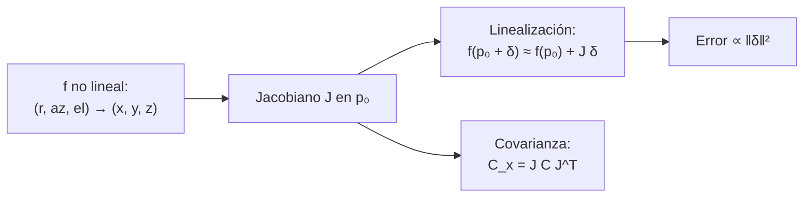

# B10-C19 — Jacobianos y linealización

<!-- nav:top -->
[🏠 Programa](../../../../README.md) · [📚 Bloque B10](../../../tronco-comun/B10-algebra-lineal-y-matematicas-geometricas.md) · [← Anterior: B10-C18 — Producto tensorial y contracción](../B10-C18-producto-tensorial-y-contraccion/CLASE.md) · [Siguiente: B10-C20 — Cinemática de orientación satelital →](../B10-C20-cinematica-de-orientacion-satelital/CLASE.md)
<!-- /nav -->

## 1. Ubicación, nivel y alcance

Decimonovena clase del bloque B10. En [B09-C04](../../B09/B09-C04-reglas-de-derivacion/CLASE.md) aprendiste que una derivada da una aproximación lineal con error; en [C18](../B10-C18-producto-tensorial-y-contraccion/CLASE.md) viste el gradiente de un campo como tensor. Aquí unes ambas ideas: el **jacobiano** es la derivada de una función de varias variables con varias salidas, y permite **linealizar**, cambiar de coordenadas y **propagar errores**. Nivel N3. El ejemplo conductor es la conversión de una medida (distancia, azimut, elevación) a coordenadas cartesianas. No verás la matriz hessiana ni ecuaciones diferenciales (B11), ni el filtro de Kalman (B22).

## 2. Por qué esta clase existe

Una estación mide la distancia, el azimut y la elevación de un objeto con incertidumbres. Para decir dónde está en coordenadas cartesianas y cuánta incertidumbre tiene esa posición, hay que transformar los números y sus errores. Si la función es no lineal, la solución exacta es costosa; el jacobiano da una respuesta lineal barata, válida para errores pequeños.

La decisión central: **¿hasta qué punto puedo sustituir una función no lineal por su aproximación lineal y qué incertidumbre queda?**

## 3. Lo que podrás hacer al terminar

1. Calcular el jacobiano de una función `ℝⁿ → ℝᵐ`.
2. Escribir la aproximación lineal `f(p + δ) ≈ f(p) + J δ`.
3. Interpretar `det J` como factor de escala de volúmenes.
4. Medir el error de linealización y su crecimiento cuadrático.
5. Propagar covarianza con `C_x = J C J^T`.
6. Verificar un jacobiano analítico con diferencias finitas.

La evidencia es el **informe de linealización** del ejercicio 12 (sección 20).

## 4. Con qué llegas y cómo comprobarlo

Necesitas derivadas ([B09-C04](../../B09/B09-C04-reglas-de-derivacion/CLASE.md)), matrices y determinantes ([C04](../B10-C04-determinantes-y-soluciones/CLASE.md)) y el tensor de marea como gradiente ([C18](../B10-C18-producto-tensorial-y-contraccion/CLASE.md)). Cinco preguntas:

1. ¿Cuánto es `d(r cos θ)/dθ`?
2. ¿Cuánto es `d(r cos θ)/dr`?
3. Calcula `det [[2, 0], [0, 3]]`.
4. ¿Qué es un cociente de diferencias centrales?
5. Si `f(x) = x²` en `x = 3`, ¿cuánto es `f′(3)`?

<details>
<summary>Ver respuestas</summary>

1. `−r sin θ`. 2. `cos θ`. 3. `6`. 4. `(f(x + h) − f(x − h))/(2h)`. 5. `6`.
</details>

## 5. Un caso real: de distancia, azimut y elevación a coordenadas cartesianas

Una estación mide un objeto (**datos sintéticos**) a `r = 1000 km`, azimut `30°` y elevación `40°`, con incertidumbres `σ_r = 0,1 km` y `σ_az = σ_el = 10⁻⁴ rad` (inventadas). La función es `x = r cos(el) cos(az)`, `y = r cos(el) sin(az)`, `z = r sin(el)`. Es el ejemplo conductor. Las cantidades son sintéticas; el método es el de cualquier conversión de coordenadas esféricas (B04-C11 introdujo las esféricas).

## 6. Vocabulario

El **jacobiano** de `f: ℝⁿ → ℝᵐ` es la matriz `m × n` de derivadas parciales `Jᵢⱼ = ∂fᵢ/∂pⱼ`. La **aproximación lineal** (o linealización) en `p₀` es `f(p₀ + δ) ≈ f(p₀) + J(p₀) δ`. Si `m = n`, `det J` es el **factor de escala de volúmenes** de la transformación (C04). Un **cambio de coordenadas** es una función invertible entre sistemas. La **propagación lineal de covarianza** es `C_x = J C_p Jᵀ` (C10 introdujo la covarianza). Una **diferencia finita central** aproxima `∂f/∂pⱼ ≈ (f(p + h eⱼ) − f(p − h eⱼ))/(2h)` (B09-C03/C04). El **error de linealización** es `‖f(p₀ + δ) − f(p₀) − J δ‖`, que crece como `‖δ‖²` si `f` es suave. Una **Monte Carlo** es una simulación con muestras aleatorias para estimar una distribución.

## 7. Modelo mental: la lupa y el plano tangente

Muy cerca de un punto, una superficie curva se parece a su plano tangente; el jacobiano es la pendiente de ese plano en todas las direcciones.



*Descripción textual:* de la función se obtiene su jacobiano en el punto de trabajo; con él se linealiza (error cuadrático en el tamaño del paso) y se propaga la covarianza de las entradas a las salidas.

Analogía: una lupa sobre un mapa de relieve: dentro de un círculo pequeño parece plano. Su límite: la lupa engaña si el círculo es grande o si hay un pico cerca (función no suave).

## 8. La explicación, paso a paso

### 8.1 El jacobiano de la conversión

Con `p = (r, az, el)` y la notación `c_a = cos az`, `s_a = sin az`, `c_e = cos el`, `s_e = sin el`:

`J = [[c_e c_a, −r c_e s_a, −r s_e c_a], [c_e s_a, r c_e c_a, −r s_e s_a], [s_e, 0, r c_e]]`.

En `(1000 km, 30°, 40°)`: primera fila `(0,6634; −383,02; −556,67)`, segunda `(0,3830; 663,41; −321,39)`, tercera `(0,6428; 0; 766,04)` (unidades: km/km, km/rad, km/rad). El laboratorio compara con diferencias centrales: error relativo `1,0 × 10⁻¹⁰`.

### 8.2 Determinante

`det J = r² cos(el) = 10⁶ · 0,7660 = 766 044 km²` (por rad²): un pequeño cubo de lados `δr, δaz, δel` se convierte en un volumen `766 044 δr δaz δel`. Es el conocido elemento de volumen esférico `r² cos(el)`. Cerca de `el = 90°` el determinante tiende a cero: la transformación se aplasta (el azimut ya no está definido) —es la singularidad esférica, análoga al bloqueo de cardán (C14)—.

### 8.3 Linealizar y medir el error

Para un paso `δ = s (577,35 km; 0,577 rad; 0,577 rad)`: `s = 0,1` da un desplazamiento real de `93,9 km` y un error de linealización de `4,957 km`; `s = 0,01`: `9,30 km` y `0,04943 km`; `s = 0,001`: `0,929 km` y `4,94 × 10⁻⁴ km`. Cada paso diez veces menor reduce el error cien veces: crecimiento cuadrático. Con pasos de ~5 % de error relativo, la linealización es dudosa; con 0,05 %, excelente.

### 8.4 Propagación de errores

`C = diag(0,01 km², 10⁻⁸, 10⁻⁸)`. Entonces `C_x = J C Jᵀ` da desviaciones `σ_x = 0,0947 km`, `σ_y = 0,0831 km`, `σ_z = 0,1000 km`. Por ejemplo, `σ_z² = (s_e σ_r)² + (r c_e σ_el)² = (0,6428 · 0,1)² + (766,04 · 10⁻⁴)² = 0,004132 + 0,005868 = 0,01`. Una Monte Carlo con 100 000 muestras da `(0,0945; 0,0832; 0,0998) km`, coincidiendo con la propagación lineal a menos del `3 %` del mayor elemento: aquí los errores son pequeños y la linealización es válida.

### 8.5 Cuándo falla

Si `σ_el` fuese de varios grados, la distribución de `z` dejaría de ser gaussiana y el resultado lineal subestimaría las colas. También falla cerca de singularidades (`el ≈ 90°`) y si el jacobiano no es de rango completo (C11).

### 8.6 Conexión con lo anterior

El tensor de marea de C18 es el jacobiano del campo `g`; la derivada de B09-C04 es el jacobiano de una función `ℝ → ℝ`; el error lineal de `|dg/dr| a_E` de B09-C04 (2,5 %) es un caso de error cuadrático de linealización.

## 9. Magnitudes, símbolos y unidades

| Símbolo | Qué es | Unidad | Nota |
|---|---|---|---|
| `p = (r, az, el)` | medida | km, rad, rad | sintética |
| `f(p) = (x, y, z)` | posición cartesiana | km | |
| `J` | jacobiano | km/km, km/rad | `3×3` |
| `δ` | desplazamiento en `p` | km, rad | |
| `C` | covarianza de `p` | km², rad² | `diag(0,01; 10⁻⁸; 10⁻⁸)` |
| `C_x` | covarianza de `(x, y, z)` | km² | `J C Jᵀ` |
| `det J` | factor de volumen | km²·(sin unidad angular) | `r² cos(el)` |

## 10. Convenciones y referencias

Azimut medido en el plano `xy` desde `x`, elevación sobre el plano `xy`; ángulos en radianes en las fórmulas. `J` se evalúa en el punto de trabajo `p₀`. La linealización solo vale cerca de `p₀`. Las incertidumbres se consideran gaussianas, independientes y pequeñas (supuestos declarados). Datos sintéticos.

## 11. De dónde sale lo que afirmamos

| ID | Fuente | Localizador | Respalda | Estado |
|---|---|---|---|---|
| S1 | NIST, *DLMF* §1.3(i), versión vigente en línea al consultar | https://dlmf.nist.gov/1.3 | Determinante de una matriz `3×3` por cofactores (1.3.1–1.3.4) | Consultada el 2026-11-05 mediante extracción automática |

Límites: el jacobiano, la linealización, el error cuadrático y la propagación `J C Jᵀ` son resultados estándar de cálculo y estadística sin cita específica en esta clase (la derivación de las derivadas parciales se hace explícitamente). Todos los valores numéricos son **sintéticos** y **calculados**; la Monte Carlo es una **simulación** con semilla fija.

## 12. Cómo ver la linealización

Equivalente accesible a la gráfica del error frente al paso:

| Escala `s` | Desplazamiento real (km) | Error lineal (km) | Error relativo |
|---|---|---|---|
| 0,1 | 93,93 | 4,957 | 5,3 % |
| 0,01 | 9,297 | 0,04943 | 0,53 % |
| 0,001 | 0,9287 | 0,000494 | 0,053 % |

Descripción larga: en una escala log‑log el error es una recta de pendiente 2; el error relativo es una recta de pendiente 1.

## 13. Ejemplo trabajado: propagar el error de la elevación

**Paso 1 · Datos.** `σ_el = 10⁻⁴ rad`, `r = 1000 km`, `el = 40°`.

**Paso 2 · Columna del jacobiano.** `∂z/∂el = r c_e = 766,04 km/rad`.

**Paso 3 · Contribución.** `766,04 · 10⁻⁴ = 0,0766 km` en `z`, y `∂x/∂el = −556,67`, `∂y/∂el = −321,39`: `0,0557` y `0,0321 km` en `x` e `y`.

**Paso 4 · Total en z.** Sumando con el aporte de `σ_r`: `√(0,0643² + 0,0766²) = 0,1000 km`.

**Paso 5 · Sentido.** Un error de `10⁻⁴ rad` (20″) a 1000 km desplaza el objeto 0,1 km: el ángulo domina. Estimación lineal sobre datos **sintéticos**.

## 14. Distintas formas de obtener el jacobiano

**Analítica** (8.1): exacta, requiere derivar. **Diferencias finitas centrales:** simple, con error `O(h²)` y ruido de redondeo. **Diferenciación automática** (B09-C04, B14): exacta y automática. La analítica y la numérica deben coincidir; el laboratorio da `10⁻¹⁰`.

## 15. Práctica guiada

**Ejercicio 1 · con los pasos indicados.** Calcula el jacobiano de `f(r, θ) = (r cos θ, r sin θ)`.

<details><summary>Solución comentada</summary>

`[[cos θ, −r sin θ], [sin θ, r cos θ]]`; `det = r`.
</details>

**Ejercicio 2 · con una pista.** Evalúa esa matriz en `r = 2`, `θ = 90°`. *Pista:* `cos 90° = 0`.

<details><summary>Solución comentada</summary>

`[[0, −2], [1, 0]]`; `det = 2`.
</details>

**Ejercicio 3 · casi autónomo.** Linealiza `f` en `(2, 90°)` y estima `f(2,1; 90° + 0,05 rad)`.

<details><summary>Solución comentada</summary>

`f(2, 90°) = (0, 2)`; `J δ = [[0, −2], [1, 0]] (0,1; 0,05) = (−0,1; 0,1)`; estimación `(−0,1; 2,1)`. Exacto: `(2,1 cos(π/2 + 0,05); 2,1 sin(π/2 + 0,05)) = (−0,105; 2,0974)`.
</details>

## 16. Práctica autónoma, transferencia e integrador

**Ejercicio 4.** Calcula `det J` del ejercicio 2 y explica su significado.

<details><summary>Solución comentada</summary>

`r = 2`: un elemento de área `δr δθ` se convierte en `2 δr δθ` (área en coordenadas polares).
</details>

**Ejercicio 5.** ¿Qué pasa con `det J` en 8.2 cuando `el → 90°`?

<details><summary>Solución comentada</summary>

Tiende a 0: la transformación se aplasta; el azimut deja de ser significativo.
</details>

**Ejercicio 6.** Calcula el error de linealización relativo del ejercicio 3.

<details><summary>Solución comentada</summary>

Error: `|(−0,105; 2,0974) − (−0,1; 2,1)| = 0,0057`; desplazamiento real `≈ 0,143`: `3,9 %`.
</details>

**Ejercicio 7.** Si se reduce el paso a la décima parte, ¿cómo cambia el error de linealización?

<details><summary>Solución comentada</summary>

A la centésima parte (error cuadrático) (8.3).
</details>

**Ejercicio 8.** Calcula la contribución de `σ_az` a `σ_x` en 8.4.

<details><summary>Solución comentada</summary>

`|∂x/∂az| σ_az = 383,02 · 10⁻⁴ = 0,0383 km`; junto con `σ_r`: `√((0,6634 · 0,1)² + 0,0383²) = √(0,0044 + 0,00147) = 0,0770` más el aporte de `el` (0,0557): total `0,0947 km` ✓.
</details>

**Ejercicio 9 · transferencia.** ¿Qué `σ_el` haría que el aporte de la elevación en `z` sea igual al de `σ_r` (0,0643 km)?

<details><summary>Solución comentada</summary>

`0,0643/766,04 = 8,4 × 10⁻⁵ rad`.
</details>

**Ejercicio 10 · transferencia.** Un colega usa grados en `σ_el = 0,0057` donde el jacobiano pide radianes. ¿Cuánto vale `σ_z` si ese número se tomase como radianes?

<details><summary>Solución comentada</summary>

`766,04 · 0,0057 = 4,4 km` en lugar de `0,0766 km` si fueran `0,0057°`: error de un factor `57`. Siempre radianes.
</details>

**Ejercicio 11 · transferencia.** Con `el = 89,9°` y los mismos errores, ¿es fiable la propagación lineal?

<details><summary>Solución comentada</summary>

No: `r cos(el)` vale `1,75 km`, el jacobiano casi pierde rango (azimut mal definido) y la distribución no es gaussiana; usar Monte Carlo o otra parametrización (8.5).
</details>

**Ejercicio 12 · integrador.** Elabora tu **informe de linealización**: una función de tres entradas y tres salidas, su jacobiano analítico verificado con diferencias finitas, la tabla de error de linealización para tres pasos, la propagación de covarianza contrastada con Monte Carlo y los casos en que falla.

<details><summary>Solución modelo</summary>

Tablas como las de 12 y 8.4 con tus datos; el laboratorio como verificación; y una nota que rotule los datos como sintéticos y la Monte Carlo como simulación.
</details>

## 17. Laboratorio: jacobiano, error de linealización y Monte Carlo

El script [jacobianos.py](jacobianos.py) calcula el jacobiano analítico y numérico, `det J`, el error de linealización para tres escalas y contrasta la propagación lineal con una simulación.

**Datos:** sintéticos, semilla fija. **Predice antes de ejecutar:** ¿cuánto baja el error al dividir el paso por 10? **Ejecución del 2026-11-05 (Python 3.12.9, numpy 2.4.4):**

```text
J =
 [[ 6.63414000e-01 -3.83022222e+02 -5.56670399e+02]
 [ 3.83022000e-01  6.63413948e+02 -3.21393805e+02]
 [ 6.42788000e-01  0.00000000e+00  7.66044443e+02]]
error relativo vs diferencias centrales = 1.03e-10
det J = 766044.443119 | r^2 cos(el) = 766044.443119
escala del paso   error de la linealizacion (km)
     1e-01   4.9572e+00   (|dx| = 9.3931e+01 km)
     1e-02   4.9433e-02   (|dx| = 9.2972e+00 km)
     1e-03   4.9417e-04   (|dx| = 9.2870e-01 km)
sigma lineal (km) = [0.094695 0.083073 0.1     ]
sigma Monte Carlo (km) = [0.094496 0.083152 0.099756]
Pruebas superadas.
```

```bash
python programa/clases/B10/B10-C19-jacobianos-y-linealizacion/jacobianos.py
```

**Límites:** errores gaussianos, independientes y pequeños; dirección de paso única; datos sintéticos.

## 18. Errores frecuentes y cómo corregirlos

**Mezclar grados y radianes.** Se corrige con el ejercicio 10.

**Linealizar lejos del punto de trabajo.** Se corrige con los ejercicios 6 y 7.

**Olvidar `Jᵀ` en la propagación (`C_x = J C J^T`).** Se corrige en la sección 8.4.

**Usar el jacobiano cerca de una singularidad.** Se corrige con los ejercicios 5 y 11.

**Confundir `∂f/∂p` con `∂p/∂f`.** Son inversos; se corrige en la sección 8.2.

## 19. Cómo sabrás que vas bien

Tras 8.1: ¿construyes el jacobiano de una conversión polar? Si no, ejercicio 1. Tras 8.3: ¿por qué el error cae por 100? Si no, ejercicio 7. Tras 8.4: ¿qué columna domina el error en `z`? Si no, ejercicio 9.

## 20. Qué entregas y cómo se evalúa

El producto es tu **informe de linealización** (ejercicio 12).

| Criterio | Inicial | En desarrollo | Logrado | Destacado |
|---|---|---|---|---|
| Jacobiano | Con errores | Parcial | Completo y verificado | Con `det J` interpretado |
| Linealización | Sin error | Un solo paso | Tres pasos con orden 2 | Con límite de validez |
| Propagación | Sin covarianza | Solo varianzas | `J C Jᵀ` contrastada | Con Monte Carlo y límites |
| Unidades | Mezcla | Parciales | Radianes y km coherentes | Con análisis dimensional |
| Fuentes y rotulado | Sin fuente | Sin fecha | Con localizador y fecha | Rotula sintético y simulado |

**Condiciones críticas:** radianes; declarar el punto de trabajo y el rango de validez; citar solo fuentes consultadas.

## 21. Ética, seguridad y límites

Una propagación lineal con errores grandes o cerca de una singularidad subestima la incertidumbre y puede dar falsa confianza en una posición. No sustituye la determinación de órbita (B22) ni la evaluación de riesgo de colisión (B118). Accesibilidad: tablas equivalentes a las figuras, fórmulas en texto, ejercicios sin conexión.

## 22. Para cerrar y seguir

El jacobiano es la derivada de una función de varias variables; linealiza con error cuadrático; `det J` es el factor de volumen; `C_x = J C Jᵀ` propaga la incertidumbre; falla con errores grandes y en singularidades. Queda abierta una pregunta: ¿cómo se usan estas piezas para integrar en el tiempo la orientación de un satélite?

**Glosario español–inglés.** jacobiano · *Jacobian*; linealización · *linearization*; propagación de covarianza · *covariance propagation*; diferencia finita · *finite difference*; cambio de coordenadas · *change of coordinates*; Monte Carlo · *Monte Carlo*; singularidad · *singularity*.

**Continuidad.** B10-C20 reutiliza tu capacidad de **linealizar y verificar numéricamente** en la cinemática de orientación satelital.

**Referencias:** ver sección 11.

<!-- nav:bottom -->
---

[← Anterior: B10-C18 — Producto tensorial y contracción](../B10-C18-producto-tensorial-y-contraccion/CLASE.md) · [📚 Bloque B10](../../../tronco-comun/B10-algebra-lineal-y-matematicas-geometricas.md) · [Siguiente: B10-C20 — Cinemática de orientación satelital →](../B10-C20-cinematica-de-orientacion-satelital/CLASE.md)
<!-- /nav -->
