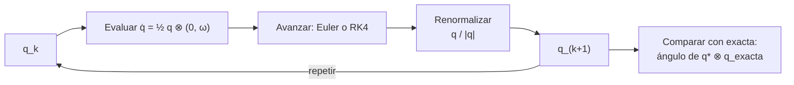

# B10-C20 — Cinemática de orientación satelital

<!-- nav:top -->
[🏠 Programa](../../../../README.md) · [📚 Bloque B10](../../../tronco-comun/B10-algebra-lineal-y-matematicas-geometricas.md) · [← Anterior: B10-C19 — Jacobianos y linealización](../B10-C19-jacobianos-y-linealizacion/CLASE.md) · [Siguiente: B11-C01 — Ecuaciones diferenciales ordinarias →](../../B11/B11-C01-ecuaciones-diferenciales-ordinarias/CLASE.md)
<!-- /nav -->

## 1. Ubicación, nivel y alcance

Vigésima y última clase del bloque B10. Reúne lo anterior: rotaciones ([C13](../B10-C13-matrices-de-rotacion-tridimensional/CLASE.md)), cuaterniones ([C15](../B10-C15-cuaterniones-unitarios/CLASE.md)), marcos ([C16](../B10-C16-transformacion-de-marcos-de-referencia/CLASE.md)) y linealización ([C19](../B10-C19-jacobianos-y-linealizacion/CLASE.md)). La **cinemática de orientación** responde a una pregunta sin dinámica: dado cómo gira un satélite (su velocidad angular), ¿cómo cambia su orientación en el tiempo? Nivel N3. Verás la ecuación `q̇ = ½ q ⊗ (0, ω)`, su solución exacta para giro constante, su integración numérica con Euler y con Runge–Kutta de cuarto orden, la renormalización y la verificación con una solución exacta. No verás la dinámica (ecuaciones de Euler del cuerpo rígido), el control ni los filtros (B16, B22).

## 2. Por qué esta clase existe

Los giróscopos de un satélite miden la velocidad angular en ejes del cuerpo. Para saber hacia dónde apunta una cámara, hay que integrar esa velocidad en el tiempo, miles de veces. Un integrador torpe acumula errores de ángulo o hace crecer la norma del cuaternión; uno bueno cuesta poco más. Es el cálculo central de cualquier sistema de determinación de actitud.

La decisión central: **¿cómo integro la actitud a partir de la velocidad angular, con qué método y cómo compruebo que el resultado es de fiar?**

## 3. Lo que podrás hacer al terminar

1. Escribir la ecuación cinemática del cuaternión y deducir `ω = 2 q* ⊗ q̇`.
2. Obtener la solución exacta para velocidad angular constante.
3. Integrar con Euler, Euler con renormalización y RK4.
4. Medir el error angular de la actitud con una métrica estable.
5. Explicar por qué hay que renormalizar y qué orden tiene cada método.
6. Estimar el efecto de un sesgo de giróscopo sobre la actitud.

La evidencia es la **simulación de actitud verificada** del ejercicio 12 (sección 20), que es el proyecto de cierre del bloque.

## 4. Con qué llegas y cómo comprobarlo

Necesitas cuaterniones ([C15](../B10-C15-cuaterniones-unitarios/CLASE.md)), la derivada ([B09-C04](../../B09/B09-C04-reglas-de-derivacion/CLASE.md)) y la idea de linealizar ([C19](../B10-C19-jacobianos-y-linealizacion/CLASE.md)). Cinco preguntas:

1. ¿Qué cuaternión representa una rotación de `θ` alrededor de `u`?
2. ¿Cuál es el conjugado de `(q₀, q⃗)`?
3. ¿Cuánto es la derivada de `cos(ωt/2)`?
4. ¿Qué error tiene un paso de Euler de tamaño `h`, en orden?
5. ¿Qué es la velocidad angular en ejes del cuerpo?

<details>
<summary>Ver respuestas</summary>

1. `(cos θ/2, sin θ/2 u)`. 2. `(q₀, −q⃗)`. 3. `−(ω/2) sin(ωt/2)`. 4. `O(h²)` por paso y `O(h)` acumulado. 5. El vector de giro del cuerpo expresado en los ejes del cuerpo (C14).
</details>

## 5. Un caso real: un satélite que gira a velocidad constante

Escenario **sintético**: la velocidad angular, medida en ejes del cuerpo, es `ω = 0,1 rad/s · (1, 1, 1)/√3` durante `60 s`, partiendo de la actitud nula (`q = (1, 0, 0, 0)`). Como el eje está fijo, hay una solución exacta con la que comparar. Es el ejemplo conductor: integrar numéricamente y medir cuánto se desvía del resultado exacto. Todos los datos son inventados; ninguna misión real los respalda.

## 6. Vocabulario

La **ecuación cinemática del cuaternión** (con rotación activa cuerpo → inercial y `ω` en el cuerpo) es `q̇ = ½ q ⊗ (0, ω)`. Su inversa es `ω = 2 q* ⊗ q̇` (parte vectorial). Con `ω` en el marco inercial, la forma es `q̇ = ½ (0, ω_i) ⊗ q`. Para `ω` **constante**, la solución exacta es `q(t) = (cos(|ω| t/2), sin(|ω| t/2) ω/|ω|)` partiendo de la identidad. Un **método de un paso** avanza con `q_{k+1} = Φ(q_k, h)`. **Euler explícito:** `q + h q̇`. **Runge–Kutta de cuarto orden (RK4):** combina cuatro evaluaciones de `q̇` por paso. El **orden** de un método es la potencia de `h` a la que cae el error global. La **renormalización** divide por `|q|` tras cada paso. El **error angular** entre dos actitudes es el ángulo de la rotación relativa `q₁* ⊗ q₂` (C15). El **sesgo** (*bias*) de un giróscopo es un error sistemático constante en `ω`. SPICE usa cuaterniones con escalar primero y señala que `q` y `−q` son la misma rotación (S1).

## 7. Modelo mental: pequeñas rotaciones encadenadas

Integrar es componer miles de rotaciones pequeñas: en cada paso, el cuaternión se multiplica por el de un giro de ángulo `|ω| h` alrededor de `ω`.



*Descripción textual:* en cada paso se evalúa la derivada, se avanza con el método elegido, se renormaliza y se repite; al final se compara con la solución exacta mediante el ángulo de la rotación relativa.

Analogía: dibujar una circunferencia con pasos cortos y rectos. Su límite: Euler se sale del círculo (la norma crece), RK4 casi lo sigue; un paso demasiado grande falla con cualquier método.

## 8. La explicación, paso a paso

### 8.1 Ecuación cinemática

Para una rotación de ángulo `φ(t)` alrededor de un eje fijo `u` con `φ̇ = ω`: `q = (cos φ/2, sin φ/2 u)`; derivando, `q̇ = ½ ω (−sin φ/2, cos φ/2 u)`, que es `½ q ⊗ (0, ω u)`. Recíprocamente, `2 q* ⊗ q̇ = (0, ω u)`: la parte vectorial es `ω`. El laboratorio lo comprueba derivando numéricamente la solución exacta: `ω = (0,057 735; 0,057 735; 0,057 735) rad/s`, igual a `0,1/√3` por componente.

### 8.2 Solución exacta con giro constante

`|ω| = 0,1 rad/s`, `t = 60 s`: ángulo `6 rad` (`343,8°`, casi una vuelta; una vuelta completa tarda `2π/0,1 = 62,83 s`). `q(60) = (cos 3, sin 3 · (1,1,1)/√3) = (−0,989 992; 0,081 476; 0,081 476; 0,081 476)`. Que el escalar sea negativo indica un ángulo mayor que `π`; equivale a `−q` con ángulo `2π − 6 = 0,283 rad` alrededor de `−ω` (C15).

### 8.3 Un paso de Euler a mano

Con `ω = (0, 0, 1) rad/s`, `h = 0,1 s`, `q₀ = (1, 0, 0, 0)`: `q̇ = ½ (1, 0, 0, 0) ⊗ (0, 0, 0, 1) = (0, 0, 0, 0,5)`; `q₁ = q₀ + h q̇ = (1, 0, 0, 0,05)`, de norma `√1,0025 = 1,001 25`. Normalizado: `(0,998 75; 0; 0; 0,049 94)`. Exacto: `(cos 0,05; 0; 0; sin 0,05) = (0,998 75; 0; 0; 0,049 98)`. El error angular es `8 × 10⁻⁵ rad` en un solo paso. La norma crece `√(1 + (hω/2)²)` en cada paso: tras `100` pasos de `0,1 s` con `ω = 1`, `1,0025⁵⁰ = 1,133`, es decir `+13 %`.

### 8.4 Resultados de los tres métodos

El laboratorio integra `60 s` con tres pasos. Norma `|q| − 1` y error angular:

| Paso `h` | Euler: `|q| − 1` | Euler: error (rad) | Euler normalizado: error | RK4: error |
|---|---|---|---|---|
| 0,5 s | 3,8 × 10⁻² | 1,25 × 10⁻³ | 1,25 × 10⁻³ | 1,95 × 10⁻⁸ |
| 0,1 s | 7,5 × 10⁻³ | 5,0 × 10⁻⁵ | 5,0 × 10⁻⁵ | 3,1 × 10⁻¹¹ |
| 0,01 s | 7,5 × 10⁻⁴ | 5,0 × 10⁻⁷ | 5,0 × 10⁻⁷ | 6,7 × 10⁻¹⁶ |

En este caso (eje fijo, medido tras normalizar) el error de Euler cae como `h²` (de `0,5` a `0,1` baja `25` veces; de `0,1` a `0,01`, `100`): cada paso gira `2 arctan(h|ω|/2)` en vez de `h|ω|`, un error de `(h|ω|)³/12` por paso, que acumulado en `T/h` pasos da `T|ω|³h²/12 = 5 × 10⁻³ h²` rad, igual a lo observado. RK4 mejora muchísimo con el mismo número de pasos; con `h = 0,01 s` está en el límite de la aritmética.

### 8.5 Por qué renormalizar

Euler explícito multiplica la norma por `√(1 + (h|ω|/2)²) > 1` en cada paso; sin renormalizar, `q` deja de ser unitario y deja de representar una rotación pura. Renormalizar es una división; no cambia el orden de Euler pero conserva la restricción (C15: `|q| = 1`).

### 8.6 Costo

Euler: una evaluación de `q̇` por paso; RK4: cuatro. Para igualar el error de RK4 con `h = 0,1 s` (`3 × 10⁻¹¹ rad`), Euler (error `5 × 10⁻³ h²`) necesitaría `h ≈ 7,7 × 10⁻⁵ s`: unos `8 × 10⁵` pasos en `60 s`, frente a `600 × 4 = 2400` evaluaciones de RK4.

### 8.7 Efecto de un sesgo de giróscopo

Un sesgo constante `b` en una componente de `ω` produce un error de actitud que crece como `b t`. Con `b = 10⁻⁵ rad/s` (valor **didáctico**) durante `600 s`: `6 × 10⁻³ rad = 0,34°`. Por eso los sistemas reales corrigen la integración con otras mediciones (seguidor estelar), tema de B22.

## 9. Magnitudes, símbolos y unidades

| Símbolo | Qué es | Unidad | Nota |
|---|---|---|---|
| `q` | cuaternión de actitud cuerpo → inercial | adimensional | escalar primero |
| `ω` | velocidad angular en ejes del cuerpo | rad/s | `0,1 (1,1,1)/√3` |
| `h` | paso de integración | s | 0,5; 0,1; 0,01 |
| `t` | tiempo | s | 0 a 60 |
| `φ = |ω| t` | ángulo girado | rad | 6 rad a 60 s |
| `ε` | error angular | rad | ángulo de `q* ⊗ q_exacta` |
| `b` | sesgo del giróscopo | rad/s | 10⁻⁵ (didáctico) |

## 10. Convenciones y referencias

Cuaterniones de Hamilton con escalar primero, rotación activa cuerpo → inercial, `ω` en ejes del cuerpo (C15). El error angular se mide con `2 atan2(‖parte vectorial‖, |escalar|)` de la rotación relativa, que es estable para ángulos pequeños (con `arccos` se pierde precisión por debajo de `10⁻⁸ rad`). La actitud inicial es la identidad. Todo es **sintético**. Para datos reales hay que verificar la convención de la fuente con un caso conocido (C15).

## 11. De dónde sale lo que afirmamos

| ID | Fuente | Localizador | Respalda | Estado |
|---|---|---|---|---|
| S1 | NASA/JPL NAIF, *SPICE Rotation Required Reading* | https://naif.jpl.nasa.gov/pub/naif/toolkit_docs/C/req/rotation.html | Cuaternión escalar‑primero `q₀ = cos(ángulo/2)`; `q` y `−q` son la misma rotación; composición `q₂ * q₁` representa `R₂(R₁)` | Consultada el 2026-11-05 mediante extracción automática |

Límites: la ecuación cinemática del cuaternión, Euler, RK4 y los órdenes de error son resultados estándar sin cita específica; la derivación de 8.1 se hace explícita para giro constante. S1 no trata la integración en el tiempo. Los datos y el escenario son **sintéticos**; los errores son **calculados** frente a una solución exacta.

## 12. Cómo ver la integración

Equivalente accesible a una gráfica de error contra paso, en escala logarítmica:

| `h` (s) | Error Euler (rad) | Error RK4 (rad) |
|---|---|---|
| 0,5 | 1,25 × 10⁻³ | 1,95 × 10⁻⁸ |
| 0,1 | 5,0 × 10⁻⁵ | 3,1 × 10⁻¹¹ |
| 0,01 | 5,0 × 10⁻⁷ | 6,7 × 10⁻¹⁶ |

Descripción larga: ambas curvas bajan al disminuir el paso, la de RK4 mucho más rápido; la de RK4 toca el piso de la aritmética (≈ 10⁻¹⁶) en el último punto.

## 13. Ejemplo trabajado: ¿cuánto se desvía la cámara?

**Paso 1 · Datos.** `ω = 0,1 (1,1,1)/√3 rad/s`, `t = 60 s`, `h = 0,1 s`, RK4 con renormalización (sintéticos).

**Paso 2 · Solución exacta.** Ángulo `6 rad` alrededor de `(1,1,1)/√3`: `q = (−0,989 992; 0,081 476; 0,081 476; 0,081 476)`.

**Paso 3 · Integración.** 600 pasos de RK4 y renormalización.

**Paso 4 · Error.** `ε = 3,1 × 10⁻¹¹ rad`, es decir `6,4 × 10⁻⁶` segundos de arco; con Euler normalizado, `5,0 × 10⁻⁵ rad = 10,3″`.

**Paso 5 · Sentido.** Una cámara con campo de visión de minutos de arco no notaría el error de RK4, y el de Euler sería ya apreciable. Todo sobre un giro constante **sintético**; el error real en vuelo estará dominado por los sesgos y el ruido de los giróscopos (8.7).

## 14. Distintas formas de propagar la actitud

**Euler con renormalización:** simple, primer orden. **RK4 con renormalización:** más caro, cuarto orden. **Exponencial exacta por paso:** si `ω` es constante en el paso, `q_{k+1} = q_k ⊗ (cos(|ω|h/2), sin(|ω|h/2) ω/|ω|)`, exacta para ese caso y la más usada en la práctica. **Matriz de rotación:** equivalente, más cara y con deriva. Todas se verifican contra una solución exacta o una cantidad conservada.

## 15. Práctica guiada

**Ejercicio 1 · con los pasos indicados.** Haz un paso de Euler con `ω = (0, 0, 1)`, `h = 0,1`, y normaliza. *Pasos:* 8.3.

<details><summary>Solución comentada</summary>

`(1, 0, 0, 0,05)` → `(0,998 75; 0; 0; 0,049 94)`.
</details>

**Ejercicio 2 · con una pista.** Da el cuaternión exacto tras `π` segundos con `ω = (0, 0, 1)`. *Pista:* ángulo `π`.

<details><summary>Solución comentada</summary>

`(cos π/2, 0, 0, sin π/2) = (0, 0, 0, 1)`: media vuelta alrededor de `z`.
</details>

**Ejercicio 3 · casi autónomo.** Estima cuánto crece la norma tras 100 pasos de Euler sin renormalizar (`ω = 1`, `h = 0,1`).

<details><summary>Solución comentada</summary>

`(1,0025)^{50} = 1,133`: `+13 %` (8.3).
</details>

## 16. Práctica autónoma, transferencia e integrador

**Ejercicio 4.** ¿Qué ángulo representa `q = (−0,989 992; …)`?

<details><summary>Solución comentada</summary>

`2 arccos(−0,989 992) = 6,00 rad`.
</details>

**Ejercicio 5.** Comprueba `ω = 2 q* ⊗ q̇` para `q = (cos φ/2, 0, 0, sin φ/2)` con `φ̇ = 1`.

<details><summary>Solución comentada</summary>

`q̇ = ½(−sin φ/2, 0, 0, cos φ/2)`; `2 q* ⊗ q̇` tiene escalar `cos·(−sin)… + sin·cos = 0` y parte `z` igual a `cos² + sin² = 1`: `ω = (0, 0, 1)`.
</details>

**Ejercicio 6.** ¿Cuánto tarda una vuelta con `|ω| = 0,1 rad/s` y qué fracción se recorre en 60 s?

<details><summary>Solución comentada</summary>

`62,83 s`; en 60 s: `95,5 %` (`343,8°`).
</details>

**Ejercicio 7.** ¿Qué orden aparente tiene Euler si el error pasa de `1,25 × 10⁻³` (h = 0,5) a `5 × 10⁻⁵` (h = 0,1)?

<details><summary>Solución comentada</summary>

Factor `25` para un cociente de pasos `5`: error ∝ `h²` (8.4). Es una propiedad de este caso de eje fijo y de la métrica; en general el Euler explícito es de primer orden, y hay que medirlo con el laboratorio.
</details>

**Ejercicio 8.** Estima los pasos que necesita Euler para igualar el error de RK4 a `h = 0,1`.

<details><summary>Solución comentada</summary>

Con error `≈ 5 × 10⁻⁵ (h/0,1)²` (ejercicio 7) hace falta `h ≈ 0,1 √(3 × 10⁻¹¹/5 × 10⁻⁵) = 0,1 · 7,7 × 10⁻⁴ = 7,7 × 10⁻⁵ s`: `7,8 × 10⁵` pasos en 60 s, frente a 600 de RK4. Estimación de orden de magnitud.
</details>

**Ejercicio 9 · transferencia.** Un giróscopo tiene sesgo `10⁻⁵ rad/s`. ¿Qué error de actitud se acumula en 600 s y en 1 hora?

<details><summary>Solución comentada</summary>

`6 × 10⁻³ rad = 0,34°` y `3,6 × 10⁻² rad = 2,06°` en 3600 s (crece linealmente) (8.7).
</details>

**Ejercicio 10 · transferencia.** Si `ω` está dada en el marco inercial, ¿qué forma de la ecuación usas?

<details><summary>Solución comentada</summary>

`q̇ = ½ (0, ω_i) ⊗ q` (el cuaternión de la velocidad multiplica por la izquierda).
</details>

**Ejercicio 11 · transferencia.** Un programa integra con Euler sin renormalizar durante 10 minutos y calcula el ángulo con `2 arccos q₀`. ¿Qué dos errores comete?

<details><summary>Solución comentada</summary>

La norma crece (el cuaternión no es una rotación) y `arccos(q₀)` con `q₀` mal normalizado da ángulo erróneo o `NaN` si `|q₀| > 1`. Renormalizar y medir con `atan2` (sección 10).
</details>

**Ejercicio 12 · integrador (proyecto de cierre del bloque).** Elabora tu **simulación de actitud verificada**: integra la actitud de un satélite sintético con `ω` constante elegida por ti, con Euler normalizado y RK4; compara con la solución exacta con el ángulo de la rotación relativa en tres pasos; muestra la deriva de la norma sin renormalizar; recupera `ω` de `q` y `q̇`; estima el efecto de un sesgo; y documenta convenciones, unidades y fuentes.

<details><summary>Solución modelo</summary>

Tablas como 8.4 y 12 con tus datos, la salida del laboratorio, una frase de convención (escalar primero, activa cuerpo → inercial, `ω` en el cuerpo), el sesgo del ejercicio 9 y el rotulado «sintético, calculado frente a solución exacta».
</details>

## 17. Laboratorio: cinemática del cuaternión

El script [cinematica_actitud.py](cinematica_actitud.py) integra la ecuación con Euler, Euler normalizado y RK4 para tres pasos, mide el error con la rotación relativa y recupera `ω` desde la solución exacta.

**Datos:** sintéticos. **Predice antes de ejecutar:** ¿qué método pasa del orden de `10⁻¹¹ rad` con `h = 0,1 s`? **Ejecución del 2026-11-05 (Python 3.12.9, numpy 2.4.4):**

```text
q exacta (t=60 s) = [-0.989992  0.081476  0.081476  0.081476] | angulo total = 6.0 rad
h =  0.50 s  euler   : |q| - 1 =  3.820e-02  error angular = 1.250e-03 rad
h =  0.50 s  euler_n : |q| - 1 = -1.110e-16  error angular = 1.250e-03 rad
h =  0.50 s  rk4     : |q| - 1 = -1.110e-16  error angular = 1.953e-08 rad
h =  0.10 s  euler   : |q| - 1 =  7.528e-03  error angular = 5.000e-05 rad
h =  0.10 s  euler_n : |q| - 1 = -1.110e-16  error angular = 5.000e-05 rad
h =  0.10 s  rk4     : |q| - 1 = -1.110e-16  error angular = 3.125e-11 rad
h =  0.01 s  euler   : |q| - 1 =  7.503e-04  error angular = 5.000e-07 rad
h =  0.01 s  euler_n : |q| - 1 =  0.000e+00  error angular = 5.000e-07 rad
h =  0.01 s  rk4     : |q| - 1 =  0.000e+00  error angular = 6.661e-16 rad
w recuperada de q y q' = [0.05773503 0.05773503 0.05773503] | w = [0.05773503 0.05773503 0.05773503]
Pruebas superadas.
```

```bash
python programa/clases/B10/B10-C20-cinematica-de-orientacion-satelital/cinematica_actitud.py
```

**Límites:** `ω` constante y sin ruido; sin dinámica; error medido frente a la solución exacta de ese caso; datos sintéticos.

## 18. Errores frecuentes y cómo corregirlos

**Olvidar renormalizar.** Se corrige con los ejercicios 3 y 11.

**Medir el error con `arccos` para ángulos diminutos.** Se corrige en la sección 10.

**Usar la ecuación del marco equivocado (ω en el cuerpo o en el inercial).** Se corrige con el ejercicio 10.

**Mezclar escalar‑primero y escalar‑último.** Se corrige con C15.

**Dar por bueno un integrador sin una solución exacta que lo verifique.** Se corrige en el ejercicio 12.

## 19. Cómo sabrás que vas bien

Tras 8.1: ¿recuperas `ω` de `q` y `q̇`? Si no, ejercicio 5. Tras 8.4: ¿por qué RK4 es mucho mejor con el mismo `h`? Si no, ejercicios 7 y 8. Tras 8.7: ¿cómo crece el error por sesgo? Si no, ejercicio 9.

## 20. Qué entregas y cómo se evalúa

El producto es tu **simulación de actitud verificada** (ejercicio 12).

| Criterio | Inicial | En desarrollo | Logrado | Destacado |
|---|---|---|---|---|
| Ecuación | Con errores de factor ½ | Correcta sin derivar | Derivada y recuperación de `ω` | Con forma inercial y de cuerpo |
| Integración | Un método | Dos sin comparar | Euler y RK4 con tres pasos | Con orden y costo |
| Verificación | Ausente | Gráfica sin cifras | Error angular frente a la exacta | Métrica estable y discusión |
| Norma y convención | Ignora | Renormaliza sin explicar | Deriva mostrada y convención declarada | Con prueba de convención |
| Fuentes y rotulado | Sin fuente | Sin fecha | Con localizador y fecha | Rotula sintético y calculado |

**Condiciones críticas:** declarar la convención; verificar contra una solución exacta; renormalizar y justificarlo; citar solo fuentes consultadas.

## 21. Ética, seguridad y límites

Este es un ejercicio didáctico de cinemática: no incluye ruido, sesgos variables, retardos, saturación ni dinámica, y no sirve como software de vuelo. Un error de convención o de integración en un sistema real puede dejar un satélite mal apuntado o sin energía. Cualquier software de actitud real exige verificación y validación independientes (B23). Accesibilidad: tablas equivalentes a las figuras, fórmulas en texto, ejercicios sin conexión.

## 22. Para cerrar y seguir

La cinemática del cuaternión es `q̇ = ½ q ⊗ (0, ω)`; para giro constante hay solución exacta con la que verificar; Euler necesita renormalizar y RK4 es mucho más preciso por paso; el error se mide con la rotación relativa; los sesgos del giróscopo hacen crecer el error con el tiempo. Con esto cierras el bloque B10: del espacio vectorial a la actitud de un satélite. Queda abierto el paso siguiente: la dinámica que produce `ω` y las ecuaciones diferenciales que se resuelven numéricamente (B11 y B16).

**Glosario español–inglés.** cinemática de orientación · *attitude kinematics*; velocidad angular · *angular velocity*; integración numérica · *numerical integration*; Runge–Kutta · *Runge–Kutta*; renormalización · *renormalization*; sesgo del giróscopo · *gyro bias*; error angular · *angular error*.

**Continuidad.** Este es el cierre de B10. B11 retoma la integración numérica de ecuaciones diferenciales y B16 la dinámica y el control de actitud, usando lo que construiste aquí.

**Referencias:** ver sección 11.

<!-- nav:bottom -->
---

[← Anterior: B10-C19 — Jacobianos y linealización](../B10-C19-jacobianos-y-linealizacion/CLASE.md) · [📚 Bloque B10](../../../tronco-comun/B10-algebra-lineal-y-matematicas-geometricas.md) · [Siguiente: B11-C01 — Ecuaciones diferenciales ordinarias →](../../B11/B11-C01-ecuaciones-diferenciales-ordinarias/CLASE.md)
<!-- /nav -->
