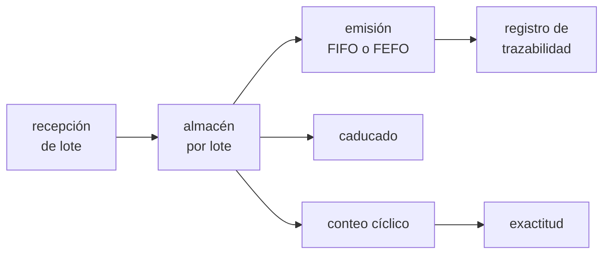

# B100-C01 — Gestión de inventario de materias primas y piezas

<!-- nav:top -->
[🏠 Programa](../../../../README.md) · [📚 Bloque B100](../../../tronco-comun/B100-logistica-y-cadena-de-suministro-extraterrestre.md) · [← Anterior: B99-C07 — Robustez del mapeo ante entornos degradados](../../../tronco-comun/B99-localizacion-y-mapeo-robotico.md#b99-c07) · [Siguiente: B100-C02 — Dimensionamiento de carga y volumen de misión →](../B100-C02-dimensionamiento-de-carga-y-volumen-de-mision/CLASE.md)
<!-- /nav -->

## 1. Ubicación, nivel y alcance

Clase 1 del bloque B100, nivel N3. En una instalación remota no se puede pedir una pieza «para mañana»: lo que hay en el almacén es lo que hay. Aquí llevas un inventario **por lotes** con trazabilidad, comparas las reglas de salida FIFO y FEFO y mides la exactitud del registro. Los datos son sintéticos y no describen ninguna instalación real. El cálculo de cuánto llevar es la clase [B100-C02](../B100-C02-dimensionamiento-de-carga-y-volumen-de-mision/CLASE.md); cuándo reponer, la [B100-C03](../B100-C03-gestion-de-inventarios-y-reposicion-de-suministros/CLASE.md).

## 2. Por qué esta clase existe

Un inventario que solo sabe «cuántas unidades hay» no puede decir de qué lote vienen, cuándo caducan ni dónde se usaron. La decisión central: **¿qué registro mínimo hace falta para emitir primero lo que caduca antes y para encontrar, si un lote resulta defectuoso, adónde fue?**

## 3. Lo que podrás hacer al terminar

1. Registrar recepciones, emisiones, caducidades y existencia por lote.
2. Comprobar la conservación `recibido = emitido + caducado + existencia`.
3. Comparar FIFO (primero en entrar) y FEFO (primero en caducar) y medir la diferencia de pérdidas.
4. Consultar la trazabilidad de un lote: emisiones, fechas y consumidores.
5. Calcular la exactitud del registro con un conteo cíclico.
6. Rotular qué datos son sintéticos y qué no se consultó.

La evidencia es la **registro de lotes con consulta de trazabilidad** del ejercicio 12 (sección 20).

## 4. Con qué llegas y cómo comprobarlo

1. ¿Qué es un lote?
2. ¿Qué es la vida útil?
3. ¿Qué es una ecuación de conservación?
4. ¿Qué es un dato sintético?
5. ¿Qué es una semilla fija?

<details>
<summary>Ver respuestas</summary>

1. Un conjunto de unidades producidas o recibidas juntas, con las mismas características y fecha. 2. El tiempo durante el cual una unidad conserva sus propiedades requeridas. 3. Una cuenta en la que lo que entra es igual a lo que sale más lo que queda. 4. Un dato generado para el ejemplo, no medido. 5. El valor inicial de un generador pseudoaleatorio que hace repetible el resultado.
</details>

Con cuatro o cinco aciertos, sigue; si no, repasa los prerrequisitos.

## 5. Un caso de contexto y casos de referencia

Una instalación sintética recibe cada 30 días un lote de 160 u de un material con vida útil limitada (90–150 d en los lotes pares y 30–60 d en los impares) y lo consume a razón de 2–6 u/d durante 365 d (demanda total 1449 u). Con FIFO caducan **324 u**; con FEFO, **164 u**. Es el **ejemplo conductor**. Todo es **sintético**: ninguna cifra describe una instalación real.

## 6. Vocabulario

Un **lote** es la unidad de trazabilidad. **FIFO** emite el lote recibido antes; **FEFO** emite el que caduca antes. **Caducado** es lo no emitido al vencer la vida útil del lote. La **trazabilidad** es la capacidad de reconstruir el historial de un lote. La **exactitud del registro** es la fracción de posiciones cuyo conteo físico coincide con el registro. Un **conteo cíclico** cuenta una parte del inventario cada vez.

## 7. Modelo mental: una biblioteca con fechas de devolución



*Descripción textual:* los lotes entran al almacén; salen por emisión (que queda registrada) o por caducidad; el conteo cíclico compara el registro con lo físico.

Analogía: una nevera compartida: sacas primero lo que vence antes, no lo que entró antes. Límite: aquí la caducidad es determinista; en un material real depende también de la temperatura (ver [B100-C04](../B100-C04-almacenamiento-remoto-y-depositos-de-suministros/CLASE.md)).

## 8. La explicación, paso a paso

### 8.1 Conservación

Con 13 lotes de 160 u se reciben `2080 u`. En FIFO: emitido `1449`, caducado `324`, existencia final `307`; `1449 + 324 + 307 = 2080`. En FEFO: `1449 + 164 + 467 = 2080`. La suma se comprueba en el laboratorio con una aserción de diferencia cero.

### 8.2 FIFO frente a FEFO

Cuando un lote posterior caduca antes que uno anterior, FIFO emite el antiguo (de larga vida) y deja vencer el nuevo. FEFO hace lo contrario. Caducan `324 u` (15,6 % de lo recibido) en FIFO y `164 u` (7,9 %) en FEFO: **160 u menos, un 49 % menos**. La demanda atendida es la misma (1449 u, faltante 0): la diferencia aparece como más existencia final (467 frente a 307 u). Si los lotes caducaran en el mismo orden en que llegan, ambas reglas darían lo mismo.

### 8.3 Trazabilidad

Cada emisión guarda `(día, lote, cantidad, consumidor)`. Para el lote L05 en FEFO hay 26 emisiones, 102 u, entre los días 199 y 262; por consumidor: C1 = 21, C2 = 21, C3 = 23, C4 = 15, C5 = 22 (suma 102). Si L05 resultara defectuoso, esta consulta dice a quién avisar.

### 8.4 Exactitud del registro

En un conteo sintético de 60 posiciones con 12 errores inyectados, coinciden 48: exactitud `48/60 = 80,0 %`; la diferencia absoluta total es 21 u (1,75 u por posición errónea). Una exactitud baja obliga a reconciliar antes de decidir reposiciones.

## 9. Magnitudes, símbolos y unidades

| Símbolo | Qué es | Unidad | Valor / nota |
|---|---|---|---|
| `Q_lote` | cantidad por lote | u | 160 (sintético) |
| `T_vida` | vida útil | d | 90–150 o 30–60 (sintético) |
| `d` | demanda diaria | u/d | 2–6 (sintética) |
| `E` | existencia final | u | 307 (FIFO); 467 (FEFO) |
| `K` | caducado | u | 324 (FIFO); 164 (FEFO) |
| `A` | exactitud del registro | — | 0,800 |

## 10. Convenciones y referencias

Tiempo en días enteros desde el día 0; unidades `u` sin dimensión física; semilla `20261110`; Python 3.12.9. Todos los datos son sintéticos. No se modelan costos ni ubicaciones.

## 11. De dónde sale lo que afirmamos

| ID | Fuente | Localizador | Respalda | Estado |
|---|---|---|---|---|
| — | Tasas de consumo, eficiencias, Δv de la red cislunar, energías de rodadura, tasas de degradación y masas de equipos | — | todos los números marcados como ilustrativos | No consultados; ilustrativos |
| — | Normas ECSS, manuales de gestión de inventarios y literatura de logística espacial | — | — | No consultados |

Límites: esta clase no se apoya en ninguna fuente consultada; las reglas FIFO/FEFO son prácticas estándar de gestión de existencias que el laboratorio verifica por conservación, y no se consultaron en un manual concreto.

## 12. Cómo ver el inventario

| Magnitud | Valor |
|---|---|
| recibido | 2080 u |
| caducado FIFO / FEFO | 324 u / 164 u |
| existencia final FIFO / FEFO | 307 u / 467 u |
| emisiones del lote L05 | 26 (102 u) |
| exactitud del registro | 80,0 % |

Descripción larga: FEFO reduce a la mitad lo caducado y la existencia final sube en la misma cantidad; la demanda atendida no cambia.

## 13. Ejemplo trabajado: la pérdida evitada por FEFO

**Paso 1 · Conservación en FIFO.** `2080 − 1449 − 324 = 307 u`.

**Paso 2 · Conservación en FEFO.** `2080 − 1449 − 164 = 467 u`.

**Paso 3 · Diferencia.** `324 − 164 = 160 u` menos de caducado; `467 − 307 = 160 u` más de existencia.

**Paso 4 · Porcentaje.** `160/324 = 49,4 %`.

## 14. Distintas formas de describir un inventario

**Por cantidades:** recibido, emitido, caducado, existencia. **Por lote:** identificador, fecha de recepción, fecha de caducidad. **Por flujo:** registro de emisiones. **Por calidad del dato:** exactitud del conteo.

## 15. Práctica guiada

**Ejercicio 1 · con los pasos indicados.** Comprueba la conservación en FIFO con `recibido = 2080`, `emitido = 1449` y `caducado = 324`. *Pasos:* resta y compara con la existencia.

<details><summary>Solución comentada</summary>

`2080 − 1449 − 324 = 307 u`, igual a la existencia final del laboratorio.
</details>

**Ejercicio 2 · con una pista.** ¿Cuánto menos caduca con FEFO, en porcentaje? *Pista:* `324` y `164`.

<details><summary>Solución comentada</summary>

`(324 − 164)/324 = 49,4 %`.
</details>

**Ejercicio 3 · casi autónomo.** ¿Qué exactitud hay si 48 de 60 posiciones coinciden?

<details><summary>Solución comentada</summary>

`48/60 = 0,80`: 80 %.
</details>

## 16. Práctica autónoma, transferencia e integrador

**Ejercicio 4 · autónomo.** Suma las emisiones por consumidor del lote L05.

<details><summary>Solución comentada</summary>

`21 + 21 + 23 + 15 + 22 = 102 u`, igual al total del lote emitido.
</details>

**Ejercicio 5 · autónomo.** ¿Qué fracción de lo recibido caduca en FIFO y en FEFO?

<details><summary>Solución comentada</summary>

`324/2080 = 15,6 %` y `164/2080 = 7,9 %`.
</details>

**Ejercicio 6 · autónomo.** Con 12 posiciones erróneas y 21 u de diferencia absoluta total, ¿cuál es el error medio por posición errónea?

<details><summary>Solución comentada</summary>

`21/12 = 1,75 u`.
</details>

**Ejercicio 7 · autónomo.** ¿Por qué la existencia final de FEFO supera a la de FIFO exactamente en 160 u?

<details><summary>Solución comentada</summary>

Por conservación: lo recibido y lo emitido son iguales; lo que no caduca queda en el almacén.
</details>

**Ejercicio 8 · autónomo.** Lista los campos mínimos que debe tener el registro de un lote.

<details><summary>Solución comentada</summary>

Identificador, cantidad, fecha de recepción, fecha de caducidad, ubicación y registro de emisiones con consumidor.
</details>

**Ejercicio 9 · transferencia.** Una pieza metálica no caduca. ¿Sirve FEFO para ella?

<details><summary>Solución comentada</summary>

No: se usa FIFO o una regla por criticidad o por número de serie; la caducidad no es el criterio.
</details>

**Ejercicio 10 · transferencia.** El conteo da 80 % de exactitud. ¿Reponer con ese registro es seguro?

<details><summary>Solución comentada</summary>

No sin conciliar: un registro con 20 % de posiciones erróneas desplaza los niveles de reposición; conviene contar más las posiciones críticas.
</details>

**Ejercicio 11 · transferencia.** Se omite el consumidor en las emisiones. ¿Qué se pierde si un lote resulta defectuoso?

<details><summary>Solución comentada</summary>

La trazabilidad: no se puede saber qué subsistemas recibieron material del lote.
</details>

**Ejercicio 12 · integrador.** Elabora tu *registro de lotes con consulta de trazabilidad*: tabla de recepciones, conservación FIFO y FEFO, trazabilidad de un lote y exactitud, con lo sintético rotulado.

<details><summary>Solución comentada</summary>

Secciones 8.1–8.4 y la salida del laboratorio.
</details>

## 17. Laboratorio: lotes, FIFO, FEFO y trazabilidad

El script [inventario.py](inventario.py) genera 13 lotes y la demanda diaria sintéticos, simula FIFO y FEFO, comprueba la conservación (**comprueba** diferencia 0 u), consulta la trazabilidad del lote L05 y calcula la exactitud de un conteo cíclico.

**Datos:** **sintéticos** (semilla 20261110); no se consultó ninguna fuente. **Predice antes de ejecutar:** ¿qué regla dejará más existencia final? (FEFO, porque caduca menos.) **Ejecución del 2026-11-10 (Python 3.12.9):**

```text
Python 3.12.9 (biblioteca estandar); semilla 20261110
Datos SINTETICOS: 13 lotes de 160 u; demanda total 1449 u en 365 d
FIFO: recibido 2080 u, emitido 1449 u, caducado 324 u, faltante 0 u, existencia final 307 u
FEFO: recibido 2080 u, emitido 1449 u, caducado 164 u, faltante 0 u, existencia final 467 u
Trazabilidad FEFO del lote L05: 26 emisiones, 102 u, del dia 199 al dia 262
  por consumidor: C1=21, C2=21, C3=23, C4=15, C5=22
Exactitud del registro (conteo ciclico sintetico): 80.0 % ; diferencia absoluta total 21 u
Pruebas superadas.
```

```bash
python programa/clases/B100/B100-C01-gestion-de-inventario-de-materias-primas-y-piezas/inventario.py
```

**Límites:** la caducidad es determinista y no hay costos, ubicaciones ni pedidos; la exactitud usa errores inyectados, no medidos.

## 18. Errores frecuentes y cómo corregirlos

**Contar solo unidades sin lote.** Se corrige con 8.3

**Creer que FEFO atiende más demanda.** Se corrige con 8.2: atiende la misma y caduca menos

**Dar por bueno un registro sin conteo.** Se corrige con 8.4

**Presentar los lotes sintéticos como una instalación real.** Se corrige con la sección 10

## 19. Cómo sabrás que vas bien

Tras la sección 8: ¿cuántas unidades esperabas que caducaran con FEFO y cuántas obtuviste? Si dudas, repasa el ejemplo 13. Tras el laboratorio: ¿qué comprueba? (ver la sección 17).

## 20. Qué entregas y cómo se evalúa

El producto es tu **registro de lotes con consulta de trazabilidad** (ejercicio 12).

| Criterio | Inicial | En desarrollo | Logrado | Destacado |
|---|---|---|---|---|
| Conceptos | Los confunde | Parciales | Aplica FIFO, FEFO y conservación | Explica los límites |
| Cálculo | Sin unidades | Con errores | Tablas completas con unidades | Calcula casos nuevos |
| Numérico | Sin comprobar | Un caso | Contraste con una segunda vía | Interpreta las diferencias |
| Fuentes | Sin fuente | Sin fecha | Fuentes con fecha y estado | Declara lo ilustrativo y lo no consultado |
| Límites | No los nombra | Uno | Tres | Discute qué falta del modelo |

**Condiciones críticas (no se compensan con promedio):** rotular los datos como sintéticos; no presentar el resultado como una instalación real; citar solo lo consultado (aquí, nada).

## 21. Ética, seguridad y límites

Clase educativa: los modelos son simplificados y sus datos son sintéticos o ilustrativos; ningún resultado describe una operación real ni sustituye a los requisitos de una misión, a los datos de proveedores ni a las normas de la agencia. Accesibilidad: tablas equivalentes a las gráficas, fórmulas en texto, ejercicios sin conexión.

## 22. Para cerrar y seguir

Con los mismos 2080 u recibidos, FEFO deja caducar `164 u` y FIFO `324 u`. Queda una pregunta: ¿cuánta carga hay que llevar para empezar?

**Glosario español–inglés.** lote · *lot*; caducidad · *expiry*; trazabilidad · *traceability*; conteo cíclico · *cycle count*; existencia · *stock on hand*.

**Continuidad.** [B100-C02](../B100-C02-dimensionamiento-de-carga-y-volumen-de-mision/CLASE.md) dimensiona la masa y el volumen de la carga.

**Referencias:** ver sección 11.

<!-- nav:bottom -->
---

[← Anterior: B99-C07 — Robustez del mapeo ante entornos degradados](../../../tronco-comun/B99-localizacion-y-mapeo-robotico.md#b99-c07) · [📚 Bloque B100](../../../tronco-comun/B100-logistica-y-cadena-de-suministro-extraterrestre.md) · [Siguiente: B100-C02 — Dimensionamiento de carga y volumen de misión →](../B100-C02-dimensionamiento-de-carga-y-volumen-de-mision/CLASE.md)
<!-- /nav -->
