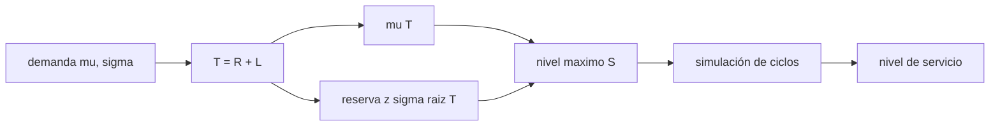

# B100-C03 — Gestión de inventarios y reposición de suministros

<!-- nav:top -->
[🏠 Programa](../../../../README.md) · [📚 Bloque B100](../../../tronco-comun/B100-logistica-y-cadena-de-suministro-extraterrestre.md) · [← Anterior: B100-C02 — Dimensionamiento de carga y volumen de misión](../B100-C02-dimensionamiento-de-carga-y-volumen-de-mision/CLASE.md) · [Siguiente: B100-C04 — Almacenamiento remoto y depósitos de suministros →](../B100-C04-almacenamiento-remoto-y-depositos-de-suministros/CLASE.md)
<!-- /nav -->

## 1. Ubicación, nivel y alcance

Clase 3 del bloque B100, nivel N3. Con la carga dimensionada ([B100-C02](../B100-C02-dimensionamiento-de-carga-y-volumen-de-mision/CLASE.md)) y el registro por lotes ([B100-C01](../B100-C01-gestion-de-inventario-de-materias-primas-y-piezas/CLASE.md)) falta decidir **cuándo y cuánto reponer** cuando el pedido tarda meses y solo hay una ventana de salida cada ~780 días. Calculas el nivel máximo y la reserva de seguridad de una política de revisión periódica y compruebas el nivel de servicio por simulación. La demanda es sintética.

## 2. Por qué esta clase existe

Con una reposición de 10 días basta una reserva pequeña; con una ventana sinódica de Marte la misma demanda exige guardar casi dos años y medio de consumo. La decisión central: **¿hasta qué nivel conviene reponer en cada ventana para que la probabilidad de quedarse sin existencias en el ciclo sea de un 5 %?**

## 3. Lo que podrás hacer al terminar

1. Calcular el intervalo de protección `T = R + L`.
2. Calcular el nivel máximo `S` y la reserva de seguridad `z σ √T`.
3. Obtener `z` a partir del nivel de servicio objetivo.
4. Comprobar el nivel de servicio por simulación con semilla fija.
5. Comparar una reposición terrestre y una con ventana sinódica.
6. Separar lo consultado (periodo sinódico) de lo sintético (demanda) y lo ilustrativo (demora).

La evidencia es la **política de reposición con nivel de servicio comprobado** del ejercicio 12 (sección 20).

## 4. Con qué llegas y cómo comprobarlo

1. ¿Qué es una desviación típica?
2. ¿Qué es un nivel de servicio?
3. ¿Qué es el periodo sinódico?
4. ¿Qué es una simulación con semilla fija?
5. ¿Qué es una distribución normal?

<details>
<summary>Ver respuestas</summary>

1. Una medida de dispersión, en las unidades del dato. 2. La probabilidad de no quedarse sin existencias durante un ciclo. 3. El tiempo entre dos alineaciones iguales de dos planetas respecto del Sol; para Marte y la Tierra, unos 780 días. 4. Una simulación estocástica repetible con el mismo resultado. 5. Una distribución simétrica con media y desviación típica.
</details>

Con cuatro o cinco aciertos, sigue; si no, repasa los prerrequisitos.

## 5. Un caso de contexto y casos de referencia

Un consumible con demanda sintética de media `10 u/d` y desviación `3 u/d`. Caso A: revisión cada 30 d, demora 10 d: `S = 431,2 u` con reserva `31,2 u`. Caso B: revisión cada 780 d (la ventana sinódica de Marte, 779,94 d consultados, redondeada), demora 180 d (ilustrativa): `S = 9752,9 u` con reserva `152,9 u`. Con 3000 ciclos simulados, el servicio es 94,27 % y 95,87 %. Es el **ejemplo conductor**; la demanda y las demoras son sintéticas o ilustrativas.

## 6. Vocabulario

El **intervalo de revisión** `R` es el tiempo entre pedidos; la **demora** `L` es el tiempo entre pedir y recibir; el **intervalo de protección** es `T = R + L`. El **nivel máximo** `S` es el nivel hasta el que se repone. La **reserva de seguridad** es `z σ √T`. El **nivel de servicio por ciclo** es la probabilidad de que la demanda en `T` no supere `S`. `z` es el cuantil de la normal estándar.

## 7. Modelo mental: llenar el tanque antes de un desierto



*Descripción textual:* de la demanda y del intervalo de protección salen la demanda media esperada y la reserva; su suma es el nivel máximo, que la simulación contrasta con el nivel de servicio objetivo.

Analogía: antes de cruzar un desierto llenas el tanque con el consumo esperado más un margen; cuanto más largo el tramo, más margen absoluto, pero crece con la raíz y no con el tramo. Límite: se supone demanda independiente día a día; una avería común rompe ese supuesto.

## 8. La explicación, paso a paso

### 8.1 Intervalo de protección

Caso A: `T = 30 + 10 = 40 d`; demanda media esperada `10 × 40 = 400 u`. Caso B: `T = 780 + 180 = 960 d`; `10 × 960 = 9600 u`.

### 8.2 Reserva de seguridad y nivel máximo

Para 95 %, `z = 1,6449`. Caso A: `z σ √T = 1,6449 × 3 × √40 = 31,2 u`, `S = 400 + 31,2 = 431,2 u`. Caso B: `1,6449 × 3 × √960 = 152,9 u`, `S = 9600 + 152,9 = 9752,9 u`. La reserva crece con `√T`: `152,9/31,2 = 4,90 = √(960/40)`; el nivel máximo crece casi con `T` (`22,6` veces).

### 8.3 Comprobación por simulación

Con 3000 ciclos sintéticos por caso (semilla 20261110) el servicio simulado es `94,27 %` (A) y `95,87 %` (B); el error estándar con 3000 ciclos es ≈ 0,4 puntos, y ambos están dentro de la tolerancia de 2 puntos. Sin reserva (`z = 0`), el servicio del caso B cae a `49,0 %`, como se espera de una mediana.

### 8.4 Qué manda la ventana

La demora tecnológica `L` (180 d) pesa menos que el intervalo de revisión `R` (780 d): la ventana fija casi todo el nivel máximo. Una reposición más corta que `R` no es posible entre ventanas, de modo que la mitigación es **adelantar existencias**, no acelerar el pedido. El tiempo de luz de ida a Marte (entre 182,1 s y 1338,9 s, calculado con las distancias mínima y máxima de la ficha) permite coordinar pedidos casi en el acto, pero no mueve la carga.

## 9. Magnitudes, símbolos y unidades

| Símbolo | Qué es | Unidad | Valor / nota |
|---|---|---|---|
| `μ` | demanda media | u/d | 10 (sintética) |
| `σ` | desviación diaria | u/d | 3 (sintética) |
| `R` | intervalo de revisión | d | 30; 780 |
| `L` | demora | d | 10; 180 (ilustrativas) |
| `z` | cuantil normal | — | 1,6449 (95 %) |
| `S` | nivel máximo | u | 431,2; 9752,9 |

## 10. Convenciones y referencias

Tiempo en días; cantidades en unidades `u`. Demanda diaria normal truncada en 0 (efecto despreciable con `μ/σ = 3,3`). Intervalos independientes; demora fija. Semilla `20261110`, 3000 ciclos por caso. 779,94 d se redondea a 780 d.

## 11. De dónde sale lo que afirmamos

| ID | Fuente | Localizador | Respalda | Estado |
|---|---|---|---|---|
| S2 | NASA/NSSDC, Mars Fact Sheet — https://nssdc.gsfc.nasa.gov/planetary/factsheet/marsfact.html (consultada 2026-11-10) | ficha completa leída | g media 3,73 m/s²; periodo sinódico 779,94 d; distancia a la Tierra entre 54,6 × 10⁶ y 401,4 × 10⁶ km; radio medio 3389,5 km | Consultada |
| — | Tasas de consumo, eficiencias, Δv de la red cislunar, energías de rodadura, tasas de degradación y masas de equipos | — | todos los números marcados como ilustrativos | No consultados; ilustrativos |
| — | Normas ECSS, manuales de gestión de inventarios y literatura de logística espacial | — | — | No consultados |

Límites: la demanda, la demora y el nivel de servicio objetivo son sintéticos o ilustrativos; no se consultó ninguna referencia de gestión de inventarios.

## 12. Cómo ver la política

| Magnitud | Valor |
|---|---|
| `S` caso A / B | 431,2 u / 9752,9 u |
| reserva A / B | 31,2 u / 152,9 u |
| servicio simulado A / B | 94,27 % / 95,87 % |
| reserva B/A | 4,90 = √24 |
| servicio B con `z = 0` | 49,0 % |

Descripción larga: el nivel máximo crece casi con el intervalo de protección y la reserva con su raíz cuadrada; sin reserva, el servicio es de una moneda al aire.

## 13. Ejemplo trabajado: el caso A

**Paso 1 · Intervalo.** `T = 30 + 10 = 40 d`.

**Paso 2 · Demanda esperada.** `10 × 40 = 400 u`.

**Paso 3 · Reserva.** `1,6449 × 3 × 6,3246 = 31,2 u`.

**Paso 4 · Nivel.** `S = 431,2 u`.

## 14. Distintas formas de describir una política de reposición

**Por parámetros:** `R`, `L`, `S`. **Por riesgo:** nivel de servicio y `z`. **Por stock:** media esperada y reserva. **Por verificación:** simulación frente a analítico.

## 15. Práctica guiada

**Ejercicio 1 · con los pasos indicados.** Calcula `T` y la demanda media del caso B. *Pasos:* suma `R + L` y multiplica por `μ`.

<details><summary>Solución comentada</summary>

`T = 960 d`; `10 × 960 = 9600 u`.
</details>

**Ejercicio 2 · con una pista.** Calcula la reserva de seguridad del caso A. *Pista:* `√40 = 6,3246`.

<details><summary>Solución comentada</summary>

`1,6449 × 3 × 6,3246 = 31,2 u`.
</details>

**Ejercicio 3 · casi autónomo.** Calcula `S` del caso A.

<details><summary>Solución comentada</summary>

`400 + 31,2 = 431,2 u`.
</details>

## 16. Práctica autónoma, transferencia e integrador

**Ejercicio 4 · autónomo.** Cociente entre las reservas de B y A.

<details><summary>Solución comentada</summary>

`152,9/31,2 = 4,90 = √24`.
</details>

**Ejercicio 5 · autónomo.** ¿Por qué el nivel máximo crece 22,6 veces y la reserva solo 4,9?

<details><summary>Solución comentada</summary>

El primero contiene `μ T` (lineal en `T`); la reserva crece con `√T`.
</details>

**Ejercicio 6 · autónomo.** Si `σ` sube a 6 u/d, ¿cuánto vale la reserva del caso A?

<details><summary>Solución comentada</summary>

Es lineal en `σ`: `2 × 31,2 = 62,4 u`.
</details>

**Ejercicio 7 · autónomo.** Servicio esperado con `z = 0`.

<details><summary>Solución comentada</summary>

50 %; el laboratorio da `49,0 %` por la variación muestral.
</details>

**Ejercicio 8 · autónomo.** Tiempo de luz de ida con la distancia mínima de 54,6 × 10⁶ km.

<details><summary>Solución comentada</summary>

`54,6 × 10⁹ m / 299 792 458 m/s = 182,1 s`.
</details>

**Ejercicio 9 · transferencia.** Una ventana se pierde por un fallo de lanzamiento. ¿Qué pasa con `R`?

<details><summary>Solución comentada</summary>

El siguiente pedido llega ~780 d después: el intervalo efectivo se duplica y la reserva calculada ya no cubre; hace falta un plan de contingencia.
</details>

**Ejercicio 10 · transferencia.** Se quiere 99 % de servicio en el caso B. ¿Cuánto sube la reserva?

<details><summary>Solución comentada</summary>

`z = 2,3263`: `2,3263 × 3 × √960 = 216,2 u`, un 41 % más que 152,9.
</details>

**Ejercicio 11 · transferencia.** Varias unidades fallan por la misma causa. ¿Qué supuesto se rompe?

<details><summary>Solución comentada</summary>

La independencia día a día: la varianza ya no escala con `T` y la reserva `z σ √T` subestima el riesgo.
</details>

**Ejercicio 12 · integrador.** Elabora tu *política de reposición con nivel de servicio comprobado*: `T`, `S` y reserva de los dos casos, servicio simulado y analítico, y rótulo de lo consultado, sintético e ilustrativo.

<details><summary>Solución comentada</summary>

Secciones 8.1–8.4 y la salida del laboratorio.
</details>

## 17. Laboratorio: reposición con ventana sinódica

El script [reposicion.py](reposicion.py) calcula `S` y la reserva de dos políticas, simula 3000 ciclos de cada una con demanda normal sintética y compara con el nivel de servicio objetivo (**comprueba** servicio dentro de 2 puntos y cociente de reservas `√(T_B/T_A)`).

**Datos:** periodo sinódico de Marte de la NASA/NSSDC (consultado); demanda **sintética**; demoras e intervalos de revisión **ilustrativos**. **Predice antes de ejecutar:** ¿cuál será el servicio sin reserva de seguridad? (Cerca de 50 %.) **Ejecución del 2026-11-10 (Python 3.12.9):**

```text
Python 3.12.9 (biblioteca estandar); semilla 20261110
Demanda SINTETICA mu = 10.0 u/d, sigma = 3.0 u/d ; z(95 %) = 1.6449
 caso   R [d]  L [d]   S [u]   reserva [u]   servicio simulado   servicio analitico
  A       30    10     431.2        31.2             94.27 %            95.00 %
  B      780   180    9752.9       152.9             95.87 %            95.00 %
Cociente de nivel maximo B/A = 22.62
Cociente de reserva de seguridad B/A = 4.90 ; sqrt de los intervalos = 4.90
Sin reserva de seguridad (z = 0) el servicio simulado cae a 49.0 %
Pruebas superadas.
```

```bash
python programa/clases/B100/B100-C03-gestion-de-inventarios-y-reposicion-de-suministros/reposicion.py
```

**Límites:** demanda normal e independiente, demora fija, un único consumible y sin costos; no es un plan de reposición real.

## 18. Errores frecuentes y cómo corregirlos

**Reponer solo hasta la demanda media.** Se corrige con 8.3: da ≈ 50 % de servicio

**Creer que la reserva crece linealmente con el intervalo.** Se corrige con 8.2

**Creer que acelerar el pedido resuelve la espera.** Se corrige con 8.4

**Presentar la demanda sintética como medida.** Se corrige con la sección 10

## 19. Cómo sabrás que vas bien

Tras la sección 8: ¿qué reserva esperabas para B y cuál obtuviste? Si dudas, repasa el ejemplo 13. Tras el laboratorio: ¿qué comprueba? (ver la sección 17).

## 20. Qué entregas y cómo se evalúa

El producto es tu **política de reposición con nivel de servicio comprobado** (ejercicio 12).

| Criterio | Inicial | En desarrollo | Logrado | Destacado |
|---|---|---|---|---|
| Conceptos | Los confunde | Parciales | Calcula `S`, reserva y servicio | Explica los límites |
| Cálculo | Sin unidades | Con errores | Tablas completas con unidades | Calcula casos nuevos |
| Numérico | Sin comprobar | Un caso | Contraste con una segunda vía | Interpreta las diferencias |
| Fuentes | Sin fuente | Sin fecha | Fuentes con fecha y estado | Declara lo ilustrativo y lo no consultado |
| Límites | No los nombra | Uno | Tres | Discute qué falta del modelo |

**Condiciones críticas (no se compensan con promedio):** rotular demanda, demoras y nivel de servicio como sintéticos o ilustrativos; no presentar el resultado como un plan de reposición real; citar solo lo consultado.

## 21. Ética, seguridad y límites

Clase educativa: los modelos son simplificados y sus datos son sintéticos o ilustrativos; ningún resultado describe una operación real ni sustituye a los requisitos de una misión, a los datos de proveedores ni a las normas de la agencia. Accesibilidad: tablas equivalentes a las gráficas, fórmulas en texto, ejercicios sin conexión.

## 22. Para cerrar y seguir

Con la misma demanda, la ventana sinódica pasa el nivel máximo de `431,2 u` a `9752,9 u`. Queda una pregunta: ¿qué ocurre con lo que se guarda tanto tiempo?

**Glosario español–inglés.** nivel máximo · *order-up-to level*; reserva de seguridad · *safety stock*; demora · *lead time*; nivel de servicio · *service level*; periodo sinódico · *synodic period*.

**Continuidad.** [B100-C04](../B100-C04-almacenamiento-remoto-y-depositos-de-suministros/CLASE.md) estudia la degradación de lo almacenado.

**Referencias:** ver sección 11.

<!-- nav:bottom -->
---

[← Anterior: B100-C02 — Dimensionamiento de carga y volumen de misión](../B100-C02-dimensionamiento-de-carga-y-volumen-de-mision/CLASE.md) · [📚 Bloque B100](../../../tronco-comun/B100-logistica-y-cadena-de-suministro-extraterrestre.md) · [Siguiente: B100-C04 — Almacenamiento remoto y depósitos de suministros →](../B100-C04-almacenamiento-remoto-y-depositos-de-suministros/CLASE.md)
<!-- /nav -->
