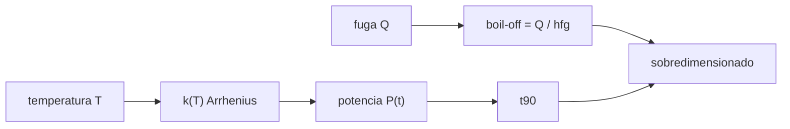

# B100-C04 — Almacenamiento remoto y depósitos de suministros

<!-- nav:top -->
[🏠 Programa](../../../../README.md) · [📚 Bloque B100](../../../tronco-comun/B100-logistica-y-cadena-de-suministro-extraterrestre.md) · [← Anterior: B100-C03 — Gestión de inventarios y reposición de suministros](../B100-C03-gestion-de-inventarios-y-reposicion-de-suministros/CLASE.md) · [Siguiente: B100-C05 — Transporte de carga sobre superficie planetaria →](../B100-C05-transporte-de-carga-sobre-superficie-planetaria/CLASE.md)
<!-- /nav -->

## 1. Ubicación, nivel y alcance

Clase 4 del bloque B100, nivel N3. Un depósito remoto guarda suministros durante meses o años y lo guardado se degrada o se evapora. Aquí estimas la vida útil de un suministro con degradación de primer orden que depende de la temperatura (Arrhenius) y la pérdida de un criógeno por fugas térmicas. Los alimentos y el soporte vital se tratan en [B106](../../../tronco-comun/B106-habitats-espaciales-y-soporte-vital.md); aquí el modelo es genérico y **ilustrativo**. Antecede a [B100-C03](../B100-C03-gestion-de-inventarios-y-reposicion-de-suministros/CLASE.md), que fija cuánto se guarda.

## 2. Por qué esta clase existe

Guardar más cantidad para cubrir una ventana larga solo sirve si lo guardado sigue siendo útil al final. La decisión central: **¿cuánto sobredimensionar un depósito para que, tras la espera, quede la cantidad útil necesaria, y qué temperatura de almacenamiento reduce esa pérdida?**

## 3. Lo que podrás hacer al terminar

1. Calcular la constante de degradación a una temperatura con la ecuación de Arrhenius.
2. Calcular la vida útil `t90` hasta un umbral del 90 %.
3. Verificar la solución exponencial con integración numérica.
4. Calcular la evaporación de un criógeno a partir de la fuga térmica y el calor latente.
5. Sobredimensionar un depósito para compensar las pérdidas.
6. Rotular las constantes ilustrativas y lo no consultado.

La evidencia es la **ficha de vida útil de un depósito** del ejercicio 12 (sección 20).

## 4. Con qué llegas y cómo comprobarlo

1. ¿Qué es una reacción de primer orden?
2. ¿Qué es la energía de activación?
3. ¿Qué es el calor latente de vaporización?
4. ¿Qué es un watt?
5. ¿Qué es una integración numérica de paso fijo?

<details>
<summary>Ver respuestas</summary>

1. Una en la que la velocidad es proporcional a la cantidad presente: `dP/dt = −kP`. 2. La barrera de energía de un proceso, en J/mol; fija cuánto depende `k` de la temperatura. 3. La energía por unidad de masa para pasar de líquido a vapor, en J/kg. 4. Un julio por segundo. 5. Avanzar la solución de una ecuación diferencial en pasos pequeños iguales.
</details>

Con cuatro o cinco aciertos, sigue; si no, repasa los prerrequisitos.

## 5. Un caso de contexto y casos de referencia

Un suministro ilustrativo con `k = 1,0 × 10⁻³ d⁻¹` a 293,15 K y `Ea = 80 kJ/mol` conserva el 90 % de su potencia durante `105,4 d` a 293,15 K, `700,8 d` a 277,15 K y solo `13,0 d` a 313,15 K. Un depósito de 5000 kg de oxígeno líquido (calor latente ilustrativo de 213 kJ/kg) con una fuga de 5 W pierde `365,1 kg` en 180 d (7,3 %); con 20 W, `1460,3 kg` (29,2 %). Es el **ejemplo conductor**. Todo es **ilustrativo**.

## 6. Vocabulario

La **constante de degradación** `k` (1/d) fija la velocidad de pérdida. La **ecuación de Arrhenius** da `k(T) = k_ref exp[−Ea/R (1/T − 1/T_ref)]`. La **vida útil `t90`** es el tiempo hasta el 90 % de la potencia inicial: `ln(1/0,9)/k`. La **evaporación** (*boil-off*) es la masa de criógeno que se vaporiza por el calor que entra: `ṁ = Q̇/h_fg`.

## 7. Modelo mental: un helado en el congelador y en la mesa



*Descripción textual:* la temperatura fija la constante de degradación y esta la vida útil; la fuga térmica fija la evaporación; ambas determinan cuánto hay que sobredimensionar.

Analogía: un helado dura años en el congelador y minutos al sol. Límite: se supone un único mecanismo de degradación con una `Ea` constante; los materiales reales tienen varios y distintos.

## 8. La explicación, paso a paso

### 8.1 Arrhenius

Con `R = 8,314462618 J/(mol·K)`: `k(T) = 10⁻³ × exp[−80000/8,3145 × (1/T − 1/293,15)]`. Resulta `k(277,15) = 1,503 × 10⁻⁴ d⁻¹`, `k(293,15) = 1,000 × 10⁻³ d⁻¹` y `k(313,15) = 8,136 × 10⁻³ d⁻¹`. Subir 10 K (de 293,15 a 303,15 K) multiplica `k` por `2,953`.

### 8.2 Vida útil

`t90 = ln(1/0,9)/k = 0,10536/k`: `700,8 d` (1,92 años) a 277,15 K; `105,4 d` (0,29 años) a 293,15 K; `13,0 d` a 313,15 K. Enfriar 16 K alarga la vida útil `6,65` veces.

### 8.3 Verificación numérica

Integrando `dP/dt = −kP` con paso de 0,01 d hasta 180 d a 293,15 K: `0,835261`; la solución analítica `exp(−0,18) = 0,835270`; diferencia relativa `1,09 × 10⁻⁵`, por debajo de la tolerancia de `10⁻⁴`.

### 8.4 Criógeno

`ṁ = 5 W/213 000 J/kg = 2,347 × 10⁻⁵ kg/s = 2,028 kg/d`; en 180 d, `365,1 kg` (7,3 % de 5000 kg). Con 20 W, cuatro veces más: `8,113 kg/d` y `1460,3 kg` (29,2 %). Si el depósito debe entregar `4000 kg` tras 180 d con 5 W, debe cargarse `4000 + 365,1 = 4365,1 kg` (modelo simple: la pérdida no depende del nivel de llenado).

## 9. Magnitudes, símbolos y unidades

| Símbolo | Qué es | Unidad | Valor / nota |
|---|---|---|---|
| `k` | constante de degradación | 1/d | 1,0 × 10⁻³ (ref., ilustrativa) |
| `Ea` | energía de activación | J/mol | 80 000 (ilustrativa) |
| `T` | temperatura | K | 277,15; 293,15; 313,15 |
| `t90` | vida útil al 90 % | d | 700,8; 105,4; 13,0 |
| `Q̇` | fuga térmica | W | 5; 20 (ilustrativas) |
| `h_fg` | calor latente | J/kg | 213 000 (ilustrativo) |

## 10. Convenciones y referencias

Temperaturas absolutas en K; tiempo en días; `R = 8,314462618 J/(mol·K)` (valor exacto del SI, no consultado en esta sesión). Degradación de primer orden con `Ea` constante; criógeno con fuga térmica constante y sin reliquefacción. Ninguna constante procede de una ficha de material.

## 11. De dónde sale lo que afirmamos

| ID | Fuente | Localizador | Respalda | Estado |
|---|---|---|---|---|
| — | Constantes exactas del SI (g₀ = 9,80665 m/s², c = 299 792 458 m/s, R = 8,314462618 J/(mol·K)) | — | valores que usa el laboratorio | No consultada en esta sesión |
| — | Tasas de consumo, eficiencias, Δv de la red cislunar, energías de rodadura, tasas de degradación y masas de equipos | — | todos los números marcados como ilustrativos | No consultados; ilustrativos |
| — | Normas ECSS, manuales de gestión de inventarios y literatura de logística espacial | — | — | No consultados |

Límites: la constante de degradación, `Ea`, la fuga térmica y el calor latente son ilustrativos y no se consultaron; el modelo no corresponde a ningún material ni tanque real.

## 12. Cómo ver el depósito

| Magnitud | Valor |
|---|---|
| `t90` a 277,15 / 293,15 / 313,15 K | 700,8 / 105,4 / 13,0 d |
| factor por +10 K | 2,953 |
| `P(180 d)` analítica / numérica | 0,835270 / 0,835261 |
| pérdida con 5 W en 180 d | 365,1 kg (7,3 %) |
| pérdida con 20 W en 180 d | 1460,3 kg (29,2 %) |

Descripción larga: la vida útil cae en forma exponencial al subir la temperatura, y la evaporación es proporcional a la fuga.

## 13. Ejemplo trabajado: la vida útil a 293,15 K

**Paso 1 · Constante.** `k = 1,0 × 10⁻³ d⁻¹` (referencia).

**Paso 2 · Logaritmo.** `ln(1/0,9) = 0,10536`.

**Paso 3 · Vida útil.** `t90 = 0,10536/0,001 = 105,4 d`.

**Paso 4 · Potencia a 180 d.** `P = exp(−0,001 × 180) = 0,8353`.

## 14. Distintas formas de describir un depósito

**Por temperatura:** `k(T)`. **Por tiempo:** `t90`. **Por pérdida de masa:** evaporación. **Por dimensionamiento:** carga inicial = entrega + pérdida.

## 15. Práctica guiada

**Ejercicio 1 · con los pasos indicados.** Calcula `t90` con `k = 10⁻³ d⁻¹`. *Pasos:* `ln(1/0,9)` y divide.

<details><summary>Solución comentada</summary>

`0,10536/0,001 = 105,4 d`.
</details>

**Ejercicio 2 · con una pista.** Calcula la potencia a 180 d con `k = 10⁻³ d⁻¹`. *Pista:* `exp(−kt)`.

<details><summary>Solución comentada</summary>

`exp(−0,18) = 0,8353`.
</details>

**Ejercicio 3 · casi autónomo.** Calcula `ṁ` para 5 W y 213 kJ/kg en kg/d. *Pasos:* W a kg/s y luego ×86 400.

<details><summary>Solución comentada</summary>

`5/213 000 × 86 400 = 2,028 kg/d`.
</details>

## 16. Práctica autónoma, transferencia e integrador

**Ejercicio 4 · autónomo.** Pérdida con 20 W en 180 d.

<details><summary>Solución comentada</summary>

`8,113 × 180 = 1460,3 kg`.
</details>

**Ejercicio 5 · autónomo.** ¿Qué masa queda de 5000 kg tras 180 d con 5 W?

<details><summary>Solución comentada</summary>

`5000 − 365,1 = 4634,9 kg`.
</details>

**Ejercicio 6 · autónomo.** Cociente `t90(277,15 K)/t90(293,15 K)`.

<details><summary>Solución comentada</summary>

`700,8/105,4 = 6,65`.
</details>

**Ejercicio 7 · autónomo.** ¿En cuántos días se vaciaría el depósito de 5000 kg con 5 W (modelo lineal)?

<details><summary>Solución comentada</summary>

`5000/2,028 ≈ 2465 d` (6,75 años).
</details>

**Ejercicio 8 · autónomo.** ¿Por qué `k` casi se octuplica de 293,15 a 313,15 K?

<details><summary>Solución comentada</summary>

Porque el exponente de Arrhenius es `−Ea/R (1/T − 1/T_ref)`: una variación de 20 K con `Ea = 80 kJ/mol` da `exp(2,09) ≈ 8,1`.
</details>

**Ejercicio 9 · transferencia.** Se debe entregar 4000 kg de criógeno tras 180 d con 5 W. ¿Cuánto cargar?

<details><summary>Solución comentada</summary>

`4000 + 365,1 = 4365,1 kg`, si la pérdida es constante.
</details>

**Ejercicio 10 · transferencia.** Refrigerar un suministro a 277,15 K exige energía. ¿Cómo decides si conviene?

<details><summary>Solución comentada</summary>

Compara el ahorro de masa por la mayor vida útil (menos sobredimensionado) con la masa y energía del refrigerador y con su fiabilidad.
</details>

**Ejercicio 11 · transferencia.** Un material tiene dos mecanismos de degradación con `Ea` distintas. ¿Qué falla en el modelo?

<details><summary>Solución comentada</summary>

Un único `Ea` no describe ambos: a bajas temperaturas domina el mecanismo de menor `Ea`, y `t90` a 277,15 K sería distinto.
</details>

**Ejercicio 12 · integrador.** Elabora tu *ficha de vida útil de un depósito*: tabla de `k` y `t90` a tres temperaturas, verificación numérica, pérdida del criógeno y sobredimensionado, con lo ilustrativo rotulado.

<details><summary>Solución comentada</summary>

Secciones 8.1–8.4 y la salida del laboratorio.
</details>

## 17. Laboratorio: degradación y evaporación de un depósito

El script [deposito.py](deposito.py) calcula `k` y `t90` a tres temperaturas con Arrhenius, integra numéricamente la degradación a 180 d y calcula la evaporación con dos fugas (**comprueba** diferencia relativa < 1e-4, orden de `t90` y relación 4:1 de pérdidas).

**Datos:** todas las constantes **ilustrativas**; `R` exacto del SI, no consultado. **Predice antes de ejecutar:** ¿qué pérdida tendrá 20 W comparada con 5 W? (Cuatro veces mayor.) **Ejecución del 2026-11-10 (Python 3.12.9):**

```text
Python 3.12.9 (biblioteca estandar)
Datos ILUSTRATIVOS: k_ref = 1.0e-3 1/d a 293.15 K, Ea = 80 kJ/mol, umbral 90 %
 T [K]    k [1/d]      t90 [d]   t90 [anios]
 277.15   1.503e-04      700.8        1.92
 293.15   1.000e-03      105.4        0.29
 313.15   8.136e-03       13.0        0.04
Factor por +10 K (293.15 -> 303.15): 2.953
Potencia a 180 d a 293.15 K: analitica 0.835270 ; numerica 0.835261 ; dif. relativa 1.09e-05
Evaporacion del criogeno (5000 kg, h_fg = 213 kJ/kg):
  fuga     5 W:  2.028 kg/d ; en 180 d   365.1 kg (7.3 % del total)
  fuga    20 W:  8.113 kg/d ; en 180 d  1460.3 kg (29.2 % del total)
Pruebas superadas.
```

```bash
python programa/clases/B100/B100-C04-almacenamiento-remoto-y-depositos-de-suministros/deposito.py
```

**Límites:** primer orden con una sola `Ea`; fuga constante, sin reliquefacción ni estratificación; sin material real.

## 18. Errores frecuentes y cómo corregirlos

**Usar grados Celsius en Arrhenius.** Se corrige con la sección 10: se usa K

**Creer que la vida útil cambia linealmente con la temperatura.** Se corrige con 8.1–8.2

**Olvidar la pérdida al dimensionar el depósito.** Se corrige con 8.4

**Presentar las constantes ilustrativas como de un material.** Se corrige con la sección 10

## 19. Cómo sabrás que vas bien

Tras la sección 8: ¿qué `t90` esperabas a 277,15 K y cuál obtuviste? Si dudas, repasa el ejemplo 13. Tras el laboratorio: ¿qué comprueba? (ver la sección 17).

## 20. Qué entregas y cómo se evalúa

El producto es tu **ficha de vida útil de un depósito** (ejercicio 12).

| Criterio | Inicial | En desarrollo | Logrado | Destacado |
|---|---|---|---|---|
| Conceptos | Los confunde | Parciales | Calcula `k(T)`, `t90` y pérdidas | Explica los límites |
| Cálculo | Sin unidades | Con errores | Tablas completas con unidades | Calcula casos nuevos |
| Numérico | Sin comprobar | Un caso | Contraste con una segunda vía | Interpreta las diferencias |
| Fuentes | Sin fuente | Sin fecha | Fuentes con fecha y estado | Declara lo ilustrativo y lo no consultado |
| Límites | No los nombra | Uno | Tres | Discute qué falta del modelo |

**Condiciones críticas (no se compensan con promedio):** rotular las constantes como ilustrativas; no presentar el resultado como la vida útil de un material real; citar solo lo consultado (aquí, nada).

## 21. Ética, seguridad y límites

Clase educativa: los modelos son simplificados y sus datos son sintéticos o ilustrativos; ningún resultado describe una operación real ni sustituye a los requisitos de una misión, a los datos de proveedores ni a las normas de la agencia. Accesibilidad: tablas equivalentes a las gráficas, fórmulas en texto, ejercicios sin conexión.

## 22. Para cerrar y seguir

Con las constantes ilustrativas, enfriar 16 K alarga la vida útil `6,65` veces, y una fuga de 5 W cuesta `365,1 kg` en 180 d. Queda una pregunta: ¿cómo se mueve la carga de un depósito a otro sobre la superficie?

**Glosario español–inglés.** constante de degradación · *degradation rate constant*; energía de activación · *activation energy*; vida útil · *shelf life*; evaporación de criógeno · *boil-off*; fuga térmica · *heat leak*.

**Continuidad.** [B100-C05](../B100-C05-transporte-de-carga-sobre-superficie-planetaria/CLASE.md) estudia el transporte de carga sobre una superficie.

**Referencias:** ver sección 11.

<!-- nav:bottom -->
---

[← Anterior: B100-C03 — Gestión de inventarios y reposición de suministros](../B100-C03-gestion-de-inventarios-y-reposicion-de-suministros/CLASE.md) · [📚 Bloque B100](../../../tronco-comun/B100-logistica-y-cadena-de-suministro-extraterrestre.md) · [Siguiente: B100-C05 — Transporte de carga sobre superficie planetaria →](../B100-C05-transporte-de-carga-sobre-superficie-planetaria/CLASE.md)
<!-- /nav -->
