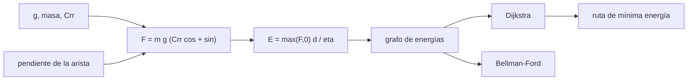

# B100-C05 — Transporte de carga sobre superficie planetaria

<!-- nav:top -->
[🏠 Programa](../../../../README.md) · [📚 Bloque B100](../../../tronco-comun/B100-logistica-y-cadena-de-suministro-extraterrestre.md) · [← Anterior: B100-C04 — Almacenamiento remoto y depósitos de suministros](../B100-C04-almacenamiento-remoto-y-depositos-de-suministros/CLASE.md) · [Siguiente: B100-C06 — Logística cislunar: nodos, depósitos y rutas de reabastecimiento →](../B100-C06-logistica-cislunar-nodos-depositos-y-rutas-de-reabastecimiento/CLASE.md)
<!-- /nav -->

## 1. Ubicación, nivel y alcance

Clase 5 del bloque B100, nivel N3. La carga que llega a un depósito ([B100-C04](../B100-C04-almacenamiento-remoto-y-depositos-de-suministros/CLASE.md)) hay que llevarla hasta donde se usa. Aquí calculas la energía de un vehículo de carga con resistencia a la rodadura y pendiente, el alcance con una batería y la ruta de mínima energía sobre un terreno sintético en la Luna y en Marte. La movilidad robótica y su autonomía se tratan en [B97](../../../tronco-comun/B97-robotica-y-construccion-extraterrestre.md); aquí el foco es la **energía por tonelada y kilómetro**. Los parámetros del vehículo son **ilustrativos**.

## 2. Por qué esta clase existe

Mover una tonelada un kilómetro cuesta energía, y esa energía depende de la gravedad, del suelo y de la pendiente. La decisión central: **¿cuánta carga y qué ruta permiten llegar con la batería disponible, y cuánto cambia el costo entre la Luna y Marte?**

## 3. Lo que podrás hacer al terminar

1. Calcular la fuerza de avance con rodadura y pendiente.
2. Calcular la energía por kilómetro y por tonelada transportada.
3. Calcular el alcance con una batería de energía específica dada.
4. Encontrar la ruta de mínima energía en una rejilla con Dijkstra y verificarla con Bellman–Ford.
5. Comparar la ruta de mínima energía con la de mínima distancia.
6. Rotular lo consultado (gravedades) y lo ilustrativo (vehículo, terreno).

La evidencia es la **ficha de transporte con ruta comparada** del ejercicio 12 (sección 20).

## 4. Con qué llegas y cómo comprobarlo

1. ¿Qué es el coeficiente de rodadura?
2. ¿Qué es la energía específica de una batería?
3. ¿Qué es una pendiente?
4. ¿Qué es un grafo de costos?
5. ¿Qué es un dato sintético?

<details>
<summary>Ver respuestas</summary>

1. La razón entre la fuerza de resistencia y el peso normal sobre el suelo. 2. La energía por unidad de masa, en Wh/kg. 3. El cociente entre desnivel y distancia horizontal. 4. Nodos y aristas con un costo por arista. 5. Un dato generado para el ejemplo, no medido.
</details>

Con cuatro o cinco aciertos, sigue; si no, repasa los prerrequisitos.

## 5. Un caso de contexto y casos de referencia

Un vehículo de 800 kg con 400 kg de carga (masa total 1200 kg), `Crr = 0,15` y eficiencia 0,60, gasta en llano `135,0 Wh/km` en la Luna (`g = 1,62 m/s²`), `310,8 Wh/km` en Marte (`3,73 m/s²`) y `817,2 Wh/km` con `g` terrestre estándar. Con 30 kWh de batería (200 kg a 150 Wh/kg) recorre `222,2 km` en la Luna y `96,5 km` en Marte. Sobre un terreno sintético de 16 × 16 celdas la ruta de mínima energía cuesta `0,3597 kWh` en la Luna. Es el **ejemplo conductor**. Todo es **ilustrativo** salvo las gravedades de la Luna y Marte.

## 6. Vocabulario

La **resistencia a la rodadura** es `F_r = Crr · m g cos θ`. La **fuerza de pendiente** es `m g sin θ`. La **fuerza de avance** es la suma, sin valores negativos (sin regeneración en este modelo). La **energía** de un tramo es `F d/η`, con `η` la eficiencia. El **alcance** es la energía de la batería dividida entre la energía por kilómetro. La **ruta de mínima energía** minimiza la suma de energías de las aristas, no la distancia.

## 7. Modelo mental: una carretilla cuesta arriba y cuesta abajo



*Descripción textual:* la gravedad, la masa y la pendiente de cada arista dan su fuerza y su energía; con esos costos, Dijkstra y Bellman–Ford encuentran la ruta de mínima energía y se comparan entre sí.

Analogía: empujas una carretilla: en llano solo pesa el roce; cuesta arriba, además el peso; cuesta abajo ayuda si la pendiente supera el roce. Límite: aquí no se recupera energía en bajada ni se modelan deslizamiento del suelo, polvo o límites de pendiente del vehículo.

## 8. La explicación, paso a paso

### 8.1 Energía en llano

`F = m g Crr = 1200 × 1,62 × 0,15 = 291,6 N` en la Luna. `E/km = 291,6 × 1000/0,60 = 4,86 × 10⁵ J = 135,0 Wh/km`, o `337,5 Wh/(t·km)` de carga (400 kg). En Marte: `1200 × 3,73 × 0,15 = 671,4 N`, `310,8 Wh/km` y `777,1 Wh/(t·km)`. La energía en llano es **proporcional a `g`**: `310,8/135,0 = 2,3025 = 3,73/1,62`.

### 8.2 Alcance

`E_bat = 200 kg × 150 Wh/kg = 30 kWh`. Luna: `30 000/135,0 = 222,2 km`; Marte: `96,5 km`; con `g` terrestre, `36,7 km`.

### 8.3 Pendiente

En una subida del 10 % (`θ = 5,71°`), `F = 1944 × (0,15 cos θ + sin θ) = 483,6 N` en la Luna: `223,9 Wh/km`, 1,66 veces el valor en llano. En una bajada del 10 %, `F = 96,7 N` sigue siendo positiva porque `tan θ = 0,10 < Crr = 0,15`; `44,8 Wh/km`. La fuerza se anula cuando `tan θ = Crr`, es decir `8,5°` de bajada.

### 8.4 Ruta de mínima energía

Terreno sintético de 16 × 16 celdas de 100 m (relieve de −104,4 a +107,1 m, semilla 20261110), de la esquina (0,0) a la (15,15) con 8 vecinos. Luna: la ruta de mínima energía cuesta `0,3597 kWh`; la de mínima distancia (`2162,6 m`) cuesta `0,3679 kWh`, un `2,28 %` más. Marte: `0,8282` frente a `0,8471 kWh` (el mismo 2,28 %). Bellman–Ford coincide con Dijkstra en `0,3597 kWh`. La energía de la ruta de la Luna es un 26 % mayor que la de recorrer su misma distancia en llano (`2,1626 km × 0,135 kWh/km = 0,292 kWh`). Como la gravedad multiplica todos los costos, la **ruta óptima no depende de `g`** en este modelo y el cociente Marte/Luna sigue siendo `2,3025`.

## 9. Magnitudes, símbolos y unidades

| Símbolo | Qué es | Unidad | Valor / nota |
|---|---|---|---|
| `g` | gravedad superficial | m/s² | 1,62 (Luna); 3,73 (Marte) |
| `m` | masa total | kg | 1200 (ilustrativa) |
| `Crr` | coef. de rodadura | — | 0,15 (ilustrativo) |
| `η` | eficiencia | — | 0,60 (ilustrativa) |
| `E_esp` | energía específica de la batería | Wh/kg | 150 (ilustrativa) |
| `E` | energía de transporte | Wh/km | 135,0; 310,8 |

## 10. Convenciones y referencias

Unidades SI; energía en J, Wh o kWh según se indica; gravedades medias de las fichas de la NASA/NSSDC; `g = 9,80665 m/s²` estándar para la Tierra (no consultado). Modelo cuasiestático, sin aceleración, sin regeneración, sin deslizamiento. Terreno sintético generado con semilla `20261110`.

## 11. De dónde sale lo que afirmamos

| ID | Fuente | Localizador | Respalda | Estado |
|---|---|---|---|---|
| S1 | NASA/NSSDC, Moon Fact Sheet — https://nssdc.gsfc.nasa.gov/planetary/factsheet/moonfact.html (consultada 2026-11-10) | ficha completa leída | g media 1,62 m/s²; distancia media Tierra–Luna 384 400 km; radio medio 1737,4 km; GM 4902 km³/s² (0,00490 × 10⁶ km³/s² en la ficha) | Consultada |
| S2 | NASA/NSSDC, Mars Fact Sheet — https://nssdc.gsfc.nasa.gov/planetary/factsheet/marsfact.html (consultada 2026-11-10) | ficha completa leída | g media 3,73 m/s²; periodo sinódico 779,94 d; distancia a la Tierra entre 54,6 × 10⁶ y 401,4 × 10⁶ km; radio medio 3389,5 km | Consultada |
| — | Constantes exactas del SI (g₀ = 9,80665 m/s², c = 299 792 458 m/s, R = 8,314462618 J/(mol·K)) | — | valores que usa el laboratorio | No consultada en esta sesión |
| — | Tasas de consumo, eficiencias, Δv de la red cislunar, energías de rodadura, tasas de degradación y masas de equipos | — | todos los números marcados como ilustrativos | No consultados; ilustrativos |

Límites: el vehículo, `Crr`, la eficiencia, la batería y el terreno no se consultaron; el terreno no es de la Luna ni de Marte; no se evalúa ninguna ruta real.

## 12. Cómo ver el transporte

| Magnitud | Valor |
|---|---|
| energía en llano Luna / Marte | 135,0 / 310,8 Wh/km |
| alcance Luna / Marte | 222,2 / 96,5 km |
| ruta mínima energía (Luna) | 0,3597 kWh |
| ruta mínima distancia (Luna) | 0,3679 kWh (+2,28 %) |
| cociente Marte/Luna | 2,3025 = 3,73/1,62 |

Descripción larga: la energía de transporte escala con la gravedad y la ruta óptima cambia poco respecto de la más corta en este terreno.

## 13. Ejemplo trabajado: el alcance en Marte

**Paso 1 · Fuerza.** `1200 × 3,73 × 0,15 = 671,4 N`.

**Paso 2 · Energía por km.** `671,4 × 1000/0,60 = 1,119 × 10⁶ J = 310,8 Wh`.

**Paso 3 · Batería.** `200 × 150 = 30 000 Wh`.

**Paso 4 · Alcance.** `30 000/310,8 = 96,5 km`.

## 14. Distintas formas de describir el transporte de carga

**Por fuerza:** rodadura y pendiente. **Por energía:** Wh/km y Wh/(t·km). **Por alcance:** km con una batería. **Por ruta:** mínima distancia o mínima energía.

## 15. Práctica guiada

**Ejercicio 1 · con los pasos indicados.** Calcula la fuerza de rodadura en llano en la Luna para 1200 kg. *Pasos:* `m g Crr`.

<details><summary>Solución comentada</summary>

`1200 × 1,62 × 0,15 = 291,6 N`.
</details>

**Ejercicio 2 · con una pista.** Convierte esa fuerza en energía por km con `η = 0,60`. *Pista:* 1 Wh = 3600 J.

<details><summary>Solución comentada</summary>

`291,6 × 1000/0,60/3600 = 135,0 Wh/km`.
</details>

**Ejercicio 3 · casi autónomo.** Calcula el alcance en la Luna con 30 kWh.

<details><summary>Solución comentada</summary>

`30 000/135,0 = 222,2 km`.
</details>

## 16. Práctica autónoma, transferencia e integrador

**Ejercicio 4 · autónomo.** Energía en llano por km en Marte.

<details><summary>Solución comentada</summary>

`1200 × 3,73 × 0,15/0,60 × 1000/3600 = 310,8 Wh/km`.
</details>

**Ejercicio 5 · autónomo.** Alcance en Marte.

<details><summary>Solución comentada</summary>

`30 000/310,8 = 96,5 km`.
</details>

**Ejercicio 6 · autónomo.** Energía por km en una subida del 10 % en la Luna.

<details><summary>Solución comentada</summary>

`F = 483,6 N` y `223,9 Wh/km` (sección 8.3).
</details>

**Ejercicio 7 · autónomo.** ¿A qué pendiente de bajada se anula la fuerza de avance?

<details><summary>Solución comentada</summary>

`tan θ = Crr = 0,15`: `θ = 8,5°`.
</details>

**Ejercicio 8 · autónomo.** ¿Por qué el cociente de energías Marte/Luna es 2,3025 en llano y en la ruta?

<details><summary>Solución comentada</summary>

Porque `g` multiplica todos los términos de la fuerza: la energía es proporcional a `g` y la ruta óptima no cambia.
</details>

**Ejercicio 9 · transferencia.** Se cargan 800 kg más (masa total 2000 kg). ¿Cómo cambia el alcance?

<details><summary>Solución comentada</summary>

La energía es proporcional a la masa: el alcance baja en `1200/2000 = 0,6` (suponiendo la misma batería): `133,3 km` en la Luna.
</details>

**Ejercicio 10 · transferencia.** En bajadas de más de 8,5° el vehículo debe frenar. ¿Qué no modela esta clase?

<details><summary>Solución comentada</summary>

La regeneración de energía y la disipación del frenado, y el límite de pendiente seguro.
</details>

**Ejercicio 11 · transferencia.** En el terreno sintético la ruta de mínima energía es solo 2,28 % más barata. ¿Se puede generalizar?

<details><summary>Solución comentada</summary>

No: depende del relieve; en un terreno más abrupto la diferencia puede ser mayor, y el terreno de esta clase es sintético.
</details>

**Ejercicio 12 · integrador.** Elabora tu *ficha de transporte con ruta comparada*: energía y alcance en dos cuerpos, la ruta de mínima energía frente a la de mínima distancia, la verificación con Bellman–Ford y el rótulo de lo consultado e ilustrativo.

<details><summary>Solución comentada</summary>

Secciones 8.1–8.4 y la salida del laboratorio.
</details>

## 17. Laboratorio: energía y ruta de carga en la Luna y en Marte

El script [transporte.py](transporte.py) calcula la energía de llano y el alcance en tres cuerpos y busca la ruta de mínima energía y la de mínima distancia sobre un terreno sintético (**comprueba** igualdad Dijkstra–Bellman–Ford a 1e-9 y proporcionalidad con `g`).

**Datos:** gravedades de la Luna y Marte (NASA/NSSDC, consultadas); vehículo, `Crr`, eficiencia, batería y terreno **ilustrativos o sintéticos**. **Predice antes de ejecutar:** ¿tendrá la ruta de mínima energía distinta forma en Marte que en la Luna? (No: es la misma, solo cambia la escala.) **Ejecución del 2026-11-10 (Python 3.12.9):**

```text
Python 3.12.9 (biblioteca estandar); semilla 20261110
Datos ILUSTRATIVOS: masas, Crr = 0.15, eta = 0.60, 150 Wh/kg, bateria 200 kg; terreno SINTETICO 16 x 16 de 100 m
 cuerpo   g [m/s2]   E llano [Wh/km]   E llano [Wh/(t km)]   alcance llano [km]
Tierra    9.80665           817.2              2043.1               36.7
Luna      1.62000           135.0               337.5              222.2
Marte     3.73000           310.8               777.1               96.5
Relieve sintetico: minimo -104.4 m, maximo 107.1 m
Luna: ruta de minima energia 0.3597 kWh ; ruta de minima distancia (2162.6 m) cuesta 0.3679 kWh (2.28 % mas)
Marte: ruta de minima energia 0.8282 kWh ; ruta de minima distancia (2162.6 m) cuesta 0.8471 kWh (2.28 % mas)
Bellman-Ford (Luna): 0.3597 kWh ; Dijkstra: 0.3597 kWh
Cociente de energia Marte/Luna en la ruta = 2.3025 ; g_M/g_L = 2.3025
Pruebas superadas.
```

```bash
python programa/clases/B100/B100-C05-transporte-de-carga-sobre-superficie-planetaria/transporte.py
```

**Límites:** modelo cuasiestático, sin regeneración, con `Crr` constante; el terreno es una suma de senos y no un modelo digital de elevación real.

## 18. Errores frecuentes y cómo corregirlos

**Usar la gravedad terrestre en la Luna o Marte.** Se corrige con 8.1

**Creer que la ruta más corta es siempre la de menor energía.** Se corrige con 8.4

**Contar energía negativa en bajadas.** Se corrige con 8.3

**Presentar el terreno sintético como real.** Se corrige con la sección 10

## 19. Cómo sabrás que vas bien

Tras la sección 8: ¿qué alcance esperabas en Marte y cuál obtuviste? Si dudas, repasa el ejemplo 13. Tras el laboratorio: ¿qué comprueba? (ver la sección 17).

## 20. Qué entregas y cómo se evalúa

El producto es tu **ficha de transporte con ruta comparada** (ejercicio 12).

| Criterio | Inicial | En desarrollo | Logrado | Destacado |
|---|---|---|---|---|
| Conceptos | Los confunde | Parciales | Calcula energía, alcance y ruta | Explica los límites |
| Cálculo | Sin unidades | Con errores | Tablas completas con unidades | Calcula casos nuevos |
| Numérico | Sin comprobar | Un caso | Contraste con una segunda vía | Interpreta las diferencias |
| Fuentes | Sin fuente | Sin fecha | Fuentes con fecha y estado | Declara lo ilustrativo y lo no consultado |
| Límites | No los nombra | Uno | Tres | Discute qué falta del modelo |

**Condiciones críticas (no se compensan con promedio):** rotular el vehículo y el terreno como ilustrativo y sintético; no presentar la ruta como una ruta real; citar solo lo consultado.

## 21. Ética, seguridad y límites

Clase educativa: los modelos son simplificados y sus datos son sintéticos o ilustrativos; ningún resultado describe una operación real ni sustituye a los requisitos de una misión, a los datos de proveedores ni a las normas de la agencia. Accesibilidad: tablas equivalentes a las gráficas, fórmulas en texto, ejercicios sin conexión.

## 22. Para cerrar y seguir

Con la gravedad de Marte el mismo vehículo gasta `310,8 Wh/km` y llega a `96,5 km`, frente a `222,2 km` en la Luna. Queda una pregunta: ¿cómo llegan la carga y el propelente hasta la órbita lunar?

**Glosario español–inglés.** resistencia a la rodadura · *rolling resistance*; alcance · *range*; ruta de mínima energía · *minimum-energy path*; energía específica · *specific energy*; eficiencia · *efficiency*.

**Continuidad.** [B100-C06](../B100-C06-logistica-cislunar-nodos-depositos-y-rutas-de-reabastecimiento/CLASE.md) trata la red logística cislunar.

**Referencias:** ver sección 11.

<!-- nav:bottom -->
---

[← Anterior: B100-C04 — Almacenamiento remoto y depósitos de suministros](../B100-C04-almacenamiento-remoto-y-depositos-de-suministros/CLASE.md) · [📚 Bloque B100](../../../tronco-comun/B100-logistica-y-cadena-de-suministro-extraterrestre.md) · [Siguiente: B100-C06 — Logística cislunar: nodos, depósitos y rutas de reabastecimiento →](../B100-C06-logistica-cislunar-nodos-depositos-y-rutas-de-reabastecimiento/CLASE.md)
<!-- /nav -->
