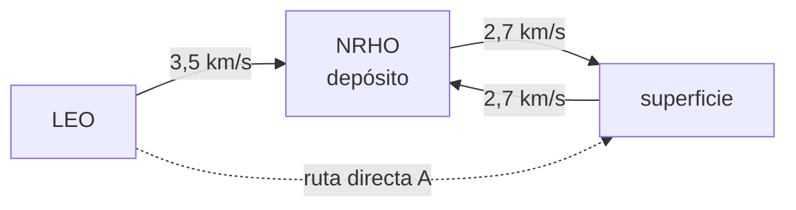

# B100-C06 — Logística cislunar: nodos, depósitos y rutas de reabastecimiento

<!-- nav:top -->
[🏠 Programa](../../../../README.md) · [📚 Bloque B100](../../../tronco-comun/B100-logistica-y-cadena-de-suministro-extraterrestre.md) · [← Anterior: B100-C05 — Transporte de carga sobre superficie planetaria](../B100-C05-transporte-de-carga-sobre-superficie-planetaria/CLASE.md) · [Siguiente: B100-C07 — Dependencia de suministros terrestres y cierre de lazos logísticos →](../B100-C07-dependencia-de-suministros-terrestres-y-cierre-de-lazos-logisticos/CLASE.md)
<!-- /nav -->

## 1. Ubicación, nivel y alcance

Clase 6 del bloque B100, nivel N3. La dinámica de las órbitas cislunares se enseña en [B76](../../../tronco-comun/B76-dinamica-cislunar-y-operaciones-de-proximidad.md); aquí se trata la **red logística** que la usa: nodos (órbita baja, órbita de halo casi rectilínea, superficie), tramos con su Δv y un depósito de reabastecimiento. Aplicas la ecuación ideal del cohete de [B100-C02](../B100-C02-dimensionamiento-de-carga-y-volumen-de-mision/CLASE.md) a cada tramo y comparas una ruta directa con otra con depósito. Los Δv y las masas son **ilustrativos**.

## 2. Por qué esta clase existe

Un depósito en órbita lunar parece una ventaja obvia, pero solo lo es si el propelente llega al depósito de una forma más barata que llevarlo directamente. La decisión central: **¿con qué transporte y con cuántos viajes del aterrizador reutilizable un depósito reduce la masa que hay que lanzar desde órbita baja?**

## 3. Lo que podrás hacer al terminar

1. Describir la red como nodos y tramos con Δv.
2. Aplicar la ecuación del cohete a cada tramo con fracción estructural.
3. Calcular el propelente de un aterrizador reutilizable (bajada con carga, subida vacío).
4. Comparar la ruta directa con la ruta con depósito.
5. Calcular el punto de equilibrio en número de viajes.
6. Rotular lo consultado (distancia Tierra–Luna, NRHO, ecuación) y lo ilustrativo (Δv, Isp, masas).

La evidencia es la **comparación de rutas con y sin depósito** del ejercicio 12 (sección 20).

## 4. Con qué llegas y cómo comprobarlo

1. ¿Qué es la ecuación ideal del cohete?
2. ¿Qué es una órbita de halo casi rectilínea (NRHO)?
3. ¿Qué es un nodo logístico?
4. ¿Qué es una etapa desechable?
5. ¿Qué es una razón de masas?

<details>
<summary>Ver respuestas</summary>

1. `Δv = ve ln(m₀/m_f)` (consultada en NASA Glenn). 2. La órbita cislunar que, según la página de la NASA consultada, usa Gateway; aquí no se calculan sus parámetros. 3. Un lugar donde se reciben, guardan o transfieren cargas y propelente. 4. Una etapa que no se reutiliza. 5. El cociente entre la masa inicial y la final de una maniobra.
</details>

Con cuatro o cinco aciertos, sigue; si no, repasa los prerrequisitos.

## 5. Un caso de contexto y casos de referencia

Entregar 1000 kg a la superficie lunar con etapas desechables exige `5063,7 kg` en órbita baja (razón `5,064`). Con un aterrizador reutilizable de 500 kg secos desde un depósito en NRHO hacen falta `2043,6 kg` de propelente por viaje; si la carga y el propelente suben desde órbita baja con etapas químicas, la razón empeora a `7,779`; con un remolcador eléctrico ilustrativo baja a `4,729` con 10 viajes y supera a la ruta directa desde el viaje 2. Es el **ejemplo conductor**. Todo es **ilustrativo**: ninguna cifra describe una arquitectura real.

## 6. Vocabulario

Un **nodo** es un punto de la red (LEO, NRHO, superficie). Un **tramo** es un arco entre nodos con un Δv. Un **depósito** guarda propelente en un nodo. Un **aterrizador reutilizable** baja y sube entre dos nodos con propelente del depósito. El **remolcador eléctrico** transporta con un Isp alto y un Δv mayor por la espiral. La **razón LEO/carga** es la masa que sale de órbita baja por cada kilogramo entregado.

## 7. Modelo mental: una red de almacenes con un transbordador



*Descripción textual:* tres nodos con tramos de Δv ilustrativo: de órbita baja a NRHO, de NRHO a la superficie y de vuelta; la ruta directa A usa etapas desechables, la B un aterrizador reutilizable abastecido desde el depósito.

Analogía: una cadena de tiendas: un almacén intermedio solo abarata si el camión que lo llena es más barato por kilo que el que iría directo. Límite: se ignora el tiempo de tránsito, que con un remolcador eléctrico es de meses.

## 8. La explicación, paso a paso

### 8.1 Ecuación por tramo

`ve = 450 × 9,80665 = 4413,0 m/s`. Para cada etapa: `r = exp(Δv/ve)`, `m_f = carga/(1 − ε(r − 1))`, `m₀ = r m_f`, con `ε = 0,10`. Para la bajada de NRHO a la superficie (2,7 km/s): `r = 1,844`, `m₀ = 2013,7 kg` para 1000 kg. Para llevar eso desde órbita baja a NRHO (3,5 km/s): `5063,7 kg`. Razón `5,064` (ruta A).

### 8.2 Aterrizador reutilizable

Con 500 kg secos, la subida vacía necesita `500 × (e^{0,612} − 1) = 421,9 kg` de propelente; la bajada con 1000 kg de carga y esa reserva necesita en total `2043,6 kg` de propelente por viaje. Ese propelente, más la carga, hay que subirlo a NRHO.

### 8.3 Con transporte químico

Si todo sube con etapas químicas: `m_LEO = m₀(carga + propelente) + m₀(500 kg)/10 = 7779,2 kg`, razón `7,779`: **peor** que la ruta directa (+53,6 %), porque se transporta propelente de subida que la ruta A no necesita.

### 8.4 Con remolcador eléctrico (ilustrativo)

Con `Isp = 1800 s`, `ε = 0,20` y Δv de 6,0 km/s para la espiral: para 1 viaje `5416,7 kg` (razón `5,417`); 3 viajes `4907,1`; 5 viajes `4805,2`; 10 viajes `4728,8` (razón `4,729`, 6,6 % menos que A); 20 viajes `4690,6`. El aterrizador compensa desde el segundo viaje. La ganancia procede de transportar la masa pesada con un Isp mucho mayor, a costa de tiempo. Segunda vía: con `ε = 0`, `exp(3,5/4,413) × exp(2,7/4,413) = 4,075292`, igual al tramo único de 6,2 km/s. El retardo de luz Tierra–Luna (384 400 km) es `1,2822 s`: la coordinación no es el límite, la masa sí.

## 9. Magnitudes, símbolos y unidades

| Símbolo | Qué es | Unidad | Valor / nota |
|---|---|---|---|
| `Δv` | cambio de velocidad | m/s | 3500; 2700; 2700 (ilustrativos) |
| `Isp` | impulso específico | s | 450 (químico); 1800 (eléctrico, ilustrativo) |
| `ε` | fracción estructural | — | 0,10; 0,20 |
| `m_seca` | masa seca del aterrizador | kg | 500 (ilustrativa) |
| `m_LEO` | masa lanzada de LEO | kg | 5063,7; 7779,2; 4728,8 |
| `d_TL` | distancia Tierra–Luna | km | 384 400 |

## 10. Convenciones y referencias

Δv en m/s; masas en kg; `g₀ = 9,80665 m/s²` y `c = 299 792 458 m/s` (valores exactos del SI, no consultados). Nodos: LEO, NRHO (órbita casi rectilínea de halo), superficie. Modelo de etapa de la clase C02. Sin pérdidas por gravedad más allá de las incluidas en el Δv ilustrativo, sin tiempo de tránsito, sin evaporación del depósito, sin retorno de carga.

## 11. De dónde sale lo que afirmamos

| ID | Fuente | Localizador | Respalda | Estado |
|---|---|---|---|---|
| S1 | NASA/NSSDC, Moon Fact Sheet — https://nssdc.gsfc.nasa.gov/planetary/factsheet/moonfact.html (consultada 2026-11-10) | ficha completa leída | g media 1,62 m/s²; distancia media Tierra–Luna 384 400 km; radio medio 1737,4 km; GM 4902 km³/s² (0,00490 × 10⁶ km³/s² en la ficha) | Consultada |
| S3 | NASA Glenn, Ideal Rocket Equation — https://www1.grc.nasa.gov/beginners-guide-to-aeronautics/ideal-rocket-equation/ (consultada 2026-11-10) | página completa | Δu = V_eq ln(m_f/m_e) (m_f: masa inicial; m_e: masa final vacía) | Consultada |
| S4 | NASA, Gateway — https://www.nasa.gov/mission/gateway/ (consultada 2026-11-10) | página completa | Gateway usa una órbita casi rectilínea de halo (NRHO); módulo HALO («Habitation and Logistics Outpost»); no da periodo ni distancias | Consultada |
| — | Constantes exactas del SI (g₀ = 9,80665 m/s², c = 299 792 458 m/s, R = 8,314462618 J/(mol·K)) | — | valores que usa el laboratorio | No consultada en esta sesión |
| — | Tasas de consumo, eficiencias, Δv de la red cislunar, energías de rodadura, tasas de degradación y masas de equipos | — | todos los números marcados como ilustrativos | No consultados; ilustrativos |
| — | Normas ECSS, manuales de gestión de inventarios y literatura de logística espacial | — | — | No consultados |

Límites: los Δv, el Isp, las fracciones estructurales y las masas no se consultaron; la página de Gateway no da periodo ni distancias de la NRHO; ninguna arquitectura logística real se evalúa aquí.

## 12. Cómo ver la red

| Magnitud | Valor |
|---|---|
| razón LEO/carga, ruta A | 5,064 |
| ruta B con transporte químico (10 viajes) | 7,779 |
| ruta B con remolcador (1 / 10 / 20 viajes) | 5,417 / 4,729 / 4,691 |
| viajes para superar a A (remolcador) | 2 |
| retardo de luz Tierra–Luna | 1,2822 s |

Descripción larga: el depósito solo ayuda si el transporte hasta él es más eficiente; con un transporte químico empeora y con uno eléctrico mejora tras el segundo viaje.

## 13. Ejemplo trabajado: la bajada a la superficie

**Paso 1 · Razón.** `r = exp(2700/4413) = 1,844`.

**Paso 2 · Etapa.** `m_f = 1000/(1 − 0,1 × 0,844) = 1092,2 kg`.

**Paso 3 · Masa inicial.** `m₀ = 1,844 × 1092,2 = 2013,7 kg`.

**Paso 4 · A LEO.** Con 3,5 km/s, `5063,7 kg`.

## 14. Distintas formas de describir una red logística

**Por nodos y tramos:** LEO, NRHO, superficie y sus Δv. **Por masa lanzada:** razón LEO/carga. **Por reutilización:** viajes del aterrizador. **Por tecnología de transporte:** química o eléctrica.

## 15. Práctica guiada

**Ejercicio 1 · con los pasos indicados.** Calcula `ve` para `Isp = 450 s`. *Pasos:* `Isp × g₀`.

<details><summary>Solución comentada</summary>

`450 × 9,80665 = 4413,0 m/s`.
</details>

**Ejercicio 2 · con una pista.** Calcula el retardo de luz Tierra–Luna. *Pista:* distancia 384 400 km.

<details><summary>Solución comentada</summary>

`384 400 000/299 792 458 = 1,2822 s`.
</details>

**Ejercicio 3 · casi autónomo.** Calcula la razón `r` para la bajada de 2,7 km/s. *Pasos:* `exp(Δv/ve)`.

<details><summary>Solución comentada</summary>

`exp(0,6118) = 1,844`.
</details>

## 16. Práctica autónoma, transferencia e integrador

**Ejercicio 4 · autónomo.** Razón LEO/carga de la ruta A.

<details><summary>Solución comentada</summary>

`5063,7/1000 = 5,064`.
</details>

**Ejercicio 5 · autónomo.** ¿Cuánto peor es la ruta B química frente a A?

<details><summary>Solución comentada</summary>

`7779,2/5063,7 = 1,536`: un 53,6 % más.
</details>

**Ejercicio 6 · autónomo.** ¿Cuánto mejor es B con remolcador y 10 viajes frente a A?

<details><summary>Solución comentada</summary>

`1 − 4728,8/5063,7 = 6,6 %` menos masa lanzada.
</details>

**Ejercicio 7 · autónomo.** Propelente de subida vacío de un aterrizador de 500 kg secos para 2,7 km/s.

<details><summary>Solución comentada</summary>

`500 × (1,844 − 1) = 421,9 kg`.
</details>

**Ejercicio 8 · autónomo.** Producto de factores con `ε = 0` de 3,5 y 2,7 km/s.

<details><summary>Solución comentada</summary>

`exp(0,7931) × exp(0,6118) = 2,2105 × 1,8437 = 4,075`.
</details>

**Ejercicio 9 · transferencia.** ¿Por qué con transporte químico el depósito empeora la masa lanzada?

<details><summary>Solución comentada</summary>

Porque hay que subir también el propelente de la subida y se paga la ecuación del cohete sobre él en un tramo de Isp bajo.
</details>

**Ejercicio 10 · transferencia.** El remolcador eléctrico tarda meses. ¿Qué no ve la comparación de masas?

<details><summary>Solución comentada</summary>

El tiempo de tránsito, la exposición a radiación, el costo del capital inmovilizado y la disponibilidad; son parte de la decisión.
</details>

**Ejercicio 11 · transferencia.** El depósito pierde un 7 % por evaporación en 180 d (clase B100-C04). ¿Qué cambia?

<details><summary>Solución comentada</summary>

Hay que subir más propelente (`÷ 0,93`) y la razón de la ruta B aumenta; el punto de equilibrio exige más viajes.
</details>

**Ejercicio 12 · integrador.** Elabora tu *comparación de rutas con y sin depósito*: tabla de razones de las rutas A y B (química y eléctrica), punto de equilibrio, segunda vía y rótulo de lo consultado e ilustrativo.

<details><summary>Solución comentada</summary>

Secciones 8.1–8.4 y la salida del laboratorio.
</details>

## 17. Laboratorio: rutas cislunares con y sin depósito

El script [cislunar.py](cislunar.py) aplica la ecuación del cohete por tramos, calcula el propelente de un aterrizador reutilizable y compara tres escenarios; **comprueba** el producto de factores con `ε = 0` a 1e-9, que la ruta B química es peor que A y que existe un punto de equilibrio con remolcador.

**Datos:** distancia Tierra–Luna y ecuación del cohete (consultadas); Δv, Isp, `ε`, masas y el remolcador **ilustrativos**. **Predice antes de ejecutar:** ¿conviene el depósito si todo se transporta con etapas químicas? (No.) **Ejecución del 2026-11-10 (Python 3.12.9):**

```text
Python 3.12.9 (biblioteca estandar)
Datos ILUSTRATIVOS: Delta-v por tramo, Isp, fracciones estructurales y masas; consultados: distancia Tierra-Luna y ecuacion del cohete
Velocidad efectiva quimica ve = 4413.0 m/s ; retardo de luz Tierra-Luna = 1.2822 s
A directo (etapas quimicas desechables): masa en NRHO 2013.7 kg ; en LEO 5063.7 kg ; razon LEO/carga = 5.064
B: aterrizador reutilizable de 500 kg secos; propelente por viaje 2043.6 kg
B con transporte quimico a NRHO (10 viajes): LEO 7779.2 kg ; razon = 7.779
B con remolcador electrico ILUSTRATIVO (Isp 1800 s, fraccion estructural 0.2, Delta-v 6.0 km/s, mas lento):
 viajes   LEO [kg]   razon LEO/carga
      1     5416.7         5.417
      3     4907.1         4.907
      5     4805.2         4.805
     10     4728.8         4.729
     20     4690.6         4.691
Viajes del aterrizador para que B con remolcador electrico supere a A: 2
Con estructura nula: producto 4.075292 ; tramo unico 4.075292
Pruebas superadas.
```

```bash
python programa/clases/B100/B100-C06-logistica-cislunar-nodos-depositos-y-rutas-de-reabastecimiento/cislunar.py
```

**Límites:** modelo de etapas simples, sin tiempo de tránsito, sin evaporación, sin retorno de carga y con Δv que no vienen de una trayectoria calculada.

## 18. Errores frecuentes y cómo corregirlos

**Suponer que un depósito siempre ahorra masa.** Se corrige con 8.3

**Ignorar el propelente de subida del aterrizador.** Se corrige con 8.2

**Olvidar el tiempo de tránsito del remolcador.** Se corrige con 8.4

**Presentar los Δv ilustrativos como de una trayectoria real.** Se corrige con la sección 10

## 19. Cómo sabrás que vas bien

Tras la sección 8: ¿qué razón esperabas para la ruta B química y cuál obtuviste? Si dudas, repasa el ejemplo 13. Tras el laboratorio: ¿qué comprueba? (ver la sección 17).

## 20. Qué entregas y cómo se evalúa

El producto es tu **comparación de rutas con y sin depósito** (ejercicio 12).

| Criterio | Inicial | En desarrollo | Logrado | Destacado |
|---|---|---|---|---|
| Conceptos | Los confunde | Parciales | Calcula razones y punto de equilibrio | Explica los límites |
| Cálculo | Sin unidades | Con errores | Tablas completas con unidades | Calcula casos nuevos |
| Numérico | Sin comprobar | Un caso | Contraste con una segunda vía | Interpreta las diferencias |
| Fuentes | Sin fuente | Sin fecha | Fuentes con fecha y estado | Declara lo ilustrativo y lo no consultado |
| Límites | No los nombra | Uno | Tres | Discute qué falta del modelo |

**Condiciones críticas (no se compensan con promedio):** rotular Δv, Isp, masas y remolcador como ilustrativos; no presentar el resultado como una arquitectura real; citar solo lo consultado.

## 21. Ética, seguridad y límites

Clase educativa: los modelos son simplificados y sus datos son sintéticos o ilustrativos; ningún resultado describe una operación real ni sustituye a los requisitos de una misión, a los datos de proveedores ni a las normas de la agencia. Accesibilidad: tablas equivalentes a las gráficas, fórmulas en texto, ejercicios sin conexión.

## 22. Para cerrar y seguir

Con las cifras ilustrativas la ruta directa lanza `5063,7 kg` por cada 1000 kg entregados y la ruta con depósito y remolcador eléctrico `4728,8 kg` tras 10 viajes. Queda una pregunta: ¿qué parte de todo esto puede dejar de venir de la Tierra?

**Glosario español–inglés.** nodo logístico · *logistics node*; depósito de propelente · *propellant depot*; aterrizador reutilizable · *reusable lander*; órbita de halo casi rectilínea · *near-rectilinear halo orbit (NRHO)*; razón de masas · *mass ratio*.

**Continuidad.** [B100-C07](../B100-C07-dependencia-de-suministros-terrestres-y-cierre-de-lazos-logisticos/CLASE.md) cuantifica la dependencia de la Tierra y el cierre de lazos.

**Referencias:** ver sección 11.

<!-- nav:bottom -->
---

[← Anterior: B100-C05 — Transporte de carga sobre superficie planetaria](../B100-C05-transporte-de-carga-sobre-superficie-planetaria/CLASE.md) · [📚 Bloque B100](../../../tronco-comun/B100-logistica-y-cadena-de-suministro-extraterrestre.md) · [Siguiente: B100-C07 — Dependencia de suministros terrestres y cierre de lazos logísticos →](../B100-C07-dependencia-de-suministros-terrestres-y-cierre-de-lazos-logisticos/CLASE.md)
<!-- /nav -->
