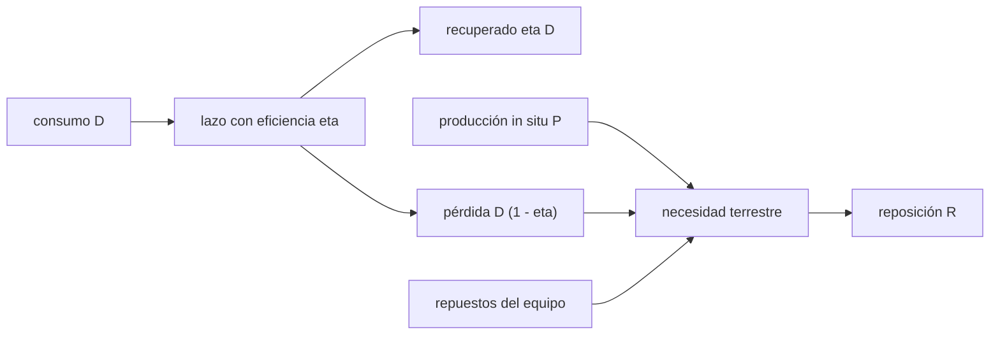

# B100-C07 — Dependencia de suministros terrestres y cierre de lazos logísticos

<!-- nav:top -->
[🏠 Programa](../../../../README.md) · [📚 Bloque B100](../../../tronco-comun/B100-logistica-y-cadena-de-suministro-extraterrestre.md) · [← Anterior: B100-C06 — Logística cislunar: nodos, depósitos y rutas de reabastecimiento](../B100-C06-logistica-cislunar-nodos-depositos-y-rutas-de-reabastecimiento/CLASE.md) · [Siguiente: B101-C01 — Transformaciones homogéneas y parametrización de eslabones (Denavit-Hartenberg) →](../../B101/B101-C01-transformaciones-homogeneas-y-parametrizacion-de-eslabones-denavit-hartenberg/CLASE.md)
<!-- /nav -->

## 1. Ubicación, nivel y alcance

Clase 7 y última del bloque B100, nivel N3. Cierra el bloque con la pregunta que lo justifica: **qué parte de los suministros debe seguir viniendo de la Tierra** cuando se recicla y se produce en el lugar. Calculas la fracción terrestre con un balance de masa, el punto de equilibrio del equipo de reciclaje y lo contrastas con una simulación diaria. El ciclo cerrado de materiales como tecnología se trata en [B59](../../../tronco-comun/B59-recursos-in-situ-y-sostenibilidad-extraterrestre.md); aquí se cuantifica el **efecto logístico**. Todas las cifras son **ilustrativas**.

## 2. Por qué esta clase existe

Reciclar el 90 % del agua no reduce la dependencia en un 90 %: quedan repuestos, fugas y averías, y el equipo pesa. La decisión central: **¿cuánta reposición terrestre queda según la eficiencia del lazo y cuántos días tarda el equipo en compensar su propia masa?**

## 3. Lo que podrás hacer al terminar

1. Escribir el balance de masa de un lazo con recuperación y producción en el lugar.
2. Calcular la reposición terrestre y su fracción del consumo.
3. Calcular el punto de equilibrio del equipo de reciclaje.
4. Contrastar el balance con una simulación diaria.
5. Reconocer el piso que fijan los repuestos y las fugas.
6. Rotular que todas las cifras son ilustrativas.

La evidencia es la **ficha de dependencia terrestre** del ejercicio 12 (sección 20).

## 4. Con qué llegas y cómo comprobarlo

1. ¿Qué es un balance de masa?
2. ¿Qué es una eficiencia de recuperación?
3. ¿Qué es producción in situ?
4. ¿Qué son los repuestos de un equipo?
5. ¿Qué es un punto de equilibrio?

<details>
<summary>Ver respuestas</summary>

1. Una cuenta en la que lo que entra menos lo que sale es lo que se acumula. 2. La fracción del flujo consumido que se recupera para reutilizarla. 3. Producir un material con recursos del lugar en lugar de traerlo. 4. Piezas de reemplazo que hay que traer porque el equipo se desgasta. 5. El tiempo tras el cual el ahorro iguala el costo inicial.
</details>

Con cuatro o cinco aciertos, sigue; si no, repasa los prerrequisitos.

## 5. Un caso de contexto y casos de referencia

Un consumo ilustrativo de agua de `16 kg/d` para 4 personas, con un equipo de reciclaje de `600 kg` que necesita repuestos del 8 % de su masa por año (`0,1315 kg/d`). Con eficiencia 0,80 la reposición terrestre es `3,332 kg/d` (20,8 % del consumo); con 0,90, `1,732 kg/d` (10,8 %); con 0,98, `0,452 kg/d` (2,8 %). El equipo compensa su masa en `42,1 d` con eficiencia 0,90. Es el **ejemplo conductor**. Todo es **ilustrativo**: ninguna cifra describe una operación real.

## 6. Vocabulario

La **eficiencia de recuperación** `η` es la fracción del consumo `D` que vuelve a estar disponible. La **producción in situ** `P` es la masa por día obtenida en el lugar. La **reposición terrestre** es `R = máx(0, D(1 − η) − P) + repuestos`. La **fracción terrestre** es `R/D`. El **punto de equilibrio** es `t_eq = M_eq/(D η − repuestos)`.

## 7. Modelo mental: un grifo con un balde y una gotera



*Descripción textual:* del consumo, la parte recuperada vuelve al lazo y la pérdida, menos la producción en el lugar, más los repuestos del equipo, forma la reposición terrestre.

Analogía: un balde que reutiliza el agua del grifo: lo que se escapa por la gotera hay que reponerlo, y la bomba del balde también se gasta. Límite: se supone una eficiencia constante y sin averías; en la práctica un fallo del equipo devuelve la dependencia al 100 % hasta repararlo.

## 8. La explicación, paso a paso

### 8.1 Balance estacionario

`R = máx(0, D(1 − η) − P) + r_rep`, con `r_rep = 0,08 × 600/365 = 0,1315 kg/d`. Sin reciclaje (`η = 0`): `R = 16,000 kg/d` (100 %). Con `η = 0,80`: `3,2 + 0,1315 = 3,332 kg/d` (20,8 %). Con `η = 0,90`: `1,6 + 0,1315 = 1,732 kg/d` (10,8 %). Con `η = 0,98`: `0,32 + 0,1315 = 0,452 kg/d` (2,8 %).

### 8.2 El piso de los repuestos

Cuando `η → 1`, `R → r_rep = 0,1315 kg/d`, es decir `0,82 %` del consumo: no se llega a cero mientras el equipo necesite repuestos. Con `η = 0,90` y producción in situ de `4 kg/d` (más que el déficit de 1,6 kg/d), `D(1 − η) − P < 0` y solo quedan los repuestos: `0,132 kg/d` (0,8 %).

### 8.3 Punto de equilibrio

El ahorro neto es `D η − r_rep`: `12,668 kg/d` con 0,80 (`t_eq = 600/12,668 = 47,4 d`); `14,268 kg/d` con 0,90 (`42,1 d`); `15,548 kg/d` con 0,98 (`38,6 d`). Una mayor eficiencia acorta el equilibrio, pero con rendimientos decrecientes.

### 8.4 Simulación diaria

Se simulan 3650 d con un inventario del lazo, reposición por lotes de 10 kg cuando baja de 20 kg. Reposición media simulada frente a balance: `16,000/16,000`; `3,329/3,332`; `1,732/1,732`; `0,449/0,452` (la mayor diferencia, 0,49 %, por la granularidad de los lotes); `0,132/0,132`. Todas dentro de la tolerancia del 3 %. El balance es una media: una ventana sinódica de 780 d con `η = 0,90` requiere `1,7315 × 780 = 1350,6 kg` de la Tierra, que es la entrada de [B100-C03](../B100-C03-gestion-de-inventarios-y-reposicion-de-suministros/CLASE.md).

## 9. Magnitudes, símbolos y unidades

| Símbolo | Qué es | Unidad | Valor / nota |
|---|---|---|---|
| `D` | consumo | kg/d | 16 (ilustrativo) |
| `η` | eficiencia de recuperación | — | 0; 0,80; 0,90; 0,98 (ilustrativas) |
| `P` | producción in situ | kg/d | 0; 4 (ilustrativa) |
| `M_eq` | masa del equipo | kg | 600 (ilustrativa) |
| `r_rep` | repuestos | kg/d | 0,1315 (8 %/año) |
| `R` | reposición terrestre | kg/d | 3,332; 1,732; 0,452 |

## 10. Convenciones y referencias

Masas en kg; tiempo en días; 365 d por año. Un solo consumible (agua) en un lazo con eficiencia constante; los repuestos se cuentan como suministro terrestre; sin averías, sin degradación y sin energía. Simulación determinista de 3650 d. Todas las cifras son ilustrativas.

## 11. De dónde sale lo que afirmamos

| ID | Fuente | Localizador | Respalda | Estado |
|---|---|---|---|---|
| — | Tasas de consumo, eficiencias, Δv de la red cislunar, energías de rodadura, tasas de degradación y masas de equipos | — | todos los números marcados como ilustrativos | No consultados; ilustrativos |
| — | Normas ECSS, manuales de gestión de inventarios y literatura de logística espacial | — | — | No consultados |

Límites: ninguna cifra de consumo, eficiencia, masa de equipo o repuestos se consultó; no se usa ningún dato de una estación real; no se cita norma ni artículo.

## 12. Cómo ver la dependencia

| Magnitud | Valor |
|---|---|
| reposición `η` = 0 / 0,80 / 0,90 / 0,98 | 16,000 / 3,332 / 1,732 / 0,452 kg/d |
| fracción terrestre `η` = 0,98 | 2,8 % |
| piso por repuestos | 0,1315 kg/d (0,82 %) |
| equilibrio con `η` = 0,90 | 42,1 d |
| necesidad por ventana (780 d, `η` = 0,90) | 1350,6 kg |

Descripción larga: la dependencia baja casi linealmente con la eficiencia hasta que choca con el piso de los repuestos; el equipo se paga en semanas.

## 13. Ejemplo trabajado: la reposición con eficiencia 0,90

**Paso 1 · Pérdida.** `16 × (1 − 0,90) = 1,6 kg/d`.

**Paso 2 · Repuestos.** `0,08 × 600/365 = 0,1315 kg/d`.

**Paso 3 · Reposición.** `R = 1,6 + 0,1315 = 1,732 kg/d`.

**Paso 4 · Fracción.** `1,732/16 = 10,8 %`.

## 14. Distintas formas de describir la dependencia terrestre

**Por flujo:** kg/d desde la Tierra. **Por fracción del consumo.** **Por tiempo:** equilibrio del equipo. **Por ventana:** kg por ventana sinódica.

## 15. Práctica guiada

**Ejercicio 1 · con los pasos indicados.** Calcula la reposición con `η = 0,80`. *Pasos:* pérdida `D(1 − η)` y suma los repuestos.

<details><summary>Solución comentada</summary>

`3,2 + 0,1315 = 3,332 kg/d`.
</details>

**Ejercicio 2 · con una pista.** Calcula la fracción terrestre de ese caso. *Pista:* divide entre `D = 16`.

<details><summary>Solución comentada</summary>

`3,332/16 = 20,8 %`.
</details>

**Ejercicio 3 · casi autónomo.** Calcula `r_rep` para un equipo de 600 kg con 8 % anual.

<details><summary>Solución comentada</summary>

`0,08 × 600/365 = 0,1315 kg/d`.
</details>

## 16. Práctica autónoma, transferencia e integrador

**Ejercicio 4 · autónomo.** Punto de equilibrio con `η = 0,90`.

<details><summary>Solución comentada</summary>

Ahorro `14,4 − 0,1315 = 14,268 kg/d`; `600/14,268 = 42,1 d`.
</details>

**Ejercicio 5 · autónomo.** Fracción terrestre con `η = 0,98`.

<details><summary>Solución comentada</summary>

`0,452/16 = 2,8 %`.
</details>

**Ejercicio 6 · autónomo.** ¿Cuánto baja la reposición al pasar de `η = 0,90` a 0,98?

<details><summary>Solución comentada</summary>

`1 − 0,452/1,732 = 73,9 %`.
</details>

**Ejercicio 7 · autónomo.** Con `η = 0,90` y `P = 4 kg/d`, ¿cuál es la reposición?

<details><summary>Solución comentada</summary>

`máx(0, 1,6 − 4) = 0`; solo los repuestos: `0,132 kg/d`.
</details>

**Ejercicio 8 · autónomo.** Masa anual desde la Tierra con `η = 0,90`.

<details><summary>Solución comentada</summary>

`1,7315 × 365 = 632 kg/año`.
</details>

**Ejercicio 9 · transferencia.** ¿A qué fracción tiende la dependencia cuando `η → 1`?

<details><summary>Solución comentada</summary>

A `0,1315/16 = 0,82 %`: el piso lo fijan los repuestos.
</details>

**Ejercicio 10 · transferencia.** Con `η = 0,90`, ¿cuánta masa debe traer una ventana de 780 d?

<details><summary>Solución comentada</summary>

`1,7315 × 780 = 1350,6 kg` (a lo que se suma la reserva de seguridad de la clase C03).
</details>

**Ejercicio 11 · transferencia.** El equipo falla 30 días (`η = 0`). ¿Qué reserva extra hace falta?

<details><summary>Solución comentada</summary>

`(16 − 1,7315) × 30 = 428 kg` por encima de la reposición normal: la resiliencia exige reserva, no solo eficiencia.
</details>

**Ejercicio 12 · integrador.** Elabora tu *ficha de dependencia terrestre*: tabla de reposición y fracción para cuatro eficiencias, el piso de repuestos, el punto de equilibrio, el contraste con la simulación y el rótulo de lo ilustrativo.

<details><summary>Solución comentada</summary>

Secciones 8.1–8.4 y la salida del laboratorio.
</details>

## 17. Laboratorio: dependencia terrestre y lazos cerrados

El script [cierre.py](cierre.py) calcula la reposición, la fracción terrestre y el punto de equilibrio para varias eficiencias, y simula 3650 días con reposición por lotes (**comprueba** diferencia < 3 %, equilibrios decrecientes y piso > 0 con `η = 0,98`).

**Datos:** todos **ilustrativos**; no se consultó ninguna fuente. **Predice antes de ejecutar:** ¿llega la reposición terrestre a cero con `η = 0,98`? (No: quedan repuestos y pérdidas.) **Ejecución del 2026-11-10 (Python 3.12.9):**

```text
Python 3.12.9 (biblioteca estandar)
Datos ILUSTRATIVOS: D = 16 kg/d, equipo 600 kg, repuestos 8 %/anio; ningun valor es de una operacion real
 eta    P [kg/d]   reposicion [kg/d]   fraccion terrestre   simulado [kg/d]   dif. rel.
 0.00      0.0             16.000              100.0 %           16.000   0.00e+00
 0.80      0.0              3.332               20.8 %            3.329   8.22e-04
 0.90      0.0              1.732               10.8 %            1.732   4.44e-14
 0.98      0.0              0.452                2.8 %            0.449   4.85e-03
 0.90      4.0              0.132                0.8 %            0.132   5.23e-14
Punto de equilibrio del equipo de reciclaje (600 kg):
  eta = 0.80: ahorro neto 12.668 kg/d ; equilibrio en   47.4 d
  eta = 0.90: ahorro neto 14.268 kg/d ; equilibrio en   42.1 d
  eta = 0.98: ahorro neto 15.548 kg/d ; equilibrio en   38.6 d
Con eta = 0.98 la fraccion terrestre baja a 2.8 % pero no a cero: quedan repuestos y fugas
Pruebas superadas.
```

```bash
python programa/clases/B100/B100-C07-dependencia-de-suministros-terrestres-y-cierre-de-lazos-logisticos/cierre.py
```

**Límites:** un solo consumible, eficiencia constante, sin averías ni energía; la simulación es determinista y comprueba el balance, no la física del reciclaje.

## 18. Errores frecuentes y cómo corregirlos

**Creer que una eficiencia del 90 % da una dependencia del 10 % sin más.** Se corrige con 8.1 y 8.2

**Olvidar la masa del equipo.** Se corrige con 8.3

**Ignorar las averías.** Se corrige con el ejercicio 11

**Presentar las cifras ilustrativas como medidas de una estación.** Se corrige con la sección 10

## 19. Cómo sabrás que vas bien

Tras la sección 8: ¿qué reposición esperabas con `η = 0,98` y cuál obtuviste? Si dudas, repasa el ejemplo 13. Tras el laboratorio: ¿qué comprueba? (ver la sección 17).

## 20. Qué entregas y cómo se evalúa

El producto es tu **ficha de dependencia terrestre** (ejercicio 12).

| Criterio | Inicial | En desarrollo | Logrado | Destacado |
|---|---|---|---|---|
| Conceptos | Los confunde | Parciales | Calcula reposición, fracción y equilibrio | Explica los límites |
| Cálculo | Sin unidades | Con errores | Tablas completas con unidades | Calcula casos nuevos |
| Numérico | Sin comprobar | Un caso | Contraste con una segunda vía | Interpreta las diferencias |
| Fuentes | Sin fuente | Sin fecha | Fuentes con fecha y estado | Declara lo ilustrativo y lo no consultado |
| Límites | No los nombra | Uno | Tres | Discute qué falta del modelo |

**Condiciones críticas (no se compensan con promedio):** rotular todas las cifras como ilustrativas; no presentar el resultado como una operación real; citar solo lo consultado (aquí, nada).

## 21. Ética, seguridad y límites

Clase educativa: los modelos son simplificados y sus datos son sintéticos o ilustrativos; ningún resultado describe una operación real ni sustituye a los requisitos de una misión, a los datos de proveedores ni a las normas de la agencia. Accesibilidad: tablas equivalentes a las gráficas, fórmulas en texto, ejercicios sin conexión.

## 22. Para cerrar y seguir

Con eficiencia 0,90 la dependencia baja del 100 % al `10,8 %`, con un piso del `0,82 %` fijado por los repuestos. El bloque deja una idea: cada kilogramo que no viaja evita multiplicarse por la ecuación del cohete, pero la resiliencia exige reservas.

**Glosario español–inglés.** eficiencia de recuperación · *recovery efficiency*; producción in situ · *in-situ production*; lazo cerrado · *closed loop*; repuestos · *spares*; punto de equilibrio · *break-even*.

**Continuidad.** Cierre del bloque B100; vuelve a la [guía del bloque](../../../tronco-comun/B100-logistica-y-cadena-de-suministro-extraterrestre.md).

**Referencias:** ver sección 11.

<!-- nav:bottom -->
---

[← Anterior: B100-C06 — Logística cislunar: nodos, depósitos y rutas de reabastecimiento](../B100-C06-logistica-cislunar-nodos-depositos-y-rutas-de-reabastecimiento/CLASE.md) · [📚 Bloque B100](../../../tronco-comun/B100-logistica-y-cadena-de-suministro-extraterrestre.md) · [Siguiente: B101-C01 — Transformaciones homogéneas y parametrización de eslabones (Denavit-Hartenberg) →](../../B101/B101-C01-transformaciones-homogeneas-y-parametrizacion-de-eslabones-denavit-hartenberg/CLASE.md)
<!-- /nav -->
